::: {.chapter-divider}
:::

::: {.chapter-header-box}
# Bab 0: Panduan Belajar & Map of Content (MOC)

<p class="chapter-desc">Peta silabus ujian, strategi belajar, dan matriks keterkaitan kompetensi UAS TPD 2025/2026.</p>
:::

## 📚 MOC: Panduan Belajar Lengkap UAS Teknologi Pengolahan Data (TPD)

::: {.callout .callout-abstract}
::: {.callout-header}
📖 **Informasi Ujian & Bahan Acuan**
:::
::: {.callout-body}
- **Mata Kuliah**: Teknologi Pengolahan Data (TPD)
- **Dosen Pengampu**: Siti Mariyah, Ph.D (Politeknik Statistika STIS)
- **Format Ujian**:
  - **30 Soal Pilihan Ganda** (Fokus pada konsep fundamental, terminologi, perbandingan biner, dan mekanisme internal).
  - **2 - 3 Soal Esai** (Fokus pada pemahaman konsep dan cara kerja; salah satunya **PASTI** soal perancangan MapReduce).
- **Rujukan Otoritatif**: Silabus UAS TPD + Buku Teks Resmi *Hadoop: The Definitive Guide*, 4th Edition (Tom White, O'Reilly).
- **Catatan Penting Silabus**: **YARN tidak diujikan mendalam** (cukup pahami konteks pemisahan perannya dari JobTracker). Seluruh materi di bawah telah dipecah menjadi modul dan sub-materi terstruktur dengan analisis kisi-kisi ujian, contoh soal, dan panduan menjawab.
:::
:::

---

### 🗺️ Peta Navigasi Modular (Map of Content)

Gunakan tautan internal Obsidian di bawah ini untuk mempelajari setiap sub-materi secara mendalam:

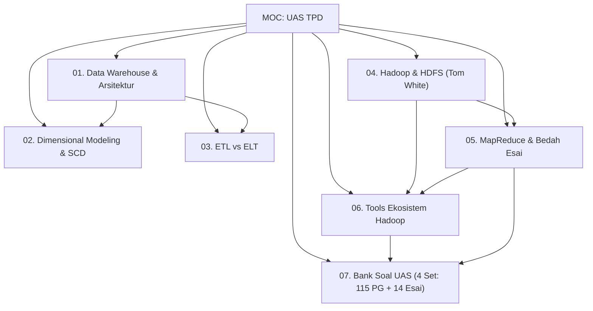

---

#### 🏢 Modul 01: Data Warehouse & Arsitektur DWH
- 01.1 Konsep Dasar, Karakteristik Inmon & SSoT: Definisi Bill Inmon 1990 (*Subject-oriented, Integrated, Non-volatile, Time-variant*), eliminasi *Data Silos*, dan DWH sebagai *Single Source of Truth* (SSoT).
- 01.2 Perbandingan Mendalam OLTP vs OLAP: Matriks komparasi 10 karakteristik, perbedaan normalisasi 3NF vs denormalisasi bintang, serta alasan teknis pemisahan sistem (*locking & resource contention*).
- 01.3 Arsitektur Lengkap Data Warehouse & Komponen Fisik: 7 komponen arsitektur DWH, peranan *Staging Area* vs *Operational Data Store (ODS)*, 3 jenis *Metadata (Technical, Business, Operational)*, dan arsitektur *Three-Tier*.
- 01.4 Arsitektur Inmon vs Kimball & EDW vs Data Mart: Pertarungan filosofis *Top-Down (CIF 3NF)* vs *Bottom-Up (Dimensional Bus Architecture)*, *Dependent vs Independent Data Mart*, dan panduan pemilihan strategi korporasi.

---

#### 📊 Modul 02: Dimensional Modeling & Slowly Changing Dimensions (SCD)
- 02.1 Anatomi Fact Table & Dimension Table: Klasifikasi fakta (*Additive, Semi-Additive, Non-Additive, Factless*), serta alasan teknis penggunaan **Surrogate Key** vs *Natural Key*.
- 02.2 Skema Desain Data Warehouse (Star, Snowflake, & Galaxy Schema): Struktur skema, trade-off performa kueri JOIN vs redundansi storage, dan skema *Fact Constellation (Galaxy)* multi-fakta.
- 02.3 4 Langkah Kimball Lifecycle & Conformed Dimensions: Metodologi 4 langkah (*Process $\to$ Grain $\to$ Dimensions $\to$ Facts*), bahaya *Grain Mismatch*, dan integrasi *Conformed Dimensions Bus Matrix*.
- 02.4 Slowly Changing Dimensions (SCD Tipe 1, 2, dan 3): Mekanisme *Overwrite (Tipe 1)*, *Add New Row (Tipe 2)* dengan atribut `StartDate, EndDate, IsCurrent`, dan *Add New Column (Tipe 3)* beserta simulasi kasusnya.
- 02.5 Operasi Multidimensi OLAP Data Cube & Server OLAP: 5 operasi kubus (*Roll-up, Drill-down, Slice, Dice, Pivot*), perbedaan mendasar *Slice vs Dice*, serta perbandingan server **MOLAP vs ROLAP vs HOLAP**.

---

#### 🔄 Modul 03: ETL & ELT
- 03.1 Pipeline & Alur Kerja Lengkap ETL (Extract, Transform, Load): Alur detail tahap *Extract (CDC vs Timestamp)*, tahap *Transform (Cleansing, Deduplication, Lookup, Quarantine)*, tahap *Load (Bulk Insert)*, serta konsep *Control Flow vs Data Flow*.
- 03.2 Perbandingan Komprehensif ETL vs ELT: Paradigma tradisional vs era Big Data Cloud, matriks komparasi 10 poin, konsep *Schema-on-Write vs Schema-on-Read*, dan kepatuhan privasi data.

---

#### 🌐 Modul 04: Hadoop & HDFS (Buku Teks Tom White)
- 04.1 Konsep Dasar Komputasi Terdistribusi & Paradigma Hadoop: Batas fisik *Scale-Up*, matematika I/O paralel, doktrin emas **Data Locality**, 3 pilar Hadoop, serta VM vs Containerization.
- 04.2 Arsitektur Kluster, Node Types & Single vs Multi Node: Pseudo-Distributed vs Multi-Node, peran **NameNode** (RAM metadata, `FsImage`, `EditLog`), **DataNode** (*Heartbeat 3s, Block Report 6h*), dan meluruskan mitos peran sebenarnya **Secondary NameNode** (*periodic checkpointer, bukan failover backup*).
- 04.3 Karakteristik & Filosofi Desain HDFS (WORM, 128 MB Block, Anti-Patterns): Model akses *Write-Once Read-Many*, **justifikasi matematis ukuran blok 128 MB** (rasio seek time $\approx 1\%$), serta **3 Skenario HDFS BUKAN Pilihan Tepat (*Low-latency, Small Files Problem, Multiple Writers*)**.
- 04.4 Replikasi Blok, Topologi Jaringan & Rack-Awareness: **Matematika metrik jarak jaringan ($d = 0, 2, 4, 6$)**, algoritma penempatan 3 replika (*Rack-Aware Placement*), dan trade-off keandalan vs bandwidth jaringan.
- 04.5 Mekanisme Detail HDFS Read Path & Write Path: Urutan langkah interaksi klien, thread `DataStreamer`, antrean memori `data queue` dan `ack queue`, paket 64 KB, pemulihan pipa gagal via **Generation Stamp**, serta koherensi `hflush` vs `hsync`.
- 04.6 Enterprise HDFS (High Availability, QJM, Federation, Block Caching): Penghapusan SPOF via *Active-Standby NameNode*, konsensus **Quorum Journal Manager (QJM)**, bahaya bencana **Split-Brain** dan pencegahannya dengan **Fencing (STONITH)**, *HDFS Federation*, dan *Centralized Block Caching*.

---

#### ⚙️ Modul 05: MapReduce & Bedah Soal Esai
- 05.1 Konsep, Komponen (JobTracker & TaskTracker) & Paradigma MapReduce: Filosofi *Divide-and-Conquer*, transformasi aljabar pasangan kunci-nilai $\langle K, V \rangle$, arsitektur master/worker (*JobTracker vs TaskTracker*), dan isolasi *Child JVM*.
- 05.2 Alur Kerja Mendalam MapReduce (InputSplit, Map, Buffer, Spill, Shuffle & Sort, Reduce): Pembagian *InputSplit* logis vs *HDFS Block* fisik, mekanisme *Circular Memory Buffer 100 MB* dengan *Spill Threshold 80%*, algoritma **HashPartitioner**, dan fase *External Merge Sort*.
- 05.3 Mekanisme Combiner, Optimasi & Speculative Execution: Sifat matematis **komutatif & asosiatif**, bedah kegagalan fungsi **Average** beserta solusi pasangan komposit $\langle \text{Count}, \text{Sum} \rangle$, mekanisme **Speculative Execution** menumpas tugas lambat (*stragglers*), dan studi kasus cuaca NCDC.
- 05.4 Panduan Menjawab & Bedah Soal Esai MapReduce (Template & 6 Kasus Lengkap): **Template 5 Komponen Jawaban Bernilai 100**, bedah 6 kasus esai terpopuler (*WordCount, Highest Salary, Group By Total, Average Salary Komposit, Kunci Komposit Country-State, dan Two-Pass Top-K URL Min-Heap*), serta checklist penilaian dosen.

---

#### 🛠️ Modul 06: Tools Ekosistem Hadoop
- 06.0 Matriks Perbandingan Akbar Ekosistem Hadoop: Matriks perbandingan 8 dimensi lintas 6 tools, pohon keputusan pemilihan alat, dan bedah 3 pasangan komparasi terpopuler (*Hive vs HBase, Pig vs Hive, MapReduce vs Spark*).
- 06.1 Apache Sqoop (RDBMS to HDFS Transfer & Map-Only Jobs): Jembatan transfer massal dua arah RDBMS $\leftrightarrow$ HDFS, alasan arsitektural penggunaan **Map-Only Jobs (tanpa Reducer)**, pembagian partisi via Primary Key, dan berkas `part-m-`.
- 06.2 Apache Hive (SQL on HDFS, Metastore, Partitioning vs Bucketing): Data warehouse deklaratif SQL di atas HDFS, peranan Metastore RDBMS, perbedaan krusial **Managed vs External Table** saat `DROP TABLE`, serta **Partitioning** (*sub-folder, partition pruning*) vs **Bucketing** (*hash files, map-side join*).
- 06.3 Apache HBase (NoSQL Column-Family & Low-Latency Random Read-Write): NoSQL Google BigTable di HDFS, akses acak real-time sub-10 ms, model data *Column-Family*, koordinat `(RowKey, CF, CQ, Timestamp)`, arsitektur *RegionServer, MemStore, WAL, HFile*, serta siklus *Minor vs Major Compaction (pembersihan tombstones)*.
- 06.4 Apache Pig (Procedural Data Flow Platform & Pig Latin): Platform data flow prosedural untuk pipeline ETL, perbandingan filosofis **Prosedural (Pig) vs Deklaratif (Hive)**, tipe data kompleks (*Atom, Tuple, Bag, Map*), dan kompilasi DAG ke MapReduce.
- 06.5 Apache Kafka (Distributed Real-Time Event Streaming & Ingestion): Sistem saraf pusat event streaming jutaan pesan/detik, konsep *Topic, Partition, Offset, Consumer Group*, serta alasan teknis performa ekstrem via **Sequential Disk I/O** dan **Zero-Copy (`sendfile`)**.
- 06.6 Apache Spark (In-Memory Unified Computing Engine & RDD): Mesin komputasi kluster memori terpadu (100x lebih cepat dari MapReduce), konsep **RDD** (*Resilient, Distributed, Immutable*), toleransi kesalahan via **Lineage Graph (DAG)**, prinsip **Lazy Evaluation** (*Transformations vs Actions*), serta perbedaan **Narrow vs Wide Dependency** (*Stage Boundary & Shuffle*).
- 06.7 Format Data, Pemrosesan Teks & Cloud Computing Big Data: Format berkas biner Hadoop (**Parquet** paling hemat kompresi vs **Avro** schema evolution), 3 tahapan menstrukturkan data teks (*Text Extraction $\to$ Tokenization $\to$ Phrase Recognition*), arsitektur *Schema-on-Read* Data Lake, model layanan awan (**IaaS, PaaS, SaaS, Hypervisor**), serta bedah ekosistem **Google Cloud Platform (GCP)** untuk Big Data (*BigQuery, Dataproc, GCS, Cloud Pub/Sub, Vertex AI*).

---

#### 📝 Modul 07: Bank Soal & Simulasi Ujian Lengkap
- 07.1 Set 1 - Simulasi Ujian Fundamental & Arsitektur (30 PG & 3 Esai):
  - 30 Soal Pilihan Ganda fokus konsep inti DWH, OLTP vs OLAP, SCD, HDFS, MapReduce, dan ekosistem Hadoop.
  - 3 Soal Esai: (1) WordCount MapReduce terstruktur, (2) Desain Skema Toko Ritel Star vs Snowflake, (3) Perancangan Pipeline ETL SSIS.
  - Dilengkapi kunci jawaban dan pembahasan analitis.
- 07.2 Set 2 - Simulasi Ujian Mekanisme Internal & Textbook Tom White (30 PG & 3 Esai):
  - 30 Soal Pilihan Ganda fokus pendalaman materi buku teks Tom White (128 MB block, WORM, topologi jarak, QJM, buffer 100 MB spill 80%, dsb).
  - 3 Soal Esai: (1) MapReduce Average Salary dengan Combiner Komposit, (2) Bedah Masalah *Small Files Problem* HDFS & Solusinya (HAR, SequenceFiles), (3) Anatomi HDFS Read Path & Write Path dengan Generation Stamp.
- 07.3 Set 3 - Simulasi Ujian Studi Kasus Industri & Troubleshooting (30 PG & 3 Esai):
  - 30 Soal Pilihan Ganda fokus studi kasus industri, troubleshooting performa, data skewness, dan arsitektur enterprise.
  - 3 Soal Esai: (1) Perancangan MapReduce Dua Tahap (*Two-Pass Chained Job*) Top-10 URL Populer, (2) Model Dimensional Layanan Rumah Sakit Lengkap dengan SCD Tipe 2, (3) Desain Arsitektur Big Data Multi-Teknologi E-Commerce (Sqoop + Kafka + Spark + HBase + Hive/HDFS).
- 07.4 Set 4 - Arsip Asli UAS 2022-2023 & Pembahasan Super Lengkap:
  - **Arsip Resmi Asli UAS 2022/2023**: 25 Soal Pilihan Ganda dan 5 Soal Esai lengkap dengan opsi jawaban dan kunci/pembahasan mendalam.
  - Pembahasan esai lengkap: (1) 5 Command Sqoop, (2) Kueri HiveQL JOIN & WHERE, (3) Kasus CLI Kafka 3-Broker & Topologi Pub/Sub, (4) Komparasi Spark vs MapReduce, (5) Bedah Layanan GCP untuk Big Data.

---

### 🎯 Tips Belajar & Strategi Menghadapi Ujian

1. **Strategi Pilihan Ganda (30 Soal - Cepat & Akurat)**:
   - **Kuasai Pasangan Biner**: Sering keluar soal kontras (OLTP vs OLAP, Inmon vs Kimball, Star vs Snowflake, ETL vs ELT, NameNode vs DataNode, Secondary NameNode vs Standby NameNode, Hive vs HBase, Pig vs Hive, Narrow vs Wide Dependency).
   - **Waspadai Angka Jebakan Buku Teks Tom White**:
     - Ukuran blok HDFS = 128 MB (bukan 64 KB atau 4 KB).
     - Alokasi RAM NameNode per objek = $\approx 150$ byte.
     - Heartbeat DataNode = 3 detik (mati setelah 10 menit).
     - Buffer Mapper = 100 MB (spill ke disk saat 80%).
     - Metrik Jarak Topologi Jaringan = 0 (mesin sama), 2 (rak sama), 4 (DC sama), 6 (DC beda).
2. **Strategi Soal Esai (2–3 Soal - Maksimalkan Poin)**:
   - **Gunakan Format Terstruktur**: Selalu pisahkan jawaban menjadi poin-poin bernomor atau tabel ringkas sebelum narasi. Dosen sangat menyukai struktur visual yang rapi.
   - **Wajib Terapkan Template 5 Komponen untuk Soal MapReduce**:
     1. Struktur Masukan $\langle k_1, v_1 \rangle$.
     2. Logika Mapper $\langle k_2, v_2 \rangle$.
     3. Evaluasi Kelayakan Combiner (khusus operasi rata-rata, wajib gunakan pasangan komposit `(count, sum)`).
     4. Alur Partisi, Shuffle & Sort $\langle k_2, [v_2] \rangle$.
     5. Logika Reducer $\langle k_3, v_3 \rangle$ yang ditulis ke HDFS.
   - **Gambarkan Diagram Alir Sederhana**: Sertakan diagram alir data (*ASCII atau diagram blok*) untuk menggambarkan alur kerja ETL, Write Path HDFS, atau arsitektur Big Data terpadu.


::: {.chapter-divider}
:::

::: {.chapter-header-box}
# Bab 1: Konsep & Arsitektur Data Warehouse

<p class="chapter-desc">Karakteristik Bill Inmon, Single Source of Truth (SSoT), OLTP vs OLAP, serta arsitektur fisik Data Warehouse.</p>
:::

## 🏢 01.1 Konsep Dasar, Karakteristik Inmon & Single Source of Truth (SSoT)

::: {.callout .callout-abstract}
::: {.callout-header}
📖 **Ringkasan Sub-Materi**
:::
::: {.callout-body}
Sub-materi ini membahas definisi fundamental *Data Warehouse* (DWH) menurut "Bapak Data Warehouse" William H. (Bill) Inmon (1990), empat pilar karakteristik DWH, konsep *Single Source of Truth* (SSoT), serta dampaknya terhadap pengambilan keputusan bisnis dan statistik analitik.
:::
:::

---

### 1. Definisi & Latar Belakang Data Warehouse

**Data Warehouse (DWH)** adalah repositori data terpusat yang dirancang khusus untuk mendukung analisis data, pelaporan eksekutif, dan *business intelligence* (BI), bukan untuk menangani transaksi harian.

Kebutuhan akan DWH bermula dari masalah **Data Silos**:
- Setiap departemen (Penjualan, Keuangan, SDM, Logistik) menggunakan sistem basis data operasional terisolasi (misal CRM di Oracle, ERP di SAP, Transaksi Kasir di MySQL).
- Format data, konvensi penamaan, dan definisi metrik berbeda-beda (misal Penjualan mencatat status pelanggan sebagai `Aktif/Nonaktif`, sedangkan Keuangan mencatat sebagai `1/0`).
- Saat pimpinan meminta laporan pendapatan total, angka dari bagian Penjualan seringkali tidak sama dengan angka dari bagian Keuangan.

DWH hadir sebagai solusi penyatuan data historis yang bersih, konsisten, dan terintegrasi dari seluruh organisasi.

---

### 2. 4 Karakteristik Utama Data Warehouse (Bill Inmon, 1990)

Definisi klasik Bill Inmon yang menjadi landasan teoritis seluruh literatur DWH:
> *"A Data Warehouse is a **subject-oriented**, **integrated**, **non-volatile**, and **time-variant** collection of data in support of management's decision-making process."*

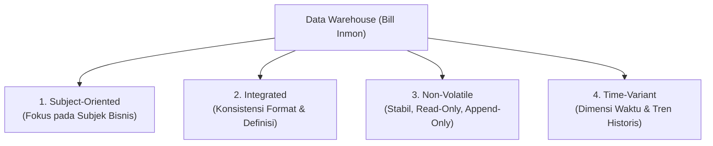

#### A. Subject-Oriented (Berorientasi Subjek)
- **Konsep**: Basis data operasional (OLTP) berorientasi pada **proses/aplikasi** (misal: proses penerbitan faktur, proses entri absensi, proses checkout belanja). Sebaliknya, DWH berorientasi pada **subjek bisnis utama** entitas organisasi (misal: Pelanggan, Produk, Penjualan, Pasien, Siswa).
- **Ciri**: Data disaring hanya untuk informasi yang relevan bagi analisis pembuat keputusan, mengabaikan detail teknis transaksional (seperti nomor urut mesin kasir atau status locking tabel).

#### B. Integrated (Terintegrasi)
- **Konsep**: Aspek paling krusial dari DWH. Data yang ditarik dari berbagai sumber heterogen (*heterogeneous data sources*) harus diseragamkan dan dibersihkan sebelum masuk ke DWH.
- **Bentuk Integrasi**:
  1. *Konvensi Penamaan*: Penyeragaman nama atribut (misal `cust_id`, `no_pelanggan`, `client_code` diseragamkan menjadi `CustomerKey`).
  2. *Encoding & Format*: Penyeragaman format tanggal (`YYYY-MM-DD` vs `DD/MM/YYYY`) dan kode jenis kelamin (`M/F` vs `L/P` diseragamkan menjadi standar ISO).
  3. *Satuan Pengukuran*: Konversi mata uang (USD, EUR ke IDR) atau satuan fisik (Gallon, Liter ke Mililiter).

#### C. Non-Volatile (Stabil / Tidak Menguap)
- **Konsep**: Data dalam DWH bersifat permanen (*read-only* bagi analis).
- **Mekanisme**:
  - Pada database transaksional (OLTP), operasi yang sering terjadi adalah `INSERT`, `UPDATE`, dan `DELETE`.
  - Pada DWH, operasi data yang terjadi hanyalah:
    1. **Initial Data Loading** (Pemuatan data awal secara massal).
    2. **Accessing / Querying Data** (Pembacaan data untuk analisis).
    3. **Periodic Incremental Appending** (Penambahan data baru secara berkala).
  - Data historis **tidak pernah di-*overwrite*** atau dihapus di tempat (*in-place update* dilarang), melainkan disimpan riwayat perubahannya menggunakan teknik SCD (*Slowly Changing Dimension*).

#### D. Time-Variant (Bervariasi Waktu)
- **Konsep**: Setiap record data di dalam DWH secara eksplisit atau implisit terikat dengan dimensi waktu (*time stamp* atau *date key*).
- **Rentang Historis**:
  - Sistem operasional hanya menyimpan data terkini (*current value*, misal saldo rekening hari ini, biasanya rentang 60–90 hari).
  - DWH menyimpan rekam jejak jangka panjang (rentang 5–10 tahun) untuk analisis tren, forecasting musiman, dan evaluasi performa tahunan.
- Setiap baris tabel fakta (*Fact Table*) memuat waktu terjadinya peristiwa bisnis.

---

### 3. Data Warehouse sebagai Single Source of Truth (SSoT)

::: {.callout .callout-note}
::: {.callout-header}
📌 **Definisi SSoT**
:::
::: {.callout-body}
**Single Source of Truth (SSoT)** adalah kondisi arsitektur informasi di mana seluruh anggota organisasi mengambil keputusan berdasarkan satu sumber acuan data tunggal yang telah disepakati kebenaran, definisi, dan integritas logisnya.
:::
:::

#### Manfaat SSoT bagi Organisasi:
1. **Menghilangkan Konflik Data Antar-Divisi**: Tidak ada lagi perdebatan laporan "angka penjualan siapa yang benar" dalam rapat dewan direksi.
2. **Kualitas Data Terjamin (*Data Quality & Integrity*)**: Melewati filter pembersihan (*data cleansing*) dan validasi pada proses ETL.
3. **Auditability & Compliance**: Riwayat perubahan data terdokumentasi rapi, memudahkan kepatuhan hukum dan audit statistik.

---

### 🎯 Hal-Hal yang Kemungkinan Besar Masuk Ujian

1. **Definisi 4 Karakteristik Bill Inmon**:
   - Sering ditanyakan dalam soal Pilihan Ganda (PG). Hati-hati dengan kata-kata pengecoh seperti *"Process-oriented"*, *"Volatile"*, *"Application-oriented"*, *"Real-time volatile"*.
2. **Makna Mendalam "Non-Volatile"**:
   - Dosen kerap menguji pemahaman bahwa non-volatile **bukan berarti data tidak pernah bertambah**, melainkan data yang sudah masuk **tidak boleh ditimpa/diubah (*no in-place updates*)**, melainkan hanya di-*append* dan dibaca (*read-only query*).
3. **Subject-Oriented vs Process-Oriented**:
   - Membedakan fokus OLTP (berbasis proses transaksi kasir/checkout) dengan DWH (berbasis subjek analisis seperti pelanggan atau penjualan).
4. **Peran Integrasi Data**:
   - Contoh nyata integrasi: penyeragaman format tanggal, konversi mata uang, dan *encoding* atribut identitas.

---

### 📋 Contoh Soal Ujian (Pilihan Ganda & Esai)

#### Contoh Soal Pilihan Ganda
**Soal 1 (Definisi Karakteristik Inmon)**  
Karakteristik Data Warehouse yang menyatakan bahwa data disimpan dalam rentang waktu historis panjang (misal 5 hingga 10 tahun) untuk analisis tren masa lalu dan peramalan masa depan disebut...  
A. *Subject-Oriented*  
B. *Integrated*  
C. *Time-Variant*  
D. *Non-Volatile*  
*Kunci Jawaban*: **C**  
*Pembahasan & Analisis Pengecoh*:
- Opsi A salah karena *Subject-Oriented* berfokus pada subjek bisnis (misal Pelanggan).
- Opsi B salah karena *Integrated* berfokus pada penyeragaman standar data dari berbagai sumber.
- Opsi C **BENAR** karena *Time-Variant* secara spesifik mengatur dimensi waktu historis jangka panjang.
- Opsi D salah karena *Non-Volatile* mengatur bahwa data yang masuk tidak boleh ditimpa/diubah.

**Soal 2 (Jebakan Non-Volatile)**  
Operasi manipulasi data mana yang secara normal **TIDAK PERNAH** dijalankan secara langsung oleh pengguna akhir (*analyst*) terhadap data di dalam Data Warehouse?  
A. `SELECT` dan aggregasi data  
B. `UPDATE` dan `DELETE` data baris lama secara *in-place*  
C. `INSERT` berkala via batch ETL  
D. `COUNT` dan pembuatan grafik laporan  
*Kunci Jawaban*: **B**  
*Pembahasan*: Sifat *Non-Volatile* memastikan data historis bersifat permanen dan *read-only*. Pembaruan baris data lama secara langsung (`UPDATE`/`DELETE`) dilarang di DWH karena merusak rekam jejak audit historis.

---

#### Contoh Soal Esai
**Soal Esai**:  
Jelaskan mengapa sistem basis data transaksional (OLTP) suatu perusahaan tidak dapat berfungsi secara efektif sebagai *Single Source of Truth* (SSoT) untuk analisis bisnis jangka panjang, dan bagaimana penerapan 4 karakteristik Data Warehouse menurut Bill Inmon memecahkan masalah tersebut!

**Pedoman Jawaban Lengkap**:
1. **Alasan OLTP Gagal Menjadi SSoT**:
   - *Data Silos*: Sistem OLTP tersebar di berbagai divisi dengan format dan skema yang tidak seragam (misal cabang A mencatat format tanggal berbeda dengan cabang B).
   - *Data Volatility*: Data di OLTP selalu berubah (*overwrite*) saat ada transaksi baru, sehingga riwayat data masa lalu hilang.
   - *Rentang Waktu Pendek*: OLTP hanya menyimpan data operasional terkini (60–90 hari) demi efisiensi performa indeks transaksi.
2. **Solusi Melalui 4 Karakteristik Inmon**:
   - **Subject-Oriented**: Mengelompokkan data yang tercecer berdasarkan entitas bisnis analitik (Penjualan, Pelanggan, Produk) sehingga relevan bagi manajemen.
   - **Integrated**: Melakukan standardisasi penamaan, tipe data, dan konversi satuan melalui pipeline ETL sehingga tercipta satu standar tunggal perusahaan.
   - **Non-Volatile**: Menyimpan data secara stabil tanpa *in-place update*, menjamin rekam jejak historis tidak hilang untuk audit.
   - **Time-Variant**: Memasukkan kunci waktu pada setiap transaksi selama bertahun-tahun, memungkinkan analisis tren masa lalu dan prediksi masa depan secara akurat.

---

### 💡 Tips & Trik Menjawab Soal Ujian

1. **Jurus Kata Kunci 4 Karakteristik Inmon**:
   - *Subject-Oriented* $\to$ Kata kunci: **Entitas bisnis utama (Customer, Sales)**, bukan alur proses aplikasi.
   - *Integrated* $\to$ Kata kunci: **Standarisasi format, penyeragaman kode, resolusi konflik sumber heterogen**.
   - *Non-Volatile* $\to$ Kata kunci: **Stabil, Read-Only, Append-Only, Tidak ada UPDATE/DELETE in-place**.
   - *Time-Variant* $\to$ Kata kunci: **Dimensi waktu eksplisit, data historis jangka panjang (5-10 tahun), tren**.
2. **Trik Menjawab Esai**:
   - Selalu sebut nama **William H. Inmon (1990)** saat menjawab pertanyaan esai mengenai karakteristik dasar DWH untuk memberi impresi penguasaan materi akademik yang mendalam.
   - Jangan lupa menyertakan diagram alur konsep SSoT (Sumber Heterogen $\to$ ETL/Pembersihan $\to$ DWH Terpadu $\to$ Keputusan Bisnis).


## ⚖️ 01.2 Perbandingan Mendalam OLTP vs OLAP

::: {.callout .callout-abstract}
::: {.callout-header}
📖 **Ringkasan Sub-Materi**
:::
::: {.callout-body}
Memahami dikotomi mendasar antara sistem pemrosesan transaksi harian (*Online Transaction Processing* - OLTP) dan sistem analitis multidimensi (*Online Analytical Processing* - OLAP). Materi ini memuat matriks perbandingan 10 dimensi, alasan teknis pemisahan kedua sistem, contoh soal ujian, dan strategi menjawab.
:::
:::

---

### 1. Konsep Dasar & Tujuan Sistem

Dalam dunia manajemen basis data modern, beban kerja (*workload*) dibagi secara tegas menjadi dua domain utama:

1. **OLTP (Online Transaction Processing)**:
   - Dirancang untuk **menjalankan operasional harian organisasi secara real-time** (*day-to-day business operations*).
   - Fokus utama: Kecepatan eksekusi transaksi atomik, integritas data (*ACID properties*), dan ketersediaan tinggi (*high availability*).
   - Contoh: Sistem kasir Indomaret, transfer saldo mobile banking BCA, reservasi tiket kereta KAI.

2. **OLAP (Online Analytical Processing)**:
   - Dirancang untuk **analisis data historis, pelaporan manajerial, penemuan tren, dan perencanaan strategis**.
   - Fokus utama: Kecepatan eksekusi kueri agregasi kompleks pada volume data yang sangat masif (*high read throughput*).
   - Contoh: Analisis tren penjualan produk kuartalan per provinsi, evaluasi profil demografi nasabah kredit macet.

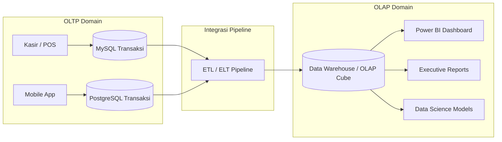

---

### 2. Matriks Komparatif 10 Karakteristik: OLTP vs OLAP

Tabel ini adalah acuan baku yang wajib dihafal untuk menjawab soal-soal perbandingan di ujian:

| Dimensi Karakteristik | OLTP (*Operational*) | OLAP (*Informational / Analytical*) |
| :--- | :--- | :--- |
| **1. Pengguna Utama (*User*)** | Kasir, staf administrasi, pelanggan, sistem otomatis | Analis data, manajer bisnis, eksekutif, data scientist |
| **2. Fungsi Sistem** | Menjalankan operasi bisnis rutin harian | Mendukung pengambilan keputusan strategis (*Decision Support*) |
| **3. Desain Basis Data** | **Ternormalisasi tinggi (3NF/BCNF)** untuk menghindari anomali *insert/update/delete* | **Tendenormalisasi (Star/Snowflake Schema)** untuk meminimalkan operasi JOIN |
| **4. Sifat Operasi Data** | **Read & Write seimbang** (Banyak `INSERT`, `UPDATE`, `DELETE`) | **Read-Heavy / Read-Only** (Kueri `SELECT` kompleks, penambahan data via batch append) |
| **5. Kompleksitas Kueri** | **Sederhana** (Kueri cepat berdasarkan index Primary Key, misal: ambil profil 1 nasabah) | **Sangat Kompleks** (Agregasi multi-tabel, `GROUP BY`, `SUM`, `AVG`, window functions) |
| **6. Akses Record** | Puluhan hingga ratusan baris per transaksi | Jutaan hingga miliaran baris historis per kueri |
| **7. Rentang Waktu Data** | **Terkini (Current Value)**; data historis terbatas (biasanya 30 - 90 hari) | **Historis Jangka Panjang**; akumulasi data 5 - 10 tahun |
| **8. Toleransi Latensi Respon** | **Sangat Rendah (Milidetik)**; respon harus instan bagi kasir/pengguna | **Sedang hingga Tinggi (Detik hingga Menit)**; dapat ditoleransi untuk analisis |
| **9. Kebutuhan Ruang Simpan** | Relatif kecil hingga sedang (Gigabyte) | Sangat besar (Terabyte hingga Petabyte) |
| **10. Prioritas Performa** | Throughput transaksi per detik (*TPS*) & integritas konkurensi (ACID) | Throughput kueri agregasi & fleksibilitas analisis multidimensi |

---

### 3. Mengapa OLTP dan OLAP Harus Dipisahkan?

Dosen sering menguji pemahaman mahasiswa tentang: *"Mengapa kita tidak menjalankan kueri analitik langsung di basis data transaksi (OLTP) saja?"*

Alasan teknis pemisahan arsitektur:
1. **Pencegahan Resource Contention & Locking**:
   - Kueri OLAP melakukan pembacaan *full-table scan* pada jutaan baris data.
   - Jika dijalankan di OLTP, mesin database akan melakukan *shared lock* atau *table lock*, menyebabkan transaksi kasir/pengguna tertahan (*blocking*) bahkan mengalami *deadlock*. Kasir tidak bisa mencetak struk belanja karena database sedang sibuk menghitung laporan tahunan!
2. **Perbedaan Pola Indeks & Struktur Data**:
   - OLTP membutuhkan banyak indeks selektif (B-Tree) pada kunci unik untuk pencarian cepat 1 baris. Indeks ini memperlambat proses `INSERT`/`UPDATE`.
   - OLAP membutuhkan indeks bitmap, kompresi kolom (*columnar storage*), dan agregat pra-hitung yang tidak efisien jika sering ditimpa.
3. **Optimasi Normalisasi vs Denormalisasi**:
   - Struktur 3NF pada OLTP membutuhkan puluhan relasi JOIN antar-tabel untuk menyusun satu laporan bisnis, yang akan melumpuhkan performa CPU.
   - Struktur denormalisasi pada OLAP mengorbankan redundansi disk demi kecepatan kueri baca.

---

### 🎯 Hal-Hal yang Kemungkinan Besar Masuk Ujian

1. **Desain Basis Data (Normalisasi vs Denormalisasi)**:
   - Ingat: **OLTP = 3NF (Ternormalisasi)** vs **OLAP = Denormalized (Star/Snowflake)**. Ini pertanyaan paling favorit di pilihan ganda!
2. **Tipe Operasi Utama**:
   - OLTP didominasi `INSERT`, `UPDATE`, `DELETE` singkat.
   - OLAP didominasi `SELECT` agregasi masif secara *read-only*.
3. **Rentang Waktu & Tingkat Detail (Grain)**:
   - OLTP menyimpan snapshot data *saat ini* (*current*) dengan grain sangat atomik.
   - OLAP menyimpan *histori jangka panjang* dengan grain atomik hingga agregat tersimpan (*summary tables*).
4. **Alasan Pemisahan Sistem (Soal Esai)**:
   - Harus mampu menjelaskan konsep *table locking*, *resource starvation*, dan benturan performa antara *write-intensive* vs *read-intensive*.

---

### 📋 Contoh Soal Ujian (Pilihan Ganda & Esai)

#### Contoh Soal Pilihan Ganda
**Soal 1 (Desain Skema Basis Data)**  
Mengapa basis data operasional (OLTP) dirancang dalam bentuk ternormalisasi tinggi (3NF), sedangkan Data Warehouse (OLAP) cenderung didenormalisasi?  
A. Agar basis data OLTP berukuran lebih besar daripada basis data OLAP.  
B. Normalisasi pada OLTP mencegah redundansi data dan anomali pembaruan data transaksi, sedangkan denormalisasi pada OLAP meminimalkan operasi JOIN yang berat saat membaca jutaan baris data.  
C. Normalisasi pada OLTP mempercepat operasi JOIN multi-tabel untuk kebutuhan eksekutif.  
D. Denormalisasi pada OLAP bertujuan untuk menerapkan integritas referensial ACID secara ketat.  
*Kunci Jawaban*: **B**  
*Pembahasan*: 3NF pada OLTP menjamin efisiensi penulisan transaksi tanpa anomali. Denormalisasi pada OLAP memadatkan dimensi agar analis tidak perlu melakukan banyak JOIN saat mengagregasi jutaan data.

**Soal 2 (Karakteristik Workload)**  
Karakteristik kueri yang umum ditemui pada lingkungan OLAP adalah...  
A. Kueri cepat yang membaca tepat satu baris data berdasarkan Primary Key nasabah.  
B. Transaksi `INSERT` tunggal yang terjadi ribuan kali per detik dari mesin ATM.  
C. Kueri agregasi kompleks (`SUM`, `AVG`, `GROUP BY`) yang memindai jutaan baris historis melintasi berbagai dimensi analisis.  
D. Operasi `UPDATE` saldo rekening secara real-time.  
*Kunci Jawaban*: **C**  
*Pembahasan*: Opsi A, B, dan D adalah karakteristik khas OLTP. Opsi C adalah definisi murni kueri analitik OLAP.

---

#### Contoh Soal Esai
**Soal Esai**:  
Sebuah perusahaan e-commerce mengalami masalah di mana aplikasi checkout pelanggan sering mengalami *timeout* atau lambat pada akhir bulan. Setelah diinvestigasi oleh DBA, ternyata tim keuangan sedang menjalankan laporan rekapitulasi laba tahunan langsung ke basis data utama MySQL produksi.  
a. Jelaskan secara teknis mengapa fenomena tersebut dapat terjadi!  
b. Berikan solusi arsitektural jangka panjang yang tepat untuk mengatasi masalah tersebut!

**Pedoman Jawaban Lengkap**:
1. **Analisis Masalah Teknis**:
   - Terjadi **Resource Contention** dan **Database Locking**.
   - Kueri rekapitulasi keuangan adalah kueri berkarakteristik OLAP yang melakukan *Full Table Scan* pada jutaan baris tabel pesanan dan pembayaran.
   - Kueri ini mengonsumsi kapasitas CPU dan memori buffer pool secara ekstrem, serta memasang *Shared Read Locks* pada tabel transaksi.
   - Akibatnya, kueri checkout pelanggan (karakteristik OLTP: `INSERT` / `UPDATE` saldo dan stok) terblokir (*waiting for lock*) hingga batas *timeout* tercapai.
2. **Solusi Arsitektural Jangka Panjang**:
   - Memisahkan arsitektur sistem secara tegas menjadi sistem OLTP dan OLAP.
   - Basis data transaksional (MySQL) difokuskan murni untuk melayani transaksi pengguna.
   - Mengimplementasikan pipeline **ETL / Change Data Capture (CDC)** untuk menyalin dan mentransformasi data transaksi secara asinkron atau batch (misal setiap malam) ke sistem **Data Warehouse terpisah**.
   - Tim keuangan diarahkan untuk menjalankan kueri laporan dan dashboard visualisasi hanya melalui sistem Data Warehouse / OLAP, sehingga sistem produksi operasional bebas dari beban analitik.

---

### 💡 Tips & Trik Menjawab Soal Ujian

1. **Jurus Cepat Pilihan Ganda (Tabel Kata Kunci)**:
   - Muncul kata *"3NF", "Normalisasi", "Kasir", "ACID", "Milidetik", "Update/Insert"* $\to$ Jawab: **OLTP**.
   - Muncul kata *"Denormalisasi", "Star Schema", "Agregasi", "Data Historis", "Eksekutif", "Read-Heavy"* $\to$ Jawab: **OLAP**.
2. **Jurus Esai**:
   - Ketika diminta membandingkan OLTP vs OLAP, buatlah **tabel komparasi singkat** (minimal mencakup 5 dimensi: Tujuan, Pengguna, Desain Skema, Pola Akses, dan Rentang Waktu) sebelum masuk ke pembahasan narasi. Dosen sangat menyukai jawaban berbasis tabel terstruktur karena langsung menunjukkan penguasaan materi komprehensif.


## 🏗️ 01.3 Arsitektur Lengkap Data Warehouse & Komponen Fisik

::: {.callout .callout-abstract}
::: {.callout-header}
📖 **Ringkasan Sub-Materi**
:::
::: {.callout-body}
Menelaah secara mendalam lapisan-lapisan fisik dan logis arsitektur Data Warehouse (DWH). Sub-materi ini membahas 7 blok pembangun utama, perbedaan krusial antara *Data Staging Area*, *Operational Data Store* (ODS), dan *Data Warehouse Core Storage*, peran vital repositori Metadata, klasifikasi *N-Tier Architecture*, serta tips menjawab soal ujian.
:::
:::

---

### 1. Diagram Blok Arsitektur Lengkap Data Warehouse

Arsitektur DWH modern dirancang berlapis (*layered architecture*) untuk mengisolasi proses ekstraksi data operasional dari beban kueri analitik pengguna akhir:

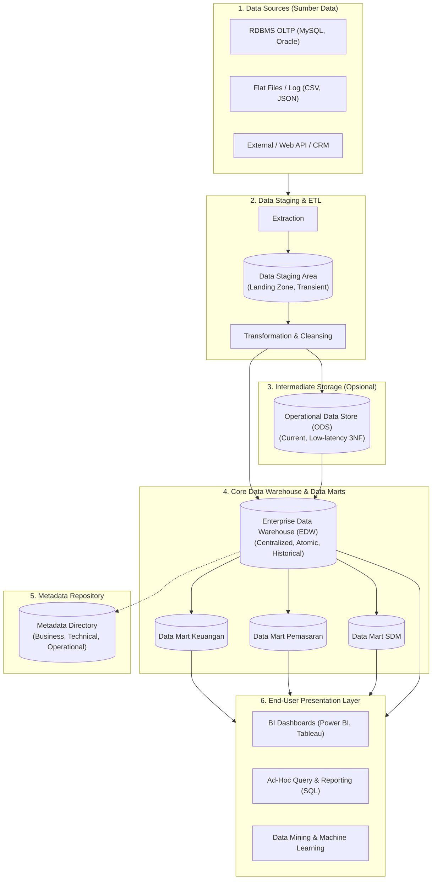

---

### 2. Bedah 7 Komponen Utama Arsitektur

#### 1. Operational Data Sources (Sumber Data Operasional)
- Sumber data mentah organisasi yang bersifat heterogen.
- Mencakup: RDBMS produksi (ERP, POS, CRM), file teks/flat files (CSV, XML, JSON), log server web, dan data eksternal (data sensus BPS, kurs valuta asing).

#### 2. Data Staging Area (Area Penampungan Sementara)
- **Karakteristik**: Bersifat *transient* (sementara) dan terisolasi dari pengguna akhir (*strictly off-limits to end users*).
- **Fungsi Utama**: Tempat mendaratnya data mentah hasil ekstraksi dari sistem sumber sebelum diproses lebih lanjut.
- **Aktivitas di Staging**: Pembersihan data (*data scrubbing*), penanganan *missing values*, konversi format, penggabungan (*joining*), dan penyeragaman kode.

#### 3. Operational Data Store (ODS) - Komponen Intermediate
- **Definisi**: Basis data relasional terintegrasi yang menyimpan data operasional terkini (*current value*, bukan data historis panjang).
- **Fungsi Khusus**:
  - Menyediakan data operasional lintas-sistem untuk laporan taktis harian yang membutuhkan data *near real-time* (misal status pesanan 1 jam terakhir).
  - Biasanya berstruktur ternormalisasi (3NF).
  - Berfungsi sebagai jembatan antara OLTP murni dan EDW.

::: {.callout .callout-warning}
::: {.callout-header}
⚠️ **Jebakan Ujian: Perbedaan Staging Area vs ODS vs Data Warehouse**
:::
::: {.callout-body}
- **Data Staging Area**: HANYA tempat kerja pemrosesan ETL; data bersifat sementara (*wiped out after ETL finishes*); pengguna akhir **TIDAK BOLEH** mengakses staging.
- **Operational Data Store (ODS)**: Menyimpan data terintegrasi **terkini (current/near real-time)** dengan riwayat minim (misal 30 hari); pengguna operasional dapat mengakses kueri harian.
- **Data Warehouse (EDW)**: Menyimpan data terintegrasi **historis jangka panjang (5–10 tahun)**; dirancang untuk kueri agregasi strategis eksekutif.
:::
:::

#### 4. Data Warehouse Storage Layer
- **Enterprise Data Warehouse (EDW)**: Repositori pusat yang menyimpan seluruh data subjek bisnis organisasi pada tingkat atomik paling detail.
- **Data Marts**: Bagian dari data warehouse yang difokuskan pada satu departemen atau lini bisnis tertentu (misal: Data Mart Penjualan, Data Mart SDM). Data di sini biasanya sudah diagregasi.

#### 5. Metadata Repository (Kamus Data Arsitektur)
- Sering disebut sebagai *"Buku Panduan / DNA dari Data Warehouse"*. Metadata adalah data tentang data.
- **3 Klasifikasi Metadata**:
  1. **Technical Metadata**: Struktur teknis database (nama tabel, nama kolom, tipe data, kunci primer/asing, partisi, ukuran indeks).
  2. **Business Metadata**: Penjelasan dalam bahasa bisnis yang dipahami manajer (definisi metrik "Pendapatan Bersih", kepemilikan data, aturan bisnis, kamus istilah).
  3. **Operational / Process Metadata**: Log eksekusi pipeline ETL (waktu mulai/selesai pemuatan, jumlah baris yang berhasil dimuat vs ditolak/error, status pemutakhiran data).

#### 6. Archive / Backup Layer
- Penyimpanan sekunder (pita magnetik atau cold storage cloud) untuk data historis yang sudah sangat lama (misal > 10 tahun) yang jarang diakses namun wajib disimpan demi kepatuhan regulasi audit hukum.

#### 7. End-User Presentation / Access Tools
- Lapisan antarmuka pengguna akhir:
  - **Executive Dashboards**: Visualisasi metrik KPI secara grafis (Power BI, Tableau, Looker).
  - **OLAP Tools**: Eksplorasi multidimensi (*slice, dice, drill-down*).
  - **Ad-hoc SQL Query Tools**: Kueri eksploratif analis.
  - **Advanced Analytics / Machine Learning**: Prediksi dan data mining.

---

### 3. Klasifikasi Arsitektur Tingkat Fisik (N-Tier)

1. **Single-Tier Architecture (Jarang Digunakan)**:
   - Pengguna mengakses langsung basis data operasional secara virtual/terisolasi. Tidak disarankan karena membebani sistem produksi.
2. **Two-Tier Architecture**:
   - Lapisan Sumber Data $\to$ Data Warehouse Fisik $\to$ Lapisan Klien.
   - Sering digunakan pada organisasi skala kecil/menengah dengan sumber data yang relatif seragam.
3. **Three-Tier Architecture (Standar Industri)**:
   - **Tier 1 (Bottom Tier)**: Server Data Warehouse (basis data relasional tempat penyimpanan data).
   - **Tier 2 (Middle Tier)**: Server OLAP (MOLAP / ROLAP) yang menyediakan abstraksi multidimensi dan pemrosesan agregasi instan.
   - **Tier 3 (Top Tier)**: Klien presentasi (Front-end BI tools, antarmuka visualisasi).

---

### 🎯 Hal-Hal yang Kemungkinan Besar Masuk Ujian

1. **Perbedaan Staging Area dan ODS**:
   - Pertanyaan klasik: *"Komponen mana yang bertindak sebagai area kerja sementara untuk proses pembersihan data tanpa boleh diakses oleh pengguna akhir?"* $\to$ Jawab: **Data Staging Area**.
2. **Peran Metadata Repository**:
   - Pahami perbedaan antara **Technical Metadata** (nama kolom, tipe data, indeks) dan **Business Metadata** (definisi istilah bisnis, rumus KPI).
3. **Komponen Arsitektur Three-Tier**:
   - Tier bawah = Database Server (DWH storage).
   - Tier tengah = OLAP Server (MOLAP/ROLAP engine).
   - Tier atas = Client / BI Tools.
4. **Data Mart vs EDW**:
   - Dosen sering menguji cakupan: Data Mart berfokus pada **satu subjek/departemen**, sedangkan EDW mencakup **seluruh perusahaan (enterprise-wide)**.

---

### 📋 Contoh Soal Ujian (Pilihan Ganda & Esai)

#### Contoh Soal Pilihan Ganda
**Soal 1 (Komponen Staging Area)**  
Di dalam arsitektur Data Warehouse, mengapa pengguna akhir (*business analysts*) secara tegas dilarang melakukan kueri langsung ke *Data Staging Area*?  
A. Karena data di staging area terlalu rahasia bagi analis bisnis.  
B. Karena data di staging area bersifat sementara (*transient*), seringkali belum bersih, strukturnya dapat berubah-ubah sewaktu-waktu, dan pemuatan data sedang berjalan aktif sehingga kueri akan mengganggu proses ETL.  
C. Karena staging area hanya berisi kode program Java tanpa data fisik.  
D. Karena staging area berada di komputer klien analis.  
*Kunci Jawaban*: **B**  
*Pembahasan*: Staging area adalah dapur pemrosesan ETL. Data di dalamnya tidak memiliki integritas referensial yang stabil bagi pelaporan sebelum proses transformasi selesai sepenuhnya.

**Soal 2 (Klasifikasi Metadata)**  
Informasi yang mencatat bahwa kueri "Total Laba Kotor" dihitung dengan rumus `Pendapatan Penjualan dikurangi Harga Pokok Penjualan (HPP)` dan pemilik data metrik tersebut adalah Kepala Bagian Akuntansi tergolong ke dalam...  
A. *Technical Metadata*  
B. *Operational Metadata*  
C. *Business Metadata*  
D. *System Architecture Metadata*  
*Kunci Jawaban*: **C**  
*Pembahasan*: Business Metadata mendefinisikan terminologi bisnis, aturan perhitungan logika bisnis, dan kepemilikan data agar analis memahami konteks data yang mereka gunakan.

---

#### Contoh Soal Esai
**Soal Esai**:  
Gambarkan diagram arsitektur tiga tingkat (*Three-Tier Architecture*) Data Warehouse dan jelaskan fungsi spesifik dari masing-masing tingkat tersebut beserta peranan repositori *Metadata* dalam menjamin kelangsungan arsitektur tersebut!

**Pedoman Jawaban Lengkap**:
1. **Diagram 3-Tier**:
   - Gambarkan secara berurutan dari bawah ke atas:
     - Tier 1: Warehouse Database Server (Back-end)
     - Tier 2: OLAP Server (Middle-tier)
     - Tier 3: Front-End Presentation Client
2. **Fungsi Masing-Masing Tier**:
   - **Tier 1 (Bottom Tier - Warehouse Storage)**: Mengelola penyimpanan fisik data historis terintegrasi (berupa RDBMS relasional terdistribusi) yang diisi secara berkala oleh proses ETL dari berbagai sistem operasional.
   - **Tier 2 (Middle Tier - OLAP Server)**: Bertindak sebagai mesin kalkulasi analitis (ROLAP atau MOLAP) yang mengabstraksi data relasional menjadi bentuk kubus multidimensi (*Data Cube*) dan mempercepat operasi agregasi (*drill-down, roll-up*).
   - **Tier 3 (Top Tier - Client Layer)**: Antarmuka visual yang digunakan oleh pengguna akhir (manajer, eksekutif) untuk membuat laporan, mengeksekusi dashboard BI, kueri ad-hoc, dan eksplorasi data.
3. **Peranan Kunci Metadata**:
   - Metadata berperan sebagai perekat atau "sistem saraf" yang mengoordinasikan seluruh tier:
     - Menginformasikan proses ETL mengenai pemetaan skema dari sumber ke target.
     - Menginformasikan OLAP server mengenai agregat tabel dan partisi fisik.
     - Menyediakan kamus data bagi pengguna di Tier 3 untuk memahami arti bisnis dari data yang mereka kueri.

---

### 💡 Tips & Trik Menjawab Soal Ujian

1. **Trik Menghafal 3 Jenis Metadata**:
   - **Technical** = *Bagaimana komputer melihat data* (Tipe data, PK/FK, nama kolom, partisi).
   - **Business** = *Bagaimana manusia/manajer melihat data* (Definisi istilah, rumus laba, aturan bisnis).
   - **Operational** = *Bagaimana sistem ETL bekerja* (Timestamp load, jumlah baris error, status keberhasilan batch).
2. **Tips Diagram Esai**:
   - Jangan pernah menggambar panah langsung dari *Operational Data Sources* menuju *Executive Dashboard*! Selalu letakkan lapisan **ETL/Staging** dan **Data Warehouse Storage** di tengahnya untuk membuktikan pemahaman arsitektural yang benar.


## 🏛️ 01.4 Arsitektur Inmon vs Kimball & EDW vs Data Mart

::: {.callout .callout-abstract}
::: {.callout-header}
📖 **Ringkasan Sub-Materi**
:::
::: {.callout-body}
Membandingkan dua paradigma arsitektur paling dominan dalam sejarah perancangan Data Warehouse: pendekatan *Top-Down* oleh Bill Inmon (*Corporate Information Factory*) versus pendekatan *Bottom-Up* oleh Ralph Kimball (*Dimensional Data Warehouse Bus Architecture*). Dilengkapi analisis komparatif antara *Enterprise Data Warehouse* (EDW) dan *Data Mart* (Independent vs Dependent), kisi-kisi ujian, dan strategi menjawab soal esai.
:::
:::

---

### 1. Pertarungan Dua Mazhab: Inmon vs Kimball

Dalam literatur dan industri Data Warehouse, terdapat perdebatan klasik antara dua tokoh pelopor: **Bill Inmon** (pendekatan terpusat / *Top-Down*) dan **Ralph Kimball** (pendekatan terdistribusi berbasis proses / *Bottom-Up*).

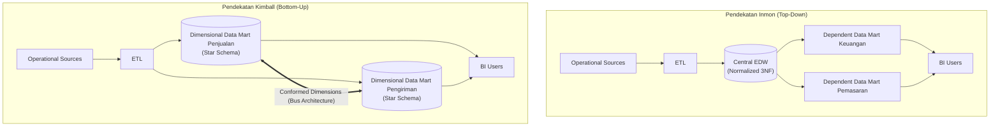

---

### 2. Bedah Filosofi & Alur Kerja

#### A. Pendekatan Bill Inmon: Corporate Information Factory (CIF) - *Top-Down*
- **Filosofi Dasar**: Data Warehouse harus menjadi repositori pusat tunggal yang komprehensif untuk seluruh organisasi sebelum melayani kebutuhan analitis per departemen.
- **Langkah Perancangan**:
  1. Buat model data perusahaan terpadu (*Enterprise Data Model*).
  2. Bangun **Enterprise Data Warehouse (EDW)** fisik yang tersentralisasi dalam bentuk **ternormalisasi (Third Normal Form / 3NF)**.
  3. Dari EDW yang sudah stabil, buat **Dependent Data Marts** yang disesuaikan untuk masing-masing departemen (misal: Finance, HR, Marketing) dengan skema dimensional.
- **Karakteristik**:
  - *Data Modeler*: Butuh perencanaan jangka panjang yang sangat matang.
  - *Redundansi*: Sangat rendah di level core EDW.
  - *Waktu Implementasi*: Lama (bisa memakan waktu bertahun-tahun sebelum laporan pertama siap digunakan pengguna).
  - *Biaya Awal*: Sangat tinggi.

#### B. Pendekatan Ralph Kimball: Dimensional Data Warehouse - *Bottom-Up*
- **Filosofi Dasar**: Data Warehouse harus segera memberikan nilai bisnis secara cepat (*deliver business value fast*) dengan berfokus langsung pada proses bisnis departemen.
- **Langkah Perancangan**:
  1. Identifikasi proses bisnis prioritas utama (misal: Transaksi Penjualan).
  2. Rancang dan bangun **Dimensional Data Mart** menggunakan model dimensional (**Star Schema** atau **Snowflake Schema**) langsung dari data staging.
  3. Untuk menghubungkan antar-Data Mart agar tidak menjadi data silos baru, gunakan konsep **Conformed Dimensions** (misal: tabel `Dim_Date` dan `Dim_Customer` dipakai bersama oleh Data Mart Penjualan maupun Data Mart Pengiriman) melalui arsitektur yang disebut **Enterprise Data Warehouse Bus Architecture**.
- **Karakteristik**:
  - *Waktu Implementasi*: Sangat cepat (iteratif per proses bisnis, hasil terlihat dalam hitungan bulan).
  - *Biaya Awal*: Relatif rendah dan bertahap.
  - *Kemudahan Kueri*: Sangat mudah dipahami oleh pengguna bisnis karena menggunakan skema bintang.

---

### 3. Matriks Perbandingan Akbar: Inmon vs Kimball

| Kriteria Evaluasi | Bill Inmon (*Top-Down Approach*) | Ralph Kimball (*Bottom-Up Approach*) |
| :--- | :--- | :--- |
| **Filosofi Inti** | *Enterprise-wide data driven* (Fokus pada integritas data seluruh perusahaan) | *Business process driven* (Fokus pada kebutuhan proses bisnis pengguna) |
| **Arsitektur Struktur** | **Top-Down**: Operasional $\to$ Staging $\to$ 3NF EDW $\to$ Dependent Data Marts | **Bottom-Up**: Operasional $\to$ Staging $\to$ Dimensional Data Marts (Bus Architecture) |
| **Model Data Inti** | **Normalized (3NF)** pada tingkat EDW pusat | **De-normalized (Dimensional / Star Schema)** |
| **Konsep Integrasi** | Integrasi dijamin oleh skema 3NF relasional tunggal di EDW | Integrasi dijamin melalui standarisasi **Conformed Dimensions** |
| **Kompleksitas Desain** | Sangat tinggi di awal proyek (*up-front heavy design*) | Rendah di awal, meningkat seiring bertambahnya Data Mart baru |
| **Waktu Pengerjaan Awal** | Panjang (berbulan-bulan hingga tahunan sebelum ROI terlihat) | Pendek / Cepat (iteratif, ROI terlihat dalam hitungan minggu/bulan) |
| **Keahlian Tim Dibutuhkan**| Ahli normalisasi data korporasi, DBA skala besar | Analis bisnis terbiasa dengan pemodelan dimensional |
| **Kemudahan Modifikasi** | Lebih mudah menambah subjek data baru di tingkat enterprise | Lebih mudah mengubah agregasi laporan bisnis per proses |

---

### 4. Perbandingan: Enterprise Data Warehouse (EDW) vs Data Mart

Dosen sering menguji perbedaan cakupan antara EDW dan Data Mart:

| Dimensi | Enterprise Data Warehouse (EDW) | Data Mart |
| :--- | :--- | :--- |
| **Cakupan Organisasi** | Seluruh perusahaan (*Enterprise-wide*) | Satu divisi/departemen (misal Keuangan atau Pemasaran) |
| **Subjek Data** | Banyak subjek bisnis terpadu | Satu subjek bisnis terisolasi |
| **Sumber Data** | Puluhan hingga ratusan sistem sumber heterogen | Beberapa sumber data yang relevan dengan divisi tersebut |
| **Ukuran Basis Data** | Sangat besar (Ratusan GB hingga Petabyte) | Relatif kecil hingga menengah (Puluhan hingga ratusan GB) |
| **Detail Data (Grain)** | Sangat atomik (detail paling bawah) | Campuran antara atomik dan data agregat (*summary data*) |
| **Waktu Pembangunan** | Jangka panjang | Cepat dan terfokus |

#### Jenis-Jenis Data Mart:
1. **Dependent Data Mart**:
   - Sumber datanya diambil secara eksklusif dari **Enterprise Data Warehouse (EDW)** yang sudah ada (mengikuti filosofi Inmon).
   - Menjamin integritas data tetap terjaga karena bersumber dari SSoT.
2. **Independent Data Mart**:
   - Dibuat langsung dari sistem sumber operasional oleh divisi tertentu tanpa melalui EDW.
   - **Kelemahan**: Menghidupkan kembali masalah *Data Silos*, di mana definisi data antar-departemen dapat bertolak belakang.

---

### 🎯 Hal-Hal yang Kemungkinan Besar Masuk Ujian

1. **Top-Down vs Bottom-Up**:
   - Inmon = **Top-Down** (mulai dari EDW 3NF $\to$ Data Marts).
   - Kimball = **Bottom-Up** (mulai dari Dimensional Data Marts $\to$ disatukan via Conformed Dimensions).
2. **Karakteristik Skema**:
   - Inmon menggunakan **3NF** di core DWH.
   - Kimball menggunakan **Star/Snowflake Schema** (Dimensional Model).
3. **Konsep Kunci Kimball**:
   - Istilah **Conformed Dimensions** dan **Bus Architecture** adalah kunci jawaban untuk pertanyaan bagaimana Kimball menyatukan data mart tanpa membuat silo data.
4. **Dependent vs Independent Data Mart**:
   - Dependent = data berasal dari EDW pusat.
   - Independent = data ditarik mandiri dari sistem operasional (rawan duplikasi dan konflik data).

---

### 📋 Contoh Soal Ujian (Pilihan Ganda & Esai)

#### Contoh Soal Pilihan Ganda
**Soal 1 (Filosofi Arsitektur Inmon)**  
Pendekatan perancangan Data Warehouse yang mengusulkan pembentukan repositori pusat terintegrasi dalam bentuk Third Normal Form (3NF) terlebih dahulu sebelum mendistribusikan data ke masing-masing Data Mart departemen dikenal sebagai pendekatan...  
A. Pendekatan Bottom-Up oleh Ralph Kimball  
B. Pendekatan Top-Down oleh Bill Inmon  
C. Pendekatan Star-Bus Architecture  
D. Pendekatan Distributed Data Lake  
*Kunci Jawaban*: **B**  
*Pembahasan*: Bill Inmon memelopori pendekatan *Top-Down* (CIF) di mana EDW 3NF dibangun terlebih dahulu sebagai fondasi tunggal perusahaan.

**Soal 2 (Risiko Independent Data Mart)**  
Sebuah divisi pemasaran membangun basis data analitiknya sendiri dengan menarik data transaksi langsung dari sistem POS kasir tanpa berkoordinasi dengan divisi IT dan tanpa melalui Data Warehouse pusat. Struktur ini disebut...  
A. *Dependent Data Mart*  
B. *Conformed Data Mart*  
C. *Independent Data Mart*  
D. *Enterprise Bus Architecture*  
*Kunci Jawaban*: **C**  
*Pembahasan*: Independent Data Mart dibangun terpisah secara mandiri langsung dari sumber operasional dan berisiko menciptakan kembali silo data.

---

#### Contoh Soal Esai
**Soal Esai**:  
Sebuah perusahaan rintisan (*startup*) berkembang pesat ingin membangun sistem analitis data. Manajemen membutuhkan laporan penjualan harian dan churn pelanggan dalam waktu kurang dari 3 bulan dengan anggaran terbatas.  
a. Pendekatan arsitektur mana yang lebih Anda rekomendasikan: Inmon atau Kimball? Berikan alasan teknis dan bisnis yang mendasari rekomendasi Anda!  
b. Bagaimana Anda memastikan bahwa solusi yang Anda pilih tidak berakhir menjadi kumpulan "Silo Data" baru di masa depan?

**Pedoman Jawaban Lengkap**:
1. **Rekomendasi Arsitektur (Pendekatan Ralph Kimball - Bottom-Up)**:
   - **Alasan Bisnis**: Proyek harus selesai cepat (< 3 bulan) dan beranggaran terbatas. Pendekatan Kimball bersifat iteratif dan berorientasi proses bisnis (*business-driven*), memungkinkan pengiriman solusi fungsional (*working Data Mart*) secara cepat untuk proses penjualan terlebih dahulu. Pendekatan Inmon membutuhkan waktu perancangan skema 3NF enterprise bertahun-tahun dan biaya awal sangat mahal, sehingga tidak cocok untuk situasi startup.
   - **Alasan Teknis**: Menggunakan pemodelan dimensional (Star Schema) yang mudah dipahami oleh analis dan menghasilkan performa kueri agregasi yang sangat cepat tanpa perlu JOIN tabel 3NF yang rumit.
2. **Strategi Mencegah Data Silos (Penerapan Conformed Dimensions & Bus Architecture)**:
   - Membuat matriks **Enterprise Data Warehouse Bus Architecture**.
   - Menetapkan dimensi-dimensi bersama (*Conformed Dimensions*) yang distandarisasi di seluruh organisasi, seperti `Dim_Date`, `Dim_Customer`, dan `Dim_Product`.
   - Ketika departemen lain (misal Layanan Pelanggan atau Pemasaran) membangun Data Mart baru, mereka **wajib mereferensikan tabel dimensi yang sama** yang telah terstandarisasi. Dengan cara ini, laporan antar-divisi tetap konsisten dan terintegrasi (*Single Source of Truth*).

---

### 💡 Tips & Trik Menjawab Soal Ujian

1. **Jurus Kata Kunci Ujian**:
   - Jika soal menyebutkan *"Corporate Information Factory", "3NF", "Top-Down", "Normalisasi terpusat"* $\to$ Kuncinya adalah **Bill Inmon**.
   - Jika soal menyebutkan *"Bus Architecture", "Conformed Dimensions", "Bottom-Up", "Star Schema", "Proses Bisnis"* $\to$ Kuncinya adalah **Ralph Kimball**.
2. **Formula Menjawab Esai Studi Kasus Pemilihan Arsitektur**:
   - Gunakan formula: **Kebutuhan Waktu/Biaya $\to$ Pilihan Tokoh $\to$ Mekanisme Teknis $\to$ Solusi Mitigasi Risiko**.
   - Jika butuh cepat/murah $\to$ Pilih **Kimball** (mitigasi: gunakan *Conformed Dimensions*).
   - Jika perusahaan raksasa multinasional yang butuh stabilitas tata kelola jangka panjang tanpa batasan waktu/biaya $\to$ Pilih **Inmon** (mitigasi: bangun *Dependent Data Marts*).


::: {.chapter-divider}
:::

::: {.chapter-header-box}
# Bab 2: Dimensional Modeling, Skema & Slowly Changing Dimensions (SCD)

<p class="chapter-desc">Anatomi Fact & Dimension table, Star vs Snowflake vs Galaxy Schema, 4 Langkah Kimball Lifecycle, SCD Tipe 1-3, dan Operasi OLAP Data Cube.</p>
:::

## 📊 02.1 Anatomi Fact Table & Dimension Table

::: {.callout .callout-abstract}
::: {.callout-header}
📖 **Ringkasan Sub-Materi**
:::
::: {.callout-body}
Menelaah blok pembangun fundamental dalam pemodelan dimensional (*Dimensional Modeling*): **Fact Table** (tabel fakta) dan **Dimension Table** (tabel dimensi). Sub-materi ini mengupas tuntas klasifikasi fakta kuantitatif (aditif, semi-aditif, non-aditif, dan *factless*), peranan krusial *Surrogate Key* versus *Natural Key*, kisi-kisi ujian, dan strategi menjawab soal analitis.
:::
:::

---

### 1. Filosofi Pemodelan Dimensional (Ralph Kimball)

Pemodelan dimensional adalah teknik perancangan basis data yang bertujuan untuk:
1. Menyajikan data analitis dalam format yang intuitif dan mudah dipahami oleh pengguna bisnis.
2. Memaksimalkan efisiensi performa pembacaan dan eksekusi kueri agregasi (*high-speed query performance*).

Setiap model dimensional membagi dunia data ke dalam dua konsep utama:
- **Pengukuran Peristiwa Bisnis (Facts)**: *"Berapa banyak barang yang terjual? Berapa total rupiah transaksi?"*
- **Konteks Analisis (Dimensions)**: *"Siapa yang membeli? Produk apa yang dibeli? Di toko mana? Kapan transaksi terjadi?"*

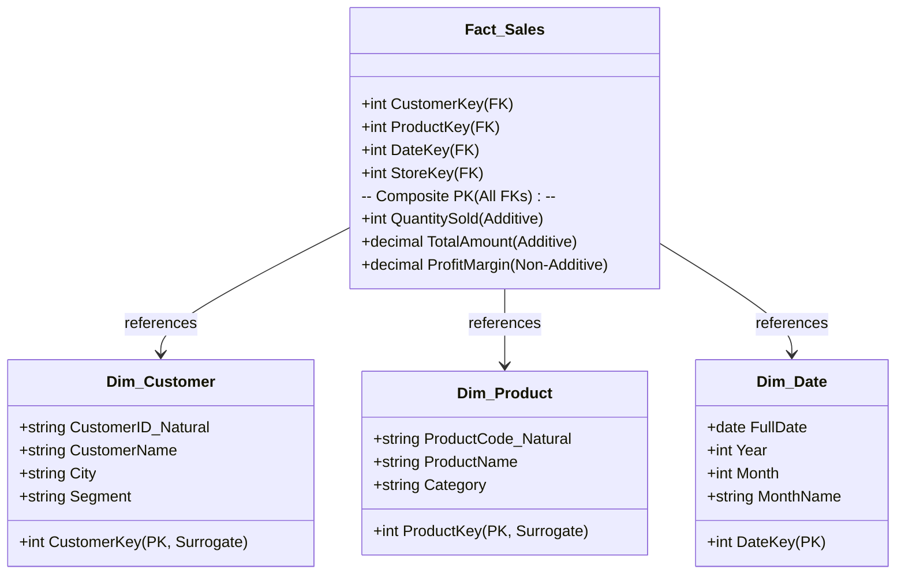

---

### 2. Anatomi Mendalam Fact Table (Tabel Fakta)

**Fact Table** adalah tabel utama di pusat model dimensional yang mencatat hasil pengukuran numerik dari suatu peristiwa bisnis (*business event*).

#### A. Karakteristik Struktural Fact Table
1. **Berisi Dua Jenis Kolom**:
   - **Foreign Keys (FK)**: Menghubungkan baris fakta ke tabel dimensi terkait.
   - **Measures / Metrics**: Nilai kuantitatif numerik hasil pengukuran peristiwa bisnis.
2. **Primary Key Berupa Composite Key**:
   - Primary key pada tabel fakta biasanya merupakan gabungan dari seluruh Foreign Keys yang ada (*Composite Primary Key*).
3. **Ukuran Baris Sangat Besar & Menjulang Tinggi (*Deep Table*)**:
   - Tabel fakta memiliki jumlah kolom yang relatif sedikit (10–20 kolom), namun memiliki jumlah baris yang masif (jutaan hingga miliaran baris).
   - Selalu bertambah secara *append-only* seiring berjalannya transaksi.

#### B. Klasifikasi Measures (Fakta Kuantitatif)
Dosen sering menguji pemahaman klasifikasi tipe fakta berikut:

| Tipe Fakta | Definisi & Karakteristik | Contoh Kasus |
| :--- | :--- | :--- |
| **1. Additive Facts (Fakta Aditif Penuh)** | Dapat dijumlahkan secara valid melintasi **seluruh dimensi** analisis (Waktu, Toko, Pelanggan, Produk). Tipe fakta yang paling ideal dan disukai dalam DWH. | - Jumlah unit terjual (`QuantitySold`)<br>- Total nilai rupiah transaksi (`TotalSalesAmount`)<br>- Biaya pengiriman (`ShippingCost`) |
| **2. Semi-Additive Facts (Fakta Semi-Aditif)** | Dapat dijumlahkan secara valid melintasi **sebagian dimensi**, namun **TIDAK BISA dijumlahkan melintasi dimensi Waktu**. | - Saldo akhir rekening bank (`AccountBalance`)<br>- Jumlah stok barang di gudang (`InventoryStock`)<br>*(Catatan: Anda tidak boleh menjumlahkan saldo tanggal 1 Jan + 2 Jan + 3 Jan untuk mendapatkan saldo bulanan! Solusinya gunakan fungsi `AVG` atau ambil nilai akhir periode).* |
| **3. Non-Additive Facts (Fakta Non-Aditif)** | **Sama sekali tidak dapat dijumlahkan** melintasi dimensi apa pun secara langsung karena berupa persentase, rasio, atau nilai intensif. | - Persentase margin laba (`ProfitMargin %`)<br>- Harga satuan produk (`UnitPrice`)<br>- Suhu ruangan (`Temperature`)<br>*(Catatan: Harus dihitung ulang dari fakta dasar, misal: $\text{Margin \%} = \frac{\sum \text{Profit}}{\sum \text{Revenue}}$).* |
| **4. Factless Fact Table (Tabel Fakta Tanpa Fakta)** | Tabel fakta yang **tidak memiliki kolom measure numerik sama sekali**, hanya berisi kumpulan Foreign Key. Digunakan untuk mencatat **kejadian peristiwa (*event tracking*)** atau rentang cakupan promosi. | - Absensi kehadiran mahasiswa kuliah (mencatat hubungan `SiswaKey`, `MataKuliahKey`, `DateKey`)<br>- Pengecekan produk mana yang sedang dalam masa promosi diskon tetapi tidak terjual. |

---

### 3. Anatomi Mendalam Dimension Table (Tabel Dimensi)

**Dimension Table** adalah tabel pendamping yang menyediakan konteks deskriptif tekstual untuk menjawab pertanyaan bisnis ("siapa, apa, di mana, kapan, mengapa, dan bagaimana").

#### A. Karakteristik Struktural Dimension Table
1. **Primary Key Tunggal**: Memiliki satu kolom Primary Key berupa integer (disebut *Surrogate Key*).
2. **Kaya Kolom Deskriptif (*Wide Table*)**: Memiliki banyak kolom atribut teks (50–100 atribut) untuk filtering dan grouping pada kueri (`WHERE`, `GROUP BY`).
3. **Jumlah Baris Relatif Sedikit**: Dibandingkan tabel fakta, tabel dimensi memiliki baris yang relatif sedikit (ratusan hingga puluhan ribu baris).
4. **Tendenormalisasi**: Atribut hierarki sering digabungkan dalam satu tabel untuk menghindari JOIN berlebih (misal: Kecamatan, Kota, Provinsi dimasukkan ke dalam `Dim_Location`).

#### B. Surrogate Key vs Natural Key (Konsep Wajib Ujian!)

::: {.callout .callout-important}
::: {.callout-header}
⚡ **Mengapa Tabel Dimensi Wajib Menggunakan Surrogate Key?**
:::
::: {.callout-body}
**Natural Key (Business Key)** adalah ID asli dari sistem operasional sumber (misal: Nomor KTP, Kode SKU Produk, No Rekening Bank).  
**Surrogate Key** adalah kunci buatan berupa integer sekuensial (`1, 2, 3, ...`) yang dibuat dan dikelola secara mandiri oleh pipeline DWH/ETL tanpa memiliki makna bisnis apa pun.
:::
:::

**4 Alasan Teknis Mengapa DWH Wajib Menggunakan Surrogate Key**:
1. **Mendukung Riwayat Perubahan SCD Tipe 2**:
   - Jika pelanggan dengan KTP `3171xxx` pindah alamat 3 kali, di DWH harus ada 3 baris dengan KTP yang sama. Jika menggunakan Natural Key sebagai PK, database akan menolak karena melanggar *Primary Key Uniqueness*. Dengan Surrogate Key, masing-masing baris memiliki PK unik (`CustomerKey: 101, 102, 103`).
2. **Integrasi Sumber Data Heterogen**:
   - Sistem Toko A menggunakan ID Produk `SKU-001` (string), sedangkan sistem Toko B menggunakan ID Produk `8821` (integer). Surrogate key menyatukan keduanya menjadi kunci integer standar internal DWH.
3. **Efisiensi Performa Kueri (Join Optimization)**:
   - Operasi JOIN pada tabel fakta (miliaran baris) menggunakan kolom integer 4-byte (`CustomerKey`) jauh lebih cepat dan menghemat kapasitas memori indeks dibandingkan JOIN menggunakan string/varchar alami (`KTP_31710123...`).
4. **Isolasi dari Anomali Sistem Operasional Sumber**:
   - Melindungi DWH jika sistem sumber menghapus, mendaur ulang (*re-use*), atau mengubah format kunci alami.

---

### 🎯 Hal-Hal yang Kemungkinan Besar Masuk Ujian

1. **Klasifikasi Measure (Additive vs Semi-Additive vs Non-Additive)**:
   - Contoh soal klasik: *"Saldo tabungan nasabah di akhir bulan tergolong jenis measure apa?"* $\to$ Jawab: **Semi-Additive** (karena tidak valid dijumlahkan melintasi dimensi waktu).
2. **Factless Fact Table**:
   - Soal konseptual: *"Tabel fakta yang mencatat presensi mahasiswa tanpa ada metrik numerik penjualan disebut..."* $\to$ Jawab: **Factless Fact Table**.
3. **Surrogate Key vs Natural Key**:
   - Sering keluar di esai maupun PG: *"Sebutkan minimal 3 alasan mengapa tabel dimensi harus menggunakan surrogate key daripada natural key!"*
4. **Struktur Kunci Tabel Fakta**:
   - Primary Key tabel fakta dibentuk dari **gabungan seluruh Foreign Key** tabel dimensi terkait (*Composite Primary Key*).

---

### 📋 Contoh Soal Ujian (Pilihan Ganda & Esai)

#### Contoh Soal Pilihan Ganda
**Soal 1 (Klasifikasi Measure Semi-Aditif)**  
Seorang perancang data warehouse membuat tabel fakta untuk mencatat stok barang di gudang setiap akhir hari. Kolom `CurrentStockLevel` (jumlah unit barang di rak) tergolong ke dalam jenis measure...  
A. *Additive Fact*, karena dapat dijumlahkan melintasi seluruh toko dan seluruh hari dalam satu bulan.  
B. *Semi-Additive Fact*, karena valid dijumlahkan melintasi dimensi gudang/toko, tetapi tidak valid dijumlahkan melintasi dimensi waktu.  
C. *Non-Additive Fact*, karena tidak dapat dijumlahkan dalam kondisi apa pun.  
D. *Factless Fact*, karena tidak mencatat nilai uang rupiah.  
*Kunci Jawaban*: **B**  
*Pembahasan*: Menjumlahkan stok 100 unit pada hari Senin, 100 unit pada hari Selasa, dan 100 unit pada hari Rabu menghasilkan angka keliru 300 unit (bukan berarti ada 300 unit barang di gudang). Stok hanya bisa di-agregasi menggunakan fungsi `AVG` atau nilai akhir periode terhadap dimensi waktu.

**Soal 2 (Keunggulan Surrogate Key)**  
Apa dampak negatif paling fatal jika perancang Data Warehouse memilih menggunakan *Natural Key* (kode unik dari sistem sumber operasional) sebagai Primary Key tabel dimensi daripada menggunakan *Surrogate Key*?  
A. Kueri `SELECT` tidak akan menghasilkan data apa pun.  
B. Sistem tidak dapat melacak riwayat perubahan historis data pelanggan saat menerapkan metode *Slowly Changing Dimension (SCD) Tipe 2*.  
C. Ukuran file backup data warehouse menjadi dua kali lipat lebih kecil.  
D. Proses ETL tidak membutuhkan pembersihan data sama sekali.  
*Kunci Jawaban*: **B**  
*Pembahasan*: SCD Tipe 2 mengharuskan pembuatan baris baru saat terjadi perubahan atribut pelanggan. Jika PK adalah Natural Key (misal NIK), pembuatan baris baru akan memicu *duplicate primary key violation*.

---

#### Contoh Soal Esai
**Soal Esai**:  
Dalam suatu rapat perancangan Data Warehouse perbankan, seorang analis junior mengusulkan untuk langsung menggunakan *Nomor Rekening Bank* (10 digit angka unik dari sistem core banking) sebagai Primary Key pada tabel dimensi `Dim_Account`, dan memasukkan *Persentase Suku Bunga Pinjaman* (`InterestRate %`) sebagai salah satu fakta utama di tabel fakta transaksi untuk dijumlahkan tiap bulan.  
a. Evaluasi usulan penggunaan Nomor Rekening sebagai Primary Key pada `Dim_Account`! Berikan solusi perbaikan yang benar!  
b. Evaluasi usulan perlakuan terhadap `InterestRate %` di tabel fakta! Jelaskan klasifikasi fakta yang tepat dan bagaimana cara agregasi yang benar!

**Pedoman Jawaban Lengkap**:
1. **Evaluasi Nomor Rekening (Natural Key) & Solusinya**:
   - Usulan tersebut **keliru**. Nomor Rekening adalah *Natural/Business Key*.
   - Jika nasabah mengubah tipe rekening atau terjadi perubahan status yang membutuhkan pelacakan riwayat historis (SCD Tipe 2), DWH tidak dapat menyimpan beberapa baris riwayat dengan nomor rekening yang sama jika nomor tersebut dijadikan Primary Key.
   - Selain itu, ketergantungan pada sistem sumber berisiko jika sistem core banking mengubah konvensi penomoran.
   - **Solusi**: Buat kolom `AccountKey` (tipe integer auto-increment) sebagai **Surrogate Key** yang bertindak sebagai Primary Key tabel dimensi. Simpan Nomor Rekening asli ke dalam kolom terpisah bernama `AccountNumber_NaturalKey` sebagai atribut bisnis.
2. **Evaluasi Persentase Suku Bunga (`InterestRate %`)**:
   - Usulan menjumlahkan persentase suku bunga tiap bulan adalah **keliru fatal**.
   - Persentase bunga tergolong **Non-Additive Fact**. Menjumlahkan suku bunga 5% + 5% + 5% tidak memiliki makna finansial.
   - **Solusi**: Persentase tidak boleh dijumlahkan langsung (`SUM`). Jika analis ingin mengetahui rata-rata bunga tertimbang atau total pendapatan bunga, tabel fakta harus menyimpan fakta aditif dasar berupa: `NominalPinjaman` (Rp) dan `NominalBungaDihasilkan` (Rp). Nilai persentase suku bunga efektif dihitung kembali di lapisan kueri presentasi dengan rumus:  
     $$\text{Suku Bunga Efektif} = \frac{\sum \text{NominalBungaDihasilkan}}{\sum \text{NominalPinjaman}} \times 100\%$$

---

### 💡 Tips & Trik Menjawab Soal Ujian

1. **Jurus Identifikasi Jenis Fakta**:
   - Bisa di-SUM di semua kondisi (uang transaksi, jumlah barang) $\to$ **Additive**.
   - Terikat saldo/posisi kas/stok fisik (tidak bisa di-SUM antar-hari/waktu) $\to$ **Semi-Additive**.
   - Berupa rasio, persen, rata-rata, harga satuan $\to$ **Non-Additive**.
   - Tidak ada kolom angka ukur sama sekali, hanya FK kejadian $\to$ **Factless Fact**.
2. **Formula Menjawab Pertanyaan Surrogate Key**:
   - Sebutkan 3 poin wajib: (1) Menjamin keunikan baris untuk riwayat **SCD Tipe 2**, (2) Menyeragamkan format dari **sumber heterogen**, (3) Meningkatkan **performa JOIN integer** pada tabel fakta masif.


## 🌟 02.2 Skema Desain Data Warehouse (Star, Snowflake, & Galaxy Schema)

::: {.callout .callout-abstract}
::: {.callout-header}
📖 **Ringkasan Sub-Materi**
:::
::: {.callout-body}
Menelaah tiga arsitektur skema pemodelan data dimensional yang paling fundamental dalam Data Warehouse: **Star Schema**, **Snowflake Schema**, dan **Fact Constellation (Galaxy) Schema**. Sub-materi ini membahas struktur, diagram, kelebihan dan kelemahan masing-masing skema, matriks komparasi teknis, kisi-kisi ujian, dan strategi menjawab soal perancangan.
:::
:::

---

### 1. Tiga Pola Skema Dimensional

Dalam mengorganisasikan relasi antara *Fact Table* dan *Dimension Tables*, industri mengenal 3 varian skema utama:

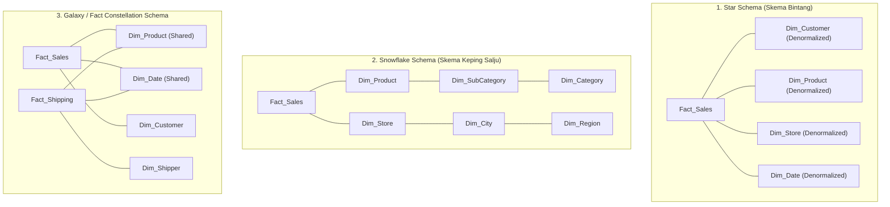

---

### 2. Bedah Struktur Masing-Masing Skema

#### A. Star Schema (Skema Bintang)
- **Struktur**: Satu tabel fakta tunggal berada di pusat (*center*) dan dikelilingi oleh tabel-tabel dimensi yang terhubung langsung seperti pola bintang.
- **Tingkat Normalisasi**: Tabel dimensi **didenormalisasi penuh** (*completely denormalized*).
  - Contoh: Dalam tabel `Dim_Product`, atribut nama produk, subkategori, kategori, dan lini produk disatukan ke dalam satu tabel fisik yang sama, meskipun ada perulangan teks nama kategori.
- **Kelebihan Utama**:
  1. **Performa Kueri Sangat Cepat**: Setiap kueri agregasi hanya memerlukan **satu tingkat JOIN** antara tabel fakta dan tabel dimensi (`Fact JOIN Dim`).
  2. **Struktur Sangat Sederhana**: Sangat mudah dipahami oleh analis bisnis dan perangkat lunak BI (Power BI, Tableau) dapat secara otomatis mendeteksi relasi bintang.
- **Kelemahan**: Terjadi redundansi data teks pada tabel dimensi, sehingga membutuhkan ruang penyimpanan dimensi yang sedikit lebih besar. Namun, karena ukuran tabel dimensi sangat kecil dibandingkan tabel fakta, trade-off ini dianggap sangat menguntungkan.

#### B. Snowflake Schema (Skema Keping Salju)
- **Struktur**: Merupakan varian dari Star Schema di mana beberapa atau seluruh tabel dimensi **dinormalisasi lebih lanjut (menjadi bentuk 2NF/3NF)** ke dalam tabel-tabel sub-dimensi bertingkat (*lookup tables*).
- **Contoh Normalisasi**:
  - `Dim_Product` dipecah menjadi: `Dim_Product` $\to$ `Dim_SubCategory` $\to$ `Dim_Category`.
  - `Dim_Location` dipecah menjadi: `Dim_Store` $\to$ `Dim_City` $\to$ `Dim_Province` $\to$ `Dim_Country`.
- **Kelebihan**:
  1. **Nol Redundansi Dimensi**: Tidak ada duplikasi teks nama kategori atau nama kota.
  2. **Integritas Data Terjaga Ketat**: Perubahan nama kategori hanya perlu dilakukan di satu baris tabel `Dim_Category`.
  3. **Menghemat Storage Dimensi**: Berguna jika tabel dimensi memiliki jutaan baris data unik.
- **Kelemahan Utama**:
  1. **Performa Kueri Melambat Signifikan**: Kueri analitik harus mengeksekusi banyak operasi JOIN berantai (*multi-hop joins*). Mesin SQL harus menggabungkan `Fact_Sales JOIN Dim_Product JOIN Dim_SubCategory JOIN Dim_Category` hanya untuk mengetahui total penjualan per kategori.
  2. **Kompleksitas Desain**: Menyerupai sistem transaksional (OLTP) sehingga membingungkan analis non-teknis.

#### C. Fact Constellation (Galaxy) Schema
- **Struktur**: Memiliki **dua atau lebih tabel fakta (*Multiple Fact Tables*)** yang saling terhubung dan berbagi beberapa tabel dimensi yang sama (*Shared / Conformed Dimensions*).
- **Contoh Penerapan Nyata**:
  - `Fact_Sales` (mencatat transaksi penjualan di kasir) dan `Fact_Shipping` (mencatat pengiriman barang oleh kurir) keduanya berbagi dimensi `Dim_Product`, `Dim_Date`, dan `Dim_Customer`.
- **Kelebihan**:
  - Mampu memodelkan proses bisnis perusahaan berskala enterprise yang kompleks dan multivariat secara terpadu tanpa duplikasi dimensi.
- **Kelemahan**:
  - Arsitektur paling rumit dalam pemeliharaan pipeline ETL dan penanganan *grain mismatch* antar-tabel fakta.

---

### 3. Matriks Komparasi Komprehensif: Star vs Snowflake vs Galaxy

| Dimensi Evaluasi | Star Schema | Snowflake Schema | Fact Constellation (Galaxy) |
| :--- | :--- | :--- | :--- |
| **Bentuk Normalisasi Dimensi** | **Didenormalisasi** (1 tabel per dimensi) | **Ternormalisasi (3NF)** (Hirarki dipecah) | Bervariasi (Umumnya Star de-normalized) |
| **Jumlah Tabel Fakta** | Tepat 1 tabel fakta | Tepat 1 tabel fakta | **Dua atau lebih** tabel fakta |
| **Kecepatan Kueri / Read Speed** | **Sangat Cepat** (Minimal JOIN) | **Lebih Lambat** (Banyak JOIN bertingkat) | Cepat pada level individu, butuh optimasi kueri silang |
| **Kompleksitas Kueri SQL** | Sederhana (Mudah ditulis) | Rumit (Banyak klausa JOIN) | Sedang hingga Rumit |
| **Penggunaan Ruang Disk (Dimensi)** | Sedikit lebih boros (Redundan) | Sangat hemat (Nol redundansi) | Efisien (Dimensi digunakan bersama) |
| **Dukungan BI Tools Modern** | **Sangat Didukung & Disukai** | Kurang disukai (Membebani semantic model)| Didukung untuk model multi-fakta enterprise |
| **Kasus Penggunaan Terbaik** | Data Mart departemen, kueri cepat | Dimensi hierarki raksasa dengan update sering | Enterprise Data Warehouse komprehensif |

---

### 🎯 Hal-Hal yang Kemungkinan Besar Masuk Ujian

1. **Trade-Off Utama Star vs Snowflake**:
   - Dosen sangat gemar menanyakan: *"Mengapa industri modern lebih memilih Star Schema daripada Snowflake Schema meskipun Star Schema memiliki redundansi data?"*  
   *Jawab*: Karena harga storage saat ini sangat murah, sementara kecepatan respons kueri pengguna bisnis jauh lebih bernilai. Star Schema menghemat komputasi CPU karena hanya membutuhkan 1 tingkat JOIN.
2. **Karakteristik Snowflake Schema**:
   - Pahami kata kunci: **"Tabel dimensi dinormalisasi menjadi tabel-tabel lookup hirarki"**.
3. **Konsep Shared Dimensions pada Galaxy Schema**:
   - Galaxy Schema dicirikan oleh **banyak tabel fakta** yang menggunakan bersama dimensi yang sama (**Conformed Dimensions**).

---

### 📋 Contoh Soal Ujian (Pilihan Ganda & Esai)

#### Contoh Soal Pilihan Ganda
**Soal 1 (Kelemahan Snowflake Schema)**  
Dalam implementasi sistem Business Intelligence, kelemahan utama dari pemilihan *Snowflake Schema* dibandingkan *Star Schema* adalah...  
A. Ukuran tabel fakta menjadi jauh lebih besar.  
B. Kueri laporan menjadi lebih lambat dan rumit karena mesin database harus melakukan banyak operasi JOIN bertingkat melintasi tabel-tabel sub-dimensi yang dinormalisasi.  
C. Snowflake schema tidak mendukung tipe data tanggal.  
D. Snowflake schema tidak dapat digunakan untuk menyimpan data historis.  
*Kunci Jawaban*: **B**  
*Pembahasan*: Normalisasi tabel dimensi pada Snowflake schema memecah dimensi menjadi tabel-tabel kecil (misal Produk $\to$ Subkategori $\to$ Kategori). Hal ini menambah beban komputasi JOIN yang signifikan pada saat kueri analitik dijalankan.

**Soal 2 (Identifikasi Galaxy Schema)**  
Sebuah skema Data Warehouse universitas memiliki dua tabel fakta: `Fact_Enrollment` (pendaftaran mata kuliah) dan `Fact_Graduation` (kelulusan mahasiswa). Kedua tabel fakta ini sama-sama terhubung ke tabel dimensi `Dim_Student`, `Dim_Time`, dan `Dim_Department`. Skema ini diklasifikasikan sebagai...  
A. *Star Schema*  
B. *Snowflake Schema*  
C. *Fact Constellation (Galaxy) Schema*  
D. *Normalized OLTP Schema*  
*Kunci Jawaban*: **C**  
*Pembahasan*: Skema yang memuat lebih dari satu tabel fakta yang saling berbagi tabel dimensi yang sama (*conformed dimensions*) adalah definisi resmi dari Fact Constellation (Galaxy) Schema.

---

#### Contoh Soal Esai
**Soal Esai**:  
Sebuah rantai toko swalayan nasional memiliki data transaksi penjualan harian. Departemen analitis sering menjalankan kueri seperti: *"Hitung total pendapatan penjualan untuk kategori produk 'Minuman Ringan' di wilayah 'Jawa Timur' selama Kuartal 3 Tahun 2025"*.  
a. Gambarkan dan rancang model data menggunakan **Star Schema** untuk skenario tersebut (tunjukkan nama Fact Table dan minimal 4 Dimension Tables beserta atribut kuncinya)!  
b. Jelaskan bagaimana struktur skema tersebut berubah jika dikonversi menjadi **Snowflake Schema**, dan analisis dampaknya terhadap performa kueri kueri eksekutif di atas!

**Pedoman Jawaban Lengkap**:
1. **Desain Star Schema**:
   - **Fact Table**: `Fact_Sales`
     - Kolom Kunci: `DateKey (FK)`, `ProductKey (FK)`, `StoreKey (FK)`, `CashierKey (FK)`.
     - Measures: `QuantitySold`, `TotalSalesAmount`, `DiscountAmount`.
   - **Dimension Tables (Didenormalisasi)**:
     - `Dim_Date`: `DateKey (PK)`, `FullDate`, `Quarter`, `Year`.
     - `Dim_Product`: `ProductKey (PK)`, `ProductName`, `CategoryName` (disatukan di sini), `Brand`.
     - `Dim_Store`: `StoreKey (PK)`, `StoreName`, `City`, `Province` (disatukan di sini).
     - `Dim_Cashier`: `CashierKey (PK)`, `CashierName`, `Shift`.
2. **Konversi ke Snowflake Schema & Analisis Performa**:
   - *Perubahan Struktur*:
     - Tabel `Dim_Product` dinormalisasi: Atribut `CategoryName` dikeluarkan menjadi tabel terpisah `Dim_Category` dengan relasi `Dim_Product (FK: CategoryKey) -> Dim_Category (PK: CategoryKey)`.
     - Tabel `Dim_Store` dinormalisasi: Atribut `Province` dikeluarkan menjadi `Dim_Province` dengan relasi `Dim_Store (FK: ProvinceKey) -> Dim_Province (PK: ProvinceKey)`.
   - *Analisis Dampak Performa Kueri*:
     - Pada **Star Schema**, kueri eksekutif hanya membutuhkan 3 operasi JOIN:  
       `Fact_Sales JOIN Dim_Product JOIN Dim_Store JOIN Dim_Date`.
     - Pada **Snowflake Schema**, kueri eksekutif membutuhkan 5 operasi JOIN:  
       `Fact_Sales JOIN Dim_Product JOIN Dim_Category JOIN Dim_Store JOIN Dim_Province JOIN Dim_Date`.
     - *Kesimpulan*: Snowflake Schema secara drastis memperlambat eksekusi kueri eksekutif karena peningkatan latensi kalkulasi JOIN pada jutaan baris tabel fakta.

---

### 💡 Tips & Trik Menjawab Soal Ujian

1. **Jurus Kata Kunci 3 Skema**:
   - Dimensi didenormalisasi, 1 level JOIN, kueri tercepat $\to$ **Star Schema**.
   - Dimensi dinormalisasi, hierarki bertingkat, nol redundansi $\to$ **Snowflake Schema**.
   - Multi-fact tables, conformed dimensions bersama $\to$ **Fact Constellation / Galaxy Schema**.
2. **Tips Menggambar Skema di Lembar Jawaban Ujian**:
   - Letakkan **Tabel Fakta di tengah kotak** dengan border tebal atau tanda khusus.
   - Cantumkan label `(PK)` dan `(FK)` secara tegas pada atribut.
   - Tarik garis relasi yang jelas dari FK tabel fakta ke PK tabel dimensi.


## 📐 02.3 4 Langkah Kimball Lifecycle & Conformed Dimensions

::: {.callout .callout-abstract}
::: {.callout-header}
📖 **Ringkasan Sub-Materi**
:::
::: {.callout-body}
Membahas metodologi terstandarisasi 4 langkah perancangan model data dimensional yang dirumuskan oleh Ralph Kimball (*Kimball 4-Step Dimensional Design Process*). Sub-materi ini mengupas konsep krusial **Deklarasi Grain** (tingkat detail data), bahaya mencampuradukkan grain, peranan vital **Conformed Dimensions**, dan pembuatan matriks *Enterprise Data Warehouse Bus Architecture*.
:::
:::

---

### 1. 4 Langkah Perancangan Dimensional Kimball

Ralph Kimball merumuskan 4 tahapan berurutan yang wajib dilalui seorang arsitek data saat merancang model dimensional:

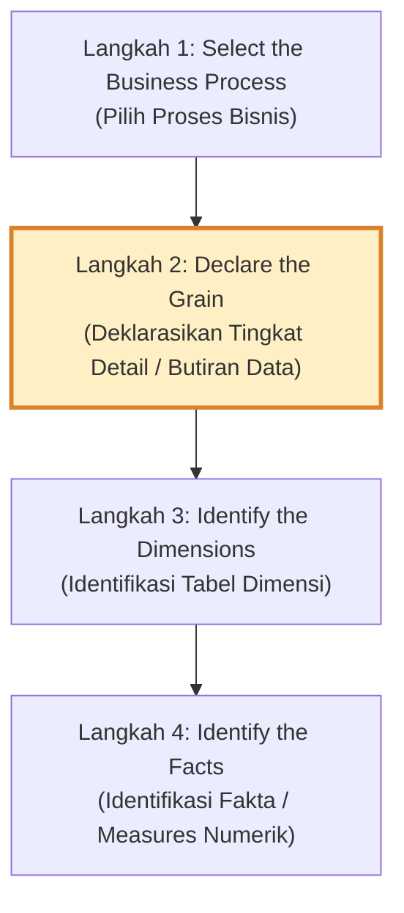

---

### 2. Bedah Langkah demi Langkah

#### Langkah 1: Select the Business Process (Pilih Proses Bisnis)
- **Definisi**: Menentukan aktivitas operasional dunia nyata yang dilakukan organisasi dan menghasilkan data yang terukur.
- **Prinsip Penting**: Proses bisnis **bukanlah departemen organisasi**. Departemen Penjualan bukanlah proses bisnis, melainkan *"Pemesanan Produk oleh Pelanggan"* atau *"Pembayaran Faktur"* adalah proses bisnisnya.
- **Contoh**: Transaksi Kasir POS, Pendaftaran Rawat Inap Rumah Sakit, Pengiriman Paket Kurir, Perekrutan Pegawai.

#### Langkah 2: Declare the Grain (Deklarasikan Butiran / Tingkat Detail)
- **Definisi**: Menetapkan secara persis **apa yang direpresentasikan oleh satu baris data (*single row*) di dalam Fact Table**.
- **Prinsip Emas**: Ini adalah **langkah paling kritis dan fundamental** dalam seluruh proses pemodelan dimensional. Anda tidak boleh melangkah ke Langkah 3 dan 4 sebelum *grain* disepakati secara mutlak.
- **Tingkatan Grain**:
  1. *Atomic Grain* (Sangat disarankan): Tingkat paling detail dari transaksi mentah (misal: *Satu baris merepresentasikan satu item barang yang dipindai kasir pada suatu struk belanja*).
  2. *Periodic Snapshot Grain*: Snapshot status pada interval waktu berkala (misal: *Satu baris merepresentasikan saldo akhir harian rekening nasabah*).
  3. *Accumulating Snapshot Grain*: Melacak siklus hidup proses dari awal hingga selesai (misal: *Satu baris merepresentasikan satu berkas klaim asuransi sejak diajukan hingga disetujui/ditolak*).

::: {.callout .callout-caution}
::: {.callout-header}
🛑 **Bahaya Fatal: Mencampuradukkan Tingkat Grain (Grain Mismatch)**
:::
::: {.callout-body}
Kesalahan paling fatal dalam ujian perancangan data warehouse adalah memasukkan fakta yang memiliki level detail berbeda ke dalam satu tabel fakta yang sama!  
**Contoh Salah**: Menaruh `HeaderTotalDiscount` (berlaku untuk 1 struk belanja) dan `ItemQuantitySold` (berlaku untuk 1 baris barang) di dalam satu tabel fakta dengan grain *per-item belanja*. Hal ini akan menyebabkan diskon terhitung berkali-kali (*double counting*) saat di-SUM!
:::
:::

#### Langkah 3: Identify the Dimensions (Identifikasi Tabel Dimensi)
- **Definisi**: Menentukan seluruh konteks deskriptif yang menjawab pertanyaan: *"Siapa, apa, di mana, kapan, dan bagaimana"* peristiwa pada tingkat grain tersebut terjadi.
- Dimensi harus dipilih secara konsisten dengan grain yang telah dideklarasikan di Langkah 2.
- **Contoh untuk Grain per-item belanja**:
  - Kapan dibeli? $\to$ `Dim_Date`, `Dim_Time`
  - Siapa yang membeli? $\to$ `Dim_Customer`
  - Barang apa yang dibeli? $\to$ `Dim_Product`
  - Di toko mana? $\to$ `Dim_Store`
  - Kasir mana yang melayani? $\to$ `Dim_Cashier`
  - Promosi apa yang aktif? $\to$ `Dim_Promotion`

#### Langkah 4: Identify the Facts (Identifikasi Fakta / Measures)
- **Definisi**: Menentukan pengukuran numerik kuantitatif yang dihasilkan dari peristiwa bisnis pada tingkat grain tersebut.
- Seluruh fakta yang dimasukkan **wajib benar-benar berlaku dan terukur pada tingkat grain yang telah dideklarasikan**.
- **Contoh fakta untuk Grain per-item belanja**:
  - `QuantitySold` (unit)
  - `ExtendedSalesAmount` (Rp)
  - `ExtendedCostAmount` (Rp)
  - `DiscountAmount` (Rp)

---

### 3. Conformed Dimensions & Enterprise Bus Architecture

Salah satu tantangan terbesar pendekatan *Bottom-Up* Ralph Kimball adalah mencegah agar pembangunan *Data Mart* per divisi tidak berubah menjadi *Silo Data* baru. Solusinya adalah standarisasi **Conformed Dimensions**.

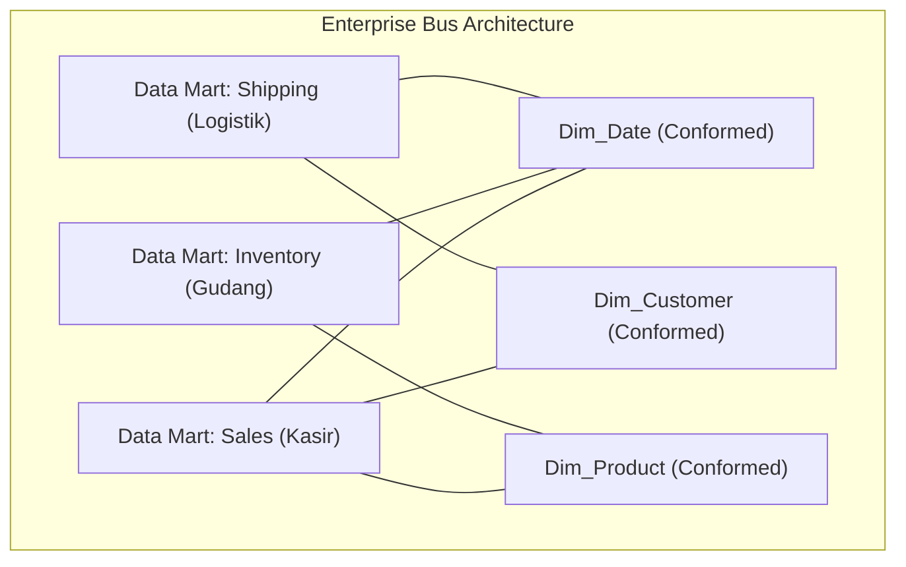

#### A. Definisi Conformed Dimensions
**Conformed Dimension** adalah tabel dimensi yang memiliki arti konsisten, konvensi penamaan seragam, struktur atribut identik, dan domain nilai domain yang sama di seluruh organisasi, sehingga dapat digunakan bersama oleh berbagai proses bisnis (*shared across multiple fact tables*).

Contoh: Tabel `Dim_Date` yang sama persis digunakan oleh tim Penjualan, tim Penggajian, dan tim Pengiriman Logistik.

#### B. Enterprise Data Warehouse Bus Architecture
Ralph Kimball merancang **Bus Matrix** sebagai cetak biru integrasi enterprise:
- **Baris matriks** merepresentasikan *Proses Bisnis* (Tabel Fakta).
- **Kolom matriks** merepresentasikan *Dimensi Terstandarisasi* (Conformed Dimensions).
- Tanda centang ($\checkmark$) menunjukkan proses bisnis mana saja yang memanfaatkan dimensi tersebut.

| Business Process (Fact) | Dim_Date | Dim_Customer | Dim_Product | Dim_Store | Dim_Shipper | Dim_Employee |
| :--- | :---: | :---: | :---: | :---: | :---: | :---: |
| **Retail Sales (Kasir)** | $\checkmark$ | $\checkmark$ | $\checkmark$ | $\checkmark$ | | $\checkmark$ |
| **Warehouse Inventory** | $\checkmark$ | | $\checkmark$ | $\checkmark$ | | |
| **Order Shipping** | $\checkmark$ | $\checkmark$ | $\checkmark$ | | $\checkmark$ | |
| **Customer Support Call**| $\checkmark$ | $\checkmark$ | $\checkmark$ | | | $\checkmark$ |

---

### 🎯 Hal-Hal yang Kemungkinan Besar Masuk Ujian

1. **Urutan 4 Langkah Kimball**:
   - Hafalkan urutannya: **(1) Process $\to$ (2) Grain $\to$ (3) Dimensions $\to$ (4) Facts**. Jangan sampai terbalik antara Dimensions dan Facts!
2. **Arti Penting Deklarasi Grain**:
   - Dosen kerap menanyakan: *"Mengapa 'Declare the Grain' disebut sebagai langkah paling krusial?"*  
   *Jawab*: Karena grain menentukan batas detail data. Dimensi dan fakta tidak dapat ditentukan sebelum grain pasti. Salah menentukan grain berakibat fatal pada perhitungan fakta (*double counting*).
3. **Definisi Conformed Dimensions**:
   - Kata kunci: **Dimensi bersama (*shared dimensions*) dengan definisi seragam lintas proses bisnis untuk mencegah data silos**.
4. **Prinsip Atomic Grain**:
   - Ralph Kimball sangat menganjurkan menyimpan data pada tingkat paling atomik (*most atomic grain*) karena memberikan fleksibilitas analisis kueri tanpa batas (*drill-down* maksimal).

---

### 📋 Contoh Soal Ujian (Pilihan Ganda & Esai)

#### Contoh Soal Pilihan Ganda
**Soal 1 (Urutan Metodologi Kimball)**  
Dalam metodologi perancangan pemodelan dimensional menurut Ralph Kimball, urutan 4 langkah utama yang benar adalah...  
A. (1) Declare Grain $\to$ (2) Select Business Process $\to$ (3) Identify Facts $\to$ (4) Identify Dimensions  
B. (1) Select Business Process $\to$ (2) Declare Grain $\to$ (3) Identify Dimensions $\to$ (4) Identify Facts  
C. (1) Identify Dimensions $\to$ (2) Identify Facts $\to$ (3) Declare Grain $\to$ (4) Select Business Process  
D. (1) Select Business Process $\to$ (2) Identify Facts $\to$ (3) Declare Grain $\to$ (4) Identify Dimensions  
*Kunci Jawaban*: **B**  
*Pembahasan*: Tahap Kimball harus dimulai dari memilih proses bisnis, kemudian mendeklarasikan grain, lalu mengidentifikasi tabel dimensi, dan terakhir mengidentifikasi fakta numerik.

**Soal 2 (Peranan Conformed Dimensions)**  
Tabel dimensi `Dim_Pelanggan` yang digunakan secara seragam oleh Data Mart Penjualan Online, Data Mart Penjualan Toko Fisik, dan Data Mart Layanan Komplain Pelanggan dengan definisi atribut yang konsisten di seluruh perusahaan disebut...  
A. *Junk Dimension*  
B. *Degenerate Dimension*  
C. *Conformed Dimension*  
D. *Role-Playing Dimension*  
*Kunci Jawaban*: **C**  
*Pembahasan*: Conformed Dimension adalah dimensi bersama yang distandarisasi untuk menghubungkan berbagai tabel fakta dalam arsitektur bus Kimball.

---

#### Contoh Soal Esai
**Soal Esai**:  
Sebuah apotek modern ingin membangun Data Warehouse untuk memantau transaksi penjualan obat.  
a. Terapkan **4 Langkah Kimball Dimensional Lifecycle** secara lengkap untuk merancang sistem tersebut! Tentukan secara eksplisit: (1) Nama Proses Bisnis, (2) Deklarasi Grain yang tepat, (3) Minimal 4 Tabel Dimensi beserta atributnya, dan (4) Minimal 3 Fakta Numerik!  
b. Jelaskan apa yang akan terjadi jika analis salah mendeklarasikan grain (misal mencampuradukkan grain level transaksi struk dengan level item obat)!

**Pedoman Jawaban Lengkap**:
1. **Penerapan 4 Langkah Kimball**:
   - **Langkah 1 (Select Business Process)**: Proses Transaksi Penjualan Obat di Kasir Apotek.
   - **Langkah 2 (Declare the Grain)**: *"Satu baris pada tabel fakta merepresentasikan satu item obat yang tertera pada satu struk transaksi penjualan oleh kasir apotek pada waktu tertentu."*
   - **Langkah 3 (Identify Dimensions)**:
     - `Dim_Date`: `DateKey (PK)`, `FullDate`, `DayName`, `Month`, `Year`.
     - `Dim_Medicine`: `MedicineKey (PK)`, `MedicineName`, `Category`, `DosageForm`, `Manufacturer`.
     - `Dim_PharmacyBranch`: `BranchKey (PK)`, `BranchName`, `City`, `Province`.
     - `Dim_Pharmacist`: `PharmacistKey (PK)`, `PharmacistName`, `LicenseNumber`.
   - **Langkah 4 (Identify Facts)**:
     - `QuantitySold` (Jumlah butir/strip obat terjual - Additive).
     - `SalesAmount` (Total nilai rupiah obat terjual - Additive).
     - `DiscountAmount` (Potongan harga item obat - Additive).
2. **Analisis Bahaya Grain Mismatch**:
   - Jika grain level struk (misal: Biaya Layanan Racik Resep per struk Rp 10.000) dicampur ke dalam tabel fakta yang ber-grain level item obat:
   - Apabila seorang pasien membeli 5 jenis obat dalam 1 struk, maka biaya racik Rp 10.000 akan tercatat di ke-5 baris item obat tersebut.
   - Saat tim keuangan menjalankan kueri agregasi `SUM(BiayaRacik)` per bulan, sistem akan melakukan penggandaan nilai (*double counting / overstatement*) sebanyak 5 kali lipat (menjadi Rp 50.000), menghasilkan laporan keuangan yang salah secara fatal.

---

### 💡 Tips & Trik Menjawab Soal Ujian

1. **Jurus Hafalan 4 Langkah Kimball**:
   - Ingat akronim: **P - G - D - F** (*Process $\to$ Grain $\to$ Dimensions $\to$ Facts*).
2. **Cara Menulis Deklarasi Grain Sempurna di Esai**:
   - Selalu gunakan format kalimat standar: *"Satu baris pada tabel fakta merepresentasikan [X] pada [WAKTU TERTENTU]"*.
   - Contoh: *"Satu baris data merepresentasikan satu panggilan telepon yang diselesaikan oleh agen customer service."*


## 🔄 02.4 Slowly Changing Dimensions (SCD Tipe 1, 2, dan 3)

::: {.callout .callout-abstract}
::: {.callout-header}
📖 **Ringkasan Sub-Materi**
:::
::: {.callout-body}
Menelaah teknik pengelolaan perubahan data pada tabel dimensi seiring berjalannya waktu yang dikenal sebagai **Slowly Changing Dimensions (SCD)**. Sub-materi ini membedah mekanisme kerja, skema tabel, kelebihan, dan kelemahan dari **SCD Tipe 1** (*Overwrite*), **SCD Tipe 2** (*Add New Row*), dan **SCD Tipe 3** (*Add New Column*), dilengkapi studi kasus nyata, kisi-kisi ujian, dan panduan menjawab esai.
:::
:::

---

### 1. Mengapa Kita Membutuhkan SCD?

Dalam dunia nyata, data entitas pada tabel dimensi tidak bersifat permanen statis, melainkan **berubah secara perlahan** (*slowly changes*):
- Seorang pelanggan berpindah domisili dari Jakarta ke Surabaya.
- Seorang karyawan dimutasi dari Divisi Penjualan ke Divisi Pemasaran.
- Seorang pasien mengubah status penjaminan dari Peserta Umum menjadi BPJS Kesehatan.

Jika sistem Data Warehouse tidak memiliki strategi penanganan perubahan data dimensi, analisis laporan historis akan rusak. Ralph Kimball merumuskan tiga teknik dasar SCD yang paling umum diuji: **Tipe 1, Tipe 2, dan Tipe 3**.

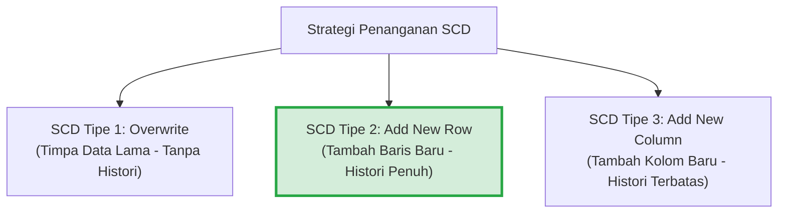

---

### 2. Bedah Detail Mekanisme SCD Tipe 1, 2, dan 3

#### A. SCD Tipe 1: Overwrite (Menimpa Nilai Lama)
- **Mekanisme**: Nilai atribut lama pada tabel dimensi langsung ditimpa (*overwrite*) dengan nilai atribut baru. Tidak ada riwayat masa lalu yang disimpan.
- **Karakteristik**:
  - Paling mudah diimplementasikan (hanya perintah SQL `UPDATE`).
  - Ukuran tabel dimensi tetap sama (tidak bertambah baris maupun kolom).
- **Dampak Analitis**:
  - Seluruh transaksi masa lalu di tabel fakta yang terhubung ke baris tersebut **secara retroaktif akan dianggap terjadi di bawah atribut yang baru**.
- **Kasus Penggunaan yang Tepat**:
  - Koreksi kesalahan ketik (*spelling error / typo*), misal memperbaiki nama "Budi Santoso" yang salah ketik menjadi "Budi Santoso".
  - Data yang memang tidak relevan riwayat historisnya (misal: perubahan nomor telepon atau email pelanggan).

##### Simulasi Kasus SCD Tipe 1:
Pelanggan ID `C101` (Budi) pindah alamat dari "Bandung" ke "Jakarta".
*Sebelum Perubahan*:
| CustomerKey (PK) | CustomerID_Natural | CustomerName | City |
| :---: | :---: | :---: | :---: |
| 1 | C101 | Budi | Bandung |

*Setelah SCD Tipe 1 (Ditutupi)*:
| CustomerKey (PK) | CustomerID_Natural | CustomerName | City |
| :---: | :---: | :---: | :---: |
| 1 | C101 | Budi | **Jakarta** |
*(Catatan: Transaksi belanja Budi tahun lalu saat masih tinggal di Bandung kini dilaporkan sebagai penjualan wilayah Jakarta).*

---

#### B. SCD Tipe 2: Add New Row (Menambah Baris Baru) - *Standar Emas Industri*
- **Mekanisme**: Setiap kali terjadi perubahan nilai atribut, sistem **menambahkan satu baris baru (*new row*)** ke dalam tabel dimensi. Nilai baris lama tetap dipertahankan untuk mengunci kebenaran data historis.
- **Syarat Wajib Desain Tabel SCD Tipe 2**:
  1. Wajib menggunakan **Surrogate Key** baru sebagai Primary Key.
  2. Wajib menambahkan kolom metadata pelacak masa berlaku:
     - `Effective_Start_Date` (Tanggal mulai berlakunya nilai baru).
     - `Effective_End_Date` (Tanggal berakhirnya nilai tersebut, diisi nilai konvensi masa depan seperti `9999-12-31` jika masih aktif).
     - `Is_Current_Flag` (Flag penanda status aktif: `'Y'` atau `'N'`, atau boolean `1/0`).
- **Kelebihan**:
  - **Integritas Historis Sempurna 100%**: Transaksi masa lalu tetap mereferensikan status lama (`CustomerKey: 1`), sedangkan transaksi masa depan akan mereferensikan status baru (`CustomerKey: 2`).
- **Kelemahan**:
  - Ukuran tabel dimensi membesar karena bertambahnya baris baru untuk setiap perubahan entitas.

##### Simulasi Kasus SCD Tipe 2:
Pelanggan `C101` (Budi) pindah alamat dari "Bandung" ke "Jakarta" pada tanggal `2025-06-01`.
*Sebelum Perubahan*:
| CustomerKey (PK) | CustomerID | CustomerName | City | StartDate | EndDate | IsCurrent |
| :---: | :---: | :---: | :---: | :---: | :---: | :---: |
| 1 | C101 | Budi | Bandung | 2024-01-01 | 9999-12-31 | Y |

*Setelah SCD Tipe 2 Diterapkan*:
| CustomerKey (PK) | CustomerID | CustomerName | City | StartDate | EndDate | IsCurrent |
| :---: | :---: | :---: | :---: | :---: | :---: | :---: |
| 1 | C101 | Budi | Bandung | 2024-01-01 | **2025-05-31** | **N** |
| **2** | C101 | Budi | **Jakarta** | **2025-06-01** | **9999-12-31** | **Y** |

---

#### C. SCD Tipe 3: Add New Column (Menambah Kolom Baru)
- **Mekanisme**: Struktur tabel dimensi dimodifikasi dengan **menambahkan kolom baru (*new column*)** untuk menampung nilai atribut sebelumnya (*previous value*).
- **Karakteristik**:
  - Hanya menyimpan riwayat terbatas (biasanya hanya 2 status: status sekarang dan tepat satu status sebelumnya).
  - Jumlah baris tidak bertambah, namun struktur kolom tabel melebar.
- **Kasus Penggunaan**:
  - Sangat jarang digunakan, kecuali untuk kasus perombakan wilayah penjualan (*sales territory realignment*), di mana analis ingin membandingkan performa penjualan sales rep berdasarkan wilayah baru vs wilayah lama secara berdampingan.

##### Simulasi Kasus SCD Tipe 3:
*Tabel Setelah SCD Tipe 3*:
| CustomerKey (PK) | CustomerID | CustomerName | Current_City | Previous_City | Effective_Date |
| :---: | :---: | :---: | :---: | :---: | :---: |
| 1 | C101 | Budi | **Jakarta** | **Bandung** | 2025-06-01 |

---

### 3. Matriks Komparasi Ringkas SCD: Tipe 1 vs Tipe 2 vs Tipe 3

| Dimensi Perbandingan | SCD Tipe 1 (*Overwrite*) | SCD Tipe 2 (*Add Row*) | SCD Tipe 3 (*Add Column*) |
| :--- | :--- | :--- | :--- |
| **Penyimpanan Riwayat** | **Nol / Tidak ada** | **Penuh (Tak terbatas)** | **Terbatas (Hanya 1 riwayat lama)** |
| **Perubahan Tabel** | Update nilai kolom di baris lama | Insert baris baru + Update baris lama | Menambah kolom baru pada skema |
| **Kebutuhan Kolom Pelacak**| Tidak ada | `StartDate`, `EndDate`, `IsCurrent` | `Current_Col`, `Previous_Col` |
| **Dampak Ukuran Tabel** | Ukuran tetap konstan | Jumlah baris bertambah (*deeper table*) | Jumlah kolom bertambah (*wider table*) |
| **Kebutuhan Surrogate Key**| Opsional | **Wajib Mutlak** | Opsional |
| **Kompleksitas ETL** | Sangat Rendah | Sedang hingga Tinggi | Sedang |
| **Kasus Ideal** | Koreksi salah ketik, data tidak penting | Mutasi jabatan, domisili, asuransi | Restrukturisasi wilayah penjualan |

---

### 🎯 Hal-Hal yang Kemungkinan Besar Masuk Ujian

1. **Atribut Metadata Wajib SCD Tipe 2**:
   - Dosen pasti memeriksa apakah Anda menyertakan 3 kolom pengendali waktu: **`Start_Date`**, **`End_Date`**, dan **`Is_Current_Flag`**.
2. **Kapan Menggunakan SCD Tipe 1 vs Tipe 2**:
   - Jika kasusnya **koreksi typo / kesalahan input** $\to$ gunakan **SCD Tipe 1**.
   - Jika kasusnya **perubahan riwayat hidup nyata (mutasi divisi, ganti asuransi, pindah kota)** $\to$ wajib gunakan **SCD Tipe 2**.
3. **Mengapa SCD Tipe 2 Butuh Surrogate Key**:
   - Pertanyaan jebakan di PG: jika menggunakan Natural Key (KTP), penambahan baris baru akan memicu error duplikasi Primary Key.
4. **Karakteristik SCD Tipe 3**:
   - Kata kunci: **Hanya menyimpan 1 perubahan terakhir menggunakan kolom tambahan (*Current vs Previous*)**.

---

### 📋 Contoh Soal Ujian (Pilihan Ganda & Esai)

#### Contoh Soal Pilihan Ganda
**Soal 1 (Identifikasi Metode SCD)**  
Seorang pegawai bernama Siti Mariyah dipromosikan dari jabatan "Senior Lektor" menjadi "Guru Besar / Profesor". Manajemen ingin agar publikasi riset yang dilakukan beliau sebelum tanggal promosi tetap tercatat atas jabatan "Senior Lektor", sedangkan riset setelah tanggal promosi tercatat atas jabatan "Guru Besar". Metode SCD manakah yang wajib diterapkan pada tabel dimensi pegawai?  
A. SCD Tipe 0 (Retain Original)  
B. SCD Tipe 1 (Overwrite)  
C. SCD Tipe 2 (Add New Row)  
D. SCD Tipe 3 (Add New Column)  
*Kunci Jawaban*: **C**  
*Pembahasan*: Kebutuhan untuk mempertahankan asosiasi historis transaksi lama ke atribut lama dan mengaitkan transaksi baru ke atribut baru hanya dapat dipenuhi secara sempurna oleh SCD Tipe 2.

**Soal 2 (Kolom Pengendali SCD Tipe 2)**  
Dalam implementasi SCD Tipe 2, baris data dimensi yang saat ini berstatus aktif dan berlaku bagi transaksi baru ditandai dengan nilai kolom...  
A. `End_Date = NULL` atau konvensi masa depan seperti `9999-12-31`, serta `Is_Current = 'Y'`  
B. `Start_Date = End_Date`  
C. `Is_Current = 'N'`  
D. `Surrogate_Key = 0`  
*Kunci Jawaban*: **A**  
*Pembahasan*: Baris aktif pada SCD 2 ditandai dengan `End_Date` bernilai masa depan tak terhingga (`9999-12-31`) dan flag aktif bernilai `'Y'` atau `True`.

---

#### Contoh Soal Esai
**Soal Esai**:  
Sebuah rumah sakit menggunakan Data Warehouse untuk memantau klaim biaya pengobatan pasien. Pasien bernama Ahmad (ID Pasien Alami: `PAS-772`) semula terdaftar dengan metode pembayaran "Umum/Mandiri". Pada tanggal 1 Oktober 2025, Ahmad memperbarui data kepesertaannya menjadi "BPJS Kesehatan".  
a. Tunjukkan skema tabel dimensi `Dim_Patient` lengkap dengan kolom-kolom yang diperlukan untuk mengimplementasikan **SCD Tipe 2**!  
b. Buatlah tabel simulasi data yang menunjukkan kondisi data pasien Ahmad **sebelum dan sesudah tanggal 1 Oktober 2025**!  
c. Jelaskan bagaimana tabel fakta transaksi klaim rawat inap memastikan bahwa biaya tindakan medis Ahmad pada bulan Agustus 2025 tetap terhitung sebagai pasien Umum, sedangkan tindakan medis pada bulan November 2025 terhitung sebagai pasien BPJS!

**Pedoman Jawaban Lengkap**:
1. **Skema Tabel `Dim_Patient` (SCD Tipe 2)**:
   - `PatientKey` (INT, Surrogate Primary Key)
   - `PatientID_Natural` (VARCHAR, Business Key dari sistem RS)
   - `PatientName` (VARCHAR)
   - `InsuranceType` (VARCHAR - Atribut yang dipantau perubahannya)
   - `Effective_Start_Date` (DATE)
   - `Effective_End_Date` (DATE)
   - `Is_Current` (CHAR(1))
2. **Simulasi Data Tabel `Dim_Patient`**:
   *Kondisi Setelah 1 Oktober 2025*:
   | PatientKey | PatientID_Natural | PatientName | InsuranceType | Effective_Start_Date | Effective_End_Date | Is_Current |
   | :---: | :---: | :---: | :---: | :---: | :---: | :---: |
   | **101** | PAS-772 | Ahmad | Umum/Mandiri | 2024-01-01 | **2025-09-30** | **N** |
   | **102** | PAS-772 | Ahmad | **BPJS Kesehatan** | **2025-10-01** | **9999-12-31** | **Y** |
3. **Mekanisme Keterkaitan dengan Fact Table**:
   - Pada bulan Agustus 2025, saat pipeline ETL memuat transaksi tindakan medis Ahmad ke `Fact_MedicalTreatment`, proses lookup ETL mencocokkan tanggal transaksi dengan rentang `Start_Date` dan `End_Date` di dimensi. Ditemukan bahwa pada bulan Agustus 2025 baris yang aktif adalah `PatientKey = 101`. Maka baris fakta tersebut menyimpan `PatientKey = 101`.
   - Pada bulan November 2025, transaksi tindakan medis Ahmad diproses oleh ETL. Lookup tanggal mendapati baris aktif saat itu adalah `PatientKey = 102`. Maka baris fakta baru menyimpan `PatientKey = 102`.
   - Dengan demikian, saat kueri laporan agregasi dijalankan:
     - Kueri agregasi historis Agustus secara otomatis menghubungkan ke `PatientKey = 101` (tercatat sebagai pasien "Umum/Mandiri").
     - Kueri agregasi November secara otomatis menghubungkan ke `PatientKey = 102` (tercatat sebagai pasien "BPJS Kesehatan"). Integritas pelaporan audit terjaga secara sempurna tanpa data hilang!

---

### 💡 Tips & Trik Menjawab Soal Ujian

1. **Jurus Menggambar Tabel SCD 2 di Ujian**:
   - Selalu buat tabel simulasi dengan **minimal 2 baris data untuk 1 entitas yang sama** (tunjukkan baris sebelum dan baris sesudah perubahan).
   - Tunjukkan perubahan tanggal `EndDate` baris lama yang ditutup, dan `StartDate` baris baru yang dibuka.
   - Sorot kolom `PatientKey` yang nilainya berbeda (misal `101` dan `102`) untuk membuktikan pentingnya **Surrogate Key**.
2. **Formula Menjawab Kapan Pakai SCD 1 vs 2**:
   - Jika perubahan karena *kesalahan teknis/typo* $\to$ Jelaskan memakai **SCD Tipe 1** agar tidak mengotori riwayat dengan data salah.
   - Jika perubahan karena *peristiwa nyata dalam hidup entitas* $\to$ Jelaskan memakai **SCD Tipe 2** untuk akurasi data analitik historis.


## 🧊 02.5 Operasi Multidimensi OLAP Data Cube & Server OLAP

::: {.callout .callout-abstract}
::: {.callout-header}
📖 **Ringkasan Sub-Materi**
:::
::: {.callout-body}
Menelaah konsep visualisasi dan analisis data multidimensi melalui **OLAP Data Cube** ($N$-dimensi). Sub-materi ini mengupas 5 operasi manipulasi data kubus (*Roll-up, Drill-down, Slice, Dice, Pivot*), klasifikasi arsitektur server OLAP (**MOLAP, ROLAP, HOLAP, DOLAP**), kisi-kisi ujian, dan strategi menjawab soal pembeda.
:::
:::

---

### 1. Konsep Data Cube ($N$-Dimensional Cube)

Untuk kebutuhan analisis bisnis cepat, data transaksi tidak disajikan dalam bentuk tabel baris datar (*flat rows*), melainkan dimodelkan ke dalam ruang geometris $N$-dimensi yang disebut **Data Cube**:
- **Sumbu / Dimensi Kubus**: Mewakili entitas analisis (misal Sumbu $X$ = Produk, Sumbu $Y$ = Wilayah, Sumbu $Z$ = Waktu).
- **Sel Kubus (*Cells*)**: Titik potong antar-dimensi yang memuat nilai fakta numerik (*Measures*, misal Total Pendapatan Penjualan).

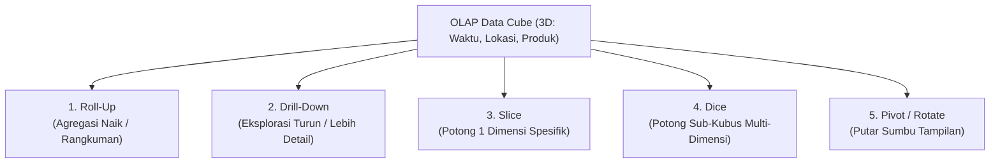

---

### 2. 5 Operasi Dasar Manipulasi OLAP Data Cube

Dosen sering menguji pemahaman definisi dan perbedaan teknis dari 5 operasi ini:

#### A. Roll-Up (Drill-Up / Agregasi Naik)
- **Definisi**: Mengurangi tingkat kedetailan data (*decreasing granularity*) dengan cara merangkum data ke tingkat hierarki yang lebih tinggi pada satu dimensi, atau dengan menghapus salah satu dimensi dari kubus.
- **Contoh Kasus**:
  - Pada Dimensi Lokasi: Dari melihat data penjualan per **Kota** $\to$ naik menjadi data penjualan per **Provinsi** $\to$ naik menjadi per **Negara**.
  - Pada Dimensi Waktu: Dari data penjualan per **Hari** $\to$ dirangkum menjadi data per **Bulan** $\to$ per **Tahun**.
- **Efek Data**: Jumlah baris data menyusut, angka berupa hasil agregasi penjumlahan (`SUM`).

#### B. Drill-Down (Navigasi Menurun / Peningkatan Detail)
- **Definisi**: Kebalikan mutlak dari Roll-Up. Menambah tingkat kedetailan data (*increasing granularity*) dengan memecah data ringkasan ke tingkat hierarki yang lebih rendah, atau dengan menambahkan dimensi analisis baru ke dalam kubus.
- **Contoh Kasus**:
  - Pada Dimensi Waktu: Dari melihat total penjualan **Tahun 2025** $\to$ dipecah (*drill-down*) untuk melihat rincian per **Kuartal (Q1, Q2, Q3, Q4)** $\to$ dipecah lebih lanjut per **Bulan**.
- **Efek Data**: Data yang disajikan menjadi lebih banyak dan lebih spesifik.

#### C. Slice (Irisan Satu Dimensi)
- **Definisi**: Memilih **tepat SATU nilai konstan pada SATU dimensi tertentu**, sehingga menghasilkan sub-kubus dengan dimensi $N-1$ (membuat "selembar irisan" dari kubus).
- **Contoh Kasus**:
  - Dari kubus 3D (Waktu, Lokasi, Produk), analis menetapkan kriteria: `Waktu = 'Tahun 2025'`.
  - Hasilnya adalah tabel 2D yang hanya menampilkan relasi antara `Lokasi` dan `Produk` khusus untuk tahun 2025 saja.

#### D. Dice (Potongan Sub-Kubus Multi-Dimensi)
- **Definisi**: Memilih rentang nilai (*range of values*) pada **DUA ATAU LEBIH dimensi sekaligus**, menghasilkan sub-kubus yang lebih kecil (*smaller sub-cube*).
- **Contoh Kasus**:
  - Analis menetapkan filter kriteria majemuk:  
    `Lokasi IN ('Jakarta', 'Surabaya')` **AND**  
    `Waktu IN ('Q1', 'Q2')` **AND**  
    `Produk IN ('Laptop', 'Tablet')`.
  - Hasilnya adalah sebuah kubus mini 3 dimensi yang terisolasi pada kriteria tersebut.

::: {.callout .callout-important}
::: {.callout-header}
⚡ **Perbedaan Kritis Ujian: Slice vs Dice**
:::
::: {.callout-body}
- **Slice** = Memotong pada **SATU dimensi tunggal** dengan satu nilai tetap (Klausul SQL setara: `WHERE Dimensi_A = 'X'`).
- **Dice** = Memotong pada **DUA ATAU LEBIH dimensi** dengan rentang nilai selektif (Klausul SQL setara: `WHERE Dimensi_A IN (...) AND Dimensi_B IN (...)`).
:::
:::

#### E. Pivot (Rotate / Pemutaran Sumbu)
- **Definisi**: Memutar sumbu koordinat dimensi data untuk menyajikan data dari sudut pandang yang berbeda pada tampilan tabel silang (*crosstab / matrix*).
- **Contoh Kasus**:
  - Semula baris menampilkan `Kategori Produk` dan kolom menampilkan `Nama Kota`.
  - Dengan operasi Pivot, baris diubah menjadi `Nama Kota` dan kolom menjadi `Kategori Produk` tanpa mengubah nilai numerik di dalamnya.

---

### 3. Klasifikasi Arsitektur Server OLAP

Berdasarkan cara penyimpanan fisik data dan mesin kalkulasinya, server OLAP diklasifikasikan menjadi 4 arsitektur:

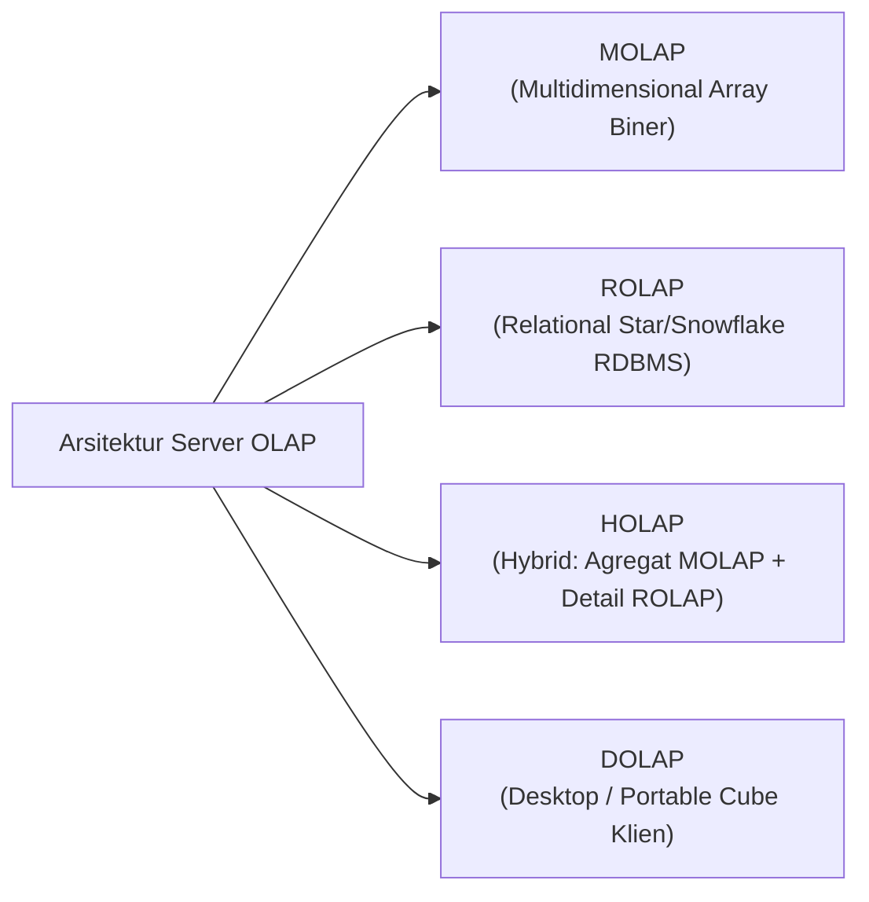

#### A. MOLAP (Multidimensional OLAP)
- **Penyimpanan**: Data disimpan dalam format array multidimensi biner berpemilik (*proprietary multidimensional storage*), bukan di dalam tabel RDBMS standar.
- **Karakteristik**:
  - Seluruh kemungkinan kombinasi agregasi telah **dihitung di awal (*pre-calculated / pre-aggregated*)** saat kubus dibangun (*cube processing*).
- **Kelebihan**: Kecepatan kueri agregasi super cepat dan konsisten (*sub-second response time*).
- **Kelemahan**:
  - Butuh waktu lama saat memproses kubus (*batch cube build*).
  - Mengalami masalah ruang kosong data (*Data Sparsity problem*).
  - Skalabilitas terbatas (sulit menampung data hingga skala Petabyte).

#### B. ROLAP (Relational OLAP)
- **Penyimpanan**: Data disimpan langsung di dalam **RDBMS relasional standar** menggunakan skema dimensional (*Star* atau *Snowflake Schema*).
- **Karakteristik**:
  - Tidak membuat file kubus biner terpisah; kueri multidimensi diterjemahkan secara dinamis oleh mesin ROLAP menjadi kueri SQL kompleks (`SELECT ... GROUP BY`).
- **Kelebihan**: Skalabilitas kapasitas data hampir tidak terbatas (mampu mengolah Terabyte hingga Petabyte).
- **Kelemahan**: Kecepatan kueri agregasi lebih lambat dibandingkan MOLAP karena mesin SQL harus menghitung agregasi secara dinamis saat kueri diminta.

#### C. HOLAP (Hybrid OLAP)
- **Penyimpanan**: Menggabungkan kelebihan terbaik dari MOLAP dan ROLAP.
  - Data agregat tingkat tinggi (*summary data*) yang sering diakses disimpan di dalam struktur **MOLAP** untuk kecepatan respon kueri.
  - Data detail atomik yang sangat besar disimpan di dalam tabel relasional **ROLAP**.
- **Kelebihan**: Memberikan respon kueri yang sangat cepat untuk dashboard eksekutif sekaligus tetap memungkinkan pengguna melakukan *drill-down* hingga ke level data atomik terdalam.

#### D. DOLAP (Desktop OLAP)
- Kubus data berukuran mini yang diunduh ke komputer desktop klien untuk analisis offline tanpa perlu terhubung terus-menerus ke server pusat.

---

### 4. Matriks Komparasi: MOLAP vs ROLAP

| Kriteria Evaluasi | MOLAP (*Multidimensional OLAP*) | ROLAP (*Relational OLAP*) |
| :--- | :--- | :--- |
| **Media Penyimpanan** | File array multidimensi biner khusus | Basis data relasional standar (RDBMS) |
| **Kecepatan Kueri** | **Sangat Cepat (Instan / Sub-detik)** | Relatif lebih lambat (Tergantung JOIN & Indeks) |
| **Waktu Prapemrosesan** | Lama (Menghitung kubus di awal) | Cepat (Tidak ada pembuatan kubus biner) |
| **Kapasitas Ukuran Data** | Terbatas (Megabyte hingga Gigabyte) | **Sangat Besar (Terabyte hingga Petabyte)** |
| **Struktur Skema** | Matriks N-Dimensi | Star Schema / Snowflake Schema |
| **Kelemahan Utama** | *Data Sparsity* & batasan ukuran kubus | Beban kueri JOIN berat pada CPU database |

---

### 🎯 Hal-Hal yang Kemungkinan Besar Masuk Ujian

1. **Pasangan Operasi yang Bertolak Belakang**:
   - **Roll-Up** (merangkum / memperluas cakupan) $\longleftrightarrow$ **Drill-Down** (merinci / memperdalam detail).
2. **Pembeda Utama Slice dan Dice**:
   - Ingat: **Slice = Tepat 1 Dimensi**. **Dice = 2 atau lebih Dimensi**.
3. **Pembeda Utama MOLAP vs ROLAP**:
   - **MOLAP** = Array biner, pra-hitung di awal, kueri tercepat, skala data terbatas.
   - **ROLAP** = RDBMS relasional (Star Schema), kueri dinamis SQL, kapasitas data tak terbatas.
4. **Konsep HOLAP**:
   - Agregat ringkas di MOLAP, transaksi atomik di ROLAP.

---

### 📋 Contoh Soal Ujian (Pilihan Ganda & Esai)

#### Contoh Soal Pilihan Ganda
**Soal 1 (Operasi Slice vs Dice)**  
Seorang manajer pemasaran melakukan filter pada Data Cube penjualan untuk melihat transaksi penjualan yang terjadi hanya pada `Toko = 'Cabang Mall Senayan'`, melintasi seluruh kuartal waktu dan seluruh varian produk. Operasi OLAP yang dilakukan oleh manajer tersebut adalah...  
A. *Roll-Up*  
B. *Drill-Down*  
C. *Slice*  
D. *Dice*  
*Kunci Jawaban*: **C**  
*Pembahasan*: Karena filter dilakukan dengan mengunci tepat **satu nilai spesifik pada satu dimensi saja** (yaitu Dimensi Toko = 'Cabang Mall Senayan'), operasi ini secara definisi adalah operasi **Slice**.

**Soal 2 (Karakteristik Arsitektur MOLAP)**  
Karakteristik teknis yang paling tepat menggambarkan server *Multidimensional OLAP (MOLAP)* adalah...  
A. Data disimpan dalam bentuk tabel 3NF pada basis data PostgreSQL murni.  
B. Data disimpan dalam struktur array multidimensi khusus di mana nilai agregasi telah dihitung sebelumnya (*pre-calculated*) untuk menghasilkan respons kueri sub-detik.  
C. Mengharuskan penulisan kueri SQL manual yang panjang untuk setiap laporan.  
D. Hanya dapat berjalan di perangkat smartphone.  
*Kunci Jawaban*: **B**  
*Pembahasan*: Inti dari arsitektur MOLAP adalah penyimpanan matriks array biner dengan pra-kalkulasi agregasi instan.

---

#### Contoh Soal Esai
**Soal Esai**:  
Sebuah jaringan bioskop nasional memiliki Data Cube analitik penjualan tiket dengan tiga dimensi: `Waktu` (Tahun $\to$ Bulan $\to$ Hari), `Lokasi Bioskop` (Kota $\to$ Gedung Bioskop), dan `Genre Film` (Action, Drama, Komedi). Fakta yang diukur adalah `TotalPendapatanTiket`.  
a. Jelaskan skenario bisnis dan perubahan hierarki yang terjadi jika analis melakukan operasi **Roll-Up** pada dimensi `Waktu` dan operasi **Drill-Down** pada dimensi `Lokasi Bioskop`!  
b. Jelaskan perbedaan nyata antara operasi **Slice** dan **Dice** menggunakan contoh kasus data bioskop tersebut!

**Pedoman Jawaban Lengkap**:
1. **Analisis Skenario Roll-Up dan Drill-Down**:
   - **Roll-Up pada Dimensi Waktu**:
     - *Skenario*: Analis yang semula melihat laporan pendapatan tiket harian (*Daily*) merangkum data tersebut menjadi laporan bulanan (*Monthly*) atau tahunan (*Yearly*).
     - *Perubahan*: Granularitas data berkurang, detail harian dihilangkan, dan nilai `TotalPendapatanTiket` dijumlahkan (`SUM`) menjadi satu angka total per bulan/tahun.
   - **Drill-Down pada Dimensi Lokasi**:
     - *Skenario*: Analis yang semula melihat total pendapatan bioskop per Kota (misal: Total Jakarta Rp 5 Miliar) memecah angka tersebut untuk melihat performa spesifik masing-masing Gedung Bioskop di Jakarta (misal: Bioskop Grand Indonesia Rp 2 Miliar, Bioskop Senayan City Rp 1,8 Miliar, dst).
     - *Perubahan*: Granularitas data meningkat, informasi menjadi lebih detail dan mendalam.
2. **Perbedaan Slice dan Dice pada Kasus Bioskop**:
   - **Operasi Slice**:
     - Memotong kubus pada **SATU dimensi spesifik**.
     - *Contoh Kueri*: Analis hanya ingin menganalisis data untuk film ber-`Genre = 'Action'`. Seluruh dimensi Waktu dan Lokasi Bioskop tetap ditampilkan, namun khusus untuk genre Action saja. (Menghasilkan irisan tabel 2D: Lokasi vs Waktu untuk genre Action).
   - **Operasi Dice**:
     - Memotong sub-kubus pada **DUA ATAU LEBIH dimensi dengan rentang kriteria**.
     - *Contoh Kueri*: Analis menetapkan filter multi-dimensi:  
       `Genre IN ('Action', 'Komedi')` **AND**  
       `Lokasi Kota IN ('Jakarta', 'Bandung')` **AND**  
       `Waktu Bulan IN ('Juni', 'Juli')`.  
     - Hasilnya adalah sebuah sub-kubus mini 3 dimensi yang terisolasi khusus pada kriteria gabungan tersebut.

---

### 💡 Tips & Trik Menjawab Soal Ujian

1. **Jurus Kata Kunci 5 Operasi OLAP**:
   - Menghilangkan detail / Rangkuman naik $\to$ **Roll-Up**.
   - Menambah detail / Memecah ke bawah $\to$ **Drill-Down**.
   - Kunci 1 dimensi / 1 nilai tetap $\to$ **Slice**.
   - Kunci 2+ dimensi / filter rentang kotak $\to$ **Dice**.
   - Memutar tampilan baris dan kolom $\to$ **Pivot**.
2. **Pola Mengingat MOLAP vs ROLAP**:
   - **M**-OLAP = **M**emory / Multidimensional matrix (Super Cepat, Data Terbatas).
   - **R**-OLAP = **R**elational database (Skalabilitas Raksasa, Kueri Agregasi Lebih Lambat).


::: {.chapter-divider}
:::

::: {.chapter-header-box}
# Bab 3: Pipeline & Rekayasa ETL vs ELT

<p class="chapter-desc">Tahapan Extract, Transform, Load, Change Data Capture (CDC), Staging Area, serta paradigma modern ETL vs ELT Cloud Data Warehouse.</p>
:::

## 🔄 03.1 Pipeline & Alur Kerja Lengkap ETL (Extract, Transform, Load)

::: {.callout .callout-abstract}
::: {.callout-header}
📖 **Ringkasan Sub-Materi**
:::
::: {.callout-body}
Mengupas tuntas mekanisme kerja pipa data tradisional **ETL (Extract, Transform, Load)** sebagai tulang punggung integrasi data enterprise. Sub-materi ini membahas teknik ekstraksi data (*Full* vs *Incremental CDC*), anatomi pembersihan dan transformasi data, strategi pemuatan ke Data Warehouse, konsep *Control Flow* vs *Data Flow*, kisi-kisi ujian, dan tips menjawab soal alur kerja.
:::
:::

---

### 1. Konsep Fundamental Pipeline ETL

**ETL (Extract, Transform, Load)** adalah fondasi integrasi data yang bertanggung jawab menyalin data dari berbagai sistem operasional heterogen, membersihkan dan menyelaraskannya sesuai aturan bisnis, lalu memuatnya ke dalam repositori pusat Data Warehouse.

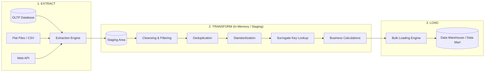

---

### 2. Alur Kerja Langkah demi Langkah

#### Tahap 1: Data Extraction (Ekstraksi Data)
Proses membaca dan menarik data mentah dari sistem sumber (*source systems*) ke dalam *Data Staging Area*.
1. **Full Extraction (Ekstraksi Penuh)**:
   - Seluruh baris data pada tabel sumber disalin tanpa filter.
   - Digunakan pada saat **Initial Load** (pemuatan perdana DWH) atau untuk tabel dimensi kecil yang jarang berubah (misal tabel kode pos atau tabel provinsi).
2. **Incremental Extraction (Delta Load)**:
   - Hanya menyalin data yang **baru bertambah atau mengalami perubahan** sejak eksekusi ETL terakhir.
   - **4 Metode Deteksi Perubahan Data (Delta Capture)**:
     - *Timestamp Column*: Menggunakan kueri `WHERE Last_Updated > :Last_ETL_Run_Time`. Kelemahan: tidak dapat mendeteksi baris yang dihapus (`DELETE`).
     - *Status Flag*: Memeriksa kolom status (misal `Is_Processed = 0`).
     - *Database Triggers*: Trigger otomatis mencatat setiap perubahan data ke tabel log audit khusus.
     - *Change Data Capture (CDC)* - **Metode Terbaik**: Membaca langsung *Transaction Log* basis data mesin (misal Binary Log MySQL atau Redo Log Oracle) tanpa membebani performa CPU tabel produksi.

---

#### Tahap 2: Data Transformation (Transformasi & Pembersihan)
Merupakan tahapan paling intensif secara komputasi dan memakan waktu terbesar (hingga 70% dari siklus proyek ETL):
1. **Data Cleansing / Scrubbing (Pembersihan Data)**:
   - Memperbaiki data kotor (*dirty data*): penanganan *null / missing values*, penghapusan karakter terlarang (*trailing spaces*, non-printable characters).
   - Validasi integritas format (misal memvalidasi apakah format nomor HP atau email valid).
2. **Deduplication (Penghapusan Duplikasi)**:
   - Mendeteksi dan menggabungkan baris data ganda yang mengacu pada entitas dunia nyata yang sama (*record linkage / fuzzy matching*).
3. **Data Conformation & Standardization**:
   - Menyeragamkan format tanggal menjadi standar ISO `YYYY-MM-DD`.
   - Mengonversi kode heterogen (misal: sistem A mencatat jenis kelamin `'1'`, sistem B mencatat `'L'`, sistem C mencatat `'M'`, diseragamkan menjadi standar `'L'`).
   - Standardisasi mata uang dan satuan ukuran fisik.
4. **Surrogate Key Lookup**:
   - Mencocokkan *Natural Key* dari sistem sumber ke tabel dimensi untuk mengambil *Surrogate Key* integer yang sesuai, serta menerapkan logika **SCD Tipe 2** (menentukan apakah record menghasilkan baris baru atau mengait ke baris aktif).
5. **Business Rule Calculation & Aggregation**:
   - Menghitung metrik turunan yang tidak ada di database operasional (misal: `TotalNetProfit = (Quantity * UnitPrice) - DiscountAmount - Tax`).
6. **Error Handling & Quarantine**:
   - Baris data yang gagal validasi (*bad records*) dialihkan secara otomatis ke tabel karantina (*Error / Reject Table*) untuk diinvestigasi oleh *Data Steward* tanpa menghentikan jalannya pipa ETL.

---

#### Tahap 3: Data Loading (Pemuatan Data ke DWH)
Proses memindahkan data yang telah bersih dan tertata dari area staging ke dalam tabel target (Fact Table dan Dimension Table di Data Warehouse):
1. **Initial Load**:
   - Pemuatan awal saat DWH pertama kali dibangun (memindahkan data historis 5 tahun sekaligus).
   - *Teknik Optimal*: Seluruh indeks dan konstrain kunci asing dinonaktifkan sementara (*disabled*), data dimuat secara paralel menggunakan *Bulk Insert*, lalu indeks dibangun kembali (*re-indexed*) untuk menghemat waktu.
2. **Incremental Load (Batch Load)**:
   - Pemuatan rutin yang dijadwalkan (misal setiap tengah malam atau setiap jam) untuk menambahkan transaksi harian baru (*append-only*).
3. **Full Refresh Load**:
   - Menghapus seluruh isi tabel target (`TRUNCATE`) dan memuat ulang seluruh data dari awal. Biasanya diterapkan pada tabel agregat ringkasan (*summary tables*).

---

### 3. Anatomi Tool ETL Enterprise (Studi Kasus Arsitektur SSIS)

Pada alat bantu ETL seperti **SQL Server Integration Services (SSIS)**, pipeline data dipisahkan secara tegas menjadi dua tingkat logika:

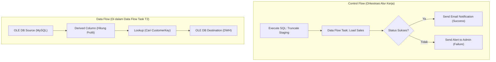

- **Control Flow**: Bertindak sebagai *konduktor orkestrasi*. Mengatur urutan eksekusi tugas (*tasks*), kontainer perulangan, kondisi percabangan logika (*precedence constraints*), dan penanganan error alur kerja.
- **Data Flow**: Bertindak sebagai *mesin pipa aliran data*. Mengalirkan baris demi baris data dari sumber (*Source*), melewati serangkaian komponen transformasi dalam memori RAM (*Transformations*), menuju ke basis data tujuan (*Destination*).

---

### 🎯 Hal-Hal yang Kemungkinan Besar Masuk Ujian

1. **Change Data Capture (CDC)**:
   - Mengapa CDC lebih disukai daripada kueri filter timestamp?  
   *Jawab*: Karena CDC membaca transaction log secara asinkron tanpa membebani tabel produksi dan mampu melacak baris yang dihapus (`DELETE`).
2. **Penanganan Data Rusak (*Bad Records*)**:
   - Pertanyaan klasik: *"Apa yang harus dilakukan sistem ETL jika menemukan baris data yang cacat saat transformasi?"*  
   *Jawab*: Jangan mematikan pipeline; alihkan data cacat tersebut ke **Tabel Karantina / Error Table** untuk audit manual, dan lanjutkan proses untuk data yang valid.
3. **Optimalisasi Initial Load**:
   - Mengapa konstrain dan indeks harus di-drop/disable saat initial load?  
   *Jawab*: Untuk mencegah mesin database memvalidasi dan memperbarui pohon indeks pada setiap baris secara individual, yang akan membuat proses load menjadi sangat lambat.
4. **Perbedaan Control Flow vs Data Flow**:
   - Control Flow = mengatur *urutan pekerjaan*; Data Flow = mengatur *transformasi fisik data di RAM*.

---

### 📋 Contoh Soal Ujian (Pilihan Ganda & Esai)

#### Contoh Soal Pilihan Ganda
**Soal 1 (Metode Ekstraksi Data)**  
Metode ekstraksi data tambahan (*incremental extraction*) yang bekerja dengan cara memantau dan membaca berkas *Transaction Log* mesin basis data tanpa mengeksekusi kueri SELECT yang membebani CPU sistem operasional disebut...  
A. *Full Table Scan*  
B. *Change Data Capture (CDC)*  
C. *Database Checkpointing*  
D. *Surrogate Key Lookup*  
*Kunci Jawaban*: **B**  
*Pembahasan*: Change Data Capture (CDC) membaca catatan log transaksi internal DBMS (seperti binlog di MySQL atau redo log di Oracle) untuk mengekstrak data delta tanpa overhead performa pada tabel produksi.

**Soal 2 (Teknik Optimasi Pemuatan Awal)**  
Saat melakukan proses *Initial Load* data historis sebesar 10 Terabyte ke dalam tabel fakta Data Warehouse, tindakan terbaik yang harus dilakukan oleh *Data Engineer* untuk mempercepat proses penulisan data adalah...  
A. Menghapus tabel fakta secara permanen.  
B. Menonaktifkan indeks dan pemeriksaan integritas referensial (Foreign Key) sebelum pemuatan, menggunakan metode *Bulk Load*, lalu membangun kembali indeks setelah pemuatan selesai.  
C. Menjalankan proses pemuatan satu baris demi satu baris (*Row-by-Row INSERT*).  
D. Menghidupkan seluruh trigger database pada tabel target.  
*Kunci Jawaban*: **B**  
*Pembahasan*: Mematikan indeks dan konstrain mencegah *overhead* kalkulasi pohon B-Tree berulang-ulang untuk setiap baris data yang dimasukkan, mempercepat proses loading hingga puluhan kali lipat.

---

#### Contoh Soal Esai
**Soal Esai**:  
Rancanglah alur kerja pipeline ETL lengkap untuk memproses data transaksi penjualan dari 50 cabang minimarket yang menggunakan basis data POS berbeda ke dalam sebuah Enterprise Data Warehouse! Jelaskan secara berurutan langkah-langkah yang terjadi pada tahap **Extract**, **Transform**, dan **Load**, serta bagaimana sistem menangani transaksi yang memiliki kode produk yang belum terdaftar di tabel master produk!

**Pedoman Jawaban Lengkap**:
1. **Tahap Extract (Ekstraksi)**:
   - Setiap malam, mesin ekstraksi menjalankan pekerjaan *Incremental Extraction* menggunakan teknik CDC atau filter timestamp transaksi hari tersebut dari 50 database cabang.
   - Seluruh data mentah disalin ke dalam satu area penyimpanan bersama yang aman yaitu **Data Staging Area**.
2. **Tahap Transform (Transformasi & Pembersihan)**:
   - *Pembersihan*: Memeriksa format data, menghapus spasi kosong pada teks, dan membuang duplikasi transaksi kasir.
   - *Standardisasi*: Menyeragamkan kode pembayaran (Tunai, Debit, QRIS) dan format tanggal/waktu transaksi ke standar ISO.
   - *Lookup Surrogate Key*: Mengonversi ID Kasir, ID Toko Cabang, dan ID Tanggal menjadi *Surrogate Key* integer yang merujuk pada tabel dimensi terkait.
   - *Kalkulasi Bisnis*: Menghitung `NilaiLaba = (HargaJual - HargaBeli) * Kuantitas`.
3. **Penanganan Masalah Kode Produk Tidak Terdaftar (*Unknown / Missing Dimension Key*)**:
   - Jika ditemukan transaksi dengan kode produk yang belum ada di tabel dimensi `Dim_Product`:
   - Sistem **TIDAK BOLEH membatalkan seluruh proses ETL** dan tidak boleh membuang transaksi tersebut begitu saja (karena transaksi uang sudah terjadi di kasir).
   - **Solusi Standar Industri**: Transaksi tersebut tetap dimuat ke tabel fakta dengan mengaitkan `ProductKey` ke sebuah baris khusus bernama **Default Row / Unknown Member** (biasanya diberi nilai `ProductKey = -1` dengan deskripsi *"Produk Belum Teridentifikasi"*).
   - Secara paralel, sistem mencatat nomor transaksi dan kode produk yang hilang tersebut ke dalam **Error Log Table** dan mengirimkan alert kepada staf master data untuk mendaftarkan produk baru tersebut keesokan harinya.
4. **Tahap Load (Pemuatan)**:
   - Menggunakan mekanisme *Bulk Insert* untuk menulis baris-baris fakta transaksi yang telah bersih secara paralel ke dalam `Fact_Sales` di Data Warehouse.
   - Memperbarui metadata operasional (waktu selesai load, total baris berhasil, total baris bermasalah).

---

### 💡 Tips & Trik Menjawab Soal Ujian

1. **Jurus Kata Kunci Tahap Transformasi**:
   - *Cleansing* (buang kotor/null), *Deduplication* (buang duplikat), *Standardization* (seragamkan format), *Lookup* (ambil Surrogate Key), *Quarantine* (pisahkan baris rusak).
2. **Pola Jawaban Esai Penanganan Kasus Error**:
   - Selalu berikan prinsip: **"Pipeline data tidak boleh mati karena 1 baris salah"**. Solusinya adalah gunakan **Error Table / Quarantine** untuk bad rows dan gunakan **Unknown Surrogate Key (`-1`)** untuk kunci dimensi yang belum sinkron.


## ⚖️ 03.2 Perbandingan Komprehensif ETL vs ELT

::: {.callout .callout-abstract}
::: {.callout-header}
📖 **Ringkasan Sub-Materi**
:::
::: {.callout-body}
Menelaah evolusi paradigma integrasi data dari pendekatan konvensional **ETL (Extract, Transform, Load)** menuju pendekatan modern **ELT (Extract, Load, Transform)**. Sub-materi ini membedah perbedaan lokasi komputasi transformasi data, alasan melonjaknya popularitas ELT di era *Big Data* dan *Cloud Data Warehouse*, matriks komparasi 10 dimensi, kisi-kisi ujian, dan panduan menjawab soal studi kasus.
:::
:::

---

### 1. Perbedaan Paradigma Arsitektur: ETL vs ELT

Perbedaan paling fundamental antara ETL dan ELT terletak pada **kapan** dan **di mana** proses transformasi data fisik dijalankan:

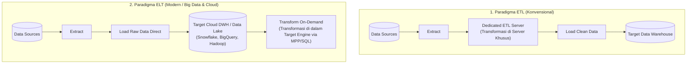

---

### 2. Bedah Detail Arsitektur Masing-Masing Pendekatan

#### A. Pendekatan Tradisional: ETL (Extract $\to$ Transform $\to$ Load)
- **Mekanisme**:
  1. Data diekstrak dari sumber operasional.
  2. Data langsung dialirkan ke **Server Pemrosesan ETL Terpisah** (*Dedicated ETL Engine*, misal server SSIS, Informatica, Talend).
  3. Transformasi, agregasi, dan pembersihan dilakukan di dalam memori dan disk lokal server ETL tersebut.
  4. Hanya data yang sudah **100% bersih, terstruktur, dan siap pakai** yang dimuat ke dalam Data Warehouse target.
- **Karakteristik & Batasan**:
  - Diciptakan pada era di mana storage disk dan daya komputasi database target sangat mahal dan terbatas.
  - *Bottleneck Komputasi*: Server ETL menjadi titik kemacetan (*single point of bottleneck*) jika volume data melonjak dari Gigabyte ke Terabyte.
  - Data mentah asli (*raw data*) hilang; jika di masa depan ada aturan bisnis baru, data harus diekstrak ulang dari sistem sumber.

#### B. Pendekatan Modern: ELT (Extract $\to$ Load $\to$ Transform)
- **Mekanisme**:
  1. Data diekstrak dari sistem sumber.
  2. Data mentah (*raw data*) langsung dimuat seketika (*direct load*) ke dalam sistem target penyimpanan skala besar (**Cloud Data Warehouse / Data Lake**, seperti BigQuery, Snowflake, Redshift, atau Hadoop HDFS).
  3. Transformasi data dilakukan **langsung di dalam mesin database target** memanfaatkan kekuatan komputasi terdistribusi (*Massively Parallel Processing - MPP* atau *Spark/Hive SQL*).
- **Faktor Pendorong Lahirnya ELT**:
  - *Storage Disk Menjadi Sangat Murah*: Kita dapat menyimpan seluruh data mentah tanpa khawatir kehabisan kapasitas.
  - *Daya Komputasi Target yang Dahsyat*: Mesin Cloud DWH modern mampu menjalankan pemrosesan paralel pada miliaran baris dalam hitungan detik.
  - *Mendukung Data Tidak Terstruktur*: Mampu menampung teks mentah, audio, video, dan log JSON (*Schema-on-Read*).

---

### 3. Matriks Perbandingan 10 Poin: ETL vs ELT

Tabel komparatif wajib hafal untuk ujian:

| Kriteria Komparasi | ETL (*Extract, Transform, Load*) | ELT (*Extract, Load, Transform*) |
| :--- | :--- | :--- |
| **1. Lokasi Transformasi** | Di server perantara ETL khusus (*dedicated server*) sebelum data masuk ke DWH | Di dalam mesin penyimpanan target (*inside target DWH/Data Lake*) |
| **2. Waktu Pemuatan Awal (*Load Time*)** | Lebih lambat (Menunggu proses transformasi selesai terlebih dahulu) | **Sangat Cepat** (Data mentah langsung disalin tanpa modifikasi awal) |
| **3. Waktu Siap Digunakan (*Query Time*)** | Sangat cepat (Data di DWH sudah matang dan diagregasi) | Cepat hingga sedang (Tergantung apakah transformasi on-demand atau materialized) |
| **4. Penyimpanan Data Mentah (*Raw Data*)** | Tidak disimpan di DWH (Data mentah dibuang setelah diproses) | **Disimpan Permanen** di DWH/Data Lake (Memungkinkan audit historis penuh) |
| **5. Skalabilitas Volume Data** | Terbatas oleh kapasitas CPU dan RAM server ETL perantara | **Sangat Skalabel** (Memanfaatkan skalabilitas elastis Cloud/Kluster MPP) |
| **6. Tipe Data yang Didukung** | Terbatas pada **Data Terstruktur (Structured)** | **Structured, Semi-Structured (JSON/XML), dan Unstructured** |
| **7. Fleksibilitas Analitis** | Kaku (*Schema-on-Write*); perubahan model data memerlukan desain ulang pipa ETL | **Sangat Fleksibel (*Schema-on-Read*)**; data mentah dapat ditransformasi kapan saja |
| **8. Kebutuhan Perangkat Keras Khusus** | Memerlukan server fisik ETL berspesifikasi tinggi yang mahal | Tidak perlu server ETL terpisah; cukup memaksimalkan mesin target |
| **9. Kepatuhan Privasi Data (GDPR / PII)** | **Unggul**: Data sensitif (misal NIK nasabah) dapat di-masking *sebelum* masuk ke penyimpanan | Harus dikelola ketat di target agar data mentah tidak bocor ke analis umum |
| **10. Kasus Penggunaan Ideal** | DWH On-Premise tradisional dengan volume data terukur dan aturan privasi ketat | Big Data, Cloud Data Lakehouse, IoT Streaming, Analisis Data Science eksploratif |

---

### 4. Kapan Memilih ETL dan Kapan Memilih ELT?

#### Pilih ETL jika:
1. **Regulasi Privasi & Keamanan Ketat**: Data memuat informasi identitas sensitif (*Personally Identifiable Information - PII*) yang secara hukum dilarang mendarat di penyimpanan target tanpa di-masking terlebih dahulu.
2. **Kapasitas Database Target Terbatas**: Sistem DWH lama (on-premise) tidak memiliki kemampuan komputasi paralel masif untuk melakukan transformasi di tempat.
3. **Format Data Sudah Terstandarisasi**: Seluruh sumber data adalah basis data relasional yang bersih dengan skema kaku.

#### Pilih ELT jika:
1. **Volume Data Sangat Masif (Big Data / Terabyte-Petabyte)**: Memindahkan transformasi ke kluster komputasi terdistribusi (seperti Apache Spark, Hadoop, BigQuery).
2. **Menggunakan Cloud Data Warehouse**: Arsitektur Snowflake atau Google BigQuery yang komputasinya terpisah dari penyimpanan (*separation of compute and storage*).
3. **Kebutuhan Eksplorasi Data Science**: Para data scientist membutuhkan akses ke data mentah asli yang belum terfilter oleh aturan bisnis.

---

### 🎯 Hal-Hal yang Kemungkinan Besar Masuk Ujian

1. **Letak Fisik Pemrosesan Transformasi**:
   - Soal PG paling standar: *"Di manakah proses transformasi data terjadi pada arsitektur ELT?"*  
   *Jawab*: **Di dalam mesin basis data target (Data Warehouse / Data Lake)**.
2. **Mengapa Big Data Beralih ke ELT?**:
   - Pahami 3 alasan utama: (1) Menghilangkan bottleneck server perantara, (2) Memanfaatkan daya komputasi paralel masif (MPP) dari kluster/cloud modern, (3) Menjaga seluruh data mentah (*raw data*) untuk analisis masa depan (*Schema-on-Read*).
3. **Kelebihan ETL Dibanding ELT**:
   - Pahami bahwa ETL masih lebih unggul dalam aspek **keamanan dan kepatuhan privasi (data masking)**, karena data sensitif tidak pernah menyentuh disk penyimpanan utama dalam bentuk mentah.
4. **Schema-on-Write vs Schema-on-Read**:
   - ETL menganut filosofi *Schema-on-Write* (skema ditentukan sebelum data ditulis).
   - ELT menganut filosofi *Schema-on-Read* (data mentah ditulis bebas, skema diterapkan saat kueri dijalankan).

---

### 📋 Contoh Soal Ujian (Pilihan Ganda & Esai)

#### Contoh Soal Pilihan Ganda
**Soal 1 (Lokasi Komputasi ELT)**  
Perbedaan mendasar antara paradigma ETL dan ELT dalam perancangan arsitektur data pipeline adalah...  
A. Pada ELT, tahapan transformasi data dihilangkan sepenuhnya sehingga data yang disimpan selamanya kotor.  
B. Pada ELT, proses transformasi dilakukan di dalam mesin database/platform analitik target setelah data mentah berhasil dimuat, memanfaatkan kekuatan komputasi terdistribusi mesin target.  
C. ETL hanya dapat digunakan untuk data semi-terstruktur, sedangkan ELT hanya untuk file teks CSV.  
D. ELT membutuhkan server perantara dengan spesifikasi memori RAM yang jauh lebih besar daripada ETL.  
*Kunci Jawaban*: **B**  
*Pembahasan*: ELT memindahkan komputasi transformasi dari server perantara ke dalam sistem database target itu sendiri (seperti Cloud DWH atau Hadoop cluster).

**Soal 2 (Keunggulan Proteksi Data ETL)**  
Dalam skenario perbankan yang terikat regulasi kepatuhan privasi data internasional (seperti GDPR), mengapa arsitektur ETL tradisional terkadang masih lebih dipilih dibandingkan ELT?  
A. Karena ETL jauh lebih murah biaya operasionalnya dibandingkan ELT.  
B. Karena pada ETL, data sensitif (seperti nomor kartu kredit dan kata sandi) dapat dibersihkan, dienkripsi, atau dihilangkan di server perantara sebelum sempat tersimpan di penyimpanan permanen target.  
C. Karena ELT tidak dapat memproses data bertipe angka.  
D. Karena ETL menjamin kueri analitik berjalan 100 kali lebih cepat.  
*Kunci Jawaban*: **B**  
*Pembahasan*: Dengan ETL, data sensitif mentah (*raw PII*) dicegat dan di-masking di server perantara sebelum masuk ke data warehouse, mencegah risiko kebocoran data di penyimpanan target.

---

#### Contoh Soal Esai
**Soal Esai**:  
Sebuah platform media sosial raksasa menerima 500 Terabyte data per hari yang terdiri dari log klik pengguna, foto, komentar teks JSON, dan transaksi pembelian koin digital. Tim data engineer perusahaan sedang memperdebatkan apakah akan mengimplementasikan arsitektur pipeline berbasis **ETL konvensional** atau **ELT modern**.  
a. Evaluasi kelayakan penggunaan arsitektur ETL konvensional untuk beban kerja (*workload*) tersebut!  
b. Jelaskan mengapa pendekatan ELT jauh lebih cocok untuk skenario platform tersebut dan uraikan alur kerja data dari sumber hingga siap dianalisis oleh data scientist!

**Pedoman Jawaban Lengkap**:
1. **Evaluasi Ketidaklayakan ETL Konvensional**:
   - Pendekatan ETL konvensional **tidak layak dan akan gagal total** untuk skenario ini karena:
     - *Throughput & Bottleneck*: Volume 500 TB/hari akan melumpuhkan server pemrosesan ETL perantara (*memory exhaustion* dan *CPU bottleneck*). Server ETL terpisah tidak akan mampu menyelesaikan transformasi sebelum batch hari berikutnya tiba.
     - *Variasi Data*: ETL konvensional menuntut *Schema-on-Write* yang kaku, sehingga sangat sulit menangani data semi-terstruktur (JSON) dan tidak terstruktur (foto/komentar bebas) yang formatnya dinamis.
     - *Kehilangan Nilai Mentah*: ETL akan membuang sebagian besar data yang dianggap "tidak relevan" hari ini, padahal data mentah tersebut sangat bernilai untuk pelatihan model Machine Learning di masa depan.
2. **Alasan Keunggulan ELT & Alur Kerjanya**:
   - **Alasan Keunggulan**:
     - *Skalabilitas Ekstrem*: ELT menyalin data mentah langsung ke Data Lake (HDFS / Cloud Object Storage seperti S3/GCS) tanpa komputasi awal, sehingga proses *ingestion* selesai dalam hitungan menit.
     - *Pemanfaatan Komputasi Terdistribusi*: Transformasi dilakukan di dalam kluster terdistribusi (Apache Spark / BigQuery) yang memiliki ribuan core prosesor yang bekerja secara paralel (*Massively Parallel Processing*).
     - *Schema-on-Read*: Data scientist dapat mengeksplorasi data mentah asli kapan saja tanpa dibatasi oleh skema kaku.
   - **Alur Kerja Data**:
     1. **Extract**: Data log klik, transaksi, dan teks JSON diekstrak secara kontinu menggunakan streaming pipeline (misal Apache Kafka).
     2. **Load (Landing)**: Data mentah langsung ditulis apa adanya (*as-is*) ke dalam zona penyimpanan mentah (*Bronze / Raw Zone*) di Data Lake / Cloud DWH.
     3. **Transform (On-Demand)**: Pipeline komputasi terdistribusi (Apache Spark / SQL Engine) dijalankan di dalam Data Lake untuk membersihkan data, memparsing teks JSON, menghitung metrik keterlibatan pengguna, dan menyimpan hasilnya ke zona data bersih (*Silver / Gold Zone*) yang siap dikueri oleh analis dan model AI.

---

### 💡 Tips & Trik Menjawab Soal Ujian

1. **Jurus Kata Kunci Pembeda**:
   - ETL = **Transformasi SEBELUM Loading**, Server perantara terpisah, *Schema-on-Write*, unggul di privasi data.
   - ELT = **Transformasi SETELAH Loading**, Di dalam mesin target, *Schema-on-Read*, unggul di Big Data & Cloud.
2. **Formula Menjawab Esai Studi Kasus Pemilihan**:
   - Jika kasusnya: Bank, Rumah Sakit, data sensitif, volume kecil-menengah $\to$ Pilih **ETL** (alasan: kepatuhan regulasi privasi & proteksi data mentah).
   - Jika kasusnya: E-commerce besar, Media Sosial, IoT Sensor, Big Data, Cloud Data Lake $\to$ Pilih **ELT** (alasan: kecepatan ingest, skalabilitas MPP, ketersediaan raw data).


::: {.chapter-divider}
:::

::: {.chapter-header-box}
# Bab 4: Ekosistem Komputasi Terdistribusi Hadoop & HDFS

<p class="chapter-desc">Filosofi komputasi terdistribusi, master-worker node, karakteristik HDFS (WORM, 128MB Block), Rack-Awareness, Read/Write Path, dan HDFS Enterprise HA/Federation.</p>
:::

## 🌐 04.1 Konsep Dasar Komputasi Terdistribusi & Paradigma Hadoop

::: {.callout .callout-abstract}
::: {.callout-header}
📖 **Ringkasan Sub-Materi**
:::
::: {.callout-body}
Menelaah latar belakang lahirnya ekosistem Apache Hadoop sebagai revolusi dalam pemrosesan data terdistribusi (*distributed data processing*). Sub-materi ini membahas batas fisik komputasi terpusat (*Scale-Up* vs *Scale-Out*), matematika transfer I/O paralel, filosofi revolusioner **Data Locality**, tiga pilar karakteristik Hadoop, konsep kontainerisasi, kisi-kisi ujian, dan panduan menjawab soal konseptual.
:::
:::

---

### 1. Kegagalan Sistem Terpusat & Matematika I/O Disk

Sebelum lahirnya Hadoop, pendekatan standar industri untuk menangani pertambahan data adalah **Scale-Up (Vertical Scaling)**, yaitu mengganti server yang ada dengan mesin mainframe atau superkomputer tunggal yang lebih besar, memiliki prosesor lebih banyak, dan RAM lebih luas.

#### Batas Fisik Scale-Up:
1. **Biaya Eksponensial**: Harga sebuah server tunggal dengan spesifikasi ekstrem melonjak secara non-linear (menjadi sangat mahal) untuk setiap penambahan kapasitas marjinal.
2. **Batas Fisik Hukum Moore**: Kecepatan *clock speed* prosesor tunggal telah mencapai batas termal (panas) dan fisika silikon.
3. **Bottleneck Kecepatan I/O Hard Drive Mekanik (*The Storage Bottleneck*)**:
   - Buku teks Tom White (*Hadoop: The Definitive Guide*) memberikan ilustrasi matematika klasik:
   - Kecepatan baca (*read transfer rate*) sebuah hard disk drive standar adalah $\approx 100\text{ MB/s}$.
   - Jika Anda memiliki **1 Terabyte (1.000.000 MB)** data pada satu hard drive tunggal:
     $$\text{Waktu Baca} = \frac{1.000.000\text{ MB}}{100\text{ MB/s}} = 10.000\text{ detik} \approx 2{,}77\text{ jam!}$$
   - Jika data Anda membengkak menjadi **100 Terabyte**, satu drive akan membutuhkan waktu **lebih dari 11 hari** hanya untuk membaca data tersebut satu kali putaran!

#### Solusi Komputasi Terdistribusi (Scale-Out):
Alih-alih membaca dari satu disk raksasa, sebarkan 1 Terabyte data tersebut ke dalam **100 hard drive murah secara paralel**:
$$\text{Waktu Baca Paralel} = \frac{10.000\text{ detik}}{100\text{ drive}} = 100\text{ detik} \approx 1{,}6\text{ menit!}$$
Inilah esensi dasar komputasi terdistribusi: **memecah data dan memprosesnya secara paralel melintasi banyak mesin komputer mandiri**.

---

### 2. Paradigma Revolusioner: Data Locality

Pada sistem terdistribusi konvensional terdahulu (seperti MPI atau Grid Computing), data disimpan di server penyimpanan pusat (NAS / SAN) terpisah. Saat komputasi dimulai, data ditarik melintasi kabel jaringan ke server komputasi (*Moving data to the computation*).

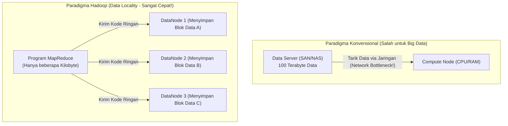

::: {.callout .callout-important}
::: {.callout-header}
⚡ **Doktrin Emas Hadoop: Data Locality**
:::
::: {.callout-body}
*"Moving computation to the data is dramatically cheaper and faster than moving data to the computation."*  
(Memindahkan program komputasi mendekati lokasi fisik data jauh lebih murah dan cepat daripada memindahkan data masif mendekati program komputasi).
:::
:::

#### Mengapa Data Locality Sangat Revolusioner?
1. **Bandwidth Jaringan Adalah Sumber Daya Paling Terbatas (*Network is the Bottleneck*)**: Mengalirkan ratusan Terabyte data melintasi switch jaringan lokal (*switches & routers*) akan menyebabkan saturasi jaringan (*congested network*), tabrakan paket, dan latensi ekstrem.
2. **Ukuran Kode Program Sangat Kecil**: File binary/program eksekusi (seperti file `.jar` program MapReduce) umumnya berukuran sangat kecil (hanya beberapa Kilobyte atau Megabyte).
3. **Efisiensi Ekstrem**: Jauh lebih cerdas mengirimkan file `.jar` sebesar 50 KB melintasi jaringan ke 100 node tempat data berada, lalu membiarkan prosesor lokal di masing-masing node memproses data di hard disk lokalnya sendiri secara paralel!

---

### 3. Tiga Pilar Karakteristik Utama Hadoop

1. **Scalability (Skalabilitas Horizontal Bebas Hambatan)**:
   - Menggunakan pendekatan **Scale-Out**.
   - Kapasitas penyimpanan dan daya komputasi dapat ditambah secara linear cukup dengan mencolokkan komputer baru (*commodity hardware*) ke dalam rak kluster tanpa perlu mematikan sistem (*zero-downtime commissioning*).
2. **Fault-Tolerance (Toleransi Kesalahan Bawaan)**:
   - Dalam kluster berisi 2.000 komputer murah, kerusakan perangkat keras (hard disk bad sector, RAM rusak, kabel lepas, power supply mati) adalah **kepastian statistik harian**, bukan insiden kebetulan.
   - Hadoop didesain dari tingkat kernel arsitektur dengan asumsi: *"Hardware will fail, and software must handle it automatically"*.
   - Jika sebuah node mati, Hadoop secara otomatis mendeteksi kegagalan tersebut melalui mekanisme *heartbeat* dan langsung mengalihkan pemrosesan ke replika data lain di node yang masih sehat.
3. **Cost-Effectiveness (Efisiensi Biaya Berbasis Commodity Hardware)**:
   - Hadoop tidak membutuhkan perangkat keras enterprise yang mahal (*no expensive proprietary appliances, no EMC SAN/NAS*).
   - Hadoop berjalan optimal di atas **Commodity Hardware**, yaitu komputer kelas komersial biasa yang mudah dibeli di pasaran bebas.

---

### 4. Konsep Pendukung: Virtualisasi (VM) vs Kontainerisasi (Docker)

Dalam perkuliahan dan praktikum Big Data modern, kluster Hadoop sering diuji menggunakan teknologi isolasi lingkungan:

| Dimensi | Virtual Machine (VM / Hypervisor) | Containerization (Docker / Podman) |
| :--- | :--- | :--- |
| **Arsitektur** | Virtualisasi di level perangkat keras (*Hardware-level*) | Isolasi di level sistem operasi (*OS-level via Linux cgroups & namespaces*) |
| **Sistem Operasi** | Membawa *Guest OS* lengkap sendiri di setiap instance | Berbagi *Host OS Kernel* yang sama secara efisien |
| **Konsumsi Resource**| Sangat berat (Membutuhkan alokasi RAM dan vCPU tetap per VM) | **Sangat ringan** (Konsumsi CPU/RAM dinamis sesuai beban proses) |
| **Waktu Booting** | Menit (Proses booting sistem operasi lengkap) | **Milidetik hingga Detik** |
| **Penerapan Hadoop** | Simulasi lab multi-node tradisional | Penggelaran lingkungan microservices, CI/CD, dan lab kluster terisolasi |

---

### 🎯 Hal-Hal yang Kemungkinan Besar Masuk Ujian

1. **Prinsip Data Locality**:
   - Soal wajib: *"Jelaskan apa yang dimaksud dengan prinsip Data Locality pada Hadoop dan mengapa prinsip ini krusial bagi pemrosesan Big Data!"*
2. **Scale-Up vs Scale-Out**:
   - Membedakan *Vertical Scaling* (memperbesar spesifikasi 1 mesin) dengan *Horizontal Scaling* (menambah jumlah mesin komoditas). Hadoop mengadopsi **Scale-Out**.
3. **Filosofi Toleransi Kesalahan (*Fault-Tolerance*)**:
   - Pahami bahwa Hadoop mengasumsikan kegagalan komponen keras sebagai hal lumrah, ditangani di level perangkat lunak (*software-managed fault tolerance*) melalui replikasi data.
4. **Analisis I/O Paralel**:
   - Menghitung waktu baca disk: membagi waktu serial dengan jumlah disk paralel.

---

### 📋 Contoh Soal Ujian (Pilihan Ganda & Esai)

#### Contoh Soal Pilihan Ganda
**Soal 1 (Prinsip Data Locality)**  
Paradigma revolusioner yang membedakan pemrosesan data Apache Hadoop dari sistem komputasi terdistribusi tradisional adalah...  
A. Memindahkan seluruh data berukuran Terabyte ke satu server superkomputer pusat.  
B. Menghapus data dari disk dan hanya menyimpannya di cache peramban web.  
C. Memindahkan komputasi (program eksekusi berukuran kecil) ke node tempat data tersimpan secara fisik (*Data Locality*), bukan memindahkan data masif melintasi jaringan.  
D. Mewajibkan penggunaan hard disk khusus buatan militer yang tidak pernah rusak.  
*Kunci Jawaban*: **C**  
*Pembahasan*: Data Locality menghemat bandwidth jaringan dengan mengeksekusi kode program langsung di node tempat blok data berada secara lokal.

**Soal 2 (Strategi Peningkatan Kapasitas)**  
Strategi penambahan kapasitas pemrosesan data dengan cara menambah unit komputer komoditas baru ke dalam kluster tanpa perlu mengganti mesin lama dikenal sebagai...  
A. *Vertical Scaling (Scale-Up)*  
B. *Horizontal Scaling (Scale-Out)*  
C. *Centralized Scaling*  
D. *Virtual Memory Paging*  
*Kunci Jawaban*: **B**  
*Pembahasan*: Scale-Out (Horizontal Scaling) adalah penambahan jumlah node komputer komoditas paralel, yang merupakan fondasi arsitektur Hadoop.

---

#### Contoh Soal Esai
**Soal Esai**:  
Sebuah lembaga survei nasional memiliki data historis sensus sebesar 50 Terabyte. Selama ini mereka menggunakan satu server basis data relasional dengan disk storage tunggal berkecepatan baca 100 MB/s.  
a. Hitung estimasi waktu teoritis yang dibutuhkan server tersebut untuk memindai seluruh data sensus dalam satu putaran kueri agregasi!  
b. Jelaskan bagaimana arsitektur kluster Hadoop dengan 100 node DataNode memecahkan masalah bottleneck I/O tersebut!  
c. Jelaskan mengapa paradigma *Data Locality* menjamin kueri tersebut tidak menyebabkan kemacetan (*bottleneck*) pada kabel jaringan kluster!

**Pedoman Jawaban Lengkap**:
1. **Perhitungan Waktu Baca Server Tunggal**:
   - Volume Data: $50\text{ TB} = 50.000.000\text{ MB}$.
   - Kecepatan Baca Disk: $100\text{ MB/s}$.
   - Waktu Pemindaian:
     $$\text{Waktu} = \frac{50.000.000\text{ MB}}{100\text{ MB/s}} = 500.000\text{ detik} \approx 138{,}8\text{ jam (atau } \approx 5{,}78\text{ hari!)}$$
   - *Kesimpulan*: Pendekatan server tunggal sama sekali tidak dapat digunakan untuk kebutuhan analitik praktis.
2. **Solusi Pemrosesan Paralel Kluster Hadoop**:
   - Dengan kluster Hadoop berisi 100 DataNode independen, data 50 TB dipecah menjadi blok-blok terdistribusi (masing-masing 128 MB) dan disebarkan merata ke 100 node (setiap node menampung $\approx 500\text{ GB}$).
   - Saat kueri dijalankan, ke-100 node membaca data di disk lokalnya masing-masing secara bersamaan (*Massive I/O Parallelism*).
   - Waktu baca teoritis terpangkas 100 kali lipat:
     $$\text{Waktu Paralel} = \frac{500.000\text{ detik}}{100} = 5.000\text{ detik} \approx 1{,}38\text{ jam}.$$
3. **Peranan Data Locality Mencegah Saturasi Jaringan**:
   - Pada arsitektur non-Hadoop, ke-100 node harus mengirimkan 50 TB data melintasi switch jaringan ke server pusat, yang akan menyebabkan jaringan mati (*network congestion*).
   - Dengan *Data Locality*, kode program Map/Agregasi (file `.jar` hanya berukuran $\approx 100\text{ KB}$) yang dikirimkan oleh master ke masing-masing dari 100 DataNode.
   - Setiap DataNode membaca data dari hard disk lokalnya tanpa melalui kabel jaringan kluster, memproses penyaringan lokal, dan hanya mengirimkan hasil agregasi kecil melalui jaringan. Akibatnya, bandwidth jaringan kluster tetap lapang dan kueri berjalan sangat cepat.

---

### 💡 Tips & Trik Menjawab Soal Ujian

1. **Jurus Kata Kunci Ujian**:
   - Scale-Out $\to$ Menambah mesin komoditas murah secara horizontal.
   - Data Locality $\to$ Kode program dikirim ke tempat data berada, bukan sebaliknya.
   - Commodity Hardware $\to$ Komputer standar pasar bebas, bukan server proprietary mahal.
2. **Formula Menjawab Esai Big Data**:
   - Selalu sertakan perbandingan angka waktu transfer disk mekanik vs transfer paralel untuk mendemonstrasikan pemahaman buku teks resmi Tom White secara meyakinkan.


## 🖥️ 04.2 Arsitektur Kluster, Node Types & Single vs Multi Node

::: {.callout .callout-abstract}
::: {.callout-header}
📖 **Ringkasan Sub-Materi**
:::
::: {.callout-body}
Menelaah arsitektur fisik dan logis kluster Hadoop. Sub-materi ini membedah perbedaan antara **Single Node Cluster** (*Pseudo-Distributed*) dan **Multi Node Cluster**, tanggung jawab arsitektural **NameNode** dan **DataNode**, meluruskan kesalahpahaman fatal mengenai peran **Secondary NameNode** (bukan *failover backup*!), mekanisme *Heartbeat* dan *Block Report*, kisi-kisi ujian, dan panduan menjawab esai.
:::
:::

---

### 1. Topologi Kluster: Single Node vs Multi Node

Dalam penggelaran (*deployment*) ekosistem Hadoop, terdapat dua modus utama:

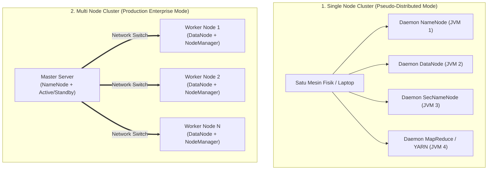

#### A. Single Node Cluster (Pseudo-Distributed Mode)
- Seluruh daemon Hadoop (`NameNode`, `DataNode`, `SecondaryNameNode`, dan manajer komputasi) dijalankan sebagai **proses JVM (Java Virtual Machine) terpisah pada SATU mesin fisik/laptop yang sama**.
- Tidak ada paralelisme perangkat keras nyata dan tidak ada toleransi kesalahan (*no real fault-tolerance*).
- **Tujuan Penggunaan**: Murni untuk pengembangan (*development*), penulisan kode program MapReduce, pengujian algoritma (*testing*), dan pembelajaran di kelas lab kampus.

#### B. Multi Node Cluster (Fully Distributed Mode)
- Daemon Master dan daemon Worker dipisahkan pada mesin-mesin fisik (*racks of servers*) yang berbeda secara terdistribusi.
- Mesin Master didedikasikan murni untuk mengelola metadata, sedangkan puluhan hingga ribuan mesin Worker (*Commodity Slaves*) bertugas menyimpan blok data dan mengeksekusi komputasi.
- **Tujuan Penggunaan**: Lingkungan produksi enterprise (*production grade*) berskala petabyte.

---

### 2. Bedah Peran & Tanggung Jawab Jenis-Jenis Node

Arsitektur penyimpanan HDFS mengadopsi model **Master/Worker (Master/Slave)**:

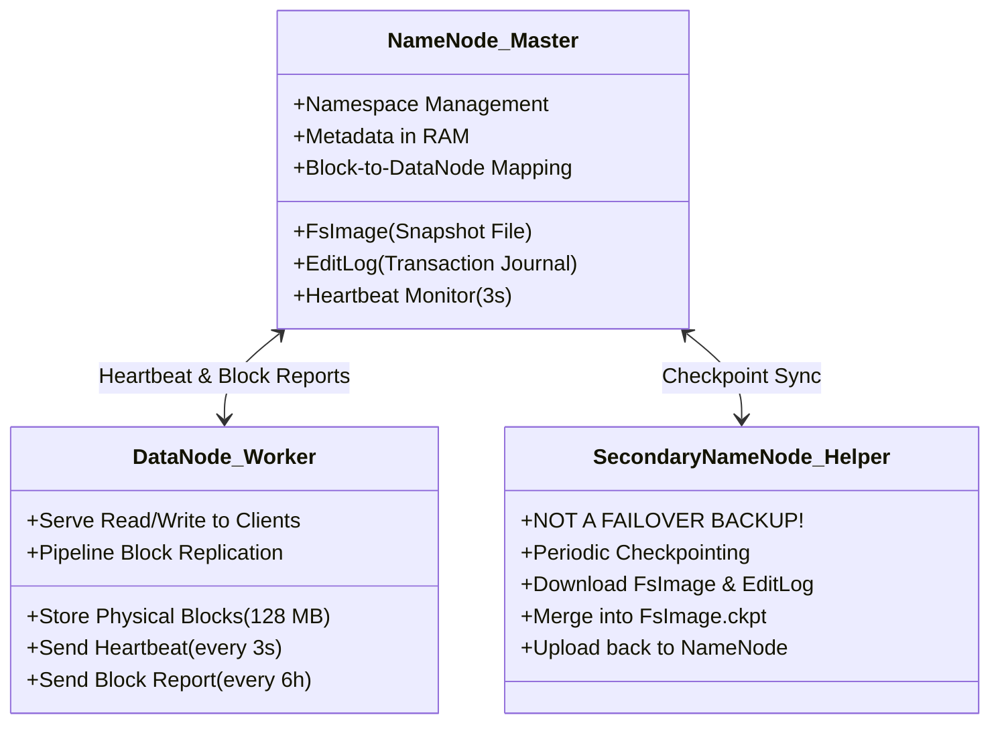

---

#### A. NameNode (The Master Node)
NameNode adalah penguasa tunggal dan "otak" dari sistem berkas HDFS.
1. **Tanggung Jawab Utama**:
   - Mengelola **Namespace Sistem Berkas**: struktur direktori hirarkis, nama file, hak akses pengguna (*permissions*), kuota penyimpanan, dan properti file.
   - Mengelola **Pemetaan Blok (*Block Mapping*)**: mencatat blok-blok fisik mana saja yang membentuk suatu file dan di DataNode mana saja replika blok tersebut tersimpan.
2. **Karakteristik Penyimpanan Metadata**:
   - Seluruh metadata namespace disimpan secara langsung di dalam **Memori RAM NameNode**. Hal ini membuat pembacaan metadata berjalan secepat kilat.
   - *Konsekuensi Penting*: Kapasitas RAM NameNode membatasi jumlah total file di seluruh kluster. Setiap file, direktori, dan blok menghabiskan $\approx 150\text{ byte}$ memori RAM NameNode.
3. **Persistensi Metadata ke Disk (Dua File Krusial)**:
   - **`FsImage`**: File snapshot lengkap dari seluruh struktur direktori dan metadata sistem berkas pada suatu titik waktu tertentu (*point-in-time state*).
   - **`EditLog`**: Jurnal catatan transaksi penulisan (*write-ahead transaction log*) yang mencatat setiap perubahan metadata (seperti pembuatan file baru, penghapusan, penggantian nama) sejak `FsImage` terakhir dibuat.

---

#### B. DataNode (The Worker Node)
DataNode adalah "kuli pekerja" yang bertugas mengelola penyimpanan fisik data.
1. **Tanggung Jawab Utama**:
   - Menyimpan blok-blok data fisik (secara default berukuran 128 MB) sebagai file biner biasa di sistem berkas sistem operasi lokal (ext4, xfs).
   - Melayani permintaan pembacaan (*read*) dan penulisan (*write*) langsung dari klien aplikasi.
   - Menjalankan penciptaan, penghapusan, dan replikasi blok fisik atas instruksi dari NameNode.
2. **Komunikasi Rutin ke NameNode**:
   - **Heartbeat**: Dikirimkan setiap **3 detik sekali** via koneksi TCP. Menginformasikan bahwa DataNode tersebut masih hidup, sehat, dan melaporkan sisa kapasitas disk yang tersedia.
     - *Aturan Timeout*: Jika NameNode tidak menerima Heartbeat dari DataNode selama **10 menit (600 detik)** berturut-turut, NameNode menyatakan node tersebut telah **mati (*Dead Node*)**, dan segera menginstruksikan DataNode lain untuk mereplikasi ulang blok-blok yang hilang.
   - **Block Report**: Dikirimkan secara berkala setiap **6 jam sekali**. Berisi daftar komprehensif seluruh blok fisik yang saat ini tersimpan di disk lokal DataNode tersebut.

---

#### C. Secondary NameNode (The Checkpointer - BUKAN Failover Backup!)

::: {.callout .callout-caution}
::: {.callout-header}
🛑 **PERINGATAN KERAS: Mitos Paling Fatal di Ujian!**
:::
::: {.callout-body}
**Secondary NameNode BUKANLAH server cadangan (*hot backup / standby*) yang akan otomatis menggantikan peran NameNode jika NameNode mati!**  
Jika NameNode utama mati pada kluster Hadoop tradisional (1.x), kluster akan mengalami kelumpuhan total (*Single Point of Failure - SPOF*). Secondary NameNode tidak dapat melayani kueri klien.
:::
:::

##### Fungsi Sebenarnya dari Secondary NameNode:
Secondary NameNode adalah mesin pembantu yang menjalankan proses **Periodic Checkpointing** (menggabungkan `FsImage` dan `EditLog`):
1. **Mengapa Perlu Checkpointing?**
   - Seiring waktu, file `EditLog` di NameNode akan terus membesar karena ribuan transaksi penulisan baru.
   - Jika `EditLog` terlalu besar, saat NameNode restart, proses startup akan memakan waktu berjam-jam hanya untuk memutar ulang transaksi (*replay log*).
2. **Alur Kerja Checkpointing**:
   1. Setiap periode waktu (default 1 jam) atau saat `EditLog` mencapai batas ukuran (default 64 MB), Secondary NameNode menghubungi NameNode.
   2. NameNode menutup `EditLog` lama dan membuka file edit log baru.
   3. Secondary NameNode mengunduh `FsImage` lama dan `EditLog` lama melalui protokol HTTP.
   4. Secondary NameNode memuat `FsImage` ke RAM lokalnya, menerapkan seluruh transaksi dari `EditLog` (*merging*), lalu menghasilkan file gambar baru: `FsImage.ckpt`.
   5. Secondary NameNode mengunggah kembali file `FsImage.ckpt` baru tersebut ke NameNode.
   6. NameNode menamai ulang file tersebut menjadi `FsImage` aktif. Ukuran `EditLog` pun kembali ramping.

---

### 🎯 Hal-Hal yang Kemungkinan Besar Masuk Ujian

1. **Fungsi Sebenarnya Secondary NameNode**:
   - Pertanyaan jebakan nomor 1 di PG: *"Pernyataan mana yang BENAR tentang Secondary NameNode?"*  
   *Jawab*: Secondary NameNode bertugas menggabungkan (*merge*) EditLog dan FsImage untuk mencegah EditLog membengkak. Ia **BUKAN** failover cadangan NameNode.
2. **Penyimpanan Metadata NameNode**:
   - Metadata disimpan di **RAM** untuk kecepatan, dan dipersistensikan ke disk dalam bentuk **`FsImage`** (snapshot) dan **`EditLog`** (jurnal perubahan).
3. **Mekanisme Heartbeat DataNode**:
   - Interval normal = **3 detik**.
   - Batas node dinyatakan mati (*dead node threshold*) = **10 menit (600 detik)**.
4. **Single Node vs Multi Node**:
   - Single node = seluruh proses berjalan dalam JVM terpisah di 1 laptop (pseudo-distributed).
   - Multi node = proses master dan worker terdistribusi fisik di banyak server rak.

---

### 📋 Contoh Soal Ujian (Pilihan Ganda & Esai)

#### Contoh Soal Pilihan Ganda
**Soal 1 (Jebakan Secondary NameNode)**  
Apa fungsi utama dari komponen *Secondary NameNode* dalam arsitektur HDFS tradisional (Hadoop 1.x)?  
A. Bertindak sebagai server pengganti instan (*automatic failover*) yang langsung mengambil alih tugas master saat NameNode utama mengalami kerusakan hardware.  
B. Melakukan proses *checkpointing* secara berkala dengan cara mengunduh, menggabungkan (*merge*) berkas FsImage dan EditLog, lalu mengunggahnya kembali ke NameNode utama untuk mencegah EditLog membengkak.  
C. Menyimpan salinan kedua (*backup copy*) dari seluruh blok data pengguna di hard disknya.  
D. Bertugas mengeksekusi fungsi Reducer pada program MapReduce.  
*Kunci Jawaban*: **B**  
*Pembahasan*: Secondary NameNode murni berperan sebagai checkpointer pemelihara berkas metadata, bukan server failover cadangan.

**Soal 2 (Toleransi Kegagalan DataNode)**  
Sebuah DataNode di dalam kluster Hadoop tiba-tiba mengalami kerusakan motherboard dan terputus dari jaringan. Apa yang akan dilakukan oleh NameNode?  
A. Kluster Hadoop langsung berhenti beroperasi dan seluruh file rusak.  
B. NameNode menunggu sinyal Heartbeat; jika setelah 10 menit tidak ada sinyal, NameNode menandai DataNode tersebut mati dan secara otomatis mereplikasi blok-blok yang hilang ke DataNode sehat lainnya agar faktor replikasi tetap terpenuhi.  
C. NameNode secara otomatis membeli server baru via internet.  
D. NameNode menghapus seluruh file yang pernah disimpan di node tersebut.  
*Kunci Jawaban*: **B**  
*Pembahasan*: Heartbeat dikirim tiap 3 detik. Setelah timeout 10 menit tanpa heartbeat, node dinyatakan mati dan proses self-healing replikasi dimulai.

---

#### Contoh Soal Esai
**Soal Esai**:  
Dalam arsitektur HDFS, metadata sistem berkas dikelola secara terpusat oleh NameNode.  
a. Jelaskan mengapa NameNode menyimpan seluruh metadata di dalam memori RAM utama, dan apa dampak negatif (*drawback*) dari keputusan arsitektur ini terhadap ukuran berkas yang disimpan di HDFS!  
b. Jelaskan secara rinci peran kedua berkas fisik di disk NameNode yaitu **`FsImage`** dan **`EditLog`**, serta bagaimana proses *checkpointing* oleh **Secondary NameNode** mencegah terjadinya kegagalan operasional NameNode!

**Pedoman Jawaban Lengkap**:
1. **Penyimpanan Metadata di RAM & Dampak Negatifnya**:
   - **Alasan**: Disimpan di RAM agar pembacaan dan pemetaan blok saat melayani kueri ribuan klien berjalan dengan latensi sangat rendah (*sub-millisecond*), karena disk seek untuk metadata akan menciptakan bottleneck fatal.
   - **Dampak Negatif**: Terjadinya **"Small Files Problem"**. Setiap objek (file, direktori, atau blok) membutuhkan alokasi memori tetap sekitar 150 byte di RAM NameNode. Jika kluster menyimpan puluhan juta file berukuran kecil (misal file ukuran 10 KB), RAM NameNode akan habis (*Out-Of-Memory*) meskipun sisa kapasitas hard disk di DataNode masih tersisa puluhan Terabyte.
2. **Peran FsImage, EditLog, dan Proses Checkpointing**:
   - **`FsImage`**: Snapshot beku yang merekam seluruh hierarki direktori dan metadata HDFS pada suatu waktu tertentu.
   - **`EditLog`**: Berkas jurnal transaksi penulisan yang mencatat setiap perubahan metadata baru (misal pembuatan berkas baru, perubahan replika) yang terjadi secara real-time.
   - **Peran Secondary NameNode**:
     - Jika tidak ada Secondary NameNode, `EditLog` akan terus bertambah besar hingga ratusan Gigabyte. Saat NameNode direstart, pemulihan (*recovery*) metadata dengan membaca ulang seluruh isi `EditLog` yang raksasa tersebut akan memakan waktu berjam-jam (*unacceptable downtime*).
     - Secondary NameNode secara periodik (misal tiap 1 jam) mengambil `FsImage` dan `EditLog` dari NameNode, menggabungkan keduanya menjadi snapshot baru (`FsImage.ckpt`), lalu mengembalikannya ke NameNode.
     - Dengan demikian, ukuran `EditLog` pada NameNode selalu terjaga kecil dan proses startup NameNode dapat berjalan sangat cepat.

---

### 💡 Tips & Trik Menjawab Soal Ujian

1. **Jurus Melibas Soal Pengecoh Secondary NameNode**:
   - Jika ada pilihan ganda yang menyatakan *"Secondary NameNode adalah backup instan yang menggantikan NameNode jika rusak"* $\to$ **Coret langsung, itu opsi jebakan!**
   - Cari opsi yang menyebutkan: **"Checkpointing", "Menggabungkan FsImage dan EditLog"**.
2. **Formula Menjawab Esai Komponen HDFS**:
   - Selalu sebutkan relasi kerja berpasangan:
     - NameNode (Master) $\longleftrightarrow$ DataNode (Worker).
     - FsImage (Snapshot statis) $\longleftrightarrow$ EditLog (Jurnal dinamis).
     - Heartbeat (Kesehatan/Kapasitas - 3 detik) $\longleftrightarrow$ Block Report (Daftar blok - 6 jam).


## 📦 04.3 Karakteristik & Filosofi Desain HDFS (WORM, 128 MB Block, Anti-Patterns)

::: {.callout .callout-abstract}
::: {.callout-header}
📖 **Ringkasan Sub-Materi**
:::
::: {.callout-body}
Menelaah secara mendalam filosofi perancangan *Hadoop Distributed File System* (HDFS) berdasarkan rujukan otoritatif buku teks *Hadoop: The Definitive Guide* karya Tom White. Sub-materi ini mengupas model akses data **WORM** (*Write-Once, Read-Many*), **justifikasi matematis ukuran blok 128 MB**, fenomena **Small Files Problem**, tiga kondisi di mana HDFS **BUKAN** pilihan yang tepat (*Anti-Patterns*), kisi-kisi ujian, dan panduan jawaban esai.
:::
:::

---

### 1. Filosofi Desain HDFS (*Hadoop: The Definitive Guide*)

Tom White merumuskan bahwa HDFS dirancang dengan asumsi beban kerja (*workload assumptions*) yang sangat spesifik:

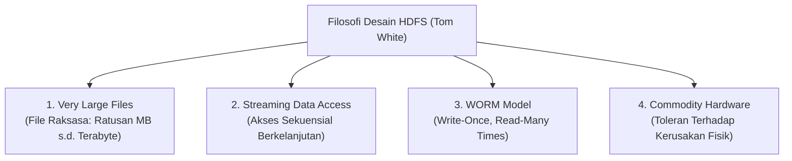

1. **Very Large Files (Berkas Sangat Besar)**:
   - HDFS ditujukan untuk mengelola berkas berukuran ratusan Megabyte, Gigabyte, hingga Petabyte. Kluster Hadoop modern mampu menyimpan jutaan berkas raksasa melintasi ribuan server.
2. **Streaming Data Access (Akses Aliran Berkelanjutan)**:
   - Pola akses data didasarkan pada prinsip: *"Lebih penting memiliki throughput transfer data yang tinggi dan konsisten daripada latensi baca instan"*.
   - HDFS dioptimalkan untuk kueri pemindaian batch (*batch processing scans*), bukan pembacaan acak satu baris (*random point queries*).
3. **Write-Once, Read-Many (WORM)**:
   - Pola hidup berkas di HDFS: berkas dibuat, ditulis satu kali dari awal hingga akhir, ditutup, dan selanjutnya dibaca berulang-ulang oleh ribuan pekerjaan analitik.
   - **Operasi yang Diizinkan**: Penambahan data baru hanya diizinkan di bagian akhir berkas (*append-only*).
   - **Operasi yang Dilarang**: Modifikasi data di sembarang posisi di tengah-tengah berkas (*arbitrary modifications / in-place updates*) secara arsitektural **TIDAK DIDUKUNG**.
   - HDFS juga hanya mendukung **Single Writer** (tidak boleh ada dua klien menulis ke satu berkas yang sama secara bersamaan).

---

### 2. Justifikasi Matematis Ukuran Blok HDFS (128 MB)

Pada sistem berkas sistem operasi standar (seperti ext4 di Linux atau NTFS di Windows), ukuran blok fisik berkisar antara **4 KB hingga 8 KB**. Sebaliknya, pada HDFS, ukuran blok default adalah **128 MB** (atau 256 MB pada kluster modern).

Mengapa ukuran blok HDFS dibuat sedemikian raksasa? Tom White memberikan pembuktian matematis berbasis karakteristik perangkat keras disk magnetik:

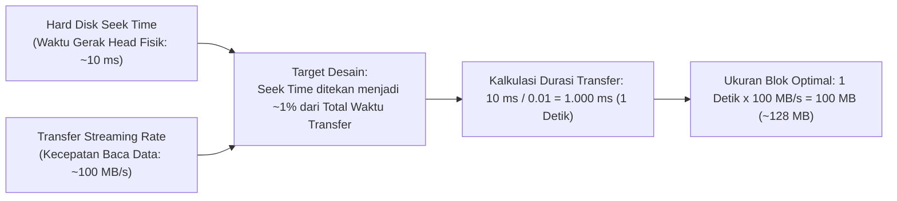

#### Penjelasan Matematis:
1. Hard disk drive mekanik memiliki waktu tunda fisik (*seek time*) $\approx 10\text{ ms}$ untuk menggerakkan lengan pembaca ke sektor track yang tepat.
2. Kecepatan transfer data sekuensial (*streaming transfer rate*) hard disk modern adalah $\approx 100\text{ MB/s}$.
3. Agar pembacaan data efisien, para perancang Hadoop menetapkan target bahwa **waktu pencarian fisik (*seek time*) tidak boleh menyita lebih dari $\approx 1\%$ dari total waktu transfer data**.
4. Rumus kalkulasi waktu transfer minimum yang dibutuhkan:
   $$\text{Waktu Transfer} = \frac{\text{Seek Time}}{1\%} = \frac{10\text{ ms}}{0{,}01} = 1.000\text{ ms} = 1\text{ detik}$$
5. Ukuran blok data fisik yang ditransfer dalam 1 detik tersebut:
   $$\text{Ukuran Blok} = 1\text{ detik} \times 100\text{ MB/s} = 100\text{ MB} \approx \mathbf{128\text{ MB}}\text{ (dibulatkan ke basis } 2^7\text{)}$$

#### Analisis Dampak Ukuran Blok:
- **Jika Blok Terlalu Kecil (misal 64 KB)**: Hard disk akan menghabiskan terlalu banyak waktu untuk memindahkan lengan mekanik (*disk seeking*), menyebabkan throughput anjlok drastis. Selain itu, RAM NameNode akan langsung kehabisan memori karena harus memetakan miliaran blok kecil.
- **Jika Blok Terlalu Besar (misal 50 GB)**: Jumlah blok menjadi terlalu sedikit, sehingga mengurangi derajat paralelisme kluster (jumlah tugas Mapper yang berjalan paralel menjadi sedikit, banyak core CPU pekerja menganggur / *idle*).

---

### 3. 3 Skenario HDFS BUKAN Pilihan yang Tepat (*Anti-Patterns*)

Buku teks *Hadoop: The Definitive Guide* menegaskan bahwa ada 3 kasus di mana HDFS **sama sekali tidak cocok digunakan**:

```mermaid
graph TD
    NOT["Kapan HDFS BUKAN Pilihan Tepat? (Anti-Patterns)"]
    NOT --> AP1["1. Low-Latency Data Access<br>(Akses Sub-Puluhan Milidetik)"]
    NOT --> AP2["2. Lots of Small Files<br>(Masalah Berkas-Berkas Berukuran Kecil)"]
    NOT --> AP3["3. Multiple Writers & In-Place Updates<br>(Banyak Penulis & Modifikasi Acak)"]

    AP1 -.-> SOL1["Solusi: Apache HBase"]
    AP2 -.-> SOL2["Solusi: HAR, SequenceFiles, CombineFileInputFormat"]
    AP3 -.-> SOL3["Solusi: RDBMS Tradisional / NoSQL Database"]
```

#### 1. Low-Latency Data Access (Akses Data Latensi Rendah)
- **Masalah**: Aplikasi yang menuntut waktu respon instan dalam orde sub-puluhan milidetik (misal kueri saldo ATM perbankan, portal pencarian pengguna real-time).
- **Alasan HDFS Gagal**: HDFS dioptimalkan untuk *high throughput of streaming data*, yang mengorbankan waktu latensi awal (*latency penalty*).
- **Solusi Tepat**: Gunakan basis data NoSQL terdistribusi seperti **Apache HBase** atau **Apache Cassandra**.

#### 2. Lots of Small Files (Masalah Berkas-Berkas Kecil)
- **Masalah**: Menyimpan jutaan berkas yang masing-masing berukuran hanya beberapa Kilobyte (misal jutaan foto avatar 10 KB atau log sensor per detik).
- **Alasan HDFS Gagal (The Small Files Problem)**:
  - NameNode menyimpan seluruh metadata sistem berkas di dalam memori RAM.
  - Aturan mutlak: **Setiap berkas, direktori, dan blok menyita $\approx 150\text{ byte}$ di RAM NameNode**.
  - *Perhitungan Bencana*: 10 juta file berukuran 10 KB menampung total data hanya $\approx 100\text{ GB}$. Namun di NameNode, metadata membutuhkan:
    $$10.000.000\text{ file} \times 150\text{ byte} = 1{,}5\text{ Gigabyte RAM Murni!}$$
  - Kapasitas RAM NameNode akan habis (*Out of Memory*) sebelum hard disk DataNode terisi bahkan 1%!
- **Solusi Tepat**:
  - Gunakan **Hadoop Archives (HAR)** untuk mengemas ribuan file kecil menjadi satu file arsip besar.
  - Gunakan **SequenceFile** (kombinasi pasangan Key-Value biner).
  - Gunakan **CombineFileInputFormat** pada MapReduce untuk menggabungkan beberapa file kecil ke dalam satu InputSplit.

#### 3. Multiple Writers & Arbitrary File Modifications (Banyak Penulis & Modifikasi Acak)
- **Masalah**: Kebutuhan di mana banyak pengguna menulis ke satu berkas secara bersamaan, atau memodifikasi nilai data di baris tengah (*random updates*).
- **Alasan HDFS Gagal**: Berkas di HDFS bersifat WORM (*single-writer append-only*). HDFS tidak mengizinkan penulisan konkuren pada berkas yang sama dan tidak mendukung *update in-place*.
- **Solusi Tepat**: Gunakan RDBMS transaksional standar (PostgreSQL, MySQL) atau NoSQL database.

---

### 🎯 Hal-Hal yang Kemungkinan Besar Masuk Ujian

1. **Justifikasi Ukuran Blok 128 MB**:
   - Dosen sering menanyakan: *"Mengapa blok HDFS berukuran 128 MB dan bagaimana kaitannya dengan rasio seek time hard disk?"*  
   *Jawab*: Untuk menekan seek time disk (~10 ms) agar hanya mengambil porsi $\approx 1\%$ dari durasi transfer streaming data sekuensial (~100 MB/s).
2. **Karakteristik Model WORM**:
   - Tahu pasti apa yang boleh (*append-only*, single writer) dan apa yang dilarang (*in-place update*, multiple writers).
3. **The Small Files Problem**:
   - Memahami bahwa bottleneck berkas kecil terletak pada **RAM NameNode** (alokasi tetap ~150 byte per objek), bukan pada kapasitas hard disk DataNode.
4. **Anti-Patterns & Alternatifnya**:
   - Butuh latensi rendah $\to$ HBase.
   - Punya jutaan file kecil $\to$ HAR / SequenceFiles.

---

### 📋 Contoh Soal Ujian (Pilihan Ganda & Esai)

#### Contoh Soal Pilihan Ganda
**Soal 1 (Justifikasi Matematis Ukuran Blok)**  
Mengapa ukuran blok default pada HDFS dikonfigurasi sebesar 128 MB, jauh lebih besar dibandingkan ukuran blok pada sistem berkas Linux biasa (4 KB)?  
A. Agar seluruh file di komputer dapat disimpan di dalam satu blok saja.  
B. Untuk meminimalkan biaya waktu pencarian fisik (*seek time*) pada piringan hard disk mekanik sehingga waktu pencarian hanya menyita sekitar 1% dari total waktu transfer data sekuensial.  
C. Karena memori RAM DataNode tidak dapat membaca blok yang lebih kecil dari 100 MB.  
D. Agar pengguna tidak dapat menghapus file yang telah dibuat.  
*Kunci Jawaban*: **B**  
*Pembahasan*: Penjelasan resmi buku teks Tom White membuktikan bahwa ukuran blok 128 MB membuat rasio seek time (10 ms) bernilai sekitar 1% terhadap waktu transfer data (1 detik pada 100 MB/s).

**Soal 2 (The Small Files Problem)**  
Sebuah kluster Hadoop mengalami kegagalan kehabisan memori (*OutOfMemoryError*) pada NameNode meskipun kapasitas penyimpanan disk pada seluruh DataNode masih tersisa 80%. Penyebab arsitektural yang paling mungkin dari kondisi ini adalah...  
A. DataNode tidak mengirimkan sinyal Heartbeat.  
B. Terjadi fenomena *Small Files Problem*, di mana kluster menyimpan puluhan juta berkas berukuran sangat kecil yang masing-masing menghabiskan memori RAM NameNode sebesar $\approx 150$ byte untuk metadata.  
C. Ukuran blok HDFS diubah menjadi 1 Gigabyte.  
D. Kluster kekurangan switch jaringan.  
*Kunci Jawaban*: **B**  
*Pembahasan*: Setiap berkas di HDFS menyita ~150 byte di RAM NameNode. Jumlah berkas kecil yang terlalu banyak akan menguras habis RAM NameNode terlepas dari masih banyaknya sisa kapasitas hard disk.

---

#### Contoh Soal Esai
**Soal Esai**:  
Berdasarkan buku teks resmi *Hadoop: The Definitive Guide* karya Tom White, HDFS dirancang untuk skenario penyimpanan data tertentu dan memiliki batasan tegas di mana HDFS tidak cocok digunakan.  
a. Sebutkan dan jelaskan **3 skenario di mana HDFS BUKAN merupakan pilihan yang tepat (*Anti-Patterns*)**!  
b. Jelaskan konsep **"Small Files Problem"** pada HDFS, analisis mengapa masalah ini menjadi ancaman fatal bagi kelangsungan NameNode, dan berikan 2 solusi teknis yang dapat diterapkan untuk mengatasinya!

**Pedoman Jawaban Lengkap**:
1. **3 Skenario HDFS BUKAN Pilihan Tepat**:
   - **Low-Latency Data Access**: Aplikasi yang menuntut latensi akses dalam skala puluhan milidetik. HDFS dirancang untuk streaming throughput tinggi dan memiliki latensi awal yang tinggi. *Solusi*: Apache HBase.
   - **Lots of Small Files**: Menyimpan jutaan file kecil (berukuran beberapa kilobyte). Metadata setiap file membebani memori RAM NameNode secara konstan, menyebabkan pemborosan memori. *Solusi*: SequenceFiles atau Hadoop Archives (HAR).
   - **Multiple Writers and Arbitrary File Modifications**: Kebutuhan banyak pengguna menulis ke satu file secara konkuren atau melakukan modifikasi acak di tengah-tengah file. HDFS hanya mendukung *single-writer* dan *append-only*. *Solusi*: Basis data relasional atau NoSQL.
2. **Analisis "Small Files Problem" & Solusinya**:
   - **Penyebab & Ancaman Fatal**:
     - Setiap file, direktori, dan blok di HDFS direpresentasikan sebagai objek Java di dalam memori RAM NameNode yang menghabiskan memori konstan sekitar **150 byte**.
     - Jika sebuah sistem menyimpan 10 juta file dengan ukuran masing-masing 10 KB (total data fisik hanya 100 GB), NameNode harus mengalokasikan sekitar $10.000.000 \times 150\text{ byte} = 1{,}5\text{ GB}$ memori RAM murni untuk metadata.
     - Jika jumlah file mencapai ratusan juta, RAM NameNode akan mengalami kegagalan *Out-Of-Memory*, melumpuhkan seluruh kluster meskipun kapasitas hard disk DataNode masih sangat lapang.
   - **2 Solusi Teknis Mengatasi Small Files Problem**:
     1. **Hadoop Archives (HAR)**: Menggunakan utilitas `hadoop archive` untuk mengemas ribuan file kecil ke dalam satu file arsip besar berukuran gigabyte di HDFS, sehingga di RAM NameNode hanya tercatat sebagai satu file tunggal namun tetap dapat dibaca secara transparan oleh MapReduce.
     2. **SequenceFiles**: Menggabungkan file-file kecil menjadi satu file biner terstruktur yang berisi pasangan *Key-Value*, di mana *Key* adalah nama file/identitas dan *Value* adalah isi konten file tersebut.
     3. *(Alternatif)* **CombineFileInputFormat**: Menginstruksikan MapReduce untuk menggabungkan beberapa blok file kecil ke dalam satu *InputSplit* logis agar tidak memicu pembuatan ribuan Mapper JVM yang membebani kluster.

---

### 💡 Tips & Trik Menjawab Soal Ujian

1. **Jurus Angka Ajaib HDFS**:
   - Ukuran blok default = **128 MB**.
   - Konsumsi RAM NameNode per objek = **~150 byte**.
   - Rasio seek time disk target = **~1%**.
   - Seek time disk rata-rata = **10 ms**, Streaming rate = **100 MB/s**.
2. **Formula Menjawab Esai Anti-Pattern**:
   - Jangan hanya menyebutkan *"HDFS tidak cocok untuk file kecil"*, tetapi jelaskan **mengapa** (karena limitasi RAM NameNode 150 byte/objek) dan berikan **solusinya** (HBase, HAR, SequenceFile). Dosen memberi nilai sempurna jika Anda menyertakan solusi teknis.


## 🌐 04.4 Replikasi Blok, Topologi Jaringan & Rack-Awareness

::: {.callout .callout-abstract}
::: {.callout-header}
📖 **Ringkasan Sub-Materi**
:::
::: {.callout-body}
Menelaah secara mendalam mekanisme toleransi kesalahan HDFS melalui strategi replikasi blok data dan kesadaran topologi rak (*Rack-Awareness*) merujuk pada buku teks resmi *Hadoop: The Definitive Guide* karya Tom White. Sub-materi ini membahas **matematika jarak topologi jaringan ($d = 0, 2, 4, 6$)**, **algoritma penempatan 3 replika**, trade-off arsitektural antara keandalan sistem dan penghematan bandwidth, kisi-kisi ujian, dan panduan jawaban esai.
:::
:::

---

### 1. Konsep Dasar Replikasi Blok HDFS

Untuk menjamin ketersediaan data di atas komputer komoditas yang rentan rusak, HDFS membagi setiap file menjadi blok-blok berukuran 128 MB dan menggandakannya sebanyak **Faktor Replikasi (*Replication Factor*)**:
- Nilai default faktor replikasi adalah **3** (`dfs.replication = 3`).
- Artinya, setiap blok data fisik akan memiliki 3 salinan identik yang disebar ke 3 DataNode yang berbeda di seluruh kluster.

Namun, bagaimana cara Hadoop menentukan *di mana* ketiga salinan tersebut harus diletakkan? Hadoop tidak meletakkannya secara acak, melainkan menggunakan algoritma cerdas berbasis **Topologi Jaringan Kluster**.

---

### 2. Metrik Jarak Topologi Jaringan HDFS (Tom White)

Dalam kluster besar, node-node komputer dipasang pada rak-rak server (*racks*). Bandwidth jaringan antar-node di dalam rak yang sama jauh lebih besar dan memiliki latensi lebih rendah dibandingkan bandwidth antar-node yang berbeda rak (karena harus melewati *rack switch* utama).

Hadoop memodelkan topologi kluster sebagai sebuah **struktur pohon (*tree structure*)**:
$$\text{Data Center} \longrightarrow \text{Rack} \longrightarrow \text{DataNode}$$

Jarak jaringan (*network distance*) antara dua node dihitung dengan menjumlahkan jarak dari masing-masing node ke **leluhur bersama terdekat (*closest common ancestor*)**:

```mermaid
graph TD
    DC1["Data Center 1 (/d1)"]
    R1["Rack 1 (/d1/r1)"]
    R2["Rack 2 (/d1/r2)"]
    DC2["Data Center 2 (/d2)"]
    R3["Rack 3 (/d2/r3)"]

    DC1 --- R1
    DC1 --- R2
    DC2 --- R3

    N1["Node 1 (/d1/r1/n1)"]
    N2["Node 2 (/d1/r1/n2)"]
    N3["Node 3 (/d1/r2/n3)"]
    N4["Node 4 (/d2/r3/n4)"]

    R1 --- N1
    R1 --- N2
    R2 --- N3
    R3 --- N4
```

#### Tabel Matriks Nilai Jarak Topologi ($d$):
| Kasus Hubungan Antar-Node | Leluhur Bersama Terdekat | Nilai Jarak ($d$) | Makna Fisik |
| :--- | :--- | :---: | :--- |
| **Node yang sama** (`/d1/r1/n1` dan `/d1/r1/n1`) | Node itu sendiri | **$d = 0$** | Proses lokal di mesin yang sama (Sangat cepat / memori/disk lokal) |
| **Node berbeda di Rak yang sama** (`n1` dan `n2`) | Rack 1 (`/d1/r1`) | **$d = 2$** | Komunikasi melalui switch rak lokal (Bandwidth sangat tinggi) |
| **Node di Rak berbeda, Data Center sama** (`n1` dan `n3`) | Data Center 1 (`/d1`) | **$d = 4$** | Komunikasi melewati switch inti data center (*cross-rack*) |
| **Node di Data Center berbeda** (`n1` dan `n4`) | Root (Akar) | **$d = 6$** | Komunikasi antar data center melintasi kabel WAN (Paling lambat) |

---

### 3. Kebijakan Penempatan Replika (*Rack-Aware Replica Placement Policy*)

Bagaimana HDFS menempatkan 3 replika dari satu blok data? Tom White merumuskan aturan default penempatan replika (*Block Placement Strategy*):

```mermaid
flowchart TD
    CLIENT["Klien Penulis (Client)"] --> REP1
    
    subgraph RACK1["Rack 1 (Rak Klien)"]
        REP1[("Replika 1<br>(Node Lokal Klien)")]
    end

    subgraph RACK2["Rack 2 (Rak Berbeda / Remote)"]
        REP2[("Replika 2<br>(Node Acak di Rack 2)")]
        REP3[("Replika 3<br>(Node Lain di Rack 2)")]
    end

    REP1 -- "Transfer Lintas-Rak (1x Cross-Rack Hop)" --> REP2
    REP2 -- "Transfer Dalam-Rak (Intra-Rack Hop)" --> REP3
```

#### Aturan Baku Penempatan 3 Replika:
1. **Replika 1**:
   - Diletakkan di **DataNode tempat klien sedang berjalan** (jika klien berada di luar kluster, dipilih satu node acak dengan kapasitas penyimpanan yang masih sehat).
2. **Replika 2**:
   - Diletakkan di sebuah DataNode pada **Rak yang berbeda (Rack 2)** yang dipilih secara acak.
3. **Replika 3**:
   - Diletakkan di sebuah DataNode **berbeda tetapi berada di Rak yang SAMA dengan Replika 2 (Rack 2)**.
4. **Replika Tambahan (jika faktor replikasi > 3)**:
   - Ditempatkan pada node acak di seluruh kluster dengan aturan ketat: tidak boleh ada lebih dari 2 replika di rak yang sama jika jumlah rak mencukupi.

---

### 4. Analisis Filosofis & Trade-Off Arsitektural

Dosen sering menguji: *"Mengapa Hadoop tidak menaruh ketiga replika pada 3 rak yang berbeda saja untuk keamanan maksimal?"*

Tom White menjelaskan bahwa strategi Hadoop adalah titik temu paling elegan (*optimal compromise*) antara **Keandalan Sistem (*Reliability*)** dan **Efisiensi Bandwidth Jaringan (*Write Bandwidth Efficiency*)**:

1. **Proteksi Kegagalan Rak (*Rack Failure Protection*)**:
   - Kerusakan switch rak (*rack switch failure*) atau pemadaman listrik rak dapat melumpuhkan seluruh server di dalam satu rak.
   - Karena Replika 1 berada di Rak 1, sedangkan Replika 2 dan 3 berada di Rak 2, maka jika salah satu rak terbakar/padam total, **data dijamin tidak akan pernah hilang** karena selalu ada salinan yang selamat di rak lainnya.
2. **Penghematan Bandwidth Penulisan Jaringan (*Write Bandwidth Optimization*)**:
   - Jika 3 replika disebar ke 3 rak berbeda (Rak 1, Rak 2, Rak 3), aliran data penulisan pipa (*pipeline write*) harus menyeberangi switch antar-rak sebanyak **dua kali** (Rak 1 $\to$ Rak 2 $\to$ Rak 3).
   - Dengan menempatkan Replika 2 dan Replika 3 di rak yang sama (Rak 2), aliran penulisan hanya perlu menyeberangi switch antar-rak **satu kali saja** (Rak 1 $\to$ Rak 2). Replikasi dari Replika 2 ke Replika 3 berjalan di switch lokal rak yang cepat dan tidak membebani switch tulang punggung (*core network switch*).

---

### 🎯 Hal-Hal yang Kemungkinan Besar Masuk Ujian

1. **Perhitungan Metrik Jarak Jaringan HDFS**:
   - Hafalkan rumus nilainya:
     - Node yang sama = **0**.
     - Rak yang sama = **2**.
     - Rak berbeda (DC sama) = **4**.
     - Data center berbeda = **6**.
2. **Pola Penempatan 3 Replika**:
   - Replika 1 di node lokal.
   - Replika 2 di rak berbeda.
   - Replika 3 di rak yang sama dengan replika kedua (pada node berbeda).
3. **Alasan Trade-Off Arsitektural**:
   - Menyeimbangkan antara proteksi terhadap kegagalan total satu rak (*rack fault tolerance*) dan meminimalkan transfer lintas-rak menjadi hanya 1 kali penyeberangan (*one cross-rack hop*).

---

### 📋 Contoh Soal Ujian (Pilihan Ganda & Esai)

#### Contoh Soal Pilihan Ganda
**Soal 1 (Kalkulasi Jarak Jaringan HDFS)**  
Berdasarkan metrik jarak topologi jaringan pada buku teks *Hadoop: The Definitive Guide*, jarak jaringan antara Node `/dc1/rack1/node1` dan Node `/dc1/rack2/node3` adalah...  
A. 0  
B. 2  
C. 4  
D. 6  
*Kunci Jawaban*: **C**  
*Pembahasan*: Kedua node berada pada rak yang berbeda (`rack1` vs `rack2`), namun masih berada di dalam data center yang sama (`dc1`). Leluhur bersama terdekat adalah `/dc1`. Jarak dari `node1` ke `/dc1` adalah 2 tingkat, dan jarak dari `/dc1` ke `node3` adalah 2 tingkat. Total jarak = $2 + 2 = 4$.

**Soal 2 (Strategi Penempatan Replika Ketiga)**  
Dalam kebijakan standar penempatan replika HDFS (*Rack-Aware Placement Policy*), di manakah replika ketiga dari sebuah blok data ditempatkan jika replika pertama berada di Rak A dan replika kedua berada di Rak B?  
A. Di sebuah node acak pada Rak A.  
B. Di sebuah node yang berbeda tetapi berada pada Rak B (rak yang sama dengan replika kedua).  
C. Wajib ditempatkan pada Rak C yang baru.  
D. Di dalam memori RAM NameNode.  
*Kunci Jawaban*: **B**  
*Pembahasan*: Aturan resmi penempatan HDFS menempatkan replika ke-3 pada rak yang sama dengan replika ke-2 (pada node fisik yang berbeda) untuk menghemat bandwidth penulisan jaringan lintas-rak.

---

#### Contoh Soal Esai
**Soal Esai**:  
Sebuah kluster Hadoop perusahaan telekomunikasi terdiri dari 3 rak server: `Rack_A`, `Rack_B`, dan `Rack_C` di dalam satu data center. Sebuah aplikasi klien yang berjalan pada server di `Rack_A` menulis sebuah berkas besar dengan faktor replikasi default 3 ke HDFS.  
a. Uraikan di rak dan node mana saja ketiga replika dari blok berkas tersebut akan ditempatkan menurut kebijakan *Rack-Awareness* Hadoop!  
b. Jelaskan secara teknis mengapa Hadoop memilih untuk meletakkan replika ketiga pada rak yang sama dengan replika kedua, bukan meletakkannya di `Rack_C`! Apa konsekuensi terhadap keandalan sistem dan efisiensi jaringan dari keputusan desain tersebut?

**Pedoman Jawaban Lengkap**:
1. **Penempatan Ketiga Replika**:
   - **Replika 1**: Ditempatkan di DataNode lokal pada `Rack_A` tempat aplikasi klien sedang berjalan.
   - **Replika 2**: Ditempatkan di salah satu DataNode pada rak yang berbeda, misalnya `Rack_B` (dipilih secara acak).
   - **Replika 3**: Ditempatkan di DataNode yang berbeda dari Replika 2, namun **tetap berada di dalam `Rack_B`** (rak yang sama dengan Replika 2).
2. **Justifikasi Keputusan Desain & Konsekuensi Arsitektural**:
   - **Alasan Tidak Meletakkan di `Rack_C`**:
     - Jika Replika 3 diletakkan di `Rack_C`, proses pengiriman data pipa penulisan (*write pipeline*) harus menyeberangi switch antar-rak sebanyak **dua kali**: dari `Rack_A` menyeberang ke `Rack_B`, kemudian dari `Rack_B` menyeberang lagi ke `Rack_C`.
     - Hal ini akan melipatgandakan beban lalu lintas jaringan pada switch tulang punggung (*core network switch*), yang merupakan sumber daya paling langka di kluster.
   - **Konsekuensi terhadap Efisiensi Jaringan**:
     - Dengan menaruh Replika 2 dan 3 di `Rack_B`, lalu lintas data antar-rak hanya terjadi **satu kali** (dari `Rack_A` ke `Rack_B`). Replikasi dari DataNode Replika 2 ke DataNode Replika 3 berlangsung di dalam switch lokal `Rack_B` yang sangat cepat dan tidak membebani jaringan kluster utama.
   - **Konsekuensi terhadap Keandalan Sistem**:
     - Sistem tetap terlindungi dari kegagalan rak tunggal (*Single Rack Failure*). Jika seluruh switch `Rack_A` atau `Rack_B` terbakar/padam listrik total, data tidak akan hilang karena selalu ada salinan blok yang bertahan di rak lainnya. Satu-satunya skenario di mana data hilang adalah jika kedua rak (`Rack_A` dan `Rack_B`) hancur secara bersamaan, yang probabilitas statistiknya sangat mendekati nol.

---

### 💡 Tips & Trik Menjawab Soal Ujian

1. **Jurus Kilat Menghitung Jarak Topologi**:
   - Sama persis mesinnya? $\to$ **0**.
   - Beda mesin, nama rak sama? $\to$ **2**.
   - Beda nama rak, nama DC sama? $\to$ **4**.
   - Beda nama DC? $\to$ **6**.
2. **Skema Hafalan Penempatan Replika**:
   - Ingat pola: **1 di Rak Sendiri, 2 di Rak Seberang**.


## 🔁 04.5 Mekanisme Detail HDFS Read Path & Write Path

::: {.callout .callout-abstract}
::: {.callout-header}
📖 **Ringkasan Sub-Materi**
:::
::: {.callout-body}
Menelaah secara mendalam siklus hidup aliran data (*data flow*) saat klien membaca dan menulis berkas di HDFS berdasarkan buku teks resmi *Hadoop: The Definitive Guide* karya Tom White. Sub-materi ini membahas protokol interaksi klien dengan NameNode dan DataNode, struktur internal antrean data (`data queue` dan `ack queue`), paket transmisi 64 KB, mekanisme pemulihan kegagalan pipa (*Pipeline Failure Recovery*) dengan *Generation Stamp*, kisi-kisi ujian, dan panduan jawaban esai.
:::
:::

---

### 1. Anatomi Alur Pembacaan Berkas (HDFS Read Path)

Alur pembacaan data dirancang agar NameNode tidak pernah menjadi bottleneck transfer data. Klien hanya meminta peta lokasi blok ke NameNode, lalu **mengalirkan data fisik secara langsung dari DataNode**:

```mermaid
sequenceDiagram
    autonumber
    actor Client
    participant NN as NameNode (Master)
    participant DN1 as DataNode 1 (Terdekat)
    participant DN2 as DataNode 2

    Client->>NN: open("/data/file.txt")
    NN-->>Client: Kembalikan metadata & daftar lokasi DataNode per blok (terurut jarak terdekat)
    Client->>DN1: Sambungkan FSDataInputStream & minta Blok 1
    loop Streaming Data Blocks
        DN1-->>Client: Alirkan paket data via TCP socket
        Note over Client: Klien verifikasi CRC-32 Checksum
    end
    Client->>DN1: Selesai Blok 1 (Tutup koneksi ke DN1)
    Client->>DN2: Sambungkan ke DN2 & minta Blok 2
    DN2-->>Client: Alirkan paket data Blok 2
    Client->>Client: close()
```

#### Langkah-Langkah Detail Read Path:
1. **Inisialisasi**: Klien membuka berkas dengan memanggil method `open()` pada objek `DistributedFileSystem`.
2. **Pengambilan Lokasi Blok**: `DistributedFileSystem` melakukan panggilan RPC (*Remote Procedure Call*) ke **NameNode** untuk meminta lokasi blok-blok pertama dari berkas tersebut.
3. **Penyortiran Jarak Topologi**: Untuk setiap blok, NameNode mengembalikan alamat DataNode yang memiliki salinan replika blok tersebut, **diurutkan berdasarkan jarak topologi jaringan yang paling dekat dengan klien** ($d = 0$ didahulukan).
4. **Aliran Data Langsung**: Klien menerima objek pembaca `FSDataInputStream` (yang membungkus `DFSInputStream`). Objek ini langsung menghubungi **DataNode terdekat** melalui soket TCP dan memanggil method `read()`. Data dialirkan secara *streaming* langsung dari DataNode ke klien tanpa melewati NameNode.
5. **Verifikasi Integritas Data (Checksum)**: Saat data mengalir, `DFSInputStream` secara otomatis memverifikasi nilai *checksum* (CRC-32) untuk setiap 512 byte data. Jika ditemukan data korup, klien melaporkan blok rusak ke NameNode dan secara otomatis beralih membaca replika dari DataNode alternatif.
6. **Perpindahan Antar-Blok**: Saat pembacaan satu blok 128 MB selesai, koneksi ke DataNode tersebut ditutup, dan `DFSInputStream` menyambung ke DataNode berikutnya untuk membaca blok selanjutnya secara transparan hingga berkas selesai dibaca.

---

### 2. Anatomi Alur Penulisan Berkas (HDFS Write Path)

Proses penulisan berkas baru ke HDFS melibatkan koordinasi ketat antara klien, NameNode, dan pembentukan **pipa penulisan (*replication pipeline*)** antar-DataNode:

```mermaid
sequenceDiagram
    autonumber
    actor Client
    participant NN as NameNode
    participant DN1 as DataNode 1 (Rak 1)
    participant DN2 as DataNode 2 (Rak 2)
    participant DN3 as DataNode 3 (Rak 2)

    Client->>NN: create("/data/file.txt")
    NN-->>Client: Verifikasi sukses & beri izin tulis
    Note over Client: Data dibagi menjadi paket 64 KB<br>Masuk ke 'data queue'
    Client->>NN: Minta alokasi blok baru & pipeline DataNode
    NN-->>Client: Berikan daftar: [DN1, DN2, DN3]
    Note over Client,DN3: Pembentukan Replication Pipeline
    Client->>DN1: Kirim Paket Data 64 KB
    DN1->>DN2: Teruskan Paket Data 64 KB
    DN2->>DN3: Teruskan Paket Data 64 KB
    Note over Client: Paket dipindahkan ke 'ack queue'
    DN3-->>DN2: Acknowledgment (ACK)
    DN2-->>DN1: Acknowledgment (ACK)
    DN1-->>Client: Acknowledgment (ACK)
    Note over Client: Hapus paket dari 'ack queue'
    Client->>NN: complete() setelah seluruh blok selesai
```

#### Langkah-Langkah Detail Write Path:
1. **Permintaan Pembuatan File**: Klien memanggil method `create()` pada `DistributedFileSystem`.
2. **Pengecekan Otoritas oleh NameNode**: `DistributedFileSystem` melakukan RPC ke NameNode untuk memeriksa apakah klien memiliki izin tulis dan memastikan file tersebut belum pernah dibuat sebelumnya. Jika lolos, NameNode mencatat transaksi pembuatan file baru di `EditLog`.
3. **Persiapan Streaming Klien**: Klien menerima objek `FSDataOutputStream` (yang membungkus `DFSOutputStream`). Data yang akan ditulis oleh klien dipecah menjadi **paket-paket kecil berukuran 64 KB**.
4. **Antrean Data (`data queue`)**: Paket-paket 64 KB tersebut pertama kali ditampung di dalam memori lokal bernama **`data queue`**.
5. **Alokasi Pipa Replikasi (*Replication Pipeline*)**:
   - Sebuah background thread internal bernama **`DataStreamer`** mengambil paket dari `data queue` dan meminta NameNode mengalokasikan blok baru.
   - NameNode memilih daftar 3 DataNode yang memenuhi aturan *Rack-Awareness* (misal: `[DataNode_1, DataNode_2, DataNode_3]`) untuk membentuk **pipa replikasi (*pipeline*)**.
6. **Streaming Paket Melintasi Pipa**:
   - Klien mengalirkan paket 64 KB ke `DataNode_1`.
   - `DataNode_1` menyimpan paket di disk lokalnya dan **secara simultan meneruskannya** ke `DataNode_2`.
   - `DataNode_2` menyimpan dan meneruskannya ke `DataNode_3`.
7. **Antrean Konfirmasi (`ack queue`)**:
   - Saat paket dialirkan ke pipa, salinan paket dipindahkan dari `data queue` ke **`ack queue`**.
   - Paket baru akan dihapus permanen dari `ack queue` **hanya jika** konfirmasi (*acknowledgment packet*) telah berhasil mengalir balik dari `DataNode_3` $\to$ `DataNode_2` $\to$ `DataNode_1` $\to$ Klien.
8. **Penutupan File**: Setelah seluruh data selesai dialirkan, klien memanggil `close()`, dan `DFSOutputStream` menghubungi NameNode melalui RPC `complete()` untuk memberi tahu bahwa seluruh blok berkas telah sukses ditulis dan direplikasi.

---

### 3. Penanganan Kegagalan Pipa (*Pipeline Failure Recovery*)

Pertanyaan tingkat tinggi pada ujian: *"Apa yang terjadi jika salah satu DataNode di tengah pipa mati saat klien sedang aktif mengalirkan paket data?"*

Tom White menguraikan mekanisme pemulihan otomatis tanpa henti (*seamless recovery*) sebagai berikut:

```mermaid
flowchart TD
    FAIL["DataNode 2 Mati di Tengah Pipa Penulisan!"] --> STEP1["1. Tutup Pipa Segera & Bekukan Aliran Data"]
    STEP1 --> STEP2["2. Kembalikan seluruh paket di 'ack queue' ke awal 'data queue'"]
    STEP2 --> STEP3["3. Minta NameNode membuat Generation Stamp (Epoch) baru<br>untuk blok parsial yang sedang ditulis"]
    STEP3 --> STEP4["4. Keluarkan DataNode 2 yang mati dari daftar pipa"]
    STEP4 --> STEP5["5. Bangun pipa baru hanya dengan node sehat tersisa (DN1 dan DN3)"]
    STEP5 --> STEP6["6. Lanjutkan penulisan sisa blok data secara normal"]
    STEP6 --> STEP7["7. NameNode mendeteksi under-replication di background<br>& mereplikasi salinan ke-3 ke node sehat lain"]
```

#### Rincian Tahapan Pemulihan:
1. **Pipa Ditutup**: Aliran transmisi data langsung dibekukan seketika.
2. **Re-queue Paket**: Seluruh paket yang ada di dalam `ack queue` (paket yang belum sempat dikonfirmasi sukses oleh ketiga node) dikembalikan ke posisi paling depan pada `data queue` agar tidak ada data yang hilang.
3. **Pemberian Generation Stamp Baru**: Klien meminta NameNode membuat **stempel generasi (*Generation Stamp*)** baru untuk blok parsial tersebut. Hal ini penting agar jika DataNode yang mati tadi hidup kembali, blok parsialnya yang usang dapat dideteksi dan dihapus.
4. **Pengecualian Node Rusak**: DataNode yang rusak dikeluarkan dari daftar pipa.
5. **Pembentukan Pipa Baru**: Pipa dibangun kembali hanya menggunakan sisa node yang sehat (misal `DataNode_1` dan `DataNode_3`).
6. **Pelanjutan Penulisan**: Sisa paket data dialirkan kembali melalui pipa baru yang sehat hingga blok selesai.
7. **Re-Replikasi di Latar Belakang**: Ketika blok ditutup, NameNode menyadari bahwa blok tersebut hanya memiliki 2 replika (*under-replicated*). NameNode secara asinkron memerintahkan replikasi tambahan ke DataNode sehat lainnya agar faktor replikasi kembali menjadi 3. Klien tidak pernah merasakan adanya kegagalan program!

---

### 4. Model Koherensi HDFS: `hflush` vs `hsync`

HDFS mengelola visibilitas data yang sedang ditulis menggunakan dua metode:
- **`hflush()`**: Memaksa seluruh buffer klien dikosongkan dan dialirkan ke semua DataNode di dalam pipa penulisan. Begitu `hflush()` selesai, pembaca (*readers*) lain di kluster dijamin sudah dapat melihat data baru tersebut secara instan. Namun, data masih berada di *OS page cache* DataNode (belum tentu tertulis permanen di piringan magnetik fisik).
- **`hsync()`**: Tidak hanya melakukan `hflush()`, tetapi juga memicu operasi sistem operasi `fsync()` pada seluruh DataNode untuk memastikan data benar-benar telah **tertulis secara permanen ke media fisik disk**. Operasi ini jauh lebih aman terhadap pemadaman listrik tiba-tiba, namun memakan biaya latensi I/O yang lebih tinggi.

---

### 🎯 Hal-Hal yang Kemungkinan Besar Masuk Ujian

1. **Peran NameNode pada Read Path**:
   - NameNode **TIDAK PERNAH mengalirkan data file**. NameNode hanya mengembalikan daftar alamat DataNode yang memegang blok data, diurutkan berdasarkan jarak topologi terdekat. Data fisik dibaca langsung dari DataNode.
2. **Ukuran Paket Transmisi**:
   - Blok HDFS = **128 MB**. Paket transmisi streaming pipa = **64 KB**. Chunk checksum = **512 byte**. Jangan sampai tertukar ketiga angka ini!
3. **Fungsi `data queue` vs `ack queue`**:
   - `data queue` menampung paket yang *akan dikirim*.
   - `ack queue` menampung paket yang *sedang menunggu konfirmasi dari ketiga DataNode*.
4. **Penanganan Kegagalan Pipa Penulisan**:
   - Kata kunci: **Generation Stamp baru**, paket yang belum di-ack dikembalikan ke antrean, node mati dikeluarkan, dan re-replikasi otomatis di latar belakang oleh NameNode.

---

### 📋 Contoh Soal Ujian (Pilihan Ganda & Esai)

#### Contoh Soal Pilihan Ganda
**Soal 1 (Alur Pembacaan Data HDFS)**  
Mengapa arsitektur HDFS tidak mengalirkan data berkas melalui NameNode saat klien melakukan operasi pembacaan (*Read*), melainkan menginstruksikan klien untuk membaca langsung dari DataNode?  
A. Karena NameNode tidak memiliki kartu jaringan (network interface).  
B. Untuk mencegah NameNode menjadi titik kemacetan transmisi (*network bottleneck*) seiring bertambahnya jumlah klien yang membaca ribuan berkas raksasa secara konkuren.  
C. Karena NameNode hanya boleh memproses instruksi penulisan (*Write*).  
D. Karena data di DataNode dienkripsi dan hanya klien yang memiliki kuncinya.  
*Kunci Jawaban*: **B**  
*Pembahasan*: Jika data ratusan Terabyte harus mengalir melewati NameNode, switch jaringan NameNode akan segera lumpuh. NameNode hanya bertindak sebagai direktori penunjuk jalan, sementara beban I/O disebar ke ribuan DataNode.

**Soal 2 (Peranan Ack Queue)**  
Dalam proses penulisan berkas HDFS (*Write Path*), kapankah sebuah paket data berukuran 64 KB dihapus dari antrean konfirmasi (*ack queue*) pada memori klien?  
A. Segera setelah paket tersebut dikirimkan ke kabel jaringan DataNode pertama.  
B. Setelah paket tersebut berhasil ditulis ke disk lokal klien.  
C. Hanya setelah sinyal konfirmasi (ACK) telah mengalir balik dari seluruh DataNode di dalam pipa replikasi (*pipeline*) yang menandakan paket sukses disimpan oleh semua replika.  
D. Setelah berkas ditutup 24 jam kemudian.  
*Kunci Jawaban*: **C**  
*Pembahasan*: `ack queue` menyimpan paket hingga seluruh node dalam pipeline (default 3 node) mengirimkan pengakuan sukses (ACK). Hal ini menjamin paket dapat dikirim ulang jika terjadi kegagalan transmisi di tengah jalan.

---

#### Contoh Soal Esai
**Soal Esai**:  
Gambarkan diagram alir dan jelaskan secara rinci proses yang terjadi pada **HDFS Write Path** saat sebuah aplikasi klien menulis sebuah berkas baru sebesar 256 MB dengan faktor replikasi 3 ke dalam sistem berkas HDFS! Jelaskan pula apa yang dilakukan oleh sistem Hadoop apabila salah satu DataNode di dalam pipa replikasi tiba-tiba mati saat transmisi data sedang berlangsung!

**Pedoman Jawaban Lengkap**:
1. **Diagram & Alur HDFS Write Path**:
   - *Langkah 1*: Klien memanggil `DistributedFileSystem.create()`. NameNode memeriksa izin akses dan mencatat entri file baru di `EditLog`.
   - *Langkah 2*: Klien menerima `FSDataOutputStream`. Berkas 256 MB dipecah menjadi 2 blok HDFS (masing-masing 128 MB). Di level transmisi klien, data dipecah menjadi paket-paket kecil 64 KB yang ditampung di `data queue`.
   - *Langkah 3*: Background thread `DataStreamer` meminta NameNode mengalokasikan blok pertama dan memilih 3 DataNode yang memenuhi aturan *Rack-Awareness* (misal DN1 di Rak 1, DN2 dan DN3 di Rak 2) untuk membentuk *Replication Pipeline*.
   - *Langkah 4*: Klien mengalirkan paket 64 KB ke DN1 $\to$ DN1 meneruskan ke DN2 $\to$ DN2 meneruskan ke DN3. Paket yang sedang berjalan dipindahkan ke `ack queue`.
   - *Langkah 5*: Sinyal ACK mengalir balik dari DN3 $\to$ DN2 $\to$ DN1 $\to$ Klien. Setelah ACK lengkap, paket dibersihkan dari `ack queue`.
   - *Langkah 6*: Proses diulang untuk blok kedua (128 MB berikutnya) dengan pipa DataNode baru yang dialokasikan oleh NameNode.
   - *Langkah 7*: Klien memanggil `close()` dan NameNode memvalidasi status blok berkas melalui RPC `complete()`.
2. **Penanganan Kegagalan DataNode di Tengah Pipa Penulisan**:
   - Jika DN2 tiba-tiba mati saat penulisan:
     1. Pipa penulisan langsung ditutup oleh klien untuk mencegah korupsi transmisi.
     2. Seluruh paket di `ack queue` yang belum menerima konfirmasi sukses dikembalikan ke urutan paling depan di `data queue`.
     3. Klien meminta NameNode membuat **Generation Stamp baru** untuk blok parsial yang sedang ditulis agar blok yang belum tuntas di DN2 yang mati tidak akan pernah dianggap valid di masa depan.
     4. DN2 yang mati dikeluarkan dari daftar pipa.
     5. Pipa baru dibentuk kembali menggunakan sisa DataNode yang masih hidup (DN1 dan DN3).
     6. Sisa paket data dari `data queue` dialirkan kembali melalui pipa baru tersebut hingga penulisan blok tuntas.
     7. Setelah penulisan selesai, NameNode mencatat bahwa blok tersebut saat ini berstatus *under-replicated* (hanya memiliki 2 salinan) dan secara asinkron di latar belakang mereplikasi salinan ketiga ke DataNode sehat lainnya di kluster.

---

### 💡 Tips & Trik Menjawab Soal Ujian

1. **Jurus Kata Kunci Write Path**:
   - `DataStreamer` $\to$ Thread yang mengelola pengiriman paket.
   - `data queue` $\to$ Antrean paket siap kirim.
   - `ack queue` $\to$ Antrean paket menunggu konfirmasi ACK.
   - Paket ukuran **64 KB**.
   - **Generation Stamp** $\to$ Stempel versi untuk membatalkan blok dari node gagal.
2. **Tips Menjawab Soal Read Path**:
   - Selalu tekankan kata kunci: **"NameNode hanya memberikan peta lokasi blok yang diurutkan berdasarkan jarak topologi terdekat; pembacaan fisik data dilakukan langsung dari DataNode ke Klien"**.


## 🛡️ 04.6 Enterprise HDFS (High Availability, QJM, Federation, Block Caching)

::: {.callout .callout-abstract}
::: {.callout-header}
📖 **Ringkasan Sub-Materi**
:::
::: {.callout-body}
Menelaah fitur-fitur tingkat perusahaan (*Enterprise Features*) pada HDFS modern merujuk pada buku teks resmi *Hadoop: The Definitive Guide* karya Tom White. Sub-materi ini membahas penghapusan titik kegagalan tunggal melalui **HDFS High Availability (HA)**, sinkronisasi **Quorum Journal Manager (QJM)**, pencegahan bencana **Split-Brain** dengan teknik **Fencing**, perluasan namespace via **HDFS Federation**, dan optimalisasi performa melalui **Block Caching**.
:::
:::

---

### 1. Masalah Keterbatasan Single NameNode (SPOF)

Pada arsitektur Hadoop 1.x klasik, kluster hanya memiliki **tepat satu NameNode**:
- Jika mesin server NameNode mati (mati lampu, kerusakan CPU, atau sistem operasi crash), **seluruh kluster Hadoop langsung lumpuh total** (*Single Point of Failure - SPOF*).
- Klien tidak dapat membaca maupun menulis berkas karena peta blok tidak tersedia.
- Waktu pemulihan (*Mean Time to Recovery - MTTR*) memakan waktu puluhan menit hingga berjam-jam karena administrator harus menyiapkan server baru, memuat `FsImage`, dan memutar ulang transaksi `EditLog` yang panjang.

---

### 2. Arsitektur HDFS High Availability (HA)

Untuk menghilangkan SPOF, Hadoop 2.x memperkenalkan arsitektur **HDFS High Availability** yang menjalankan **sepasang NameNode: Active NameNode dan Standby NameNode**:

```mermaid
graph TD
    subgraph "HDFS High Availability Architecture"
        ANN["Active NameNode<br>(Melayani Kueri & Transaksi Tulis)"]
        SNN["Standby NameNode<br>(Replikasi State & Siap Failover Instan)"]

        subgraph "Quorum Journal Manager (QJM)"
            JN1["JournalNode 1"]
            JN2["JournalNode 2"]
            JN3["JournalNode 3"]
        end

        subgraph "Failover Controller & ZooKeeper"
            ZKFC1["ZKFC (Active Node)"]
            ZKFC2["ZKFC (Standby Node)"]
            ZK[("ZooKeeper Cluster")]
        end

        ANN -- "Tulis Log Perubahan" --> QJM
        QJM -- "Baca Log Perubahan" --> SNN
        
        ZKFC1 --- ANN
        ZKFC2 --- SNN
        ZKFC1 <--> ZK
        ZKFC2 <--> ZK
    end

    DN[("Pool DataNodes")] --> ANN
    DN --> SNN
```

#### A. Active vs Standby NameNode
- **Active NameNode**: Bertanggung jawab melayani seluruh permintaan pembacaan dan penulisan dari klien aplikasi. Setiap perubahan metadata dicatat ke *shared storage*.
- **Standby NameNode**: Bertindak sebagai cadangan aktif (*hot standby*). Terus-menerus menyinkronkan status memorinya dengan membaca perubahan dari *shared storage*, dan menjaga pemetaan blok data terbaru. Jika Active NameNode mati, Standby dapat langsung dipromosikan menjadi Active dalam hitungan detik (*instant failover*).
- **Peran DataNode**: Seluruh DataNode di kluster dikonfigurasi untuk mengirimkan *Heartbeat* dan *Block Report* ke **KEDUA NameNode secara bersamaan**.

#### B. Quorum Journal Manager (QJM)
Bagaimana Active dan Standby NameNode saling bertukar transaksi `EditLog` secara konsisten tanpa SPOF baru? Solusi standar Hadoop adalah **Quorum Journal Manager (QJM)**:
- Terdiri dari sekelompok proses daemon ringan bernama **JournalNodes** (biasanya berjumlah ganjil: 3 atau 5 node).
- **Aturan Kuorum Mayoritas**: Setiap transaksi penulisan `EditLog` oleh Active NameNode dinyatakan sukses **hanya jika berhasil ditulis ke mayoritas JournalNode** ($\lfloor N/2 \rfloor + 1$).
  - Pada kluster dengan 3 JournalNode, transaksi membutuhkan persetujuan minimal **2 node**. Sistem dapat menoleransi kegagalan 1 JournalNode.
  - Pada kluster dengan 5 JournalNode, transaksi membutuhkan persetujuan minimal **3 node**. Sistem dapat menoleransi kegagalan 2 JournalNode.

---

### 3. Bahaya Bencana Split-Brain & Mekanisme Fencing

::: {.callout .callout-caution}
::: {.callout-header}
🛑 **Konsep Kritis Ujian: Skenario Split-Brain**
:::
::: {.callout-body}
**Split-Brain** adalah kondisi bencana di mana akibat adanya gangguan partisi jaringan (*network partition*), Active NameNode lama dan Standby NameNode yang baru dipromosikan **sama-sama menganggap dirinya sebagai Active NameNode yang sah**.  
Keduanya mulai menulis perubahan metadata ke sistem berkas secara independen, yang berakibat pada **kerusakan permanen (*irreparable corruption*)** pada struktur sistem berkas HDFS!
:::
:::

```mermaid
flowchart TD
    ANN["Active NameNode Lama<br>(Terisolasi partisi jaringan, tapi masih hidup)"]
    SNN["Standby NameNode Baru<br>(Dipromosikan jadi Active oleh ZooKeeper)"]

    FENCE["Mekanisme Fencing Dijalankan!"]
    FENCE --> KILL["Metode STONITH:<br>Matikan daya listrik mesin lama via IPMI / PDU"]
    KILL --> SAFE["Active Lama Mati Total $\to$ Split-Brain Dicegah!"]
```

#### Mekanisme Fencing (Pemagaran / Isolasi):
Untuk mencegah terjadinya *split-brain*, arsitektur HDFS mewajibkan adanya konfigurasi **Fencing**:
1. Sebelum Standby NameNode dipromosikan menjadi Active baru oleh *Failover Controller*, sistem **wajib mengeksekusi aksi Fencing terhadap Active NameNode yang lama**.
2. **Metode Fencing yang Digunakan**:
   - *SSH Fencing*: Menghubungi mesin Active lama via SSH dan mematikan proses Java NameNode secara paksa (`kill -9`).
   - *Network Port Disabling*: Menginstruksikan switch jaringan untuk memutus akses port jaringan server lama.
   - *Power Fencing / STONITH ("Shoot The Other Node In The Head")*: Mengirimkan perintah ke perangkat keras manajemen server (*IPMI / iLO / remote PDU*) untuk langsung **mematikan aliran listrik mesin Active lama secara fisik**.

---

### 4. HDFS Federation (Skalabilitas Namespace Horizontal)

Meskipun High Availability memecahkan masalah keandalan (toleransi kegagalan), sistem berkas HDFS tradisional masih dibatasi oleh **kapasitas memori RAM satu server NameNode tunggal** (ingat aturan ~150 byte per objek).

HDFS Federation memecahkan batasan ini dengan membagi namespace secara horizontal:

```mermaid
graph TD
    subgraph "HDFS Federation"
        NN1["NameNode 1<br>(Namespace: /user)"]
        NN2["NameNode 2<br>(Namespace: /analytics)"]
        NN3["NameNode 3<br>(Namespace: /logs)"]

        subgraph "Common Block Storage Service"
            BP1["Block Pool 1"]
            BP2["Block Pool 2"]
            BP3["Block Pool 3"]
            
            DN_ALL["Shared DataNodes (Menyimpan blok dari seluruh Block Pool)"]
        end

        NN1 --- BP1
        NN2 --- BP2
        NN3 --- BP3
        BP1 --- DN_ALL
        BP2 --- DN_ALL
        BP3 --- DN_ALL
    end
```

#### Karakteristik HDFS Federation:
1. **Multiple Independent NameNodes**: Beberapa NameNode berjalan secara paralel dan masing-masing mengelola direktori (*Namespace*) yang berbeda tanpa perlu saling berkomunikasi.
2. **Shared Block Storage (Block Pools)**:
   - Seluruh NameNode berbagi sekumpulan DataNode fisik yang sama di kluster.
   - Setiap DataNode mengalokasikan direktori penyimpanan terpisah yang disebut **Block Pool** untuk masing-masing NameNode.
3. **Manfaat**: Skalabilitas namespace kluster menjadi tak terbatas; jika sebuah divisi membutuhkan miliaran file baru, cukup tambahkan satu server NameNode baru untuk mengelola namespace divisi tersebut.

---

### 5. HDFS Centralized Block Caching

Dalam analisis data modern (seperti kueri berulang pada tabel dimensi di Hive atau algoritma iteratif di Spark), pembacaan berulang dari hard disk mekanik memperlambat komputasi.

HDFS menyediakan fitur **Centralized Block Caching**:
- Administrator sistem dapat menetapkan file, direktori, atau tabel tertentu untuk **dikunci langsung di dalam memori RAM DataNode** (*off-heap memory cache*).
- Aplikasi komputasi (MapReduce atau Spark) dapat langsung membaca blok data tersebut dari memori RAM fisik DataNode dengan kecepatan memori bus (*gigabytes per second*), memangkas latensi pembacaan disk menjadi nol.

---

### 🎯 Hal-Hal yang Kemungkinan Besar Masuk Ujian

1. **Peran QJM (Quorum Journal Manager)**:
   - Menghafal konsep **Kuorum Mayoritas**: $\lfloor N/2 \rfloor + 1$. Minimal 2 dari 3, atau minimal 3 dari 5 node harus setuju.
2. **Definisi Split-Brain dan Fencing**:
   - Dosen sangat sering menguji konsep ini: *"Apa itu skenario Split-Brain dan bagaimana cara mencegahnya menggunakan teknik Fencing?"*
3. **Perbedaan HDFS High Availability vs HDFS Federation**:
   - **High Availability (HA)** = Mengatasi masalah **Keandalan / Ketersediaan (SPOF)** dengan pasangan Active-Standby untuk 1 namespace yang sama.
   - **Federation** = Mengatasi masalah **Skalabilitas Kapasitas Memori RAM** dengan menggunakan banyak NameNode independen untuk namespace yang berbeda.
4. **Peran ZooKeeper (ZKFC)**:
   - Mengawasi detak jantung NameNode dan mengotomatisasi pengalihan fungsi (*automatic failover*).

---

### 📋 Contoh Soal Ujian (Pilihan Ganda & Esai)

#### Contoh Soal Pilihan Ganda
**Soal 1 (Pencegahan Split-Brain)**  
Dalam arsitektur HDFS High Availability, tindakan drastis yang dilakukan oleh sistem untuk mematikan daya listrik server Active NameNode lama secara fisik (dikenal dengan istilah STONITH) sesaat sebelum Standby NameNode dipromosikan menjadi Active baru bertujuan untuk...  
A. Menghemat konsumsi daya listrik kluster.  
B. Mencegah terjadinya bencana *Split-Brain*, di mana dua NameNode aktif secara bersamaan dan merusak metadata sistem berkas.  
C. Mempercepat proses kompilasi kode MapReduce.  
D. Menghapus seluruh file temporary di DataNode.  
*Kunci Jawaban*: **B**  
*Pembahasan*: Fencing (termasuk STONITH) menjamin bahwa Active NameNode lama benar-benar mati atau terisolasi sebelum Standby mengambil alih, mencegah dua master menulis ke sistem berkas secara simultan (split-brain).

**Soal 2 (HDFS High Availability vs Federation)**  
Fitur arsitektur HDFS yang dirancang khusus untuk mengatasi keterbatasan kapasitas memori RAM NameNode tunggal dengan cara menggunakan banyak NameNode independen yang berbagi sekumpulan DataNode fisik melalui konsep *Block Pool* disebut...  
A. *HDFS High Availability*  
B. *HDFS Federation*  
C. *HDFS Snapshots*  
D. *Secondary NameNode Checkpointing*  
*Kunci Jawaban*: **B**  
*Pembahasan*: HDFS Federation membagi namespace secara horizontal melintasi banyak NameNode independen untuk mengatasi batasan RAM satu server. High Availability (HA) difokuskan pada toleransi kegagalan Active-Standby.

---

#### Contoh Soal Esai
**Soal Esai**:  
Kluster Hadoop tradisional (Hadoop 1.x) memiliki kelemahan arsitektural berupa *Single Point of Failure* (SPOF) pada NameNode dan keterbatasan skalabilitas metadata akibat ukuran RAM server tunggal.  
a. Jelaskan bagaimana arsitektur **HDFS High Availability (HA)** memecahkan masalah SPOF tersebut! Uraikan peranan **Active NameNode**, **Standby NameNode**, **Quorum Journal Manager (QJM)**, dan **ZooKeeper**!  
b. Jelaskan secara teknis skenario apa yang disebut sebagai **Split-Brain** pada kluster HA, mengapa skenario ini sangat berbahaya bagi integritas data, dan bagaimana mekanisme **Fencing** mengatasinya!

**Pedoman Jawaban Lengkap**:
1. **Solusi HDFS High Availability (HA) terhadap SPOF**:
   - Mengimplementasikan sepasang NameNode: **Active NameNode** (melayani kueri dan transaksi tulis pengguna) dan **Standby NameNode** (menjaga replikasi status metadata secara real-time di memorinya).
   - Seluruh DataNode mengirimkan Heartbeat dan Block Report ke kedua NameNode secara simultan.
   - **Quorum Journal Manager (QJM)**: Sekelompok node JournalNode independen (misal 3 node). Active NameNode menulis catatan log perubahan metadata ke QJM dan transaksi dianggap sah jika disetujui kuorum mayoritas (minimal 2 dari 3). Standby NameNode terus membaca log tersebut dari QJM untuk menjaga memorinya tetap identik dengan Active.
   - **ZooKeeper & ZKFC**: ZooKeeper Failover Controller (ZKFC) memantau kesehatan Active NameNode. Jika Active mati, ZKFC mendeteksi kegagalan tersebut dan secara otomatis mempromosikan Standby menjadi Active baru dalam hitungan detik tanpa downtime.
2. **Analisis Skenario Split-Brain & Mekanisme Fencing**:
   - **Definisi Split-Brain**: Terjadi saat terjadi gangguan koneksi jaringan parsial (*network partition*). Mesin Active lama sebenarnya masih hidup tetapi kehilangan kontak dengan ZooKeeper. Standby menganggap Active telah mati dan mempromosikan dirinya menjadi Active baru. Akibatnya, ada **DUA Active NameNode** yang beroperasi secara bersamaan di dalam satu kluster.
   - **Bahaya Fatal**: Kedua NameNode akan menerima instruksi penulisan dari klien yang berbeda dan keduanya akan mencoba memodifikasi metadata serta menginstruksikan DataNode secara berlawanan. Hal ini menyebabkan korupsi fatal pada struktur sistem berkas HDFS yang tidak dapat diperbaiki.
   - **Mekanisme Fencing**:
     - Fencing adalah aturan isolasi mutlak: Sebelum Standby diizinkan menjadi Active baru, sistem **wajib menjamin bahwa Active lama telah dinonaktifkan sepenuhnya**.
     - Sistem menjalankan skrip Fencing: mencoba mematikan proses NameNode via SSH, mematikan port jaringan, atau mengeksekusi metode **STONITH** (*Shoot The Other Node In The Head*) dengan mematikan catu daya listrik server lama melalui antarmuka IPMI perangkat keras. Hanya setelah konfirmasi fencing sukses diterima, Standby baru resmi diaktifkan.

---

### 💡 Tips & Trik Menjawab Soal Ujian

1. **Jurus Kata Kunci Enterprise HDFS**:
   - High Availability (HA) $\to$ Pasangan Active-Standby, zero-downtime failover.
   - QJM $\to$ Sinkronisasi EditLog berbasis kuorum mayoritas.
   - Split-Brain $\to$ Bahaya dua master aktif bersamaan.
   - Fencing / STONITH $\to$ Mematikan/mengisolasi master lama secara paksa.
   - Federation $\to$ Banyak NameNode, multi-namespace, shared block pool (solusi batasan RAM).
2. **Formula Menjawab Esai HA**:
   - Sebutkan 4 komponen wajib: Active NN, Standby NN, QJM, dan ZKFC/ZooKeeper.
   - Jangan lupa menyertakan diagram alur kuorum QJM dan bahaya Split-Brain.


::: {.chapter-divider}
:::

::: {.chapter-header-box}
# Bab 5: Pemrosesan Terdistribusi MapReduce & Analisis Esai

<p class="chapter-desc">Paradigma Map & Reduce, komponen v1 vs v2, alur internal 6 fase (InputSplit, Map, Buffer/Spill, Shuffle & Sort, Reduce), Combiner, Speculative Execution, dan panduan esai ujian.</p>
:::

## ⚙️ 05.1 Konsep, Komponen (JobTracker & TaskTracker) & Paradigma MapReduce

::: {.callout .callout-abstract}
::: {.callout-header}
📖 **Ringkasan Sub-Materi**
:::
::: {.callout-body}
Menelaah paradigma pemrograman komputasi paralel **MapReduce** yang dipelopori oleh Google (Jeffrey Dean & Sanjay Ghemawat, 2004) dan diimplementasikan secara open-source oleh Apache Hadoop. Sub-materi ini membahas filosofi *Divide-and-Conquer*, transformasi matematis pasangan kunci-nilai (*Key-Value Pairs*), arsitektur eksekusi klasik **JobTracker** dan **TaskTracker**, catatan silabus terkait YARN, kisi-kisi ujian, dan tips menjawab.
:::
:::

---

### 1. Filosofi & Paradigma Pemrograman MapReduce

Sebelum MapReduce lahir, menulis program pemrosesan data paralel berskala besar sangatlah rumit. Pemrogram harus secara manual mengelola sinkronisasi thread, penguncian memori (*mutex/locking*), pembagian data jaringan, dan penanganan mesin yang mendadak rusak.

MapReduce memecahkan masalah ini dengan menyediakan sebuah **model abstraksi pemrograman fungsional**:
- Pemrogram hanya perlu fokus menuliskan dua fungsi bisnis sederhana:
  1. **Fungsi `map()`**: Melakukan transformasi, pemfilteran, dan ekstraksi data awal secara paralel.
  2. **Fungsi `reduce()`**: Melakukan agregasi, perangkuman, dan kalkulasi hasil akhir.
- Segala kerumitan sistem terdistribusi (pemisahan berkas, pengiriman data melintasi jaringan, pengurutan, penyeimbangan beban, dan toleransi kesalahan) **dikelola secara otomatis dan transparan oleh framework Hadoop**.

```mermaid
graph LR
    INPUT["Dataset Masif di HDFS"] --> SPLIT["Divide:<br>Pecah Menjadi Blok Mandiri"]
    SPLIT --> MAP["Conquer (Map):<br>Proses Paralel Lokal Tanpa Ketergantungan"]
    MAP --> SHUFFLE["Shuffle & Sort:<br>Kelompokkan Berdasarkan Kunci"]
    SHUFFLE --> REDUCE["Combine (Reduce):<br>Agregasi Nilai Per Kunci"]
    REDUCE --> OUTPUT["Hasil Akhir Bersih di HDFS"]
```

---

### 2. Jantung Aliran Data: Transformasi Pasangan Kunci-Nilai (*Key-Value Pairs*)

Seluruh siklus komputasi di dalam MapReduce diformulasikan secara ketat dalam bentuk transformasi **pasangan kunci-nilai ($\langle \text{Key}, \text{Value} \rangle$)**:

$$\langle k_1, v_1 \rangle \xrightarrow{\mathbf{map}} \text{list}(\langle k_2, v_2 \rangle) \xrightarrow{\mathbf{shuffle\ \&\ sort}} \langle k_2, \text{list}(v_2) \rangle \xrightarrow{\mathbf{reduce}} \text{list}(\langle k_3, v_3 \rangle)$$

#### Penjelasan Transformasi 4 Tahap:
1. **Input Reader**:
   - Membaca baris berkas teks mentah.
   - $k_1$ = Posisi offset byte baris di dalam berkas (biasanya tipe `LongWritable`).
   - $v_1$ = Isi teks baris tersebut (tipe `Text`).
2. **Fase `map()`**:
   - Menerima $\langle k_1, v_1 \rangle$, mengekstrak atribut penting, dan memancarkan (*emit*) pasangan kunci perantara:
   - $k_2$ = Kunci pengelompokan yang diinginkan (misal kata, ID departemen, nama negara).
   - $v_2$ = Nilai yang akan diagregasi (misal angka 1, nominal gaji, nilai suhu cuaca).
3. **Fase *Shuffle & Sort* (Dikelola Framework Otomatis)**:
   - Seluruh pasangan $\langle k_2, v_2 \rangle$ yang memiliki kunci identik ($k_2$) dari seluruh node mapper dikumpulkan melintasi jaringan, diurutkan, dan disatukan menjadi satu daftar nilai:
   - Format: $\langle k_2, [v_{2a}, v_{2b}, v_{2c}, \dots] \rangle$.
4. **Fase `reduce()`**:
   - Menerima kunci $k_2$ beserta daftar seluruh nilainya $\text{list}(v_2)$.
   - Menjalankan logika iterasi perulangan (penjumlahan `SUM`, pencarian nilai maksimum `MAX`, perhitungan rata-rata, dll).
   - Memancarkan hasil akhir: $\langle k_3, v_3 \rangle$ yang ditulis permanen ke HDFS.

---

### 3. Arsitektur Eksekusi Klasik (Hadoop 1.x Engine)

Arsitektur komputasi MapReduce v1 mengadopsi model **Master/Worker** yang terdiri dari dua daemon utama:

```mermaid
graph TD
    subgraph "Master Layer"
        JT["JobTracker (Master)<br>- Menerima Job dari Client<br>- Penjadwalan Tugas Berbasis Data Locality<br>- Monitor Kesehatan TaskTracker via Heartbeat<br>- Menjadwalkan Ulang Tugas Gagal"]
    end

    subgraph "Worker Layer (Node 1)"
        TT1["TaskTracker 1 (Slave)"]
        JVM_M1["Child JVM: Map Task"]
        JVM_R1["Child JVM: Reduce Task"]
        TT1 --- JVM_M1
        TT1 --- JVM_R1
    end

    subgraph "Worker Layer (Node 2)"
        TT2["TaskTracker 2 (Slave)"]
        JVM_M2["Child JVM: Map Task"]
        TT2 --- JVM_M2
    end

    JT <== "Heartbeat & Task Assignment" ==> TT1
    JT <== "Heartbeat & Task Assignment" ==> TT2
```

#### A. JobTracker (The Compute Master)
1. **Tanggung Jawab Utama**:
   - Bertindak sebagai titik kontak tunggal bagi aplikasi klien yang ingin menjalankan pekerjaan komputasi (*job submission*).
   - Menentukan jumlah tugas (*tasks*) yang dibutuhkan dengan memeriksa jumlah *InputSplit* dari NameNode.
   - **Penjadwalan Berbasis Data Locality**: Memeriksa di mana blok data HDFS tersimpan secara fisik, lalu menugaskan *Map task* ke TaskTracker yang berada di mesin DataNode yang sama (atau setidaknya di rak yang sama).
   - Memantau kemajuan pekerjaan (*progress tracking*) dan mendeteksi node yang mengalami kegagalan melalui sinyal *heartbeat*.
   - Jika suatu tugas gagal pada satu TaskTracker, JobTracker secara otomatis menjadwalkan ulang (*reschedule*) tugas tersebut ke TaskTracker lain yang sehat.
2. **Keterbatasan Utama**:
   - Merupakan titik kegagalan tunggal (*SPOF*) di sisi komputasi pada Hadoop 1.x.
   - Memiliki batasan skalabilitas kluster (hanya mampu mengelola hingga $\approx 4.000$ node pekerja karena beban memori tracking terpusat).

#### B. TaskTracker (The Compute Worker)
1. **Tanggung Jawab Utama**:
   - Berjalan pada setiap mesin DataNode pekerja di kluster.
   - Mengalokasikan slot eksekusi berukuran tetap: **Map Slots** dan **Reduce Slots**.
   - Menjalankan proses Java terpisah (*Child JVM*) untuk mengeksekusi tugas komputasi aktual pengguna. Penggunaan Child JVM terpisah menjamin bahwa jika kode program MapReduce pengguna mengalami *crash* atau *segmentation fault*, daemon TaskTracker utama tetap aman dan tidak ikut mati.
   - Mengirimkan sinyal Heartbeat secara periodik (setiap beberapa detik) ke JobTracker untuk mengabarkan status slot kosong dan kemajuan pekerjaan.

---

### 4. Catatan Silabus Penting: Konteks YARN

::: {.callout .callout-note}
::: {.callout-header}
📌 **Penegasan Silabus UAS**
:::
::: {.callout-body}
**Materi YARN (Yet Another Resource Negotiator) TIDAK DIUJIKAN secara mendalam dalam UAS ini!**  
Dosen hanya mengharapkan pemahaman konseptual evolusi arsitektural:
- Pada Hadoop 1.x, **JobTracker memikul beban ganda** yang terlalu berat: (1) Mengelola alokasi resource hardware kluster, sekaligus (2) Memantau siklus hidup aplikasi komputasi.
- Pada Hadoop 2.x, **YARN memisahkan kedua tugas tersebut**:
  - Alokasi resource perangkat keras diserahkan ke daemon pusat bernama **ResourceManager**.
  - Pemantauan siklus hidup aplikasi komputasi diserahkan ke komponen mandiri per aplikasi bernama **ApplicationMaster**.
- Namun, logika fungsional `map()`, *shuffle & sort*, dan `reduce()` **tetap identik 100%** di kedua versi Hadoop.
:::
:::

---

### 🎯 Hal-Hal yang Kemungkinan Besar Masuk Ujian

1. **Transformasi Pasangan Kunci-Nilai**:
   - Dosen pasti menanyakan formula perubahan tipe data:
     $$(k_1, v_1) \longrightarrow (k_2, v_2) \longrightarrow (k_2, [v_2]) \longrightarrow (k_3, v_3)$$
2. **Tanggung Jawab JobTracker vs TaskTracker**:
   - JobTracker = Master (penjadwalan, alokasi data locality, toleransi kesalahan).
   - TaskTracker = Worker (menjalankan child JVM pada slot map/reduce, melaporkan progress via heartbeat).
3. **Data Locality pada Penjadwalan JobTracker**:
   - JobTracker memprioritaskan penugasan Map Task ke node yang **menyimpan blok HDFS secara lokal**.
4. **Fungsi Child JVM**:
   - Mengapa TaskTracker menjalankan proses anak terpisah (*child JVM*)? Untuk mengisolasi kegagalan kode pengguna agar tidak merusak daemon inti TaskTracker.

---

### 📋 Contoh Soal Ujian (Pilihan Ganda & Esai)

#### Contoh Soal Pilihan Ganda
**Soal 1 (Transformasi Tipe Data MapReduce)**  
Dalam siklus hidup eksekusi pekerjaan MapReduce, format struktur data yang diterima sebagai parameter masukan (*input argument*) oleh fungsi `reduce()` setelah melewati tahapan Shuffle and Sort adalah...  
A. $\langle k_1, v_1 \rangle$  
B. Pasangan kunci tunggal beserta daftar seluruh nilainya: $\langle k_2, \text{list}(v_2) \rangle$  
C. Sekumpulan baris teks acak tanpa kunci  
D. Berkas zip terkompresi  
*Kunci Jawaban*: **B**  
*Pembahasan*: Fase Shuffle and Sort mengelompokkan seluruh nilai yang memiliki kunci $k_2$ yang sama ke dalam bentuk iterable list, sehingga fungsi reduce menerima pasangan $\langle k_2, \text{Iterable}\langle v_2 \rangle \rangle$.

**Soal 2 (Peranan JobTracker)**  
Pada arsitektur klasik Hadoop 1.x, komponen master yang bertanggung jawab mengoordinasikan eksekusi pekerjaan, menjadwalkan tugas ke mesin pekerja dengan mempertimbangkan prinsip *Data Locality*, dan melakukan penjadwalan ulang jika tugas pekerja gagal adalah...  
A. TaskTracker  
B. NameNode  
C. JobTracker  
D. DataNode  
*Kunci Jawaban*: **C**  
*Pembahasan*: JobTracker adalah master pemrosesan komputasi MapReduce klasik yang mengelola penjadwalan berbasis data locality dan toleransi kesalahan tugas. (NameNode mengelola storage HDFS, bukan komputasi).

---

#### Contoh Soal Esai
**Soal Esai**:  
Jelaskan prinsip kerja paradigma komputasi MapReduce! Mengapa arsitektur ini membagi pemrosesan data ke dalam pasangan kunci-nilai (*Key-Value Pairs*), dan bagaimana peran arsitektur Master/Worker (**JobTracker** dan **TaskTracker**) menjamin bahwa pekerjaan komputasi dapat selesai secara andal meskipun ada mesin pekerja yang mendadak rusak di tengah proses?

**Pedoman Jawaban Lengkap**:
1. **Prinsip Kerja Paradigma MapReduce & Peranan Pasangan Kunci-Nilai**:
   - MapReduce bekerja dengan filosofi *Divide-and-Conquer*: memecah dataset raksasa menjadi potongan-potongan independen yang diproses secara serentak oleh fungsi `map()` tanpa ketergantungan antar-node (*shared-nothing architecture*).
   - Penggunaan pasangan **Key-Value Pairs ($\langle K, V \rangle$)** adalah kunci standardisasi agregasi data terdistribusi:
     - *Key* bertindak sebagai penentu identitas pengelompokan (*routing / partitioning criteria*) yang memastikan bahwa seluruh data yang relevan dengan satu topik yang sama akan dikirimkan ke mesin Reducer yang sama.
     - *Value* merepresentasikan besaran pengukuran kuantitatif atau atribut yang akan dikomputasi (dijumlahkan, dirata-rata, atau dicari ekstremumnya).
2. **Peran JobTracker dan TaskTracker dalam Menjamin Keandalan (*Fault-Tolerance*)**:
   - **JobTracker (Master)** memantau seluruh pekerja di kluster melalui sinyal *Heartbeat* berkala dari TaskTracker.
   - **TaskTracker (Worker)** mengeksekusi tugas pada *Child JVM* terisolasi. Jika program pengguna crash karena bug memori, hanya JVM anak tersebut yang mati, sementara daemon TaskTracker tetap stabil.
   - **Mekanisme Penanganan Kegagalan**:
     - Jika sebuah TaskTracker berhenti mengirimkan sinyal Heartbeat (misal server mati lampu atau terputus jaringan), JobTracker menandai TaskTracker tersebut bermasalah.
     - JobTracker memeriksa tugas-tugas (Map atau Reduce) yang sedang berjalan pada node tersebut.
     - Karena data input tersimpan aman dan memiliki replika cadangan di HDFS, JobTracker secara otomatis **menjadwalkan ulang (*reschedule*) tugas yang gagal tersebut ke TaskTracker sehat lainnya** yang memiliki salinan replika blok data tersebut (*Data Locality Failover*).
     - Seluruh proses pemulihan ini berlangsung secara otomatis tanpa campur tangan pemrogram dan pekerjaan MapReduce tetap sukses diselesaikan.

---

### 💡 Tips & Trik Menjawab Soal Ujian

1. **Jurus Membedakan Storage vs Compute Node**:
   - Penyimpanan Data (HDFS) $\to$ **NameNode** (Master) dan **DataNode** (Worker).
   - Pemrosesan Komputasi (MapReduce v1) $\to$ **JobTracker** (Master) dan **TaskTracker** (Worker).
   - Jangan pernah mencampuradukkan kedua domain ini di jawaban esai!
2. **Formula Menjawab Paradigma MapReduce**:
   - Selalu tuliskan rumus aljabar transformasi pasangan kunci-nilainya:  
     $$\langle k_1, v_1 \rangle \to \langle k_2, v_2 \rangle \to \langle k_2, [v_2] \rangle \to \langle k_3, v_3 \rangle$$
   - Penulisan rumus ini langsung memberikan nilai maksimal pada jawaban esai konseptual.


## 🔄 05.2 Alur Kerja Mendalam MapReduce (InputSplit, Map, Buffer, Spill, Shuffle & Sort, Reduce)

::: {.callout .callout-abstract}
::: {.callout-header}
📖 **Ringkasan Sub-Materi**
:::
::: {.callout-body}
Mengupas tuntas mekanisme internal aliran data fisik dan siklus eksekusi MapReduce merujuk pada bab 2, 3, dan 7 buku teks *Hadoop: The Definitive Guide* karya Tom White. Sub-materi ini membahas perbedaan fundamental **InputSplit logis vs HDFS Block fisik**, mekanisme **Circular Memory Buffer (100 MB) & Spilling (80%)**, peranan **HashPartitioner**, anatomi fase **Shuffle & Sort**, kisi-kisi ujian, dan panduan jawaban esai.
:::
:::

---

### 1. Siklus Hidup Aliran Data Lengkap MapReduce

Banyak mahasiswa keliru mengira bahwa data hanya berpindah dari "Map langsung ke Reduce". Sebenarnya, terdapat 5 tahapan mekanis internal yang sangat terstruktur:

```mermaid
flowchart TD
    subgraph S1["Tahap 1: Input & Splitting"]
        HDFS_FILE["File Input di HDFS"] --> SPLIT["InputFormat & InputSplit (Logis)"]
        SPLIT --> RR["RecordReader: Parse baris jadi (k1, v1)"]
    end

    subgraph S2["Tahap 2: Mapping & Spilling (Di Node Mapper)"]
        RR --> MAP_FN["Eksekusi map(k1, v1)"]
        MAP_FN --> BUF["Circular Memory Buffer (100 MB)"]
        BUF -- "Threshold 80% Tercapai" --> SORT_MEM["In-Memory Sort by Key & Partition"]
        SORT_MEM --> COMB_LOCAL["Combiner Lokal (Opsional)"]
        COMB_LOCAL --> SPILL["Spill ke Disk Lokal Mapper (*.out)"]
        SPILL --> MERGE_MAP["Merge Spill Files Jadi 1 File Terurut"]
    end

    subgraph S3["Tahap 3: Shuffling & Sorting (Transfer Jaringan)"]
        MERGE_MAP -- "HTTP Pull via Jaringan" --> SHUFFLE["Shuffle Phase:<br>Reducer menarik partisi miliknya"]
        SHUFFLE --> MERGE_SORT["Sort Phase:<br>External Merge Sort & Grouping by Key"]
    end

    subgraph S4["Tahap 4: Reducing (Di Node Reducer)"]
        MERGE_SORT --> REDUCE_FN["Eksekusi reduce(k2, list(v2))"]
    end

    subgraph S5["Tahap 5: Output Writing"]
        REDUCE_FN --> OUT_FORMAT["OutputFormat: Tulis (k3, v3)"]
        OUT_FORMAT --> HDFS_OUT[("HDFS Target Storage<br>(part-r-00000, Ter-Replikasi 3x)")]
    end
```

---

### 2. Bedah Detail 5 Tahapan Internal

#### Tahap 1: Input Splitting & Reading
1. **InputFormat**: Kelas yang mendefinisikan validasi berkas masukan dan cara memecah berkas.
2. **InputSplit vs HDFS Block (Konsep Wajib Ujian!)**:
   - **HDFS Block**: Pembagian fisik data di disk (secara default berukuran 128 MB). Dikelola oleh HDFS.
   - **InputSplit**: Representasi logis dari sekumpulan data yang akan diproses oleh **tepat SATU tugas Mapper (*Map Task*)**. Dikelola oleh MapReduce.
   - *Korelasi*: Umumnya 1 InputSplit berukuran sama dengan 1 HDFS Block. Jika sebuah berkas berukuran 512 MB dipecah menjadi 4 blok HDFS, maka framework akan membuat 4 InputSplit dan menjalankan **4 tugas Mapper paralel**.
3. **RecordReader**:
   - Membaca data mentah di dalam InputSplit baris demi baris dan mengonversinya menjadi pasangan $\langle k_1, v_1 \rangle$:
   - $k_1$ = Posisi offset byte baris (tipe `LongWritable`).
   - $v_1$ = Teks baris data tersebut (tipe `Text`).

---

#### Tahap 2: Mapping Phase & In-Memory Spilling (Tom White)
Fungsi `map()` mengeksekusi logika pemfilteran dan menghasilkan pasangan kunci-nilai perantara $\langle k_2, v_2 \rangle$.

::: {.callout .callout-important}
::: {.callout-header}
⚡ **Di Manakah Output Map Disimpan?**
:::
::: {.callout-body}
Output dari fungsi Mapper **TIDAK PERNAH ditulis ke HDFS dan TIDAK DIREPLIKASI!**  
Output mapper adalah hasil perantara (*intermediate data*) yang bersifat sementara. Menulisnya ke HDFS akan membuang-buang bandwidth dan storage replikasi. Output mapper ditulis ke **memori RAM dan disk lokal mesin DataNode tempat mapper berjalan**.
:::
:::

##### Mekanisme Buffer & Spilling (Buku Teks Tom White):
1. **Circular Memory Buffer (100 MB)**:
   - Setiap tugas Mapper memiliki buffer memori melingkar di RAM sebesar default **100 MB** (`mapreduce.task.io.sort.mb = 100`).
   - Output `map()` ditampung sementara di dalam buffer ini.
2. **Spill Threshold (80%)**:
   - Ketika isi buffer mencapai ambang batas **80% (80 MB)** (`mapreduce.map.sort.spill.percent = 0.80`), sebuah background thread terpisah mulai dibangunkan untuk menumpahkan (*spill*) isi buffer ke disk lokal.
   - Selama proses penumpahan ke disk berjalan di background, fungsi `map()` tetap dapat terus menulis data baru ke sisa 20% ruang buffer yang kosong tanpa hambatan.
3. **In-Memory Sort & Partitioning**:
   - Sebelum ditulis ke disk, background thread membagi data di buffer ke dalam partisi-partisi (sesuai jumlah Reducer tujuan) dan **mengurutkannya berdasarkan Kunci (*sort by key*)**.
   - Jika kelas **Combiner** didefinisikan, fungsi Combiner langsung dijalankan pada data di buffer sebelum ditulis ke disk untuk mengurangi volume data.
4. **Merge Spill Files**:
   - Setiap kali buffer penuh 80%, satu file spill baru terbentuk di disk lokal (misal `spill1.out`, `spill2.out`).
   - Saat tugas Mapper selesai sepenuhnya, seluruh file spill tersebut digabungkan (*merged*) dan diurutkan kembali menjadi **satu file output terurut tunggal** yang siap diambil oleh Reducer.

---

#### Tahap 3: Shuffling & Sorting Phase (Jantung MapReduce)
Fase ini menghubungkan ujung Mapper dengan pangkal Reducer.

1. **Partitioning (Pembagian Tugas ke Reducer)**:
   - Siapa yang menentukan pasangan kunci $\langle k_2, v_2 \rangle$ harus dikirim ke Reducer nomor berapa? Komponen **Partitioner**.
   - **Default: `HashPartitioner`**:
     Menggunakan fungsi hash dari kunci modulo jumlah Reducer:
     $$\text{ReducerID} = (\text{key.hashCode()} \ \& \ \text{Integer.MAX\_VALUE}) \pmod{\text{numReduceTasks}}$$
   - *Jaminan Matematika*: Seluruh record yang memiliki nilai Kunci ($k_2$) yang identik **dijamin 100% akan selalu dikirim ke Reducer yang sama!**
2. **Copy Phase (Network Shuffle)**:
   - Reducer memiliki beberapa thread penyalin (*fetcher threads*). Segera setelah satu Mapper selesai, Reducer mulai menyalin (*pull/fetch*) partisi datanya melintasi jaringan via protokol HTTP.
3. **Sort / Merge Phase**:
   - Reducer mengumpulkan file-file partisi yang ditarik dari ratusan Mapper.
   - Reducer menjalankan algoritma pengurutan eksternal (*External Merge Sort*, merge factor default 10) untuk menyatukan seluruh aliran data yang telah terurut tersebut.
   - Seluruh nilai yang memiliki kunci sama disatukan ke dalam satu koleksi nilai:  
     $$\langle k_2, [v_{2a}, v_{2b}, v_{2c}, \dots] \rangle$$

---

#### Tahap 4: Reducing Phase
- Fungsi `reduce(k2, Iterable<v2>)` dieksekusi tepat satu kali untuk setiap kunci unik $k_2$.
- Logika aplikasi dijalankan (misal menjumlahkan angka, mencari nilai terbesar, dll).
- Reducer memancarkan hasil akhir: $\langle k_3, v_3 \rangle$.

---

#### Tahap 5: Output Writing
- Komponen `OutputFormat` (default: `TextOutputFormat`) menerima pasangan $\langle k_3, v_3 \rangle$ dan menulisnya secara permanen ke dalam **HDFS**.
- Berbeda dengan output Mapper, **output Reducer disimpan permanen di HDFS dan otomatis direplikasi sesuai faktor replikasi kluster (default 3 salinan)**.
- Setiap Reducer menghasilkan satu berkas terpisah di HDFS dengan konvensi penamaan: `part-r-00000`, `part-r-00001`, dst.

---

### 🎯 Hal-Hal yang Kemungkinan Besar Masuk Ujian

1. **InputSplit vs HDFS Block**:
   - Block = unit fisik disk (128 MB). InputSplit = unit logis pembagian tugas untuk 1 Mapper.
2. **Spesifikasi Circular Buffer (Angka Resmi Tom White)**:
   - Ukuran total buffer = **100 MB**.
   - Ambang batas spill (*spill threshold*) = **80% (80 MB)**.
3. **Di Mana Output Mapper dan Reducer Disimpan?**:
   - Output Mapper $\to$ **Disk LOKAL DataNode** (sementara, tanpa replikasi).
   - Output Reducer $\to$ **HDFS** (permanen, ter-replikasi 3x).
4. **Rumus HashPartitioner**:
   - `(key.hashCode() & Integer.MAX_VALUE) % numReducers`. Memastikan kunci yang sama selalu masuk ke reducer yang sama.
5. **Urutan Lengkap 5 Fase**:
   - *Input $\to$ Map $\to$ Spill $\to$ Shuffle & Sort $\to$ Reduce $\to$ Output*.

---

### 📋 Contoh Soal Ujian (Pilihan Ganda & Esai)

#### Contoh Soal Pilihan Ganda
**Soal 1 (Penyimpanan Output Mapper)**  
Di manakah data luaran perantara (*intermediate key-value output*) dari fungsi Mapper disimpan selama siklus eksekusi pekerjaan MapReduce berlangsung?  
A. Disimpan permanen di HDFS dengan faktor replikasi 3.  
B. Disimpan sementara di dalam memori buffer RAM dan kemudian ditumpahkan (*spill*) ke media hard disk lokal milik mesin pekerja Mapper tersebut tanpa direplikasi.  
C. Diunggah ke server cloud eksternal.  
D. Disimpan di dalam memori RAM master NameNode.  
*Kunci Jawaban*: **B**  
*Pembahasan*: Output mapper adalah data sementara yang hanya dibutuhkan hingga fase Shuffle selesai. Oleh karena itu, data tersebut disimpan di disk lokal node pekerja untuk menghemat ruang dan replikasi jaringan HDFS.

**Soal 2 (Mekanisme Spilling Buku Teks Tom White)**  
Berdasarkan buku teks resmi karya Tom White, sebuah tugas Mapper menampung keluarannya di dalam *Circular Memory Buffer* berukuran default 100 MB. Proses penulisan tumpahan (*spilling*) ke disk lokal mulai aktif berjalan saat kapasitas buffer mencapai ambang batas...  
A. 50%  
B. 80%  
C. 100%  
D. 99%  
*Kunci Jawaban*: **B**  
*Pembahasan*: Ambang batas spilling default adalah 80% (80 MB), memungkinkan proses mapper tetap menulis sisa 20% data ke buffer selagi thread latar belakang menulis data ke disk.

---

#### Contoh Soal Esai
**Soal Esai**:  
Gambarkan diagram arsitektur aliran data dan jelaskan secara rinci apa yang terjadi pada fase **Shuffle and Sort** dalam eksekusi MapReduce! Mengapa fase ini disebut sebagai "jantung" dari MapReduce dan bagaimana Hadoop memastikan bahwa seluruh data yang memiliki kunci sama pasti bermuara pada Reducer yang sama?

**Pedoman Jawaban Lengkap**:
1. **Diagram & Alur Kerja Shuffle and Sort**:
   - Fase Shuffle and Sort menjembatani keluaran Mapper menuju masukan Reducer.
   - *Langkah 1 (Partitioning)*: Saat mapper menulis data, **Partitioner** menghitung ID Reducer target untuk setiap pasangan kunci-nilai.
   - *Langkah 2 (Sorting Lokal)*: Data diurutkan berdasarkan kunci di memori sebelum ditumpahkan ke disk lokal mapper.
   - *Langkah 3 (Fetch/Copy)*: Reducer menarik (*pull*) partisi file miliknya dari seluruh node mapper melintasi jaringan via protokol HTTP.
   - *Langkah 4 (Merge & Group)*: Reducer melakukan *External Merge Sort* pada file-file yang ditarik, menyatukan nilai-nilai dengan kunci yang sama menjadi format: $\langle \text{Kunci}, [\text{Nilai}_1, \text{Nilai}_2, \dots] \rangle$.
2. **Mengapa Disebut "Jantung" MapReduce?**:
   - Karena di fase inilah seluruh transformasi komputasi terdistribusi terjadi: mengubah data acak yang tersebar di ratusan node menjadi data terstruktur yang dikelompokkan secara deterministik berdasarkan kuncinya. Tanpa shuffle and sort, operasi agregasi global mustahil dilakukan secara paralel.
3. **Mekanisme Penjaminan Kunci Sama ke Reducer Sama**:
   - Dijamin melalui kelas **`HashPartitioner`**.
   - Algoritma menghitung kode hash dari objek kunci, membuang tanda negatif (`& Integer.MAX_VALUE`), lalu melakukan operasi modulo terhadap jumlah total task Reducer:
     $$\text{Target Reducer} = (\text{key.hashCode()} \ \& \ \text{Integer.MAX\_VALUE}) \pmod{N_{\text{reducers}}}$$
   - Karena dua kunci yang bernilai identik akan selalu menghasilkan nilai `hashCode()` yang sama persis, maka hasil operasi modulo-nya dipastikan menghasilkan integer yang sama, menjamin seluruh record ber-kunci sama mendarat di Reducer yang sama.

---

### 💡 Tips & Trik Menjawab Soal Ujian

1. **Jurus Kata Kunci 5 Tahap MapReduce**:
   - *InputFormat* $\to$ Menghitung *InputSplit* (logis).
   - *Mapper* $\to$ *Circular Buffer* (100 MB, 80% spill).
   - *Partitioner* $\to$ Routing kunci ke Reducer ID (HashPartitioner).
   - *Shuffle* $\to$ Transfer data HTTP lintas jaringan.
   - *Sort* $\to$ Grouping by key $\to$ $\langle k_2, [v_2] \rangle$.
   - *Reducer* $\to$ Agregasi akhir $\to$ Tulis ke HDFS (part-r-XXXXX).
2. **Pola Mengingat Lokasi Data**:
   - Input $\to$ HDFS.
   - Map output $\to$ Local Disk Worker (no replication).
   - Reduce output $\to$ HDFS (replicated 3x).


## ⚡ 05.3 Mekanisme Combiner, Optimasi & Speculative Execution

::: {.callout .callout-abstract}
::: {.callout-header}
📖 **Ringkasan Sub-Materi**
:::
::: {.callout-body}
Menelaah secara mendalam teknik optimasi performa MapReduce berdasarkan rujukan buku teks resmi *Hadoop: The Definitive Guide* karya Tom White. Sub-materi ini mengupas tuntas fungsi **Combiner (Mini-Reducer)**, **syarat matematis komutatif & asosiatif**, jebakan fatal pada operasi **Rata-Rata (*Average*)** beserta solusinya, mekanisme **Speculative Execution** untuk menumpas tugas lambat (*stragglers*), studi kasus NCDC Weather, kisi-kisi ujian, dan panduan jawaban esai.
:::
:::

---

### 1. Mekanisme Combiner (The Mini-Reducer)

Pada kluster besar, fase *Shuffle* yang memindahkan data luaran Mapper melintasi kabel jaringan menuju Reducer adalah titik hambatan performa terbesar (*network bandwidth bottleneck*).

Untuk menghemat lalu lintas jaringan, Hadoop menyediakan komponen opsional bernama **Combiner** (sering disebut sebagai *Mini-Reducer*):

```mermaid
graph TD
    subgraph "Tanpa Combiner (Boros Jaringan!)"
        M1["Mapper Node"] -- "Kirim Jutaan Record:<br>(apple, 1), (apple, 1), (apple, 1)..." --> NET1["Kabel Jaringan (Jenuh!)"]
        NET1 --> R1["Reducer Node"]
    end

    subgraph "Dengan Combiner (Sangat Hemat Bandwidth!)"
        M2["Mapper Node"] --> C1["Combiner Lokal:<br>Pra-agregasi (apple, 3)"]
        C1 -- "Hanya Kirim 1 Record:<br>(apple, 3)" --> NET2["Kabel Jaringan (Lapang)"]
        NET2 --> R2["Reducer Node"]
    end
```

#### A. Sifat & Karakteristik Penting Combiner:
1. **Dijalankan Secara Lokal di Mesin Mapper**: Combiner memproses data di dalam memori dan disk lokal node pekerja Mapper sesaat sebelum data dikirimkan ke jaringan.
2. **Bersifat Kontraktual Opsional**: Framework Hadoop **tidak menjamin berapa kali Combiner akan dipanggil** (bisa dipanggil nol kali jika data sedikit, satu kali saat spilling, atau berkali-kali saat merge).
3. **Kaidah Emas**: Pemanggilan fungsi Combiner **TIDAK BOLEH mengubah hasil akhir komputasi** yang diterima oleh Reducer!

---

### 2. Syarat Matematis Mutlak Combiner & Masalah Rata-Rata (*The Average Problem*)

Dosen sangat gemar menguji pemahaman mahasiswa mengenai fungsi matematika apa saja yang aman menggunakan Combiner:

::: {.callout .callout-important}
::: {.callout-header}
⚡ **Syarat Matematis Mutlak Combiner**
:::
::: {.callout-body}
Sebuah fungsi agregasi HANYA BISA dan AMAN dijadikan sebagai Combiner jika dan hanya jika fungsi tersebut bersifat **Komutatif** dan **Asosiatif**:
1. **Komutatif**: Urutan operan tidak mengubah hasil:  
   $$A \oplus B = B \oplus A$$
2. **Asosiatif**: Pengelompokan urutan operasi tidak mengubah hasil:  
   $$(A \oplus B) \oplus C = A \oplus (B \oplus C)$$
:::
:::

#### Evaluasi Fungsi Matematika Umum:
- **`MAX` (Nilai Maksimum)**: Asosiatif dan Komutatif $\to$ **SANGAT AMAN** ($\max(\max(2, 5), 8) = \max(2, \max(5, 8)) = 8$).
- **`MIN` (Nilai Minimum)**: Asosiatif dan Komutatif $\to$ **SANGAT AMAN**.
- **`SUM` (Penjumlahan)**: Asosiatif dan Komutatif $\to$ **SANGAT AMAN** ($(1 + 2) + 3 = 1 + (2 + 3) = 6$).
- **`AVERAGE` (Nilai Rata-Rata)**: **TIDAK ASOSIATIF! $\to$ DILARANG MENGGUNAKAN COMBINER BIASA!**

---

#### Bedah Kasus: Mengapa Rata-Rata Gagal Total dengan Combiner Naif?
Misalkan kita memiliki 3 buah data angka: $10, 20, 30$.  
Rata-rata sebenarnya yang benar adalah:
$$\text{Average Sebenarnya} = \frac{10 + 20 + 30}{3} = \frac{60}{3} = \mathbf{20}$$

Bayangkan jika data tersebut diproses oleh 2 Mapper terpisah yang menggunakan fungsi `average` sebagai Combiner:
- **Mapper 1** memproses angka $10$ dan $20$. Combiner Mapper 1 menghitung:
  $$\text{Rata-rata lokal 1} = \frac{10 + 20}{2} = 15 \implies \text{Emit: } \langle \text{kunci}, 15 \rangle$$
- **Mapper 2** memproses angka $30$. Combiner Mapper 2 menghitung:
  $$\text{Rata-rata lokal 2} = \frac{30}{1} = 30 \implies \text{Emit: } \langle \text{kunci}, 30 \rangle$$
- **Reducer** menerima kedua angka hasil Combiner ($15$ dan $30$) lalu menghitung rata-rata akhirnya:
  $$\text{Hasil Reducer} = \frac{15 + 30}{2} = \mathbf{22{,}5} \quad (\mathbf{SALAH\ BESAR!\ Hasil\ sebenarnya\ adalah\ 20})$$

Kesalahan ini terjadi karena pembagi bobot (*weight / count*) hilang saat dirata-ratakan di tingkat lokal!

---

#### Solusi Otoritatif Buku Teks Tom White: Pola Pasangan Komposit
Agar kita tetap bisa memanfaatkan kehebatan Combiner untuk menghitung rata-rata tanpa menghasilkan nilai yang salah, kita wajib menggunakan **Pola Pasangan Komposit $\langle \text{Count}, \text{Sum} \rangle$**:

```mermaid
flowchart TD
    M["1. Mapper: Baca angka V<br>Emit: (Kunci, Pair(Count=1, Sum=V))"] --> C["2. Combiner Lokal:<br>Hitung parsial Sum & Count<br>Emit: (Kunci, Pair(Sum_Local, Count_Local))"]
    C --> R["3. Reducer Global:<br>Total_Sum = SUM(Sum_Local)<br>Total_Count = SUM(Count_Local)<br>Average = Total_Sum / Total_Count<br>Emit: (Kunci, Average)"]
```

1. **Logika Mapper**:
   - Untuk setiap nilai angka $V$, Mapper memancarkan nilai komposit:  
     $$\text{Emit: } \langle \text{Key}, (1, V) \rangle$$
2. **Logika Combiner (Aman & Asosiatif)**:
   - Combiner menerima daftar pasangan $(\text{count}_i, \text{sum}_i)$.
   - Combiner menjumlahkan seluruh count dan seluruh sum secara terpisah:
     $$\text{Count}_{\text{local}} = \sum 1, \quad \text{Sum}_{\text{local}} = \sum V$$
   - Combiner memancarkan pasangan hasil pra-agregasi parsial:  
     $$\text{Emit: } \langle \text{Key}, (\text{Count}_{\text{local}}, \text{Sum}_{\text{local}}) \rangle$$
3. **Logika Reducer**:
   - Reducer menerima seluruh pasangan parsial dari seluruh node mapper, menjumlahkan total keseluruhan:
     $$\text{TotalCount} = \sum \text{Count}_{\text{local}}, \quad \text{TotalSum} = \sum \text{Sum}_{\text{local}}$$
   - Reducer menghitung rata-rata sejati:
     $$\text{Average} = \frac{\text{TotalSum}}{\text{TotalCount}}$$
   - Nilai rata-rata yang dihasilkan dijamin **100% presisi dan benar**, sementara bandwidth jaringan tetap berhasil dihemat!

---

### 3. Speculative Execution & Penanganan Stragglers

Dalam kluster terdistribusi berskala ratusan node, sering terjadi fenomena **Straggler**:
- **Definisi Straggler**: Suatu tugas (*task*) yang berjalan sangat lambat secara abnormal dibandingkan tugas-tugas lainnya dalam pekerjaan yang sama.
- **Penyebab Straggler**: Bukan karena bug pada kode program, melainkan karena **degradasi perangkat keras pada mesin pekerja tertentu** (misal: hard disk mengalami *bad sectors* sehingga kecepatan baca anjlok ke 1 MB/s, kipas pendingin CPU mati menyebabkan prosesor menurunkan kecepatan / *throttling*, atau kabel jaringan mengalami *packet loss* parah).
- **Dampak Fatal**: Karena pekerjaan MapReduce secara keseluruhan baru dianggap selesai jika seluruh tugas selesai, satu tugas straggler yang lambat dapat menahan penyelesaian pekerjaan selama berjam-jam (*cluster bottleneck*).

```mermaid
sequenceDiagram
    participant JT as JobTracker / Master
    participant N1 as Node 1 (Lambat / Straggler)
    participant N2 as Node 2 (Cepat / Sehat)

    JT->>N1: Tugaskan Map Task A
    Note over N1: Berjalan sangat lambat (hard disk bad sector)... Baru selesai 30%
    Note over JT: Deteksi: Task A jauh lebih lambat dari rata-rata kluster!
    JT->>N2: Luncurkan 'Speculative Task A' (Tugas Cadangan Identik)
    Note over N2: Membaca blok replika yang sama dari disk sehat... Selesai 100%!
    N2-->>JT: Laporkan Sukses Selesai!
    JT->>N1: Kirim sinyal KILL untuk mematikan Task A lambat di Node 1
    Note over JT: Hasil dari N2 diresmikan ke HDFS
```

#### Mekanisme Speculative Execution (Eksekusi Spekulatif):
1. **Deteksi Otomatis**: Framework memantau kecepatan kemajuan (*progress score*) seluruh tugas yang sedang berjalan secara statistik.
2. **Peluncuran Tugas Cadangan**: Jika sebuah tugas terdeteksi berjalan lambat secara signifikan dan tidak ada indikasi kegagalan program, master secara otomatis meluncurkan **tugas cadangan yang identik (*speculative backup task*)** pada node pekerja lain yang sehat.
3. **Kompetisi Paralel**: Tugas asli dan tugas spekulatif kini berlari secara paralel memproses data masukan yang sama.
4. **Pemenang Mengambil Semua (*Winner Takes All*)**: Begitu salah satu tugas berhasil selesai terlebih dahulu:
   - Hasil tugas yang menang langsung diterima sebagai output resmi.
   - Tugas lawannya yang masih tertatih-tatih langsung **dimatikan secara paksa (*killed*)** oleh master agar tidak memboroskan sumber daya kluster.

---

### 4. Studi Kasus Otoritatif Tom White: NCDC Global Weather Data

Dalam buku teks *Hadoop: The Definitive Guide*, Tom White menggunakan contoh kasus analitik dataset cuaca dari *National Climatic Data Center* (NCDC) untuk menemukan **Suhu Udara Maksimum Global per Tahun**:
- **Format Data Mentah**: Baris teks ASCII panjang di mana kolom tahun berada di karakter 15–19 dan kolom suhu udara berada di karakter 87–92 (dengan kode kualitas 9999 menandakan data hilang).
- **Desain MapReduce**:
  - `map()`: Mengekstrak teks $\to$ jika suhu valid ($\neq 9999$), emit $\langle \text{Year}, \text{Temperature} \rangle$.
  - `combiner`: Menjalankan fungsi `Math.max()` lokal di node mapper untuk menyaring suhu tertinggi per tahun pada blok tersebut.
  - `reduce()`: Menjalankan `Math.max()` global untuk seluruh tahun tersebut dan memancarkan suhu maksimum final ke HDFS.

---

### 🎯 Hal-Hal yang Kemungkinan Besar Masuk Ujian

1. **Syarat Matematis Combiner**:
   - Wajib hafal: **Komutatif** ($A+B = B+A$) dan **Asosiatif** ($(A+B)+C = A+(B+C)$).
2. **Jebakan Operasi Rata-Rata (*Average*)**:
   - Dosen pasti menanyakan: *"Mengapa fungsi Average tidak bisa langsung digunakan sebagai Combiner?"*  
   *Jawab*: Karena Average tidak asosiatif. Rata-rata dari rata-rata lokal menghasilkan nilai bias yang salah.
   - Solusi: Emit pasangan komposit `(count, sum)`.
3. **Fungsi Speculative Execution**:
   - Kata kunci: **Mengatasi masalah stragglers (tugas lambat akibat degradasi hardware)** dengan menjalankan tugas cadangan paralel di node sehat lain.
4. **Mengapa Combiner Bersifat Opsional?**:
   - Karena Hadoop tidak menjamin frekuensi pemanggilan combiner; fungsi combiner murni alat bantu penghemat bandwidth jaringan.

---

### 📋 Contoh Soal Ujian (Pilihan Ganda & Esai)

#### Contoh Soal Pilihan Ganda
**Soal 1 (Kelayakan Fungsi Combiner)**  
Di antara fungsi-fungsi agregasi statistik berikut, manakah yang **TIDAK BISA** digunakan secara langsung sebagai fungsi *Combiner* pada pekerjaan MapReduce tanpa memicu kesalahan kalkulasi nilai akhir?  
A. `SUM` (Menghitung total penjualan)  
B. `MAX` (Mencari nilai transaksi tertinggi)  
C. `AVERAGE` (Menghitung nilai rata-rata nilai ujian)  
D. `MIN` (Mencari temperatur terendah)  
*Kunci Jawaban*: **C**  
*Pembahasan*: Rata-rata (Average) tidak memenuhi sifat aljabar asosiatif. Melakukan rata-rata atas rata-rata bagian lokal akan mendistorsi bobot perhitungan populasi data sesungguhnya.

**Soal 2 (Mekanisme Speculative Execution)**  
Fitur *Speculative Execution* pada Apache Hadoop diaktifkan secara default untuk mengatasi skenario di mana...  
A. Seluruh hard disk di kluster penuh secara bersamaan.  
B. Terjadi *Straggler*, yaitu tugas yang berjalan sangat lambat pada sebuah mesin pekerja akibat degradasi perangkat keras tersembunyi, sehingga Hadoop meluncurkan tugas cadangan paralel di node lain.  
C. Pengguna salah menuliskan sintaks kode program Java.  
D. NameNode kehabisan memori RAM.  
*Kunci Jawaban*: **B**  
*Pembahasan*: Speculative Execution mendeteksi tugas tertatih-tatih (stragglers) dan menjalankan salinan spekulatif di node pekerja lain untuk mencegah keterlambatan penyelesaian pekerjaan secara keseluruhan.

---

#### Contoh Soal Esai
**Soal Esai**:  
Sebuah perusahaan logistik ingin menghitung **biaya pengiriman rata-rata per kilogram paket barang untuk setiap provinsi tujuan** dari dataset transaksi sebesar 5 Terabyte menggunakan MapReduce.  
a. Jelaskan mengapa seorang data engineer dilarang secara naif menggunakan fungsi perhitungan rata-rata standar sebagai *Combiner* pada pekerjaan tersebut!  
b. Rancanglah solusi arsitektur MapReduce yang benar (spesifikasikan struktur input, logika fungsi **Mapper**, fungsi **Combiner**, dan fungsi **Reducer**) agar proses komputasi rata-rata tersebut tetap dapat memanfaatkan efisiensi penghematan bandwidth dari Combiner tanpa menghasilkan kesalahan kalkulasi!

**Pedoman Jawaban Lengkap**:
1. **Penyebab Larangan Combiner Rata-Rata Naif**:
   - Operasi rata-rata bersifat **non-asosiatif**: $\text{avg}(\text{avg}(a, b), c) \neq \text{avg}(a, b, c)$ jika jumlah sampel di tiap kelompok berbeda.
   - Jika Combiner naif menghitung rata-rata lokal di masing-masing Mapper, informasi mengenai *jumlah frekuensi paket barang (bobot pengali)* akan terhapus. Reducer yang hanya merata-ratakan angka hasil rata-rata lokal tersebut akan menghasilkan nilai rata-rata tertimbang (*weighted average*) yang keliru secara fatal.
2. **Desain Solusi MapReduce dengan Pola Pasangan Komposit**:
   - **Struktur Input**:
     - $\langle k_1, v_1 \rangle = \langle \text{ByteOffset}, \text{TeksBaris: "Provinsi, BeratKg, BiayaKirim"} \rangle$.
   - **Logika Mapper**:
     - Parse baris, ekstrak `Provinsi`, `BeratKg`, dan `BiayaKirim`.
     - Hitung biaya per kg untuk baris tersebut: $\text{CostPerKg} = \frac{\text{BiayaKirim}}{\text{BeratKg}}$.
     - *Emit*: Pasangan dengan nilai komposit berupa pasangan $\langle \text{Count}=1, \text{CostPerKg} \rangle$:  
       $$\text{Emit: } \langle \text{Provinsi}, (1, \text{CostPerKg}) \rangle$$
   - **Logika Combiner (Pra-Agregasi Lokal Aman)**:
     - Menerima: $\langle \text{Provinsi}, \text{list}((1, \text{Cost}_1), (1, \text{Cost}_2), \dots) \rangle$.
     - Lakukan akumulasi penjumlahan secara terpisah untuk count dan cost:
       $$\text{LocalCount} = \sum 1, \quad \text{LocalCostSum} = \sum \text{Cost}_i$$
     - *Emit*: Pasangan hasil akumulasi parsial lokal:  
       $$\text{Emit: } \langle \text{Provinsi}, (\text{LocalCount}, \text{LocalCostSum}) \rangle$$
   - **Fase Shuffle and Sort**:
     - Mengelompokkan seluruh pasangan parsial untuk provinsi yang sama dari seluruh mapper ke Reducer yang sama.
   - **Logika Reducer (Kalkulasi Rata-Rata Global)**:
     - Menerima: $\langle \text{Provinsi}, \text{list}((\text{LocalCount}_j, \text{LocalCostSum}_j)) \rangle$.
     - Inisialisasi: $\text{GlobalCount} = 0, \text{GlobalCostSum} = 0$.
     - Iterasi:
       $$\text{GlobalCount} += \text{LocalCount}_j, \quad \text{GlobalCostSum} += \text{LocalCostSum}_j$$
     - Hitung rata-rata sejati:
       $$\text{AverageCostPerKg} = \frac{\text{GlobalCostSum}}{\text{GlobalCount}}$$
     - *Emit*: Hasil akhir yang ditulis ke HDFS:  
       $$\text{Emit: } \langle \text{Provinsi}, \text{AverageCostPerKg} \rangle$$
   - *Keunggulan*: Nilai rata-rata dihasilkan secara matematis 100% akurat dan bandwidth jaringan tetap terhemat secara masif berkat peringkasan data oleh Combiner di setiap node Mapper.

---

### 💡 Tips & Trik Menjawab Soal Ujian

1. **Jurus Kilat Evaluasi Combiner**:
   - Jika ditanya: "Bolehkah fungsi [X] dijadikan Combiner?", uji dengan 3 angka berbeda: apakah $(A \oplus B) \oplus C = A \oplus (B \oplus C)$?
   - Jika sama $\to$ **Boleh (Valid)**.
   - Jika beda $\to$ **Dilarang (Butuh Composite Pattern)**.
2. **Formula Menjawab Esai Rata-Rata**:
   - Selalu tunjukkan struktur komposit: `(Count, Sum)`. Tuliskan rumus di tingkat Mapper, Combiner, dan Reducer secara terpisah dan bertahap.


## ✍️ 05.4 Panduan Menjawab & Bedah Soal Esai MapReduce (Template & 6 Kasus Lengkap)

::: {.callout .callout-abstract}
::: {.callout-header}
📖 **Dokumen Wajib Kuasai untuk UAS!**
:::
::: {.callout-body}
Kisi-kisi resmi UAS menegaskan: **"2–3 soal esai, salah satunya PASTI adalah soal perancangan / penggunaan MapReduce"**.  
Sub-materi ini menyediakan **Template Standar 5 Komponen Jawaban Bernilai Sempurna (100)**, diikuti pembedahan langkah demi langkah **6 Kasus Soal Esai MapReduce** yang paling sering dikeluarkan oleh dosen, mulai dari *Word Count*, agregasi komposit, hingga algoritma *Two-Pass Top-K*.
:::
:::

---

### 1. Template Standar 5 Komponen Jawaban Esai MapReduce

Untuk mendapatkan poin penuh dari dosen penguji, jangan hanya menulis kode acak atau paragraf narasi tanpa struktur. Susun jawaban Anda mengikuti **Template 5 Komponen Baku** berikut:

```markdown
### 1. Struktur Masukan (Input Data)
- Format berkas mentah: [Jelaskan delimiter koma/tab/teks baris]
- Masukan Mapper: <k1, v1> = <ByteOffset (LongWritable), BarisTeks (Text)>

### 2. Logika Mapper (Mapping Phase)
- Pemrosesan: [Jelaskan tokenisasi, ekstraksi kolom, atau filtering]
- Pasangan Luaran Map: <k2, v2> = <KunciPengelompokan, NilaiPengukuran>
- Contoh Pemancangan (Emit): Emit <"Kunci", Nilai>

### 3. Evaluasi & Logika Combiner (Opsional / Mini-Reducer)
- Analisis Kelayakan: [Jelaskan apakah fungsi asosiatif & komutatif]
- Logika Pra-Agregasi: [Jelaskan agregasi parsial di node lokal mapper]
- Luaran Combiner: Emit <k2, v2_ringkas>

### 4. Fase Shuffle & Sort (Framework Otomatis)
- Partisioning: HashPartitioner merutekan seluruh k2 yang sama ke Reducer yang sama.
- Grouping: Framework mengelompokkan nilai menjadi <k2, list(v2)>.

### 5. Logika Reducer (Reducing Phase & Output)
- Masukan Reducer: <k2, Iterable<v2>>
- Pemrosesan: [Jelaskan loop iterasi agregasi akhir: SUM, MAX, AVG, atau Heap]
- Pasangan Luaran Akhir: <k3, v3> yang ditulis permanen ke HDFS.
```

---

### 2. Bedah 6 Kasus Soal Esai MapReduce Paling Sering Diujikan

---

#### Kasus 1: Word Count Klasik (Frekuensi Kata)
**Skenario Soal**: Diberikan sekumpulan dokumen teks mentah berukuran 1 Terabyte di HDFS. Rancang program MapReduce untuk menghitung total frekuensi kemunculan setiap kata unik!

**Pedoman Jawaban Sempurna**:
1. **Input**: $\langle k_1, v_1 \rangle = \langle \text{ByteOffset}, \text{BarisKalimat} \rangle$.
2. **Mapper**:
   - Memecah baris teks menjadi kata-kata terpisah (*tokenization*) berdasarkan spasi/tanda baca.
   - Mengubah kata menjadi huruf kecil (*case-insensitive*) dan membuang karakter non-alfanumerik.
   - Untuk setiap kata $W$, pancarkan:
     $$\text{Emit: } \langle W, 1 \rangle$$
3. **Combiner**:
   - Operasi penjumlahan bersifat asosiatif dan komutatif $\to$ **Valid dan Sangat Dianjurkan**.
   - Melakukan penjumlahan lokal di node mapper: $\text{Count}_{\text{local}} = \sum 1$.
   - Pancarkan: $\langle W, \text{Count}_{\text{local}} \rangle$.
4. **Shuffle & Sort**:
   - Merutekan seluruh kata yang identik ke Reducer yang sama. Menghasilkan: $\langle W, [c_1, c_2, c_3, \dots] \rangle$.
5. **Reducer**:
   - Inisialisasi $\text{Total} = 0$.
   - Iterasi: Untuk setiap nilai $c$ dalam list, lakukan $\text{Total} += c$.
   - Pancarkan hasil akhir ke HDFS:
     $$\text{Emit: } \langle W, \text{Total} \rangle$$

---

#### Kasus 2: Nilai Tertinggi Global (*Highest / Maximum Value*)
**Skenario Soal**: Diberikan file CSV transaksi penggajian karyawan perusahaan nasional: `EmpID, Name, Department, Salary`. Rancang MapReduce untuk menemukan **Gaji Tertinggi (*Highest Salary*) di seluruh perusahaan** beserta nama karyawannya!

**Pedoman Jawaban Sempurna**:
1. **Input**: $\langle k_1, v_1 \rangle = \langle \text{ByteOffset}, \text{"EmpID, Name, Department, Salary"} \rangle$.
2. **Mapper**:
   - Parse CSV, ekstrak kolom `Name` dan `Salary`.
   - Karena mencari maksimum global di seluruh perusahaan, gunakan **Kunci Dummy Tunggal (*Dummy Global Key*)** yang sama untuk semua record agar seluruh data bermuara ke satu titik:
     $$\text{Emit: } \langle \text{"GLOBAL\_MAX"}, (\text{Salary}, \text{Name}) \rangle$$
3. **Combiner**:
   - Fungsi `MAX` bersifat asosiatif dan komutatif $\to$ **Sangat Dianjurkan**.
   - Combiner lokal mencari pasangan dengan `Salary` tertinggi di mapper tersebut, dan **hanya memancarkan 1 pasang pemenang lokal** ke jaringan:
     $$\text{Emit: } \langle \text{"GLOBAL\_MAX"}, (\text{MaxSalary}_{\text{local}}, \text{Name}_{\text{local}}) \rangle$$
4. **Shuffle & Sort**:
   - Seluruh pemenang lokal dari setiap mapper dikumpulkan ke satu Reducer: $\langle \text{"GLOBAL\_MAX"}, [(\text{Sal}_1, \text{Nm}_1), (\text{Sal}_2, \text{Nm}_2), \dots] \rangle$.
5. **Reducer**:
   - Inisialisasi: $\text{MaxVal} = -1$, $\text{WinnerName} = \text{""}$.
   - Iterasi melintasi list kandidat:
     - Jika $\text{Salary} > \text{MaxVal}$, perbarui $\text{MaxVal} = \text{Salary}$ dan $\text{WinnerName} = \text{Name}$.
   - Pancarkan hasil akhir ke HDFS:
     $$\text{Emit: } \langle \text{WinnerName}, \text{MaxVal} \rangle$$

---

#### Kasus 3: Agregasi per Grup / Departemen (`GROUP BY` + `SUM`)
**Skenario Soal**: Diberikan file CSV transaksi penjualan toko: `TransactionID, StoreCity, ProductID, AmountSold`. Rancang MapReduce untuk menghitung **Total Omset Penjualan per Kota Toko (*Total Sales Amount per City*)**!

**Pedoman Jawaban Sempurna**:
1. **Input**: $\langle k_1, v_1 \rangle = \langle \text{ByteOffset}, \text{"TransactionID, StoreCity, ProductID, AmountSold"} \rangle$.
2. **Mapper**:
   - Parse baris, ambil kolom `StoreCity` sebagai Kunci, dan `AmountSold` sebagai Nilai.
   - Pancarkan:
     $$\text{Emit: } \langle \text{StoreCity}, \text{AmountSold} \rangle$$
3. **Combiner**:
   - Penjumlahan omset bersifat komutatif & asosiatif $\to$ **Valid**.
   - Melakukan `SUM(AmountSold)` lokal per kota di mapper:
     $$\text{Emit: } \langle \text{StoreCity}, \sum \text{AmountSold}_{\text{local}} \rangle$$
4. **Shuffle & Sort**:
   - Mengelompokkan seluruh data berdasarkan nama kota: $\langle \text{StoreCity}, [\text{SubTotal}_1, \text{SubTotal}_2, \dots] \rangle$.
5. **Reducer**:
   - Inisialisasi: $\text{GrandTotalCity} = 0$.
   - Iterasi list nilai: $\text{GrandTotalCity} += \text{SubTotal}_i$.
   - Pancarkan hasil ke HDFS:
     $$\text{Emit: } \langle \text{StoreCity}, \text{GrandTotalCity} \rangle$$

---

#### Kasus 4: Rata-Rata per Grup (*Average Salary per Department*)
**Skenario Soal**: Diberikan file data pegawai: `EmpID, Department, Salary`. Rancang MapReduce untuk menghitung **Rata-Rata Gaji per Departemen** dengan memanfaatkan Combiner secara benar!

**Pedoman Jawaban Sempurna**:
1. **Input**: $\langle k_1, v_1 \rangle = \langle \text{ByteOffset}, \text{"EmpID, Department, Salary"} \rangle$.
2. **Mapper**:
   - Parse kolom `Department` dan `Salary`.
   - Menggunakan pola pasangan komposit nilai $\langle \text{Count}=1, \text{Salary} \rangle$:
     $$\text{Emit: } \langle \text{Department}, (1, \text{Salary}) \rangle$$
3. **Combiner (Pola Komposit Khusus - BUKAN Rata-Rata Naif!)**:
   - Menghitung subtotal jumlah orang dan subtotal nominal gaji di node lokal mapper:
     $$\text{Count}_{\text{local}} = \sum 1, \quad \text{SalarySum}_{\text{local}} = \sum \text{Salary}$$
   - Pancarkan pasangan teragregasi parsial:
     $$\text{Emit: } \langle \text{Department}, (\text{Count}_{\text{local}}, \text{SalarySum}_{\text{local}}) \rangle$$
4. **Shuffle & Sort**:
   - Mengelompokkan berdasarkan departemen: $\langle \text{Department}, [(\text{Cnt}_1, \text{Sum}_1), (\text{Cnt}_2, \text{Sum}_2), \dots] \rangle$.
5. **Reducer**:
   - Inisialisasi: $\text{TotalPegawai} = 0, \text{TotalGaji} = 0$.
   - Iterasi:
     $$\text{TotalPegawai} += \text{Cnt}_i, \quad \text{TotalGaji} += \text{Sum}_i$$
   - Hitung rata-rata: $\text{AvgSalary} = \frac{\text{TotalGaji}}{\text{TotalPegawai}}$.
   - Pancarkan hasil ke HDFS:
     $$\text{Emit: } \langle \text{Department}, \text{AvgSalary} \rangle$$

---

#### Kasus 5: Kunci Komposit (*Composite Key: Country + State*)
**Skenario Soal**: Diberikan data sensus dunia: `Country, StateProvince, District, Population`. Rancang MapReduce untuk menghitung **Total Populasi per Provinsi di Masing-Masing Negara**!

**Pedoman Jawaban Sempurna**:
1. **Input**: $\langle k_1, v_1 \rangle = \langle \text{ByteOffset}, \text{"Country, StateProvince, District, Population"} \rangle$.
2. **Mapper**:
   - Ekstrak kolom `Country`, `StateProvince`, dan `Population`.
   - Karena pengelompokan melibatkan dua dimensi hierarkis, buat **Kunci Komposit (*Composite Key*)** dengan menggabungkan Country dan State menggunakan delimiter unik (misal titik dua `:` atau kelas kustom `CountryStateWritable`):
     $$\text{KunciKomposit} = \text{Country} + \text{":"} + \text{StateProvince}$$
   - Pancarkan:
     $$\text{Emit: } \langle \text{KunciKomposit}, \text{Population} \rangle$$
3. **Combiner**:
   - Lakukan pra-penjumlahan lokal populasi untuk kunci komposit tersebut:
     $$\text{Emit: } \langle \text{KunciKomposit}, \sum \text{Population}_{\text{local}} \rangle$$
4. **Shuffle & Sort**:
   - Mengelompokkan seluruh populasi untuk pasangan negara-provinsi yang identik: $\langle \text{"Indonesia:JawaTimur"}, [P_1, P_2, \dots] \rangle$.
5. **Reducer**:
   - Inisialisasi: $\text{TotalProvPop} = 0$.
   - Iterasi: $\text{TotalProvPop} += P_i$.
   - Pancarkan hasil akhir yang rapi ke HDFS:
     $$\text{Emit: } \langle \text{KunciKomposit}, \text{TotalProvPop} \rangle$$

---

#### Kasus 6: Pencarian Top-K Global Dua Tahap (*Two-Pass Top-K URL*)
**Skenario Soal**: Diberikan log web server sebesar 2 Terabyte: `timestamp, ip_address, url, status_code`. Rancang arsitektur MapReduce untuk menemukan **10 URL Halaman Web yang Paling Banyak Dikunjungi (*Top-10 Visited URLs*)**!

**Pedoman Jawaban Sempurna**:
Masalah ini menuntut arsitektur **Dua Tahap Berantai (*Two-Pass Chained MapReduce Job*)**:

```mermaid
flowchart LR
    LOGS["Log Web (2 TB)"] --> JOB1["Job 1: Hitung Frekuensi URL<br>(WordCount Pattern)"]
    JOB1 --> INTERMEDIATE[("Output Job 1 di HDFS:<br>(URL, TotalKunjungan)")]
    INTERMEDIATE --> JOB2["Job 2: Pencarian Top-10 Global<br>(In-Memory Min-Heap Pattern)"]
    JOB2 --> TOP10[("Top-10 URL Final di HDFS")]
```

##### Job 1: Menghitung Frekuensi Kemunculan Setiap URL
- **Mapper 1**: Ekstrak `url`. Emit: $\langle \text{url}, 1 \rangle$.
- **Combiner 1**: Hitung $\sum 1$ lokal di mapper. Emit: $\langle \text{url}, \text{SubTotal} \rangle$.
- **Reducer 1**: Hitung total global per URL: $\text{GrandTotal} = \sum \text{SubTotal}$.
- **Output Job 1**: Berkas di HDFS berisi baris: `(url, TotalKunjungan)`.

##### Job 2: Pencarian Top-10 Global Menggunakan Min-Heap
- **Mapper 2**:
  - Membaca baris output Job 1: `url` dan `TotalKunjungan`.
  - Di dalam memori Mapper 2, buat struktur data **PriorityQueue / Min-Heap** berkapasitas maksimal 10 elemen terurut berdasarkan `TotalKunjungan`.
  - Masukkan setiap record ke Min-Heap. Jika ukuran heap $> 10$, buang elemen terkecil (*poll*).
  - Saat split selesai dibaca seluruhnya (`cleanup` method), Mapper 2 **hanya memancarkan tepat 10 URL teratas lokalnya** menggunakan Kunci Global Dummy:
    $$\text{Emit: } \langle \text{"TOP"}, (url, TotalKunjungan) \rangle$$
- **Reducer 2**:
  - Konfigurasikan jumlah Reducer tepat 1 (`setNumReduceTasks(1)`).
  - Reducer 2 menerima kandidat 10 teratas dari seluruh Mapper di kluster (misal dari 100 mapper $\to$ menerima 1.000 kandidat).
  - Reducer 2 memasukkan 1.000 kandidat tersebut ke dalam Min-Heap ukuran 10 miliknya.
  - Setelah selesai, elemen di dalam Min-Heap diurutkan menurun (*descending*) dan dipancarkan ke HDFS sebagai **Top-10 URL terpopuler global**.

---

### 🎯 Kriteria Penilaian Dosen & Checklist Nilai 100

| Komponen Penilaian | Poin Kunci yang Dinilai Dosen | Skor Maks |
| :--- | :--- | :---: |
| **1. Definisi Input $\langle k_1, v_1 \rangle$** | Menyebutkan tipe offset byte dan baris teks secara tepat | 15% |
| **2. Logika Mapper $\langle k_2, v_2 \rangle$** | Penentuan Kunci ($k_2$) dan Nilai ($v_2$) yang tepat sesuai tujuan pengelompokan | 25% |
| **3. Analisis Combiner** | Ketepatan evaluasi apakah fungsi boleh/tidak memakai combiner (terutama kasus Average) | 15% |
| **4. Alur Shuffle & Sort** | Penjelasan bagaimana kueri dikelompokkan menjadi $\langle k_2, [v_2] \rangle$ | 15% |
| **5. Logika Reducer $\langle k_3, v_3 \rangle$** | Ketepatan loop iterasi agregasi dan format hasil akhir yang ditulis ke HDFS | 30% |
| **TOTAL SKOR** | **Jawaban Terstruktur Sempurna** | **100%** |

---

### 💡 Tips & Trik Menjawab Soal Ujian

1. **Jurus Kunci Dummy**:
   - Jika soal meminta nilai global (misal *Gaji Tertinggi di seluruh perusahaan*, bukan per divisi) $\to$ gunakan **Kunci Dummy Tunggal** di Mapper, misal `"ALL"` atau `"GLOBAL"`.
2. **Jurus Soal Rata-Rata**:
   - Jika keluar soal rata-rata di esai, **wajib gunakan pola komposit `(count, sum)`** di Combiner. Tuliskan penjelasan eksplisit mengapa Combiner rata-rata biasa dilarang. Dosen penguji sangat mengagumi mahasiswa yang paham detail ini!
3. **Jurus Soal Top-K**:
   - Jika keluar soal Top-K (Top-5, Top-10) $\to$ jelaskan bahwa dibutuhkan **Two-Pass Job** (Job 1 agregasi count, Job 2 pemfilteran Min-Heap).


::: {.chapter-divider}
:::

::: {.chapter-header-box}
# Bab 6: Perbandingan Komprehensif Tools Ekosistem Hadoop

<p class="chapter-desc">Matriks komparasi akbar, Apache Sqoop, Apache Hive, Apache HBase, Apache Pig, Apache Kafka, Apache Spark, format data Big Data (Parquet/Avro), dan Cloud Big Data.</p>
:::

## 🌐 06.0 Matriks Perbandingan Akbar Ekosistem Hadoop

::: {.callout .callout-abstract}
::: {.callout-header}
📖 **Ringkasan Sub-Materi**
:::
::: {.callout-body}
Menyajikan peta komparatif komprehensif lintas 6 alat bantu (*tools*) utama dalam ekosistem Apache Hadoop: **Apache Sqoop**, **Apache Hive**, **Apache HBase**, **Apache Pig**, **Apache Kafka**, dan **Apache Spark**. Fokus pada **Spesialisasi Aplikasi Unik** (apa yang membedakannya secara mutlak dari tools lain), fungsi utama, matriks komparasi 8 dimensi, pohon keputusan arsitektural (*decision tree*), kisi-kisi ujian, dan tips menjawab.
:::
:::

---

### 1. Peta Ekosistem Hadoop: Dari Ingest hingga Komputasi Memori

Ekosistem Big Data Hadoop dirancang seperti sebuah kotak perkakas modular di mana setiap *tool* memiliki spesialisasi peran unik dalam siklus hidup data:

```mermaid
graph TD
    subgraph "1. Ingestion Layer (Pengambilan Data)"
        RDBMS[("RDBMS Relasional (MySQL/Oracle)")] -- "Batch Ingest (Map-Only)" --> SQOOP["Apache Sqoop"]
        APPS["Web / IoT / Microservices"] -- "Real-Time Streaming Events" --> KAFKA["Apache Kafka"]
    end

    subgraph "2. Storage Layer (Penyimpanan Terdistribusi)"
        HDFS[("HDFS (Hadoop Distributed File System)<br>Penyimpanan Berkas Sekuensial / WORM")]
        HBASE[("Apache HBase<br>NoSQL Wide-Column, Low-Latency Random Read/Write")]
    end

    subgraph "3. Processing & Analytics Layer (Komputasi & Analisis)"
        PIG["Apache Pig<br>(Procedural Data Flow / ETL Scripting)"]
        HIVE["Apache Hive<br>(Declarative SQL / Data Warehouse on HDFS)"]
        SPARK["Apache Spark<br>(In-Memory Distributed Unified Computing / ML / Streaming)"]
    end

    SQOOP --> HDFS
    SQOOP --> HBASE
    KAFKA --> SPARK
    KAFKA --> HDFS
    HDFS --- HBASE
    HDFS --> PIG
    HDFS --> HIVE
    HDFS --> SPARK
    HBASE --> SPARK
    HBASE --> HIVE
```

---

### 2. Matriks Komparasi Akbar 6 Tools Utama

Tabel ini adalah acuan baku terlengkap untuk menjawab pertanyaan-pertanyaan spesialisasi alat pada UAS:

| Tool | Spesialisasi Aplikasi Unik (*Key Differentiator*) | Model Data / Struktur | Abstraksi Bahasa | Latensi Pemrosesan | Titik Integrasi Hadoop | Kasus Penggunaan Ideal |
| :--- | :--- | :--- | :--- | :--- | :--- | :--- |
| **Apache Sqoop** | **Jembatan Transfer Data Massal Dua Arah** antara RDBMS Relasional dan HDFS/Hive/HBase | Tabel Terstruktur Relasional (RDBMS) | CLI / Parameter Perintah Bash | Batch (Tergantung ukuran tabel) | Menggunakan **Map-Only Jobs** di Hadoop | Migrasi data master dari MySQL/Oracle ke HDFS saat awal proyek |
| **Apache Hive** | **Data Warehouse Terdistribusi Berbasis SQL Deklaratif** di atas HDFS untuk analis BI | Tabel Skematik Terstruktur (Skema RDBMS di atas file HDFS) | **HiveQL (Dialek SQL ANSI)** | Batch Tinggi (Puluhan detik s.d. jam) | Mengompilasi kueri SQL menjadi serangkaian job **MapReduce / Tez** | Pembuatan laporan analitik bulanan dan dashboard BI oleh tim analis SQL |
| **Apache HBase** | **NoSQL Column-Family Database Terdistribusi** untuk operasi kueri acak instan (*random read/write*) | Semi-Terstruktur (*Sparse Column Families*) | Java API / REST / HBase Shell | **Sangat Rendah (Sub-10 milidetik)** | Menggunakan **HDFS sebagai media simpan file HFile** | Sistem pencarian profil pelanggan real-time, sensor IoT, deteksi fraud |
| **Apache Pig** | **Platform Pemrosesan Data Aliran Prosedural (*Data Flow Pipeline*)** untuk transformasi data kompleks | Semi-Terstruktur / Tak Terstruktur (Bag, Tuple, Map) | **Pig Latin (Bahasa Prosedural / Alir)** | Batch Tinggi (Mirip Hive) | Menerjemahkan skrip DAG menjadi serangkaian job **MapReduce** | Pipeline pembersihan data (ETL), ekstraksi log mentah, data scrubbing |
| **Apache Kafka** | **Distributed Publish-Subscribe Event Streaming Platform** dengan throughput jutaan pesan/detik | Aliran Pesan Biner (*Key-Value byte arrays*) | Producer / Consumer API / Kafka Streams | **Real-Time Ekstrem (Sub-milidetik)** | Jalur masukan (*ingest*) untuk Spark Streaming atau Flume ke HDFS | Pengumpulan klik pengguna web (*clickstream*), agregasi log server terpusat |
| **Apache Spark** | **Mesin Komputasi Kluster Terpadu Berbasis Memori (*In-Memory*)**, hingga 100x lebih cepat dari MapReduce | Resilient Distributed Datasets (RDD), DataFrame | Python (PySpark), Scala, Java, Spark SQL | **Near Real-Time hingga Batch Mikro (Sub-detik)** | Berjalan di atas HDFS/YARN, menggantikan peran eksekusi MapReduce | Algoritma iteratif Machine Learning, graph analytics, stream processing |

---

### 3. Pohon Keputusan: "Kapan Memilih Tool Apa?"

```mermaid
flowchart TD
    START["Kebutuhan Pengolahan Data"] --> Q1{"Data berasal dari RDBMS dan ingin dipindahkan ke HDFS secara massal?"}
    Q1 -- Ya --> SQOOP_CHOICE["Gunakan: Apache Sqoop"]
    Q1 -- Tidak --> Q2{"Data berupa aliran event kontinu real-time (klik web / sensor)?"}
    
    Q2 -- Ya --> KAFKA_CHOICE["Gunakan: Apache Kafka (Ingest)"]
    Q2 -- Tidak --> Q3{"Butuh akses baca/tulis acak per-baris secara instan (latensi < 10 ms)?"}

    Q3 -- Ya --> HBASE_CHOICE["Gunakan: Apache HBase (NoSQL)"]
    Q3 -- Tidak --> Q4{"Butuh komputasi iteratif cepat (Machine Learning / Graph / Sub-detik)?"}

    Q4 -- Ya --> SPARK_CHOICE["Gunakan: Apache Spark"]
    Q4 -- Tidak --> Q5{"Tim analis lebih terbiasa dengan SQL deklaratif atau skrip alur prosedural?"}

    Q5 -- "SQL Deklaratif" --> HIVE_CHOICE["Gunakan: Apache Hive"]
    Q5 -- "Alur Prosedural / Pipeline ETL" --> PIG_CHOICE["Gunakan: Apache Pig"]
```

---

### 4. Tiga Pasangan Perbandingan Paling Sering Diuji Dosen

#### 1. Apache Hive vs Apache HBase
- **Hive**: Adalah mesin **Data Warehouse berbasis SQL** untuk analisis pemindaian batch (*batch scans*) pada dataset historis raksasa di HDFS. **Tidak mendukung pembaruan acak (*no random point writes*)**.
- **HBase**: Adalah mesin **Database NoSQL** yang dirancang untuk **pembacaan dan penulisan acak satu baris (*random read/write*) secara real-time** dengan latensi sub-10 ms.

#### 2. Apache Hive vs Apache Pig
- **Hive**: Bahasa **Deklaratif (SQL)**. Pengguna hanya mendeskripsikan *apa* hasil yang diinginkan (`SELECT ... FROM ... WHERE ...`), membiarkan mesin Hive menentukan alur eksekusinya. Cocok untuk analis bisnis.
- **Pig**: Bahasa **Prosedural (Pig Latin)**. Pengguna mendeskripsikan *bagaimana* data mengalir langkah demi langkah (`LOAD ... FOREACH ... FILTER ... GENERATE ...`). Cocok untuk pemrogram dan insinyur data pipeline ETL.

#### 3. Apache MapReduce vs Apache Spark
- **MapReduce**: Memproses data berbasis **Disk I/O**. Setiap langkah perantara (*intermediate output*) wajib ditulis dan dibaca kembali dari hard disk lokal, sehingga sangat lambat untuk algoritma iteratif.
- **Spark**: Memproses data secara terpadu di dalam **Memori RAM (*In-Memory Computing*)**. Data dipertahankan di RAM melintasi tahapan iterasi tanpa perlu menyentuh disk, menghasilkan kecepatan komputasi hingga **100 kali lipat lebih cepat** dibandingkan MapReduce.

---

### 🎯 Hal-Hal yang Kemungkinan Besar Masuk Ujian

1. **Spesialisasi Unik Tiap Tool**:
   - Dosen pasti menanyakan: *"Alat manakah yang bertindak sebagai jembatan impor data RDBMS ke HDFS?"* $\to$ **Sqoop**.
   - *"Alat manakah yang menyediakan akses random read/write latensi sub-10 ms?"* $\to$ **HBase**.
   - *"Alat manakah yang memproses data in-memory?"* $\to$ **Spark**.
2. **Abstraksi Bahasa**:
   - Hive $\to$ **HiveQL (SQL)**.
   - Pig $\to$ **Pig Latin (Prosedural)**.
   - Sqoop $\to$ **CLI / Batch Map-only**.
   - Spark $\to$ **RDD / DataFrame (Scala/Python/SQL)**.
3. **Mekanisme Eksekusi di Bawah Layar**:
   - Sqoop mengeksekusi **Map-only jobs** (tanpa Reducer).
   - Hive dan Pig mengompilasi skripnya menjadi serangkaian **MapReduce/Tez jobs**.
   - Spark memiliki mesin eksekusi sendiri berbasis **DAG Engine** independen dari MapReduce.

---

### 📋 Contoh Soal Ujian (Pilihan Ganda & Esai)

#### Contoh Soal Pilihan Ganda
**Soal 1 (Pembeda Hive vs HBase)**  
Sebuah aplikasi analitik rumah sakit membutuhkan fitur pencarian riwayat rekam medis seorang pasien secara instan berdasarkan Nomor Rekam Medis (ID unik) dengan waktu respons di bawah 10 milidetik. Alat ekosistem Hadoop manakah yang paling tepat untuk kebutuhan tersebut?  
A. Apache Hive  
B. Apache Pig  
C. Apache HBase  
D. Apache Sqoop  
*Kunci Jawaban*: **C**  
*Pembahasan*: Apache HBase dirancang khusus untuk kueri acak (*random point queries*) dengan latensi sangat rendah (sub-10 ms) menggunakan RowKey. Apache Hive dan Pig adalah mesin pemindaian batch yang membutuhkan waktu puluhan detik untuk memulai komputasi.

**Soal 2 (Karakteristik Pemrosesan Spark vs MapReduce)**  
Alasan fundamental mengapa Apache Spark mampu menjalankan algoritma komputasi iteratif (seperti Machine Learning) hingga 100 kali lebih cepat dibandingkan Apache MapReduce tradisional adalah...  
A. Karena Spark tidak membutuhkan komputer server.  
B. Karena Spark mempertahankan data perantara (*intermediate data*) di dalam memori RAM utama melintasi seluruh siklus iterasi tanpa perlu menulis dan membaca ulang dari media hard disk mekanik.  
C. Karena Spark menghapus kebutuhan sistem operasi.  
D. Karena Spark hanya bisa berjalan pada satu node tunggal.  
*Kunci Jawaban*: **B**  
*Pembahasan*: Keunggulan utama Spark adalah *In-Memory Computing*. MapReduce membuang banyak waktu untuk siklus I/O hard disk pada setiap pergantian fase map dan reduce.

---

#### Contoh Soal Esai
**Soal Esai**:  
Sebuah bank nasional ingin memodernisasi infrastruktur pengolahan datanya menggunakan ekosistem Apache Hadoop. Bank tersebut memiliki empat kebutuhan bisnis:  
1. Menyalin riwayat transaksi 10 tahun dari basis data Oracle ke HDFS setiap akhir pekan.  
2. Memungkinkan tim akuntan membuat laporan kepatuhan pajak bulanan menggunakan kueri bergaya SQL standar.  
3. Mendeteksi indikasi transaksi kartu kredit palsu (*fraud detection*) secara real-time saat nasabah menggesek kartu di mesin EDC.  
4. Melayani kueri pengecekan saldo rekening nasabah di aplikasi mobile banking dengan latensi instan (< 10 ms).  
Tentukan alat (*tool*) ekosistem Hadoop mana yang paling tepat untuk masing-masing dari ke-4 kebutuhan di atas, dan jelaskan alasan spesialisasi dari masing-masing alat yang Anda pilih!

**Pedoman Jawaban Lengkap**:
1. **Kebutuhan 1: Apache Sqoop**:
   - *Alasan*: Sqoop adalah alat yang dirancang khusus (*purpose-built*) untuk transfer data massal dua arah yang efisien antara sistem RDBMS relasional (Oracle) dan kluster HDFS menggunakan pekerjaan Map-only paralel.
2. **Kebutuhan 2: Apache Hive**:
   - *Alasan*: Hive menyediakan antarmuka deklaratif **HiveQL (dialek SQL)** yang familiar bagi analis bisnis dan akuntan untuk memindai dataset historis raksasa di HDFS tanpa perlu mempelajari bahasa pemrograman Java atau MapReduce tingkat rendah.
3. **Kebutuhan 3: Kombinasi Apache Kafka & Apache Spark Streaming**:
   - *Alasan*: Kafka bertindak sebagai pipa penerima aliran transaksi (*event ingestion*) dari ribuan mesin EDC secara real-time dengan latensi sub-milidetik. Spark Streaming memproses dan mengevaluasi aturan deteksi penipuan (*fraud detection algorithms*) di dalam memori RAM secara instan saat transaksi masuk.
4. **Kebutuhan 4: Apache HBase**:
   - *Alasan*: HBase adalah basis data NoSQL terdistribusi yang memiliki kemampuan melayani pembacaan acak satu baris (*random point lookup*) pada tabel berisi miliaran baris dengan latensi sangat rendah (**sub-10 milidetik**) menggunakan `RowKey` berupa nomor rekening nasabah. HDFS murni atau Hive tidak dapat melayani kueri instan ini karena berkarakteristik batch.

---

### 💡 Tips & Trik Menjawab Soal Ujian

1. **Jurus Pencocokan Cepat Nama Tool**:
   - RDBMS $\leftrightarrow$ HDFS $\to$ **Sqoop**.
   - SQL di atas HDFS $\to$ **Hive**.
   - NoSQL / Latensi < 10 ms / Random Read-Write $\to$ **HBase**.
   - Data Flow / Pipeline ETL Prosedural $\to$ **Pig**.
   - Real-Time Message Bus / Event Streaming $\to$ **Kafka**.
   - In-Memory Computing / Cepat 100x $\to$ **Spark**.
2. **Trik Esai Perbandingan**:
   - Selalu sebutkan aspek **Latensi** (Batch vs Sub-detik vs Sub-10ms) dan **Struktur Data** (Relasional vs Column-Family vs Byte-Stream) saat membandingkan dua alat untuk mendapatkan nilai penuh.


## 🔄 06.1 Apache Sqoop (RDBMS to HDFS Transfer & Map-Only Jobs)

::: {.callout .callout-abstract}
::: {.callout-header}
📖 **Ringkasan Sub-Materi**
:::
::: {.callout-body}
Menelaah secara mendalam alat bantu transfer data **Apache Sqoop** (*SQL-to-Hadoop*). Sub-materi ini membahas spesialisasi peran Sqoop sebagai jembatan dua arah RDBMS $\leftrightarrow$ Hadoop, arsitektur eksekusi berbasis **Map-Only Jobs** (tanpa Reducer), pembagian partisi paralel menggunakan *Primary Key*, fitur *Incremental Import*, format penyimpanan, kisi-kisi ujian, dan tips menjawab.
:::
:::

---

### 1. Spesialisasi Aplikasi Unik (*The Differentiator*)

Nama **Sqoop** merupakan portmanteau (singkatan) dari **SQL-to-Hadoop**:
- **Spesialisasi Unik**: Apache Sqoop dirancang khusus (*purpose-built*) untuk melakukan **transfer data terstruktur dalam volume massal (*bulk data transfer*) secara efisien dan dua arah antara sistem basis data relasional (RDBMS) dan ekosistem Hadoop (HDFS, Hive, HBase)**.
- **Mengapa Dibutuhkan?**:
  - Menulis script Java JDBC manual untuk memindahkan 10 Terabyte data dari Oracle ke HDFS akan sangat lambat, rawan putus koneksi, dan membebani server tunggal.
  - Sqoop mengotomatisasi seluruh proses tersebut dengan memanfaatkan daya komputasi paralel dari kluster Hadoop.

```mermaid
flowchart LR
    subgraph "Dunia Relasional (RDBMS)"
        R1[("Oracle")]
        R2[("MySQL")]
        R3[("PostgreSQL")]
    end

    subgraph "Jembatan Transfer Paralel (Map-Only)"
        SQOOP["Apache Sqoop<br>(JDBC Driver + Auto Code Gen)"]
    end

    subgraph "Dunia Big Data (Hadoop)"
        H1[("HDFS (Raw Files)")]
        H2[("Apache Hive (Data Warehouse)")]
        H3[("Apache HBase (NoSQL)")]
    end

    R1 <== "Sqoop Import / Export" ==> SQOOP
    R2 <== "Sqoop Import / Export" ==> SQOOP
    R3 <== "Sqoop Import / Export" ==> SQOOP
    SQOOP <== "Paralel Streams" ==> H1
    SQOOP <== "Paralel Streams" ==> H2
    SQOOP <== "Paralel Streams" ==> H3
```

---

### 2. Dua Arah Operasi Utama

1. **Sqoop Import (RDBMS $\longrightarrow$ Hadoop)**:
   - Membaca baris-baris tabel dari RDBMS dan menuliskannya sebagai kumpulan berkas terpartisi di HDFS, tabel metastore di Apache Hive, atau tabel kolom di Apache HBase.
2. **Sqoop Export (Hadoop $\longrightarrow$ RDBMS)**:
   - Membaca data hasil agregasi/analisis dari HDFS dan menyalinnya kembali (*bulk insert/update*) ke dalam tabel target di RDBMS agar dapat diakses oleh aplikasi kasir, portal web, atau sistem ERP operasional.

---

### 3. Cara Kerja Konseptual: Mengapa Sqoop Berbasis "Map-Only"?

Dosen sangat gemar menanyakan mekanisme kerja internal Sqoop: *"Bagaimana Sqoop memindahkan data secara paralel dan mengapa Sqoop tidak menggunakan Reducer?"*

```mermaid
sequenceDiagram
    autonumber
    actor User as Data Engineer
    participant Sqoop as Sqoop Client
    participant DB as RDBMS (MySQL)
    participant Cluster as Hadoop MapReduce Cluster
    participant HDFS as HDFS Storage

    User->>Sqoop: sqoop import --connect jdbc:... --table orders --split-by order_id -m 4
    Sqoop->>DB: Periksa metadata tabel via JDBC (Kolom, Tipe Data, Min & Max ID)
    DB-->>Sqoop: Return: Min(order_id)=1, Max(order_id)=1.000.000
    Note over Sqoop: Hitung 4 Rentang Split:<br>M1: 1-250k, M2: 250k-500k,<br>M3: 500k-750k, M4: 750k-1M
    Sqoop->>Cluster: Luncurkan Map-Only Job (4 Mapper Paralel, 0 Reducer)
    par Eksekusi 4 Mapper Bersamaan
        Cluster->>DB: Mapper 1: SELECT * FROM orders WHERE id >= 1 AND id <= 250000
        Cluster->>DB: Mapper 2: SELECT * FROM orders WHERE id > 250000 AND id <= 500000
        Cluster->>DB: Mapper 3: SELECT * FROM orders WHERE id > 500000 AND id <= 750000
        Cluster->>DB: Mapper 4: SELECT * FROM orders WHERE id > 750000 AND id <= 1000000
    end
    par Tulis Langsung ke HDFS
        Cluster->>HDFS: Mapper 1 menulis part-m-00000
        Cluster->>HDFS: Mapper 2 menulis part-m-00001
        Cluster->>HDFS: Mapper 3 menulis part-m-00002
        Cluster->>HDFS: Mapper 4 menulis part-m-00003
    end
```

#### Langkah-Langkah Detail Kerja Sqoop:
1. **Pemeriksaan Metadata (Introspection via JDBC)**:
   - Sqoop menghubungi RDBMS melalui driver JDBC standar. Sqoop memeriksa skema tabel: nama-nama kolom, tipe data SQL, dan keberadaan **Primary Key**.
2. **Penentuan Batas Rentang Data (*Splitting Boundary*)**:
   - Jika pengguna menentukan parameter 4 mapper (`-m 4`), Sqoop mengeksekusi kueri agregasi cepat ke RDBMS:
     `SELECT MIN(primary_key), MAX(primary_key) FROM table;`
   - Berdasarkan nilai minimum dan maksimum tersebut, Sqoop membagi rentang data menjadi 4 irisan (*splits*) yang sama rata.
3. **Pembangkitan Kode Java Otomatis (*Auto Code Generation*)**:
   - Sqoop secara otomatis men-generate sebuah kelas Java DAO (*Data Access Object*) yang mengonversi tipe data SQL (misal `VARCHAR`, `INTEGER`, `TIMESTAMP`) menjadi tipe data serialisasi Hadoop (`Text`, `IntWritable`, dll).
4. **Peluncuran Map-Only Job (Nol Reducer)**:
   - Sqoop mengirimkan pekerjaan komputasi ke kluster Hadoop. Pekerjaan ini **HANYA TERDIRI DARI FASE MAPPER (Map-Only Job)**.
   - Jumlah Reducer secara sengaja diatur **tepat 0 (`numReduceTasks = 0`)**.
   - *Alasan Arsitektural*: Tugas Sqoop murni membaca data dari sumber dan menuliskannya ke target (*data transfer / replication*). Tidak ada proses kalkulasi matematika, tidak ada pengelompokan agregasi, dan tidak ada pengurutan ulang. Menambahkan fase Reducer hanya akan membuang waktu dan memicu network shuffle yang tidak perlu.
5. **Penulisan Paralel ke HDFS**:
   - Masing-masing Mapper membaca bagian datanya secara independen langsung dari RDBMS dan menuliskannya langsung ke blok HDFS. Setiap Mapper menghasilkan satu berkas partisi bernama `part-m-00000`, `part-m-00001`, dst (huruf `m` menandakan hasil dari Mapper).

---

---

### 4. 5 Perintah Utama Apache Sqoop (Sering Keluar di Ujian Esai!)

Dalam ujian UAS, mahasiswa sering diminta menyebutkan dan menjelaskan perintah-perintah utama pada Apache Sqoop beserta contoh sintaksnya:

```mermaid
flowchart TD
    SQOOP["Keluarga Perintah Apache Sqoop"]
    SQOOP --> C1["1. sqoop import<br>(Pindah Data: RDBMS -> Hadoop)"]
    SQOOP --> C2["2. sqoop export<br>(Pindah Data: Hadoop -> RDBMS)"]
    SQOOP --> C3["3. sqoop eval<br>(Eksekusi Kueri DDL/DML Instan ke RDBMS)"]
    SQOOP --> C4["4. sqoop list-databases<br>(Inspeksi Daftar Database di RDBMS)"]
    SQOOP --> C5["5. sqoop list-tables<br>(Inspeksi Daftar Tabel di Database)"]
```

#### 1. `sqoop import`
- **Fungsi**: Mengimpor data satu tabel (atau hasil kueri SQL) dari basis data relasional (RDBMS) ke dalam sistem penyimpanan Hadoop (HDFS, Hive, atau HBase).
- **Contoh Sintaks**:
  ```bash
  sqoop import \
    --connect jdbc:mysql://localhost:3306/db_penjualan \
    --username root \
    --password secret \
    --table produk \
    --target-dir /data/produk \
    -m 4
  ```

#### 2. `sqoop export`
- **Fungsi**: Mengekspor sekumpulan berkas data hasil pengolahan di HDFS kembali ke tabel target yang sudah ada pada basis data relasional.
- **Contoh Sintaks**:
  ```bash
  sqoop export \
    --connect jdbc:mysql://localhost:3306/db_penjualan \
    --username root \
    --password secret \
    --table produk_ringkasan \
    --export-dir /data/produk_agregat \
    -m 2
  ```

#### 3. `sqoop eval` (Paling Sering Masuk Pilihan Ganda!)
- **Fungsi**: Mengeksekusi kueri SQL instan (**baik perintah DDL seperti `CREATE`/`DROP` maupun DML seperti `SELECT`/`INSERT`/`UPDATE`**) secara langsung terhadap basis data relasional sumber tanpa perlu menyimpan hasilnya ke HDFS. Sangat berguna untuk menguji koneksi JDBC, melihat preview data, atau memvalidasi skema sebelum melakukan impor massal.
- **Contoh Sintaks**:
  ```bash
  sqoop eval \
    --connect jdbc:mysql://localhost:3306/db_penjualan \
    --username root \
    --password secret \
    --query "SELECT id, nama, harga FROM produk WHERE stok > 50 LIMIT 10"
  ```

#### 4. `sqoop list-databases`
- **Fungsi**: Menampilkan daftar seluruh nama basis data (*databases/schemas*) yang tersedia pada server RDBMS target melalui koneksi JDBC.
- **Contoh Sintaks**:
  ```bash
  sqoop list-databases \
    --connect jdbc:mysql://localhost:3306/ \
    --username root \
    --password secret
  ```

#### 5. `sqoop list-tables`
- **Fungsi**: Menampilkan daftar seluruh tabel yang berada di dalam basis data spesifik pada server RDBMS target.
- **Contoh Sintaks**:
  ```bash
  sqoop list-tables \
    --connect jdbc:mysql://localhost:3306/db_penjualan \
    --username root \
    --password secret
  ```

---

### 5. Fitur Penting: Incremental Import & Format Berkas

#### A. Parameter Kunci Incremental Import (Soal Wajib UAS!)
Untuk menghindari pengunduhan ulang seluruh tabel setiap hari (*full load*), Sqoop menyediakan fitur pengisian bertahap (*incremental load*). Tiga parameter utama yang **wajib digunakan bersamaan**:
1. `--incremental <mode>`: Menentukan mode inkremental, yaitu:
   - `append`: Untuk data sekuensial yang selalu bertambah (misal transaksi dengan ID baru).
   - `lastmodified`: Untuk data yang dapat diubah nilainya (*update*) berdasarkan timestamp.
2. `--check-column <nama_kolom>`: Menentukan kolom acuan pemeriksaan (misal `id` transaksi atau `updated_at`).
3. `--last-value <nilai>`: Menentukan batas nilai terakhir yang telah diimpor pada proses sebelumnya. Baris yang akan diimpor berikutnya adalah yang memiliki nilai lebih besar dari nilai ini.

**Contoh Perintah Incremental Import**:
```bash
sqoop import \
  --connect jdbc:mysql://localhost:3306/db_penjualan \
  --username root \
  --table transaksi \
  --target-dir /data/transaksi \
  --incremental append \
  --check-column id_transaksi \
  --last-value 150000
```

#### B. Format Berkas yang Didukung di HDFS:
- *TextFile (CSV/TSV)*: Berkas teks biasa yang mudah dibaca manusia.
- *SequenceFile*: Format biner terkompresi berkinerja tinggi bawaan Hadoop.
- *Apache Avro*: Format biner berbasis skema JSON yang mendukung evolusi skema (*schema evolution*).
- *Apache Parquet*: Format penyimpanan berbasis kolom (*columnar storage*) yang paling efisien dalam kompresi dan penghematan ruang penyimpanan kueri analitik.

---

### 🎯 Hal-Hal yang Kemungkinan Besar Masuk Ujian

1. **Mengapa Sqoop Menggunakan Map-Only Job?**:
   - *Jawab*: Karena proses impor data adalah transfer data langsung tanpa membutuhkan agregasi atau pengurutan ulang. Fase Shuffle dan Reduce dihilangkan untuk memaksimalkan kecepatan transfer (*zero shuffle overhead*).
2. **Peran Primary Key dalam Eksekusi Sqoop**:
   - Sqoop membutuhkan kolom Primary Key (atau kolom yang ditentukan via `--split-by`) untuk **membagi rentang baris data secara merata ke masing-masing tugas Mapper**.
3. **Format Penamaan Berkas Output Sqoop**:
   - Berkas bernama `part-m-XXXXX` (huruf `m` untuk mapper), berbeda dengan output MapReduce standar `part-r-XXXXX` (huruf `r` untuk reducer).
4. **Fungsi `sqoop eval`**:
   - Menjalankan kueri SQL DDL maupun DML langsung ke database sumber tanpa menulis ke HDFS.
5. **Trio Parameter Incremental Load**:
   - `--incremental`, `--check-column`, dan `--last-value`.
6. **5 Perintah Utama Sqoop**:
   - `import`, `export`, `eval`, `list-databases`, dan `list-tables`.

---

### 📋 Contoh Soal Ujian (Pilihan Ganda & Esai)

#### Contoh Soal Pilihan Ganda
**Soal 1 (Mekanisme Eksekusi Sqoop)**  
Mengapa pekerjaan komputasi MapReduce yang dihasilkan oleh Apache Sqoop saat melakukan impor data dari basis data MySQL ke HDFS secara default dikonfigurasi sebagai *Map-Only Job* (tanpa fase Reducer)?  
A. Karena mesin MySQL tidak mendukung sintaks Reducer.  
B. Karena proses impor Sqoop murni merupakan operasi pembacaan dan penyalinan data paralel secara langsung ke HDFS tanpa memerlukan agregasi, pengurutan, atau pemindahan data lintas jaringan (*shuffle*).  
C. Karena memori RAM DataNode tidak cukup untuk menjalankan Reducer.  
D. Agar data yang tersimpan di HDFS terenkripsi otomatis.  
*Kunci Jawaban*: **B**  
*Pembahasan*: Pekerjaan impor data tidak melakukan kalkulasi gabungan (*aggregation*). Menggunakan Reducer hanya akan membuang sumber daya kluster untuk proses network shuffle yang sia-sia.

**Soal 2 (Peranan Kolom Pembagi Data)**  
Jika sebuah tabel RDBMS yang akan diimpor menggunakan Apache Sqoop dengan 4 Mapper tidak memiliki kolom *Primary Key*, tindakan apa yang wajib ditentukan oleh administrator dalam perintah Sqoop agar proses pembagian data paralel dapat berjalan sukses?  
A. Menghapus tabel tersebut dari RDBMS.  
B. Menentukan kolom pembagi secara eksplisit menggunakan parameter `--split-by <nama_kolom>`, atau memaksa jumlah mapper menjadi tepat satu (`-m 1`).  
C. Mengubah format berkas menjadi PDF.  
D. Me-restart master NameNode.  
*Kunci Jawaban*: **B**  
*Pembahasan*: Sqoop mengandalkan Primary Key untuk membagi beban rentang data ke mapper. Jika tidak ada PK, pengguna harus menentukan kolom alternatif via `--split-by` atau menjalankan impor secara serial dengan 1 mapper (`-m 1`).

---

#### Contoh Soal Esai
**Soal Esai**:  
Sebuah perusahaan e-commerce memiliki tabel transaksi pesanan `orders` di basis data PostgreSQL produksi yang menampung 50 juta baris data (total ukuran $\approx 20\text{ GB}$). Perusahaan ingin memigrasikan data tersebut ke HDFS menggunakan Apache Sqoop dengan 4 proses paralel.  
a. Jelaskan secara teknis bagaimana Apache Sqoop membagi tabel `orders` tersebut ke dalam 4 tugas paralel dan bagaimana masing-masing tugas berinteraksi dengan database sumber!  
b. Jelaskan mengapa luaran berkas yang dihasilkan di HDFS memiliki penamaan berawalan `part-m-` dan bukan `part-r-`!

**Pedoman Jawaban Lengkap**:
1. **Mekanisme Pembagian Beban Paralel Sqoop**:
   - *Tahap 1*: Klien mengeksekusi perintah Sqoop import dengan parameter `-m 4`. Sqoop menghubungi PostgreSQL via JDBC dan memeriksa nilai minimum dan maksimum dari kolom Primary Key (misal `order_id`):  
     `SELECT MIN(order_id), MAX(order_id) FROM orders;`
   - *Tahap 2*: Misalkan nilai minimum adalah 1 dan maksimum adalah 50.000.000. Sqoop menghitung lebar rentang (*split size*): $\frac{50.000.000}{4} = 12.500.000$ baris per tugas.
   - *Tahap 3*: Sqoop meluncurkan 4 Mapper di kluster Hadoop. Masing-masing Mapper menjalankan kueri SQL terisolasi ke database PostgreSQL secara bersamaan:
     - Mapper 1: `SELECT * FROM orders WHERE order_id >= 1 AND order_id < 12500001`
     - Mapper 2: `SELECT * FROM orders WHERE order_id >= 12500001 AND order_id < 25000001`
     - Mapper 3: `SELECT * FROM orders WHERE order_id >= 25000001 AND order_id < 37500001`
     - Mapper 4: `SELECT * FROM orders WHERE order_id >= 37500001 AND order_id <= 50000000`
   - *Tahap 4*: Setiap Mapper membaca aliran baris data dari PostgreSQL dan langsung menuliskannya secara independen ke blok-blok HDFS.
2. **Alasan Penamaan Berkas `part-m-`**:
   - Di Hadoop MapReduce, konvensi penamaan berkas luaran mencerminkan komponen yang menghasilkannya:
     - Huruf **`m`** menandakan bahwa berkas tersebut ditulis langsung oleh tugas **Mapper** (`part-m-00000`).
     - Huruf **`r`** menandakan bahwa berkas tersebut ditulis oleh tugas **Reducer** (`part-r-00000`).
   - Karena pekerjaan Sqoop adalah **Map-Only Job** (di mana jumlah Reducer dikonfigurasi nol untuk efisiensi transfer data langsung tanpa shuffle), seluruh berkas yang dihasilkan di HDFS secara otomatis diberi awalan `part-m-`.

---

### 💡 Tips & Trik Menjawab Soal Ujian

1. **Jurus Kata Kunci Sqoop**:
   - SQL-to-Hadoop, jembatan dua arah RDBMS $\leftrightarrow$ Hadoop.
   - **Map-Only Job** (tanpa Reducer, zero shuffle overhead).
   - Bergantung pada **Primary Key** untuk splitting beban paralel.
   - Output berkas berawalan **`part-m-`**.
2. **Trik Membedakan Sqoop vs Flume / Kafka**:
   - Jika sumber data adalah **basis data relasional (RDBMS / batch)** $\to$ Jawab: **Sqoop**.
   - Jika sumber data adalah **aliran log server / event kontinu real-time** $\to$ Jawab: **Kafka** atau **Flume**.


## 🐝 06.2 Apache Hive (SQL on HDFS, Metastore, Partitioning vs Bucketing)

::: {.callout .callout-abstract}
::: {.callout-header}
📖 **Ringkasan Sub-Materi**
:::
::: {.callout-body}
Menelaah secara mendalam platform data warehouse terdistribusi **Apache Hive** yang dipelopori oleh tim data Facebook. Sub-materi ini membahas arsitektur penerjemahan bahasa deklaratif **HiveQL** menjadi pekerjaan MapReduce/Tez, peranan krusial **Hive Metastore**, perbedaan fatal antara **Managed Table vs External Table**, teknik optimasi **Partitioning vs Bucketing**, kisi-kisi ujian, dan panduan jawaban esai.
:::
:::

---

### 1. Spesialisasi Aplikasi Unik (*The Differentiator*)

Sebelum Apache Hive diciptakan, siapapun yang ingin menganalisis data di HDFS harus menulis puluhan hingga ratusan baris kode pemrograman Java MapReduce yang rumit. Hal ini membatasi pemanfaatan Big Data hanya bagi insinyur perangkat lunak senior.

**Spesialisasi Unik Apache Hive**:
- Membangun abstraksi **Data Warehouse terdistribusi di atas HDFS** dengan menyediakan antarmuka kueri berbasis dialek SQL deklaratif yang disebut **HiveQL**.
- Memungkinkan para analis data, pakar statistik, dan eksekutif bisnis untuk melakukan agregasi dan kueri analitis pada dataset berskala Petabyte menggunakan sintaks SQL yang telah mereka kuasai (`SELECT`, `JOIN`, `GROUP BY`).
- Di bawah layar, mesin Hive secara otomatis **menerjemahkan kueri SQL tersebut menjadi serangkaian pekerjaan MapReduce atau Apache Tez**.

```mermaid
flowchart TD
    USER["Analis Data / BI Tool"] -- "Kueri SQL: SELECT year, SUM(sales) FROM orders GROUP BY year" --> DRIVER["Hive Driver & Compiler"]
    DRIVER <--> META[("Hive Metastore<br>(RDBMS MySQL: Skema, Kolom, Partisi)")]
    DRIVER --> PLAN["Query Execution Plan (DAG)"]
    PLAN --> ENG["Execution Engine (MapReduce / Apache Tez)"]
    ENG <== "Streaming Data Blok" ==> HDFS[("HDFS Storage<br>(/user/hive/warehouse/...)")]
```

---

---

### 2. Arsitektur Komponen Utama Hive

```mermaid
flowchart TD
    CLIENTS["Klien Aplikasi (Java, Python, C++, Web)"]
    CLIENTS <--> THRIFT["Thrift Server (Cross-Language Services API)"]
    CLIENTS <--> CLI["Hive CLI / Beeline"]
    THRIFT --> DRIVER["Hive Driver (Compiler, Optimizer, Executor)"]
    CLI --> DRIVER
    DRIVER <--> META[("Hive Metastore<br>(RDBMS MySQL/Postgres: Metadata & Partisi)")]
    DRIVER --> EXEC["Execution Engine (MapReduce / Tez / Spark)"]
    EXEC <--> HDFS[("HDFS (Data Fisik File Terstruktur)")]
```

1. **Hive Thrift Server (Sangat Sering Keluar di Pilihan Ganda!)**:
   - Berfungsi sebagai **kerangka kerja layanan lintas bahasa (*cross-language services framework*)**.
   - Menyediakan antarmuka RPC (*Remote Procedure Call*) berbasis Apache Thrift yang memungkinkan aplikasi luar yang ditulis dalam berbagai bahasa pemrograman berbeda (Python, Java, PHP, C++, Ruby) untuk terhubung, mengirimkan kueri SQL, dan menerima hasil dari Hive secara terstandarisasi.
2. **Hive Driver, Compiler, & Optimizer**:
   - Menerima kueri HiveQL dari pengguna atau Thrift Server.
   - Mengurai sintaks (*parsing*), memvalidasi semantik kebenaran nama tabel dan tipe data kolom dengan memeriksa Metastore.
   - Mengubah kueri SQL menjadi *Directed Acyclic Graph (DAG)* yang optimal dan menghasilkan pekerjaan MapReduce/Tez yang siap dieksekusi di kluster.
3. **Hive Metastore (Kamus Data Skema)**:
   - **Definisi Resmi**: Pusat penyimpanan metadata untuk tabel dan partisi Hive di dalam **basis data relasional (RDBMS eksternal seperti MySQL atau PostgreSQL)**, dan memberikan klien akses ke informasi ini menggunakan API layanan metastore (*Metastore Service API*).
   - Menyimpan seluruh definisi: nama tabel, skema tipe kolom, lokasi direktori fisik di HDFS, format serialisasi (*SerDe*), dan informasi partisi/bucketing.
   - *Mengapa di RDBMS?*: Karena Hive membutuhkan pembacaan metadata skema dengan latensi sangat rendah saat memvalidasi kueri tanpa membebani HDFS.
4. **Execution Engine (Mesin Eksekusi)**:
   - Bertugas menjalankan rencana eksekusi fisik (MapReduce, Apache Tez, atau Apache Spark).
5. **Karakteristik Data: Khusus Data Terstruktur (*Structured Data Only*)**:
   - Berbeda dengan Spark atau Pig yang dapat mengolah data semi-terstruktur dan tidak terstruktur, **Apache Hive secara fundamental dirancang khusus hanya untuk memproses data terstruktur (*structured data*)** yang memiliki skema terdefinisi jelas (*Schema-on-Read*).

---

### 3. Klasifikasi Perintah HiveQL: DDL vs DML (Awas Jebakan Ujian!)

Banyak mahasiswa terkecoh membedakan antara Data Definition Language (DDL) dan Data Manipulation Language (DML) pada HiveQL:

| Kategori | Definisi | Contoh Perintah HiveQL |
| :--- | :--- | :--- |
| **DDL (Data Definition Language)** | Perintah untuk mendefinisikan, mengubah, atau memeriksa struktur/metadata tabel di Metastore | `CREATE TABLE`, `ALTER TABLE`, `DROP TABLE`, `TRUNCATE TABLE`, `SHOW TABLES`, `SHOW PARTITIONS`, `DESCRIBE [FORMATTED] <tabel>` |
| **DML (Data Manipulation Language)** | Perintah untuk memanipulasi, memuat, dan mengambil isi data fisik | **`LOAD DATA [LOCAL] INPATH ... INTO TABLE`** (⚠️ *Bukan DDL!*), `INSERT INTO / OVERWRITE TABLE`, `SELECT ... FROM` |

::: {.callout .callout-warning}
::: {.callout-header}
⚠️ **Jebakan Populer UAS**
:::
::: {.callout-body}
Perintah **`LOAD DATA`** atau **`LOAD TABLE`** tergolong dalam **DML**, karena tugasnya adalah memindahkan atau menyalin berkas data fisik ke dalam direktori tabel di HDFS, bukan mendefinisikan skema metadata! Sebaliknya, `SHOW TABLES` dan `DESCRIBE` adalah **DDL**.
:::
:::

---

### 4. Konsep Krusial: Managed Table vs External Table

Dosen penguji hampir selalu mengeluarkan topik ini di ujian pilihan ganda maupun esai:

```mermaid
graph TD
    subgraph "Managed Table (Internal Table)"
        MT_CMD["DROP TABLE managed_users;"]
        MT_CMD --> MT_DEL_META["Metadata di Metastore Dihapus!"]
        MT_CMD --> MT_DEL_DATA["DATA FISIK DI HDFS DIHAPUS PERMANEN!"]
    end

    subgraph "External Table"
        ET_CMD["DROP TABLE external_logs;"]
        ET_CMD --> ET_DEL_META["Metadata di Metastore Dihapus!"]
        ET_CMD --> ET_KEEP_DATA["DATA FISIK DI HDFS TETAP UTUH & AMAN!"]
    end
```

#### A. Managed Table (Internal Table)
- **Definisi**: Tabel di mana Hive memiliki **kendali penuh** atas skema dan siklus hidup data fisik berkasnya.
- **Lokasi Penyimpanan**: Berkas disimpan di direktori default internal Hive Warehouse di HDFS (biasanya di `/user/hive/warehouse/nama_tabel`).
- **Dampak Perintah `DROP TABLE`**:
  - Jika Anda mengeksekusi `DROP TABLE`, Hive akan menghapus **metadata tabel di Metastore DAN MENGHAPUS BERKAS FISIK DATA DI HDFS SECARA PERMANEN!**
- **Kasus Penggunaan**: Cocok untuk tabel temporer, tabel olahan internal, atau data yang sepenuhnya dimiliki oleh tim analis Hive.

#### B. External Table (Tabel Eksternal)
- **Definisi**: Tabel di mana Hive **hanya mengelola metadata skema saja**, sedangkan data fisik berkasnya berada di direktori kustom HDFS di luar kendali langsung Hive.
- **Karakteristik**: Dideklarasikan menggunakan kata kunci `CREATE EXTERNAL TABLE ... LOCATION '/path/hdfs/kustom'`.
- **Dampak Perintah `DROP TABLE`**:
  - Jika Anda mengeksekusi `DROP TABLE`, Hive **HANYA AKAN MENGHAPUS METADATA di Metastore**. Berkas fisik data mentah di HDFS **TETAP AMAN 100% DAN TIDAK AKAN PERNAH TERHAPUS!**
- **Kasus Penggunaan (Standar Industri)**: Wajib digunakan untuk data mentah (*raw data logs*), data bersama yang juga diakses oleh Spark atau Pig, dan data kritis perusahaan agar tidak sengaja terhapus oleh kueri analis.

---

### 4. Teknik Optimasi Penyimpanan: Partitioning vs Bucketing

Untuk mencegah agar kueri tidak melakukan pemindaian seluruh isi tabel (*Full Table Scan*) pada dataset ratusan Terabyte, Hive menyediakan dua strategi partisi fisik:

```mermaid
flowchart TD
    subgraph "1. Partitioning (Sub-Direktori Hirarkis di HDFS)"
        P_ROOT["/user/hive/warehouse/sales/"]
        P_ROOT --> P_2024["year=2024/"]
        P_ROOT --> P_2025["year=2025/"]
        P_2025 --> P_01["month=01/"]
        P_2025 --> P_02["month=02/"]
    end

    subgraph "2. Bucketing (Jumlah File Hash Tetap di Dalam Partisi)"
        P_01 --> B0["000000_0 (Hash Bucket 0)"]
        P_01 --> B1["000001_0 (Hash Bucket 1)"]
        P_01 --> B2["000002_0 (Hash Bucket 2)"]
        P_01 --> B3["000003_0 (Hash Bucket 3)"]
    end
```

#### A. Partitioning (Pemartisian Direktori)
- **Mekanisme**: Membagi tabel ke dalam **sub-direktori fisik hirarkis di HDFS** berdasarkan nilai dari satu atau beberapa kolom partisi (misal kolom `year` dan `country`).
- **Keuntungan Utama (*Partition Pruning*)**:
  - Jika pengguna menjalankan kueri:  
    `SELECT * FROM sales WHERE year = 2025 AND country = 'ID';`
  - Mesin Hive hanya akan membuka dan memindai folder `/year=2025/country=ID/`. Seluruh folder tahun dan negara lainnya diabaikan sepenuhnya (*pruned*), memangkas waktu eksekusi kueri dari hitungan jam menjadi hitungan detik.
- **Batasan**: Kolom partisi harus memiliki kardinalitas rendah/sedang (misal tanggal, tahun, wilayah). Jangan mempartisi berdasarkan kolom berkardinalitas tinggi seperti `user_id` karena akan menciptakan jutaan folder kecil (*Small Files Problem* di NameNode!).

#### B. Bucketing / Clustering (Pembagian Ember Hash)
- **Mekanisme**: Memecah data di dalam suatu direktori menjadi **sejumlah berkas fisik dengan jumlah tetap (*fixed number of bucket files*)** berdasarkan fungsi hash dari suatu kolom:
  $$\text{Nomor Bucket} = \text{hash(kolom)} \pmod{\text{jumlah\_bucket}}$$
- **Keuntungan Utama**:
  1. **Optimalisasi Kueri JOIN (*Map-Side Bucket Join*)**: Jika dua tabel besar di-bucket pada kolom yang sama (misal `customer_id`) dengan kelipatan bucket yang sama, proses JOIN antar-tabel dapat dilakukan langsung di memori Mapper tanpa perlu melakukan *network shuffle* yang mahal.
  2. **Pengambilan Sampel Cepat (*Efficient Sampling*)**: Memungkinkan pengambilan sampel data secara representatif menggunakan klausa `TABLESAMPLE(BUCKET x OUT OF y)`.

---

### 5. Matriks Komparasi Ringkas: Partitioning vs Bucketing

| Dimensi Perbandingan | Partitioning | Bucketing (Clustering) |
| :--- | :--- | :--- |
| **Bentuk Fisik di HDFS** | Membentuk **Sub-Direktori Hirarkis** | Membentuk **Berkas Fisik Terpisah** di dalam direktori |
| **Kriteria Penentuan** | Berdasarkan nilai unik kolom (misal `year=2025`) | Berdasarkan fungsi kalkulasi hash modulo kolom |
| **Jumlah Hasil** | Dinamis (Sebanyak nilai unik kolom partisi) | **Tetap / Statis** (Ditentukan di awal via `CLUSTERED BY ... INTO N BUCKETS`) |
| **Kolom yang Tepat** | Kolom kardinalitas rendah (Tahun, Bulan, Wilayah) | Kolom kardinalitas tinggi (ID Pengguna, ID Transaksi) |
| **Manfaat Utama** | *Partition Pruning* (Menghindari scan folder lain) | *Map-Side Join Optimization* & *Data Sampling* |

---

---

### 🎯 Hal-Hal yang Kemungkinan Besar Masuk Ujian

1. **Peran Thrift Server**:
   - Sebagai framework layanan lintas bahasa (*cross-language services*) agar aplikasi dari berbagai bahasa (Python, Java, PHP, dll) dapat berinteraksi dengan Hive via RPC.
2. **Definisi Hive Metastore**:
   - Pusat penyimpanan metadata tabel dan partisi di dalam **RDBMS eksternal** (MySQL/PostgreSQL) yang diakses klien via Metastore Service API.
3. **Perbedaan Managed vs External Table**:
   - *Managed Table* $\implies$ `DROP TABLE` menghapus **metadata DAN data fisik HDFS**.
   - *External Table* $\implies$ `DROP TABLE` **HANYA menghapus metadata**, data fisik HDFS tetap utuh.
4. **Klasifikasi DDL vs DML**:
   - `CREATE TABLE`, `SHOW TABLES`, `DESCRIBE` adalah **DDL**.
   - `LOAD DATA` adalah **DML** (karena memanipulasi pemindahan berkas data fisik).
5. **Spesialisasi Data Terstruktur**:
   - Hive hanya dirancang untuk memproses **data terstruktur (*structured data*)**, bukan data bebas tanpa skema.
6. **Partitioning vs Bucketing**:
   - Partitioning = sub-folder hirarki (bagus untuk filter WHERE kolom tanggal/kategori).
   - Bucketing = file hash dengan jumlah tetap (bagus untuk JOIN kolom ID).

---

### 📋 Contoh Soal Ujian (Pilihan Ganda & Esai)

#### Contoh Soal Pilihan Ganda

**Soal 1 (Dampak DROP TABLE pada External Table)**  
Seorang data engineer membuat tabel di Apache Hive menggunakan perintah:  
`CREATE EXTERNAL TABLE web_logs (...) LOCATION '/data/logs/';`  
Suatu hari, engineer tersebut tidak sengaja mengeksekusi perintah `DROP TABLE web_logs;`. Apa yang terjadi pada data log di HDFS?  
A. Seluruh berkas log di `/data/logs/` terhapus permanen dari HDFS.  
B. Hanya metadata definisi tabel di Metastore yang terhapus, sedangkan berkas fisik data mentah di direktori HDFS `/data/logs/` tetap aman dan utuh sepenuhnya.  
C. Seluruh kluster Hadoop mengalami restart otomatis.  
D. Berkas data dipindahkan ke recycle bin komputer klien.  
*Kunci Jawaban*: **B**  
*Pembahasan*: Karakteristik utama dari External Table adalah pelepasan kepemilikan data fisik. Hive hanya mengelola metadata skema; penghapusan tabel eksternal tidak pernah menyentuh data fisik di HDFS.

**Soal 2 (Klasifikasi Perintah HiveQL)**  
Berikut ini yang BUKAN merupakan perintah Data Definition Language (DDL) pada HiveQL adalah...  
A. `LOAD TABLE` / `LOAD DATA`  
B. `CREATE TABLE`  
C. `SHOW TABLES`  
D. `DESCRIBE`  
*Kunci Jawaban*: **A**  
*Pembahasan*: `LOAD DATA` tergolong DML (Data Manipulation Language) karena memanipulasi pengisian file data fisik ke dalam direktori tabel.

**Soal 3 (Komponen Cross-Language Services)**  
Komponen Apache Hive yang berperan sebagai kerangka kerja (*framework*) untuk menyediakan layanan lintas bahasa (*cross-language services*) adalah...  
A. Hive Driver  
B. Hive CLI  
C. Thrift Server  
D. Metastore  
*Kunci Jawaban*: **C**  
*Pembahasan*: Apache Thrift Server memungkinkan client dari bahasa pemrograman non-Java (Python, PHP, C++) terhubung dan mengirim kueri ke Hive.

---

#### Contoh Soal Esai

##### Soal Esai 1: Kueri HiveQL Penggabungan Tabel & Penyaringan (UAS 2022/2023)
Diketahui dua tabel pada Apache Hive:
- **Tabel A**: memuat kolom `ID`, `Nama`, `Usia`.
- **Tabel B**: memuat kolom `ID`, `Kota`, `Gaji`.

Tuliskan sintaks kueri HiveQL yang tepat untuk:
a. Menggabungkan Tabel A dan Tabel B berdasarkan kolom `ID`!  
b. Menampilkan nama dan gaji pegawai yang berumur di bawah 30 tahun dan bertempat tinggal di kota "Jakarta"!

**Pedoman Jawaban**:
```sql
-- a. Menggabungkan Tabel A dan Tabel B berdasarkan kolom ID:
SELECT 
    A.ID, 
    A.Nama, 
    A.Usia, 
    B.Kota, 
    B.Gaji 
FROM TabelA A 
JOIN TabelB B ON A.ID = B.ID;

-- b. Menampilkan Nama dan Gaji pegawai berumur < 30 tahun di kota Jakarta:
SELECT 
    A.Nama, 
    B.Gaji 
FROM TabelA A 
JOIN TabelB B ON A.ID = B.ID 
WHERE A.Usia < 30 AND B.Kota = 'Jakarta';
```

---

##### Soal Esai 2: Desain Optimasi Partitioning & Bucketing Perbankan
Sebuah bank menyimpan 100 Terabyte log transaksi perbankan di HDFS. Tim analis data sering menjalankan kueri analitik seperti: *"Hitung total transaksi nasabah pada bulan Agustus 2025"* dan kueri penggabungan (*JOIN*) antara tabel transaksi dengan tabel profil nasabah berdasarkan kolom `customer_id`.  
a. Rancanglah strategi optimasi penyimpanan tabel di Apache Hive untuk kasus tersebut dengan mengombinasikan teknik **Partitioning** dan **Bucketing**! Jelaskan kolom mana yang dijadikan partisi, kolom mana yang dijadikan bucket, dan berikan alasan teknisnya!  
b. Jelaskan mengapa bank tersebut wajib mendefinisikan tabel transaksi tersebut sebagai **External Table** dan bukan Managed Table!

**Pedoman Jawaban Lengkap**:
1. **Strategi Kombinasi Partitioning & Bucketing**:
   - **Penerapan Partitioning pada Kolom Waktu (`year` dan `month`)**:
     - *Alasan*: Kueri analis selalu memfilter data berdasarkan periode waktu tertentu (misal: Agustus 2025). Dengan mempartisi tabel berdasarkan `year` dan `month`, data fisik di HDFS akan terbagi ke dalam sub-folder hirarki (misal `/year=2025/month=08/`).
     - Saat kueri dijalankan, mesin Hive melakukan **Partition Pruning**: Hive hanya memindai folder bulan Agustus 2025 dan mengabaikan 99% data dari bulan-bulan lainnya, menghemat pembacaan I/O disk secara masif.
   - **Penerapan Bucketing pada Kolom `customer_id` (misal 32 Buckets)**:
     - *Alasan*: Kueri sering melakukan operasi `JOIN` antara tabel transaksi dan tabel profil nasabah menggunakan kunci `customer_id`. Kolom `customer_id` memiliki kardinalitas sangat tinggi (jutaan nasabah) sehingga tidak boleh dijadikan partisi folder.
     - Dengan melakukan bucketing pada `customer_id` di kedua tabel dengan jumlah bucket yang selaras, Hive dapat mengeksekusi teknik **Map-Side Bucket Join**. Data nasabah dengan ID yang sama dijamin berada di bucket nomor yang sama, sehingga proses JOIN dapat dilakukan langsung di dalam memori Mapper tanpa perlu melakukan fase Shuffle jaringan yang lambat.
2. **Urgensi Pemilihan External Table**:
   - Data transaksi perbankan berukuran 100 TB adalah aset data historis paling kritis perusahaan.
   - Jika didefinisikan sebagai *Managed Table*, risiko kesalahan manusia (*human error*) sangat tinggi: jika seorang analis junior atau script otomatis menjalankan perintah `DROP TABLE`, seluruh 100 TB berkas data fisik di HDFS akan terhapus seketika dan musnah.
   - Dengan mendeklarasikan tabel sebagai **External Table**, data fisik HDFS terlindungi secara independen. Perintah `DROP TABLE` hanya akan menghapus definisi metadata di Metastore, sementara aset data 100 TB di HDFS tetap terjaga aman.

---

### 💡 Tips & Trik Menjawab Soal Ujian

1. **Jurus Kilat Managed vs External**:
   - Managed Table $\to$ Drop menghapus: **Metadata + Data Fisik HDFS**.
   - External Table $\to$ Drop menghapus: **Hanya Metadata (Data HDFS AMAN)**.
2. **Jurus Kilat Partitioning vs Bucketing**:
   - Partisi $\to$ Sub-direktori HDFS, kolom kardinalitas rendah (Waktu, Negara), manfaat: *Partition Pruning*.
   - Bucketing $\to$ File hash tetap, kolom kardinalitas tinggi (User ID), manfaat: *Map-Side Join*.
3. **Jurus Kilat DDL vs DML**:
   - Struktur skema = DDL (`CREATE`, `ALTER`, `DROP`, `SHOW`, `DESCRIBE`).
   - Gerakan data = DML (`LOAD DATA`, `INSERT`, `SELECT`).
4. **Karakteristik**:
   - Thrift Server = Cross-language RPC.
   - Metastore = RDBMS relasional terpisah.
   - Target data = Structured data.


## 🗄️ 06.3 Apache HBase (NoSQL Column-Family & Low-Latency Random Read-Write)

::: {.callout .callout-abstract}
::: {.callout-header}
📖 **Ringkasan Sub-Materi**
:::
::: {.callout-body}
Menelaah secara mendalam basis data NoSQL terdistribusi **Apache HBase** yang dibangun berdasarkan cetak biru arsitektur *Google BigTable*. Sub-materi ini membahas spesialisasi HBase dalam melayani operasi kueri acak instan (*random real-time read/write*) berlatensi sub-10 ms, model data *Column-Family*, arsitektur internal (**HMaster, RegionServer, MemStore, WAL, HFile, ZooKeeper**), siklus *Minor vs Major Compaction*, kisi-kisi ujian, dan tips menjawab.
:::
:::

---

### 1. Spesialisasi Aplikasi Unik (*The Differentiator*)

Mengapa kita membutuhkan Apache HBase jika kita sudah memiliki sistem berkas HDFS yang masif?

```mermaid
graph LR
    subgraph "Keterbatasan HDFS Murni"
        HDFS_N["HDFS Storage Murni:<br>- Model WORM (Write-Once, Read-Many)<br>- Akses Sekuensial Streaming<br>- Latensi Kueri Tinggi (Detik s.d. Menit)<br>- TIDAK MENDUKUNG Update Acak"]
    end

    subgraph "Spesialisasi Apache HBase"
        HBASE_N["Apache HBase (Di atas HDFS):<br>- Basis Data NoSQL Wide-Column<br>- Akses Acak Real-Time (Random Read/Write)<br>- Latensi Super Rendah (< 10 Milidetik)<br>- MENDUKUNG Update & Delete Instan per RowKey"]
    end
```

- **Spesialisasi Unik**: Apache HBase dirancang khusus untuk menyediakan **kemampuan pembacaan dan penulisan acak satu baris (*random real-time read/write access*) dengan latensi sangat rendah (< 10 milidetik)** pada dataset berukuran Petabyte yang memuat miliaran baris dan jutaan kolom.
- **Karakteristik Teorema CAP**: HBase adalah sistem **CP (Consistency & Partition Tolerance)**. HBase menjamin konsistensi pembacaan data yang kuat (*Strong Consistency*) pada setiap baris data.

---

### 2. Model Data HBase: Wide-Column & Sparse Map

Berbeda dengan tabel relasional (RDBMS) yang kaku, model data HBase didefinisikan secara matematis sebagai:
> *"A sparse, distributed, persistent, multidimensional sorted map."*

Setiap sel data diakses melalui 4 koordinat koordinasi unik:
$$\mathbf{(RowKey,\ ColumnFamily,\ ColumnQualifier,\ Timestamp) \longrightarrow Value}$$

```mermaid
classDiagram
    class HBase_Row {
        +String RowKey (Primary Index, Terurut Leksikografis)
        +ColumnFamily: PersonalInfo
        +ColumnFamily: ContactInfo
        +ColumnFamily: FinancialMetrics
    }

    class PersonalInfo_CF {
        +name (Qualifier) : "Budi" [t=1]
        +gender (Qualifier) : "L" [t=1]
    }

    class ContactInfo_CF {
        +email (Qualifier) : "budi@mail.com" [t=2]
        +phone (Qualifier) : "0812xxx" [t=1]
    }

    HBase_Row *-- PersonalInfo_CF
    HBase_Row *-- ContactInfo_CF
```

#### Elemen-Elemen Model Data:
1. **RowKey (Kunci Baris)**:
   - Bertindak sebagai Primary Key utama tabel. Seluruh baris di dalam tabel HBase secara fisik **diurutkan secara leksikografis (*lexicographically sorted*)** berdasarkan RowKey.
   - Akses instan sub-10 ms **HANYA BISA dilakukan jika kueri mencari berdasarkan RowKey spesifik** atau pemindaian rentang (*range scan: startRow to stopRow*).
2. **Column Family (Keluarga Kolom)**:
   - Sekelompok kolom yang memiliki kesamaan sifat akses dan **disimpan bersama secara fisik dalam satu berkas di disk**.
   - Harus dideklarasikan di awal saat pembuatan skema tabel (biasanya hanya berjumlah sedikit: 1 hingga 3 Column Family per tabel).
3. **Column Qualifier (Nama Kolom Dinamis)**:
   - Atribut kolom individual di dalam sebuah Column Family.
   - Bersifat **dinamis (*schema-less*)**: Kolom dapat ditambahkan kapan saja oleh aplikasi pada baris tertentu tanpa perlu memodifikasi skema tabel (*no ALTER TABLE needed*).
4. **Timestamp / Versioning**:
   - Setiap sel data dapat menyimpan beberapa versi historis nilai yang dibedakan berdasarkan timestamp waktu penulisan. Secara default, HBase menyimpan 3 versi terbaru dari suatu sel data.

---

### 3. Perintah Utama HBase Shell / CLI (Soal Wajib UAS!)

HBase **TIDAK MENGGUNAKAN bahasa SQL standar**. Perintah `SELECT` tidak ada di HBase CLI. Sebagai gantinya, HBase menggunakan perintah operasi berbasis baris:

```mermaid
flowchart TD
    CMD["Operasi Data HBase CLI"]
    CMD --> GET["GET 'tabel', 'rowkey'<br>Mengambil 1 baris spesifik (Point Lookup)"]
    CMD --> SCAN["SCAN 'tabel'<br>Memindai seluruh tabel atau rentang baris (Range Scan)"]
    CMD --> PUT["PUT 'tabel', 'rowkey', 'cf:col', 'val'<br>Menyisipkan atau memperbarui sel data"]
    CMD --> DEL["DELETE 'tabel', 'rowkey', 'cf:col'<br>Menandai sel dengan tombstone (tanda hapus)"]
```

1. **`GET` (Point Lookup Cepat Berbasis Row Key)**:
   - Mengambil data untuk satu *Row Key* tertentu secara langsung.
   - **Contoh Kasus UAS**:
     ```hbase
     -- Mengambil data produk dengan Row Key '3'
     GET 'produk', '3'
     
     -- Mengambil kolom tertentu dari Row Key '3'
     GET 'produk', '3', {COLUMN => 'info:harga'}
     ```
2. **`SCAN` (Range Scan)**:
   - Memindai beberapa baris sekaligus. Dapat dibatasi menggunakan batas awal dan akhir (*startRow* dan *stopRow*):
     ```hbase
     SCAN 'produk', {STARTROW => '1', STOPROW => '5'}
     ```
3. **`PUT` (Insert / Update)**:
   - Menyimpan atau menimpa nilai sel baru:
     ```hbase
     PUT 'produk', '3', 'info:harga', '650000'
     ```
4. **`DELETE`**:
   - Menghapus sel atau baris spesifik (menuliskan *tombstone*).

---

### 4. Arsitektur Internal: Komponen Fisik HBase

HBase berjalan di atas kluster HDFS dan dikoordinasikan oleh Apache ZooKeeper:

```mermaid
flowchart TD
    CLIENT["Aplikasi Klien"] <--> ZK[("Apache ZooKeeper<br>(Mencatat Lokasi hbase:meta & Master)")]
    CLIENT <--> RS1["RegionServer 1 (Worker)"]

    subgraph "Master Layer"
        HM["HMaster<br>- Penugasan Region<br>- DDL Operations (Create/Drop Table)<br>- Load Balancing"]
    end

    subgraph "Worker Layer: RegionServer 1"
        RS1 --> WAL["Write-Ahead Log (WAL / HLog)<br>(Jurnal di Disk HDFS)"]
        RS1 --> REG1["Region A (Rentang RowKey: A - M)"]
        
        subgraph "Di Dalam Region A"
            REG1 --> MEM["MemStore (RAM Write Buffer)<br>Data terurut berdasarkan RowKey"]
            REG1 --> STG_STORE["Store (Per Column Family)"]
            STG_STORE --> HF1[("HFile 1 (di HDFS)")]
            STG_STORE --> HF2[("HFile 2 (di HDFS)")]
        end
    end

    HM --- ZK
    RS1 --- HM
```

#### Komponen-Komponen Utama:
1. **HMaster**:
   - Bertanggung jawab atas operasi manajemen skema DDL (*Create, Alter, Drop Table*), penugasan partisi (*Region assignment*) ke RegionServer, pemantauan kegagalan node, dan penyeimbangan beban kluster (*load balancing*).
   - *Catatan Penting*: **HMaster TIDAK PERNAH dilewati oleh aliran data kueri klien (*client does not read/write through HMaster*)**.
2. **RegionServer (Worker Daemon)**:
   - Pekerja utama yang melayani permintaan pembacaan (`GET`, `SCAN`) dan penulisan (`PUT`, `DELETE`) langsung dari aplikasi klien.
   - Satu RegionServer mengelola puluhan hingga ratusan **Region**.
3. **Region (Partisi Baris Horizontal)**:
   - Partisi horizontal dari tabel HBase yang memuat **rentang baris tertentu (*continuous range of RowKeys*)**, misal Region 1 memuat baris `1` hingga `10000`, Region 2 memuat `10001` hingga `20000`.
   - **Awas Jebakan Ujian**: **Region Split membagi data berdasarkan RENTANG ROW KEY**, BUKAN berdasarkan column-family!
   - Jika ukuran data di dalam Region membesar melampaui batas (misal > 10 GB), Region secara otomatis membelah dirinya menjadi dua (*Region Split*).
4. **MemStore (Buffer Penulisan di RAM)**:
   - Setiap Column Family di dalam Region memiliki satu **MemStore** di memori RAM.
   - Saat klien melakukan operasi tulis (`PUT`), data baru pertama kali disimpan di dalam MemStore dalam kondisi **terurut berdasarkan RowKey**.
5. **Write-Ahead Log (WAL / HLog)**:
   - Karena MemStore berada di RAM yang rentan hilang jika listrik padam, sebelum data ditulis ke MemStore, data **wajib dicatat terlebih dahulu ke dalam berkas jurnal WAL di HDFS**. Jika RegionServer crash, data di MemStore dapat dipulihkan 100% dengan membaca ulang WAL.
6. **HFile (Penyimpanan Fisik Permanen dalam Region)**:
   - **HFile merupakan format berkas fisik penyimpanan data dalam Region HBase** di HDFS.
   - Di dalam HFile, data disimpan dalam blok-blok terkompresi dengan pohon indeks (*Block Index*). Indeks Row Key inilah yang memungkinkan operasi **Random Access berkecepatan tinggi** (sub-10 ms). Berkas HFile bersifat *immutable*.

---

### 5. Siklus Pemeliharaan Data: Minor vs Major Compaction

Seiring berjalannya transaksi penulisan, jumlah berkas HFile di HDFS akan bertambah banyak, yang dapat memperlambat kueri pembacaan. HBase menjalankan proses pemeliharaan berkala yang disebut **Compaction**:

```mermaid
graph TD
    subgraph "Minor Compaction (Sering Terjadi, Ringan)"
        HF_SMALL1["HFile 1 (10 MB)"]
        HF_SMALL2["HFile 2 (15 MB)"]
        HF_SMALL3["HFile 3 (12 MB)"]
        HF_SMALL1 & HF_SMALL2 & HF_SMALL3 --> MINOR["Merge Otomatis"]
        MINOR --> HF_MED["HFile Gabungan (37 MB)"]
        NOTE_MIN["* Tombstones (Data Terhapus) BELUM DIBUANG"]
    end

    subgraph "Major Compaction (Jarang Terjadi, Berat I/O)"
        HF_ALL1["HFile A"]
        HF_ALL2["HFile B"]
        HF_ALL3["HFile C"]
        HF_ALL1 & HF_ALL2 & HF_ALL3 --> MAJOR["Merge Total Menjadi 1 File"]
        MAJOR --> HF_SINGLE["Satu HFile Tunggal Per Column Family"]
        NOTE_MAJ["* TOMBSTONES DIBERSIHKAN TOTAL!<br>* Versi Kadaluarsa Dihapus Permanen!"]
    end
```

| Dimensi Evaluasi | Minor Compaction | Major Compaction |
| :--- | :--- | :--- |
| **Cakupan Penggabungan** | Menggabungkan **beberapa HFile kecil** yang berdekatan menjadi file yang lebih besar | Menggabungkan **SELURUH HFile** di dalam satu Store menjadi **tepat satu HFile tunggal** |
| **Penanganan Data Terhapus (*Tombstones*)** | **TIDAK menghapus** data yang berstatus *tombstone* (tanda hapus) | **MEMBERSIHKAN & MENGHAPUS PERMANEN** seluruh record *tombstone* dari disk fisik |
| **Penanganan Versi Kadaluarsa** | Membiarkan versi data lama | Membuang seluruh versi data yang melebihi batas retensi skema |
| **Beban Performa I/O** | Ringan, berjalan otomatis di latar belakang | **Sangat Berat**, mengonsumsi I/O disk dan jaringan kluster secara masif |
| **Frekuensi Pelaksanaan** | Berjalan terus-menerus sesuai ambang batas file | Biasanya dijadwalkan secara manual oleh admin di luar jam sibuk (tengah malam) |

---

### 🎯 Hal-Hal yang Kemungkinan Besar Masuk Ujian

1. **Model Data**:
   - Model data Apache HBase adalah **Column-Family** (NoSQL Wide-Column).
2. **Pembeda Mutlak Hive vs HBase**:
   - Hive cocok untuk **analisis pemrosesan batch data terstruktur** (agregasi SQL / reporting).
   - HBase dirancang untuk **pemrosesan transaksi data berlatensi rendah pada level baris (*row-level random read/write*)**.
3. **Pernyataan Benar tentang Arsitektur HBase**:
   - ✅ **HFile** merupakan format berkas fisik dalam HBase untuk menyimpan data di dalam Region.
   - ✅ Operasi **Random Access** berkecepatan tinggi dimungkinkan karena adanya **indeks Row Key** pada setiap baris data.
   - ❌ Region split membagi data berdasarkan rentang Row Key (bukan column-family).
   - ❌ HBase tidak menggunakan perintah `SELECT`, melainkan `GET` dan `SCAN`.
4. **Perintah Kueri Data**:
   - Mengambil data baris tunggal berdasarkan Row Key $\implies$ gunakan perintah **`GET`** (contoh: `GET 'produk', '3'`).
5. **Alur Penulisan Data (MemStore & WAL)**:
   - Data ditulis ke **WAL (disk HDFS)** terlebih dahulu untuk durabilitas, baru dimasukkan ke **MemStore (RAM)**, lalu di-*flush* ke **HFile**.
6. **Minor vs Major Compaction**:
   - Rekaman yang dihapus (*tombstone*) **hanya benar-benar dibersihkan dan dihapus permanen dari disk fisik saat siklus Major Compaction**.

---

### 📋 Contoh Soal Ujian (Pilihan Ganda & Esai)

#### Contoh Soal Pilihan Ganda

**Soal 1 (Perintah Point Lookup HBase - UAS 2022/2023)**  
Diketahui suatu tabel HBase bernama `produk` dengan baris data sebagai berikut:
| Row Key | Info:Nama | Info:Harga | Info:Stok |
| :--- | :--- | :--- | :--- |
| 1 | Mouse | 100,000 | 50 |
| 2 | Keyboard | 230,000 | 30 |
| 3 | Monitor | 600,000 | 100 |

Perintah HBase Shell yang tepat digunakan untuk mengambil data dengan Row Key "3" adalah...  
A. `SCAN 'produk', '3'`  
B. `GET 'produk', '3'`  
C. `SELECT 'produk', '3'`  
D. `FETCH 'produk', '3'`  
*Kunci Jawaban*: **B**  
*Pembahasan*: Pada HBase CLI, pembacaan record tunggal spesifik berdasarkan Row Key menggunakan perintah `GET`. Perintah `SELECT` tidak dikenal di HBase, sedangkan `SCAN` digunakan untuk rentang banyak baris.

**Soal 2 (Pernyataan Karakteristik HBase - UAS 2022/2023)**  
Perhatikan pernyataan-pernyataan berikut tentang Apache HBase:  
1) HBase memanfaatkan MapReduce untuk memproses data dalam Hadoop.  
2) Region split pada HBase membagi data berdasarkan rentang column-family.  
3) HFile merupakan format file dalam HBase untuk menyimpan data dalam Region.  
4) Random access pada HBase memungkinkan karena indeks Row Key pada setiap baris data.  
5) Perintah select digunakan untuk membaca data pada HBase, sama dengan perintah Hive.  
Manakah kombinasi pernyataan yang BENAR?  
A. 1 dan 2  
B. 2 dan 3  
C. 3 dan 4  
D. 4 dan 5  
*Kunci Jawaban*: **C**  
*Pembahasan*: Pernyataan 3 benar (HFile adalah format penyimpanan Region di HDFS) dan Pernyataan 4 benar (indeks Row Key memungkinkan pencarian acak sub-10 ms). Pernyataan 2 salah karena Region split membagi berdasarkan baris/Row Key. Pernyataan 5 salah karena kueri HBase menggunakan `GET`/`SCAN`, bukan `SELECT`.

**Soal 3 (Komparasi Fundamental Hive vs HBase - UAS 2022/2023)**  
Pernyataan berikut ini yang paling tepat menggambarkan perbedaan fungsi antara Apache Hive dan Apache HBase adalah...  
A. Hive menyediakan API untuk membaca dan menulis data menggunakan operasi CRUD, sedangkan HBase dirancang untuk kueri data menggunakan bahasa HiveQL.  
B. Hive cenderung lebih cocok untuk pemrosesan analitik batch, sedangkan HBase dirancang untuk pemrosesan data yang membutuhkan akses baca/tulis yang cepat pada level baris (*row-level*).  
C. Hive lebih sesuai untuk aplikasi transaksi real-time, sedangkan HBase untuk batch analitis.  
D. Hive dan HBase memiliki tipe pemrosesan data yang persis sama.  
*Kunci Jawaban*: **B**  
*Pembahasan*: Hive dioptimalkan untuk batch processing berbasis SQL analitik, sedangkan HBase adalah NoSQL untuk random read/write real-time berlatensi rendah.

**Soal 4 (Mekanisme Penghapusan Data Fisik)**  
Saat perintah `DELETE` dieksekusi terhadap suatu baris di Apache HBase, data tersebut tidak langsung dihapus dari disk fisik HFile, melainkan diberi penanda khusus bernama *Tombstone*. Pada tahapan manakah berkas bertanda *Tombstone* tersebut benar-benar dibersihkan dan dihapus secara fisik dari media penyimpanan HDFS?  
A. Sesaat setelah perintah DELETE selesai dieksekusi.  
B. Saat proses *Minor Compaction* berlangsung.  
C. Saat proses *Major Compaction* dijalankan.  
D. Saat master NameNode melakukan restart.  
*Kunci Jawaban*: **C**  
*Pembahasan*: Karena berkas HFile bersifat immutable, operasi delete hanya menulis penanda tombstone. Pembersihan fisik data dan penghapusan tombstone dari disk baru terjadi saat seluruh HFile digabungkan dalam siklus Major Compaction.

---

#### Contoh Soal Esai
**Soal Esai**:  
Sebuah platform perbankan digital melayani transaksi jutaan nasabah. Sistem membutuhkan basis data yang mampu melayani kueri pengecekan saldo rekening nasabah secara acak (*random query*) dengan latensi di bawah 10 milidetik, sekaligus mampu mencatat mutasi transaksi baru secara instan.  
a. Jelaskan mengapa sistem berkas HDFS murni tidak dapat digunakan untuk kebutuhan tersebut dan mengapa **Apache HBase** adalah solusi yang tepat!  
b. Jelaskan alur kerja internal yang terjadi di dalam RegionServer ketika aplikasi perbankan mengeksekusi operasi penulisan data mutasi baru (`PUT`), dan bagaimana peran **Write-Ahead Log (WAL)** dan **MemStore** menjamin bahwa data nasabah tidak akan hilang jika listrik server mendadak padam!

**Pedoman Jawaban Lengkap**:
1. **Mengapa HDFS Gagal & Mengapa HBase Tepat**:
   - **Kegagalan HDFS Murni**: HDFS dirancang dengan model akses *Write-Once, Read-Many (WORM)* yang dioptimalkan untuk pembacaan aliran sekuensial (*batch streaming*). HDFS tidak memiliki mekanisme indeks pencarian acak satu baris data; kueri saldo satu nasabah di HDFS akan memicu pemindaian seluruh file berukuran gigabyte (*Full Scan*) yang memakan waktu puluhan detik hingga menit. HDFS juga tidak mendukung modifikasi data acak (*no arbitrary in-place updates*).
   - **Keunggulan Apache HBase**: HBase mengorganisasikan data dalam struktur tabel NoSQL terurut berdasarkan `RowKey` (nomor rekening). Menggunakan indeks internal blok HFile dan cache memori, HBase mampu langsung melompat (*point lookup*) ke lokasi fisik record nasabah yang dicari dan mengembalikan saldo rekening dalam waktu **sub-10 milidetik**.
2. **Alur Kerja Operasi Penulisan (`PUT`) & Jaminan Durabilitas Data**:
   - Saat klien bank mengeksekusi instruksi `PUT`:
     - *Langkah 1 (Pencatatan WAL)*: Klien mengirim transaksi ke RegionServer yang bertanggung jawab atas Region nomor rekening tersebut. RegionServer **pertama-tama menuliskan catatan transaksi mutasi tersebut ke dalam berkas Write-Ahead Log (WAL / HLog)** yang dipersistensikan secara aman ke HDFS.
     - *Langkah 2 (Penyimpanan di MemStore)*: Setelah transaksi aman tercatat di WAL, data dimasukkan ke dalam memori RAM bernama **MemStore**. Di dalam MemStore, data langsung disusun terurut secara rapi berdasarkan `RowKey`.
     - *Langkah 3 (Konfirmasi Klien)*: RegionServer langsung mengirimkan status sukses (*ACK*) ke aplikasi perbankan. Seluruh proses ini hanya memakan waktu beberapa milidetik karena operasi penulisan di memori sangat cepat.
   - **Peran Penjamin Keamanan (Crash Recovery)**:
     - Jika mesin server tiba-tiba mati lampu saat data masih berada di RAM MemStore dan belum sempat di-flush ke HFile:
     - Master HBase akan mendeteksi kematian node melalui ZooKeeper dan mengalihkan Region tersebut ke RegionServer lain yang sehat.
     - RegionServer baru akan **membuka berkas WAL di HDFS dan memutar ulang (*replay*) seluruh transaksi mutasi yang belum sempat tertulis ke HFile**.
     - Dengan cara ini, saldo dan mutasi nasabah dijamin **100% aman dan tidak akan hilang**, memenuhi prinsip durabilitas data enterprise.

---

### 💡 Tips & Trik Menjawab Soal Ujian

1. **Jurus Kata Kunci HBase**:
   - NoSQL Wide-Column, Google BigTable, CP system.
   - **Random Read/Write**, Latensi **sub-10 milidetik**.
   - Terurut berdasarkan **RowKey**.
   - Komponen: HMaster (DDL), RegionServer (Kueri data), MemStore (RAM), WAL (Disaster recovery), HFile (Disk HDFS).
   - Major Compaction $\to$ Hapus tombstones secara fisik.
2. **Trik Membedakan Hive vs HBase di Soal Kasus**:
   - Butuh laporan analitik bulanan / SQL aggregasi masif $\to$ **Hive**.
   - Butuh kueri profil instan per-ID / transaksi cepat sub-detik $\to$ **HBase**.


## 🐷 06.4 Apache Pig (Procedural Data Flow Platform & Pig Latin)

::: {.callout .callout-abstract}
::: {.callout-header}
📖 **Ringkasan Sub-Materi**
:::
::: {.callout-body}
Menelaah secara mendalam platform pemrosesan data aliran prosedural **Apache Pig** yang dirintis oleh tim riset Yahoo!. Sub-materi ini membahas spesialisasi peran Pig dalam menyusun pipeline data ETL yang rumit, komparasi fundamental antara bahasa **Prosedural (Pig Latin)** versus **Deklaratif (HiveQL/SQL)**, tipe data kompleks (**Atom, Tuple, Bag, Map**), arsitektur kompilasi skrip menjadi *Directed Acyclic Graph* (DAG) pekerjaan MapReduce, kisi-kisi ujian, dan panduan jawaban esai.
:::
:::

---

### 1. Spesialisasi Aplikasi Unik (*The Differentiator*)

Bagi para perekayasa perangkat lunak (*software engineers*), bahasa SQL seringkali terasa kaku dan sulit digunakan saat harus mengeksekusi serangkaian tahapan pembersihan data bertingkat (*multi-stage data transformations*) yang melibatkan percabangan logika, format semi-terstruktur, dan penanganan kesalahan.

**Spesialisasi Unik Apache Pig**:
- Menyediakan platform **aliran data prosedural tingkat tinggi (*procedural data flow platform*)** yang mengekspresikan transformasi data kompleks langkah demi langkah menggunakan bahasa alir bernama **Pig Latin**.
- Menjembatani kesenjangan antara kemudahan bahasa skrip tingkat tinggi dengan kekuatan komputasi terdistribusi skala Petabyte di Hadoop.
- Mengubah alur skrip Pig Latin menjadi **graf ketergantungan terarah (*Directed Acyclic Graph - DAG*) yang secara otomatis dioptimasi dan dikompilasi menjadi serangkaian pekerjaan MapReduce atau Apache Tez**.

```mermaid
flowchart TD
    SCRIPT["Skrip Pig Latin:<br>A = LOAD 'data.txt';<br>B = FILTER A BY age > 20;<br>C = GROUP B BY city;<br>D = FOREACH C GENERATE group, COUNT(B);<br>STORE D INTO 'output';"]
    SCRIPT --> PARSER["Pig Parser & Checker"]
    PARSER --> LOGIC_PLAN["Logical Plan (DAG Operasi Aljabar)"]
    LOGIC_PLAN --> OPTIMIZER["Optimization Engine<br>(Push-down filter, buang kolom tak terpakai)"]
    OPTIMIZER --> PHYS_PLAN["Physical Plan (Rangkaian Job MapReduce)"]
    PHYS_PLAN --> MR_JOBS["Eksekusi Paralel di Kluster Hadoop"]
    MR_JOBS --> HDFS_OUT[("Output Tersimpan di HDFS")]
```

---

### 2. Paradigma Bahasa: Prosedural (Pig) vs Deklaratif (Hive)

Salah satu pertanyaan paling klasik dalam ujian Big Data adalah membandingkan filosofi pendekatan bahasa antara Apache Pig dan Apache Hive:

```mermaid
graph LR
    subgraph "Apache Hive (Declarative SQL)"
        H_CODE["SELECT city, COUNT(*)<br>FROM users<br>WHERE age > 20<br>GROUP BY city;"]
        H_DESC["Pengguna hanya menyatakan:<br>APA HASIL AKHIR YANG DIINGINKAN<br>(What you want)"]
    end

    subgraph "Apache Pig (Procedural Data Flow)"
        P_CODE["raw = LOAD 'users';<br>filtered = FILTER raw BY age > 20;<br>grp = GROUP filtered BY city;<br>res = FOREACH grp GENERATE group, COUNT(filtered);<br>STORE res INTO 'out';"]
        P_DESC["Pengguna menyatakan:<br>BAGAIMANA DATA DITRANSFORMASI<br>LANGKAH DEMI LANGKAH<br>(How to process it)"]
    end
```

| Dimensi Perbandingan | Apache Pig (Pig Latin) | Apache Hive (HiveQL) |
| :--- | :--- | :--- |
| **Gaya Pemrograman** | **Prosedural / Imperatif** (Menjelaskan *langkah demi langkah*) | **Deklaratif** (Menjelaskan *hasil akhir* yang diinginkan) |
| **Audiens Pengguna Utama**| Pemrogram, Data Engineer, Pengembang Pipeline ETL | Analis Bisnis, Administrator Database, Praktisi BI |
| **Penanganan Skema Data**| Mendukung skema opsional (*Schema-optional*), sangat fleksibel menangani data semi-terstruktur | Menuntut skema tabel terdefinisi di awal (*Schema-required* di Metastore) |
| **Titik Manfaat Terbaik** | Pipeline pembersihan data, ekstraksi log mentah, data scrubbing multi-tahap | Pelaporan ringkasan, kueri agregasi OLAP, dashboard manajemen |
| **Kemudahan Kueri Ad-hoc** | Kurang intuitif untuk kueri cepat satu baris | **Sangat Mudah & Intuitif** bagi pengguna SQL |

---

### 3. Tipe Data Kompleks Pig (Atom, Tuple, Bag, Map)

Tidak seperti database relasional yang hanya mengenal tipe data skalar datar, Pig Latin memiliki sistem tipe data bertingkat (*nested data model*) yang sangat kaya:

```mermaid
classDiagram
    class Bag {
        +Tuple 1: ("Budi", 25, "Jakarta")
        +Tuple 2: ("Siti", 28, "Surabaya")
        +Tuple 3: ("Ahmad", 22, "Bandung")
    }

    class Tuple {
        +Atom: "Budi" (chararray)
        +Atom: 25 (int)
        +Atom: "Jakarta" (chararray)
        +Map: [skill#Java, level#Senior]
    }

    Bag *-- Tuple : memuat himpunan
```

1. **Atom / Scalar (Nilai Tunggal Primitif)**:
   - Nilai data sederhana atomik tunggal, seperti `int`, `long`, `float`, `double`, `chararray` (string teks), dan `bytearray`.
   - Contoh: `100`, `'Budi Santoso'`, `3.14`.
2. **Tuple (Rekaman Data Berurutan)**:
   - Kumpulan nilai data berurutan (*ordered set of fields*) dengan jumlah elemen tetap. Mirip seperti **satu baris record** dalam tabel database.
   - Ditandai dengan tanda kurung biasa `(...)`.
   - Contoh: `('Budi', 25, 'Teknik Informatika')`.
3. **Bag (Himpunan Rekaman / Multi-set)**:
   - Koleksi atau himpunan *tuple* yang **tidak berurutan (*unordered collection of tuples*)**.
   - Ditandai dengan tanda kurung kurawal `{...}`.
   - Boleh memuat duplikasi data dan skema antar-tuple tidak harus seragam. Seringkali dihasilkan dari operasi `GROUP BY` atau `COGROUP`.
   - Contoh: `{('Budi', 25), ('Siti', 28), ('Ahmad', 22)}`.
4. **Map (Pasangan Kunci-Nilai Dinamis)**:
   - Kumpulan pasangan elemen di mana kunci (*key*) bertipe teks string dan mengait ke sembarang nilai (*value*).
   - Ditandai dengan tanda kurung siku `[...]` dengan delimiter tanda pagar `#`.
   - Contoh: `['nama'#'Budi', 'pekerjaan'#'Programmer', 'gaji'#15000000]`.

---

---

### 4. Cara Kerja & Urutan Eksekusi Pig Engine (Sering Keluar di Pilihan Ganda!)

Dosen sering menguji urutan tahapan internal yang dilakukan oleh **Pig Engine** saat mengeksekusi skrip Pig Latin:

```mermaid
flowchart LR
    P1["1. Parse<br>(Pemeriksaan Sintaks)"] --> P2["2. Optimize<br>(Optimasi Aljabar)"]
    P2 --> P3["3. Compile<br>(Penerjemahan ke MR/Tez)"]
    P3 --> P4["4. Plan<br>(Pembuatan DAG Rencana Eksekusi)"]
    P4 --> P5["5. Execute<br>(Jalankan di Kluster)"]
```

::: {.callout .callout-important}
::: {.callout-header}
⚡ **Urutan Resmi 4 Tahapan Pig Engine**
:::
::: {.callout-body}
Sesuai silabus dan kunci ujian, urutan proses transformasi internal Pig Engine adalah:
$$\mathbf{Parse \longrightarrow Optimize \longrightarrow Compile \longrightarrow Plan}$$
1. **Parse**: Memeriksa kebenaran sintaks Pig Latin, memvalidasi nama tipe data, dan memastikan relasi variabel terdefinisi dengan benar.
2. **Optimize**: Mesin pengoptimasi menerapkan aturan aljabar cerdas, seperti *Push-down Predicates* (memajukan filter seawal mungkin) dan *Column Pruning* (membuang kolom yang tidak digunakan).
3. **Compile**: Menerjemahkan operator-operator logis menjadi pekerjaan fisik MapReduce (mengelompokkan filter/transformasi ke Mapper dan pengelompokan ke Reducer).
4. **Plan**: Menyusun pekerjaan-pekerjaan fisik tersebut ke dalam graf ketergantungan terarah (*Directed Acyclic Graph - DAG*) rencana eksekusi yang siap diserahkan ke kluster Hadoop.
:::
:::

---

### 5. Operator Relasional Kunci Pig Latin (Awas Sintaks Ujian!)

Pig Latin memiliki sintaks deklarasi aliran data yang khas:

| Operator | Fungsi Utama | Contoh Sintaks Nyata |
| :--- | :--- | :--- |
| **`LOAD`** | Membaca data mentah dari HDFS dengan skema opsional | `students = LOAD 'students.csv' USING PigStorage(',') AS (fname:chararray, lname:chararray, age:int, grade:int);` |
| **`FILTER`** | Menyaring baris berdasarkan kondisi (**Wajib gunakan kata `BY`**) | **`students_20 = FILTER students BY age > 20;`** (⚠️ *Bukan SELECT / WHERE!*) |
| **`FOREACH`** | Melakukan proyeksi kolom atau transformasi ekspresi per baris | `names = FOREACH students GENERATE fname, age;` |
| **`GROUP`** | Mengelompokkan data berdasarkan satu atau beberapa kunci | `by_grade = GROUP students BY grade;` |
| **`JOIN`** | Menggabungkan dua atau lebih relasi berdasarkan kunci identik | `joined = JOIN students BY grade, classes BY grade;` |
| **`STORE`** | Menuliskan hasil olahan relasi ke direktori HDFS | `STORE students_20 INTO '/output/students_dewasa';` |
| **`DUMP`** | Menampilkan hasil relasi langsung ke layar terminal (debug) | `DUMP students_20;` |

---

### 🎯 Hal-Hal yang Kemungkinan Besar Masuk Ujian

1. **Urutan Pemrosesan Pig Engine**:
   - **`parse - optimize - compile - plan`** (Hafalkan urutan ini!).
2. **Sintaks Filter Data**:
   - Di Pig Latin, penyaringan menggunakan format: **`FILTER <relasi> BY <kondisi>;`**.
3. **Gaya Bahasa Pig vs Hive**:
   - Pig = **Prosedural (How)**. Hive = **Deklaratif (What)**.
4. **4 Tipe Data Kompleks Pig**:
   - **Atom** = Nilai tunggal skalar.
   - **Tuple** = Satu baris record diapit `(...)`.
   - **Bag** = Kumpulan tuple tidak berurutan diapit `{...}`.
   - **Map** = Pasangan key-value diapit `[...]` dengan delimiter `#`.
5. **Kompilasi di Balik Layar**:
   - Pig Latin dikompilasi menjadi **DAG pekerjaan MapReduce/Tez**.

---

### 📋 Contoh Soal Ujian (Pilihan Ganda & Esai)

#### Contoh Soal Pilihan Ganda

**Soal 1 (Urutan Proses Pig Engine - UAS 2022/2023)**  
Urutan proses yang dilakukan oleh Pig Engine dalam memproses skrip Pig Latin adalah...  
A. parse - compile - optimize - plan  
B. parse - compile - plan - execute  
C. parse - optimize - compile - execute  
D. parse - optimize - compile - plan  
*Kunci Jawaban*: **D**  
*Pembahasan*: Pig Engine memproses skrip melalui urutan sintaksis: *parse* (validasi) $\to$ *optimize* (optimasi aljabar DAG) $\to$ *compile* (kompilasi ke pekerjaan MapReduce) $\to$ *plan* (perencanaan graf eksekusi fisik).

**Soal 2 (Sintaks Filter Pig Latin - UAS 2022/2023)**  
Diketahui suatu data berkas CSV dimuat ke Apache Pig dengan perintah:  
`students = LOAD 'students.csv' USING PigStorage(',') AS (fname: chararray, lname: chararray, age: int, grade: int);`  
Skrip Pig Latin yang benar untuk mengambil data siswa dengan usia di atas 20 tahun adalah...  
A. `students_20 = SELECT students WHERE age > 20;`  
B. `students_20 = WHERE students BY age > 20;`  
C. `students_20 = FILTER students BY age > 20;`  
D. `students_20 = EXTRACT students IF age > 20;`  
*Kunci Jawaban*: **C**  
*Pembahasan*: Pada bahasa Pig Latin, penyaringan record dilakukan menggunakan operator `FILTER ... BY <kondisi>`. Kata kunci `SELECT` dan `WHERE` adalah milik SQL/HiveQL, bukan Pig.

**Soal 3 (Filosofi Pemrograman Pig vs Hive)**  
Perbedaan mendasar antara Apache Pig dan Apache Hive dalam hal pendekatan bahasa pemrosesan data adalah...  
A. Pig menggunakan bahasa pemrograman assembly biner, sedangkan Hive menggunakan bahasa HTML.  
B. Pig menggunakan bahasa prosedural (Pig Latin) yang mendeskripsikan aliran transformasi data langkah demi langkah (*how to process*), sedangkan Hive menggunakan bahasa deklaratif (HiveQL) yang menyatakan hasil akhir yang diinginkan (*what to retrieve*).  
C. Hive hanya dapat memproses data teks, sedangkan Pig hanya untuk gambar.  
D. Pig tidak dapat dijalankan di atas Hadoop.  
*Kunci Jawaban*: **B**  
*Pembahasan*: Karakteristik utama yang membedakan Pig dari Hive adalah gaya bahasanya: Pig bersifat prosedural (*data flow pipeline*), sedangkan Hive bersifat deklaratif (*SQL-like*).

**Soal 4 (Struktur Data Kompleks Pig)**  
Dalam sistem model data Apache Pig, kumpulan atau himpunan dari beberapa record *Tuple* yang tidak berurutan dan diapit oleh tanda kurung kurawal `{...}` disebut sebagai...  
A. *Atom*  
B. *Bag*  
C. *Map*  
D. *Array*  
*Kunci Jawaban*: **B**  
*Pembahasan*: Sesuai spesifikasi resmi Pig, *Bag* adalah koleksi atau multi-set dari beberapa tuple yang tidak berurutan dan ditandai dengan kurung kurawal `{...}`.

---

#### Contoh Soal Esai
**Soal Esai**:  
Sebuah perusahaan analitik media sosial mengumpulkan 50 Terabyte log interaksi pengguna dalam format semi-terstruktur yang tidak memiliki skema tabel kaku. Tim engineer perlu melakukan serangkaian transformasi: (1) Menyaring log error, (2) Mengekstrak hashtag dari teks komentar, (3) Menghitung frekuensi kemunculan tiap hashtag, dan (4) Menyimpan hasilnya ke HDFS.  
a. Jelaskan mengapa **Apache Pig** lebih disukai oleh para data engineer dibandingkan **Apache Hive** untuk tugas pemrosesan pipeline data di atas!  
b. Jelaskan bagaimana struktur data bertingkat pada Apache Pig (**Tuple**, **Bag**, dan **Map**) mempermudah manipulasi data komentar yang kompleks tanpa perlu melakukan normalisasi database yang kaku!

**Pedoman Jawaban Lengkap**:
1. **Mengapa Apache Pig Lebih Unggul untuk Pipeline ETL Tersebut**:
   - **Fleksibilitas Skema (Schema-Optional)**: Log interaksi media sosial bersifat semi-terstruktur dan formatnya sering berubah. Hive menuntut skema tabel kaku di Metastore sebelum kueri dapat dieksekusi. Sebaliknya, Pig Latin memungkinkan data mentah dimuat apa adanya tanpa skema (`LOAD 'log.txt'`), dan skema dapat diterapkan secara bertahap saat data mengalir.
   - **Alur Kerja Prosedural Langkah demi Langkah**: Tugas tersebut memiliki 4 tahapan transformasi sekuensial yang saling bergantung. Menulis kueri SQL di Hive untuk skenario ini akan menghasilkan *nested sub-queries* yang sangat panjang dan sulit di-debug. Di Pig Latin, engineer cukup menuliskan 4 baris kode sederhana yang mengekspresikan aliran data secara natural:
     ```piglatin
     A = LOAD 'logs';
     B = FILTER A BY status != 'ERROR';
     C = FOREACH B GENERATE extract_hashtag(comment) AS tag;
     D = GROUP C BY tag;
     E = FOREACH D GENERATE group, COUNT(C);
     STORE E INTO 'output';
     ```
   - Kemudahan debugging dan kontrol alur prosedural inilah yang membuat Pig menjadi alat favorit para data engineer.
2. **Peran Model Data Kompleks (Tuple, Bag, Map)**:
   - Pada basis data relasional standar (Hive/RDBMS), sebuah komentar yang memuat banyak hashtag (misal: `#BigData`, `#AI`, `#Hadoop`) harus dinormalisasi menjadi banyak baris di tabel relasi terpisah via operasi JOIN yang lambat.
   - Di Apache Pig, satu baris komentar dapat langsung disimpan sebagai satu **Tuple**, di mana daftar hashtag-nya ditampung langsung sebagai sebuah **Bag** di dalam tuple tersebut:
     $$(\text{"Komentar 1"}, \text{"Budi"}, \{(\text{"\#BigData"}), (\text{"\#AI"}), (\text{"\#Hadoop"})\})$$
   - Metadata tambahan (seperti perangkat yang digunakan dan lokasi GPS) dapat disimpan secara dinamis menggunakan tipe **Map**:
     $$[\text{'device'}\#\text{'Android'}, \text{'city'}\#\text{'Jakarta'}]$$
   - Kemampuan menampung struktur data bersarang (*nested structures*) ini menghilangkan kebutuhan operasi JOIN yang mahal dan memungkinkan pemrosesan data semi-terstruktur berjalan jauh lebih cepat.

---

### 💡 Tips & Trik Menjawab Soal Ujian

1. **Jurus Kata Kunci Pig**:
   - Prosedural / Imperatif, Aliran Data (*Data Flow Pipeline*).
   - Tipe data: **Atom, Tuple `(...)`, Bag `{...}`, Map `[...]`**.
   - Kasus ideal: **Data Cleansing, Ekstraksi Log Semi-Terstruktur, Pipeline ETL Multi-Tahap**.
2. **Formula Menjawab Komparasi Pig vs Hive**:
   - Jangan lupa menyertakan tabel komparatif 2 kolom (Pig vs Hive) dengan parameter: Gaya Bahasa (*Procedural vs Declarative*), Audiens (*Engineer vs Analyst*), Skema (*Optional vs Required*), dan Kegunaan Utama.


## 📨 06.5 Apache Kafka (Distributed Real-Time Event Streaming & Ingestion)

::: {.callout .callout-abstract}
::: {.callout-header}
📖 **Ringkasan Sub-Materi**
:::
::: {.callout-body}
Menelaah secara mendalam platform pengaliran event terdistribusi **Apache Kafka** yang dirintis oleh para insinyur LinkedIn. Sub-materi ini membahas spesialisasi peran Kafka sebagai "Sistem Saraf Pusat" (*Event Ingestion Backbone*), konsep inti (**Producer, Consumer, Broker, Topic, Partition, Offset, Consumer Group**), alasan teknis performa ekstrem (*Sequential Disk I/O* dan *Zero-Copy*), kisi-kisi ujian, dan panduan jawaban esai.
:::
:::

---

### 1. Spesialisasi Aplikasi Unik (*The Differentiator*)

Di era Big Data modern, data tidak lagi hanya berupa tabel transaksi harian di RDBMS, melainkan berupa **aliran peristiwa kontinu (*continuous event streams*)** yang terjadi setiap milidetik: klik pengguna web (*clickstream*), perubahan sensor IoT, log server, dan transaksi finansial.

Sistem perantara pesan tradisional (seperti RabbitMQ atau ActiveMQ) seringkali tumbang ketika harus menangani jutaan pesan per detik dari ribuan produsen data yang berbeda.

**Spesialisasi Unik Apache Kafka**:
- Bertindak sebagai **Distributed Publish-Subscribe Event Streaming Platform berkinerja tinggi** yang berfungsi sebagai "Sistem Saraf Pusat" (*Central Event Backbone*) bagi seluruh arsitektur data enterprise.
- Mampu menerima, menyimpan, dan mengalirkan **jutaan event per detik dengan latensi sub-milidetik** secara toleran terhadap kesalahan (*fault-tolerant*).
- Menghubungkan sistem penghasil data (*Producers*) dengan berbagai mesin pemrosesan analitik (*Consumers*) seperti Apache Spark Streaming, Apache Flink, dan penyimpanan HDFS.

```mermaid
flowchart LR
    subgraph "Producers (Penghasil Event)"
        P1["Web Clickstreams"]
        P2["IoT Sensors"]
        P3["Payment Services"]
    end

    subgraph "Apache Kafka Cluster (The Streaming Backbone)"
        B1["Kafka Broker 1"]
        B2["Kafka Broker 2"]
        B3["Kafka Broker 3"]
        TOPIC[("Topic Terpartisi<br>(Sequential Append-Only Log)")]
    end

    subgraph "Consumers (Pemroses Event)"
        C1["Spark Streaming<br>(Deteksi Fraud Real-Time)"]
        C2["HDFS / Data Lake<br>(Penyimpanan Dingin Historis)"]
        C3["Monitoring Dashboard"]
    end

    P1 & P2 & P3 -- "Publish Events" --> TOPIC
    TOPIC --- B1 & B2 & B3
    TOPIC -- "Subscribe & Pull" --> C1 & C2 & C3
```

---

### 2. Bedah Anatomi Komponen & Konsep Inti Kafka

```mermaid
graph TD
    subgraph "Topic: payment_events"
        subgraph "Partition 0 (Broker 1)"
            P0_0["Offset 0"] --> P0_1["Offset 1"] --> P0_2["Offset 2"] --> P0_3["Offset 3..."]
        end
        subgraph "Partition 1 (Broker 2)"
            P1_0["Offset 0"] --> P1_1["Offset 1"] --> P1_2["Offset 2..."]
        end
        subgraph "Partition 2 (Broker 3)"
            P2_0["Offset 0"] --> P2_1["Offset 1"] --> P2_2["Offset 2..."]
        end
    end

    PROD["Producer"] -- "Kirim Pesan (Key: UserID)" --> Topic
    
    subgraph "Consumer Group A (Paralelisme 1-to-1)"
        CG1["Consumer 1 (Baca Partisi 0)"]
        CG2["Consumer 2 (Baca Partisi 1)"]
        CG3["Consumer 3 (Baca Partisi 2)"]
    end

    P0_3 -.-> CG1
    P1_2 -.-> CG2
    P2_2 -.-> CG3
```

#### 1. Producer (Produsen Pesan)
- Aplikasi klien yang mempublikasikan (*menuliskan*) pesan rekaman event ke dalam Kafka Topics.
- Produsen dapat menentukan kunci pesan (*Message Key*). Seluruh pesan dengan kunci yang sama dijamin akan diarahkan ke partisi yang sama (*key-based hashing*).

#### 2. Consumer & Consumer Group (Konsumen Pesan)
- **Consumer**: Aplikasi klien yang berlangganan (*subscribe*) dan membaca pesan dari Topics.
- **Consumer Group (Konsep Paling Penting di Ujian!)**:
  - Sekelompok consumer yang bekerja sama untuk membaca data dari sebuah Topic secara paralel.
  - **Aturan Pembagian Partisi**: Setiap partisi di dalam satu Topic **HANYA AKAN DIBACA oleh tepat satu consumer di dalam satu consumer group**.
  - *Mekanisme Skalabilitas*: Jika sebuah Topic memiliki 4 partisi, Anda dapat menjalankan 4 consumer di dalam satu grup untuk membagi beban kerja secara merata (skalabilitas baca 4x). Namun, jika Anda menjalankan 5 consumer pada Topic dengan 4 partisi, consumer ke-5 akan menganggur (*idle*) karena tidak ada partisi yang tersisa!

#### 3. Kafka Broker & Cluster
- **Broker**: Satu server node fisik di dalam kluster Kafka yang bertugas menerima, menyimpan berkas log partisi di disk, dan melayani pembacaan klien.
- **Cluster**: Kumpulan beberapa broker yang bekerja sama untuk mendistribusikan data secara seimbang dan toleran terhadap kegagalan.

#### 4. Topic (Kategori Saluran Pesan)
- Saluran logis tempat pesan dikelompokkan (misal Topic `user_clicks`, `gps_locations`, `order_status`). Klien berlangganan ke nama topic tertentu.

#### 5. Partition (Unit Skalabilitas Fisik) & Aturan Distribusi Pesan (Soal Wajib UAS!)
- Setiap Topic dipecah menjadi satu atau beberapa **Partisi (*Partitions*)**.
- **Aturan Pengiriman Pesan (Awas Jebakan Ujian!)**:
  > **Sebuah pesan (*message*) dalam sebuah topik HANYA dikirimkan dan disimpan ke SALAH SATU partisi tertentu dalam topik tersebut**, BUKAN disiarkan (*broadcast*) ke semua partisi!
  - Penentuan partisi target dilakukan oleh Producer berdasarkan nilai hash dari *Message Key* (atau mekanisme *Round-Robin* jika tanpa key).
- Partisi adalah **log sekuensial yang terurut dan tidak dapat diubah (*immutable append-only commit log*)**.
- Pesan baru selalu ditambahkan di bagian paling akhir (*append to end*).
- Partisi adalah kunci paralelisme Kafka: semakin banyak partisi, semakin banyak data yang dapat ditulis dan dibaca secara bersamaan di seluruh broker.

#### 6. Offset (ID Urutan Pesan)
- Setiap pesan yang masuk ke dalam sebuah partisi diberi nomor pengenal integer sekuensial unik yang disebut **Offset** (misal Offset 0, 1, 2, 3, dst).
- Offset menjamin urutan pesan strictly preserved **di dalam satu partisi**.
- Consumer melacak posisinya sendiri dengan mencatat offset terakhir yang berhasil dibaca (*committing offset*).

---

### 3. Manajemen Topik via Perintah CLI (`kafka-topics.sh`)

Dalam administrasi dan soal ujian, pembuatan topic dilakukan menggunakan utilitas skrip CLI:

```bash
kafka-topics.sh --create \
  --zookeeper <zookeeper_host>:<zookeeper_port> \
  --replication-factor 1 \
  --partitions 3 \
  --topic clicks
```

*Penjelasan Parameter Kunci*:
1. `--create`: Menginstruksikan Kafka untuk membuat topik baru.
2. `--zookeeper` (atau `--bootstrap-server` pada versi baru): Alamat koordinasi kluster (ZooKeeper mengelola metadata topik dan status broker).
3. `--replication-factor 1`: Jumlah salinan redundan per partisi (faktor replikasi 1 berarti setiap partisi hanya memiliki 1 salinan fisik tanpa backup).
4. `--partitions 3`: Jumlah pecahan partisi fisik untuk topik tersebut.
5. `--topic clicks`: Nama topik yang dibuat (dalam hal ini `clicks`).

---

### 4. Model Komunikasi Real-time: Publish-Subscribe (Pub/Sub)

Aliran data real-time pada Apache Kafka menerapkan model komunikasi **Publish-Subscribe (Pub/Sub)** berarsitektur *event-driven*:
- **Producer (Publisher)**: Mempublikasikan aliran event atau pesan ke dalam topik tanpa perlu mengetahui siapa konsumen yang akan membacanya (*decoupled producers*).
- **Broker**: Menyimpan pesan-pesan tersebut secara persisten dan terdistribusi ke dalam partisi-partisi log.
- **Consumer (Subscriber)**: Melakukan *subscribe* ke topik tertentu dan menarik (*pull*) pesan dari partisi secara mandiri sesuai kecepatannya masing-masing.

---

### 5. Mengapa Apache Kafka Sangat Cepat? (*Under the Hood*)

Dosen sering menguji rahasia teknis di balik throughput jutaan pesan/detik Kafka:

```mermaid
flowchart TD
    subgraph "Zero-Copy Data Transfer (Bypass CPU & RAM User)"
        DISK["Hard Disk (Page Cache)"] -- "DMA Copy (Direct Memory Access)" --> OS_CACHE["OS Kernel Page Cache"]
        OS_CACHE -- "sendfile() System Call (Bypass User Buffer!)" --> NIC["Network Interface Card (NIC)"]
        NIC --> CLIENT["Klien Consumer via Jaringan"]
    end
```

1. **Sequential Disk I/O (Penulisan Sekuensial ke Disk)**:
   - Kafka menyimpan pesan secara *append-only* di ujung berkas disk.
   - Kecepatan penulisan sekuensial pada hard disk mekanik modern mencapai $\approx 600\text{ MB/s}$, hampir menyamai kecepatan akses memori acak (*random memory access*). Kafka menghindari *random disk seeks* sama sekali.
2. **Teknik Zero-Copy (Bypass Memori Aplikasi)**:
   - Pada aplikasi tradisional, data dari disk dibaca ke memori kernel sistem operasi $\to$ disalin ke memori aplikasi (JVM) $\to$ disalin kembali ke buffer soket kernel $\to$ dikirim ke kartu jaringan (NIC). Hal ini memicu 4 kali penyalinan konteks CPU.
   - Kafka menggunakan panggilan sistem kernel Linux **`sendfile()` (Zero-Copy)**: data langsung dialirkan dari *OS page cache* ke antarmuka kartu jaringan tanpa pernah masuk ke memori aplikasi JVM. Ini memangkas siklus CPU hingga mendekati nol!
3. **Penyimpanan Berbasis Halaman Memori OS (*Page Cache Centric*)**:
   - Kafka tidak menimbun pesan di dalam memori Java Heap (menghindari jeda *Garbage Collection pause*), melainkan memanfaatkan *Page Cache* sistem operasi secara cerdas.

---

### 🎯 Hal-Hal yang Kemungkinan Besar Masuk Ujian

1. **Aturan Distribusi Pesan**:
   - Satu pesan dalam sebuah topik **hanya dikirimkan ke SALAH SATU partisi tertentu** (bukan ke seluruh partisi).
2. **Model Komunikasi**:
   - Menerapkan arsitektur **Publish-Subscribe (Pub/Sub)** *event-driven*.
3. **Parameter CLI `kafka-topics.sh`**:
   - `--topic`, `--partitions`, `--replication-factor`, `--zookeeper` / `--bootstrap-server`.
4. **Aturan Consumer Group & Partisi**:
   - 1 partisi hanya dibaca oleh tepat 1 consumer di dalam consumer group yang sama.
5. **Rahasia Kecepatan Kafka**:
   - **Sequential Disk I/O** (append-only) dan **Zero-Copy Architecture** (`sendfile()`).

---

### 📋 Contoh Soal Ujian (Pilihan Ganda & Esai)

#### Contoh Soal Pilihan Ganda

**Soal 1 (Distribusi Pesan ke Partisi - UAS 2022/2023)**  
Pernyataan berikut ini yang BENAR tentang pesan (*message*) dalam Apache Kafka adalah...  
A. Sebuah message dalam sebuah topik dikirimkan ke semua partisi dalam topik tersebut secara paralel.  
B. Sebuah message dalam sebuah topik dikirimkan ke salah satu partisi tertentu dalam topik tersebut.  
C. Offset sebuah message di dalam sebuah partisi Kafka digunakan untuk mengatur kecepatan produksi message dalam partisi tersebut.  
D. Offset sebuah message merupakan kunci yang digunakan untuk mengenkripsi message di topik Kafka.  
*Kunci Jawaban*: **B**  
*Pembahasan*: Sesuai arsitektur Kafka, setiap record pesan hanya dikirimkan dan disimpan ke satu partisi spesifik di dalam topik (berdasarkan key hash atau round-robin). Offset adalah ID urutan numerik pesan di partisi, bukan pengatur kecepatan atau kunci enkripsi.

**Soal 2 (Dinamika Alokasi Consumer Group)**  
Sebuah Topic pada Apache Kafka dikonfigurasi memiliki 6 partisi. Sebuah tim data engineer menjalankan sebuah aplikasi *Consumer Group* yang memiliki 8 instans consumer aktif untuk membaca Topic tersebut. Pernyataan manakah yang paling akurat mengenai pembagian beban kerja tersebut?  
A. Dua partisi akan dibaca oleh dua consumer secara bersamaan.  
B. Enam consumer masing-masing akan membaca tepat satu partisi, sementara dua consumer lainnya akan berada dalam kondisi menganggur (*idle / standby*).  
C. Seluruh consumer akan mengalami error *OutOfMemory*.  
D. Kafka secara otomatis menambah 2 partisi baru pada topic tersebut.  
*Kunci Jawaban*: **B**  
*Pembahasan*: Aturan partisi Kafka menjamin bahwa satu partisi hanya boleh dikonsumsi oleh maksimal satu consumer di dalam satu grup yang sama demi menjaga keterurutan pesan. Jika jumlah consumer melebihi jumlah partisi, kelebihannya akan menganggur.

**Soal 3 (Teknik Optimasi Throughput Kafka)**  
Teknologi tingkat rendah pada sistem operasi Linux yang dimanfaatkan oleh Apache Kafka untuk mentransfer data log berkas langsung dari *Page Cache* ke soket jaringan kartu antarmuka (NIC) tanpa perlu menyalin data ke dalam memori aplikasi JVM pengguna disebut...  
A. *Garbage Collection Tuning*  
B. *Zero-Copy Transfer (via sendfile)*  
C. *Thread Locking*  
D. *MapReduce Paging*  
*Kunci Jawaban*: **B**  
*Pembahasan*: Panggilan sistem `sendfile()` memungkinkan transfer data langsung (zero-copy) antar-deskriptor kernel, meminimalkan penyalinan konteks CPU dan menghasilkan throughput transmisi yang luar biasa cepat.

---

#### Contoh Soal Esai

##### Soal Esai 1: Analisis Perintah CLI Kafka & Topologi 3 Broker (UAS 2022/2023)
Diketahui suatu pemrosesan data real-time pada Apache Kafka yang berjalan di atas kluster 3 Broker/Server Kafka diinisialisasi menggunakan perintah sebagai berikut:
```bash
kafka-topics.sh --create \
  --zookeeper 192.168.1.10:2181 \
  --replication-factor 1 \
  --partitions 3 \
  --topic clicks
```
Berdasarkan skenario di atas:
a. Sebutkan nama topic yang dibuat dan berapakah jumlah partisinya!  
b. Gambarkan dan jelaskan secara jelas dan sederhana hubungan antara **Producer**, **Broker**, **Topic**, **Partition**, dan **Consumer** pada kasus di atas (perhatikan jumlah tiap komponen)!  
c. Jelaskan secara singkat model komunikasi yang digunakan dalam aliran data real-time pada Apache Kafka!

**Pedoman Jawaban Lengkap**:
1. **Nama Topic & Jumlah Partisi**:
   - **Nama Topic**: `clicks`
   - **Jumlah Partisi**: `3` (Partisi 0, Partisi 1, Partisi 2)
2. **Gambaran Hubungan Komponen**:
   ```
   [Producer] 
       │ (Kirim aliran event klik)
       ▼
   ┌─────────────────────────────────────────────────────────────────┐
   │                       Topic: clicks                             │
   │  ┌───────────────────┐ ┌───────────────────┐ ┌────────────────┐ │
   │  │    Partition 0    │ │    Partition 1    │ │  Partition 2   │ │
   │  └─────────┬─────────┘ └─────────┬─────────┘ └────────┬───────┘ │
   └────────────┼─────────────────────┼────────────────────┼─────────┘
                ▼                     ▼                    ▼
        ┌──────────────┐      ┌──────────────┐     ┌──────────────┐
        │   Broker 1   │      │   Broker 2   │     │   Broker 3   │
        └───────┬──────┘      └───────┬──────┘     └───────┬──────┘
                │                     │                    │
                └─────────────────────┼────────────────────┘
                                      ▼ (Subscribe & Pull data)
                              [Consumer Group]
                      (Consumer 1, Consumer 2, Consumer 3)
   ```
   - *Penjelasan Distribusi*:
     - Terdapat 3 Broker Server. Karena parameter `--replication-factor 1`, masing-masing partisi tidak memiliki replika cadangan.
     - Kafka mendistribusikan 3 partisi secara merata: **Partition 0 dialokasikan di Broker 1**, **Partition 1 di Broker 2**, dan **Partition 2 di Broker 3**.
     - **Producer**: Mengirimkan pesan event klik ke topic `clicks`. Tiap pesan diarahkan ke salah satu dari 3 partisi.
     - **Consumer**: Aplikasi konsumen (Consumer Group dengan 3 consumer) membaca data dari masing-masing partisi secara paralel dan independen.
3. **Model Komunikasi Real-time**:
   - Apache Kafka menggunakan model **Publish-Subscribe (Pub/Sub)** berarsitektur *event-driven*.
   - **Producer (Publisher)** mempublikasikan pesan ke topik tanpa perlu mengetahui siapa penerimanya (*loosely coupled*).
   - Pesan disimpan secara terurut dan persisten di dalam partisi log broker.
   - **Consumer (Subscriber)** berlangganan ke topik dan secara aktif menarik (*pull*) data dari partisi broker sesuai kapasitas kecepatannya masing-masing.

---

##### Soal Esai 2: Arsitektur Penyerapan Lonjakan GPS Pengemudi (E-Commerce/Ride-Hailing)
Sebuah platform transportasi online menerima aliran data koordinat GPS dari 500.000 pengemudi setiap 2 detik. Data ini harus didistribusikan ke dua sistem berbeda: (1) Sistem pencocokan tarif real-time, dan (2) Sistem Data Lake di HDFS untuk histori rute.  
a. Gambarkan arsitektur Kafka untuk skenario tersebut!  
b. Jelaskan bagaimana offset menjamin kedua konsumen dapat membaca dengan kecepatan berbeda tanpa saling mengganggu!

**Pedoman Jawaban**:
- Lihat rincian implementasi Producer GPS, Topic terpartisi, dan 2 Consumer Group independen (`realtime-matching` dan `hdfs-archival`) dengan Offset pointer terpisah.

---

### 💡 Tips & Trik Menjawab Soal Ujian

1. **Jurus Kata Kunci Kafka**:
   - Pub-Sub Event Streaming, Real-time Backbone.
   - 1 Pesan $\to$ Hanya ke **1 partisi tertentu**.
   - **Topic** $\to$ **Partition** (Log fisik terurut) $\to$ **Offset** (ID urutan unik).
   - **Consumer Group** (1 partisi = tepat 1 consumer per grup).
   - Rahasia kecepatan: **Sequential Disk I/O** dan **Zero-Copy (`sendfile`)**.
2. **Sintaks CLI**:
   - `kafka-topics.sh --create --topic <nama> --partitions <N> --replication-factor <M>`.


## ⚡ 06.6 Apache Spark (In-Memory Unified Computing Engine & RDD)

::: {.callout .callout-abstract}
::: {.callout-header}
📖 **Ringkasan Sub-Materi**
:::
::: {.callout-body}
Menelaah secara mendalam mesin komputasi terdistribusi generasi modern **Apache Spark** yang dirintis oleh AMPLab UC Berkeley. Sub-materi ini membahas abstraksi inti **Resilient Distributed Datasets (RDD)**, toleransi kesalahan berbasis **Lineage Graph**, siklus **Lazy Evaluation** (*Transformations vs Actions*), perbedaan krusial **Narrow vs Wide Dependency**, optimasi *Catalyst*, komparasi mendalam **Spark vs MapReduce**, kisi-kisi ujian, dan panduan jawaban esai.
:::
:::

---

### 1. Spesialisasi Aplikasi Unik (*The Differentiator*)

Meskipun Apache MapReduce sangat andal untuk pemrosesan batch data statis, MapReduce memiliki kelemahan mendasar: **setiap langkah perantara (*intermediate data*) wajib ditulis ke media hard disk fisik dan dibaca ulang melintasi jaringan**.

Kelemahan I/O disk ini membuat algoritma iteratif (seperti pelatihan model *Machine Learning* k-means, regresi logistik, analisis graf PageRank, atau kueri kueri interaktif) berjalan sangat lambat karena harus mengulang siklus baca-tulis disk puluhan kali.

**Spesialisasi Unik Apache Spark**:
- Menghadirkan **Mesin Komputasi Kluster Terpadu Berbasis Memori (*In-Memory Unified Cluster Computing Engine*)**.
- Mempertahankan dataset perantara di dalam **memori RAM utama secara terdistribusi melintasi seluruh siklus iterasi**, sehingga mampu mencapai kecepatan komputasi hingga **100 kali lebih cepat di RAM** (atau 10x lebih cepat di disk) dibandingkan Apache MapReduce konvensional.
- Menyediakan ekosistem API terpadu untuk kueri SQL (*Spark SQL*), *Machine Learning* (*MLlib*), pemrosesan graf (*GraphX*), dan pengaliran data real-time (*Spark Streaming*).

```mermaid
graph TD
    subgraph "Siklus Iteratif MapReduce (Lambat / Disk Bottleneck)"
        D1[(Disk)] --> M1["Map 1"] --> R1["Reduce 1"] --> D2[(Tulis ke Disk)]
        D2 --> M2["Map 2"] --> R2["Reduce 2"] --> D3[(Tulis ke Disk)]
    end

    subgraph "Siklus Iteratif Apache Spark (Super Cepat / 100x di RAM!)"
        RAM[("HDFS / Storage")] --> SPARK_MEM["Muat ke RAM (RDD / DataFrame)"]
        SPARK_MEM --> IT1["Iterasi 1 (Dalam RAM)"]
        IT1 --> IT2["Iterasi 2 (Dalam RAM)"]
        IT2 --> IT_N["Iterasi N (Dalam RAM)"]
        IT_N --> OUT[(Simpan Hasil Akhir)]
    end
```

---

### 2. Abstraksi Inti: Resilient Distributed Datasets (RDD)

Jantung dari model pemrograman Apache Spark adalah **RDD (Resilient Distributed Dataset)**:
- **Resilient (Tahan Banting)**: Mampu memulihkan data yang hilang secara otomatis jika sebuah node pekerja rusak di tengah komputasi tanpa memerlukan replikasi data fisik ke disk.
- **Distributed (Terdistribusi)**: Data dipecah menjadi partisi-partisi logis yang disebar melintasi memori RAM ratusan komputer pekerja di kluster.
- **Dataset (Kumpulan Elemen Data)**: Koleksi objek data yang dapat diolah menggunakan fungsi pemrograman fungsional (Scala, Python, Java, R).
- **Immutable (Tidak Dapat Diubah)**: RDD bersifat *read-only*. Sekali dibuat, isi partisi RDD tidak pernah bisa dimodifikasi. Setiap operasi transformasi selalu menghasilkan RDD baru.

---

### 3. Toleransi Kesalahan Tanpa Replikasi Disk: Lineage Graph

Bagaimana Spark menjamin toleransi kesalahan (*fault-tolerance*) jika data hanya disimpan di memori RAM yang mudah hilang saat server mati?

::: {.callout .callout-important}
::: {.callout-header}
⚡ **Rahasia Ketahanan Spark: Lineage Graph (DAG)**
:::
::: {.callout-body}
Spark **TIDAK MENDUPLIKASI partisi RDD ke 3 hard disk** seperti yang dilakukan HDFS.  
Sebagai gantinya, Spark mencatat secara rinci **"silsilah keturunan" (*Lineage Graph*)** dari setiap RDD: informasi mengenai RDD induk mana yang melahirkannya dan fungsi transformasi apa yang diterapkan.
:::
:::

```mermaid
flowchart LR
    R1["RDD 1 (HDFS File)"] -- "filter()" --> R2["RDD 2 (Clean Lines)"]
    R2 -- "map()" --> R3["RDD 3 (Pairs)"]
    R3 -- "reduceByKey()" --> R4["RDD 4 (Aggregated)"]

    style R3 stroke:#d9534f,stroke-width:3px,stroke-dasharray: 5 5
```

**Mekanisme Pemulihan Otomatis**:
- Jika mesin pekerja yang memegang salah satu partisi dari `RDD 3` tiba-tiba meledak/mati:
- Spark **tidak perlu mengulang seluruh pekerjaan dari awal!**
- Manajer kluster Spark cukup memeriksa *Lineage Graph* untuk melihat bagaimana partisi tersebut diciptakan: yaitu dengan menerapkan fungsi `map()` pada partisi yang sesuai di `RDD 2`.
- Spark menjadwalkan ulang komputasi lokal untuk menghitung ulang (*recompute*) hanya partisi yang hilang tersebut pada node lain yang masih sehat. Pendekatan ini sangat hemat penyimpanan disk dan overhead jaringan!

---

### 4. Siklus Eksekusi: Transformations vs Actions (Lazy Evaluation)

Operasi pada RDD dibagi secara tegas menjadi dua kategori:

```mermaid
graph TD
    subgraph "Transformations (Lazy / Hanya Membangun Rencana)"
        T1["lines = sc.textFile('file.txt')"]
        T2["errors = lines.filter(isError)"]
        T3["messages = errors.map(extractMsg)"]
        T1 --> T2 --> T3
    end

    ACT["Action Dipanggil: messages.count() / collect()"]

    subgraph "Eksekusi Fisik Terpicu!"
        DAG_EXEC["Compiler DAG membangun rencana eksekusi fisik & tugas diluncurkan ke kluster!"]
    end

    T3 -.-> ACT
    ACT ==> DAG_EXEC
```

#### A. Transformations (Bersifat Lazy Evaluation)
- Operasi yang menerima RDD yang sudah ada dan menghasilkan RDD baru (misal: `map()`, `filter()`, `flatMap()`, `groupByKey()`, `distinct()`).
- **Prinsip Lazy Evaluation (Evaluasi Malas)**: Saat Anda menulis baris kode transformasi, **Spark TIDAK LANGSUNG mengeksekusi komputasi tersebut secara fisik!** Spark hanya mencatat operasi tersebut sebagai simpul rencana di dalam *Lineage Graph*.
- *Tujuan Optimasi*: Memungkinkan mesin pengoptimasi Spark menggabungkan beberapa tahapan operasi (misal menggabungkan `filter()` dan `map()` ke dalam satu putaran loop) sebelum data dieksekusi secara nyata.

##### 1. Perbedaan Krusial `map()` vs `flatMap()` (Soal Wajib UAS!)
| Metode Transformasi | Pola Pemetaan | Mekanisme Kerja | Contoh Kasus Penggunaan |
| :--- | :--- | :--- | :--- |
| **`map(func)`** | **1-ke-1 ($1 \to 1$)** | Setiap satu elemen masukan menghasilkan **tepat satu elemen keluaran** | Mengubah string huruf kecil ke kapital: `"halo" \to "HALO"` |
| **`flatMap(func)`** | **1-ke-Banyak ($1 \to N$)** | Setiap satu elemen masukan dipetakan dan diratakan (*flattened*) menjadi **nol, satu, atau banyak elemen keluaran** | **Tokenisasi Teks**: Memecah satu baris kalimat menjadi daftar kata-kata individu (*WordCount*) |

::: {.callout .callout-example}
::: {.callout-header}
📝 **Kasus Soal UAS: Mengapa flatMap()?**
:::
::: {.callout-body}
Jika input berupa baris teks: `["Project Gutenberg's", "Alice's Adventures"]`  
- Jika menggunakan `.map(lambda line: line.split(" "))`, hasilnya adalah array di dalam array: `[["Project", "Gutenberg's"], ["Alice's", "Adventures"]]`  
- Jika menggunakan **`.flatMap(lambda line: line.split(" "))`**, seluruh array diratakan menjadi satu aliran baris kata: `["Project", "Gutenberg's", "Alice's", "Adventures"]`.
:::
:::

##### 2. Perilaku Transformasi pada *Immutable RDD* (Awas Jebakan Ujian!)
Ketika sebuah operasi transformasi diterapkan pada sebuah Immutable RDD di Spark:
- **Data dalam RDD awal TIDAK PERNAH DIUBAH** secara langsung (*read-only*).
- **Spark membentuk RDD baru yang sepenuhnya independen** yang merepresentasikan hasil transformasi tersebut dan terhubung ke RDD induknya dalam *Lineage Graph*.

##### 3. Operasi pada DataFrame Spark (`withColumn`)
Selain RDD level rendah, Spark menyediakan abstraksi tingkat tinggi berupa **DataFrame**:
- Fungsi **`.withColumn(colName, colExpr)`**: Digunakan untuk **menambah kolom baru atau memperbarui/memodifikasi konten data pada kolom yang sudah ada**.
- Contoh: `df_baru = df.withColumn("gaji_bonus", df["gaji"] * 1.1)`

#### B. Actions (Pemicu Eksekusi Nyata)
- Operasi yang menghasilkan nilai akhir bukan-RDD kembali ke program *driver* atau menulis data ke sistem berkas permanen (misal: `count()`, `collect()`, `take(n)`, `reduce()`, `saveAsTextFile()`).
- **Action adalah Pemicu (*Trigger*)**: Hanya ketika sebuah fungsi *Action* dipanggil, mesin penjadwal DAG Spark akan benar-benar menjalankan komputasi fisik di kluster.

---

### 5. Dependensi RDD: Narrow Dependency vs Wide Dependency

Konsep pembeda paling vital yang menentukan batas tahapan (*Stages*) eksekusi pada Spark:

```mermaid
flowchart TD
    subgraph "1. Narrow Dependency (Cepat / No Shuffle)"
        P1["Partisi A1"] --> P4["Partisi B1 (map / filter)"]
        P2["Partisi A2"] --> P5["Partisi B2 (map / filter)"]
        P3["Partisi A3"] --> P6["Partisi B3 (map / filter)"]
    end

    subgraph "2. Wide Dependency (Shuffle Dependency / Pemicu Stage Baru)"
        WA1["Partisi X1"] --> WB1["Partisi Y1"]
        WA1 --> WB2["Partisi Y2"]
        WA2["Partisi X2"] --> WB1
        WA2 --> WB2
        NOTE_WIDE["* Memerlukan Network Shuffle Melintasi Kluster!"]
    end
```

| Dimensi Evaluasi | Narrow Dependency (*Dependensi Sempit*) | Wide Dependency (*Dependensi Luas / Shuffle*) |
| :--- | :--- | :--- |
| **Pola Ketergantungan** | Setiap partisi RDD induk digunakan oleh **maksimal satu partisi** RDD anak | Satu partisi RDD induk digunakan oleh **banyak partisi** RDD anak |
| **Contoh Operasi** | `map()`, `filter()`, `flatMap()`, `mapPartitions()` | `groupByKey()`, `reduceByKey()`, `join()`, `distinct()` |
| **Kebutuhan Jaringan** | **Nol Shuffle Jaringan**; data dapat diproses langsung di memori lokal (*pipelining*) | **Wajib Network Shuffle**; data harus ditata ulang dan ditransfer melintasi jaringan |
| **Batas Tahapan (*Stage*)**| Berjalan di dalam **satu Stage yang sama** | **Membagi eksekusi menjadi Stage baru (*Stage Boundary*)** |
| **Biaya Pemulihan Data** | Cepat (hanya hitung ulang 1 partisi induk lokal) | Lebih lambat (harus melibatkan partisi dari banyak node) |

---

### 6. Matriks Perbandingan Akbar: Apache Spark vs Apache MapReduce

| Kriteria Komparasi | Apache MapReduce | Apache Spark |
| :--- | :--- | :--- |
| **Media Pemrosesan Data** | **Hard Disk I/O Sentris** (Setiap pergantian fase map-reduce membaca dan menulis ke disk) | **Memori RAM Sentris** (*In-Memory Computing*, persistensi ke disk hanya jika RAM penuh) |
| **Kecepatan Algoritma Iteratif** | Lambat (Terbebani penulisan disk lokal dan replikasi) | **Hingga 100x Lebih Cepat** untuk Machine Learning dan graph |
| **Mekanisme Toleransi Kesalahan**| Replikasi blok fisik ke disk DataNode (HDFS) | Pelacakan komputasi logis berbasis **Lineage Graph (DAG)** |
| **Model Eksekusi** | Kaku: tepat 2 fase berturut-turut (*Map $\to$ Shuffle $\to$ Reduce*) | Fleksibel: graf asiklik terarah arbitrer (**DAG Engine**) |
| **Evaluasi Kueri** | Segera / Langsung dieksekusi per langkah | **Lazy Evaluation** (Dioptimasi sebelum Action dijalankan) |
| **Dukungan Streaming** | Tidak mendukung streaming asli (hanya batch besar) | Mendukung streaming kontinu / mikro-batch (*Spark Streaming*) |
| **Kebutuhan Perangkat Keras**| RAM sedang, kapasitas disk hard drive besar | **Membutuhkan kapasitas RAM kluster yang sangat besar** |

---

### 🎯 Hal-Hal yang Kemungkinan Besar Masuk Ujian

1. **Abstraksi Dasar Spark Core**:
   - Struktur data fundamental Spark adalah **RDD (Resilient Distributed Dataset)**.
2. **Transformasi `map()` vs `flatMap()`**:
   - Pemecahan baris kalimat teks menjadi kata-kata individu ($1 \to N$) menggunakan fungsi **`flatMap()`**.
3. **Manipulasi Kolom DataFrame**:
   - Menambah atau memodifikasi nilai konten kolom pada DataFrame menggunakan fungsi **`.withColumn()`**.
4. **Sifat Immutable RDD**:
   - Saat transformasi diterapkan, **RDD awal tidak diubah, melainkan dibentuk RDD baru yang sepenuhnya independen**.
5. **In-Memory Computing**:
   - Spark hingga **100x lebih cepat** dibanding MapReduce untuk algoritma iteratif karena data perantara ditahan di memori RAM tanpa siklus baca-tulis disk berulang.
6. **Narrow vs Wide Dependency**:
   - Narrow (`map`, `filter`) = satu partisi ke satu partisi, nol shuffle.
   - Wide (`groupByKey`, `reduceByKey`, `join`) = melibatkan banyak partisi, memicu **Network Shuffle**.

---

### 📋 Contoh Soal Ujian (Pilihan Ganda & Esai)

#### Contoh Soal Pilihan Ganda

**Soal 1 (Abstraksi Data Dasar Spark - UAS 2022/2023)**  
Berikut ini merupakan struktur data dasar Spark dan abstraksi data utama pada Apache Spark dan Spark Core adalah...  
A. DataFrame  
B. Linked List  
C. Hash Table  
D. Resilient Distributed Dataset  
*Kunci Jawaban*: **D**  
*Pembahasan*: RDD (Resilient Distributed Dataset) adalah fondasi dan abstraksi data paling mendasar dari Apache Spark Core. DataFrame dibangun di atas RDD.

**Soal 2 (Operasi Transformasi flatMap - UAS 2022/2023)**  
Diketahui baris masukan teks:
```
+--------------------+
|                data|
+--------------------+
|Project Gutenberg's |
|Alice's Adventures  |
+--------------------+
```
Menghasilkan keluaran satu kolom kata individu:
```
+--------------------+
|               value|
+--------------------+
|Project             |
|Gutenberg's         |
|Alice's             |
|Adventures          |
+--------------------+
```
Jenis transformasi di Spark yang berfungsi untuk menghasilkan luaran di atas adalah...  
A. `collect()`  
B. `map()`  
C. `filter()`  
D. `flatMap()`  
*Kunci Jawaban*: **D**  
*Pembahasan*: Transformasi `flatMap()` memetakan setiap satu baris elemen masukan menjadi banyak elemen keluaran (*one-to-many*) dan meratakannya menjadi satu aliran data datar.

**Soal 3 (Modifikasi Kolom DataFrame - UAS 2022/2023)**  
Operasi yang digunakan pada DataFrame Spark untuk melakukan modifikasi pada konten data atau menambah kolom baru adalah...  
A. `groupBy`  
B. `select`  
C. `withColumn`  
D. `filter`  
*Kunci Jawaban*: **C**  
*Pembahasan*: Metode `.withColumn(nama_kolom, ekspresi)` digunakan secara khusus pada Spark DataFrame untuk menambah kolom baru atau mengubah isi data kolom yang sudah ada.

**Soal 4 (Perilaku Immutable RDD - UAS 2022/2023)**  
Ketika sebuah transformasi diterapkan pada *Immutable RDD* dalam Apache Spark, apa yang sebenarnya terjadi?  
A. RDD awal diubah menjadi RDD baru yang sepenuhnya independen.  
B. Data dalam RDD awal diubah secara langsung tanpa membuat RDD baru.  
C. RDD baru dibuat yang hanya menyimpan perbedaan dengan RDD awal.  
D. Transformasi dieksekusi pada RDD awal secara berurutan satu per satu.  
*Kunci Jawaban*: **A**  
*Pembahasan*: Sifat mutlak RDD adalah *immutable* (tidak dapat diubah). Setiap transformasi membentuk RDD baru yang mandiri dan mencatat hubungan dependensinya pada Lineage Graph.

**Soal 5 (Konsep Narrow vs Wide Dependency)**  
Dalam arsitektur Apache Spark, operasi transformasi yang menyebabkan data dari satu partisi RDD induk harus dipindahkan melintasi jaringan (*network shuffle*) untuk digabungkan dengan data dari partisi lain disebut...  
A. *Narrow Dependency*  
B. *Wide / Shuffle Dependency*  
C. *In-Memory Pipelining*  
D. *Local Thread Partition*  
*Kunci Jawaban*: **B**  
*Pembahasan*: Wide Dependency mengharuskan terjadinya pemindahan data antar-node melalui jaringan (shuffle) karena partisi anak bergantung pada data dari banyak partisi induk (misal pada `groupByKey()`).

---

#### Contoh Soal Esai

##### Soal Esai 1: Komparasi Mendalam Apache Spark vs Apache MapReduce (UAS 2022/2023)
Jelaskan secara mendalam perbedaan antara Apache Spark dan Apache MapReduce dari 3 aspek arsitektural utama!

**Pedoman Jawaban Lengkap**:
1. **Penyimpanan Data Perantara (*Intermediate Data Storage*)**:
   - **MapReduce**: Menuliskan seluruh data perantara ke media hard disk fisik (disk lokal & HDFS) pada setiap akhir fase *Map* dan *Reduce*. Hal ini menimbulkan beban disk I/O dan latensi yang sangat tinggi.
   - **Spark**: Memproses dan menahan data perantara langsung di dalam **memori RAM utama secara terdistribusi (*In-Memory Computing*)**. Persistensi ke disk hanya dilakukan jika kapasitas RAM tidak mencukupi atau atas permintaan eksplisit (`persist/checkpoint`).
2. **Kecepatan Komputasi & Performa Algoritma Iteratif**:
   - **MapReduce**: Eksekusinya lambat, sangat terbebani operasi baca-tulis piringan disk, dan hanya optimal untuk pemrosesan batch satu kali jalan (*one-pass batch*).
   - **Spark**: Mampu mencapai kecepatan **hingga 100 kali lebih cepat** dibandingkan MapReduce, terutama untuk pemrosesan interaktif dan algoritma iteratif (seperti *Machine Learning* dan pemrosesan graf) di mana data diakses berulang kali di RAM.
3. **Model Pemrograman & Fleksibilitas Eksekusi**:
   - **MapReduce**: Terikat secara kaku pada dua fungsi primitif: `map` dan `reduce` dengan pola linier bertahap (*Map $\to$ Shuffle $\to$ Reduce*).
   - **Spark**: Menyediakan ratusan fungsi transformasi tingkat tinggi yang kaya (`map`, `filter`, `flatMap`, `reduceByKey`, `join`) dengan dukungan arsitektur **Directed Acyclic Graph (DAG)** dan eksekusi berbasis **Lazy Evaluation**.

---

##### Soal Esai 2: Fault Tolerance RDD pada Kasus Machine Learning
Sebuah laboratorium AI melatih model regresi logistik 50 iterasi pada data 2 TB di Spark. Server mati pada iterasi ke-45. Jelaskan peran RDD dan Lineage Graph dalam menyelamatkan komputasi tersebut tanpa mengulang dari awal!  
*(Lihat pembahasan detail pada Bab 3 tentang recompute partisi hilang via Lineage Graph).*

---

### 💡 Tips & Trik Menjawab Soal Ujian

1. **Jurus Kata Kunci Apache Spark**:
   - In-Memory Computing, RDD (Resilient, Distributed, Immutable).
   - `flatMap()` $\to$ Memecah kalimat menjadi kata ($1 \to N$).
   - `.withColumn()` $\to$ Menambah/mengubah kolom DataFrame.
   - Transformasi pada Immutable RDD $\to$ **Membentuk RDD baru yang independen**.
   - **Lineage Graph (DAG)** $\to$ Fault-tolerance tanpa replikasi data ke disk.
   - **Lazy Evaluation** $\to$ *Transformations* dicatat, baru dieksekusi saat *Action* dipanggil.
2. **Formula Menjawab Esai Spark vs MapReduce**:
   - Sebutkan 3 poin kontras: **Media Penyimpanan (RAM vs Disk)**, **Kecepatan (Hingga 100x di RAM)**, dan **Model Pemrograman (Fleksibel DAG vs Kaku Map-Reduce)**.


## ☁️ 06.7 Format Data, Pemrosesan Teks & Cloud Computing Big Data

::: {.callout .callout-abstract}
::: {.callout-header}
📖 **Ringkasan Sub-Materi**
:::
::: {.callout-body}
Menelaah topik-topik modern yang diujikan dalam UAS TPD: (1) Format berkas penyimpanan Big Data di ekosistem Hadoop (**Apache Parquet, Apache Avro, ORC**), (2) Tahapan menstrukturkan data teks tidak terstruktur dan strategi data semi-terstruktur di **Data Lake**, (3) Konsep komputasi awan (**IaaS, PaaS, SaaS, dan Hypervisor**), serta (4) Ekosistem **Google Cloud Platform (GCP)** dan layanan-layanan Big Data unggulannya (**BigQuery, Dataproc, Cloud Storage, Pub/Sub**).
:::
:::

---

### 1. Format Berkas Penyimpanan Big Data di Hadoop

Pemilihan format berkas (*file format*) sangat menentukan efisiensi kompresi, konsumsi I/O disk, dan kecepatan kueri di Hadoop:

```mermaid
flowchart TD
    FILES["Format Berkas Hadoop"]
    FILES --> ROW["Row-Oriented (Berorientasi Baris)"]
    FILES --> COL["Columnar (Berorientasi Kolom)"]

    ROW --> CSV["Text / CSV / JSON<br>- Human readable<br>- Lambat, tanpa tipe data ketat"]
    ROW --> AVRO["Apache Avro<br>- Biner kompak<br>- Skema JSON & Schema Evolution<br>- Terbaik untuk Ingestion & Write Path"]

    COL --> PARQUET["Apache Parquet<br>- Format paling efisien kompresi<br>- Sangat hemat storage<br>- Terbaik untuk Kueri Analitik OLAP"]
    COL --> ORC["Apache ORC<br>- Dioptimalkan untuk Hive<br>- Indeks stripe & bloom filter"]
```

#### A. Apache Parquet (Format Paling Efisien di Hadoop - Soal Wajib UAS!)
- **Filosofi Penyimpanan**: **Penyimpanan Berorientasi Kolom (*Columnar Storage*)**. Nilai dari kolom yang sama disimpan berdampingan secara fisik di dalam blok disk.
- **Keunggulan Kompresi & Penghematan Ruang**:
  - Karena data dalam satu kolom memiliki tipe dan domain nilai yang sama, algoritma kompresi (seperti *Snappy* atau *Gzip*) dan teknik *dictionary encoding / run-length encoding* dapat memampatkan data dengan rasio yang luar biasa tinggi.
  - **Parquet adalah format file yang paling efisien dalam hal kompresi dan penghematan ruang penyimpanan (*storage saving*) di Hadoop**.
- **Efisiensi Kueri Analitik (*Column Pruning*)**:
  - Jika kueri hanya meminta 2 kolom dari tabel yang memiliki 100 kolom:
    `SELECT customer_id, SUM(total) FROM orders;`
  - Mesin kueri hanya membaca blok disk dari kolom `customer_id` dan `total`. Sebanyak 98 kolom lainnya **tidak pernah dibaca dari disk**, memangkas I/O hingga 98%.

#### B. Apache Avro (Format Baris Biner & Evolusi Skema)
- **Filosofi Penyimpanan**: **Berorientasi Baris (*Row-based Storage*)**. Data disimpan dalam format biner kompak.
- **Karakteristik Unik**:
  - Skema data didefinisikan menggunakan format **JSON** dan **disimpan bersama data di dalam berkas itu sendiri (*self-describing*)**.
  - **Dukungan Evolusi Skema (*Schema Evolution*)**: Sangat tangguh saat skema berubah seiring waktu (penambahan kolom baru, penghapusan kolom lama) tanpa merusak kompatibilitas pembacaan data historis.
  - **Sangat Ideal untuk**: Aliran data masuk (*event streaming ingestion* via Kafka) dan lapisan *Schema-on-Read* pada Data Lake.

#### C. Matriks Perbandingan Format Berkas Hadoop

| Dimensi Evaluasi | Text (CSV/JSON) | Apache Avro | Apache Parquet | Apache ORC |
| :--- | :--- | :--- | :--- | :--- |
| **Orientasi Penyimpanan** | Baris (Teks) | **Baris (Biner)** | **Kolom (Biner)** | **Kolom (Biner)** |
| **Efisiensi Kompresi** | Sangat Rendah | Sedang / Tinggi | **Sangat Tinggi (Paling Hemat Ruang)** | Sangat Tinggi |
| **Kecepatan Kueri Analitik** | Sangat Lambat | Sedang | **Sangat Cepat (*Column Pruning*)** | Sangat Cepat (Hive) |
| **Dukungan Schema Evolution** | Lemah / Manual | **Sangat Kuat (Skema JSON)** | Baik | Baik |
| **Kasus Penggunaan Terbaik** | Ekspor mentah manusia | Ingestion Kafka & Data Lake | DWH, Spark SQL, Analitik OLAP | Data Warehouse Apache Hive |

---

### 2. Pemrosesan Data Teks Tidak Terstruktur & Semi-Terstruktur

Data modern di dunia Big Data didominasi oleh data semi-terstruktur (JSON, XML, log web) dan tidak terstruktur (dokumen teks bebas, review pelanggan, transkrip percakapan).

```mermaid
flowchart LR
    RAW["Dokumen Teks Bebas Mentah"] --> S1["1. Text Extraction<br>(Ekstraksi Teks Mentah)"]
    S1 --> S2["2. Parsing / Tokenization<br>(Pemecahan Teks ke Kata)"]
    S2 --> S3["3. Phrase Recognition<br>(Pengenalan Entitas Frasa)"]
    S3 --> STRUCT["Data Terstruktur<br>(Siap Masuk Database / Model)"]
```

#### A. Tiga Tahapan Menstrukturkan Data Teks Tidak Terstruktur (Soal Wajib UAS!)
Untuk mengubah teks bebas menjadi data yang memiliki struktur tabular/relasional, alur pemrosesan teks standar melewati 3 tahapan utama:
1. **Text Extraction (Ekstraksi Teks)**:
   - Mengambil teks murni dari berbagai format dokumen asal (seperti file PDF, HTML web scrap, dokumen Word, atau OCR gambar) dan membersihkan format biner pembungkusnya.
2. **Parsing / Tokenization (Segmentasi Kata)**:
   - Mengurai teks menjadi unit-unit terkecil yang bermakna (*tokens* / kata-kata individu), membuang tanda baca, memisahkan spasi, serta menerapkan *stop words removal* dan *stemming*.
3. **Phrase Recognition (Pengenalan Frasa & Entitas)**:
   - Mengidentifikasi kelompok kata atau frasa majemuk yang memiliki makna khusus (*Named Entity Recognition - NER*), seperti nama orang, nama kota ("DKI Jakarta"), istilah teknis, atau nilai mata uang.

::: {.callout .callout-warning}
::: {.callout-header}
⚠️ **Awas Jebakan UAS**
:::
::: {.callout-body}
Istilah seperti **"Flatering Flatmap" / `flatMap` BUKAN merupakan tahapan menstrukturkan teks linguistik**, melainkan fungsi transformasi komputasi koding pada Apache Spark!
:::
:::

#### B. Pemrosesan Data Semi-Terstruktur pada Data Lake Hadoop
- **Konsep *Schema-on-Read***:
  - Berbeda dengan Data Warehouse tradisional yang menerapkan *Schema-on-Write* (skema harus divalidasi ketat saat data ditulis), **Data Lake** mengizinkan penyimpanan data mentah apa adanya.
  - Skema data baru diterapkan dan disesuaikan **saat data dibaca (*Schema-on-Read*)**.
- **Peran Format Avro**:
  - Data semi-terstruktur dapat dikonversi ke dalam **format Avro** untuk mempermudah penyesuaian dan evolusi skema saat data dibaca (*schema evolution*), memungkinkan kolom baru ditambahkan tanpa perlu memformat ulang seluruh dataset historis.

---

### 3. Komputasi Awan (Cloud Computing) & Model Layanan

Cloud Computing menyediakan sumber daya komputasi (server, storage, database, jaringan, perangkat lunak) melalui internet secara *on-demand* dengan model pembayaran sesuai pemakaian (*pay-as-you-go*).

```mermaid
flowchart TD
    subgraph "Tumpukan Piramida Layanan Awan (Cloud Stack)"
        SAAS["SaaS: Software-as-a-Service<br>(Pengguna hanya memakai aplikasi siap jadi. Tidak mengelola apapun.)"]
        PAAS["PaaS: Platform-as-a-Service<br>(Pengembang mengelola kode aplikasi & data. OS & runtime dikelola vendor.)"]
        IAAS["IaaS: Infrastructure-as-a-Service<br>(Pengguna mengelola OS, penyimpanan, dan jaringan di atas perangkat keras virtual.)"]
    end
    SAAS --> PAAS --> IAAS
```

#### A. Tiga Model Layanan Cloud Computing
1. **IaaS (Infrastructure-as-a-Service)**:
   - **Karakteristik**: Menyediakan infrastruktur komputasi fisik dasar secara virtual: mesin virtual (*Virtual Machines*), penyimpanan (*storage*), dan jaringan (*networking*) yang dapat diakses melalui konektivitas berbasis IP.
   - **Contoh Soal UAS**: Pengiriman dan penyimpanan berkas dari sistem lokal ke server penyimpanan awan melalui konektivitas berbasis IP sebagai bagian dari sumber daya penyimpanan fisik *on-demand* tergolong dalam layanan **IaaS**.
   - *Contoh Layanan*: Google Compute Engine (GCE), Amazon EC2, Azure VMs, Google Cloud Storage.
2. **PaaS (Platform-as-a-Service)**:
   - **Karakteristik**: Menyediakan lingkungan *runtime*, kerangka kerja (*framework*), dan peralatan terkelola untuk membangun, menguji, dan meluncurkan aplikasi tanpa perlu memusingkan pemeliharaan server fisik dan sistem operasi.
   - *Contoh Layanan*: Google App Engine, Google Cloud Dataproc (Hadoop/Spark terkelola), AWS Elastic Beanstalk.
3. **SaaS (Software-as-a-Service)**:
   - **Karakteristik**: Menyediakan perangkat lunak aplikasi siap pakai yang di-host di awan dan diakses pengguna melalui antarmuka web atau aplikasi mobile.
   - Pengguna **TIDAK PERLU melakukan pengelolaan infrastruktur atau instalasi software sama sekali**, dan hanya membayar lisensi sesuai pemakaian (*pay-as-you-go*).
   - *Contoh Layanan*: Google Workspace (Gmail, Docs), Salesforce, Microsoft 365, Dropbox.

#### B. Peran Hypervisor dalam Virtualisasi Cloud
- **Definisi**: **Hypervisor** (atau *Virtual Machine Monitor - VMM*) adalah **lapisan perangkat lunak (software) yang membuat, mengelola, dan mengalokasikan sumber daya komputasi fisik (CPU, RAM, Hard Disk) ke beberapa mesin virtual (*Virtual Machines - VMs*) secara terisolasi**.
- **Fungsi Utama**:
  - Memungkinkan satu server fisik besar (*Host Machine*) menjalankan puluhan sistem operasi tamu (*Guest OS*) yang berbeda secara bersamaan dan independen.

---

### 4. Bedah Lengkap Google Cloud Platform (GCP) untuk Big Data

**Google Cloud Platform (GCP)** adalah ekosistem layanan komputasi awan (*cloud computing*) yang berjalan di atas infrastruktur global berkecepatan tinggi milik Google. GCP menyediakan infrastruktur terkelola (IaaS dan PaaS) untuk kebutuhan penyimpanan, pengolahan *Big Data*, jaringan, hingga kecerdasan buatan secara *scalable* dan *on-demand*.

```mermaid
flowchart TD
    GCP["Google Cloud Platform (GCP)"]
    GCP --> C1["1. Compute (Komputasi)"]
    GCP --> C2["2. Storage & Database (Penyimpanan)"]
    GCP --> C3["3. Big Data & Analytics (Analitik Data)"]
    GCP --> C4["4. AI & Machine Learning"]

    C1 --> C1_1["Google Compute Engine (GCE) - Mesin VM IaaS"]
    C1 --> C1_2["Google Kubernetes Engine (GKE) - Kluster Kontainer"]

    C2 --> C2_1["Cloud Storage (GCS) - Object Store (Alternatif HDFS)"]
    C2 --> C2_2["Cloud SQL - MySQL / PostgreSQL RDBMS"]
    C2 --> C2_3["Cloud Bigtable - NoSQL Wide-Column (HBase Asli Google)"]

    C3 --> C3_1["BigQuery - Serverless Cloud Data Warehouse (SQL)"]
    C3 --> C3_2["Cloud Dataproc - Hadoop & Spark Kluster Terkelola"]
    C3 --> C3_3["Cloud Pub/Sub - Event Ingestion Streaming (Alternatif Kafka)"]
    C3 --> C3_4["Cloud Dataflow - Pipeline Apache Beam (Batch + Stream)"]

    C4 --> C4_1["Vertex AI & AutoML - Pelatihan Model AI Terpadu"]
```

#### Fitur & Layanan Utama GCP untuk Perekayasaan Data:
1. **Layanan Compute (Komputasi)**:
   - **Google Compute Engine (GCE)**: Layanan IaaS yang menyediakan mesin virtual (*Virtual Machines*) yang dapat dikonfigurasi fleksibel (CPU, RAM, GPU) sesuai kebutuhan pemrosesan data.
   - **Google Kubernetes Engine (GKE)**: Platform orkestrasi kontainer Docker terkelola untuk menjalankan aplikasi mikroservis dan pipeline data modern.
2. **Layanan Storage & Database (Penyimpanan)**:
   - **Cloud Storage (GCS)**: Layanan penyimpanan objek (*object storage*) dengan durabilitas 99.999999999% (11 nines). Sering digunakan sebagai *Data Lake* pengganti sistem berkas HDFS on-premise.
   - **Cloud Bigtable**: Basis data NoSQL berlatensi sub-milidetik berskala Petabyte. Merupakan cetak biru asli yang menginspirasi Apache HBase.
   - **Cloud SQL & Cloud Spanner**: Basis data relasional terkelola (MySQL, PostgreSQL, SQL Server) dan basis data transaksional terdistribusi global yang konsisten (*NewSQL*).
3. **Layanan Big Data & Analytics (Analitik Data Terdistribusi)**:
   - **BigQuery**: Platform *Data Warehouse* berbasis awan yang sepenuhnya *serverless* dan sangat cepat. Mampu mengeksekusi kueri SQL pada dataset skala Terabyte/Petabyte dalam hitungan detik (*query engine Dremel*).
   - **Cloud Dataproc**: Layanan kluster **Apache Hadoop dan Apache Spark terkelola**. Memungkinkan pengguna membuat kluster pemrosesan data Big Data dalam waktu kurang dari 90 detik, lalu menghancurkannya saat selesai (*ephemeral clusters*) untuk menghemat biaya.
   - **Google Cloud Pub/Sub**: Layanan pengaliran pesan (*message ingestion*) berbasis publish-subscribe yang dapat diskalakan secara otomatis untuk menyerap jutaan event per detik (padanan dari Apache Kafka).
   - **Cloud Dataflow**: Layanan pemrosesan data *stream* dan *batch* terkelola berbasis Apache Beam.
4. **Layanan AI & Machine Learning**:
   - **Vertex AI & AutoML**: Platform terpadu untuk melatih, mengevaluasi, dan men-deploy model *Machine Learning* skala besar yang terintegrasi langsung dengan data di BigQuery.

---

### 🎯 Hal-Hal yang Kemungkinan Besar Masuk Ujian

1. **Format File Paling Hemat di Hadoop**:
   - **Apache Parquet**: Format berbasis kolom (*columnar*), kompresi paling efisien, dan paling hemat ruang penyimpanan.
2. **Tahapan Menstrukturkan Teks Tidak Terstruktur**:
   - Tiga tahap resmi: **Text Extraction $\to$ Parsing/Tokenization $\to$ Phrase Recognition**.
   - `flatMap` / "Flatering Flatmap" **BUKAN** tahapan teks, melainkan fungsi koding.
3. **Data Semi-Terstruktur di Data Lake**:
   - Menerapkan prinsip **Schema-on-Read**. Format **Avro** membantu mengelola penyesuaian skema saat dibaca.
4. **Model Layanan Cloud**:
   - **IaaS**: Penyimpanan fisik / file transfer via IP, server VM (*Infrastructure*).
   - **PaaS**: Lingkungan platform pengembang, runtime tanpa kelola server (*Platform*).
   - **SaaS**: Pengguna hanya memakai aplikasi siap jadi, bayar per pakai (*Software*).
5. **Definisi Hypervisor**:
   - Perangkat lunak yang mengelola mesin virtual (VM) dan mengalokasikan sumber daya perangkat keras fisik.
6. **Ekosistem Google Cloud Platform (GCP)**:
   - Pengertian: Ekosistem komputasi awan terkelola IaaS/PaaS milik Google.
   - Layanan Big Data wajib: **BigQuery** (DWH), **Cloud Dataproc** (Hadoop & Spark), **Cloud Storage** (Data Lake), dan **Pub/Sub** (Streaming).

---

### 📋 Contoh Soal Ujian (Pilihan Ganda & Esai)

#### Contoh Soal Pilihan Ganda

**Soal 1 (Format Berkas Paling Efisien - UAS 2022/2023)**  
Di antara format file di bawah ini, yang paling efisien dalam hal kompresi dan penghematan ruang penyimpanan di Hadoop adalah...  
A. CSV  
B. Avro  
C. Parquet  
D. JSON  
*Kunci Jawaban*: **C**  
*Pembahasan*: Format Parquet menggunakan penyimpanan berorientasi kolom (*columnar storage*) yang mengelompokkan nilai dari tipe data yang sama sehingga algoritma kompresi dapat memampatkan data dengan efisiensi tertinggi dan menghemat ruang disk HDFS.

**Soal 2 (Tahapan Penstrukturan Data Teks - UAS 2022/2023)**  
Tahapan yang dilakukan dalam proses menstrukturkan data tidak terstruktur pada data Teks, KECUALI...  
A. Flatering Flatmap  
B. Text Extraction  
C. Parsing/Tokenization  
D. Phrase Recognition  
*Kunci Jawaban*: **A**  
*Pembahasan*: Tahapan baku menstrukturkan dokumen teks meliputi ekstraksi teks mentah (*Text Extraction*), segmentasi/tokenisasi kata (*Parsing/Tokenization*), dan pengenalan frasa majemuk (*Phrase Recognition*). *Flatmap* merupakan operasi pemrograman pada mesin komputasi (Spark).

**Soal 3 (Pemrosesan Data Semi-Terstruktur di Data Lake - UAS 2022/2023)**  
Berikut ini pernyataan yang benar tentang pemrosesan data semi-structured pada Data Lake Hadoop adalah...  
A. Penentuan skema data dilakukan ketika data disimpan dalam Data Lake.  
B. Data dapat dikonversi ke dalam format Avro untuk penyesuaian skema data ketika data dibaca.  
C. Data semi-structured dapat diproses sebagai tabel Hive untuk menjamin skema data yang fleksibel di Data Lake.  
D. Skema tidak relevan dalam pemrosesan data semi-structured pada Data Lake.  
*Kunci Jawaban*: **B**  
*Pembahasan*: Data Lake menerapkan prinsip *Schema-on-Read*. Mengonversi data ke format Avro memfasilitasi evolusi skema (*schema evolution*) saat kueri pembacaan data dieksekusi.

**Soal 4 (Model Layanan Penyimpanan Awan - UAS 2022/2023)**  
Metode untuk mengirimkan suatu file dari suatu sistem ke server penyimpanan, melalui konektivitas berbasis IP sebagai bagian dari layanan on-demand adalah bagian dari layanan cloud computing...  
A. Software-as-a-service  
B. Platform-as-a-service  
C. Infrastructure-as-a-service  
D. Cloud-as-a-service  
*Kunci Jawaban*: **C**  
*Pembahasan*: Penyediaan media penyimpanan data fisik dan transfer data berbasis jaringan IP secara on-demand merupakan komponen dasar dari IaaS (Infrastructure-as-a-Service).

**Soal 5 (Definisi Hypervisor - UAS 2022/2023)**  
Apa yang dimaksud dengan hypervisor dalam virtualisasi Cloud Computing?  
A. Alat yang mengatur kecepatan koneksi internet di Cloud.  
B. Komponen perangkat keras yang memastikan ketersediaan Cloud secara terus-menerus.  
C. Perangkat lunak yang mengelola mesin virtual dan alokasi sumber daya.  
D. Teknologi enkripsi yang melindungi data saat transit di Cloud.  
*Kunci Jawaban*: **C**  
*Pembahasan*: Hypervisor (Virtual Machine Monitor) adalah lapisan perangkat lunak yang bertugas membuat, menjalankan, dan mengalokasikan sumber daya fisik (CPU, RAM, storage) ke beberapa mesin virtual secara terisolasi.

**Soal 6 (Karakteristik SaaS - UAS 2022/2023)**  
Tipe cloud computing yang memungkinkan pengguna tidak perlu melakukan pengelolaan infrastruktur atau software sendiri dan hanya membayar sesuai dengan pemakaian aplikasi siap pakai adalah...  
A. IaaS  
B. SaaS  
C. PaaS  
D. Virtualization  
*Kunci Jawaban*: **B**  
*Pembahasan*: SaaS (Software-as-a-Service) menyediakan aplikasi siap pakai yang berjalan di awan tanpa mewajibkan pengguna menginstal, mengelola, atau mengonfigurasi infrastruktur di bawahnya.

---

#### Contoh Soal Esai

##### Soal Esai: Google Cloud Platform (GCP) & Fitur-Fiturnya (UAS 2022/2023)
Jelaskan apakah yang dimaksud dengan **Google Cloud Platform (GCP)** dan sebutkan fitur-fitur serta layanan utama yang disediakan oleh GCP untuk mendukung pemrosesan dan analitik data berskala besar!

**Pedoman Jawaban Lengkap**:
1. **Pengertian Google Cloud Platform (GCP)**:
   - Google Cloud Platform (GCP) adalah ekosistem rangkaian layanan komputasi awan (*cloud computing services*) terpadu yang berjalan di atas infrastruktur fisik global berkinerja tinggi yang sama dengan yang digunakan oleh produk konsumen Google (seperti Google Search, YouTube, dan Gmail).
   - GCP menyediakan layanan komputasi terdistribusi dalam model **IaaS (Infrastructure-as-a-Service)** dan **PaaS (Platform-as-a-Service)** yang memungkinkan perusahaan menyimpan, mengelola, memproses *Big Data*, dan menjalankan algoritma analitik/AI secara elastis, aman, dan *on-demand*.
2. **Empat Kategori Fitur & Layanan Utama GCP untuk Perekayasaan Data**:
   - **Compute (Layanan Komputasi)**:
     - *Google Compute Engine (GCE)*: Mesin virtual (VM) IaaS yang dapat dikonfigurasi spesifikasi CPU, RAM, dan akselerator GPU-nya secara fleksibel.
     - *Google Kubernetes Engine (GKE)*: Layanan orkestrasi kontainer terkelola untuk deployment pipeline data mikroservis.
   - **Storage & Database (Layanan Penyimpanan & Basis Data)**:
     - *Cloud Storage (GCS)*: Penyimpanan objek (*object storage*) berskala tak terbatas dengan durabilitas tinggi yang bertindak sebagai *Data Lake* korporat.
     - *Cloud Bigtable*: Basis data NoSQL terdistribusi *Wide-Column* dengan latensi sub-milidetik untuk pembacaan dan penulisan data masif (padanan HBase).
     - *Cloud SQL*: Basis data relasional terkelola (MySQL, PostgreSQL).
   - **Big Data & Analytics (Analitik Data Terdistribusi)**:
     - *BigQuery*: *Cloud Data Warehouse* terkelola penuh (*serverless*) yang memungkinkan kueri analitik SQL super cepat pada data skala Petabyte tanpa perlu mengelola kluster server.
     - *Cloud Dataproc*: Layanan penyediaan kluster **Apache Hadoop dan Apache Spark terkelola** secara instan (dapat dinyalakan dalam hitungan detik dan dimatikan otomatis untuk penghematan biaya).
     - *Cloud Pub/Sub*: Layanan perantara pesan streaming berbasis *publish-subscribe* berlatensi rendah untuk penyerapan data masif secara real-time (padanan Kafka).
     - *Cloud Dataflow*: Layanan pemrosesan pipeline data streaming dan batch berbasis Apache Beam.
   - **Artificial Intelligence & Machine Learning (AI/ML)**:
     - *Vertex AI & AutoML*: Platform terpadu untuk melatih, menyetel, dan meluncurkan model Machine Learning yang terintegrasi langsung dengan dataset di BigQuery dan Cloud Storage.

---

### 💡 Tips & Trik Menjawab Soal Ujian

1. **Jurus Kata Kunci Format File**:
   - Parquet $\to$ Columnar storage, **paling hemat dan efisien kompresi di Hadoop**.
   - Avro $\to$ Row-based binary, JSON schema, **Schema Evolution** terbaik.
2. **Jurus Kata Kunci Pemrosesan Teks**:
   - Tahapan: **Text Extraction $\to$ Parsing/Tokenization $\to$ Phrase Recognition**.
   - Ingat: flatMap adalah fungsi koding, bukan tahapan bahasa teks.
3. **Jurus Kata Kunci Cloud & GCP**:
   - IaaS = Sewa infrastruktur mentah (Server VM, storage, IP transfer).
   - PaaS = Sewa platform pengembangan/runtime (Dataproc managed).
   - SaaS = Sewa aplikasi siap pakai langsung diakses pengguna (Gmail, Office 365).
   - Hypervisor = Software pengelola VM dan alokasi resource fisik.
   - BigQuery = Serverless Data Warehouse SQL di GCP.
   - Cloud Dataproc = Hadoop & Spark terkelola di GCP.
   - Cloud Bigtable = NoSQL Wide-column berlatensi rendah di GCP.


::: {.chapter-divider}
:::

::: {.chapter-header-box}
# Bab 7: Bank Soal Komprehensif & Arsip Asli UAS Beserta Pembahasan

<p class="chapter-desc">Simulasi Ujian Set 1-3 (90 PG & 9 Esai) dan Set 4 Spesial (Arsip Asli UAS 2022/2023: 25 PG & 5 Esai Lengkap) dengan analisis trap dan scoring rubric.</p>
:::

## 🔴 SET 1: SIMULASI UJIAN (FOKUS KONSEP FUNDAMENTAL & ARSITEKTUR)

### Bagian I: 30 Pilihan Ganda (Set 1)

#### [Topik 1: Konsep Data Warehouse & Arsitektur DWH]
**1. Definisi klasik Data Warehouse yang dirumuskan oleh Bill Inmon pada tahun 1990 mencakup empat karakteristik utama, yaitu...**  
A. *Application-oriented, distributed, volatile, time-variant*  
B. *Subject-oriented, integrated, non-volatile, time-variant*  
C. *Process-oriented, normalized, volatile, real-time*  
D. *Transaction-oriented, consolidated, editable, static*  

**2. Karakteristik "Non-Volatile" pada Data Warehouse memiliki makna operasional bahwa...**  
A. Data dapat diubah dan dihapus sewaktu-waktu oleh pengguna akhir untuk menjaga relevansi.  
B. Data hanya tersimpan sementara di memori RAM dan hilang jika server dimatikan.  
C. Data yang telah dimuat bersifat permanen (*read-only* bagi analis), tidak ditimpa (*in-place update*), dan hanya diperbarui melalui penambahan data baru (*append-only*).  
D. Data selalu berubah mengikuti transaksi kasir detik demi detik.  

**3. Manakah dari pernyataan berikut yang paling tepat membedakan sistem OLTP dan OLAP?**  
A. OLTP menggunakan skema denormalisasi untuk kueri cepat, sedangkan OLAP menggunakan 3NF ketat.  
B. OLTP berfokus pada eksekusi transaksi operasional saat ini (*current*), sedangkan OLAP berfokus pada kueri analitis data historis multidimensi.  
C. OLTP melayani puluhan analis manajerial, sedangkan OLAP melayani jutaan kasir secara konkuren.  
D. OLTP memiliki latensi pemrosesan tumpak harian, sedangkan OLAP harus merespons dalam hitungan milidetik.  

**4. Dalam perancangan Enterprise Data Warehouse (EDW), pendekatan Inmon (*Top-Down*) berbeda dengan pendekatan Kimball (*Bottom-Up*) dalam hal...**  
A. Inmon membangun Data Mart terlebih dahulu, sedangkan Kimball membangun EDW 3NF terpusat terlebih dahulu.  
B. Inmon memodelkan data warehouse inti dalam bentuk relasional ternormalisasi (3NF), sedangkan Kimball langsung menggunakan model dimensional (*Star/Snowflake Schema*).  
C. Inmon menghasilkan biaya inisial yang jauh lebih murah dan *time-to-market* yang lebih cepat dibandingkan Kimball.  
D. Pendekatan Kimball menolak penggunaan *Conformed Dimensions*.  

**5. Pernyataan yang BENAR mengenai perbedaan antara Data Mart dan Enterprise Data Warehouse (EDW) adalah...**  
A. Data Mart mencakup seluruh data organisasi lintas divisi, sedangkan EDW hanya untuk satu departemen.  
B. Data Mart berfokus pada subjek tunggal untuk satu unit bisnis/departemen tertentu, sedangkan EDW mencakup seluruh enterprise.  
C. Waktu implementasi Data Mart jauh lebih lama dan membutuhkan biaya lebih besar daripada EDW.  
D. Data Mart selalu menyimpan data mentah yang belum dibersihkan.  

#### [Topik 2: Dimensional Modeling, SCD, & OLAP]
**6. Karakteristik utama dari sebuah Fact Table dalam pemodelan dimensional adalah...**  
A. Memiliki kunci primer tunggal (*simple primary key*) dan berisi atribut teks deskriptif yang panjang.  
B. Memiliki *Composite Primary Key* yang tersusun atas kumpulan Foreign Keys ke tabel dimensi dan berisi metrik pengukuran numerik kuantitatif (*measures*).  
C. Bersifat sangat kecil dengan jumlah baris tidak lebih dari seribu record.  
D. Merupakan tabel yang menyimpan hierarki normalisasi cabang dan wilayah.  

**7. Mengapa penggunaan Surrogate Key sangat direkomendasikan pada Dimension Table dibandingkan Natural Key?**  
A. Karena Surrogate Key menghemat kapasitas hard disk secara mutlak dan menghilangkan kebutuhan index.  
B. Karena Surrogate Key memberikan independensi dari sistem sumber OLTP dan mempermudah pelacakan perubahan historis pada SCD Tipe 2.  
C. Karena Natural Key tidak dapat digunakan sama sekali dalam database relasional.  
D. Karena Surrogate Key dibuat langsung oleh kasir pada sistem transaksi operasional.  

**8. Pembeda utama antara Star Schema dan Snowflake Schema adalah...**  
A. Star Schema memiliki tabel fakta ternormalisasi, sedangkan Snowflake Schema memiliki tabel fakta didenormalisasi.  
B. Star Schema memiliki tabel-tabel dimensi yang didenormalisasi (*denormalized*), sedangkan Snowflake Schema menormalisasi tabel dimensi ke dalam hierarki beberapa tabel relasional.  
C. Kueri pada Snowflake Schema jauh lebih cepat dan membutuhkan lebih sedikit operasi `JOIN` dibandingkan Star Schema.  
D. Star Schema tidak mendukung pembuatan agregasi data cube.  

**9. Konsep *Conformed Dimensions* dalam metodologi Kimball merujuk pada...**  
A. Dimensi yang hanya boleh digunakan oleh satu tabel fakta secara eksklusif.  
B. Dimensi yang memiliki definisi dan struktur atribut yang konsisten sehingga dapat digunakan bersama oleh beberapa Data Mart dalam satu perusahaan.  
C. Dimensi yang nilainya tidak boleh memiliki penanda waktu atau tanggal.  
D. Dimensi sementara yang dihapus setelah proses ETL selesai.  

**10. Dalam 4 tahapan Dimensional Modeling menurut Kimball, manakah atribut berikut yang TIDAK TEPAT dimasukkan ke dalam Fact Table pada proses bisnis penjualan ritel harian?**  
A. `total_sales_amount` (Numerik aditif)  
B. `quantity_sold` (Numerik aditif)  
C. `customer_full_name` (Teks deskriptif)  
D. `discount_given` (Numerik aditif)  

**11. Jika terjadi perubahan alamat pelanggan dari "Jakarta" ke "Surabaya", dan sistem memutuskan untuk menerapkan Slowly Changing Dimension (SCD) Tipe 2, maka yang dilakukan oleh sistem DWH adalah...**  
A. Menimpa (*overwrite*) nilai "Jakarta" menjadi "Surabaya" pada baris yang sama tanpa mencatat tanggal.  
B. Menghapus record pelanggan tersebut dari database.  
C. Menyisipkan baris baru dengan Surrogate Key baru, mengisi `Start_Date` baru, dan menandai baris lama dengan `End_Date` serta status tidak aktif.  
D. Menambahkan kolom baru bernama `Previous_City` di baris yang sama.  

**12. Operasi analitis pada OLAP Data Cube yang menaikkan tingkat abstraksi data dengan merangkum data sepanjang hierarki dimensi (misal dari level Kota naik ke level Provinsi) disebut...**  
A. *Drill-down*  
B. *Slice*  
C. *Dice*  
D. *Roll-up*  

**13. Operasi OLAP yang melakukan penyaringan (*filtering*) pada dua atau lebih dimensi sekaligus untuk mengambil sebuah sub-kubus data disebut...**  
A. *Slice*  
B. *Dice*  
C. *Pivot*  
D. *Drill-down*  

**14. Arsitektur server OLAP yang menyimpan data agregasi dalam format kubus multidimensi di memori/disk khusus sehingga menghasilkan waktu respon kueri paling cepat adalah...**  
A. ROLAP  
B. MOLAP  
C. DOLAP  
D. HOLAP  

#### [Topik 3: Konsep ETL vs ELT]
**15. Perbedaan mendasar paling kritis antara arsitektur ETL dan ELT terletak pada...**  
A. Tipe data yang diproses, di mana ETL hanya untuk teks dan ELT hanya untuk citra digital.  
B. Lokasi dan waktu dilakukannya transformasi data, di mana ETL mentransformasikan data di server staging sebelum dimuat, sedangkan ELT memuat data mentah ke target terlebih dahulu baru mentransformasikannya di engine target.  
C. Biaya lisensi perangkat lunak, di mana ETL selalu berbayar dan ELT selalu open source.  
D. Kebutuhan koneksi jaringan, di mana ETL tidak membutuhkan konektor ODBC.  

**16. Mengapa paradigma ELT menjadi sangat populer pada era Big Data dan modern Cloud Data Warehouse?**  
A. Karena server target (seperti cluster Hadoop atau cloud warehouse) memiliki daya komputasi paralel masif untuk memproses transformasi langsung di atas data mentah (*raw data lake*).  
B. Karena data mentah tidak memerlukan tata kelola keamanan sama sekali.  
C. Karena ELT sama sekali tidak memerlukan proses ekstraksi data.  
D. Karena ELT menghilangkan kebutuhan analisis bisnis.  

**17. Dalam alur kerja transformasi ETL, operasi yang bertujuan mendeteksi dan mengeliminasi record ganda yang memiliki kesamaan identitas bisnis disebut...**  
A. *Data Filtering*  
B. *Data Cleansing*  
C. *Data Deduplicating*  
D. *Data Aggregation*  

**18. Manakah dari komponen transformasi berikut dalam tools ETL (seperti SSIS) yang tergolong sebagai *Asynchronous (Blocking) Transformation* dan harus digunakan secara hati-hati?**  
A. *Derived Column*  
B. *Character Map*  
C. *Sort* dan *Aggregate*  
D. *Data Conversion*  

#### [Topik 4: Pengenalan Hadoop & HDFS]
**19. Filosofi utama pemrosesan data terdistribusi pada Apache Hadoop yang membedakannya secara fundamental dari sistem komputasi terpusat tradisional adalah...**  
A. Memindahkan dataset berukuran besar melalui kabel jaringan menuju ke satu server prosesor super cepat.  
B. *"Moving computation to the data, not moving data to the computation"* (Data Locality).  
C. Mengandalkan perangkat keras superkomputer berbiaya sangat tinggi untuk mencegah kerusakan.  
D. Menyimpan semua dataset hanya di dalam memori RAM tanpa pernah menulis ke hard disk.  

**20. Perbedaan utama antara Hadoop Single Node Cluster dan Multi Node Cluster adalah...**  
A. Single Node Cluster tidak memiliki HDFS, sedangkan Multi Node Cluster memiliki HDFS.  
B. Single Node Cluster menjalankan seluruh daemon (NameNode, DataNode, dll.) pada satu mesin fisik yang sama dengan hanya 1 DataNode aktif.  
C. Multi Node Cluster hanya dapat menjalankan program MapReduce dalam bahasa Python.  
D. Single Node Cluster dirancang khusus untuk beban kerja produksi industri perbankan.  

**21. Peran dan tanggung jawab utama dari NameNode dalam arsitektur HDFS adalah...**  
A. Menyimpan blok-blok data fisik aktual pada piringan disk lokalnya.  
B. Menjalankan fungsi map dan reduce secara komputasional.  
C. Mengelola namespace sistem file, menyimpan metadata struktur direktori dan pemetaan blok di memori RAM.  
D. Mengirimkan sinyal heartbeat setiap 3 detik ke DataNode.  

**22. Ukuran blok default pada HDFS versi modern (Hadoop 2.x/3.x) dan faktor replikasi bawaannya adalah...**  
A. 4 KB dan replikasi 1  
B. 64 KB dan replikasi 2  
C. 128 MB dan replikasi 3  
D. 1 GB dan replikasi 5  

**23. Mengapa ukuran blok pada HDFS dirancang sangat besar (default 128 MB) dibandingkan ukuran blok OS biasa (4 KB)?**  
A. Agar semua file berukuran di bawah 1 KB otomatis ditolak oleh Hadoop.  
B. Untuk meminimalkan biaya pencarian piringan disk (*disk seek time*) dan menghemat penggunaan memori RAM pada NameNode.  
C. Karena hardware komoditas tidak mampu membaca blok kecil.  
D. Agar data tidak dapat dibaca oleh pengguna yang tidak berhak.  

**24. Pada mekanisme HDFS Read Path, ketika aplikasi klien ingin membaca sebuah file, aliran transfer data blok terjadi antara...**  
A. Data mengalir dari DataNode ke NameNode, lalu NameNode mengirimkannya ke Klien.  
B. Data mengalir langsung dari DataNode terdekat ke Klien melalui streaming soket TCP tanpa melalui NameNode.  
C. Data harus disalin terlebih dahulu ke Secondary NameNode sebelum dibaca klien.  
D. Klien membaca langsung dari hard disk server Master.  

#### [Topik 5: MapReduce]
**25. Model pemrograman MapReduce pertama kali diformulasikan oleh Jeffrey Dean dan Sanjay Ghemawat pada tahun 2004 di perusahaan...**  
A. Yahoo!  
B. Facebook  
C. Google  
D. Microsoft  

**26. Dalam alur kerja MapReduce, apa fungsi utama dari fase *Shuffling and Sorting*?**  
A. Menghapus record yang memiliki nilai null sebelum masuk ke mapper.  
B. Memindahkan pasangan nilai perantara (*intermediate pairs*) melintasi jaringan dan mengelompokkan semua nilai yang memiliki kunci perantara yang sama ke mesin Reducer yang sama.  
C. Mengompresi file keluaran akhir di HDFS menjadi format binary.  
D. Mengalokasikan memori RAM di Master Node untuk mengeksekusi Driver.  

**27. Pasangan data perantara (*intermediate key-value pairs*) yang dihasilkan oleh fungsi `map()` pada mulanya disimpan di...**  
A. HDFS dengan faktor replikasi 3.  
B. Memori buffer lokal (*Map Output Buffer* di RAM) dan di-*spill* ke hard disk lokal milik DataNode tersebut jika buffer penuh.  
C. Memori utama milik NameNode.  
D. Database MySQL di server Metastore.  

#### [Topik 6: Tools Ekosistem Hadoop (Sqoop - Spark)]
**28. Tool dalam ekosistem Hadoop yang memiliki spesialisasi utama memindahkan data secara massal antara database relasional (RDBMS) dan HDFS secara dua arah dengan menjalankan *Map-only job* adalah...**  
A. Apache Flume  
B. Apache Sqoop  
C. Apache Pig  
D. Apache Hive  

**29. Manakah pernyataan yang paling akurat membedakan antara Apache Hive dan Apache HBase?**  
A. Hive adalah database NoSQL real-time berorientasi kolom, sedangkan HBase adalah data warehouse batch berbasis SQL.  
B. Hive menyediakan interface kueri mirip SQL (HiveQL) untuk pemrosesan analitis batch skala besar berlatensi tinggi, sedangkan HBase adalah database NoSQL yang menyediakan akses baca/tulis acak berlatensi rendah (*real-time random read/write*).  
C. Hive tidak menggunakan HDFS sebagai media penyimpanan, sedangkan HBase wajib menggunakan MapReduce untuk setiap kueri baca.  
D. Hive tidak memiliki skema, sedangkan HBase memiliki skema relasional 3NF yang kaku.  

**30. Mengapa Apache Spark mampu memproses komputasi analitis hingga 100 kali lebih cepat dibandingkan Hadoop MapReduce?**  
A. Karena Spark ditulis dalam bahasa C++ tanpa memerlukan JVM.  
B. Karena Spark memproses dan mempertahankan kumpulan data perantara (*working datasets*) langsung di dalam memori utama (RAM) menggunakan abstraksi RDD, menghindari beban berat baca/tulis disk fisik antar-tahap.  
C. Karena Spark tidak mendukung operasi agregasi dan pengurutan data.  
D. Karena Spark tidak memiliki mekanisme toleransi kesalahan (*fault-tolerance*).  

---

### Kunci Jawaban & Pembahasan Singkat (Set 1)
1. **B** (Definisi Bill Inmon 1990) | 2. **C** (Non-volatile = append-only, read-only) | 3. **B** (OLTP = operasional terkini, OLAP = analitis historis) | 4. **B** (Inmon = EDW 3NF top-down, Kimball = dimensional mart bottom-up) | 5. **B** (Data mart = subjek tunggal departemen, EDW = lintas organisasi) | 6. **B** (Fact table = composite PK, measures numerik) | 7. **B** (Surrogate key = independensi sistem & pelacakan SCD 2) | 8. **B** (Star = denormalized, Snowflake = normalized) | 9. **B** (Conformed dimensions = konsisten & reusable) | 10. **C** (Nama pelanggan adalah atribut deskriptif dimensi) | 11. **C** (SCD 2 = tambah baris baru dengan start/end date & surrogate key baru) | 12. **D** (Roll-up = naik hierarki/agregasi) | 13. **B** (Dice = filter $\ge 2$ dimensi) | 14. **B** (MOLAP = pre-computed multidimensional cubes) | 15. **B** (Lokasi dan waktu transformasi) | 16. **A** (Target Big Data memiliki daya komputasi paralel masif) | 17. **C** (Deduplicating = hapus duplikat) | 18. **C** (Sort dan Aggregate memblokir aliran data) | 19. **B** (Data locality) | 20. **B** (Single node = semua daemon di 1 mesin fisik) | 21. **C** (NameNode kelola namespace & metadata di RAM) | 22. **C** (128 MB & replikasi 3) | 23. **B** (Meminimalkan disk seek time & hemat RAM NameNode) | 24. **B** (Data mengalir langsung dari DataNode ke klien) | 25. **C** (Google, 2004) | 26. **B** (Shuffling mengelompokkan data perantara by key ke Reducer) | 27. **B** (Map output buffer RAM di-spill ke disk lokal DataNode) | 28. **B** (Sqoop = Map-only import/export) | 29. **B** (Hive = SQL batch warehouse, HBase = NoSQL real-time random access) | 30. **B** (Spark in-memory RDD processing).

---

### Bagian II: 3 Soal Esai & Pedoman Jawaban (Set 1)

#### Esai 1 (Set 1): Perancangan MapReduce Penjualan E-Commerce
**Soal**: Rancang solusi MapReduce untuk menghitung total penjualan per pasangan Kota dan Kategori Produk (`store_city + product_category`) dari dataset log transaksi: `transaction_id, customer_id, store_city, product_category, sale_amount`.  
**Jawaban**:
1. **Input**: Key = byte offset (`LongWritable`), Value = baris teks string (`Text`).
2. **Mapper**: Parse kolom `store_city` dan `product_category`. Bentuk kunci komposit `composite_key = store_city + "#" + product_category`. Ambil `sale_amount` sebagai integer. Emit: $\langle \text{composite\_key}, \text{sale\_amount} \rangle$.
3. **Combiner**: Gunakan combiner lokal `SUM(sale_amount)` pada node mapper untuk meringkas total parsial sebelum shuffle.
4. **Shuffling & Sorting**: Mengelompokkan semua record berdasarkan `composite_key` yang sama ke Reducer: $\langle \text{composite\_key}, [v_1, v_2, \dots] \rangle$.
5. **Reducer**: Inisialisasi `total = 0`. Lakukan loop: `for (val in values) total += val`. Emit: $\langle \text{composite\_key}, \text{total} \rangle$.
6. **Output**: File di HDFS berisi baris pasangan kota, kategori, dan total pendapatan.

#### Esai 2 (Set 1): Keandalan HDFS, Rack Awareness, dan Penanganan Crash
**Soal**: Jelaskan bagaimana penempatan replika berbasis Rack Awareness menjamin keandalan saat 1 rak mati, dan jelaskan langkah HDFS ketika 1 DataNode crash saat pembacaan klien!  
**Jawaban**:
1. **Rack Awareness**: Replika 1 ditaruh di node lokal (Rak 1), Replika 2 di rak berbeda (Rak 2), Replika 3 di rak yang sama dengan Replika 2 tapi beda node. Jika Rak 1 mati total, Replika 2 dan 3 di Rak 2 tetap hidup dan dapat melayani klien.
2. **Crash Saat Read**: Klien mengalami putus koneksi soket dengan DataNode 1. Klien secara transparan beralih ke alamat DataNode berikutnya dalam daftar blok tanpa crash. Di sisi master, NameNode mendeteksi tidak adanya heartbeat dari DataNode 1 selama 10 menit, menyatakan node DEAD, dan mereplikasi ulang blok-blok yang kekurangan replika ke node sehat lainnya.

#### Esai 3 (Set 1): Pemilihan Arsitektur Teknologi (Hive vs HBase vs Spark)
**Soal**: Tentukan tool terbaik untuk: (A) Laporan bulanan agregasi sensus 20 TB, (B) Pencarian instan profil penduduk berdasarkan NIK sub-50 ms, (C) Pelatihan model machine learning iteratif!  
**Jawaban**:
1. **Kasus A**: **Apache Hive**, karena membutuhkan analisis batch terstruktur skala besar menggunakan SQL (*OLAP*); latensi tinggi tidak masalah untuk laporan bulanan.
2. **Kasus B**: **Apache HBase**, karena menyediakan akses acak instan berlatensi sangat rendah (*sub-50 ms*) terindeks berdasarkan RowKey (NIK) via RAM MemStore/BlockCache.
3. **Kasus C**: **Apache Spark**, karena algoritma ML sangat iteratif dan Spark mampu mempertahankan dataset di dalam memori RAM antar-iterasi (*in-memory caching*) menggunakan library bawaan Spark MLlib.

---


## 🔵 SET 2: SIMULASI UJIAN (FOKUS TEXTBOOK TOM WHITE & MEKANISME INTERNAL)

### Bagian I: 30 Pilihan Ganda (Set 2)

#### [Sub-Topik: The Design of HDFS & Textbook Concepts]
**1. Menurut buku teks *Tom White (Chapter 3)*, HDFS dibangun di atas filosofi pola akses data...**  
A. *Write-many, read-once*  
B. *Write-once, read-many-times (WORM)*  
C. *Concurrent write, random read-write*  
D. *Continuous random updates at arbitrary offsets*  

**2. Manakah dari skenario berikut di mana HDFS dinyatakan TIDAK COCOK (*not a good fit*) menurut Tom White?**  
A. Menyimpan file video berukuran 50 GB.  
B. Menjalankan analisis batch terhadap log web bulanan sebesar 2 TB.  
C. Aplikasi transaksi perbankan yang membutuhkan akses acak berlatensi rendah dalam rentang 10 milidetik.  
D. Menjalankan kueri agregasi di atas ribuan node komoditas.  

**3. Fenomena *"Small Files Problem"* pada HDFS terjadi karena...**  
A. Hard disk fisik menolak menulis file yang berukuran di bawah 128 MB.  
B. Setiap file, direktori, dan blok mengonsumsi sekitar 150 byte di memori RAM NameNode, sehingga miliaran file kecil akan menghabiskan memori NameNode.  
C. DataNode hanya mampu menyimpan maksimal 100 file.  
D. Algoritma MapReduce tidak dapat membaca file teks.  

**4. Mengenai kemampuan modifikasi file, batasan ketat yang dimiliki oleh HDFS adalah...**  
A. Mendukung banyak penulis simultan (*concurrent multiple writers*) di berbagai posisi file.  
B. Hanya mendukung tepat satu penulis (*single writer*) dan penulisan hanya dapat dilakukan di akhir file (*append-only*).  
C. Mengizinkan pembaruan nilai record di sembarang posisi (*arbitrary offset updates*).  
D. File yang sudah ditutup dapat dibuka kembali untuk disisipkan data di awal file.  

**5. Mengapa ukuran blok HDFS ditetapkan sangat besar (default 128 MB)? Berdasarkan analisis Tom White, hal ini bertujuan agar...**  
A. Seluruh file dapat dimuat ke dalam satu thread CPU saja.  
B. Waktu pencarian piringan disk (*disk seek time*) hanya memakan waktu sekitar 1% dari total waktu transfer data streaming berkecepatan tinggi.  
C. Memaksa pengguna membeli hard disk dengan kapasitas minimal 1 Petabyte.  
D. Mempercepat proses instalasi sistem operasi Linux.  

#### [Sub-Topik: HDFS Internals, Federation, & HA]
**6. Fitur *Block Caching* pada HDFS memungkinkan sebuah blok file yang sering diakses (seperti tabel lookup) untuk...**  
A. Dihapus dari disk fisik dan hanya disimpan di cloud.  
B. Dicadangkan secara eksplisit di memori RAM DataNode (*off-heap memory*) agar kueri berikutnya berjalan pada kecepatan memori.  
C. Disalin ke seluruh mesin di dunia secara otomatis.  
D. Dikonversi menjadi file zip terenkripsi.  

**7. *HDFS Federation* (diperkenalkan pada Hadoop 2.x) memecahkan masalah keterbatasan skalabilitas memori NameNode dengan cara...**  
A. Menghapus peran NameNode dan menggantikannya dengan database MySQL.  
B. Menambahkan banyak NameNode independen yang masing-masing mengelola sub-bagian namespace berbeda namun berbagi pool DataNode yang sama.  
C. Mengurangi ukuran blok dari 128 MB menjadi 4 KB.  
D. Membatasi jumlah klien maksimal 5 komputer.  

**8. Dalam arsitektur *HDFS High Availability (HA)*, komponen yang bertugas mereplikasi log transaksi antara Active NameNode dan Standby NameNode secara konsisten adalah...**  
A. TaskTracker  
B. Quorum Journal Manager (QJM)  
C. Secondary NameNode  
D. Apache Sqoop  

**9. Berdasarkan metrik perhitungan jarak topologi jaringan Hadoop, jika Node A dan Node B berada pada rak yang sama dalam satu datacenter, maka jarak (*network distance*) antara keduanya bernilai...**  
A. 0  
B. 2  
C. 4  
D. 6  

**10. Dalam kebijakan penempatan replika (*Rack-Aware Placement Policy*), jika replika faktor adalah 3, di manakah Replika 3 ditempatkan?**  
A. Di datacenter yang berada di benua lain.  
B. Di node lokal klien yang sama dengan Replika 1.  
C. Di node yang berbeda, tetapi berada di dalam rak yang sama dengan Replika 2.  
D. Di dalam memori RAM Secondary NameNode.  

#### [Sub-Topik: Data Flow Read/Write & Coherency Model]
**11. Pada HDFS Read Path, objek stream yang membungkus komunikasi ke DataNode dan mendukung operasi pemindahan posisi pembacaan (*seek*) adalah...**  
A. `FSDataOutputStream`  
B. `FSDataInputStream` (yang membungkus `DFSInputStream`)  
C. `SocketChannelReader`  
D. `HttpChunkedStream`  

**12. Saat klien menulis data ke HDFS (Write Path), data dipecah menjadi paket-paket kecil (umumnya berukuran 64 KB) dan dimasukkan ke dalam antrean memori internal bernama...**  
A. *Spill queue*  
B. *Data queue*  
C. *Shuffle queue*  
D. *Zombie queue*  

**13. Dalam HDFS Write Path, paket data baru dihapus dari *ack queue* ketika...**  
A. Klien selesai memanggil method `close()`.  
B. Paket tersebut telah berhasil diterima dan dikonfirmasi (*ACK*) oleh seluruh DataNode dalam pipeline replikasi.  
C. NameNode mematikan koneksi RPC.  
D. Paket data telah berusia lebih dari 24 jam.  

**14. Jika sebuah DataNode mengalami kegagalan (*crash*) di tengah-tengah proses penulisan blok data oleh klien, langkah penanganan yang dilakukan HDFS adalah...**  
A. Menghentikan penulisan dan membatalkan seluruh file (*throw fatal error*).  
B. Menutup pipeline, mengembalikan paket yang belum di-ACK ke depan data queue, memberi identitas generasi baru (*new epoch stamp*) pada blok di node sehat, dan melanjutkan penulisan pada node yang tersisa.  
C. Memformat ulang hard disk DataNode master.  
D. Menunggu hingga DataNode yang rusak menyala kembali.  

**15. Dalam model konsistensi HDFS (*Coherency Model*), method yang harus dipanggil oleh klien untuk menjamin bahwa data yang ditulis benar-benar telah tersimpan secara fisik di piringan disk (*flushed to physical disk media*) adalah...**  
A. `flush()`  
B. `hflush()`  
C. `hsync()`  
D. `syncNamespace()`  

#### [Sub-Topik: MapReduce Shuffle, Sort, & Execution Details]
**16. Mengapa fungsi `AVERAGE` (Rata-rata) TIDAK DAPAT digunakan secara langsung sebagai fungsi Combiner dalam MapReduce?**  
A. Karena fungsi average menghasilkan nilai floating point yang tidak didukung oleh Java.  
B. Karena operasi rata-rata tidak bersifat asosiatif ($\operatorname{avg}(\operatorname{avg}(a, b), c) \neq \operatorname{avg}(a, b, c)$), sehingga menghasilkan perhitungan agregasi yang salah jika dijalankan sebagian di node lokal mapper.  
C. Karena Combiner hanya mendukung operasi perkalian matriks.  
D. Karena NameNode melarang eksekusi pembagian di node pekerja.  

**17. Berapakah ukuran default dari *circular memory buffer* pada setiap Map Task tempat menampung output fungsi `map()` sebelum di-spill ke disk?**  
A. 10 MB  
B. 100 MB (`mapreduce.task.io.sort.mb`)  
C. 1 GB  
D. 128 MB  

**18. Thread latar belakang pada Mapper akan mulai menumpahkan (*spill*) isi buffer ke disk lokal ketika kapasitas buffer mencapai ambang batas (*spill threshold*) sebesar...**  
A. 50%  
B. 80% (`mapreduce.map.sort.spill.percent = 0.80`)  
C. 99%  
D. 100%  

**19. Tepat sebelum isi buffer memori mapper ditulis ke dalam file spill di disk lokal, tindakan yang dilakukan oleh sistem adalah...**  
A. Mengirim data tersebut ke NameNode melalui kabel LAN.  
B. Membagi data menjadi partisi sesuai jumlah Reducer, mengurutkan data berdasarkan kunci (*in-memory sort by key*), dan menjalankan fungsi Combiner jika ada.  
C. Mengompresi data menggunakan enkripsi RSA 2048-bit.  
D. Menghapus seluruh data perantara yang bernilai ganjil.  

**20. Dalam fase Shuffle pada sisi Reducer (*The Reduce Side*), proses pengambilan partisi output dari berbagai node mapper dilakukan oleh thread khusus yang disebut...**  
A. *Spill thread*  
B. *Copier / Fetcher threads* (default 5 thread paralel)  
C. *Garbage collection thread*  
D. *Heartbeat daemon*  

**21. Fenomena di mana sebuah task komputasi berjalan jauh lebih lambat daripada rata-rata task lainnya akibat kendala hardware lokal di node tertentu disebut...**  
A. *Deadlock*  
B. *Straggler*  
C. *Livelock*  
D. *Race Condition*  

**22. Untuk mengatasi masalah *Straggler*, mekanisme yang dijalankan oleh Hadoop adalah *Speculative Execution*, yaitu...**  
A. Mematikan seluruh cluster dan mengulang pekerjaan dari awal.  
B. Menjalankan salinan tugas duplikat yang identik (*speculative task*) di node lain yang sehat, dan mengambil hasil dari tugas yang selesai lebih dahulu.  
C. Mengurangi memori RAM yang dialokasikan ke task tersebut.  
D. Mengubah bahasa program Java menjadi C++.  

#### [Sub-Topik: Ekosistem Tools & Karakteristik Lanjutan]
**23. Perintah Sqoop yang digunakan untuk melakukan impor data secara bertahap hanya untuk baris-baris baru yang ditambahkan ke tabel RDBMS adalah...**  
A. `sqoop import --mode full`  
B. `sqoop import --incremental append --check-column <col> --last-value <val>`  
C. `sqoop export --update-key id`  
D. `sqoop copy --stream raw`  

**24. Perbedaan mendasar antara *Managed Table* dan *External Table* pada Apache Hive adalah...**  
A. Managed Table hanya mendukung data teks, sedangkan External Table hanya mendukung data Parquet.  
B. Jika Managed Table dihapus (`DROP TABLE`), skema dan data fisik di HDFS ikut terhapus; sedangkan pada External Table, hanya skema yang terhapus sementara file fisik di HDFS tetap utuh.  
C. External Table tidak dapat diakses menggunakan kueri SQL.  
D. Managed Table disimpan di server luar organisasi.  

**25. Komponen dalam arsitektur Apache HBase yang berfungsi mencatat seluruh operasi penulisan (*write*) ke disk lokal sebelum data dimasukkan ke dalam memori MemStore adalah...**  
A. BlockCache  
B. Write-Ahead Log (WAL / HLog)  
C. HFile  
D. ZooKeeper  

**26. Ketika sebuah Region pada tabel HBase tumbuh melampaui batas ukuran maksimumnya (default 10 GB), proses yang dilakukan oleh HBase adalah...**  
A. Menolak seluruh transaksi penulisan baru (*table locked*).  
B. Memecah region tersebut menjadi dua region baru yang lebih kecil (*Region Splitting*) berdasarkan rentang RowKey.  
C. Menghapus 50% data tertua secara otomatis.  
D. Memindahkan seluruh data ke database SQLite.  

**27. Dalam arsitektur Apache Pig, komponen yang bertugas memeriksa sintaks script Pig Latin dan menghasilkan graf asiklik terarah (*DAG*) adalah...**  
A. Execution Engine  
B. Parser  
C. Grunt Shell  
D. MapOutputCollector  

**28. Dalam model data Apache Pig, kumpulan dari beberapa *tuple* di mana setiap baris tuple diperbolehkan memiliki skema dan jumlah kolom yang berbeda disebut...**  
A. Atom  
B. Bag  
C. Map  
D. Array  

**29. Suatu pesan di dalam partisi Apache Kafka diidentifikasi secara unik dan berurutan oleh sebuah bilangan bulat penanda urutan yang disebut...**  
A. Partition Key  
B. Offset  
C. Consumer Group ID  
D. Magic Byte  

**30. Dalam Apache Spark, operasi seperti `map()`, `filter()`, dan `flatMap()` tidak langsung menghasilkan komputasi fisik melainkan hanya mencatat rencana graf eksekusi. Karakteristik ini dikenal sebagai...**  
A. *Eager Execution*  
B. *Lazy Evaluation*  
C. *Strict Parsing*  
D. *Synchronous Dispatch*  

---

### Kunci Jawaban & Pembahasan Singkat (Set 2)
1. **B** (WORM = Write Once Read Many) | 2. **C** (Akses acak berlatensi rendah adalah tugas HBase, bukan HDFS) | 3. **B** (Setiap objek memakan ~150 byte di memori RAM NameNode) | 4. **B** (Single writer, append-only, tidak ada modifikasi pada arbitrary offset) | 5. **B** (Rasio seek time vs transfer streaming time 1:100) | 6. **B** (Off-heap block caching di RAM DataNode) | 7. **B** (Federasi membagi namespace ke beberapa NameNode) | 8. **B** (Quorum Journal Manager mereplikasi EditLog pada HA) | 9. **B** (Node pada rak yang sama berjarak 2) | 10. **C** (Replika 3 di rak yang sama dengan Replika 2 pada node berbeda) | 11. **B** (`FSDataInputStream` wrap `DFSInputStream`) | 12. **B** (`data queue` menampung paket 64 KB) | 13. **B** (Dihapus dari ack queue setelah di-ACK oleh semua node pipeline) | 14. **B** (Pipeline ditutup, paket un-acked dikembalikan ke data queue, epoch baru dibuat) | 15. **C** (`hsync()` menjamin penulisan fisik ke disk) | 16. **B** (Operasi average tidak asosiatif) | 17. **B** (Default circular memory buffer 100 MB) | 18. **B** (Spill threshold default 80%) | 19. **B** (Partisi, in-memory sort, dan combiner dieksekusi sebelum spill) | 20. **B** (Fetcher / copier threads menarik partisi via HTTP) | 21. **B** (Straggler = task lambat di mesin bermasalah) | 22. **B** (Speculative execution meluncurkan backup task identik) | 23. **B** (Sqoop incremental append) | 24. **B** (Managed table menghapus data fisik, External table mempertahankan data fisik) | 25. **B** (WAL menjamin ketahanan durabilitas sebelum masuk RAM MemStore) | 26. **B** (Region splitting membagi region menjadi dua di split point RowKey) | 27. **B** (Parser menghasilkan logical DAG) | 28. **B** (Bag = kumpulan tuple berskema bebas) | 29. **B** (Offset = nomor urut unik pesan dalam partisi) | 30. **B** (Lazy evaluation pada RDD transformations).

---

### Bagian II: 3 Soal Esai & Pedoman Jawaban (Set 2)

#### Esai 1 (Set 2): Perancangan MapReduce Rata-Rata Suhu dengan Combiner Aman
**Soal**: Rancang solusi MapReduce untuk menghitung **Suhu Rata-rata per Stasiun Cuaca** dari log `station_id, timestamp, temperature` di mana fungsi Combiner **wajib digunakan** secara aman tanpa merusak kebenaran matematika!  
**Jawaban**:
1. **Masalah**: Fungsi `AVG` tidak komutatif/asosiatif. Jika combiner menghitung rata-rata lokal, hasilnya salah.
2. **Solusi Desain Kunci**: Mapper dan Combiner tidak boleh memancarkan nilai rata-rata, melainkan harus memancarkan pasangan komposit: $\langle \text{count}, \text{sum} \rangle$.
3. **Mapper**: Untuk setiap baris, parse `station_id` dan `temperature`. Emit: $\langle \text{station\_id}, (1, \text{temperature}) \rangle$.
4. **Combiner**: Menerima $\langle \text{station\_id}, [(1, t_1), (1, t_2), \dots] \rangle$. Jumlahkan count lokal: $\sum 1 = C_{\text{local}}$ dan jumlahkan suhu lokal: $\sum t = S_{\text{local}}$. Emit dari Combiner: $\langle \text{station\_id}, (C_{\text{local}}, S_{\text{local}}) \rangle$.
5. **Shuffling & Sorting**: Mengumpulkan seluruh pasangan $(C, S)$ parsial per station_id ke Reducer.
6. **Reducer**: Inisialisasi `total_count = 0` dan `total_sum = 0`. Lakukan loop: `total_count += val.count; total_sum += val.sum;`. Hitung: $\text{Final\_Avg} = \frac{\text{total\_sum}}{\text{total\_count}}$. Emit: $\langle \text{station\_id}, \text{Final\_Avg} \rangle$.

#### Esai 2 (Set 2): Masalah Banyak File Kecil (*Small Files Problem*) & Penanganannya
**Soal**: Jelaskan mengapa menyimpan 10 juta file berukuran 10 KB di HDFS menjadi bencana performa bagi NameNode dan MapReduce, serta berikan 3 solusi konkret menurut textbook Tom White!  
**Jawaban**:
1. **Penyebab**: Setiap file dan blok membutuhkan ~150 byte metadata di RAM NameNode. 10 juta file memakan ~3 GB RAM hanya untuk metadata file kosong. Pada MapReduce, setiap file kecil dialokasikan satu InputSplit dan satu Map task, menimbulkan overhead startup JVM ribuan kali lebih lama daripada waktu komputasi data.
2. **3 Solusi Menurut Textbook**:
   - **Hadoop Archives (HAR Files)**: Mengemas ribuan file kecil menjadi satu file arsip besar berindeks di HDFS tanpa kehilangan akses individual.
   - **SequenceFile**: Menggunakan format file biner Hadoop di mana nama file menjadi *Key* dan isi file menjadi *Value*.
   - **CombineFileInputFormat**: Mengonfigurasi MapReduce agar menggabungkan (*pack*) banyak file kecil ke dalam satu InputSplit tunggal sehingga hanya membutuhkan satu Mapper.

#### Esai 3 (Set 2): Arsitektur Pipeline Deteksi Penipuan Real-Time
**Soal**: Rancang arsitektur pipeline data terintegrasi untuk mendeteksi penipuan transaksi kartu kredit secara instan (sub-detik) dan menyimpan riwayat untuk analisis audit jangka panjang menggunakan Kafka, Spark Streaming, HBase, dan HDFS!  
**Jawaban**:
1. **Ingestion Layer (Apache Kafka)**: Sistem transaksi perbankan mempublikasikan event transaksi ke topic `credit_card_transactions` secara real-time. Kafka bertindak sebagai buffer berkecepatan tinggi yang tahan lonjakan trafik.
2. **Stream Processing Layer (Spark Streaming)**: Mengonsumsi stream transaksi dari Kafka per micro-batch (misal 500 ms). Menjalankan model machine learning deteksi anomali.
3. **Real-time Serving & State Storage (Apache HBase)**: Menyimpan profil risiko nasabah dan melayani kueri pencarian acak instan (sub-10 ms) berdasarkan RowKey `card_number`. Jika terdeteksi penipuan, status kartu langsung diblokir di HBase.
4. **Historical Cold Storage (HDFS & Hive)**: Seluruh stream data mentah dari Kafka dialirkan secara batch berkala ke HDFS dalam format Parquet untuk pelaporan audit bulanan dan retraining model machine learning menggunakan Hive dan Spark MLlib.

---


## 🟢 SET 3: SIMULASI UJIAN (FOKUS KASUS INDUSTRI, TROUBLESHOOTING & KOMPARASI KOMPLEKS)

### Bagian I: 30 Pilihan Ganda (Set 3)

#### [Sub-Topik: Desain Dimensional Kompleks & Normalisasi]
**1. Pada arsitektur Fact Constellation (Galaxy Schema), dua atau lebih tabel fakta saling terhubung melalui...**  
A. Shared / Conformed Dimensions  
B. Composite Primary Key yang identik  
C. Database relasional yang berbeda server fisik  
D. Trigger tabel transaksi kasir  

**2. Jika seorang pelanggan berganti status pekerjaan dari "Mahasiswa" menjadi "PNS", dan manajemen hanya ingin mengetahui status saat ini serta status pertama kali tanpa memerlukan riwayat perantara, tipe SCD yang paling efisien adalah...**  
A. SCD Tipe 1  
B. SCD Tipe 2  
C. SCD Tipe 3 (menambahkan kolom `Original_Status` dan `Current_Status`)  
D. SCD Tipe 4  

**3. Manakah dari contoh fakta berikut yang tergolong sebagai *Semi-Additive Fact*?**  
A. Jumlah unit produk terjual dalam satu transaksi.  
B. Saldo akhir rekening tabungan nasabah pada penutupan hari (dapat dijumlahkan lintas cabang, tetapi tidak boleh dijumlahkan lintas dimensi waktu).  
C. Total nominal pembayaran kasir.  
D. Persentase margin keuntungan produk.  

**4. Kelemahan terbesar dari penerapan Snowflake Schema dibandingkan Star Schema dalam lingkungan analitis skala besar adalah...**  
A. Memerlukan ruang hard disk 10 kali lebih besar.  
B. Kueri analitis membutuhkan banyak operasi *multi-table JOIN* yang kompleks dan membebani komputasi database.  
C. Tidak dapat digunakan bersama dengan tools Business Intelligence.  
D. Tabel fakta tidak boleh memiliki ukuran lebih dari 1 MB.  

**5. Mengapa penentuan *Grain* (granularitas) harus dilakukan pada langkah kedua dalam metodologi Kimball sebelum memilih dimensi dan fakta?**  
A. Karena grain menentukan format warna pada dashboard BI.  
B. Karena definisi grain secara tegas menetapkan apa yang diwakili oleh tepat satu baris di fact table, sehingga menjadi acuan mutlak apakah suatu dimensi dan fakta sah dimasukkan ke tabel tersebut.  
C. Karena grain adalah instruksi untuk menghapus database sumber.  
D. Karena tanpa grain proses instalasi software ETL akan gagal.  

#### [Sub-Topik: Optimasi Pipeline ETL & Formats]
**6. Format penyimpanan file di HDFS yang menggunakan struktur berorientasi kolom (*columnar storage*), mendukung kompresi blok tinggi, dan sangat optimal untuk kueri analitis pembacaan sebagian kolom (*partial read*) adalah...**  
A. Plain Text / CSV  
B. SequenceFile  
C. Apache Parquet / ORC  
D. XML  

**7. Karakteristik utama dari format file Apache Avro dalam ekosistem Hadoop adalah...**  
A. Menyimpan skema struktur data dalam format JSON langsung di dalam file datanya (*schema embedded in file*), mendukung evolusi skema, dan berbasis biner kompak.  
B. Tidak mendukung kompresi sama sekali.  
C. Hanya dapat dibaca oleh bahasa pemrograman Pascal.  
D. Merupakan format file berorientasi baris murni tanpa tipe data.  

**8. Dalam optimasi performa ETL, konsep *Pushdown Predicates* berarti...**  
A. Menunda eksekusi filter hingga data mencapai dashboard visualisasi.  
B. Mendorong kriteria penyaringan data (`WHERE clause`) ke database sumber agar hanya data yang relevan yang dialirkan melintasi jaringan ke server ETL.  
C. Mengompresi seluruh hard disk server ETL.  
D. Menghapus index pada database target.  

**9. Manakah di antara komponen transformasi SSIS berikut yang tergolong *Synchronous Transformation* di mana baris output langsung dihasilkan tanpa menunggu seluruh batch selesai dibaca?**  
A. *Sort*  
B. *Aggregate*  
C. *Derived Column*  
D. *Merge Join*  

**10. Dalam pemuatan data massal (*Bulk Loading*) ke Data Warehouse target, pengaturan parameter *Commit Size* yang terlalu kecil akan berdampak negatif berupa...**  
A. Database target kehabisan kapasitas hard disk.  
B. Terlalu sering terjadi operasi penulisan log transaksi dan penguncian tabel (*excessive transaction log overhead*), sehingga memperlambat pemuatan secara drastis.  
C. Data teks otomatis terenkripsi secara permanen.  
D. Koneksi ODBC terputus otomatis.  

#### [Sub-Topik: HDFS Troubleshooting & High Availability]
**11. Pada cluster HDFS yang menerapkan High Availability, proses yang memastikan bahwa NameNode yang sebelumnya aktif benar-benar telah berhenti dan tidak lagi menulis ke storage bersama (*preventing split-brain scenario*) disebut...**  
A. *Garbage Collection*  
B. *Fencing*  
C. *Decommissioning*  
D. *SafeMode*  

**12. Ketika NameNode HDFS baru saja dinyalakan (*startup*), ia memasuki kondisi khusus di mana file sistem bersifat *read-only* dan tidak ada replikasi blok yang dilakukan. Kondisi ini disebut...**  
A. *SafeMode*  
B. *Recovery Mode*  
C. *Standby Mode*  
D. *Quorum State*  

**13. Apa yang terjadi jika sebuah DataNode melaporkan blok data yang checksum CRC-32-nya tidak cocok (*corrupted block*) saat klien membaca file?**  
A. Klien menghentikan pembacaan dan menyatakan sistem rusak total.  
B. Klien beralih membaca replika blok yang valid dari DataNode lain, dan NameNode secara otomatis membuat replika sehat baru untuk menggantikan blok yang korup tersebut.  
C. NameNode menghapus file tersebut dari HDFS secara sepihak.  
D. Seluruh cluster dimatikan untuk pemeriksaan fisik.  

**14. Jika administrator ingin menambah DataNode baru ke dalam cluster HDFS yang sedang berjalan tanpa melakukan restart sistem (*hot-plugging*), istilah proses ini adalah...**  
A. *Commissioning Nodes*  
B. *Fencing Nodes*  
C. *Format HDFS*  
D. *Split-Brain Setup*  

**15. Perintah CLI HDFS yang digunakan untuk memeriksa integritas kesehatan file sistem, mendeteksi blok yang hilang (*missing blocks*) atau kekurangan replika (*under-replicated blocks*) adalah...**  
A. `hdfs dfs -ls /`  
B. `hdfs fsck /`  
C. `hdfs dfsadmin -report`  
D. `hdfs balancer`  

#### [Sub-Topik: MapReduce Advanced Patterns]
**16. Masalah *Data Skewness* pada fase Reducer di MapReduce terjadi ketika...**  
A. Jumlah mapper lebih sedikit daripada jumlah CPU core.  
B. Distribusi data perantara sangat tidak merata, di mana satu kunci tertentu memiliki jutaan nilai sementara kunci lain hanya memiliki sedikit nilai, sehingga satu Reducer bekerja sangat lama sementara Reducer lain menganggur.  
C. Hard disk master node penuh.  
D. Klien lupa mendefinisikan kelas Driver.  

**17. Untuk mengatasi *Data Skewness* pada MapReduce yang disebabkan oleh sebuah kunci bernilai sangat masif, teknik perancangan yang paling tepat adalah...**  
A. Mematikan fase Reducer sama sekali.  
B. Menambahkan *Salt* (angka acak/awalan) pada kunci perantara di Mapper untuk memecah beban kunci tersebut ke beberapa Reducer, lalu melakukan penggabungan di tahap kedua.  
C. Mengurangi memori RAM Reducer menjadi 512 MB.  
D. Mengubah tipe data menjadi String.  

**18. Jika sebuah pekerjaan MapReduce hanya memerlukan proses transformasi baris-per-baris (misal memfilter teks atau mengubah format tanggal) tanpa memerlukan agregasi atau pengelompokan sama sekali, maka konfigurasi optimalnya adalah...**  
A. Menetapkan jumlah Reducer menjadi nol (`job.setNumReduceTasks(0)`), sehingga menjadi *Map-Only Job* tanpa fase Shuffle sama sekali.  
B. Menetapkan jumlah Reducer sebanyak 1000 mesin.  
C. Menulis ulang kode menggunakan bahasa assembler.  
D. Menggunakan 10 kelas Combiner berurutan.  

**19. Komponen `Partitioner` bawaan pada Hadoop (`HashPartitioner`) menentukan nomor partisi reducer untuk suatu kunci menggunakan rumus...**  
A. `key.hashCode() % numReduceTasks` (dengan memastikan nilai non-negatif)  
B. `key.length() * 100`  
C. `random() * numReduceTasks`  
D. `offset / 128 MB`  

**20. Pada program MapReduce Java standar, tipe data yang digunakan untuk membungkus bilangan bulat 32-bit yang dapat diserialisasi melintasi jaringan adalah...**  
A. `java.lang.Integer`  
B. `org.apache.hadoop.io.IntWritable`  
C. `org.apache.hadoop.io.Text`  
D. `java.io.SerializableInt`  

#### [Sub-Topik: Komparasi Ekosistem Tools & Integrasi]
**21. Berdasarkan Teorema CAP (Brewer, 2000), sistem basis data Apache HBase dikategorikan sebagai sistem...**  
A. AP (*Availability & Partition Tolerance*)  
B. CP (*Consistency & Partition Tolerance*)  
C. CA (*Consistency & Availability*)  
D. AC (*Atomicity & Consistency*)  

**22. Dalam arsitektur internal Apache HBase, kumpulan sel data yang disimpan dalam urutan RowKey terurut dan terbagi atas beberapa RegionServer diorganisasikan berdasarkan...**  
A. File Excel sheet terpisah  
B. Column Family  
C. Tabel relasional 3NF  
D. Dokumen JSON bersarang murni  

**23. Proses di mana HBase menggabungkan beberapa file HFile kecil menjadi satu HFile besar dan menghapus record yang telah ditandai untuk dihapus (*tombstones*) disebut...**  
A. *Region Splitting*  
B. *Compaction (Major Compaction)*  
C. *WAL Flushing*  
D. *ZooKeeper Heartbeat*  

**24. Dalam Apache Hive, teknik optimasi di mana data dipecah ke dalam direktori-direktori folder hirarkis di HDFS berdasarkan nilai kolom tertentu (seperti `country` dan `year`) disebut...**  
A. *Bucketing*  
B. *Partitioning*  
C. *Denormalization*  
D. *Indexing*  

**25. Perbedaan antara teknik *Partitioning* dan *Bucketing* pada Hive adalah...**  
A. Partitioning membagi data ke dalam sub-direktori terpisah berdasarkan nilai kolom, sedangkan Bucketing membagi data ke dalam jumlah file yang tetap berdasarkan fungsi hash dari kolom tertentu.  
B. Bucketing hanya boleh digunakan untuk data gambar.  
C. Partitioning membatasi ukuran file maksimal 1 MB.  
D. Bucketing tidak memerlukan HDFS.  

**26. Operator relasional pada bahasa Pig Latin yang digunakan untuk menggabungkan dua atau lebih relasi menjadi satu tanpa menghilangkan duplikat adalah...**  
A. `FILTER`  
B. `UNION`  
C. `SPLIT`  
D. `CROSS`  

**27. Dalam Apache Kafka, sekumpulan konsumen (*consumers*) yang bekerja sama untuk membaca pesan dari partisi-partisi topik yang sama secara paralel di mana setiap partisi hanya dibaca oleh tepat satu konsumen dalam kelompok tersebut dinamakan...**  
A. *Broker Cluster*  
B. *Consumer Group*  
C. *Topic Partitioners*  
D. *Replication Syncers*  

**28. Dalam arsitektur Apache Spark, dependensi antar-tahap di mana satu partisi RDD induk digunakan oleh banyak partisi RDD turunan sehingga memerlukan proses pemindahan data melintasi jaringan (*shuffle*) disebut...**  
A. *Narrow Dependency* (misal `map()`, `filter()`)  
B. *Wide / Shuffle Dependency* (misal `groupByKey()`, `reduceByKey()`)  
C. *Local Memory Dependency*  
D. *Thread Pipeline*  

**29. Abstraksi data tingkat tinggi pada Apache Spark yang menyediakan optimasi kueri otomatis berbasis mesin pengoptimasi *Catalyst Optimizer* dan API berbasis kolom adalah...**  
A. RDD murni  
B. DataFrame / Dataset  
C. SequenceFile  
D. TextFile  

**30. Jika sebuah organisasi membutuhkan sistem analitis yang mampu memproses miliaran event klik pengguna situs web secara real-time, menyimpannya untuk kueri acak instan, dan mengagregasi laporan tren per jam, kombinasi arsitektur terbaik adalah...**  
A. MySQL murni dan script bash.  
B. Kafka (Ingest Stream) $\to$ Spark Streaming (Real-time Processing) $\to$ HBase (Serving Layer Real-time) $\to$ HDFS/Hive (Long-term Cold Storage).  
C. Menggunakan SSIS desktop untuk setiap klik mouse.  
D. Hanya menggunakan Single Node Hadoop Cluster tanpa memori RAM.  

---

### Kunci Jawaban & Pembahasan Singkat (Set 3)
1. **A** (Galaxy schema berbagi conformed dimensions) | 2. **C** (SCD 3 menambah kolom original dan current) | 3. **B** (Saldo tabungan tidak boleh dijumlahkan melintasi dimensi waktu) | 4. **B** (Snowflake membutuhkan banyak operasi JOIN yang mahal) | 5. **B** (Grain adalah kontrak tingkat detail atomik tabel fakta) | 6. **C** (Parquet/ORC = columnar format dengan kompresi tinggi) | 7. **A** (Avro menyertakan skema JSON di dalam file biner) | 8. **B** (Mendorong filter ke sumber meminimalkan lalu lintas jaringan) | 9. **C** (Derived Column memproses data secara synchronous per baris) | 10. **B** (Commit size terlalu kecil menimbulkan overhead transaksi berlebihan) | 11. **B** (Fencing mencegah split-brain pada HA) | 12. **A** (SafeMode = mode proteksi read-only saat startup) | 13. **B** (Failover ke replika lain & NameNode mereplikasi ulang) | 14. **A** (Commissioning = menambah node tanpa downtime) | 15. **B** (`hdfs fsck` memeriksa konsistensi filesystem) | 16. **B** (Data skewness = beban tidak merata pada reducer) | 17. **B** (Salting memecah kunci masif dengan prefiks acak) | 18. **A** (Map-only job tanpa fase shuffle) | 19. **A** (HashPartitioner menggunakan hashCode modulo numReducers) | 20. **B** (`IntWritable` adalah tipe serialisasi integer Hadoop) | 21. **B** (HBase = CP system konsisten dan tahan partisi) | 22. **B** (Data HBase disusun per Column Family) | 23. **B** (Major compaction menggabungkan HFiles & membersihkan tombstones) | 24. **B** (Partitioning membuat folder hirarkis di HDFS) | 25. **A** (Partitioning = sub-direktori, Bucketing = file hash tetap) | 26. **B** (`UNION` menggabungkan relasi di Pig) | 27. **B** (Consumer Group membagi pembacaan partisi secara paralel) | 28. **B** (Wide dependency memicu network shuffle) | 29. **B** (DataFrame dioptimalkan oleh Catalyst Optimizer) | 30. **B** (Arsitektur Lambda/Kappa terpadu: Kafka + Spark + HBase + HDFS).

---

### Bagian II: 3 Soal Esai & Pedoman Jawaban (Set 3)

#### Esai 1 (Set 3): Perancangan MapReduce Dua Tahap (Two-Pass Job): Top-K URL Terpopuler
**Soal**: Rancang arsitektur MapReduce untuk menemukan **10 URL Halaman Web yang Paling Sering Dikunjungi (*Top-10 Visited URLs*)** dari log server web sebesar 1 TB dengan format: `timestamp, ip_address, url, status_code`!  
**Jawaban**:
1. **Pendekatan Solusi**: Diperlukan **Two-Pass MapReduce Job** (dua pekerjaan berurutan):
   - **Job 1**: Menghitung frekuensi kemunculan setiap URL (*WordCount Pattern*).
   - **Job 2**: Mencari 10 URL dengan frekuensi tertinggi (*Global Top-K Pattern*).
2. **Desain Job 1 (Hitung Frekuensi URL)**:
   - *Mapper 1*: Baca baris, ekstrak kolom `url`. Emit: $\langle \text{url}, 1 \rangle$.
   - *Combiner 1*: `SUM(1)` lokal di node mapper.
   - *Reducer 1*: Jumlahkan total kemunculan URL: $\text{total} = \sum 1$. Emit: $\langle \text{url}, \text{total} \rangle$.
3. **Desain Job 2 (Pencarian Top-10 Global)**:
   - *Input*: File output dari Job 1: `(url, total)`.
   - *Mapper 2*: Menampung record ke dalam struktur data *PriorityQueue / Min-Heap* lokal berukuran maksimal 10 elemen terurut berdasarkan `total`. Setelah selesai memproses split, Mapper 2 hanya memancarkan 10 URL teratas lokalnya menggunakan kunci dummy: $\langle \text{"TOP"}, (url, total) \rangle$.
   - *Reducer 2*: Mengatur jumlah Reducer tepat 1 (`setNumReduceTasks(1)`). Reducer menerima kandidat 10 teratas dari seluruh mapper, memasukkannya ke dalam Min-Heap ukuran 10 global, dan akhirnya memancarkan tepat 10 URL tertinggi ke HDFS.

#### Esai 2 (Set 3): Desain Model Dimensional Lengkap Studi Kasus Rumah Sakit
**Soal**: Sebuah rumah sakit ingin menganalisis layanan rawat inap pasien. Rancanglah model dimensional (Fact Table dan Dimension Tables) dengan *Grain*: **Satu baris merepresentasikan satu tindakan medis rawat inap yang diberikan kepada pasien oleh dokter pada waktu tertentu**! Terapkan SCD Tipe 2 untuk status penjaminan pasien (BPJS/Asuransi Swasta/Umum)!  
**Jawaban**:
1. **Fact Table (`Fact_MedicalProcedure`)**:
   - *Composite Primary Key / Foreign Keys*: `time_key`, `patient_key`, `doctor_key`, `room_key`, `procedure_key`.
   - *Measures (Fakta Numerik Aditif)*: `procedure_cost` (biaya tindakan), `medication_cost` (biaya obat), `duration_minutes` (durasi tindakan).
2. **Dimension Tables**:
   - `Dim_Time`: `time_key (PK)`, `full_date`, `day_name`, `month`, `quarter`, `year`.
   - `Dim_Doctor`: `doctor_key (PK)`, `doctor_id_natural`, `doctor_name`, `specialization`, `department`.
   - `Dim_Procedure`: `procedure_key (PK)`, `procedure_code`, `procedure_name`, `category`.
   - `Dim_Room`: `room_key (PK)`, `room_number`, `class_type` (Kelas 1/VIP), `building`.
3. **Penerapan SCD Tipe 2 pada `Dim_Patient`**:
   - Kolom: `patient_key (Surrogate PK)`, `patient_id_natural (No RM)`, `patient_name`, `insurance_type`, `start_date`, `end_date`, `is_current_flag`.
   - *Mekanisme*: Jika pasien berganti penjamin dari "Umum" ke "BPJS", baris lama diberi `end_date = CURRENT_DATE` dan `is_current_flag = 'N'`. Baris baru dibuat dengan `patient_key` baru, `insurance_type = 'BPJS'`, `start_date = CURRENT_DATE`, `end_date = '9999-12-31'`, dan `is_current_flag = 'Y'`. Tindakan medis masa lalu tetap merujuk ke status lama secara akurat.

#### Esai 3 (Set 3): Desain Arsitektur Big Data Terintegrasi Multi-Teknologi
**Soal**: Rancang arsitektur pipeline data end-to-end untuk platform e-commerce yang menggabungkan: (1) Ingestion transaksi MySQL, (2) Ingestion klik web real-time, (3) Pemrosesan streaming deteksi penipuan, (4) Data warehouse analitis pelaporan bulanan!  
**Jawaban**:
1. **Lapisan Ingestion Data Terstruktur (Apache Sqoop)**:
   - Menjalankan job terjadwal berkala untuk mengimpor data master pelanggan, katalog produk, dan histori transaksi dari RDBMS MySQL ke cluster HDFS dalam format Parquet menggunakan *incremental import*.
2. **Lapisan Ingestion Streaming Cepat (Apache Kafka)**:
   - Server web mempublikasikan ribuan log klik (*clickstream*) per detik ke Kafka Topics terpartisi.
3. **Lapisan Pemrosesan Cepat / Real-Time (Apache Spark Streaming)**:
   - Spark Streaming mengonsumsi pesan dari Kafka secara terus-menerus, memvalidasi transaksi secara instan, dan mengecek anomali penipuan.
4. **Lapisan Penyimpanan Kueri Instan (Apache HBase)**:
   - Hasil deteksi penipuan dan profil sesi pengguna disimpan di HBase untuk melayani lookup profil real-time dengan latensi sub-10 ms melalui kunci `user_id`.
5. **Lapisan Penyimpanan Dingin & Data Warehouse (HDFS & Apache Hive)**:
   - Seluruh data transaksi historis dari Sqoop dan log bersih dari Spark disimpan permanen di HDFS. Apache Hive dikonfigurasi di atas HDFS dengan teknik *Partitioning* berdasarkan `year/month` untuk melayani kueri SQL pelaporan bulanan bagi tim analis bisnis.


## 🎯 Set 4: Arsip Asli Naskah UAS 2022/2023 & Pembahasan Super Lengkap

::: {.callout .callout-abstract}
::: {.callout-header}
📖 **Lembar Informasi Arsip Ujian Resmi**
:::
::: {.callout-body}
- **Mata Kuliah**: Teknologi Perekayasaan Data (TPD)
- **Tingkat/Kelas**: Tingkat III - D4 Komputasi Statistik / Sistem Informasi
- **Tahun Ajaran**: UAS Semester Genap T.A. 2022/2023
- **Waktu & Sifat Ujian**: Tutup Buku (*Closed Book*)
- **Komposisi Soal**:
  - **Bagian A**: 25 Soal Pilihan Ganda (Menilai pemahaman format file, Sqoop, Hive, HBase, Pig, Kafka, Spark, struktur data teks, dan cloud computing).
  - **Bagian B**: 5 Soal Esai (Menilai kecakapan teknis perintah Sqoop, kueri HiveQL, arsitektur Kafka 3-broker, komparasi Spark vs MapReduce, dan ekosistem Google Cloud Platform).
:::
:::

---

### 📌 Bagian A: 25 Soal Pilihan Ganda (Beserta Kunci & Pembahasan)

#### Soal 1
Di antara format file di bawah ini, yang paling efisien dalam hal kompresi dan penghematan ruang penyimpanan di Hadoop adalah...  
A. CSV  
B. Avro  
C. Parquet  
D. JSON  

::: {.callout .callout-success}
::: {.callout-header}
✅ **Kunci Jawaban: C (Parquet)**
:::
::: {.callout-body}
**Pembahasan Analitis**:  
Format **Apache Parquet** menggunakan model penyimpanan berorientasi kolom (*columnar storage*). Karena data di dalam satu kolom memiliki tipe data dan karakteristik yang homogen, Parquet mampu menerapkan teknik encoding (*dictionary encoding*, *run-length encoding*) dan algoritma kompresi (*Snappy*, *Gzip*) dengan rasio reduksi ukuran yang sangat tinggi. Parquet adalah format paling hemat media penyimpanan di Hadoop dan optimal untuk kueri analitik (*column pruning*).
:::
:::

---

#### Soal 2
Untuk dapat melakukan *incremental load* menggunakan Sqoop, pilihan (*option*) yang digunakan dalam perintah **`sqoop import`** adalah...  
A. `--incremental`, `--exec`, `--check`  
B. `--incremental`, `--last-value`, `--check-column`  
C. `--incremental`, `--check-value`, `--incremental-column`  
D. `--incremental--load`, `--last-value`, `--check-column`  

::: {.callout .callout-success}
::: {.callout-header}
✅ **Kunci Jawaban: B (`--incremental, --last-value, --check-column`)**
:::
::: {.callout-body}
**Pembahasan Analitis**:  
Mekanisme *incremental import* pada Sqoop membutuhkan 3 parameter wajib:
1. `--incremental <mode>` (bernilai `append` untuk data sekuensial bertambah, atau `lastmodified` untuk data yang diperbarui).
2. `--check-column <nama_kolom>` (menentukan kolom acuan, misal `id` atau `updated_at`).
3. `--last-value <nilai>` (nilai batas tertinggi dari kueri sebelumnya sebagai acuan baris yang akan ditarik).
:::
:::

---

#### Soal 3
Perintah **`sqoop eval`** pada Apache Sqoop dapat digunakan untuk...  
A. Melakukan load data pada HDFS  
B. Preview data pada HDFS  
C. Melihat list tabel yang ada pada sumber data  
D. Melakukan query baik DDL maupun DML pada sumber data  

::: {.callout .callout-success}
::: {.callout-header}
✅ **Kunci Jawaban: D (Melakukan query baik DDL maupun DML pada sumber data)**
:::
::: {.callout-body}
**Pembahasan Analitis**:  
Perintah `sqoop eval` berfungsi sebagai terminal kueri SQL instan (*SQL evaluation tool*) yang langsung mengeksekusi *statement* SQL ke basis data relasional target via JDBC tanpa perlu menyimpan hasilnya ke HDFS. Perintah ini mendukung kueri DDL (seperti `CREATE TABLE`, `DROP TABLE`) maupun kueri DML (seperti `SELECT * FROM ... LIMIT 10`, `INSERT`, `UPDATE`).
:::
:::

---

#### Soal 4
Komponen Apache Hive yang berperan sebagai framework untuk layanan lintas bahasa (*cross-language services*) adalah...  
A. Driver  
B. CLI  
C. Thrift Server  
D. Metastore  

::: {.callout .callout-success}
::: {.callout-header}
✅ **Kunci Jawaban: C (Thrift Server)**
:::
::: {.callout-body}
**Pembahasan Analitis**:  
**Hive Thrift Server** mengekspos antarmuka RPC berbasis Apache Thrift yang memungkinkan klien aplikasi dari berbagai bahasa pemrograman yang berbeda di luar ekosistem Java (seperti Python, PHP, C++, Ruby) untuk mengirimkan kueri HiveQL dan menerima hasilnya secara terstandarisasi.
:::
:::

---

#### Soal 5
Pernyataan berikut ini yang benar tentang **Hive Metastore** adalah...  
A. Pusat penyimpanan data dalam basis data baik dalam bentuk tabel yang berada di Hadoop  
B. Pusat penyimpanan metadata untuk tabel dan partisi Hive dalam basis data relasional, dan memberikan client akses ke informasi ini menggunakan API layanan metastore  
C. Pusat penyimpanan skema tabel yang terletak di hadoop repositori data yang bisa diakses dengan mudah  
D. Proses menjalankan data dan kueri data SQL yang dapat dijalankan di hadoop ekosistem  

::: {.callout .callout-success}
::: {.callout-header}
✅ **Kunci Jawaban: B**
:::
::: {.callout-body}
**Pembahasan Analitis**:  
Metastore pada Apache Hive bertindak sebagai repositori metadata terpusat (skema tabel, tipe kolom, lokasi direktori fisik HDFS, informasi partisi, dan bucketing). Metastore disimpan di dalam RDBMS relasional eksternal (seperti MySQL atau PostgreSQL) dan melayani permintaan klien melalui Metastore Service API.
:::
:::

---

#### Soal 6
Dalam Hive, kita dapat membuat tabel dengan perintah sebagai berikut:
```sql
CREATE TABLE sales1 ...;
CREATE EXTERNAL TABLE sales2 ...;
```
Perbedaan dari kedua tabel tersebut adalah...  
A. `sales1` adalah tabel yang dapat diakses secara eksternal oleh aplikasi lain di luar Apache Hive, sedangkan `sales2` adalah tabel yang hanya dapat diakses oleh Apache Hive itu sendiri  
B. `sales1` adalah tabel yang memiliki struktur skema yang ketat, sedangkan `sales2` adalah tabel yang memungkinkan skema yang fleksibel  
C. `sales1` adalah tabel yang disimpan di dalam basis data Hive secara terorganisir baik data dan metadata, sedangkan `sales2` adalah tabel yang hanya disimpan metadatanya tanpa menyimpan data fisik  
D. Tidak ada perbedaan fungsional pada dua tabel tersebut karena istilah tabel pada `sales1` dan `sales2` dapat digunakan secara bergantian untuk menggambarkan tabel-tabel yang dikelola oleh Hive  

::: {.callout .callout-success}
::: {.callout-header}
✅ **Kunci Jawaban: C**
:::
::: {.callout-body}
**Pembahasan Analitis**:  
`sales1` adalah **Managed Table (Internal Table)** di mana Hive mengelola siklus hidup metadata dan berkas data fisik di HDFS (jika di-drop, data dan metadata musnah). Sedangkan `sales2` adalah **External Table** di mana Hive hanya mencatat metadatanya saja di Metastore; berkas fisik data berada di direktori eksternal HDFS dan tidak akan terhapus saat tabel di-drop.
:::
:::

---

#### Soal 7
Berikut ini yang termasuk perintah Data Definition Language (DDL) pada HiveQL, **KECUALI**...  
A. `LOAD TABLE` (atau `LOAD DATA`)  
B. `CREATE TABLE`  
C. `SHOW TABLES`  
D. `DESCRIBE`  

::: {.callout .callout-success}
::: {.callout-header}
✅ **Kunci Jawaban: A (`LOAD TABLE` / `LOAD DATA`)**
:::
::: {.callout-body}
**Pembahasan Analitis**:  
Perintah `LOAD DATA [LOCAL] INPATH ... INTO TABLE` tergolong dalam kelompok **DML (Data Manipulation Language)** karena fungsinya adalah menyalin/memindahkan berkas data fisik ke dalam direktori tabel di HDFS. Sebaliknya, `CREATE TABLE`, `SHOW TABLES`, dan `DESCRIBE` memanipulasi struktur/metadata tabel sehingga tergolong **DDL**.
:::
:::

---

#### Soal 8
Model data yang digunakan oleh **Apache HBase** adalah...  
A. Graph  
B. Key-value  
C. Document  
D. Column-Family  

::: {.callout .callout-success}
::: {.callout-header}
✅ **Kunci Jawaban: D (Column-Family)**
:::
::: {.callout-body}
**Pembahasan Analitis**:  
Apache HBase adalah basis data NoSQL terdistribusi berbasis model Google BigTable yang menggunakan arsitektur **Column-Family (Wide-Column Store)**. Kolom-kolom dikelompokkan ke dalam famili kolom yang disimpan bersama secara fisik di disk.
:::
:::

---

#### Soal 9
Berikut ini merupakan perbedaan antara Apache Hive dan Apache HBase yang paling tepat adalah...  
A. Hive menyediakan API untuk membaca dan menulis data menggunakan operasi CRUD, sedangkan HBase dirancang untuk query data menggunakan bahasa HiveQL  
B. Hive cenderung lebih cocok untuk pemrosesan batch, sedangkan HBase dirancang untuk pemrosesan data yang membutuhkan akses baca/tulis yang cepat pada level baris  
C. Hive lebih sesuai untuk aplikasi yang memerlukan akses langsung ke data, pemrosesan transaksi dengan kebutuhan respons real-time, sedangkan HBase lebih cocok untuk analisis data yang berbasis query untuk pemrosesan batch  
D. Hive dan HBase mempunyai tipe pemrosesan data yang sama  

::: {.callout .callout-success}
::: {.callout-header}
✅ **Kunci Jawaban: B**
:::
::: {.callout-body}
**Pembahasan Analitis**:  
- **Hive**: Dioptimalkan untuk pemrosesan batch (*high latency, high throughput*) menggunakan dialek SQL deklaratif (HiveQL) untuk agregasi dataset besar.
- **HBase**: Dioptimalkan untuk transaksi pembacaan dan penulisan acak berlatensi rendah (*low latency < 10 ms*) pada tingkat record individual baris (*row-level CRUD*).
:::
:::

---

#### Soal 10
Pernyataan berikut yang benar tentang **Apache HBase** adalah:  
1) HBase memanfaatkan MapReduce untuk memproses data dalam Hadoop.  
2) Region split pada HBase membagi data berdasarkan rentang column-family.  
3) HFile merupakan format file dalam HBase untuk menyimpan data dalam Region.  
4) Random access pada HBase memungkinkan karena indeks Row Key pada setiap baris data.  
5) Perintah select digunakan untuk membaca data pada HBase, sama dengan perintah Hive.  

Kombinasi pernyataan yang benar adalah...  
A. 1 dan 2  
B. 2 dan 3  
C. 3 dan 4  
D. 4 dan 5  

::: {.callout .callout-success}
::: {.callout-header}
✅ **Kunci Jawaban: C (Pernyataan 3 dan 4)**
:::
::: {.callout-body}
**Pembahasan Analitis**:  
- **Pernyataan 3 Benar**: HFile adalah format penyimpanan fisik berbasis blok biner terindeks di HDFS untuk menyimpan isi Store/Region HBase.
- **Pernyataan 4 Benar**: Row Key diindeks secara leksikografis sehingga memungkinkan *point lookup* acak berkecepatan sub-milidetik.
- *Pernyataan 2 Salah*: Region split membagi data berdasarkan rentang **baris / Row Key**, bukan rentang column-family.
- *Pernyataan 5 Salah*: HBase menggunakan perintah `GET` dan `SCAN`, bukan perintah `SELECT`.
:::
:::

---

#### Soal 11
Diketahui suatu tabel HBase bernama **`produk`** sebagai berikut:
| Row Key | Info:Nama | Info:Harga | Info:Stok |
| :--- | :--- | :--- | :--- |
| 1 | Mouse | 100,000 | 50 |
| 2 | Keyboard | 230,000 | 30 |
| 3 | Monitor | 600,000 | 100 |

Perintah HBase Shell yang digunakan untuk mengambil data dengan Row Key "3" adalah...  
A. `SCAN 'produk', '3'`  
B. `GET 'produk', '3'`  
C. `SELECT 'produk', '3'`  
D. `FETCH 'produk', '3'`  

::: {.callout .callout-success}
::: {.callout-header}
✅ **Kunci Jawaban: B (`GET 'produk', '3'`)**
:::
::: {.callout-body}
**Pembahasan Analitis**:  
Pada sintaks HBase Shell, operasi penarikan data baris tunggal secara instan berdasarkan Row Key selalu menggunakan perintah **`GET '<nama_tabel>', '<row_key>'`**.
:::
:::

---

#### Soal 12
Urutan proses yang dilakukan oleh **Pig Engine** dalam mengeksekusi skrip Pig Latin adalah...  
A. parse - compile - optimize - plan  
B. parse - compile - plan - execute  
C. parse - optimize - compile - execute  
D. parse - optimize - compile - plan  

::: {.callout .callout-success}
::: {.callout-header}
✅ **Kunci Jawaban: D (`parse - optimize - compile - plan`)**
:::
::: {.callout-body}
**Pembahasan Analitis**:  
Pipeline eksekusi Pig Latin meliputi:
1. **Parse**: Memvalidasi sintaksis dan semantik skrip.
2. **Optimize**: Menerapkan optimasi aljabar logis (*predicate push-down*, *projection pruning*).
3. **Compile**: Menerjemahkan operator aljabar menjadi pekerjaan MapReduce/Tez.
4. **Plan**: Menyusun pekerjaan ke dalam DAG rencana eksekusi fisik sebelum dieksekusi di kluster.
:::
:::

---

#### Soal 13
Layanan yang menjadi solusi untuk membangun alur data yang dapat menangani aliran data streaming dalam jumlah besar secara efisien dan handal adalah...  
A. Pig  
B. Sqoop  
C. Hive  
D. Kafka  

::: {.callout .callout-success}
::: {.callout-header}
✅ **Kunci Jawaban: D (Kafka)**
:::
::: {.callout-body}
**Pembahasan Analitis**:  
**Apache Kafka** adalah platform *distributed event streaming* berkecepatan tinggi yang dirancang khusus untuk menangani aliran jutaan pesan real-time per detik secara toleran terhadap kesalahan.
:::
:::

---

#### Soal 14
Diketahui suatu berkas data CSV dimuat menggunakan Apache Pig:
```piglatin
students = LOAD 'students.csv' USING PigStorage(',') AS (fname: chararray, lname: chararray, age: int, grade: int);
```
Skrip Pig Latin yang digunakan untuk mengambil data siswa dengan usia di atas 20 tahun adalah...  
A. `students_20 = SELECT students WHERE age > 20;`  
B. `students_20 = WHERE students BY age > 20;`  
C. `students_20 = FILTER students BY age > 20;`  
D. `students_20 = SPLIT students INTO age_gt_20 IF age > 20, age_lte 20 IF age <= 20;`  

::: {.callout .callout-success}
::: {.callout-header}
✅ **Kunci Jawaban: C (`students_20 = FILTER students BY age > 20;`)**
:::
::: {.callout-body}
**Pembahasan Analitis**:  
Pada bahasa pemrograman prosedural Pig Latin, penyaringan baris data dilakukan menggunakan operator relasional **`FILTER <relasi> BY <kondisi>;`**.
:::
:::

---

#### Soal 15
Pernyataan berikut yang benar tentang pesan (*message*) dalam **Apache Kafka** adalah...  
A. Sebuah message dalam sebuah topik dikirimkan ke semua partisi dalam topik tersebut secara paralel  
B. Sebuah message dalam sebuah topik dikirimkan ke salah satu partisi tertentu dalam topik tersebut  
C. Offset sebuah message di dalam sebuah partisi Kafka digunakan untuk mengatur kecepatan produksi message dalam partisi tersebut  
D. Offset sebuah message merupakan kunci yang digunakan untuk mengenkripsi message di topik Kafka  

::: {.callout .callout-success}
::: {.callout-header}
✅ **Kunci Jawaban: B**
:::
::: {.callout-body}
**Pembahasan Analitis**:  
Di dalam Kafka, setiap pesan yang dipublikasikan oleh Producer ke suatu topik **hanya akan diarahkan dan disimpan ke tepat satu partisi tertentu** (berdasarkan kalkulasi hashing dari kunci pesan atau distribusi round-robin). Pesan tidak diduplikasi ke seluruh partisi.
:::
:::

---

#### Soal 16
Berikut ini merupakan struktur data dasar Spark dan abstraksi data utama pada Apache Spark dan Spark Core adalah...  
A. DataFrame  
B. Linked List  
C. Hash Table  
D. Resilient Distributed Dataset  

::: {.callout .callout-success}
::: {.callout-header}
✅ **Kunci Jawaban: D (Resilient Distributed Dataset - RDD)**
:::
::: {.callout-body}
**Pembahasan Analitis**:  
**RDD (Resilient Distributed Dataset)** adalah abstraksi fundamental dan struktur data paling mendasar dari Apache Spark Core yang bersifat *immutable*, terpartisi, dan toleran terhadap kegagalan via Lineage Graph.
:::
:::

---

#### Soal 17
Diketahui masukan data teks:
```
+---------------------+
|                 data|
+---------------------+
| Project Gutenberg's |
| Alice's Adventures  |
| Project Gutenberg's |
| Adventures in Won...|
+---------------------+
```
Menghasilkan keluaran satu kolom daftar kata individual:
```
+---------------------+
|                value|
+---------------------+
| Project             |
| Gutenberg's         |
| Alice's             |
| Adventures          |
| in                  |
| Wonderland          |
+---------------------+
```
Jenis transformasi di Spark yang berfungsi untuk menghasilkan keluaran di atas adalah...  
A. `collect()`  
B. `map()`  
C. `filter()`  
D. `flatMap()`  

::: {.callout .callout-success}
::: {.callout-header}
✅ **Kunci Jawaban: D (`flatMap()`)**
:::
::: {.callout-body}
**Pembahasan Analitis**:  
Operasi `flatMap()` melakukan pemetaan satu-ke-banyak (*one-to-many*) dan meratakan hasilnya (*flattening*), sehingga satu baris kalimat yang memuat banyak kata dipecah menjadi beberapa baris rekaman kata tunggal.
:::
:::

---

#### Soal 18
Operasi yang digunakan pada DataFrame Spark untuk melakukan modifikasi pada konten data atau menambah kolom baru adalah...  
A. `groupBy`  
B. `select`  
C. `withColumn`  
D. `filter`  

::: {.callout .callout-success}
::: {.callout-header}
✅ **Kunci Jawaban: C (`withColumn`)**
:::
::: {.callout-body}
**Pembahasan Analitis**:  
Fungsi `.withColumn(colName, colExpr)` pada Spark DataFrame digunakan untuk menambahkan kolom baru atau memperbarui nilai dari kolom yang sudah ada dengan ekspresi baru.
:::
:::

---

#### Soal 19
Ketika sebuah transformasi diterapkan pada *Immutable RDD* dalam Apache Spark, apa yang sebenarnya terjadi?  
A. RDD awal diubah menjadi RDD baru yang sepenuhnya independen  
B. Data dalam RDD awal diubah secara langsung tanpa membuat RDD baru  
C. RDD baru dibuat yang hanya menyimpan perbedaan dengan RDD awal  
D. Transformasi dieksekusi pada RDD awal secara berurutan satu per satu  

::: {.callout .callout-success}
::: {.callout-header}
✅ **Kunci Jawaban: A (RDD awal diubah menjadi RDD baru yang sepenuhnya independen)**
:::
::: {.callout-body}
**Pembahasan Analitis**:  
Sifat RDD adalah *immutable* (tidak dapat dimodifikasi). Sekali RDD dibuat, datanya tidak pernah berubah. Setiap operasi transformasi menghasilkan objek RDD baru yang mandiri yang dicatat silsilahnya dalam *Lineage Graph*.
:::
:::

---

#### Soal 20
Alat pemrosesan (*processing tool*) yang terdapat di ekosistem Hadoop dan hanya terbatas untuk menangani data terstruktur (*structured data*) adalah...  
A. Spark  
B. Hive  
C. Pig  
D. MapReduce  

::: {.callout .callout-success}
::: {.callout-header}
✅ **Kunci Jawaban: B (Hive)**
:::
::: {.callout-body}
**Pembahasan Analitis**:  
**Apache Hive** dirancang secara khusus sebagai Data Warehouse terdistribusi yang menuntut skema tabel terdefinisi di Metastore (*Schema-on-Read*) dan hanya dapat memproses data terstruktur berbasis baris dan kolom. Sebaliknya, MapReduce, Pig, dan Spark mampu mengolah data semi-terstruktur maupun tidak terstruktur.
:::
:::

---

#### Soal 21
Tahapan yang dilakukan dalam proses menstrukturkan data tidak terstruktur pada data Teks, **KECUALI**...  
A. Flatering Flatmap  
B. Text Extraction  
C. Parsing/Tokenization  
D. Phrase Recognition  

::: {.callout .callout-success}
::: {.callout-header}
✅ **Kunci Jawaban: A (Flatering Flatmap)**
:::
::: {.callout-body}
**Pembahasan Analitis**:  
Tiga tahapan linguistik dalam menstrukturkan dokumen teks mentah adalah: (1) Ekstraksi teks (*Text Extraction*), (2) Segmentasi kata (*Parsing/Tokenization*), dan (3) Pengenalan entitas frasa (*Phrase Recognition*). Sedangkan *flatmap* adalah metode manipulasi koding transformasi dataset.
:::
:::

---

#### Soal 22
Berikut ini pernyataan yang benar tentang pemrosesan data *semi-structured* pada Data Lake Hadoop adalah...  
A. Penentuan skema data dilakukan ketika data disimpan dalam Data Lake  
B. Data dapat dikonversi ke dalam format Avro untuk penyesuaian skema data ketika data dibaca  
C. Data semi-structured dapat diproses sebagai tabel Hive untuk menjamin skema data yang fleksibel di Data Lake  
D. Skema tidak relevan dalam pemrosesan data semi-structured pada Data Lake  

::: {.callout .callout-success}
::: {.callout-header}
✅ **Kunci Jawaban: B**
:::
::: {.callout-body}
**Pembahasan Analitis**:  
Data Lake menerapkan paradigma *Schema-on-Read*. Mengonversi data semi-terstruktur ke dalam format biner **Apache Avro** mempermudah pengelolaan evolusi skema (*schema evolution*) saat data dibaca kembali oleh berbagai mesin kueri.
:::
:::

---

#### Soal 23
Metode untuk mengirimkan suatu file dari suatu sistem ke server penyimpanan, melalui konektivitas berbasis IP sebagai bagian dari layanan *on-demand* adalah bagian dari layanan komputasi awan (*cloud computing*)...  
A. Software-as-a-service  
B. Platform-as-a-service  
C. Infrastructure-as-a-service  
D. Cloud-as-a-service  

::: {.callout .callout-success}
::: {.callout-header}
✅ **Kunci Jawaban: C (Infrastructure-as-a-service - IaaS)**
:::
::: {.callout-body}
**Pembahasan Analitis**:  
Penyediaan kapasitas penyimpanan fisik (*raw storage*) dan transfer berkas melalui jaringan IP secara fleksibel dan *on-demand* merupakan bentuk layanan tingkat infrastruktur (**IaaS**).
:::
:::

---

#### Soal 24
Apa yang dimaksud dengan **hypervisor** dalam virtualisasi Cloud Computing?  
A. Alat yang mengatur kecepatan koneksi internet di Cloud  
B. Komponen perangkat keras yang memastikan ketersediaan Cloud secara terus-menerus  
C. Perangkat lunak yang mengelola mesin virtual dan alokasi sumber daya  
D. Teknologi enkripsi yang melindungi data saat transit di Cloud  

::: {.callout .callout-success}
::: {.callout-header}
✅ **Kunci Jawaban: C (Perangkat lunak yang mengelola mesin virtual dan alokasi sumber daya)**
:::
::: {.callout-body}
**Pembahasan Analitis**:  
**Hypervisor** (atau *Virtual Machine Monitor*) adalah lapisan perangkat lunak yang bertugas membuat, mengontrol, dan mendistribusikan sumber daya fisik perangkat keras (CPU, memori RAM, disk) ke beberapa mesin virtual (*Virtual Machines*) yang berjalan di atasnya.
:::
:::

---

#### Soal 25
Tipe cloud computing yang memungkinkan pengguna tidak perlu melakukan pengelolaan infrastruktur atau perangkat lunak sendiri dan hanya membayar sesuai dengan pemakaian aplikasi siap pakai adalah...  
A. IaaS  
B. SaaS  
C. PaaS  
D. Virtualization  

::: {.callout .callout-success}
::: {.callout-header}
✅ **Kunci Jawaban: B (SaaS - Software-as-a-Service)**
:::
::: {.callout-body}
**Pembahasan Analitis**:  
Pada model **SaaS**, seluruh lapisan perangkat keras, sistem operasi, hingga aplikasi dikelola penuh oleh penyedia layanan awan. Pengguna akhir cukup menggunakan aplikasi tersebut langsung melalui peramban web tanpa perlu instalasi atau konfigurasi server.
:::
:::

---

### 📝 Bagian B: 5 Soal Esai Lengkap (Beserta Pedoman Jawaban Resmi)

#### Soal Esai 1 (Apache Sqoop)
**Pertanyaan**:  
Sebutkan 5 perintah (*command*) utama pada Apache Sqoop disertai penjelasan fungsi dan contoh sintaks penggunaannya masing-masing!

**Pedoman Jawaban Lengkap**:
1. **`sqoop import`**:
   - *Fungsi*: Mengimpor data satu tabel dari RDBMS (MySQL, PostgreSQL, Oracle) ke dalam penyimpanan Hadoop (HDFS, Hive, atau HBase).
   - *Contoh Penggunaan*:
     ```bash
     sqoop import \
       --connect jdbc:mysql://localhost:3306/db_penjualan \
       --username root \
       --password secret \
       --table produk \
       --target-dir /data/produk \
       -m 4
     ```
2. **`sqoop export`**:
   - *Fungsi*: Mengekspor sekumpulan file data hasil pengolahan analitik dari HDFS kembali ke dalam tabel relasional di RDBMS.
   - *Contoh Penggunaan*:
     ```bash
     sqoop export \
       --connect jdbc:mysql://localhost:3306/db_penjualan \
       --username root \
       --password secret \
       --table ringkasan_omset \
       --export-dir /data/hasil_spark \
       -m 2
     ```
3. **`sqoop eval`**:
   - *Fungsi*: Mengeksekusi kueri SQL instan (baik perintah DDL seperti `CREATE`/`DROP` maupun DML seperti `SELECT`/`INSERT`) langsung terhadap RDBMS sumber tanpa menyimpan hasilnya ke HDFS.
   - *Contoh Penggunaan*:
     ```bash
     sqoop eval \
       --connect jdbc:mysql://localhost:3306/db_penjualan \
       --username root \
       --query "SELECT id, nama, harga FROM produk WHERE harga > 50000 LIMIT 5"
     ```
4. **`sqoop list-databases`**:
   - *Fungsi*: Menampilkan daftar seluruh nama basis data (*databases/schemas*) yang tersedia pada server RDBMS target melalui koneksi JDBC.
   - *Contoh Penggunaan*:
     ```bash
     sqoop list-databases \
       --connect jdbc:mysql://localhost:3306/ \
       --username root
     ```
5. **`sqoop list-tables`**:
   - *Fungsi*: Menampilkan daftar seluruh tabel yang berada di dalam satu basis data RDBMS spesifik.
   - *Contoh Penggunaan*:
     ```bash
     sqoop list-tables \
       --connect jdbc:mysql://localhost:3306/db_penjualan \
       --username root
     ```

---

#### Soal Esai 2 (Kueri Apache HiveQL)
**Pertanyaan**:  
Diketahui dua tabel pada Apache Hive sebagai berikut:
- **Tabel A**: Kolom `ID`, `Nama`, `Usia`.
- **Tabel B**: Kolom `ID`, `Kota`, `Gaji`.

Tuliskan sintaks perintah HiveQL yang tepat untuk:  
a. Menggabungkan Tabel A dan Tabel B berdasarkan kolom `ID`!  
b. Menampilkan nama dan gaji pegawai yang berumur di bawah 30 tahun dan berada di kota "Jakarta"!

**Pedoman Jawaban Lengkap**:
```sql
-- a. Kueri menggabungkan Tabel A dan Tabel B berdasarkan kolom ID:
SELECT 
    A.ID, 
    A.Nama, 
    A.Usia, 
    B.Kota, 
    B.Gaji 
FROM TabelA A 
JOIN TabelB B ON A.ID = B.ID;

-- b. Kueri menampilkan nama dan gaji pegawai berumur < 30 tahun di kota Jakarta:
SELECT 
    A.Nama, 
    B.Gaji 
FROM TabelA A 
JOIN TabelB B ON A.ID = B.ID 
WHERE A.Usia < 30 AND B.Kota = 'Jakarta';
```

---

#### Soal Esai 3 (Arsitektur & Komunikasi Apache Kafka)
**Pertanyaan**:  
Diketahui suatu pemrosesan data real-time pada Apache Kafka yang berjalan menggunakan 3 Server/Broker Kafka dimulai dengan perintah CLI berikut:
```bash
kafka-topics.sh --create \
  --zookeeper 192.168.1.10:2181 \
  --replication-factor 1 \
  --partitions 3 \
  --topic clicks
```
a. Sebutkan nama topik yang dibuat dan berapakah jumlah partisinya!  
b. Gambarkan secara jelas dan sederhana hubungan antara **Producer**, **Broker**, **Topic**, **Partition**, dan **Consumer** pada kasus di atas (perhatikan jumlah tiap komponen)!  
c. Jelaskan secara singkat model komunikasi yang digunakan dalam aliran data real-time pada Apache Kafka!

**Pedoman Jawaban Lengkap**:
1. **Identifikasi Nama Topik & Partisi**:
   - **Nama Topik**: `clicks`
   - **Jumlah Partisi**: `3` (terdiri dari *Partition 0*, *Partition 1*, dan *Partition 2*).
2. **Gambaran Hubungan Komponen (Topologi 3 Broker & 3 Partisi)**:
   ```
   [ Producer (Pengirim Event Klik) ]
                 │
                 ▼ (Pesan didistribusikan ke salah satu partisi)
   ┌─────────────────────────────────────────────────────────────────────────┐
   │                          Topic: clicks                                  │
   │  ┌──────────────────────┐ ┌──────────────────────┐ ┌──────────────────┐ │
   │  │     Partition 0      │ │     Partition 1      │ │   Partition 2    │ │
   │  └──────────┬───────────┘ └──────────┬───────────┘ └────────┬─────────┘ │
   └─────────────┼────────────────────────┼──────────────────────┼───────────┘
                 ▼                        ▼                      ▼
         ┌───────────────┐        ┌───────────────┐      ┌───────────────┐
         │ Kafka Server  │        │ Kafka Server  │      │ Kafka Server  │
         │   (Broker 1)  │        │   (Broker 2)  │      │   (Broker 3)  │
         └───────┬───────┘        └───────┬───────┘      └───────┬───────┘
                 │                        │                      │
                 └────────────────────────┼──────────────────────┘
                                          ▼ (Subscribe & Pull Aliran Data)
                                  [ Consumer Group ]
                         (Consumer 1, Consumer 2, Consumer 3)
   ```
   - *Penjelasan Relasi*:
     - **Topic (`clicks`)**: Saluran pesan logis yang dipecah menjadi 3 partisi fisik.
     - **Broker**: Karena terdapat 3 broker server dan parameter `--replication-factor 1` (tanpa salinan redundan), Kafka menempatkan masing-masing dari 3 partisi pada broker yang berbeda: **Partition 0 berada di Broker 1**, **Partition 1 di Broker 2**, dan **Partition 2 di Broker 3**.
     - **Producer**: Menghasilkan log klik dan mengirimkannya ke topik `clicks`. Setiap pesan diarahkan ke satu partisi tertentu.
     - **Consumer**: Aplikasi konsumen (Consumer Group dengan 3 consumer) menarik pesan dari masing-masing partisi secara paralel sehingga beban throughput seimbang.
3. **Model Komunikasi Real-time**:
   - Menggunakan model **Publish-Subscribe (Pub/Sub)** berarsitektur *event-driven*.
   - **Producer (Publisher)** mempublikasikan data ke topik tanpa perlu mengetahui siapa penerimanya (*decoupled*). Pesan disimpan secara terurut dan persisten di disk broker.
   - **Consumer (Subscriber)** berlangganan ke topik dan secara aktif menarik (*pull*) data dari partisi broker sesuai kecepatan pemrosesannya masing-masing.

---

#### Soal Esai 4 (Komparasi Mendalam Apache Spark vs MapReduce)
**Pertanyaan**:  
Jelaskan secara mendalam perbedaan antara Apache Spark dan Apache MapReduce dari segi:
1. Media penyimpanan data perantara (*intermediate data*),
2. Kecepatan komputasi, dan
3. Model pemrograman serta fleksibilitas eksekusinya!

**Pedoman Jawaban Lengkap**:

| Kriteria Komparasi | Apache MapReduce | Apache Spark |
| :--- | :--- | :--- |
| **1. Penyimpanan Data Perantara** | **Hard Disk I/O Sentris**: Setiap fase *Map* dan *Reduce* selesai, data perantara wajib ditulis ke disk lokal atau HDFS, lalu dibaca kembali melintasi jaringan. Hal ini menimbulkan latensi I/O disk yang sangat berat. | **Memori RAM Sentris (*In-Memory*)**: Data perantara disimpan dan diolah langsung di dalam memori RAM kluster (*RDD/DataFrame*). Persistensi ke disk hanya dilakukan jika RAM penuh atau diminta eksplisit. |
| **2. Kecepatan Komputasi** | **Lambat**: Terbatas untuk komputasi batch linier satu putaran. Algoritma iteratif (*Machine Learning*) berjalan sangat lambat karena berulang kali membaca dan menulis ke piringan disk mekanik. | **Hingga 100x Lebih Cepat**: Mampu memproses data hingga 100 kali lebih cepat di RAM (atau 10x di disk) dibanding MapReduce, sangat unggul untuk pemrosesan interaktif dan iteratif. |
| **3. Model Pemrograman & Fleksibilitas** | **Kaku**: Terikat pada dua fungsi aljabar linier bertahap: fungsi `map()` dan `reduce()`. Alur multi-tahap harus dihubungkan manual menjadi rantai pekerjaan (*chained jobs*). | **Fleksibel (DAG & Lazy Evaluation)**: Mendukung graf asiklik terarah arbitrer (**DAG Engine**) dengan ratusan fungsi transformasi (`filter`, `flatMap`, `join`) yang dieksekusi secara *Lazy Evaluation*. |

---

#### Soal Esai 5 (Google Cloud Platform & Fitur-Fiturnya)
**Pertanyaan**:  
Jelaskan apakah yang dimaksud dengan **Google Cloud Platform (GCP)** dan sebutkan fitur-fitur serta layanan utama yang disediakan oleh GCP untuk mendukung pemrosesan data berskala besar!

**Pedoman Jawaban Lengkap**:
1. **Pengertian Google Cloud Platform (GCP)**:
   - Google Cloud Platform (GCP) adalah ekosistem rangkaian layanan komputasi awan (*cloud computing*) yang berjalan di atas infrastruktur global milik Google.
   - GCP menyediakan layanan komputasi terkelola dalam model **IaaS (Infrastructure-as-a-Service)** dan **PaaS (Platform-as-a-Service)** yang dapat diskalakan secara elastis (*scalable*), aman, dan *on-demand* untuk kebutuhan komputasi, penyimpanan, analitik *Big Data*, serta kecerdasan buatan (*AI/Machine Learning*).
2. **Empat Kategori Fitur & Layanan Utama GCP untuk Big Data**:
   - **1. Compute (Layanan Komputasi Terdistribusi)**:
     - *Google Compute Engine (GCE)*: Mesin virtual (VM) IaaS yang dapat dikustomisasi CPU, memori RAM, dan kartu grafis GPU-nya.
     - *Google Kubernetes Engine (GKE)*: Platform orkestrasi kontainer Docker terkelola untuk menjalankan aplikasi data terdistribusi.
   - **2. Storage & Database (Penyimpanan & Basis Data Terkelola)**:
     - *Cloud Storage (GCS)*: Penyimpanan objek (*object storage*) berskala tak terbatas dengan durabilitas 11 nines yang berfungsi sebagai *Data Lake* korporat.
     - *Cloud Bigtable*: Basis data NoSQL terdistribusi *Wide-Column* berlatensi sub-milidetik (padanan Apache HBase).
     - *Cloud SQL*: Basis data relasional terkelola (MySQL, PostgreSQL, SQL Server).
   - **3. Big Data & Analytics (Platform Analitik Big Data)**:
     - *BigQuery*: *Cloud Data Warehouse* terkelola penuh (*serverless*) berkecepatan tinggi yang memungkinkan kueri analitik SQL pada data Petabyte dalam hitungan detik.
     - *Cloud Dataproc*: Layanan penyediaan kluster **Apache Hadoop dan Apache Spark terkelola** secara instan (dapat dinyalakan dalam hitungan detik dan dimatikan otomatis untuk menghemat biaya).
     - *Cloud Pub/Sub*: Layanan perantara pesan streaming berbasis *publish-subscribe* berlatensi rendah untuk penyerapan data masif secara real-time (padanan Apache Kafka).
     - *Cloud Dataflow*: Layanan pemrosesan data *stream* dan *batch* terkelola berbasis Apache Beam.
   - **4. AI & Machine Learning**:
     - *Vertex AI & AutoML*: Platform terpadu untuk membangun, melatih, dan men-deploy model Machine Learning skala besar yang terhubung langsung dengan BigQuery.


