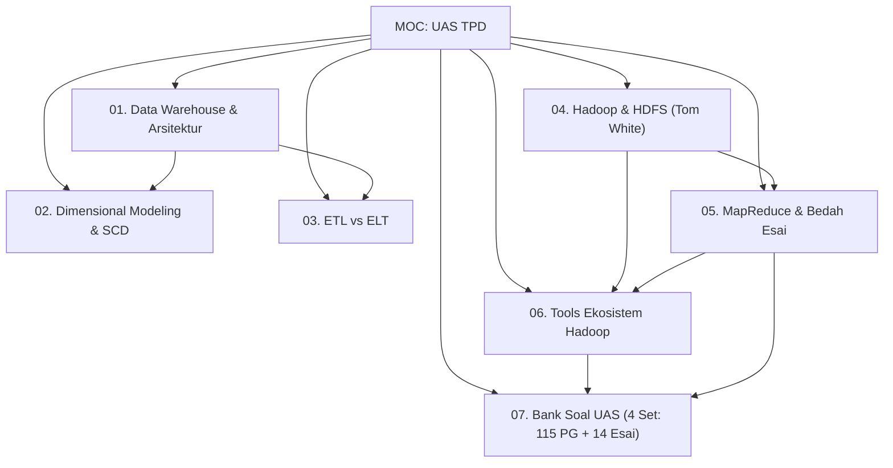

# 📚 MOC: Panduan Belajar Lengkap UAS Teknologi Pengolahan Data (TPD)

> [!ABSTRACT] Informasi Ujian & Bahan Acuan
> - **Mata Kuliah**: Teknologi Pengolahan Data (TPD)
> - **Dosen Pengampu**: Siti Mariyah, Ph.D (Politeknik Statistika STIS)
> - **Format Ujian**:
>   - **30 Soal Pilihan Ganda** (Fokus pada konsep fundamental, terminologi, perbandingan biner, dan mekanisme internal).
>   - **2 - 3 Soal Esai** (Fokus pada pemahaman konsep dan cara kerja; salah satunya **PASTI** soal perancangan MapReduce).
> - **Rujukan Otoritatif**: Silabus UAS TPD + Buku Teks Resmi *Hadoop: The Definitive Guide*, 4th Edition (Tom White, O'Reilly).
> - **Catatan Penting Silabus**: **YARN tidak diujikan mendalam** (cukup pahami konteks pemisahan perannya dari JobTracker). Seluruh materi di bawah telah dipecah menjadi modul dan sub-materi terstruktur dengan analisis kisi-kisi ujian, contoh soal, dan panduan menjawab.

---

## 🗺️ Peta Navigasi Modular (Map of Content)

Gunakan tautan internal Obsidian di bawah ini untuk mempelajari setiap sub-materi secara mendalam:

---

### 🏢 Modul 01: Data Warehouse & Arsitektur DWH
- [[01.1 Konsep Dasar, Karakteristik Inmon & SSoT]]: Definisi Bill Inmon 1990 (*Subject-oriented, Integrated, Non-volatile, Time-variant*), eliminasi *Data Silos*, dan DWH sebagai *Single Source of Truth* (SSoT).
- [[01.2 Perbandingan Mendalam OLTP vs OLAP]]: Matriks komparasi 10 karakteristik, perbedaan normalisasi 3NF vs denormalisasi bintang, serta alasan teknis pemisahan sistem (*locking & resource contention*).
- [[01.3 Arsitektur Lengkap Data Warehouse & Komponen Fisik]]: 7 komponen arsitektur DWH, peranan *Staging Area* vs *Operational Data Store (ODS)*, 3 jenis *Metadata (Technical, Business, Operational)*, dan arsitektur *Three-Tier*.
- [[01.4 Arsitektur Inmon vs Kimball & EDW vs Data Mart]]: Pertarungan filosofis *Top-Down (CIF 3NF)* vs *Bottom-Up (Dimensional Bus Architecture)*, *Dependent vs Independent Data Mart*, dan panduan pemilihan strategi korporasi.

---

### 📊 Modul 02: Dimensional Modeling & Slowly Changing Dimensions (SCD)
- [[02.1 Anatomi Fact Table & Dimension Table]]: Klasifikasi fakta (*Additive, Semi-Additive, Non-Additive, Factless*), serta alasan teknis penggunaan **Surrogate Key** vs *Natural Key*.
- [[02.2 Skema Desain Data Warehouse (Star, Snowflake, & Galaxy Schema)]]: Struktur skema, trade-off performa kueri JOIN vs redundansi storage, dan skema *Fact Constellation (Galaxy)* multi-fakta.
- [[02.3 4 Langkah Kimball Lifecycle & Conformed Dimensions]]: Metodologi 4 langkah (*Process $\to$ Grain $\to$ Dimensions $\to$ Facts*), bahaya *Grain Mismatch*, dan integrasi *Conformed Dimensions Bus Matrix*.
- [[02.4 Slowly Changing Dimensions (SCD Tipe 1, 2, dan 3)]]: Mekanisme *Overwrite (Tipe 1)*, *Add New Row (Tipe 2)* dengan atribut `StartDate, EndDate, IsCurrent`, dan *Add New Column (Tipe 3)* beserta simulasi kasusnya.
- [[02.5 Operasi Multidimensi OLAP Data Cube & Server OLAP]]: 5 operasi kubus (*Roll-up, Drill-down, Slice, Dice, Pivot*), perbedaan mendasar *Slice vs Dice*, serta perbandingan server **MOLAP vs ROLAP vs HOLAP**.

---

### 🔄 Modul 03: ETL & ELT
- [[03.1 Pipeline & Alur Kerja Lengkap ETL (Extract, Transform, Load)]]: Alur detail tahap *Extract (CDC vs Timestamp)*, tahap *Transform (Cleansing, Deduplication, Lookup, Quarantine)*, tahap *Load (Bulk Insert)*, serta konsep *Control Flow vs Data Flow*.
- [[03.2 Perbandingan Komprehensif ETL vs ELT]]: Paradigma tradisional vs era Big Data Cloud, matriks komparasi 10 poin, konsep *Schema-on-Write vs Schema-on-Read*, dan kepatuhan privasi data.

---

### 🌐 Modul 04: Hadoop & HDFS (Buku Teks Tom White)
- [[04.1 Konsep Dasar Komputasi Terdistribusi & Paradigma Hadoop]]: Batas fisik *Scale-Up*, matematika I/O paralel, doktrin emas **Data Locality**, 3 pilar Hadoop, serta VM vs Containerization.
- [[04.2 Arsitektur Kluster, Node Types & Single vs Multi Node]]: Pseudo-Distributed vs Multi-Node, peran **NameNode** (RAM metadata, `FsImage`, `EditLog`), **DataNode** (*Heartbeat 3s, Block Report 6h*), dan meluruskan mitos peran sebenarnya **Secondary NameNode** (*periodic checkpointer, bukan failover backup*).
- [[04.3 Karakteristik & Filosofi Desain HDFS (WORM, 128 MB Block, Anti-Patterns)]]: Model akses *Write-Once Read-Many*, **justifikasi matematis ukuran blok 128 MB** (rasio seek time $\approx 1\%$), serta **3 Skenario HDFS BUKAN Pilihan Tepat (*Low-latency, Small Files Problem, Multiple Writers*)**.
- [[04.4 Replikasi Blok, Topologi Jaringan & Rack-Awareness]]: **Matematika metrik jarak jaringan ($d = 0, 2, 4, 6$)**, algoritma penempatan 3 replika (*Rack-Aware Placement*), dan trade-off keandalan vs bandwidth jaringan.
- [[04.5 Mekanisme Detail HDFS Read Path & Write Path]]: Urutan langkah interaksi klien, thread `DataStreamer`, antrean memori `data queue` dan `ack queue`, paket 64 KB, pemulihan pipa gagal via **Generation Stamp**, serta koherensi `hflush` vs `hsync`.
- [[04.6 Enterprise HDFS (High Availability, QJM, Federation, Block Caching)]]: Penghapusan SPOF via *Active-Standby NameNode*, konsensus **Quorum Journal Manager (QJM)**, bahaya bencana **Split-Brain** dan pencegahannya dengan **Fencing (STONITH)**, *HDFS Federation*, dan *Centralized Block Caching*.

---

### ⚙️ Modul 05: MapReduce & Bedah Soal Esai
- [[05.1 Konsep, Komponen (JobTracker & TaskTracker) & Paradigma MapReduce]]: Filosofi *Divide-and-Conquer*, transformasi aljabar pasangan kunci-nilai $\langle K, V \rangle$, arsitektur master/worker (*JobTracker vs TaskTracker*), dan isolasi *Child JVM*.
- [[05.2 Alur Kerja Mendalam MapReduce (InputSplit, Map, Buffer, Spill, Shuffle & Sort, Reduce)]]: Pembagian *InputSplit* logis vs *HDFS Block* fisik, mekanisme *Circular Memory Buffer 100 MB* dengan *Spill Threshold 80%*, algoritma **HashPartitioner**, dan fase *External Merge Sort*.
- [[05.3 Mekanisme Combiner, Optimasi & Speculative Execution]]: Sifat matematis **komutatif & asosiatif**, bedah kegagalan fungsi **Average** beserta solusi pasangan komposit $\langle \text{Count}, \text{Sum} \rangle$, mekanisme **Speculative Execution** menumpas tugas lambat (*stragglers*), dan studi kasus cuaca NCDC.
- [[05.4 Panduan Menjawab & Bedah Soal Esai MapReduce (Template & 6 Kasus Lengkap)]]: **Template 5 Komponen Jawaban Bernilai 100**, bedah 6 kasus esai terpopuler (*WordCount, Highest Salary, Group By Total, Average Salary Komposit, Kunci Komposit Country-State, dan Two-Pass Top-K URL Min-Heap*), serta checklist penilaian dosen.

---

### 🛠️ Modul 06: Tools Ekosistem Hadoop
- [[06.0 Matriks Perbandingan Akbar Ekosistem Hadoop]]: Matriks perbandingan 8 dimensi lintas 6 tools, pohon keputusan pemilihan alat, dan bedah 3 pasangan komparasi terpopuler (*Hive vs HBase, Pig vs Hive, MapReduce vs Spark*).
- [[06.1 Apache Sqoop (RDBMS to HDFS Transfer & Map-Only Jobs)]]: Jembatan transfer massal dua arah RDBMS $\leftrightarrow$ HDFS, alasan arsitektural penggunaan **Map-Only Jobs (tanpa Reducer)**, pembagian partisi via Primary Key, dan berkas `part-m-`.
- [[06.2 Apache Hive (SQL on HDFS, Metastore, Partitioning vs Bucketing)]]: Data warehouse deklaratif SQL di atas HDFS, peranan Metastore RDBMS, perbedaan krusial **Managed vs External Table** saat `DROP TABLE`, serta **Partitioning** (*sub-folder, partition pruning*) vs **Bucketing** (*hash files, map-side join*).
- [[06.3 Apache HBase (NoSQL Column-Family & Low-Latency Random Read-Write)]]: NoSQL Google BigTable di HDFS, akses acak real-time sub-10 ms, model data *Column-Family*, koordinat `(RowKey, CF, CQ, Timestamp)`, arsitektur *RegionServer, MemStore, WAL, HFile*, serta siklus *Minor vs Major Compaction (pembersihan tombstones)*.
- [[06.4 Apache Pig (Procedural Data Flow Platform & Pig Latin)]]: Platform data flow prosedural untuk pipeline ETL, perbandingan filosofis **Prosedural (Pig) vs Deklaratif (Hive)**, tipe data kompleks (*Atom, Tuple, Bag, Map*), dan kompilasi DAG ke MapReduce.
- [[06.5 Apache Kafka (Distributed Real-Time Event Streaming & Ingestion)]]: Sistem saraf pusat event streaming jutaan pesan/detik, konsep *Topic, Partition, Offset, Consumer Group*, serta alasan teknis performa ekstrem via **Sequential Disk I/O** dan **Zero-Copy (`sendfile`)**.
- [[06.6 Apache Spark (In-Memory Unified Computing Engine & RDD)]]: Mesin komputasi kluster memori terpadu (100x lebih cepat dari MapReduce), konsep **RDD** (*Resilient, Distributed, Immutable*), toleransi kesalahan via **Lineage Graph (DAG)**, prinsip **Lazy Evaluation** (*Transformations vs Actions*), serta perbedaan **Narrow vs Wide Dependency** (*Stage Boundary & Shuffle*).
- [[06.7 Format Data, Pemrosesan Teks & Cloud Computing Big Data]]: Format berkas biner Hadoop (**Parquet** paling hemat kompresi vs **Avro** schema evolution), 3 tahapan menstrukturkan data teks (*Text Extraction $\to$ Tokenization $\to$ Phrase Recognition*), arsitektur *Schema-on-Read* Data Lake, model layanan awan (**IaaS, PaaS, SaaS, Hypervisor**), serta bedah ekosistem **Google Cloud Platform (GCP)** untuk Big Data (*BigQuery, Dataproc, GCS, Cloud Pub/Sub, Vertex AI*).

---

### 📝 Modul 07: Bank Soal & Simulasi Ujian Lengkap
- [[07.1 Set 1 - Simulasi Ujian Fundamental & Arsitektur (30 PG & 3 Esai)]]:
  - 30 Soal Pilihan Ganda fokus konsep inti DWH, OLTP vs OLAP, SCD, HDFS, MapReduce, dan ekosistem Hadoop.
  - 3 Soal Esai: (1) WordCount MapReduce terstruktur, (2) Desain Skema Toko Ritel Star vs Snowflake, (3) Perancangan Pipeline ETL SSIS.
  - Dilengkapi kunci jawaban dan pembahasan analitis.
- [[07.2 Set 2 - Simulasi Ujian Mekanisme Internal & Textbook Tom White (30 PG & 3 Esai)]]:
  - 30 Soal Pilihan Ganda fokus pendalaman materi buku teks Tom White (128 MB block, WORM, topologi jarak, QJM, buffer 100 MB spill 80%, dsb).
  - 3 Soal Esai: (1) MapReduce Average Salary dengan Combiner Komposit, (2) Bedah Masalah *Small Files Problem* HDFS & Solusinya (HAR, SequenceFiles), (3) Anatomi HDFS Read Path & Write Path dengan Generation Stamp.
- [[07.3 Set 3 - Simulasi Ujian Studi Kasus Industri & Troubleshooting (30 PG & 3 Esai)]]:
  - 30 Soal Pilihan Ganda fokus studi kasus industri, troubleshooting performa, data skewness, dan arsitektur enterprise.
  - 3 Soal Esai: (1) Perancangan MapReduce Dua Tahap (*Two-Pass Chained Job*) Top-10 URL Populer, (2) Model Dimensional Layanan Rumah Sakit Lengkap dengan SCD Tipe 2, (3) Desain Arsitektur Big Data Multi-Teknologi E-Commerce (Sqoop + Kafka + Spark + HBase + Hive/HDFS).
- [[07.4 Set 4 - Arsip Asli UAS 2022-2023 & Pembahasan Super Lengkap]]:
  - **Arsip Resmi Asli UAS 2022/2023**: 25 Soal Pilihan Ganda dan 5 Soal Esai lengkap dengan opsi jawaban dan kunci/pembahasan mendalam.
  - Pembahasan esai lengkap: (1) 5 Command Sqoop, (2) Kueri HiveQL JOIN & WHERE, (3) Kasus CLI Kafka 3-Broker & Topologi Pub/Sub, (4) Komparasi Spark vs MapReduce, (5) Bedah Layanan GCP untuk Big Data.

---

## 🎯 Tips Belajar & Strategi Menghadapi Ujian

1. **Strategi Pilihan Ganda (30 Soal - Cepat & Akurat)**:
   - **Kuasai Pasangan Biner**: Sering keluar soal kontras (OLTP vs OLAP, Inmon vs Kimball, Star vs Snowflake, ETL vs ELT, NameNode vs DataNode, Secondary NameNode vs Standby NameNode, Hive vs HBase, Pig vs Hive, Narrow vs Wide Dependency).
   - **Waspadai Angka Jebakan Buku Teks Tom White**:
     - Ukuran blok HDFS = 128 MB (bukan 64 KB atau 4 KB).
     - Alokasi RAM NameNode per objek = $\approx 150$ byte.
     - Heartbeat DataNode = 3 detik (mati setelah 10 menit).
     - Buffer Mapper = 100 MB (spill ke disk saat 80%).
     - Metrik Jarak Topologi Jaringan = 0 (mesin sama), 2 (rak sama), 4 (DC sama), 6 (DC beda).
2. **Strategi Soal Esai (2–3 Soal - Maksimalkan Poin)**:
   - **Gunakan Format Terstruktur**: Selalu pisahkan jawaban menjadi poin-poin bernomor atau tabel ringkas sebelum narasi. Dosen sangat menyukai struktur visual yang rapi.
   - **Wajib Terapkan Template 5 Komponen untuk Soal MapReduce**:
     1. Struktur Masukan $\langle k_1, v_1 \rangle$.
     2. Logika Mapper $\langle k_2, v_2 \rangle$.
     3. Evaluasi Kelayakan Combiner (khusus operasi rata-rata, wajib gunakan pasangan komposit `(count, sum)`).
     4. Alur Partisi, Shuffle & Sort $\langle k_2, [v_2] \rangle$.
     5. Logika Reducer $\langle k_3, v_3 \rangle$ yang ditulis ke HDFS.
   - **Gambarkan Diagram Alir Sederhana**: Sertakan diagram alir data (*ASCII atau diagram blok*) untuk menggambarkan alur kerja ETL, Write Path HDFS, atau arsitektur Big Data terpadu.