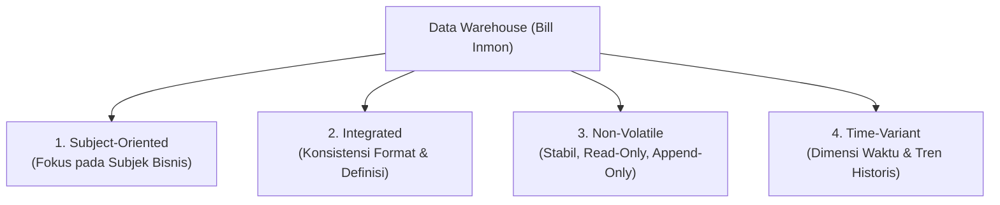

# 🏢 01.1 Konsep Dasar, Karakteristik Inmon & Single Source of Truth (SSoT)

> [!ABSTRACT] Ringkasan Sub-Materi
> Sub-materi ini membahas definisi fundamental *Data Warehouse* (DWH) menurut "Bapak Data Warehouse" William H. (Bill) Inmon (1990), empat pilar karakteristik DWH, konsep *Single Source of Truth* (SSoT), serta dampaknya terhadap pengambilan keputusan bisnis dan statistik analitik.

---

## 1. Definisi & Latar Belakang Data Warehouse

**Data Warehouse (DWH)** adalah repositori data terpusat yang dirancang khusus untuk mendukung analisis data, pelaporan eksekutif, dan *business intelligence* (BI), bukan untuk menangani transaksi harian.

Kebutuhan akan DWH bermula dari masalah **Data Silos**:
- Setiap departemen (Penjualan, Keuangan, SDM, Logistik) menggunakan sistem basis data operasional terisolasi (misal CRM di Oracle, ERP di SAP, Transaksi Kasir di MySQL).
- Format data, konvensi penamaan, dan definisi metrik berbeda-beda (misal Penjualan mencatat status pelanggan sebagai `Aktif/Nonaktif`, sedangkan Keuangan mencatat sebagai `1/0`).
- Saat pimpinan meminta laporan pendapatan total, angka dari bagian Penjualan seringkali tidak sama dengan angka dari bagian Keuangan.

DWH hadir sebagai solusi penyatuan data historis yang bersih, konsisten, dan terintegrasi dari seluruh organisasi.

---

## 2. 4 Karakteristik Utama Data Warehouse (Bill Inmon, 1990)

Definisi klasik Bill Inmon yang menjadi landasan teoritis seluruh literatur DWH:
> *"A Data Warehouse is a **subject-oriented**, **integrated**, **non-volatile**, and **time-variant** collection of data in support of management's decision-making process."*

### A. Subject-Oriented (Berorientasi Subjek)
- **Konsep**: Basis data operasional (OLTP) berorientasi pada **proses/aplikasi** (misal: proses penerbitan faktur, proses entri absensi, proses checkout belanja). Sebaliknya, DWH berorientasi pada **subjek bisnis utama** entitas organisasi (misal: Pelanggan, Produk, Penjualan, Pasien, Siswa).
- **Ciri**: Data disaring hanya untuk informasi yang relevan bagi analisis pembuat keputusan, mengabaikan detail teknis transaksional (seperti nomor urut mesin kasir atau status locking tabel).

### B. Integrated (Terintegrasi)
- **Konsep**: Aspek paling krusial dari DWH. Data yang ditarik dari berbagai sumber heterogen (*heterogeneous data sources*) harus diseragamkan dan dibersihkan sebelum masuk ke DWH.
- **Bentuk Integrasi**:
  1. *Konvensi Penamaan*: Penyeragaman nama atribut (misal `cust_id`, `no_pelanggan`, `client_code` diseragamkan menjadi `CustomerKey`).
  2. *Encoding & Format*: Penyeragaman format tanggal (`YYYY-MM-DD` vs `DD/MM/YYYY`) dan kode jenis kelamin (`M/F` vs `L/P` diseragamkan menjadi standar ISO).
  3. *Satuan Pengukuran*: Konversi mata uang (USD, EUR ke IDR) atau satuan fisik (Gallon, Liter ke Mililiter).

### C. Non-Volatile (Stabil / Tidak Menguap)
- **Konsep**: Data dalam DWH bersifat permanen (*read-only* bagi analis).
- **Mekanisme**:
  - Pada database transaksional (OLTP), operasi yang sering terjadi adalah `INSERT`, `UPDATE`, dan `DELETE`.
  - Pada DWH, operasi data yang terjadi hanyalah:
    1. **Initial Data Loading** (Pemuatan data awal secara massal).
    2. **Accessing / Querying Data** (Pembacaan data untuk analisis).
    3. **Periodic Incremental Appending** (Penambahan data baru secara berkala).
  - Data historis **tidak pernah di-*overwrite*** atau dihapus di tempat (*in-place update* dilarang), melainkan disimpan riwayat perubahannya menggunakan teknik SCD (*Slowly Changing Dimension*).

### D. Time-Variant (Bervariasi Waktu)
- **Konsep**: Setiap record data di dalam DWH secara eksplisit atau implisit terikat dengan dimensi waktu (*time stamp* atau *date key*).
- **Rentang Historis**:
  - Sistem operasional hanya menyimpan data terkini (*current value*, misal saldo rekening hari ini, biasanya rentang 60–90 hari).
  - DWH menyimpan rekam jejak jangka panjang (rentang 5–10 tahun) untuk analisis tren, forecasting musiman, dan evaluasi performa tahunan.
- Setiap baris tabel fakta (*Fact Table*) memuat waktu terjadinya peristiwa bisnis.

---

## 3. Data Warehouse sebagai Single Source of Truth (SSoT)

> [!NOTE] Definisi SSoT
> **Single Source of Truth (SSoT)** adalah kondisi arsitektur informasi di mana seluruh anggota organisasi mengambil keputusan berdasarkan satu sumber acuan data tunggal yang telah disepakati kebenaran, definisi, dan integritas logisnya.

### Manfaat SSoT bagi Organisasi:
1. **Menghilangkan Konflik Data Antar-Divisi**: Tidak ada lagi perdebatan laporan "angka penjualan siapa yang benar" dalam rapat dewan direksi.
2. **Kualitas Data Terjamin (*Data Quality & Integrity*)**: Melewati filter pembersihan (*data cleansing*) dan validasi pada proses ETL.
3. **Auditability & Compliance**: Riwayat perubahan data terdokumentasi rapi, memudahkan kepatuhan hukum dan audit statistik.

---

## 🎯 Hal-Hal yang Kemungkinan Besar Masuk Ujian

1. **Definisi 4 Karakteristik Bill Inmon**:
   - Sering ditanyakan dalam soal Pilihan Ganda (PG). Hati-hati dengan kata-kata pengecoh seperti *"Process-oriented"*, *"Volatile"*, *"Application-oriented"*, *"Real-time volatile"*.
2. **Makna Mendalam "Non-Volatile"**:
   - Dosen kerap menguji pemahaman bahwa non-volatile **bukan berarti data tidak pernah bertambah**, melainkan data yang sudah masuk **tidak boleh ditimpa/diubah (*no in-place updates*)**, melainkan hanya di-*append* dan dibaca (*read-only query*).
3. **Subject-Oriented vs Process-Oriented**:
   - Membedakan fokus OLTP (berbasis proses transaksi kasir/checkout) dengan DWH (berbasis subjek analisis seperti pelanggan atau penjualan).
4. **Peran Integrasi Data**:
   - Contoh nyata integrasi: penyeragaman format tanggal, konversi mata uang, dan *encoding* atribut identitas.

---

## 📋 Contoh Soal Ujian (Pilihan Ganda & Esai)

### Contoh Soal Pilihan Ganda
**Soal 1 (Definisi Karakteristik Inmon)**  
Karakteristik Data Warehouse yang menyatakan bahwa data disimpan dalam rentang waktu historis panjang (misal 5 hingga 10 tahun) untuk analisis tren masa lalu dan peramalan masa depan disebut...  
A. *Subject-Oriented*  
B. *Integrated*  
C. *Time-Variant*  
D. *Non-Volatile*  
*Kunci Jawaban*: **C**  
*Pembahasan & Analisis Pengecoh*:
- Opsi A salah karena *Subject-Oriented* berfokus pada subjek bisnis (misal Pelanggan).
- Opsi B salah karena *Integrated* berfokus pada penyeragaman standar data dari berbagai sumber.
- Opsi C **BENAR** karena *Time-Variant* secara spesifik mengatur dimensi waktu historis jangka panjang.
- Opsi D salah karena *Non-Volatile* mengatur bahwa data yang masuk tidak boleh ditimpa/diubah.

**Soal 2 (Jebakan Non-Volatile)**  
Operasi manipulasi data mana yang secara normal **TIDAK PERNAH** dijalankan secara langsung oleh pengguna akhir (*analyst*) terhadap data di dalam Data Warehouse?  
A. `SELECT` dan aggregasi data  
B. `UPDATE` dan `DELETE` data baris lama secara *in-place*  
C. `INSERT` berkala via batch ETL  
D. `COUNT` dan pembuatan grafik laporan  
*Kunci Jawaban*: **B**  
*Pembahasan*: Sifat *Non-Volatile* memastikan data historis bersifat permanen dan *read-only*. Pembaruan baris data lama secara langsung (`UPDATE`/`DELETE`) dilarang di DWH karena merusak rekam jejak audit historis.

---

### Contoh Soal Esai
**Soal Esai**:  
Jelaskan mengapa sistem basis data transaksional (OLTP) suatu perusahaan tidak dapat berfungsi secara efektif sebagai *Single Source of Truth* (SSoT) untuk analisis bisnis jangka panjang, dan bagaimana penerapan 4 karakteristik Data Warehouse menurut Bill Inmon memecahkan masalah tersebut!

**Pedoman Jawaban Lengkap**:
1. **Alasan OLTP Gagal Menjadi SSoT**:
   - *Data Silos*: Sistem OLTP tersebar di berbagai divisi dengan format dan skema yang tidak seragam (misal cabang A mencatat format tanggal berbeda dengan cabang B).
   - *Data Volatility*: Data di OLTP selalu berubah (*overwrite*) saat ada transaksi baru, sehingga riwayat data masa lalu hilang.
   - *Rentang Waktu Pendek*: OLTP hanya menyimpan data operasional terkini (60–90 hari) demi efisiensi performa indeks transaksi.
2. **Solusi Melalui 4 Karakteristik Inmon**:
   - **Subject-Oriented**: Mengelompokkan data yang tercecer berdasarkan entitas bisnis analitik (Penjualan, Pelanggan, Produk) sehingga relevan bagi manajemen.
   - **Integrated**: Melakukan standardisasi penamaan, tipe data, dan konversi satuan melalui pipeline ETL sehingga tercipta satu standar tunggal perusahaan.
   - **Non-Volatile**: Menyimpan data secara stabil tanpa *in-place update*, menjamin rekam jejak historis tidak hilang untuk audit.
   - **Time-Variant**: Memasukkan kunci waktu pada setiap transaksi selama bertahun-tahun, memungkinkan analisis tren masa lalu dan prediksi masa depan secara akurat.

---

## 💡 Tips & Trik Menjawab Soal Ujian

1. **Jurus Kata Kunci 4 Karakteristik Inmon**:
   - *Subject-Oriented* $\to$ Kata kunci: **Entitas bisnis utama (Customer, Sales)**, bukan alur proses aplikasi.
   - *Integrated* $\to$ Kata kunci: **Standarisasi format, penyeragaman kode, resolusi konflik sumber heterogen**.
   - *Non-Volatile* $\to$ Kata kunci: **Stabil, Read-Only, Append-Only, Tidak ada UPDATE/DELETE in-place**.
   - *Time-Variant* $\to$ Kata kunci: **Dimensi waktu eksplisit, data historis jangka panjang (5-10 tahun), tren**.
2. **Trik Menjawab Esai**:
   - Selalu sebut nama **William H. Inmon (1990)** saat menjawab pertanyaan esai mengenai karakteristik dasar DWH untuk memberi impresi penguasaan materi akademik yang mendalam.
   - Jangan lupa menyertakan diagram alur konsep SSoT (Sumber Heterogen $\to$ ETL/Pembersihan $\to$ DWH Terpadu $\to$ Keputusan Bisnis).
