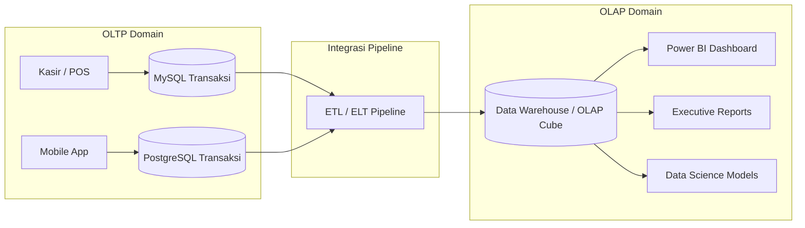

# ⚖️ 01.2 Perbandingan Mendalam OLTP vs OLAP

> [!ABSTRACT] Ringkasan Sub-Materi
> Memahami dikotomi mendasar antara sistem pemrosesan transaksi harian (*Online Transaction Processing* - OLTP) dan sistem analitis multidimensi (*Online Analytical Processing* - OLAP). Materi ini memuat matriks perbandingan 10 dimensi, alasan teknis pemisahan kedua sistem, contoh soal ujian, dan strategi menjawab.

---

## 1. Konsep Dasar & Tujuan Sistem

Dalam dunia manajemen basis data modern, beban kerja (*workload*) dibagi secara tegas menjadi dua domain utama:

1. **OLTP (Online Transaction Processing)**:
   - Dirancang untuk **menjalankan operasional harian organisasi secara real-time** (*day-to-day business operations*).
   - Fokus utama: Kecepatan eksekusi transaksi atomik, integritas data (*ACID properties*), dan ketersediaan tinggi (*high availability*).
   - Contoh: Sistem kasir Indomaret, transfer saldo mobile banking BCA, reservasi tiket kereta KAI.

2. **OLAP (Online Analytical Processing)**:
   - Dirancang untuk **analisis data historis, pelaporan manajerial, penemuan tren, dan perencanaan strategis**.
   - Fokus utama: Kecepatan eksekusi kueri agregasi kompleks pada volume data yang sangat masif (*high read throughput*).
   - Contoh: Analisis tren penjualan produk kuartalan per provinsi, evaluasi profil demografi nasabah kredit macet.

---

## 2. Matriks Komparatif 10 Karakteristik: OLTP vs OLAP

Tabel ini adalah acuan baku yang wajib dihafal untuk menjawab soal-soal perbandingan di ujian:

| Dimensi Karakteristik | OLTP (*Operational*) | OLAP (*Informational / Analytical*) |
| :--- | :--- | :--- |
| **1. Pengguna Utama (*User*)** | Kasir, staf administrasi, pelanggan, sistem otomatis | Analis data, manajer bisnis, eksekutif, data scientist |
| **2. Fungsi Sistem** | Menjalankan operasi bisnis rutin harian | Mendukung pengambilan keputusan strategis (*Decision Support*) |
| **3. Desain Basis Data** | **Ternormalisasi tinggi (3NF/BCNF)** untuk menghindari anomali *insert/update/delete* | **Tendenormalisasi (Star/Snowflake Schema)** untuk meminimalkan operasi JOIN |
| **4. Sifat Operasi Data** | **Read & Write seimbang** (Banyak `INSERT`, `UPDATE`, `DELETE`) | **Read-Heavy / Read-Only** (Kueri `SELECT` kompleks, penambahan data via batch append) |
| **5. Kompleksitas Kueri** | **Sederhana** (Kueri cepat berdasarkan index Primary Key, misal: ambil profil 1 nasabah) | **Sangat Kompleks** (Agregasi multi-tabel, `GROUP BY`, `SUM`, `AVG`, window functions) |
| **6. Akses Record** | Puluhan hingga ratusan baris per transaksi | Jutaan hingga miliaran baris historis per kueri |
| **7. Rentang Waktu Data** | **Terkini (Current Value)**; data historis terbatas (biasanya 30 - 90 hari) | **Historis Jangka Panjang**; akumulasi data 5 - 10 tahun |
| **8. Toleransi Latensi Respon** | **Sangat Rendah (Milidetik)**; respon harus instan bagi kasir/pengguna | **Sedang hingga Tinggi (Detik hingga Menit)**; dapat ditoleransi untuk analisis |
| **9. Kebutuhan Ruang Simpan** | Relatif kecil hingga sedang (Gigabyte) | Sangat besar (Terabyte hingga Petabyte) |
| **10. Prioritas Performa** | Throughput transaksi per detik (*TPS*) & integritas konkurensi (ACID) | Throughput kueri agregasi & fleksibilitas analisis multidimensi |

---

## 3. Mengapa OLTP dan OLAP Harus Dipisahkan?

Dosen sering menguji pemahaman mahasiswa tentang: *"Mengapa kita tidak menjalankan kueri analitik langsung di basis data transaksi (OLTP) saja?"*

Alasan teknis pemisahan arsitektur:
1. **Pencegahan Resource Contention & Locking**:
   - Kueri OLAP melakukan pembacaan *full-table scan* pada jutaan baris data.
   - Jika dijalankan di OLTP, mesin database akan melakukan *shared lock* atau *table lock*, menyebabkan transaksi kasir/pengguna tertahan (*blocking*) bahkan mengalami *deadlock*. Kasir tidak bisa mencetak struk belanja karena database sedang sibuk menghitung laporan tahunan!
2. **Perbedaan Pola Indeks & Struktur Data**:
   - OLTP membutuhkan banyak indeks selektif (B-Tree) pada kunci unik untuk pencarian cepat 1 baris. Indeks ini memperlambat proses `INSERT`/`UPDATE`.
   - OLAP membutuhkan indeks bitmap, kompresi kolom (*columnar storage*), dan agregat pra-hitung yang tidak efisien jika sering ditimpa.
3. **Optimasi Normalisasi vs Denormalisasi**:
   - Struktur 3NF pada OLTP membutuhkan puluhan relasi JOIN antar-tabel untuk menyusun satu laporan bisnis, yang akan melumpuhkan performa CPU.
   - Struktur denormalisasi pada OLAP mengorbankan redundansi disk demi kecepatan kueri baca.

---

## 🎯 Hal-Hal yang Kemungkinan Besar Masuk Ujian

1. **Desain Basis Data (Normalisasi vs Denormalisasi)**:
   - Ingat: **OLTP = 3NF (Ternormalisasi)** vs **OLAP = Denormalized (Star/Snowflake)**. Ini pertanyaan paling favorit di pilihan ganda!
2. **Tipe Operasi Utama**:
   - OLTP didominasi `INSERT`, `UPDATE`, `DELETE` singkat.
   - OLAP didominasi `SELECT` agregasi masif secara *read-only*.
3. **Rentang Waktu & Tingkat Detail (Grain)**:
   - OLTP menyimpan snapshot data *saat ini* (*current*) dengan grain sangat atomik.
   - OLAP menyimpan *histori jangka panjang* dengan grain atomik hingga agregat tersimpan (*summary tables*).
4. **Alasan Pemisahan Sistem (Soal Esai)**:
   - Harus mampu menjelaskan konsep *table locking*, *resource starvation*, dan benturan performa antara *write-intensive* vs *read-intensive*.

---

## 📋 Contoh Soal Ujian (Pilihan Ganda & Esai)

### Contoh Soal Pilihan Ganda
**Soal 1 (Desain Skema Basis Data)**  
Mengapa basis data operasional (OLTP) dirancang dalam bentuk ternormalisasi tinggi (3NF), sedangkan Data Warehouse (OLAP) cenderung didenormalisasi?  
A. Agar basis data OLTP berukuran lebih besar daripada basis data OLAP.  
B. Normalisasi pada OLTP mencegah redundansi data dan anomali pembaruan data transaksi, sedangkan denormalisasi pada OLAP meminimalkan operasi JOIN yang berat saat membaca jutaan baris data.  
C. Normalisasi pada OLTP mempercepat operasi JOIN multi-tabel untuk kebutuhan eksekutif.  
D. Denormalisasi pada OLAP bertujuan untuk menerapkan integritas referensial ACID secara ketat.  
*Kunci Jawaban*: **B**  
*Pembahasan*: 3NF pada OLTP menjamin efisiensi penulisan transaksi tanpa anomali. Denormalisasi pada OLAP memadatkan dimensi agar analis tidak perlu melakukan banyak JOIN saat mengagregasi jutaan data.

**Soal 2 (Karakteristik Workload)**  
Karakteristik kueri yang umum ditemui pada lingkungan OLAP adalah...  
A. Kueri cepat yang membaca tepat satu baris data berdasarkan Primary Key nasabah.  
B. Transaksi `INSERT` tunggal yang terjadi ribuan kali per detik dari mesin ATM.  
C. Kueri agregasi kompleks (`SUM`, `AVG`, `GROUP BY`) yang memindai jutaan baris historis melintasi berbagai dimensi analisis.  
D. Operasi `UPDATE` saldo rekening secara real-time.  
*Kunci Jawaban*: **C**  
*Pembahasan*: Opsi A, B, dan D adalah karakteristik khas OLTP. Opsi C adalah definisi murni kueri analitik OLAP.

---

### Contoh Soal Esai
**Soal Esai**:  
Sebuah perusahaan e-commerce mengalami masalah di mana aplikasi checkout pelanggan sering mengalami *timeout* atau lambat pada akhir bulan. Setelah diinvestigasi oleh DBA, ternyata tim keuangan sedang menjalankan laporan rekapitulasi laba tahunan langsung ke basis data utama MySQL produksi.  
a. Jelaskan secara teknis mengapa fenomena tersebut dapat terjadi!  
b. Berikan solusi arsitektural jangka panjang yang tepat untuk mengatasi masalah tersebut!

**Pedoman Jawaban Lengkap**:
1. **Analisis Masalah Teknis**:
   - Terjadi **Resource Contention** dan **Database Locking**.
   - Kueri rekapitulasi keuangan adalah kueri berkarakteristik OLAP yang melakukan *Full Table Scan* pada jutaan baris tabel pesanan dan pembayaran.
   - Kueri ini mengonsumsi kapasitas CPU dan memori buffer pool secara ekstrem, serta memasang *Shared Read Locks* pada tabel transaksi.
   - Akibatnya, kueri checkout pelanggan (karakteristik OLTP: `INSERT` / `UPDATE` saldo dan stok) terblokir (*waiting for lock*) hingga batas *timeout* tercapai.
2. **Solusi Arsitektural Jangka Panjang**:
   - Memisahkan arsitektur sistem secara tegas menjadi sistem OLTP dan OLAP.
   - Basis data transaksional (MySQL) difokuskan murni untuk melayani transaksi pengguna.
   - Mengimplementasikan pipeline **ETL / Change Data Capture (CDC)** untuk menyalin dan mentransformasi data transaksi secara asinkron atau batch (misal setiap malam) ke sistem **Data Warehouse terpisah**.
   - Tim keuangan diarahkan untuk menjalankan kueri laporan dan dashboard visualisasi hanya melalui sistem Data Warehouse / OLAP, sehingga sistem produksi operasional bebas dari beban analitik.

---

## 💡 Tips & Trik Menjawab Soal Ujian

1. **Jurus Cepat Pilihan Ganda (Tabel Kata Kunci)**:
   - Muncul kata *"3NF", "Normalisasi", "Kasir", "ACID", "Milidetik", "Update/Insert"* $\to$ Jawab: **OLTP**.
   - Muncul kata *"Denormalisasi", "Star Schema", "Agregasi", "Data Historis", "Eksekutif", "Read-Heavy"* $\to$ Jawab: **OLAP**.
2. **Jurus Esai**:
   - Ketika diminta membandingkan OLTP vs OLAP, buatlah **tabel komparasi singkat** (minimal mencakup 5 dimensi: Tujuan, Pengguna, Desain Skema, Pola Akses, dan Rentang Waktu) sebelum masuk ke pembahasan narasi. Dosen sangat menyukai jawaban berbasis tabel terstruktur karena langsung menunjukkan penguasaan materi komprehensif.
