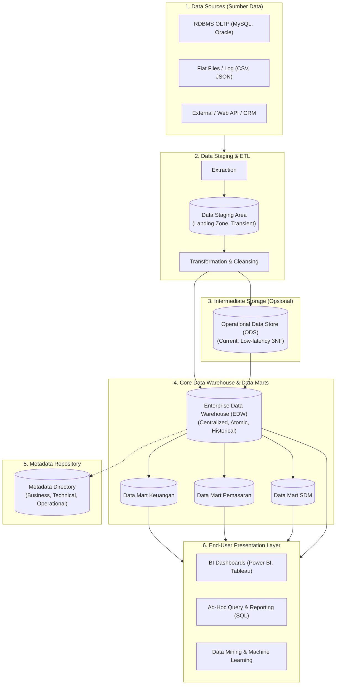

# 🏗️ 01.3 Arsitektur Lengkap Data Warehouse & Komponen Fisik

> [!ABSTRACT] Ringkasan Sub-Materi
> Menelaah secara mendalam lapisan-lapisan fisik dan logis arsitektur Data Warehouse (DWH). Sub-materi ini membahas 7 blok pembangun utama, perbedaan krusial antara *Data Staging Area*, *Operational Data Store* (ODS), dan *Data Warehouse Core Storage*, peran vital repositori Metadata, klasifikasi *N-Tier Architecture*, serta tips menjawab soal ujian.

---

## 1. Diagram Blok Arsitektur Lengkap Data Warehouse

Arsitektur DWH modern dirancang berlapis (*layered architecture*) untuk mengisolasi proses ekstraksi data operasional dari beban kueri analitik pengguna akhir:

---

## 2. Bedah 7 Komponen Utama Arsitektur

### 1. Operational Data Sources (Sumber Data Operasional)
- Sumber data mentah organisasi yang bersifat heterogen.
- Mencakup: RDBMS produksi (ERP, POS, CRM), file teks/flat files (CSV, XML, JSON), log server web, dan data eksternal (data sensus BPS, kurs valuta asing).

### 2. Data Staging Area (Area Penampungan Sementara)
- **Karakteristik**: Bersifat *transient* (sementara) dan terisolasi dari pengguna akhir (*strictly off-limits to end users*).
- **Fungsi Utama**: Tempat mendaratnya data mentah hasil ekstraksi dari sistem sumber sebelum diproses lebih lanjut.
- **Aktivitas di Staging**: Pembersihan data (*data scrubbing*), penanganan *missing values*, konversi format, penggabungan (*joining*), dan penyeragaman kode.

### 3. Operational Data Store (ODS) - Komponen Intermediate
- **Definisi**: Basis data relasional terintegrasi yang menyimpan data operasional terkini (*current value*, bukan data historis panjang).
- **Fungsi Khusus**:
  - Menyediakan data operasional lintas-sistem untuk laporan taktis harian yang membutuhkan data *near real-time* (misal status pesanan 1 jam terakhir).
  - Biasanya berstruktur ternormalisasi (3NF).
  - Berfungsi sebagai jembatan antara OLTP murni dan EDW.

> [!WARNING] Jebakan Ujian: Perbedaan Staging Area vs ODS vs Data Warehouse
> - **Data Staging Area**: HANYA tempat kerja pemrosesan ETL; data bersifat sementara (*wiped out after ETL finishes*); pengguna akhir **TIDAK BOLEH** mengakses staging.
> - **Operational Data Store (ODS)**: Menyimpan data terintegrasi **terkini (current/near real-time)** dengan riwayat minim (misal 30 hari); pengguna operasional dapat mengakses kueri harian.
> - **Data Warehouse (EDW)**: Menyimpan data terintegrasi **historis jangka panjang (5–10 tahun)**; dirancang untuk kueri agregasi strategis eksekutif.

### 4. Data Warehouse Storage Layer
- **Enterprise Data Warehouse (EDW)**: Repositori pusat yang menyimpan seluruh data subjek bisnis organisasi pada tingkat atomik paling detail.
- **Data Marts**: Bagian dari data warehouse yang difokuskan pada satu departemen atau lini bisnis tertentu (misal: Data Mart Penjualan, Data Mart SDM). Data di sini biasanya sudah diagregasi.

### 5. Metadata Repository (Kamus Data Arsitektur)
- Sering disebut sebagai *"Buku Panduan / DNA dari Data Warehouse"*. Metadata adalah data tentang data.
- **3 Klasifikasi Metadata**:
  1. **Technical Metadata**: Struktur teknis database (nama tabel, nama kolom, tipe data, kunci primer/asing, partisi, ukuran indeks).
  2. **Business Metadata**: Penjelasan dalam bahasa bisnis yang dipahami manajer (definisi metrik "Pendapatan Bersih", kepemilikan data, aturan bisnis, kamus istilah).
  3. **Operational / Process Metadata**: Log eksekusi pipeline ETL (waktu mulai/selesai pemuatan, jumlah baris yang berhasil dimuat vs ditolak/error, status pemutakhiran data).

### 6. Archive / Backup Layer
- Penyimpanan sekunder (pita magnetik atau cold storage cloud) untuk data historis yang sudah sangat lama (misal > 10 tahun) yang jarang diakses namun wajib disimpan demi kepatuhan regulasi audit hukum.

### 7. End-User Presentation / Access Tools
- Lapisan antarmuka pengguna akhir:
  - **Executive Dashboards**: Visualisasi metrik KPI secara grafis (Power BI, Tableau, Looker).
  - **OLAP Tools**: Eksplorasi multidimensi (*slice, dice, drill-down*).
  - **Ad-hoc SQL Query Tools**: Kueri eksploratif analis.
  - **Advanced Analytics / Machine Learning**: Prediksi dan data mining.

---

## 3. Klasifikasi Arsitektur Tingkat Fisik (N-Tier)

1. **Single-Tier Architecture (Jarang Digunakan)**:
   - Pengguna mengakses langsung basis data operasional secara virtual/terisolasi. Tidak disarankan karena membebani sistem produksi.
2. **Two-Tier Architecture**:
   - Lapisan Sumber Data $\to$ Data Warehouse Fisik $\to$ Lapisan Klien.
   - Sering digunakan pada organisasi skala kecil/menengah dengan sumber data yang relatif seragam.
3. **Three-Tier Architecture (Standar Industri)**:
   - **Tier 1 (Bottom Tier)**: Server Data Warehouse (basis data relasional tempat penyimpanan data).
   - **Tier 2 (Middle Tier)**: Server OLAP (MOLAP / ROLAP) yang menyediakan abstraksi multidimensi dan pemrosesan agregasi instan.
   - **Tier 3 (Top Tier)**: Klien presentasi (Front-end BI tools, antarmuka visualisasi).

---

## 🎯 Hal-Hal yang Kemungkinan Besar Masuk Ujian

1. **Perbedaan Staging Area dan ODS**:
   - Pertanyaan klasik: *"Komponen mana yang bertindak sebagai area kerja sementara untuk proses pembersihan data tanpa boleh diakses oleh pengguna akhir?"* $\to$ Jawab: **Data Staging Area**.
2. **Peran Metadata Repository**:
   - Pahami perbedaan antara **Technical Metadata** (nama kolom, tipe data, indeks) dan **Business Metadata** (definisi istilah bisnis, rumus KPI).
3. **Komponen Arsitektur Three-Tier**:
   - Tier bawah = Database Server (DWH storage).
   - Tier tengah = OLAP Server (MOLAP/ROLAP engine).
   - Tier atas = Client / BI Tools.
4. **Data Mart vs EDW**:
   - Dosen sering menguji cakupan: Data Mart berfokus pada **satu subjek/departemen**, sedangkan EDW mencakup **seluruh perusahaan (enterprise-wide)**.

---

## 📋 Contoh Soal Ujian (Pilihan Ganda & Esai)

### Contoh Soal Pilihan Ganda
**Soal 1 (Komponen Staging Area)**  
Di dalam arsitektur Data Warehouse, mengapa pengguna akhir (*business analysts*) secara tegas dilarang melakukan kueri langsung ke *Data Staging Area*?  
A. Karena data di staging area terlalu rahasia bagi analis bisnis.  
B. Karena data di staging area bersifat sementara (*transient*), seringkali belum bersih, strukturnya dapat berubah-ubah sewaktu-waktu, dan pemuatan data sedang berjalan aktif sehingga kueri akan mengganggu proses ETL.  
C. Karena staging area hanya berisi kode program Java tanpa data fisik.  
D. Karena staging area berada di komputer klien analis.  
*Kunci Jawaban*: **B**  
*Pembahasan*: Staging area adalah dapur pemrosesan ETL. Data di dalamnya tidak memiliki integritas referensial yang stabil bagi pelaporan sebelum proses transformasi selesai sepenuhnya.

**Soal 2 (Klasifikasi Metadata)**  
Informasi yang mencatat bahwa kueri "Total Laba Kotor" dihitung dengan rumus `Pendapatan Penjualan dikurangi Harga Pokok Penjualan (HPP)` dan pemilik data metrik tersebut adalah Kepala Bagian Akuntansi tergolong ke dalam...  
A. *Technical Metadata*  
B. *Operational Metadata*  
C. *Business Metadata*  
D. *System Architecture Metadata*  
*Kunci Jawaban*: **C**  
*Pembahasan*: Business Metadata mendefinisikan terminologi bisnis, aturan perhitungan logika bisnis, dan kepemilikan data agar analis memahami konteks data yang mereka gunakan.

---

### Contoh Soal Esai
**Soal Esai**:  
Gambarkan diagram arsitektur tiga tingkat (*Three-Tier Architecture*) Data Warehouse dan jelaskan fungsi spesifik dari masing-masing tingkat tersebut beserta peranan repositori *Metadata* dalam menjamin kelangsungan arsitektur tersebut!

**Pedoman Jawaban Lengkap**:
1. **Diagram 3-Tier**:
   - Gambarkan secara berurutan dari bawah ke atas:
     - Tier 1: Warehouse Database Server (Back-end)
     - Tier 2: OLAP Server (Middle-tier)
     - Tier 3: Front-End Presentation Client
2. **Fungsi Masing-Masing Tier**:
   - **Tier 1 (Bottom Tier - Warehouse Storage)**: Mengelola penyimpanan fisik data historis terintegrasi (berupa RDBMS relasional terdistribusi) yang diisi secara berkala oleh proses ETL dari berbagai sistem operasional.
   - **Tier 2 (Middle Tier - OLAP Server)**: Bertindak sebagai mesin kalkulasi analitis (ROLAP atau MOLAP) yang mengabstraksi data relasional menjadi bentuk kubus multidimensi (*Data Cube*) dan mempercepat operasi agregasi (*drill-down, roll-up*).
   - **Tier 3 (Top Tier - Client Layer)**: Antarmuka visual yang digunakan oleh pengguna akhir (manajer, eksekutif) untuk membuat laporan, mengeksekusi dashboard BI, kueri ad-hoc, dan eksplorasi data.
3. **Peranan Kunci Metadata**:
   - Metadata berperan sebagai perekat atau "sistem saraf" yang mengoordinasikan seluruh tier:
     - Menginformasikan proses ETL mengenai pemetaan skema dari sumber ke target.
     - Menginformasikan OLAP server mengenai agregat tabel dan partisi fisik.
     - Menyediakan kamus data bagi pengguna di Tier 3 untuk memahami arti bisnis dari data yang mereka kueri.

---

## 💡 Tips & Trik Menjawab Soal Ujian

1. **Trik Menghafal 3 Jenis Metadata**:
   - **Technical** = *Bagaimana komputer melihat data* (Tipe data, PK/FK, nama kolom, partisi).
   - **Business** = *Bagaimana manusia/manajer melihat data* (Definisi istilah, rumus laba, aturan bisnis).
   - **Operational** = *Bagaimana sistem ETL bekerja* (Timestamp load, jumlah baris error, status keberhasilan batch).
2. **Tips Diagram Esai**:
   - Jangan pernah menggambar panah langsung dari *Operational Data Sources* menuju *Executive Dashboard*! Selalu letakkan lapisan **ETL/Staging** dan **Data Warehouse Storage** di tengahnya untuk membuktikan pemahaman arsitektural yang benar.
