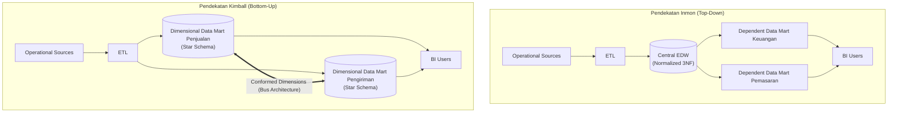

# 🏛️ 01.4 Arsitektur Inmon vs Kimball & EDW vs Data Mart

> [!ABSTRACT] Ringkasan Sub-Materi
> Membandingkan dua paradigma arsitektur paling dominan dalam sejarah perancangan Data Warehouse: pendekatan *Top-Down* oleh Bill Inmon (*Corporate Information Factory*) versus pendekatan *Bottom-Up* oleh Ralph Kimball (*Dimensional Data Warehouse Bus Architecture*). Dilengkapi analisis komparatif antara *Enterprise Data Warehouse* (EDW) dan *Data Mart* (Independent vs Dependent), kisi-kisi ujian, dan strategi menjawab soal esai.

---

## 1. Pertarungan Dua Mazhab: Inmon vs Kimball

Dalam literatur dan industri Data Warehouse, terdapat perdebatan klasik antara dua tokoh pelopor: **Bill Inmon** (pendekatan terpusat / *Top-Down*) dan **Ralph Kimball** (pendekatan terdistribusi berbasis proses / *Bottom-Up*).

---

## 2. Bedah Filosofi & Alur Kerja

### A. Pendekatan Bill Inmon: Corporate Information Factory (CIF) - *Top-Down*
- **Filosofi Dasar**: Data Warehouse harus menjadi repositori pusat tunggal yang komprehensif untuk seluruh organisasi sebelum melayani kebutuhan analitis per departemen.
- **Langkah Perancangan**:
  1. Buat model data perusahaan terpadu (*Enterprise Data Model*).
  2. Bangun **Enterprise Data Warehouse (EDW)** fisik yang tersentralisasi dalam bentuk **ternormalisasi (Third Normal Form / 3NF)**.
  3. Dari EDW yang sudah stabil, buat **Dependent Data Marts** yang disesuaikan untuk masing-masing departemen (misal: Finance, HR, Marketing) dengan skema dimensional.
- **Karakteristik**:
  - *Data Modeler*: Butuh perencanaan jangka panjang yang sangat matang.
  - *Redundansi*: Sangat rendah di level core EDW.
  - *Waktu Implementasi*: Lama (bisa memakan waktu bertahun-tahun sebelum laporan pertama siap digunakan pengguna).
  - *Biaya Awal*: Sangat tinggi.

### B. Pendekatan Ralph Kimball: Dimensional Data Warehouse - *Bottom-Up*
- **Filosofi Dasar**: Data Warehouse harus segera memberikan nilai bisnis secara cepat (*deliver business value fast*) dengan berfokus langsung pada proses bisnis departemen.
- **Langkah Perancangan**:
  1. Identifikasi proses bisnis prioritas utama (misal: Transaksi Penjualan).
  2. Rancang dan bangun **Dimensional Data Mart** menggunakan model dimensional (**Star Schema** atau **Snowflake Schema**) langsung dari data staging.
  3. Untuk menghubungkan antar-Data Mart agar tidak menjadi data silos baru, gunakan konsep **Conformed Dimensions** (misal: tabel `Dim_Date` dan `Dim_Customer` dipakai bersama oleh Data Mart Penjualan maupun Data Mart Pengiriman) melalui arsitektur yang disebut **Enterprise Data Warehouse Bus Architecture**.
- **Karakteristik**:
  - *Waktu Implementasi*: Sangat cepat (iteratif per proses bisnis, hasil terlihat dalam hitungan bulan).
  - *Biaya Awal*: Relatif rendah dan bertahap.
  - *Kemudahan Kueri*: Sangat mudah dipahami oleh pengguna bisnis karena menggunakan skema bintang.

---

## 3. Matriks Perbandingan Akbar: Inmon vs Kimball

| Kriteria Evaluasi | Bill Inmon (*Top-Down Approach*) | Ralph Kimball (*Bottom-Up Approach*) |
| :--- | :--- | :--- |
| **Filosofi Inti** | *Enterprise-wide data driven* (Fokus pada integritas data seluruh perusahaan) | *Business process driven* (Fokus pada kebutuhan proses bisnis pengguna) |
| **Arsitektur Struktur** | **Top-Down**: Operasional $\to$ Staging $\to$ 3NF EDW $\to$ Dependent Data Marts | **Bottom-Up**: Operasional $\to$ Staging $\to$ Dimensional Data Marts (Bus Architecture) |
| **Model Data Inti** | **Normalized (3NF)** pada tingkat EDW pusat | **De-normalized (Dimensional / Star Schema)** |
| **Konsep Integrasi** | Integrasi dijamin oleh skema 3NF relasional tunggal di EDW | Integrasi dijamin melalui standarisasi **Conformed Dimensions** |
| **Kompleksitas Desain** | Sangat tinggi di awal proyek (*up-front heavy design*) | Rendah di awal, meningkat seiring bertambahnya Data Mart baru |
| **Waktu Pengerjaan Awal** | Panjang (berbulan-bulan hingga tahunan sebelum ROI terlihat) | Pendek / Cepat (iteratif, ROI terlihat dalam hitungan minggu/bulan) |
| **Keahlian Tim Dibutuhkan**| Ahli normalisasi data korporasi, DBA skala besar | Analis bisnis terbiasa dengan pemodelan dimensional |
| **Kemudahan Modifikasi** | Lebih mudah menambah subjek data baru di tingkat enterprise | Lebih mudah mengubah agregasi laporan bisnis per proses |

---

## 4. Perbandingan: Enterprise Data Warehouse (EDW) vs Data Mart

Dosen sering menguji perbedaan cakupan antara EDW dan Data Mart:

| Dimensi | Enterprise Data Warehouse (EDW) | Data Mart |
| :--- | :--- | :--- |
| **Cakupan Organisasi** | Seluruh perusahaan (*Enterprise-wide*) | Satu divisi/departemen (misal Keuangan atau Pemasaran) |
| **Subjek Data** | Banyak subjek bisnis terpadu | Satu subjek bisnis terisolasi |
| **Sumber Data** | Puluhan hingga ratusan sistem sumber heterogen | Beberapa sumber data yang relevan dengan divisi tersebut |
| **Ukuran Basis Data** | Sangat besar (Ratusan GB hingga Petabyte) | Relatif kecil hingga menengah (Puluhan hingga ratusan GB) |
| **Detail Data (Grain)** | Sangat atomik (detail paling bawah) | Campuran antara atomik dan data agregat (*summary data*) |
| **Waktu Pembangunan** | Jangka panjang | Cepat dan terfokus |

### Jenis-Jenis Data Mart:
1. **Dependent Data Mart**:
   - Sumber datanya diambil secara eksklusif dari **Enterprise Data Warehouse (EDW)** yang sudah ada (mengikuti filosofi Inmon).
   - Menjamin integritas data tetap terjaga karena bersumber dari SSoT.
2. **Independent Data Mart**:
   - Dibuat langsung dari sistem sumber operasional oleh divisi tertentu tanpa melalui EDW.
   - **Kelemahan**: Menghidupkan kembali masalah *Data Silos*, di mana definisi data antar-departemen dapat bertolak belakang.

---

## 🎯 Hal-Hal yang Kemungkinan Besar Masuk Ujian

1. **Top-Down vs Bottom-Up**:
   - Inmon = **Top-Down** (mulai dari EDW 3NF $\to$ Data Marts).
   - Kimball = **Bottom-Up** (mulai dari Dimensional Data Marts $\to$ disatukan via Conformed Dimensions).
2. **Karakteristik Skema**:
   - Inmon menggunakan **3NF** di core DWH.
   - Kimball menggunakan **Star/Snowflake Schema** (Dimensional Model).
3. **Konsep Kunci Kimball**:
   - Istilah **Conformed Dimensions** dan **Bus Architecture** adalah kunci jawaban untuk pertanyaan bagaimana Kimball menyatukan data mart tanpa membuat silo data.
4. **Dependent vs Independent Data Mart**:
   - Dependent = data berasal dari EDW pusat.
   - Independent = data ditarik mandiri dari sistem operasional (rawan duplikasi dan konflik data).

---

## 📋 Contoh Soal Ujian (Pilihan Ganda & Esai)

### Contoh Soal Pilihan Ganda
**Soal 1 (Filosofi Arsitektur Inmon)**  
Pendekatan perancangan Data Warehouse yang mengusulkan pembentukan repositori pusat terintegrasi dalam bentuk Third Normal Form (3NF) terlebih dahulu sebelum mendistribusikan data ke masing-masing Data Mart departemen dikenal sebagai pendekatan...  
A. Pendekatan Bottom-Up oleh Ralph Kimball  
B. Pendekatan Top-Down oleh Bill Inmon  
C. Pendekatan Star-Bus Architecture  
D. Pendekatan Distributed Data Lake  
*Kunci Jawaban*: **B**  
*Pembahasan*: Bill Inmon memelopori pendekatan *Top-Down* (CIF) di mana EDW 3NF dibangun terlebih dahulu sebagai fondasi tunggal perusahaan.

**Soal 2 (Risiko Independent Data Mart)**  
Sebuah divisi pemasaran membangun basis data analitiknya sendiri dengan menarik data transaksi langsung dari sistem POS kasir tanpa berkoordinasi dengan divisi IT dan tanpa melalui Data Warehouse pusat. Struktur ini disebut...  
A. *Dependent Data Mart*  
B. *Conformed Data Mart*  
C. *Independent Data Mart*  
D. *Enterprise Bus Architecture*  
*Kunci Jawaban*: **C**  
*Pembahasan*: Independent Data Mart dibangun terpisah secara mandiri langsung dari sumber operasional dan berisiko menciptakan kembali silo data.

---

### Contoh Soal Esai
**Soal Esai**:  
Sebuah perusahaan rintisan (*startup*) berkembang pesat ingin membangun sistem analitis data. Manajemen membutuhkan laporan penjualan harian dan churn pelanggan dalam waktu kurang dari 3 bulan dengan anggaran terbatas.  
a. Pendekatan arsitektur mana yang lebih Anda rekomendasikan: Inmon atau Kimball? Berikan alasan teknis dan bisnis yang mendasari rekomendasi Anda!  
b. Bagaimana Anda memastikan bahwa solusi yang Anda pilih tidak berakhir menjadi kumpulan "Silo Data" baru di masa depan?

**Pedoman Jawaban Lengkap**:
1. **Rekomendasi Arsitektur (Pendekatan Ralph Kimball - Bottom-Up)**:
   - **Alasan Bisnis**: Proyek harus selesai cepat (< 3 bulan) dan beranggaran terbatas. Pendekatan Kimball bersifat iteratif dan berorientasi proses bisnis (*business-driven*), memungkinkan pengiriman solusi fungsional (*working Data Mart*) secara cepat untuk proses penjualan terlebih dahulu. Pendekatan Inmon membutuhkan waktu perancangan skema 3NF enterprise bertahun-tahun dan biaya awal sangat mahal, sehingga tidak cocok untuk situasi startup.
   - **Alasan Teknis**: Menggunakan pemodelan dimensional (Star Schema) yang mudah dipahami oleh analis dan menghasilkan performa kueri agregasi yang sangat cepat tanpa perlu JOIN tabel 3NF yang rumit.
2. **Strategi Mencegah Data Silos (Penerapan Conformed Dimensions & Bus Architecture)**:
   - Membuat matriks **Enterprise Data Warehouse Bus Architecture**.
   - Menetapkan dimensi-dimensi bersama (*Conformed Dimensions*) yang distandarisasi di seluruh organisasi, seperti `Dim_Date`, `Dim_Customer`, dan `Dim_Product`.
   - Ketika departemen lain (misal Layanan Pelanggan atau Pemasaran) membangun Data Mart baru, mereka **wajib mereferensikan tabel dimensi yang sama** yang telah terstandarisasi. Dengan cara ini, laporan antar-divisi tetap konsisten dan terintegrasi (*Single Source of Truth*).

---

## 💡 Tips & Trik Menjawab Soal Ujian

1. **Jurus Kata Kunci Ujian**:
   - Jika soal menyebutkan *"Corporate Information Factory", "3NF", "Top-Down", "Normalisasi terpusat"* $\to$ Kuncinya adalah **Bill Inmon**.
   - Jika soal menyebutkan *"Bus Architecture", "Conformed Dimensions", "Bottom-Up", "Star Schema", "Proses Bisnis"* $\to$ Kuncinya adalah **Ralph Kimball**.
2. **Formula Menjawab Esai Studi Kasus Pemilihan Arsitektur**:
   - Gunakan formula: **Kebutuhan Waktu/Biaya $\to$ Pilihan Tokoh $\to$ Mekanisme Teknis $\to$ Solusi Mitigasi Risiko**.
   - Jika butuh cepat/murah $\to$ Pilih **Kimball** (mitigasi: gunakan *Conformed Dimensions*).
   - Jika perusahaan raksasa multinasional yang butuh stabilitas tata kelola jangka panjang tanpa batasan waktu/biaya $\to$ Pilih **Inmon** (mitigasi: bangun *Dependent Data Marts*).
