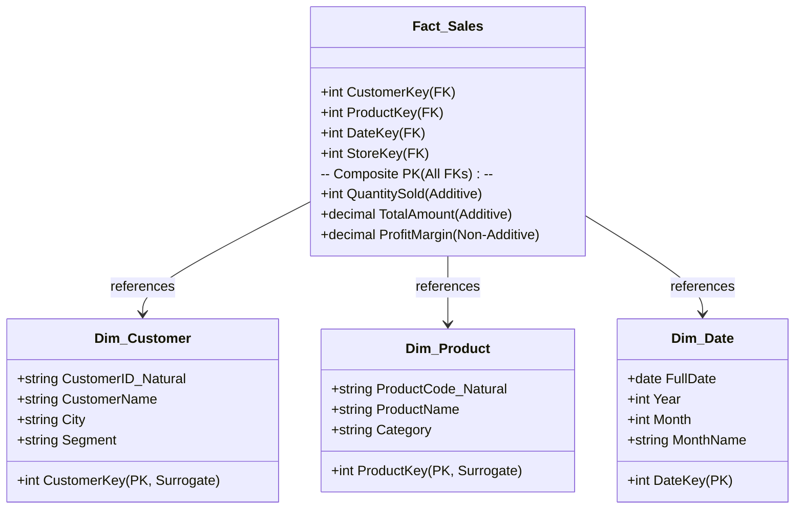

# 📊 02.1 Anatomi Fact Table & Dimension Table

> [!ABSTRACT] Ringkasan Sub-Materi
> Menelaah blok pembangun fundamental dalam pemodelan dimensional (*Dimensional Modeling*): **Fact Table** (tabel fakta) dan **Dimension Table** (tabel dimensi). Sub-materi ini mengupas tuntas klasifikasi fakta kuantitatif (aditif, semi-aditif, non-aditif, dan *factless*), peranan krusial *Surrogate Key* versus *Natural Key*, kisi-kisi ujian, dan strategi menjawab soal analitis.

---

## 1. Filosofi Pemodelan Dimensional (Ralph Kimball)

Pemodelan dimensional adalah teknik perancangan basis data yang bertujuan untuk:
1. Menyajikan data analitis dalam format yang intuitif dan mudah dipahami oleh pengguna bisnis.
2. Memaksimalkan efisiensi performa pembacaan dan eksekusi kueri agregasi (*high-speed query performance*).

Setiap model dimensional membagi dunia data ke dalam dua konsep utama:
- **Pengukuran Peristiwa Bisnis (Facts)**: *"Berapa banyak barang yang terjual? Berapa total rupiah transaksi?"*
- **Konteks Analisis (Dimensions)**: *"Siapa yang membeli? Produk apa yang dibeli? Di toko mana? Kapan transaksi terjadi?"*

---

## 2. Anatomi Mendalam Fact Table (Tabel Fakta)

**Fact Table** adalah tabel utama di pusat model dimensional yang mencatat hasil pengukuran numerik dari suatu peristiwa bisnis (*business event*).

### A. Karakteristik Struktural Fact Table
1. **Berisi Dua Jenis Kolom**:
   - **Foreign Keys (FK)**: Menghubungkan baris fakta ke tabel dimensi terkait.
   - **Measures / Metrics**: Nilai kuantitatif numerik hasil pengukuran peristiwa bisnis.
2. **Primary Key Berupa Composite Key**:
   - Primary key pada tabel fakta biasanya merupakan gabungan dari seluruh Foreign Keys yang ada (*Composite Primary Key*).
3. **Ukuran Baris Sangat Besar & Menjulang Tinggi (*Deep Table*)**:
   - Tabel fakta memiliki jumlah kolom yang relatif sedikit (10–20 kolom), namun memiliki jumlah baris yang masif (jutaan hingga miliaran baris).
   - Selalu bertambah secara *append-only* seiring berjalannya transaksi.

### B. Klasifikasi Measures (Fakta Kuantitatif)
Dosen sering menguji pemahaman klasifikasi tipe fakta berikut:

| Tipe Fakta | Definisi & Karakteristik | Contoh Kasus |
| :--- | :--- | :--- |
| **1. Additive Facts (Fakta Aditif Penuh)** | Dapat dijumlahkan secara valid melintasi **seluruh dimensi** analisis (Waktu, Toko, Pelanggan, Produk). Tipe fakta yang paling ideal dan disukai dalam DWH. | - Jumlah unit terjual (`QuantitySold`) - Total nilai rupiah transaksi (`TotalSalesAmount`) - Biaya pengiriman (`ShippingCost`) |
| **2. Semi-Additive Facts (Fakta Semi-Aditif)** | Dapat dijumlahkan secara valid melintasi **sebagian dimensi**, namun **TIDAK BISA dijumlahkan melintasi dimensi Waktu**. | - Saldo akhir rekening bank (`AccountBalance`) - Jumlah stok barang di gudang (`InventoryStock`) *(Catatan: Anda tidak boleh menjumlahkan saldo tanggal 1 Jan + 2 Jan + 3 Jan untuk mendapatkan saldo bulanan! Solusinya gunakan fungsi `AVG` atau ambil nilai akhir periode).* |
| **3. Non-Additive Facts (Fakta Non-Aditif)** | **Sama sekali tidak dapat dijumlahkan** melintasi dimensi apa pun secara langsung karena berupa persentase, rasio, atau nilai intensif. | - Persentase margin laba (`ProfitMargin %`) - Harga satuan produk (`UnitPrice`) - Suhu ruangan (`Temperature`) *(Catatan: Harus dihitung ulang dari fakta dasar, misal: $\text{Margin \%} = \frac{\sum \text{Profit}}{\sum \text{Revenue}}$).* |
| **4. Factless Fact Table (Tabel Fakta Tanpa Fakta)** | Tabel fakta yang **tidak memiliki kolom measure numerik sama sekali**, hanya berisi kumpulan Foreign Key. Digunakan untuk mencatat **kejadian peristiwa (*event tracking*)** atau rentang cakupan promosi. | - Absensi kehadiran mahasiswa kuliah (mencatat hubungan `SiswaKey`, `MataKuliahKey`, `DateKey`) - Pengecekan produk mana yang sedang dalam masa promosi diskon tetapi tidak terjual. |

---

## 3. Anatomi Mendalam Dimension Table (Tabel Dimensi)

**Dimension Table** adalah tabel pendamping yang menyediakan konteks deskriptif tekstual untuk menjawab pertanyaan bisnis ("siapa, apa, di mana, kapan, mengapa, dan bagaimana").

### A. Karakteristik Struktural Dimension Table
1. **Primary Key Tunggal**: Memiliki satu kolom Primary Key berupa integer (disebut *Surrogate Key*).
2. **Kaya Kolom Deskriptif (*Wide Table*)**: Memiliki banyak kolom atribut teks (50–100 atribut) untuk filtering dan grouping pada kueri (`WHERE`, `GROUP BY`).
3. **Jumlah Baris Relatif Sedikit**: Dibandingkan tabel fakta, tabel dimensi memiliki baris yang relatif sedikit (ratusan hingga puluhan ribu baris).
4. **Tendenormalisasi**: Atribut hierarki sering digabungkan dalam satu tabel untuk menghindari JOIN berlebih (misal: Kecamatan, Kota, Provinsi dimasukkan ke dalam `Dim_Location`).

### B. Surrogate Key vs Natural Key (Konsep Wajib Ujian!)

> [!IMPORTANT] Mengapa Tabel Dimensi Wajib Menggunakan Surrogate Key?
> **Natural Key (Business Key)** adalah ID asli dari sistem operasional sumber (misal: Nomor KTP, Kode SKU Produk, No Rekening Bank).  
> **Surrogate Key** adalah kunci buatan berupa integer sekuensial (`1, 2, 3, ...`) yang dibuat dan dikelola secara mandiri oleh pipeline DWH/ETL tanpa memiliki makna bisnis apa pun.

**4 Alasan Teknis Mengapa DWH Wajib Menggunakan Surrogate Key**:
1. **Mendukung Riwayat Perubahan SCD Tipe 2**:
   - Jika pelanggan dengan KTP `3171xxx` pindah alamat 3 kali, di DWH harus ada 3 baris dengan KTP yang sama. Jika menggunakan Natural Key sebagai PK, database akan menolak karena melanggar *Primary Key Uniqueness*. Dengan Surrogate Key, masing-masing baris memiliki PK unik (`CustomerKey: 101, 102, 103`).
2. **Integrasi Sumber Data Heterogen**:
   - Sistem Toko A menggunakan ID Produk `SKU-001` (string), sedangkan sistem Toko B menggunakan ID Produk `8821` (integer). Surrogate key menyatukan keduanya menjadi kunci integer standar internal DWH.
3. **Efisiensi Performa Kueri (Join Optimization)**:
   - Operasi JOIN pada tabel fakta (miliaran baris) menggunakan kolom integer 4-byte (`CustomerKey`) jauh lebih cepat dan menghemat kapasitas memori indeks dibandingkan JOIN menggunakan string/varchar alami (`KTP_31710123...`).
4. **Isolasi dari Anomali Sistem Operasional Sumber**:
   - Melindungi DWH jika sistem sumber menghapus, mendaur ulang (*re-use*), atau mengubah format kunci alami.

---

## 🎯 Hal-Hal yang Kemungkinan Besar Masuk Ujian

1. **Klasifikasi Measure (Additive vs Semi-Additive vs Non-Additive)**:
   - Contoh soal klasik: *"Saldo tabungan nasabah di akhir bulan tergolong jenis measure apa?"* $\to$ Jawab: **Semi-Additive** (karena tidak valid dijumlahkan melintasi dimensi waktu).
2. **Factless Fact Table**:
   - Soal konseptual: *"Tabel fakta yang mencatat presensi mahasiswa tanpa ada metrik numerik penjualan disebut..."* $\to$ Jawab: **Factless Fact Table**.
3. **Surrogate Key vs Natural Key**:
   - Sering keluar di esai maupun PG: *"Sebutkan minimal 3 alasan mengapa tabel dimensi harus menggunakan surrogate key daripada natural key!"*
4. **Struktur Kunci Tabel Fakta**:
   - Primary Key tabel fakta dibentuk dari **gabungan seluruh Foreign Key** tabel dimensi terkait (*Composite Primary Key*).

---

## 📋 Contoh Soal Ujian (Pilihan Ganda & Esai)

### Contoh Soal Pilihan Ganda
**Soal 1 (Klasifikasi Measure Semi-Aditif)**  
Seorang perancang data warehouse membuat tabel fakta untuk mencatat stok barang di gudang setiap akhir hari. Kolom `CurrentStockLevel` (jumlah unit barang di rak) tergolong ke dalam jenis measure...  
A. *Additive Fact*, karena dapat dijumlahkan melintasi seluruh toko dan seluruh hari dalam satu bulan.  
B. *Semi-Additive Fact*, karena valid dijumlahkan melintasi dimensi gudang/toko, tetapi tidak valid dijumlahkan melintasi dimensi waktu.  
C. *Non-Additive Fact*, karena tidak dapat dijumlahkan dalam kondisi apa pun.  
D. *Factless Fact*, karena tidak mencatat nilai uang rupiah.  
*Kunci Jawaban*: **B**  
*Pembahasan*: Menjumlahkan stok 100 unit pada hari Senin, 100 unit pada hari Selasa, dan 100 unit pada hari Rabu menghasilkan angka keliru 300 unit (bukan berarti ada 300 unit barang di gudang). Stok hanya bisa di-agregasi menggunakan fungsi `AVG` atau nilai akhir periode terhadap dimensi waktu.

**Soal 2 (Keunggulan Surrogate Key)**  
Apa dampak negatif paling fatal jika perancang Data Warehouse memilih menggunakan *Natural Key* (kode unik dari sistem sumber operasional) sebagai Primary Key tabel dimensi daripada menggunakan *Surrogate Key*?  
A. Kueri `SELECT` tidak akan menghasilkan data apa pun.  
B. Sistem tidak dapat melacak riwayat perubahan historis data pelanggan saat menerapkan metode *Slowly Changing Dimension (SCD) Tipe 2*.  
C. Ukuran file backup data warehouse menjadi dua kali lipat lebih kecil.  
D. Proses ETL tidak membutuhkan pembersihan data sama sekali.  
*Kunci Jawaban*: **B**  
*Pembahasan*: SCD Tipe 2 mengharuskan pembuatan baris baru saat terjadi perubahan atribut pelanggan. Jika PK adalah Natural Key (misal NIK), pembuatan baris baru akan memicu *duplicate primary key violation*.

---

### Contoh Soal Esai
**Soal Esai**:  
Dalam suatu rapat perancangan Data Warehouse perbankan, seorang analis junior mengusulkan untuk langsung menggunakan *Nomor Rekening Bank* (10 digit angka unik dari sistem core banking) sebagai Primary Key pada tabel dimensi `Dim_Account`, dan memasukkan *Persentase Suku Bunga Pinjaman* (`InterestRate %`) sebagai salah satu fakta utama di tabel fakta transaksi untuk dijumlahkan tiap bulan.  
a. Evaluasi usulan penggunaan Nomor Rekening sebagai Primary Key pada `Dim_Account`! Berikan solusi perbaikan yang benar!  
b. Evaluasi usulan perlakuan terhadap `InterestRate %` di tabel fakta! Jelaskan klasifikasi fakta yang tepat dan bagaimana cara agregasi yang benar!

**Pedoman Jawaban Lengkap**:
1. **Evaluasi Nomor Rekening (Natural Key) & Solusinya**:
   - Usulan tersebut **keliru**. Nomor Rekening adalah *Natural/Business Key*.
   - Jika nasabah mengubah tipe rekening atau terjadi perubahan status yang membutuhkan pelacakan riwayat historis (SCD Tipe 2), DWH tidak dapat menyimpan beberapa baris riwayat dengan nomor rekening yang sama jika nomor tersebut dijadikan Primary Key.
   - Selain itu, ketergantungan pada sistem sumber berisiko jika sistem core banking mengubah konvensi penomoran.
   - **Solusi**: Buat kolom `AccountKey` (tipe integer auto-increment) sebagai **Surrogate Key** yang bertindak sebagai Primary Key tabel dimensi. Simpan Nomor Rekening asli ke dalam kolom terpisah bernama `AccountNumber_NaturalKey` sebagai atribut bisnis.
2. **Evaluasi Persentase Suku Bunga (`InterestRate %`)**:
   - Usulan menjumlahkan persentase suku bunga tiap bulan adalah **keliru fatal**.
   - Persentase bunga tergolong **Non-Additive Fact**. Menjumlahkan suku bunga 5% + 5% + 5% tidak memiliki makna finansial.
   - **Solusi**: Persentase tidak boleh dijumlahkan langsung (`SUM`). Jika analis ingin mengetahui rata-rata bunga tertimbang atau total pendapatan bunga, tabel fakta harus menyimpan fakta aditif dasar berupa: `NominalPinjaman` (Rp) dan `NominalBungaDihasilkan` (Rp). Nilai persentase suku bunga efektif dihitung kembali di lapisan kueri presentasi dengan rumus:  
     $$\text{Suku Bunga Efektif} = \frac{\sum \text{NominalBungaDihasilkan}}{\sum \text{NominalPinjaman}} \times 100\%$$

---

## 💡 Tips & Trik Menjawab Soal Ujian

1. **Jurus Identifikasi Jenis Fakta**:
   - Bisa di-SUM di semua kondisi (uang transaksi, jumlah barang) $\to$ **Additive**.
   - Terikat saldo/posisi kas/stok fisik (tidak bisa di-SUM antar-hari/waktu) $\to$ **Semi-Additive**.
   - Berupa rasio, persen, rata-rata, harga satuan $\to$ **Non-Additive**.
   - Tidak ada kolom angka ukur sama sekali, hanya FK kejadian $\to$ **Factless Fact**.
2. **Formula Menjawab Pertanyaan Surrogate Key**:
   - Sebutkan 3 poin wajib: (1) Menjamin keunikan baris untuk riwayat **SCD Tipe 2**, (2) Menyeragamkan format dari **sumber heterogen**, (3) Meningkatkan **performa JOIN integer** pada tabel fakta masif.
