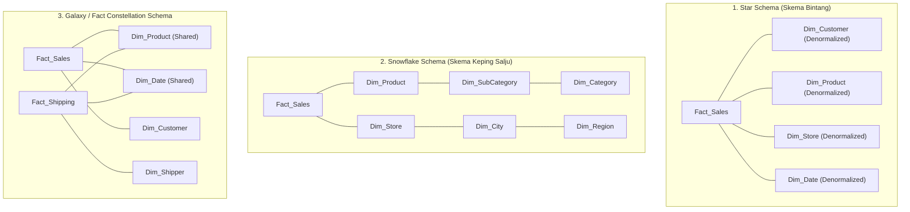

# 🌟 02.2 Skema Desain Data Warehouse (Star, Snowflake, & Galaxy Schema)

> [!ABSTRACT] Ringkasan Sub-Materi
> Menelaah tiga arsitektur skema pemodelan data dimensional yang paling fundamental dalam Data Warehouse: **Star Schema**, **Snowflake Schema**, dan **Fact Constellation (Galaxy) Schema**. Sub-materi ini membahas struktur, diagram, kelebihan dan kelemahan masing-masing skema, matriks komparasi teknis, kisi-kisi ujian, dan strategi menjawab soal perancangan.

---

## 1. Tiga Pola Skema Dimensional

Dalam mengorganisasikan relasi antara *Fact Table* dan *Dimension Tables*, industri mengenal 3 varian skema utama:

---

## 2. Bedah Struktur Masing-Masing Skema

### A. Star Schema (Skema Bintang)
- **Struktur**: Satu tabel fakta tunggal berada di pusat (*center*) dan dikelilingi oleh tabel-tabel dimensi yang terhubung langsung seperti pola bintang.
- **Tingkat Normalisasi**: Tabel dimensi **didenormalisasi penuh** (*completely denormalized*).
  - Contoh: Dalam tabel `Dim_Product`, atribut nama produk, subkategori, kategori, dan lini produk disatukan ke dalam satu tabel fisik yang sama, meskipun ada perulangan teks nama kategori.
- **Kelebihan Utama**:
  1. **Performa Kueri Sangat Cepat**: Setiap kueri agregasi hanya memerlukan **satu tingkat JOIN** antara tabel fakta dan tabel dimensi (`Fact JOIN Dim`).
  2. **Struktur Sangat Sederhana**: Sangat mudah dipahami oleh analis bisnis dan perangkat lunak BI (Power BI, Tableau) dapat secara otomatis mendeteksi relasi bintang.
- **Kelemahan**: Terjadi redundansi data teks pada tabel dimensi, sehingga membutuhkan ruang penyimpanan dimensi yang sedikit lebih besar. Namun, karena ukuran tabel dimensi sangat kecil dibandingkan tabel fakta, trade-off ini dianggap sangat menguntungkan.

### B. Snowflake Schema (Skema Keping Salju)
- **Struktur**: Merupakan varian dari Star Schema di mana beberapa atau seluruh tabel dimensi **dinormalisasi lebih lanjut (menjadi bentuk 2NF/3NF)** ke dalam tabel-tabel sub-dimensi bertingkat (*lookup tables*).
- **Contoh Normalisasi**:
  - `Dim_Product` dipecah menjadi: `Dim_Product` $\to$ `Dim_SubCategory` $\to$ `Dim_Category`.
  - `Dim_Location` dipecah menjadi: `Dim_Store` $\to$ `Dim_City` $\to$ `Dim_Province` $\to$ `Dim_Country`.
- **Kelebihan**:
  1. **Nol Redundansi Dimensi**: Tidak ada duplikasi teks nama kategori atau nama kota.
  2. **Integritas Data Terjaga Ketat**: Perubahan nama kategori hanya perlu dilakukan di satu baris tabel `Dim_Category`.
  3. **Menghemat Storage Dimensi**: Berguna jika tabel dimensi memiliki jutaan baris data unik.
- **Kelemahan Utama**:
  1. **Performa Kueri Melambat Signifikan**: Kueri analitik harus mengeksekusi banyak operasi JOIN berantai (*multi-hop joins*). Mesin SQL harus menggabungkan `Fact_Sales JOIN Dim_Product JOIN Dim_SubCategory JOIN Dim_Category` hanya untuk mengetahui total penjualan per kategori.
  2. **Kompleksitas Desain**: Menyerupai sistem transaksional (OLTP) sehingga membingungkan analis non-teknis.

### C. Fact Constellation (Galaxy) Schema
- **Struktur**: Memiliki **dua atau lebih tabel fakta (*Multiple Fact Tables*)** yang saling terhubung dan berbagi beberapa tabel dimensi yang sama (*Shared / Conformed Dimensions*).
- **Contoh Penerapan Nyata**:
  - `Fact_Sales` (mencatat transaksi penjualan di kasir) dan `Fact_Shipping` (mencatat pengiriman barang oleh kurir) keduanya berbagi dimensi `Dim_Product`, `Dim_Date`, dan `Dim_Customer`.
- **Kelebihan**:
  - Mampu memodelkan proses bisnis perusahaan berskala enterprise yang kompleks dan multivariat secara terpadu tanpa duplikasi dimensi.
- **Kelemahan**:
  - Arsitektur paling rumit dalam pemeliharaan pipeline ETL dan penanganan *grain mismatch* antar-tabel fakta.

---

## 3. Matriks Komparasi Komprehensif: Star vs Snowflake vs Galaxy

| Dimensi Evaluasi | Star Schema | Snowflake Schema | Fact Constellation (Galaxy) |
| :--- | :--- | :--- | :--- |
| **Bentuk Normalisasi Dimensi** | **Didenormalisasi** (1 tabel per dimensi) | **Ternormalisasi (3NF)** (Hirarki dipecah) | Bervariasi (Umumnya Star de-normalized) |
| **Jumlah Tabel Fakta** | Tepat 1 tabel fakta | Tepat 1 tabel fakta | **Dua atau lebih** tabel fakta |
| **Kecepatan Kueri / Read Speed** | **Sangat Cepat** (Minimal JOIN) | **Lebih Lambat** (Banyak JOIN bertingkat) | Cepat pada level individu, butuh optimasi kueri silang |
| **Kompleksitas Kueri SQL** | Sederhana (Mudah ditulis) | Rumit (Banyak klausa JOIN) | Sedang hingga Rumit |
| **Penggunaan Ruang Disk (Dimensi)** | Sedikit lebih boros (Redundan) | Sangat hemat (Nol redundansi) | Efisien (Dimensi digunakan bersama) |
| **Dukungan BI Tools Modern** | **Sangat Didukung & Disukai** | Kurang disukai (Membebani semantic model)| Didukung untuk model multi-fakta enterprise |
| **Kasus Penggunaan Terbaik** | Data Mart departemen, kueri cepat | Dimensi hierarki raksasa dengan update sering | Enterprise Data Warehouse komprehensif |

---

## 🎯 Hal-Hal yang Kemungkinan Besar Masuk Ujian

1. **Trade-Off Utama Star vs Snowflake**:
   - Dosen sangat gemar menanyakan: *"Mengapa industri modern lebih memilih Star Schema daripada Snowflake Schema meskipun Star Schema memiliki redundansi data?"*  
   *Jawab*: Karena harga storage saat ini sangat murah, sementara kecepatan respons kueri pengguna bisnis jauh lebih bernilai. Star Schema menghemat komputasi CPU karena hanya membutuhkan 1 tingkat JOIN.
2. **Karakteristik Snowflake Schema**:
   - Pahami kata kunci: **"Tabel dimensi dinormalisasi menjadi tabel-tabel lookup hirarki"**.
3. **Konsep Shared Dimensions pada Galaxy Schema**:
   - Galaxy Schema dicirikan oleh **banyak tabel fakta** yang menggunakan bersama dimensi yang sama (**Conformed Dimensions**).

---

## 📋 Contoh Soal Ujian (Pilihan Ganda & Esai)

### Contoh Soal Pilihan Ganda
**Soal 1 (Kelemahan Snowflake Schema)**  
Dalam implementasi sistem Business Intelligence, kelemahan utama dari pemilihan *Snowflake Schema* dibandingkan *Star Schema* adalah...  
A. Ukuran tabel fakta menjadi jauh lebih besar.  
B. Kueri laporan menjadi lebih lambat dan rumit karena mesin database harus melakukan banyak operasi JOIN bertingkat melintasi tabel-tabel sub-dimensi yang dinormalisasi.  
C. Snowflake schema tidak mendukung tipe data tanggal.  
D. Snowflake schema tidak dapat digunakan untuk menyimpan data historis.  
*Kunci Jawaban*: **B**  
*Pembahasan*: Normalisasi tabel dimensi pada Snowflake schema memecah dimensi menjadi tabel-tabel kecil (misal Produk $\to$ Subkategori $\to$ Kategori). Hal ini menambah beban komputasi JOIN yang signifikan pada saat kueri analitik dijalankan.

**Soal 2 (Identifikasi Galaxy Schema)**  
Sebuah skema Data Warehouse universitas memiliki dua tabel fakta: `Fact_Enrollment` (pendaftaran mata kuliah) dan `Fact_Graduation` (kelulusan mahasiswa). Kedua tabel fakta ini sama-sama terhubung ke tabel dimensi `Dim_Student`, `Dim_Time`, dan `Dim_Department`. Skema ini diklasifikasikan sebagai...  
A. *Star Schema*  
B. *Snowflake Schema*  
C. *Fact Constellation (Galaxy) Schema*  
D. *Normalized OLTP Schema*  
*Kunci Jawaban*: **C**  
*Pembahasan*: Skema yang memuat lebih dari satu tabel fakta yang saling berbagi tabel dimensi yang sama (*conformed dimensions*) adalah definisi resmi dari Fact Constellation (Galaxy) Schema.

---

### Contoh Soal Esai
**Soal Esai**:  
Sebuah rantai toko swalayan nasional memiliki data transaksi penjualan harian. Departemen analitis sering menjalankan kueri seperti: *"Hitung total pendapatan penjualan untuk kategori produk 'Minuman Ringan' di wilayah 'Jawa Timur' selama Kuartal 3 Tahun 2025"*.  
a. Gambarkan dan rancang model data menggunakan **Star Schema** untuk skenario tersebut (tunjukkan nama Fact Table dan minimal 4 Dimension Tables beserta atribut kuncinya)!  
b. Jelaskan bagaimana struktur skema tersebut berubah jika dikonversi menjadi **Snowflake Schema**, dan analisis dampaknya terhadap performa kueri kueri eksekutif di atas!

**Pedoman Jawaban Lengkap**:
1. **Desain Star Schema**:
   - **Fact Table**: `Fact_Sales`
     - Kolom Kunci: `DateKey (FK)`, `ProductKey (FK)`, `StoreKey (FK)`, `CashierKey (FK)`.
     - Measures: `QuantitySold`, `TotalSalesAmount`, `DiscountAmount`.
   - **Dimension Tables (Didenormalisasi)**:
     - `Dim_Date`: `DateKey (PK)`, `FullDate`, `Quarter`, `Year`.
     - `Dim_Product`: `ProductKey (PK)`, `ProductName`, `CategoryName` (disatukan di sini), `Brand`.
     - `Dim_Store`: `StoreKey (PK)`, `StoreName`, `City`, `Province` (disatukan di sini).
     - `Dim_Cashier`: `CashierKey (PK)`, `CashierName`, `Shift`.
2. **Konversi ke Snowflake Schema & Analisis Performa**:
   - *Perubahan Struktur*:
     - Tabel `Dim_Product` dinormalisasi: Atribut `CategoryName` dikeluarkan menjadi tabel terpisah `Dim_Category` dengan relasi `Dim_Product (FK: CategoryKey) -> Dim_Category (PK: CategoryKey)`.
     - Tabel `Dim_Store` dinormalisasi: Atribut `Province` dikeluarkan menjadi `Dim_Province` dengan relasi `Dim_Store (FK: ProvinceKey) -> Dim_Province (PK: ProvinceKey)`.
   - *Analisis Dampak Performa Kueri*:
     - Pada **Star Schema**, kueri eksekutif hanya membutuhkan 3 operasi JOIN:  
       `Fact_Sales JOIN Dim_Product JOIN Dim_Store JOIN Dim_Date`.
     - Pada **Snowflake Schema**, kueri eksekutif membutuhkan 5 operasi JOIN:  
       `Fact_Sales JOIN Dim_Product JOIN Dim_Category JOIN Dim_Store JOIN Dim_Province JOIN Dim_Date`.
     - *Kesimpulan*: Snowflake Schema secara drastis memperlambat eksekusi kueri eksekutif karena peningkatan latensi kalkulasi JOIN pada jutaan baris tabel fakta.

---

## 💡 Tips & Trik Menjawab Soal Ujian

1. **Jurus Kata Kunci 3 Skema**:
   - Dimensi didenormalisasi, 1 level JOIN, kueri tercepat $\to$ **Star Schema**.
   - Dimensi dinormalisasi, hierarki bertingkat, nol redundansi $\to$ **Snowflake Schema**.
   - Multi-fact tables, conformed dimensions bersama $\to$ **Fact Constellation / Galaxy Schema**.
2. **Tips Menggambar Skema di Lembar Jawaban Ujian**:
   - Letakkan **Tabel Fakta di tengah kotak** dengan border tebal atau tanda khusus.
   - Cantumkan label `(PK)` dan `(FK)` secara tegas pada atribut.
   - Tarik garis relasi yang jelas dari FK tabel fakta ke PK tabel dimensi.
