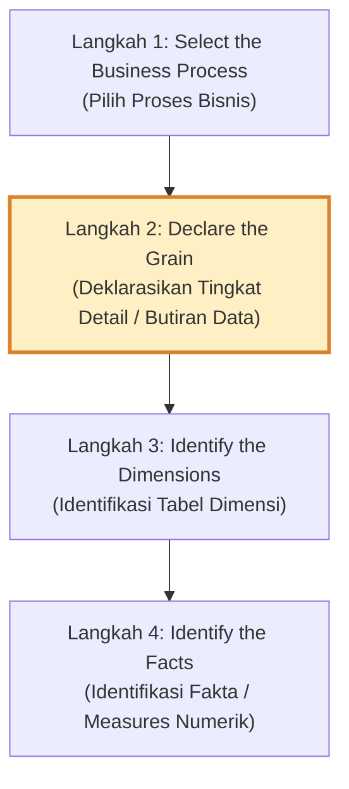
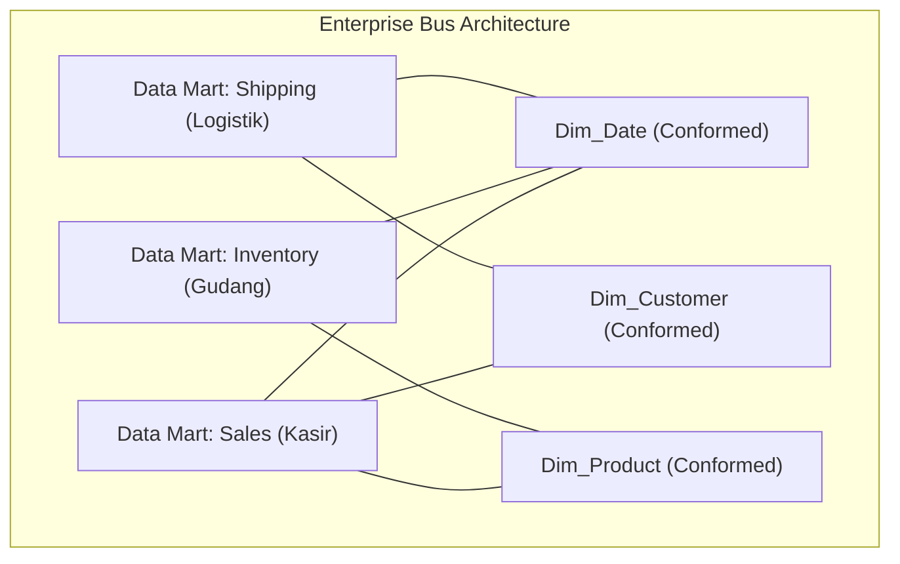

# 📐 02.3 4 Langkah Kimball Lifecycle & Conformed Dimensions

> [!ABSTRACT] Ringkasan Sub-Materi
> Membahas metodologi terstandarisasi 4 langkah perancangan model data dimensional yang dirumuskan oleh Ralph Kimball (*Kimball 4-Step Dimensional Design Process*). Sub-materi ini mengupas konsep krusial **Deklarasi Grain** (tingkat detail data), bahaya mencampuradukkan grain, peranan vital **Conformed Dimensions**, dan pembuatan matriks *Enterprise Data Warehouse Bus Architecture*.

---

## 1. 4 Langkah Perancangan Dimensional Kimball

Ralph Kimball merumuskan 4 tahapan berurutan yang wajib dilalui seorang arsitek data saat merancang model dimensional:

---

## 2. Bedah Langkah demi Langkah

### Langkah 1: Select the Business Process (Pilih Proses Bisnis)
- **Definisi**: Menentukan aktivitas operasional dunia nyata yang dilakukan organisasi dan menghasilkan data yang terukur.
- **Prinsip Penting**: Proses bisnis **bukanlah departemen organisasi**. Departemen Penjualan bukanlah proses bisnis, melainkan *"Pemesanan Produk oleh Pelanggan"* atau *"Pembayaran Faktur"* adalah proses bisnisnya.
- **Contoh**: Transaksi Kasir POS, Pendaftaran Rawat Inap Rumah Sakit, Pengiriman Paket Kurir, Perekrutan Pegawai.

### Langkah 2: Declare the Grain (Deklarasikan Butiran / Tingkat Detail)
- **Definisi**: Menetapkan secara persis **apa yang direpresentasikan oleh satu baris data (*single row*) di dalam Fact Table**.
- **Prinsip Emas**: Ini adalah **langkah paling kritis dan fundamental** dalam seluruh proses pemodelan dimensional. Anda tidak boleh melangkah ke Langkah 3 dan 4 sebelum *grain* disepakati secara mutlak.
- **Tingkatan Grain**:
  1. *Atomic Grain* (Sangat disarankan): Tingkat paling detail dari transaksi mentah (misal: *Satu baris merepresentasikan satu item barang yang dipindai kasir pada suatu struk belanja*).
  2. *Periodic Snapshot Grain*: Snapshot status pada interval waktu berkala (misal: *Satu baris merepresentasikan saldo akhir harian rekening nasabah*).
  3. *Accumulating Snapshot Grain*: Melacak siklus hidup proses dari awal hingga selesai (misal: *Satu baris merepresentasikan satu berkas klaim asuransi sejak diajukan hingga disetujui/ditolak*).

> [!CAUTION] Bahaya Fatal: Mencampuradukkan Tingkat Grain (Grain Mismatch)
> Kesalahan paling fatal dalam ujian perancangan data warehouse adalah memasukkan fakta yang memiliki level detail berbeda ke dalam satu tabel fakta yang sama!  
> **Contoh Salah**: Menaruh `HeaderTotalDiscount` (berlaku untuk 1 struk belanja) dan `ItemQuantitySold` (berlaku untuk 1 baris barang) di dalam satu tabel fakta dengan grain *per-item belanja*. Hal ini akan menyebabkan diskon terhitung berkali-kali (*double counting*) saat di-SUM!

### Langkah 3: Identify the Dimensions (Identifikasi Tabel Dimensi)
- **Definisi**: Menentukan seluruh konteks deskriptif yang menjawab pertanyaan: *"Siapa, apa, di mana, kapan, dan bagaimana"* peristiwa pada tingkat grain tersebut terjadi.
- Dimensi harus dipilih secara konsisten dengan grain yang telah dideklarasikan di Langkah 2.
- **Contoh untuk Grain per-item belanja**:
  - Kapan dibeli? $\to$ `Dim_Date`, `Dim_Time`
  - Siapa yang membeli? $\to$ `Dim_Customer`
  - Barang apa yang dibeli? $\to$ `Dim_Product`
  - Di toko mana? $\to$ `Dim_Store`
  - Kasir mana yang melayani? $\to$ `Dim_Cashier`
  - Promosi apa yang aktif? $\to$ `Dim_Promotion`

### Langkah 4: Identify the Facts (Identifikasi Fakta / Measures)
- **Definisi**: Menentukan pengukuran numerik kuantitatif yang dihasilkan dari peristiwa bisnis pada tingkat grain tersebut.
- Seluruh fakta yang dimasukkan **wajib benar-benar berlaku dan terukur pada tingkat grain yang telah dideklarasikan**.
- **Contoh fakta untuk Grain per-item belanja**:
  - `QuantitySold` (unit)
  - `ExtendedSalesAmount` (Rp)
  - `ExtendedCostAmount` (Rp)
  - `DiscountAmount` (Rp)

---

## 3. Conformed Dimensions & Enterprise Bus Architecture

Salah satu tantangan terbesar pendekatan *Bottom-Up* Ralph Kimball adalah mencegah agar pembangunan *Data Mart* per divisi tidak berubah menjadi *Silo Data* baru. Solusinya adalah standarisasi **Conformed Dimensions**.

### A. Definisi Conformed Dimensions
**Conformed Dimension** adalah tabel dimensi yang memiliki arti konsisten, konvensi penamaan seragam, struktur atribut identik, dan domain nilai domain yang sama di seluruh organisasi, sehingga dapat digunakan bersama oleh berbagai proses bisnis (*shared across multiple fact tables*).

Contoh: Tabel `Dim_Date` yang sama persis digunakan oleh tim Penjualan, tim Penggajian, dan tim Pengiriman Logistik.

### B. Enterprise Data Warehouse Bus Architecture
Ralph Kimball merancang **Bus Matrix** sebagai cetak biru integrasi enterprise:
- **Baris matriks** merepresentasikan *Proses Bisnis* (Tabel Fakta).
- **Kolom matriks** merepresentasikan *Dimensi Terstandarisasi* (Conformed Dimensions).
- Tanda centang ($\checkmark$) menunjukkan proses bisnis mana saja yang memanfaatkan dimensi tersebut.

| Business Process (Fact) | Dim_Date | Dim_Customer | Dim_Product | Dim_Store | Dim_Shipper | Dim_Employee |
| :--- | :---: | :---: | :---: | :---: | :---: | :---: |
| **Retail Sales (Kasir)** | $\checkmark$ | $\checkmark$ | $\checkmark$ | $\checkmark$ | | $\checkmark$ |
| **Warehouse Inventory** | $\checkmark$ | | $\checkmark$ | $\checkmark$ | | |
| **Order Shipping** | $\checkmark$ | $\checkmark$ | $\checkmark$ | | $\checkmark$ | |
| **Customer Support Call**| $\checkmark$ | $\checkmark$ | $\checkmark$ | | | $\checkmark$ |

---

## 🎯 Hal-Hal yang Kemungkinan Besar Masuk Ujian

1. **Urutan 4 Langkah Kimball**:
   - Hafalkan urutannya: **(1) Process $\to$ (2) Grain $\to$ (3) Dimensions $\to$ (4) Facts**. Jangan sampai terbalik antara Dimensions dan Facts!
2. **Arti Penting Deklarasi Grain**:
   - Dosen kerap menanyakan: *"Mengapa 'Declare the Grain' disebut sebagai langkah paling krusial?"*  
   *Jawab*: Karena grain menentukan batas detail data. Dimensi dan fakta tidak dapat ditentukan sebelum grain pasti. Salah menentukan grain berakibat fatal pada perhitungan fakta (*double counting*).
3. **Definisi Conformed Dimensions**:
   - Kata kunci: **Dimensi bersama (*shared dimensions*) dengan definisi seragam lintas proses bisnis untuk mencegah data silos**.
4. **Prinsip Atomic Grain**:
   - Ralph Kimball sangat menganjurkan menyimpan data pada tingkat paling atomik (*most atomic grain*) karena memberikan fleksibilitas analisis kueri tanpa batas (*drill-down* maksimal).

---

## 📋 Contoh Soal Ujian (Pilihan Ganda & Esai)

### Contoh Soal Pilihan Ganda
**Soal 1 (Urutan Metodologi Kimball)**  
Dalam metodologi perancangan pemodelan dimensional menurut Ralph Kimball, urutan 4 langkah utama yang benar adalah...  
A. (1) Declare Grain $\to$ (2) Select Business Process $\to$ (3) Identify Facts $\to$ (4) Identify Dimensions  
B. (1) Select Business Process $\to$ (2) Declare Grain $\to$ (3) Identify Dimensions $\to$ (4) Identify Facts  
C. (1) Identify Dimensions $\to$ (2) Identify Facts $\to$ (3) Declare Grain $\to$ (4) Select Business Process  
D. (1) Select Business Process $\to$ (2) Identify Facts $\to$ (3) Declare Grain $\to$ (4) Identify Dimensions  
*Kunci Jawaban*: **B**  
*Pembahasan*: Tahap Kimball harus dimulai dari memilih proses bisnis, kemudian mendeklarasikan grain, lalu mengidentifikasi tabel dimensi, dan terakhir mengidentifikasi fakta numerik.

**Soal 2 (Peranan Conformed Dimensions)**  
Tabel dimensi `Dim_Pelanggan` yang digunakan secara seragam oleh Data Mart Penjualan Online, Data Mart Penjualan Toko Fisik, dan Data Mart Layanan Komplain Pelanggan dengan definisi atribut yang konsisten di seluruh perusahaan disebut...  
A. *Junk Dimension*  
B. *Degenerate Dimension*  
C. *Conformed Dimension*  
D. *Role-Playing Dimension*  
*Kunci Jawaban*: **C**  
*Pembahasan*: Conformed Dimension adalah dimensi bersama yang distandarisasi untuk menghubungkan berbagai tabel fakta dalam arsitektur bus Kimball.

---

### Contoh Soal Esai
**Soal Esai**:  
Sebuah apotek modern ingin membangun Data Warehouse untuk memantau transaksi penjualan obat.  
a. Terapkan **4 Langkah Kimball Dimensional Lifecycle** secara lengkap untuk merancang sistem tersebut! Tentukan secara eksplisit: (1) Nama Proses Bisnis, (2) Deklarasi Grain yang tepat, (3) Minimal 4 Tabel Dimensi beserta atributnya, dan (4) Minimal 3 Fakta Numerik!  
b. Jelaskan apa yang akan terjadi jika analis salah mendeklarasikan grain (misal mencampuradukkan grain level transaksi struk dengan level item obat)!

**Pedoman Jawaban Lengkap**:
1. **Penerapan 4 Langkah Kimball**:
   - **Langkah 1 (Select Business Process)**: Proses Transaksi Penjualan Obat di Kasir Apotek.
   - **Langkah 2 (Declare the Grain)**: *"Satu baris pada tabel fakta merepresentasikan satu item obat yang tertera pada satu struk transaksi penjualan oleh kasir apotek pada waktu tertentu."*
   - **Langkah 3 (Identify Dimensions)**:
     - `Dim_Date`: `DateKey (PK)`, `FullDate`, `DayName`, `Month`, `Year`.
     - `Dim_Medicine`: `MedicineKey (PK)`, `MedicineName`, `Category`, `DosageForm`, `Manufacturer`.
     - `Dim_PharmacyBranch`: `BranchKey (PK)`, `BranchName`, `City`, `Province`.
     - `Dim_Pharmacist`: `PharmacistKey (PK)`, `PharmacistName`, `LicenseNumber`.
   - **Langkah 4 (Identify Facts)**:
     - `QuantitySold` (Jumlah butir/strip obat terjual - Additive).
     - `SalesAmount` (Total nilai rupiah obat terjual - Additive).
     - `DiscountAmount` (Potongan harga item obat - Additive).
2. **Analisis Bahaya Grain Mismatch**:
   - Jika grain level struk (misal: Biaya Layanan Racik Resep per struk Rp 10.000) dicampur ke dalam tabel fakta yang ber-grain level item obat:
   - Apabila seorang pasien membeli 5 jenis obat dalam 1 struk, maka biaya racik Rp 10.000 akan tercatat di ke-5 baris item obat tersebut.
   - Saat tim keuangan menjalankan kueri agregasi `SUM(BiayaRacik)` per bulan, sistem akan melakukan penggandaan nilai (*double counting / overstatement*) sebanyak 5 kali lipat (menjadi Rp 50.000), menghasilkan laporan keuangan yang salah secara fatal.

---

## 💡 Tips & Trik Menjawab Soal Ujian

1. **Jurus Hafalan 4 Langkah Kimball**:
   - Ingat akronim: **P - G - D - F** (*Process $\to$ Grain $\to$ Dimensions $\to$ Facts*).
2. **Cara Menulis Deklarasi Grain Sempurna di Esai**:
   - Selalu gunakan format kalimat standar: *"Satu baris pada tabel fakta merepresentasikan [X] pada [WAKTU TERTENTU]"*.
   - Contoh: *"Satu baris data merepresentasikan satu panggilan telepon yang diselesaikan oleh agen customer service."*
