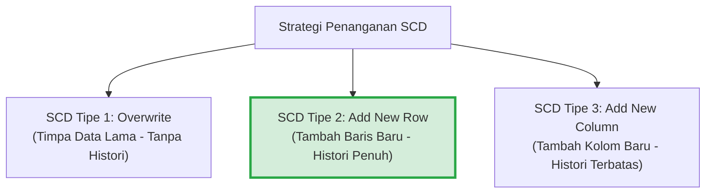

# 🔄 02.4 Slowly Changing Dimensions (SCD Tipe 1, 2, dan 3)

> [!ABSTRACT] Ringkasan Sub-Materi
> Menelaah teknik pengelolaan perubahan data pada tabel dimensi seiring berjalannya waktu yang dikenal sebagai **Slowly Changing Dimensions (SCD)**. Sub-materi ini membedah mekanisme kerja, skema tabel, kelebihan, dan kelemahan dari **SCD Tipe 1** (*Overwrite*), **SCD Tipe 2** (*Add New Row*), dan **SCD Tipe 3** (*Add New Column*), dilengkapi studi kasus nyata, kisi-kisi ujian, dan panduan menjawab esai.

---

## 1. Mengapa Kita Membutuhkan SCD?

Dalam dunia nyata, data entitas pada tabel dimensi tidak bersifat permanen statis, melainkan **berubah secara perlahan** (*slowly changes*):
- Seorang pelanggan berpindah domisili dari Jakarta ke Surabaya.
- Seorang karyawan dimutasi dari Divisi Penjualan ke Divisi Pemasaran.
- Seorang pasien mengubah status penjaminan dari Peserta Umum menjadi BPJS Kesehatan.

Jika sistem Data Warehouse tidak memiliki strategi penanganan perubahan data dimensi, analisis laporan historis akan rusak. Ralph Kimball merumuskan tiga teknik dasar SCD yang paling umum diuji: **Tipe 1, Tipe 2, dan Tipe 3**.

---

## 2. Bedah Detail Mekanisme SCD Tipe 1, 2, dan 3

### A. SCD Tipe 1: Overwrite (Menimpa Nilai Lama)
- **Mekanisme**: Nilai atribut lama pada tabel dimensi langsung ditimpa (*overwrite*) dengan nilai atribut baru. Tidak ada riwayat masa lalu yang disimpan.
- **Karakteristik**:
  - Paling mudah diimplementasikan (hanya perintah SQL `UPDATE`).
  - Ukuran tabel dimensi tetap sama (tidak bertambah baris maupun kolom).
- **Dampak Analitis**:
  - Seluruh transaksi masa lalu di tabel fakta yang terhubung ke baris tersebut **secara retroaktif akan dianggap terjadi di bawah atribut yang baru**.
- **Kasus Penggunaan yang Tepat**:
  - Koreksi kesalahan ketik (*spelling error / typo*), misal memperbaiki nama "Budi Santoso" yang salah ketik menjadi "Budi Santoso".
  - Data yang memang tidak relevan riwayat historisnya (misal: perubahan nomor telepon atau email pelanggan).

#### Simulasi Kasus SCD Tipe 1:
Pelanggan ID `C101` (Budi) pindah alamat dari "Bandung" ke "Jakarta".
*Sebelum Perubahan*:
| CustomerKey (PK) | CustomerID_Natural | CustomerName | City |
| :---: | :---: | :---: | :---: |
| 1 | C101 | Budi | Bandung |

*Setelah SCD Tipe 1 (Ditutupi)*:
| CustomerKey (PK) | CustomerID_Natural | CustomerName | City |
| :---: | :---: | :---: | :---: |
| 1 | C101 | Budi | **Jakarta** |
*(Catatan: Transaksi belanja Budi tahun lalu saat masih tinggal di Bandung kini dilaporkan sebagai penjualan wilayah Jakarta).*

---

### B. SCD Tipe 2: Add New Row (Menambah Baris Baru) - *Standar Emas Industri*
- **Mekanisme**: Setiap kali terjadi perubahan nilai atribut, sistem **menambahkan satu baris baru (*new row*)** ke dalam tabel dimensi. Nilai baris lama tetap dipertahankan untuk mengunci kebenaran data historis.
- **Syarat Wajib Desain Tabel SCD Tipe 2**:
  1. Wajib menggunakan **Surrogate Key** baru sebagai Primary Key.
  2. Wajib menambahkan kolom metadata pelacak masa berlaku:
     - `Effective_Start_Date` (Tanggal mulai berlakunya nilai baru).
     - `Effective_End_Date` (Tanggal berakhirnya nilai tersebut, diisi nilai konvensi masa depan seperti `9999-12-31` jika masih aktif).
     - `Is_Current_Flag` (Flag penanda status aktif: `'Y'` atau `'N'`, atau boolean `1/0`).
- **Kelebihan**:
  - **Integritas Historis Sempurna 100%**: Transaksi masa lalu tetap mereferensikan status lama (`CustomerKey: 1`), sedangkan transaksi masa depan akan mereferensikan status baru (`CustomerKey: 2`).
- **Kelemahan**:
  - Ukuran tabel dimensi membesar karena bertambahnya baris baru untuk setiap perubahan entitas.

#### Simulasi Kasus SCD Tipe 2:
Pelanggan `C101` (Budi) pindah alamat dari "Bandung" ke "Jakarta" pada tanggal `2025-06-01`.
*Sebelum Perubahan*:
| CustomerKey (PK) | CustomerID | CustomerName | City | StartDate | EndDate | IsCurrent |
| :---: | :---: | :---: | :---: | :---: | :---: | :---: |
| 1 | C101 | Budi | Bandung | 2024-01-01 | 9999-12-31 | Y |

*Setelah SCD Tipe 2 Diterapkan*:
| CustomerKey (PK) | CustomerID | CustomerName | City | StartDate | EndDate | IsCurrent |
| :---: | :---: | :---: | :---: | :---: | :---: | :---: |
| 1 | C101 | Budi | Bandung | 2024-01-01 | **2025-05-31** | **N** |
| **2** | C101 | Budi | **Jakarta** | **2025-06-01** | **9999-12-31** | **Y** |

---

### C. SCD Tipe 3: Add New Column (Menambah Kolom Baru)
- **Mekanisme**: Struktur tabel dimensi dimodifikasi dengan **menambahkan kolom baru (*new column*)** untuk menampung nilai atribut sebelumnya (*previous value*).
- **Karakteristik**:
  - Hanya menyimpan riwayat terbatas (biasanya hanya 2 status: status sekarang dan tepat satu status sebelumnya).
  - Jumlah baris tidak bertambah, namun struktur kolom tabel melebar.
- **Kasus Penggunaan**:
  - Sangat jarang digunakan, kecuali untuk kasus perombakan wilayah penjualan (*sales territory realignment*), di mana analis ingin membandingkan performa penjualan sales rep berdasarkan wilayah baru vs wilayah lama secara berdampingan.

#### Simulasi Kasus SCD Tipe 3:
*Tabel Setelah SCD Tipe 3*:
| CustomerKey (PK) | CustomerID | CustomerName | Current_City | Previous_City | Effective_Date |
| :---: | :---: | :---: | :---: | :---: | :---: |
| 1 | C101 | Budi | **Jakarta** | **Bandung** | 2025-06-01 |

---

## 3. Matriks Komparasi Ringkas SCD: Tipe 1 vs Tipe 2 vs Tipe 3

| Dimensi Perbandingan | SCD Tipe 1 (*Overwrite*) | SCD Tipe 2 (*Add Row*) | SCD Tipe 3 (*Add Column*) |
| :--- | :--- | :--- | :--- |
| **Penyimpanan Riwayat** | **Nol / Tidak ada** | **Penuh (Tak terbatas)** | **Terbatas (Hanya 1 riwayat lama)** |
| **Perubahan Tabel** | Update nilai kolom di baris lama | Insert baris baru + Update baris lama | Menambah kolom baru pada skema |
| **Kebutuhan Kolom Pelacak**| Tidak ada | `StartDate`, `EndDate`, `IsCurrent` | `Current_Col`, `Previous_Col` |
| **Dampak Ukuran Tabel** | Ukuran tetap konstan | Jumlah baris bertambah (*deeper table*) | Jumlah kolom bertambah (*wider table*) |
| **Kebutuhan Surrogate Key**| Opsional | **Wajib Mutlak** | Opsional |
| **Kompleksitas ETL** | Sangat Rendah | Sedang hingga Tinggi | Sedang |
| **Kasus Ideal** | Koreksi salah ketik, data tidak penting | Mutasi jabatan, domisili, asuransi | Restrukturisasi wilayah penjualan |

---

## 🎯 Hal-Hal yang Kemungkinan Besar Masuk Ujian

1. **Atribut Metadata Wajib SCD Tipe 2**:
   - Dosen pasti memeriksa apakah Anda menyertakan 3 kolom pengendali waktu: **`Start_Date`**, **`End_Date`**, dan **`Is_Current_Flag`**.
2. **Kapan Menggunakan SCD Tipe 1 vs Tipe 2**:
   - Jika kasusnya **koreksi typo / kesalahan input** $\to$ gunakan **SCD Tipe 1**.
   - Jika kasusnya **perubahan riwayat hidup nyata (mutasi divisi, ganti asuransi, pindah kota)** $\to$ wajib gunakan **SCD Tipe 2**.
3. **Mengapa SCD Tipe 2 Butuh Surrogate Key**:
   - Pertanyaan jebakan di PG: jika menggunakan Natural Key (KTP), penambahan baris baru akan memicu error duplikasi Primary Key.
4. **Karakteristik SCD Tipe 3**:
   - Kata kunci: **Hanya menyimpan 1 perubahan terakhir menggunakan kolom tambahan (*Current vs Previous*)**.

---

## 📋 Contoh Soal Ujian (Pilihan Ganda & Esai)

### Contoh Soal Pilihan Ganda
**Soal 1 (Identifikasi Metode SCD)**  
Seorang pegawai bernama Siti Mariyah dipromosikan dari jabatan "Senior Lektor" menjadi "Guru Besar / Profesor". Manajemen ingin agar publikasi riset yang dilakukan beliau sebelum tanggal promosi tetap tercatat atas jabatan "Senior Lektor", sedangkan riset setelah tanggal promosi tercatat atas jabatan "Guru Besar". Metode SCD manakah yang wajib diterapkan pada tabel dimensi pegawai?  
A. SCD Tipe 0 (Retain Original)  
B. SCD Tipe 1 (Overwrite)  
C. SCD Tipe 2 (Add New Row)  
D. SCD Tipe 3 (Add New Column)  
*Kunci Jawaban*: **C**  
*Pembahasan*: Kebutuhan untuk mempertahankan asosiasi historis transaksi lama ke atribut lama dan mengaitkan transaksi baru ke atribut baru hanya dapat dipenuhi secara sempurna oleh SCD Tipe 2.

**Soal 2 (Kolom Pengendali SCD Tipe 2)**  
Dalam implementasi SCD Tipe 2, baris data dimensi yang saat ini berstatus aktif dan berlaku bagi transaksi baru ditandai dengan nilai kolom...  
A. `End_Date = NULL` atau konvensi masa depan seperti `9999-12-31`, serta `Is_Current = 'Y'`  
B. `Start_Date = End_Date`  
C. `Is_Current = 'N'`  
D. `Surrogate_Key = 0`  
*Kunci Jawaban*: **A**  
*Pembahasan*: Baris aktif pada SCD 2 ditandai dengan `End_Date` bernilai masa depan tak terhingga (`9999-12-31`) dan flag aktif bernilai `'Y'` atau `True`.

---

### Contoh Soal Esai
**Soal Esai**:  
Sebuah rumah sakit menggunakan Data Warehouse untuk memantau klaim biaya pengobatan pasien. Pasien bernama Ahmad (ID Pasien Alami: `PAS-772`) semula terdaftar dengan metode pembayaran "Umum/Mandiri". Pada tanggal 1 Oktober 2025, Ahmad memperbarui data kepesertaannya menjadi "BPJS Kesehatan".  
a. Tunjukkan skema tabel dimensi `Dim_Patient` lengkap dengan kolom-kolom yang diperlukan untuk mengimplementasikan **SCD Tipe 2**!  
b. Buatlah tabel simulasi data yang menunjukkan kondisi data pasien Ahmad **sebelum dan sesudah tanggal 1 Oktober 2025**!  
c. Jelaskan bagaimana tabel fakta transaksi klaim rawat inap memastikan bahwa biaya tindakan medis Ahmad pada bulan Agustus 2025 tetap terhitung sebagai pasien Umum, sedangkan tindakan medis pada bulan November 2025 terhitung sebagai pasien BPJS!

**Pedoman Jawaban Lengkap**:
1. **Skema Tabel `Dim_Patient` (SCD Tipe 2)**:
   - `PatientKey` (INT, Surrogate Primary Key)
   - `PatientID_Natural` (VARCHAR, Business Key dari sistem RS)
   - `PatientName` (VARCHAR)
   - `InsuranceType` (VARCHAR - Atribut yang dipantau perubahannya)
   - `Effective_Start_Date` (DATE)
   - `Effective_End_Date` (DATE)
   - `Is_Current` (CHAR(1))
2. **Simulasi Data Tabel `Dim_Patient`**:
   *Kondisi Setelah 1 Oktober 2025*:
   | PatientKey | PatientID_Natural | PatientName | InsuranceType | Effective_Start_Date | Effective_End_Date | Is_Current |
   | :---: | :---: | :---: | :---: | :---: | :---: | :---: |
   | **101** | PAS-772 | Ahmad | Umum/Mandiri | 2024-01-01 | **2025-09-30** | **N** |
   | **102** | PAS-772 | Ahmad | **BPJS Kesehatan** | **2025-10-01** | **9999-12-31** | **Y** |
3. **Mekanisme Keterkaitan dengan Fact Table**:
   - Pada bulan Agustus 2025, saat pipeline ETL memuat transaksi tindakan medis Ahmad ke `Fact_MedicalTreatment`, proses lookup ETL mencocokkan tanggal transaksi dengan rentang `Start_Date` dan `End_Date` di dimensi. Ditemukan bahwa pada bulan Agustus 2025 baris yang aktif adalah `PatientKey = 101`. Maka baris fakta tersebut menyimpan `PatientKey = 101`.
   - Pada bulan November 2025, transaksi tindakan medis Ahmad diproses oleh ETL. Lookup tanggal mendapati baris aktif saat itu adalah `PatientKey = 102`. Maka baris fakta baru menyimpan `PatientKey = 102`.
   - Dengan demikian, saat kueri laporan agregasi dijalankan:
     - Kueri agregasi historis Agustus secara otomatis menghubungkan ke `PatientKey = 101` (tercatat sebagai pasien "Umum/Mandiri").
     - Kueri agregasi November secara otomatis menghubungkan ke `PatientKey = 102` (tercatat sebagai pasien "BPJS Kesehatan"). Integritas pelaporan audit terjaga secara sempurna tanpa data hilang!

---

## 💡 Tips & Trik Menjawab Soal Ujian

1. **Jurus Menggambar Tabel SCD 2 di Ujian**:
   - Selalu buat tabel simulasi dengan **minimal 2 baris data untuk 1 entitas yang sama** (tunjukkan baris sebelum dan baris sesudah perubahan).
   - Tunjukkan perubahan tanggal `EndDate` baris lama yang ditutup, dan `StartDate` baris baru yang dibuka.
   - Sorot kolom `PatientKey` yang nilainya berbeda (misal `101` dan `102`) untuk membuktikan pentingnya **Surrogate Key**.
2. **Formula Menjawab Kapan Pakai SCD 1 vs 2**:
   - Jika perubahan karena *kesalahan teknis/typo* $\to$ Jelaskan memakai **SCD Tipe 1** agar tidak mengotori riwayat dengan data salah.
   - Jika perubahan karena *peristiwa nyata dalam hidup entitas* $\to$ Jelaskan memakai **SCD Tipe 2** untuk akurasi data analitik historis.
