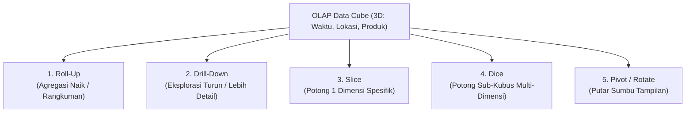
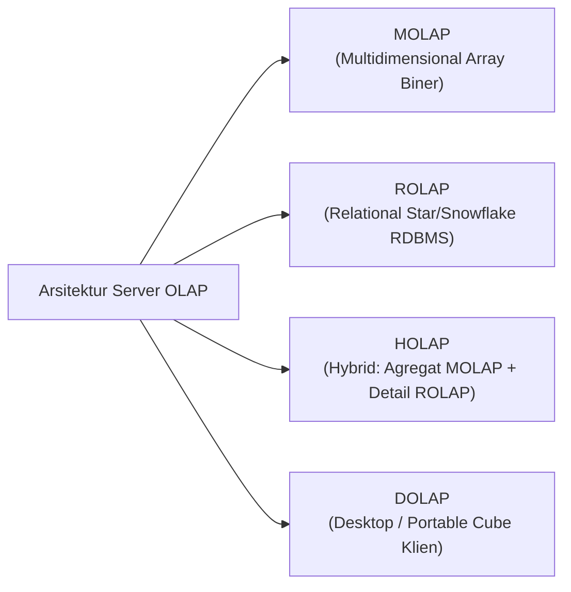

# 🧊 02.5 Operasi Multidimensi OLAP Data Cube & Server OLAP

> [!ABSTRACT] Ringkasan Sub-Materi
> Menelaah konsep visualisasi dan analisis data multidimensi melalui **OLAP Data Cube** ($N$-dimensi). Sub-materi ini mengupas 5 operasi manipulasi data kubus (*Roll-up, Drill-down, Slice, Dice, Pivot*), klasifikasi arsitektur server OLAP (**MOLAP, ROLAP, HOLAP, DOLAP**), kisi-kisi ujian, dan strategi menjawab soal pembeda.

---

## 1. Konsep Data Cube ($N$-Dimensional Cube)

Untuk kebutuhan analisis bisnis cepat, data transaksi tidak disajikan dalam bentuk tabel baris datar (*flat rows*), melainkan dimodelkan ke dalam ruang geometris $N$-dimensi yang disebut **Data Cube**:
- **Sumbu / Dimensi Kubus**: Mewakili entitas analisis (misal Sumbu $X$ = Produk, Sumbu $Y$ = Wilayah, Sumbu $Z$ = Waktu).
- **Sel Kubus (*Cells*)**: Titik potong antar-dimensi yang memuat nilai fakta numerik (*Measures*, misal Total Pendapatan Penjualan).

---

## 2. 5 Operasi Dasar Manipulasi OLAP Data Cube

Dosen sering menguji pemahaman definisi dan perbedaan teknis dari 5 operasi ini:

### A. Roll-Up (Drill-Up / Agregasi Naik)
- **Definisi**: Mengurangi tingkat kedetailan data (*decreasing granularity*) dengan cara merangkum data ke tingkat hierarki yang lebih tinggi pada satu dimensi, atau dengan menghapus salah satu dimensi dari kubus.
- **Contoh Kasus**:
  - Pada Dimensi Lokasi: Dari melihat data penjualan per **Kota** $\to$ naik menjadi data penjualan per **Provinsi** $\to$ naik menjadi per **Negara**.
  - Pada Dimensi Waktu: Dari data penjualan per **Hari** $\to$ dirangkum menjadi data per **Bulan** $\to$ per **Tahun**.
- **Efek Data**: Jumlah baris data menyusut, angka berupa hasil agregasi penjumlahan (`SUM`).

### B. Drill-Down (Navigasi Menurun / Peningkatan Detail)
- **Definisi**: Kebalikan mutlak dari Roll-Up. Menambah tingkat kedetailan data (*increasing granularity*) dengan memecah data ringkasan ke tingkat hierarki yang lebih rendah, atau dengan menambahkan dimensi analisis baru ke dalam kubus.
- **Contoh Kasus**:
  - Pada Dimensi Waktu: Dari melihat total penjualan **Tahun 2025** $\to$ dipecah (*drill-down*) untuk melihat rincian per **Kuartal (Q1, Q2, Q3, Q4)** $\to$ dipecah lebih lanjut per **Bulan**.
- **Efek Data**: Data yang disajikan menjadi lebih banyak dan lebih spesifik.

### C. Slice (Irisan Satu Dimensi)
- **Definisi**: Memilih **tepat SATU nilai konstan pada SATU dimensi tertentu**, sehingga menghasilkan sub-kubus dengan dimensi $N-1$ (membuat "selembar irisan" dari kubus).
- **Contoh Kasus**:
  - Dari kubus 3D (Waktu, Lokasi, Produk), analis menetapkan kriteria: `Waktu = 'Tahun 2025'`.
  - Hasilnya adalah tabel 2D yang hanya menampilkan relasi antara `Lokasi` dan `Produk` khusus untuk tahun 2025 saja.

### D. Dice (Potongan Sub-Kubus Multi-Dimensi)
- **Definisi**: Memilih rentang nilai (*range of values*) pada **DUA ATAU LEBIH dimensi sekaligus**, menghasilkan sub-kubus yang lebih kecil (*smaller sub-cube*).
- **Contoh Kasus**:
  - Analis menetapkan filter kriteria majemuk:  
    `Lokasi IN ('Jakarta', 'Surabaya')` **AND**  
    `Waktu IN ('Q1', 'Q2')` **AND**  
    `Produk IN ('Laptop', 'Tablet')`.
  - Hasilnya adalah sebuah kubus mini 3 dimensi yang terisolasi pada kriteria tersebut.

> [!IMPORTANT] Perbedaan Kritis Ujian: Slice vs Dice
> - **Slice** = Memotong pada **SATU dimensi tunggal** dengan satu nilai tetap (Klausul SQL setara: `WHERE Dimensi_A = 'X'`).
> - **Dice** = Memotong pada **DUA ATAU LEBIH dimensi** dengan rentang nilai selektif (Klausul SQL setara: `WHERE Dimensi_A IN (...) AND Dimensi_B IN (...)`).

### E. Pivot (Rotate / Pemutaran Sumbu)
- **Definisi**: Memutar sumbu koordinat dimensi data untuk menyajikan data dari sudut pandang yang berbeda pada tampilan tabel silang (*crosstab / matrix*).
- **Contoh Kasus**:
  - Semula baris menampilkan `Kategori Produk` dan kolom menampilkan `Nama Kota`.
  - Dengan operasi Pivot, baris diubah menjadi `Nama Kota` dan kolom menjadi `Kategori Produk` tanpa mengubah nilai numerik di dalamnya.

---

## 3. Klasifikasi Arsitektur Server OLAP

Berdasarkan cara penyimpanan fisik data dan mesin kalkulasinya, server OLAP diklasifikasikan menjadi 4 arsitektur:

### A. MOLAP (Multidimensional OLAP)
- **Penyimpanan**: Data disimpan dalam format array multidimensi biner berpemilik (*proprietary multidimensional storage*), bukan di dalam tabel RDBMS standar.
- **Karakteristik**:
  - Seluruh kemungkinan kombinasi agregasi telah **dihitung di awal (*pre-calculated / pre-aggregated*)** saat kubus dibangun (*cube processing*).
- **Kelebihan**: Kecepatan kueri agregasi super cepat dan konsisten (*sub-second response time*).
- **Kelemahan**:
  - Butuh waktu lama saat memproses kubus (*batch cube build*).
  - Mengalami masalah ruang kosong data (*Data Sparsity problem*).
  - Skalabilitas terbatas (sulit menampung data hingga skala Petabyte).

### B. ROLAP (Relational OLAP)
- **Penyimpanan**: Data disimpan langsung di dalam **RDBMS relasional standar** menggunakan skema dimensional (*Star* atau *Snowflake Schema*).
- **Karakteristik**:
  - Tidak membuat file kubus biner terpisah; kueri multidimensi diterjemahkan secara dinamis oleh mesin ROLAP menjadi kueri SQL kompleks (`SELECT ... GROUP BY`).
- **Kelebihan**: Skalabilitas kapasitas data hampir tidak terbatas (mampu mengolah Terabyte hingga Petabyte).
- **Kelemahan**: Kecepatan kueri agregasi lebih lambat dibandingkan MOLAP karena mesin SQL harus menghitung agregasi secara dinamis saat kueri diminta.

### C. HOLAP (Hybrid OLAP)
- **Penyimpanan**: Menggabungkan kelebihan terbaik dari MOLAP dan ROLAP.
  - Data agregat tingkat tinggi (*summary data*) yang sering diakses disimpan di dalam struktur **MOLAP** untuk kecepatan respon kueri.
  - Data detail atomik yang sangat besar disimpan di dalam tabel relasional **ROLAP**.
- **Kelebihan**: Memberikan respon kueri yang sangat cepat untuk dashboard eksekutif sekaligus tetap memungkinkan pengguna melakukan *drill-down* hingga ke level data atomik terdalam.

### D. DOLAP (Desktop OLAP)
- Kubus data berukuran mini yang diunduh ke komputer desktop klien untuk analisis offline tanpa perlu terhubung terus-menerus ke server pusat.

---

## 4. Matriks Komparasi: MOLAP vs ROLAP

| Kriteria Evaluasi | MOLAP (*Multidimensional OLAP*) | ROLAP (*Relational OLAP*) |
| :--- | :--- | :--- |
| **Media Penyimpanan** | File array multidimensi biner khusus | Basis data relasional standar (RDBMS) |
| **Kecepatan Kueri** | **Sangat Cepat (Instan / Sub-detik)** | Relatif lebih lambat (Tergantung JOIN & Indeks) |
| **Waktu Prapemrosesan** | Lama (Menghitung kubus di awal) | Cepat (Tidak ada pembuatan kubus biner) |
| **Kapasitas Ukuran Data** | Terbatas (Megabyte hingga Gigabyte) | **Sangat Besar (Terabyte hingga Petabyte)** |
| **Struktur Skema** | Matriks N-Dimensi | Star Schema / Snowflake Schema |
| **Kelemahan Utama** | *Data Sparsity* & batasan ukuran kubus | Beban kueri JOIN berat pada CPU database |

---

## 🎯 Hal-Hal yang Kemungkinan Besar Masuk Ujian

1. **Pasangan Operasi yang Bertolak Belakang**:
   - **Roll-Up** (merangkum / memperluas cakupan) $\longleftrightarrow$ **Drill-Down** (merinci / memperdalam detail).
2. **Pembeda Utama Slice dan Dice**:
   - Ingat: **Slice = Tepat 1 Dimensi**. **Dice = 2 atau lebih Dimensi**.
3. **Pembeda Utama MOLAP vs ROLAP**:
   - **MOLAP** = Array biner, pra-hitung di awal, kueri tercepat, skala data terbatas.
   - **ROLAP** = RDBMS relasional (Star Schema), kueri dinamis SQL, kapasitas data tak terbatas.
4. **Konsep HOLAP**:
   - Agregat ringkas di MOLAP, transaksi atomik di ROLAP.

---

## 📋 Contoh Soal Ujian (Pilihan Ganda & Esai)

### Contoh Soal Pilihan Ganda
**Soal 1 (Operasi Slice vs Dice)**  
Seorang manajer pemasaran melakukan filter pada Data Cube penjualan untuk melihat transaksi penjualan yang terjadi hanya pada `Toko = 'Cabang Mall Senayan'`, melintasi seluruh kuartal waktu dan seluruh varian produk. Operasi OLAP yang dilakukan oleh manajer tersebut adalah...  
A. *Roll-Up*  
B. *Drill-Down*  
C. *Slice*  
D. *Dice*  
*Kunci Jawaban*: **C**  
*Pembahasan*: Karena filter dilakukan dengan mengunci tepat **satu nilai spesifik pada satu dimensi saja** (yaitu Dimensi Toko = 'Cabang Mall Senayan'), operasi ini secara definisi adalah operasi **Slice**.

**Soal 2 (Karakteristik Arsitektur MOLAP)**  
Karakteristik teknis yang paling tepat menggambarkan server *Multidimensional OLAP (MOLAP)* adalah...  
A. Data disimpan dalam bentuk tabel 3NF pada basis data PostgreSQL murni.  
B. Data disimpan dalam struktur array multidimensi khusus di mana nilai agregasi telah dihitung sebelumnya (*pre-calculated*) untuk menghasilkan respons kueri sub-detik.  
C. Mengharuskan penulisan kueri SQL manual yang panjang untuk setiap laporan.  
D. Hanya dapat berjalan di perangkat smartphone.  
*Kunci Jawaban*: **B**  
*Pembahasan*: Inti dari arsitektur MOLAP adalah penyimpanan matriks array biner dengan pra-kalkulasi agregasi instan.

---

### Contoh Soal Esai
**Soal Esai**:  
Sebuah jaringan bioskop nasional memiliki Data Cube analitik penjualan tiket dengan tiga dimensi: `Waktu` (Tahun $\to$ Bulan $\to$ Hari), `Lokasi Bioskop` (Kota $\to$ Gedung Bioskop), dan `Genre Film` (Action, Drama, Komedi). Fakta yang diukur adalah `TotalPendapatanTiket`.  
a. Jelaskan skenario bisnis dan perubahan hierarki yang terjadi jika analis melakukan operasi **Roll-Up** pada dimensi `Waktu` dan operasi **Drill-Down** pada dimensi `Lokasi Bioskop`!  
b. Jelaskan perbedaan nyata antara operasi **Slice** dan **Dice** menggunakan contoh kasus data bioskop tersebut!

**Pedoman Jawaban Lengkap**:
1. **Analisis Skenario Roll-Up dan Drill-Down**:
   - **Roll-Up pada Dimensi Waktu**:
     - *Skenario*: Analis yang semula melihat laporan pendapatan tiket harian (*Daily*) merangkum data tersebut menjadi laporan bulanan (*Monthly*) atau tahunan (*Yearly*).
     - *Perubahan*: Granularitas data berkurang, detail harian dihilangkan, dan nilai `TotalPendapatanTiket` dijumlahkan (`SUM`) menjadi satu angka total per bulan/tahun.
   - **Drill-Down pada Dimensi Lokasi**:
     - *Skenario*: Analis yang semula melihat total pendapatan bioskop per Kota (misal: Total Jakarta Rp 5 Miliar) memecah angka tersebut untuk melihat performa spesifik masing-masing Gedung Bioskop di Jakarta (misal: Bioskop Grand Indonesia Rp 2 Miliar, Bioskop Senayan City Rp 1,8 Miliar, dst).
     - *Perubahan*: Granularitas data meningkat, informasi menjadi lebih detail dan mendalam.
2. **Perbedaan Slice dan Dice pada Kasus Bioskop**:
   - **Operasi Slice**:
     - Memotong kubus pada **SATU dimensi spesifik**.
     - *Contoh Kueri*: Analis hanya ingin menganalisis data untuk film ber-`Genre = 'Action'`. Seluruh dimensi Waktu dan Lokasi Bioskop tetap ditampilkan, namun khusus untuk genre Action saja. (Menghasilkan irisan tabel 2D: Lokasi vs Waktu untuk genre Action).
   - **Operasi Dice**:
     - Memotong sub-kubus pada **DUA ATAU LEBIH dimensi dengan rentang kriteria**.
     - *Contoh Kueri*: Analis menetapkan filter multi-dimensi:  
       `Genre IN ('Action', 'Komedi')` **AND**  
       `Lokasi Kota IN ('Jakarta', 'Bandung')` **AND**  
       `Waktu Bulan IN ('Juni', 'Juli')`.  
     - Hasilnya adalah sebuah sub-kubus mini 3 dimensi yang terisolasi khusus pada kriteria gabungan tersebut.

---

## 💡 Tips & Trik Menjawab Soal Ujian

1. **Jurus Kata Kunci 5 Operasi OLAP**:
   - Menghilangkan detail / Rangkuman naik $\to$ **Roll-Up**.
   - Menambah detail / Memecah ke bawah $\to$ **Drill-Down**.
   - Kunci 1 dimensi / 1 nilai tetap $\to$ **Slice**.
   - Kunci 2+ dimensi / filter rentang kotak $\to$ **Dice**.
   - Memutar tampilan baris dan kolom $\to$ **Pivot**.
2. **Pola Mengingat MOLAP vs ROLAP**:
   - **M**-OLAP = **M**emory / Multidimensional matrix (Super Cepat, Data Terbatas).
   - **R**-OLAP = **R**elational database (Skalabilitas Raksasa, Kueri Agregasi Lebih Lambat).
