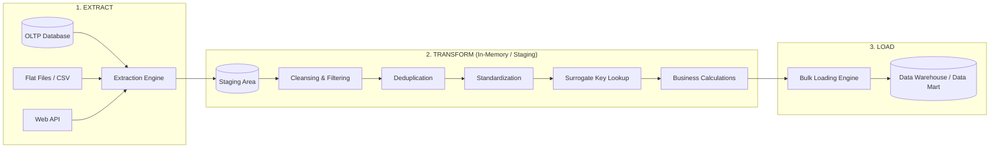
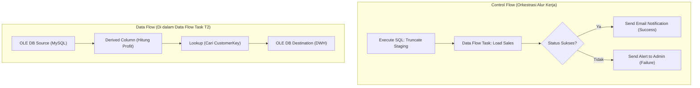

# 🔄 03.1 Pipeline & Alur Kerja Lengkap ETL (Extract, Transform, Load)

> [!ABSTRACT] Ringkasan Sub-Materi
> Mengupas tuntas mekanisme kerja pipa data tradisional **ETL (Extract, Transform, Load)** sebagai tulang punggung integrasi data enterprise. Sub-materi ini membahas teknik ekstraksi data (*Full* vs *Incremental CDC*), anatomi pembersihan dan transformasi data, strategi pemuatan ke Data Warehouse, konsep *Control Flow* vs *Data Flow*, kisi-kisi ujian, dan tips menjawab soal alur kerja.

---

## 1. Konsep Fundamental Pipeline ETL

**ETL (Extract, Transform, Load)** adalah fondasi integrasi data yang bertanggung jawab menyalin data dari berbagai sistem operasional heterogen, membersihkan dan menyelaraskannya sesuai aturan bisnis, lalu memuatnya ke dalam repositori pusat Data Warehouse.

---

## 2. Alur Kerja Langkah demi Langkah

### Tahap 1: Data Extraction (Ekstraksi Data)
Proses membaca dan menarik data mentah dari sistem sumber (*source systems*) ke dalam *Data Staging Area*.
1. **Full Extraction (Ekstraksi Penuh)**:
   - Seluruh baris data pada tabel sumber disalin tanpa filter.
   - Digunakan pada saat **Initial Load** (pemuatan perdana DWH) atau untuk tabel dimensi kecil yang jarang berubah (misal tabel kode pos atau tabel provinsi).
2. **Incremental Extraction (Delta Load)**:
   - Hanya menyalin data yang **baru bertambah atau mengalami perubahan** sejak eksekusi ETL terakhir.
   - **4 Metode Deteksi Perubahan Data (Delta Capture)**:
     - *Timestamp Column*: Menggunakan kueri `WHERE Last_Updated > :Last_ETL_Run_Time`. Kelemahan: tidak dapat mendeteksi baris yang dihapus (`DELETE`).
     - *Status Flag*: Memeriksa kolom status (misal `Is_Processed = 0`).
     - *Database Triggers*: Trigger otomatis mencatat setiap perubahan data ke tabel log audit khusus.
     - *Change Data Capture (CDC)* - **Metode Terbaik**: Membaca langsung *Transaction Log* basis data mesin (misal Binary Log MySQL atau Redo Log Oracle) tanpa membebani performa CPU tabel produksi.

---

### Tahap 2: Data Transformation (Transformasi & Pembersihan)
Merupakan tahapan paling intensif secara komputasi dan memakan waktu terbesar (hingga 70% dari siklus proyek ETL):
1. **Data Cleansing / Scrubbing (Pembersihan Data)**:
   - Memperbaiki data kotor (*dirty data*): penanganan *null / missing values*, penghapusan karakter terlarang (*trailing spaces*, non-printable characters).
   - Validasi integritas format (misal memvalidasi apakah format nomor HP atau email valid).
2. **Deduplication (Penghapusan Duplikasi)**:
   - Mendeteksi dan menggabungkan baris data ganda yang mengacu pada entitas dunia nyata yang sama (*record linkage / fuzzy matching*).
3. **Data Conformation & Standardization**:
   - Menyeragamkan format tanggal menjadi standar ISO `YYYY-MM-DD`.
   - Mengonversi kode heterogen (misal: sistem A mencatat jenis kelamin `'1'`, sistem B mencatat `'L'`, sistem C mencatat `'M'`, diseragamkan menjadi standar `'L'`).
   - Standardisasi mata uang dan satuan ukuran fisik.
4. **Surrogate Key Lookup**:
   - Mencocokkan *Natural Key* dari sistem sumber ke tabel dimensi untuk mengambil *Surrogate Key* integer yang sesuai, serta menerapkan logika **SCD Tipe 2** (menentukan apakah record menghasilkan baris baru atau mengait ke baris aktif).
5. **Business Rule Calculation & Aggregation**:
   - Menghitung metrik turunan yang tidak ada di database operasional (misal: `TotalNetProfit = (Quantity * UnitPrice) - DiscountAmount - Tax`).
6. **Error Handling & Quarantine**:
   - Baris data yang gagal validasi (*bad records*) dialihkan secara otomatis ke tabel karantina (*Error / Reject Table*) untuk diinvestigasi oleh *Data Steward* tanpa menghentikan jalannya pipa ETL.

---

### Tahap 3: Data Loading (Pemuatan Data ke DWH)
Proses memindahkan data yang telah bersih dan tertata dari area staging ke dalam tabel target (Fact Table dan Dimension Table di Data Warehouse):
1. **Initial Load**:
   - Pemuatan awal saat DWH pertama kali dibangun (memindahkan data historis 5 tahun sekaligus).
   - *Teknik Optimal*: Seluruh indeks dan konstrain kunci asing dinonaktifkan sementara (*disabled*), data dimuat secara paralel menggunakan *Bulk Insert*, lalu indeks dibangun kembali (*re-indexed*) untuk menghemat waktu.
2. **Incremental Load (Batch Load)**:
   - Pemuatan rutin yang dijadwalkan (misal setiap tengah malam atau setiap jam) untuk menambahkan transaksi harian baru (*append-only*).
3. **Full Refresh Load**:
   - Menghapus seluruh isi tabel target (`TRUNCATE`) dan memuat ulang seluruh data dari awal. Biasanya diterapkan pada tabel agregat ringkasan (*summary tables*).

---

## 3. Anatomi Tool ETL Enterprise (Studi Kasus Arsitektur SSIS)

Pada alat bantu ETL seperti **SQL Server Integration Services (SSIS)**, pipeline data dipisahkan secara tegas menjadi dua tingkat logika:

- **Control Flow**: Bertindak sebagai *konduktor orkestrasi*. Mengatur urutan eksekusi tugas (*tasks*), kontainer perulangan, kondisi percabangan logika (*precedence constraints*), dan penanganan error alur kerja.
- **Data Flow**: Bertindak sebagai *mesin pipa aliran data*. Mengalirkan baris demi baris data dari sumber (*Source*), melewati serangkaian komponen transformasi dalam memori RAM (*Transformations*), menuju ke basis data tujuan (*Destination*).

---

## 🎯 Hal-Hal yang Kemungkinan Besar Masuk Ujian

1. **Change Data Capture (CDC)**:
   - Mengapa CDC lebih disukai daripada kueri filter timestamp?  
   *Jawab*: Karena CDC membaca transaction log secara asinkron tanpa membebani tabel produksi dan mampu melacak baris yang dihapus (`DELETE`).
2. **Penanganan Data Rusak (*Bad Records*)**:
   - Pertanyaan klasik: *"Apa yang harus dilakukan sistem ETL jika menemukan baris data yang cacat saat transformasi?"*  
   *Jawab*: Jangan mematikan pipeline; alihkan data cacat tersebut ke **Tabel Karantina / Error Table** untuk audit manual, dan lanjutkan proses untuk data yang valid.
3. **Optimalisasi Initial Load**:
   - Mengapa konstrain dan indeks harus di-drop/disable saat initial load?  
   *Jawab*: Untuk mencegah mesin database memvalidasi dan memperbarui pohon indeks pada setiap baris secara individual, yang akan membuat proses load menjadi sangat lambat.
4. **Perbedaan Control Flow vs Data Flow**:
   - Control Flow = mengatur *urutan pekerjaan*; Data Flow = mengatur *transformasi fisik data di RAM*.

---

## 📋 Contoh Soal Ujian (Pilihan Ganda & Esai)

### Contoh Soal Pilihan Ganda
**Soal 1 (Metode Ekstraksi Data)**  
Metode ekstraksi data tambahan (*incremental extraction*) yang bekerja dengan cara memantau dan membaca berkas *Transaction Log* mesin basis data tanpa mengeksekusi kueri SELECT yang membebani CPU sistem operasional disebut...  
A. *Full Table Scan*  
B. *Change Data Capture (CDC)*  
C. *Database Checkpointing*  
D. *Surrogate Key Lookup*  
*Kunci Jawaban*: **B**  
*Pembahasan*: Change Data Capture (CDC) membaca catatan log transaksi internal DBMS (seperti binlog di MySQL atau redo log di Oracle) untuk mengekstrak data delta tanpa overhead performa pada tabel produksi.

**Soal 2 (Teknik Optimasi Pemuatan Awal)**  
Saat melakukan proses *Initial Load* data historis sebesar 10 Terabyte ke dalam tabel fakta Data Warehouse, tindakan terbaik yang harus dilakukan oleh *Data Engineer* untuk mempercepat proses penulisan data adalah...  
A. Menghapus tabel fakta secara permanen.  
B. Menonaktifkan indeks dan pemeriksaan integritas referensial (Foreign Key) sebelum pemuatan, menggunakan metode *Bulk Load*, lalu membangun kembali indeks setelah pemuatan selesai.  
C. Menjalankan proses pemuatan satu baris demi satu baris (*Row-by-Row INSERT*).  
D. Menghidupkan seluruh trigger database pada tabel target.  
*Kunci Jawaban*: **B**  
*Pembahasan*: Mematikan indeks dan konstrain mencegah *overhead* kalkulasi pohon B-Tree berulang-ulang untuk setiap baris data yang dimasukkan, mempercepat proses loading hingga puluhan kali lipat.

---

### Contoh Soal Esai
**Soal Esai**:  
Rancanglah alur kerja pipeline ETL lengkap untuk memproses data transaksi penjualan dari 50 cabang minimarket yang menggunakan basis data POS berbeda ke dalam sebuah Enterprise Data Warehouse! Jelaskan secara berurutan langkah-langkah yang terjadi pada tahap **Extract**, **Transform**, dan **Load**, serta bagaimana sistem menangani transaksi yang memiliki kode produk yang belum terdaftar di tabel master produk!

**Pedoman Jawaban Lengkap**:
1. **Tahap Extract (Ekstraksi)**:
   - Setiap malam, mesin ekstraksi menjalankan pekerjaan *Incremental Extraction* menggunakan teknik CDC atau filter timestamp transaksi hari tersebut dari 50 database cabang.
   - Seluruh data mentah disalin ke dalam satu area penyimpanan bersama yang aman yaitu **Data Staging Area**.
2. **Tahap Transform (Transformasi & Pembersihan)**:
   - *Pembersihan*: Memeriksa format data, menghapus spasi kosong pada teks, dan membuang duplikasi transaksi kasir.
   - *Standardisasi*: Menyeragamkan kode pembayaran (Tunai, Debit, QRIS) dan format tanggal/waktu transaksi ke standar ISO.
   - *Lookup Surrogate Key*: Mengonversi ID Kasir, ID Toko Cabang, dan ID Tanggal menjadi *Surrogate Key* integer yang merujuk pada tabel dimensi terkait.
   - *Kalkulasi Bisnis*: Menghitung `NilaiLaba = (HargaJual - HargaBeli) * Kuantitas`.
3. **Penanganan Masalah Kode Produk Tidak Terdaftar (*Unknown / Missing Dimension Key*)**:
   - Jika ditemukan transaksi dengan kode produk yang belum ada di tabel dimensi `Dim_Product`:
   - Sistem **TIDAK BOLEH membatalkan seluruh proses ETL** dan tidak boleh membuang transaksi tersebut begitu saja (karena transaksi uang sudah terjadi di kasir).
   - **Solusi Standar Industri**: Transaksi tersebut tetap dimuat ke tabel fakta dengan mengaitkan `ProductKey` ke sebuah baris khusus bernama **Default Row / Unknown Member** (biasanya diberi nilai `ProductKey = -1` dengan deskripsi *"Produk Belum Teridentifikasi"*).
   - Secara paralel, sistem mencatat nomor transaksi dan kode produk yang hilang tersebut ke dalam **Error Log Table** dan mengirimkan alert kepada staf master data untuk mendaftarkan produk baru tersebut keesokan harinya.
4. **Tahap Load (Pemuatan)**:
   - Menggunakan mekanisme *Bulk Insert* untuk menulis baris-baris fakta transaksi yang telah bersih secara paralel ke dalam `Fact_Sales` di Data Warehouse.
   - Memperbarui metadata operasional (waktu selesai load, total baris berhasil, total baris bermasalah).

---

## 💡 Tips & Trik Menjawab Soal Ujian

1. **Jurus Kata Kunci Tahap Transformasi**:
   - *Cleansing* (buang kotor/null), *Deduplication* (buang duplikat), *Standardization* (seragamkan format), *Lookup* (ambil Surrogate Key), *Quarantine* (pisahkan baris rusak).
2. **Pola Jawaban Esai Penanganan Kasus Error**:
   - Selalu berikan prinsip: **"Pipeline data tidak boleh mati karena 1 baris salah"**. Solusinya adalah gunakan **Error Table / Quarantine** untuk bad rows dan gunakan **Unknown Surrogate Key (`-1`)** untuk kunci dimensi yang belum sinkron.
