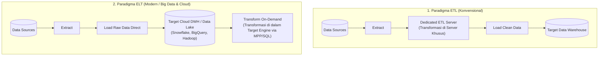

# ⚖️ 03.2 Perbandingan Komprehensif ETL vs ELT

> [!ABSTRACT] Ringkasan Sub-Materi
> Menelaah evolusi paradigma integrasi data dari pendekatan konvensional **ETL (Extract, Transform, Load)** menuju pendekatan modern **ELT (Extract, Load, Transform)**. Sub-materi ini membedah perbedaan lokasi komputasi transformasi data, alasan melonjaknya popularitas ELT di era *Big Data* dan *Cloud Data Warehouse*, matriks komparasi 10 dimensi, kisi-kisi ujian, dan panduan menjawab soal studi kasus.

---

## 1. Perbedaan Paradigma Arsitektur: ETL vs ELT

Perbedaan paling fundamental antara ETL dan ELT terletak pada **kapan** dan **di mana** proses transformasi data fisik dijalankan:

---

## 2. Bedah Detail Arsitektur Masing-Masing Pendekatan

### A. Pendekatan Tradisional: ETL (Extract $\to$ Transform $\to$ Load)
- **Mekanisme**:
  1. Data diekstrak dari sumber operasional.
  2. Data langsung dialirkan ke **Server Pemrosesan ETL Terpisah** (*Dedicated ETL Engine*, misal server SSIS, Informatica, Talend).
  3. Transformasi, agregasi, dan pembersihan dilakukan di dalam memori dan disk lokal server ETL tersebut.
  4. Hanya data yang sudah **100% bersih, terstruktur, dan siap pakai** yang dimuat ke dalam Data Warehouse target.
- **Karakteristik & Batasan**:
  - Diciptakan pada era di mana storage disk dan daya komputasi database target sangat mahal dan terbatas.
  - *Bottleneck Komputasi*: Server ETL menjadi titik kemacetan (*single point of bottleneck*) jika volume data melonjak dari Gigabyte ke Terabyte.
  - Data mentah asli (*raw data*) hilang; jika di masa depan ada aturan bisnis baru, data harus diekstrak ulang dari sistem sumber.

### B. Pendekatan Modern: ELT (Extract $\to$ Load $\to$ Transform)
- **Mekanisme**:
  1. Data diekstrak dari sistem sumber.
  2. Data mentah (*raw data*) langsung dimuat seketika (*direct load*) ke dalam sistem target penyimpanan skala besar (**Cloud Data Warehouse / Data Lake**, seperti BigQuery, Snowflake, Redshift, atau Hadoop HDFS).
  3. Transformasi data dilakukan **langsung di dalam mesin database target** memanfaatkan kekuatan komputasi terdistribusi (*Massively Parallel Processing - MPP* atau *Spark/Hive SQL*).
- **Faktor Pendorong Lahirnya ELT**:
  - *Storage Disk Menjadi Sangat Murah*: Kita dapat menyimpan seluruh data mentah tanpa khawatir kehabisan kapasitas.
  - *Daya Komputasi Target yang Dahsyat*: Mesin Cloud DWH modern mampu menjalankan pemrosesan paralel pada miliaran baris dalam hitungan detik.
  - *Mendukung Data Tidak Terstruktur*: Mampu menampung teks mentah, audio, video, dan log JSON (*Schema-on-Read*).

---

## 3. Matriks Perbandingan 10 Poin: ETL vs ELT

Tabel komparatif wajib hafal untuk ujian:

| Kriteria Komparasi | ETL (*Extract, Transform, Load*) | ELT (*Extract, Load, Transform*) |
| :--- | :--- | :--- |
| **1. Lokasi Transformasi** | Di server perantara ETL khusus (*dedicated server*) sebelum data masuk ke DWH | Di dalam mesin penyimpanan target (*inside target DWH/Data Lake*) |
| **2. Waktu Pemuatan Awal (*Load Time*)** | Lebih lambat (Menunggu proses transformasi selesai terlebih dahulu) | **Sangat Cepat** (Data mentah langsung disalin tanpa modifikasi awal) |
| **3. Waktu Siap Digunakan (*Query Time*)** | Sangat cepat (Data di DWH sudah matang dan diagregasi) | Cepat hingga sedang (Tergantung apakah transformasi on-demand atau materialized) |
| **4. Penyimpanan Data Mentah (*Raw Data*)** | Tidak disimpan di DWH (Data mentah dibuang setelah diproses) | **Disimpan Permanen** di DWH/Data Lake (Memungkinkan audit historis penuh) |
| **5. Skalabilitas Volume Data** | Terbatas oleh kapasitas CPU dan RAM server ETL perantara | **Sangat Skalabel** (Memanfaatkan skalabilitas elastis Cloud/Kluster MPP) |
| **6. Tipe Data yang Didukung** | Terbatas pada **Data Terstruktur (Structured)** | **Structured, Semi-Structured (JSON/XML), dan Unstructured** |
| **7. Fleksibilitas Analitis** | Kaku (*Schema-on-Write*); perubahan model data memerlukan desain ulang pipa ETL | **Sangat Fleksibel (*Schema-on-Read*)**; data mentah dapat ditransformasi kapan saja |
| **8. Kebutuhan Perangkat Keras Khusus** | Memerlukan server fisik ETL berspesifikasi tinggi yang mahal | Tidak perlu server ETL terpisah; cukup memaksimalkan mesin target |
| **9. Kepatuhan Privasi Data (GDPR / PII)** | **Unggul**: Data sensitif (misal NIK nasabah) dapat di-masking *sebelum* masuk ke penyimpanan | Harus dikelola ketat di target agar data mentah tidak bocor ke analis umum |
| **10. Kasus Penggunaan Ideal** | DWH On-Premise tradisional dengan volume data terukur dan aturan privasi ketat | Big Data, Cloud Data Lakehouse, IoT Streaming, Analisis Data Science eksploratif |

---

## 4. Kapan Memilih ETL dan Kapan Memilih ELT?

### Pilih ETL jika:
1. **Regulasi Privasi & Keamanan Ketat**: Data memuat informasi identitas sensitif (*Personally Identifiable Information - PII*) yang secara hukum dilarang mendarat di penyimpanan target tanpa di-masking terlebih dahulu.
2. **Kapasitas Database Target Terbatas**: Sistem DWH lama (on-premise) tidak memiliki kemampuan komputasi paralel masif untuk melakukan transformasi di tempat.
3. **Format Data Sudah Terstandarisasi**: Seluruh sumber data adalah basis data relasional yang bersih dengan skema kaku.

### Pilih ELT jika:
1. **Volume Data Sangat Masif (Big Data / Terabyte-Petabyte)**: Memindahkan transformasi ke kluster komputasi terdistribusi (seperti Apache Spark, Hadoop, BigQuery).
2. **Menggunakan Cloud Data Warehouse**: Arsitektur Snowflake atau Google BigQuery yang komputasinya terpisah dari penyimpanan (*separation of compute and storage*).
3. **Kebutuhan Eksplorasi Data Science**: Para data scientist membutuhkan akses ke data mentah asli yang belum terfilter oleh aturan bisnis.

---

## 🎯 Hal-Hal yang Kemungkinan Besar Masuk Ujian

1. **Letak Fisik Pemrosesan Transformasi**:
   - Soal PG paling standar: *"Di manakah proses transformasi data terjadi pada arsitektur ELT?"*  
   *Jawab*: **Di dalam mesin basis data target (Data Warehouse / Data Lake)**.
2. **Mengapa Big Data Beralih ke ELT?**:
   - Pahami 3 alasan utama: (1) Menghilangkan bottleneck server perantara, (2) Memanfaatkan daya komputasi paralel masif (MPP) dari kluster/cloud modern, (3) Menjaga seluruh data mentah (*raw data*) untuk analisis masa depan (*Schema-on-Read*).
3. **Kelebihan ETL Dibanding ELT**:
   - Pahami bahwa ETL masih lebih unggul dalam aspek **keamanan dan kepatuhan privasi (data masking)**, karena data sensitif tidak pernah menyentuh disk penyimpanan utama dalam bentuk mentah.
4. **Schema-on-Write vs Schema-on-Read**:
   - ETL menganut filosofi *Schema-on-Write* (skema ditentukan sebelum data ditulis).
   - ELT menganut filosofi *Schema-on-Read* (data mentah ditulis bebas, skema diterapkan saat kueri dijalankan).

---

## 📋 Contoh Soal Ujian (Pilihan Ganda & Esai)

### Contoh Soal Pilihan Ganda
**Soal 1 (Lokasi Komputasi ELT)**  
Perbedaan mendasar antara paradigma ETL dan ELT dalam perancangan arsitektur data pipeline adalah...  
A. Pada ELT, tahapan transformasi data dihilangkan sepenuhnya sehingga data yang disimpan selamanya kotor.  
B. Pada ELT, proses transformasi dilakukan di dalam mesin database/platform analitik target setelah data mentah berhasil dimuat, memanfaatkan kekuatan komputasi terdistribusi mesin target.  
C. ETL hanya dapat digunakan untuk data semi-terstruktur, sedangkan ELT hanya untuk file teks CSV.  
D. ELT membutuhkan server perantara dengan spesifikasi memori RAM yang jauh lebih besar daripada ETL.  
*Kunci Jawaban*: **B**  
*Pembahasan*: ELT memindahkan komputasi transformasi dari server perantara ke dalam sistem database target itu sendiri (seperti Cloud DWH atau Hadoop cluster).

**Soal 2 (Keunggulan Proteksi Data ETL)**  
Dalam skenario perbankan yang terikat regulasi kepatuhan privasi data internasional (seperti GDPR), mengapa arsitektur ETL tradisional terkadang masih lebih dipilih dibandingkan ELT?  
A. Karena ETL jauh lebih murah biaya operasionalnya dibandingkan ELT.  
B. Karena pada ETL, data sensitif (seperti nomor kartu kredit dan kata sandi) dapat dibersihkan, dienkripsi, atau dihilangkan di server perantara sebelum sempat tersimpan di penyimpanan permanen target.  
C. Karena ELT tidak dapat memproses data bertipe angka.  
D. Karena ETL menjamin kueri analitik berjalan 100 kali lebih cepat.  
*Kunci Jawaban*: **B**  
*Pembahasan*: Dengan ETL, data sensitif mentah (*raw PII*) dicegat dan di-masking di server perantara sebelum masuk ke data warehouse, mencegah risiko kebocoran data di penyimpanan target.

---

### Contoh Soal Esai
**Soal Esai**:  
Sebuah platform media sosial raksasa menerima 500 Terabyte data per hari yang terdiri dari log klik pengguna, foto, komentar teks JSON, dan transaksi pembelian koin digital. Tim data engineer perusahaan sedang memperdebatkan apakah akan mengimplementasikan arsitektur pipeline berbasis **ETL konvensional** atau **ELT modern**.  
a. Evaluasi kelayakan penggunaan arsitektur ETL konvensional untuk beban kerja (*workload*) tersebut!  
b. Jelaskan mengapa pendekatan ELT jauh lebih cocok untuk skenario platform tersebut dan uraikan alur kerja data dari sumber hingga siap dianalisis oleh data scientist!

**Pedoman Jawaban Lengkap**:
1. **Evaluasi Ketidaklayakan ETL Konvensional**:
   - Pendekatan ETL konvensional **tidak layak dan akan gagal total** untuk skenario ini karena:
     - *Throughput & Bottleneck*: Volume 500 TB/hari akan melumpuhkan server pemrosesan ETL perantara (*memory exhaustion* dan *CPU bottleneck*). Server ETL terpisah tidak akan mampu menyelesaikan transformasi sebelum batch hari berikutnya tiba.
     - *Variasi Data*: ETL konvensional menuntut *Schema-on-Write* yang kaku, sehingga sangat sulit menangani data semi-terstruktur (JSON) dan tidak terstruktur (foto/komentar bebas) yang formatnya dinamis.
     - *Kehilangan Nilai Mentah*: ETL akan membuang sebagian besar data yang dianggap "tidak relevan" hari ini, padahal data mentah tersebut sangat bernilai untuk pelatihan model Machine Learning di masa depan.
2. **Alasan Keunggulan ELT & Alur Kerjanya**:
   - **Alasan Keunggulan**:
     - *Skalabilitas Ekstrem*: ELT menyalin data mentah langsung ke Data Lake (HDFS / Cloud Object Storage seperti S3/GCS) tanpa komputasi awal, sehingga proses *ingestion* selesai dalam hitungan menit.
     - *Pemanfaatan Komputasi Terdistribusi*: Transformasi dilakukan di dalam kluster terdistribusi (Apache Spark / BigQuery) yang memiliki ribuan core prosesor yang bekerja secara paralel (*Massively Parallel Processing*).
     - *Schema-on-Read*: Data scientist dapat mengeksplorasi data mentah asli kapan saja tanpa dibatasi oleh skema kaku.
   - **Alur Kerja Data**:
     1. **Extract**: Data log klik, transaksi, dan teks JSON diekstrak secara kontinu menggunakan streaming pipeline (misal Apache Kafka).
     2. **Load (Landing)**: Data mentah langsung ditulis apa adanya (*as-is*) ke dalam zona penyimpanan mentah (*Bronze / Raw Zone*) di Data Lake / Cloud DWH.
     3. **Transform (On-Demand)**: Pipeline komputasi terdistribusi (Apache Spark / SQL Engine) dijalankan di dalam Data Lake untuk membersihkan data, memparsing teks JSON, menghitung metrik keterlibatan pengguna, dan menyimpan hasilnya ke zona data bersih (*Silver / Gold Zone*) yang siap dikueri oleh analis dan model AI.

---

## 💡 Tips & Trik Menjawab Soal Ujian

1. **Jurus Kata Kunci Pembeda**:
   - ETL = **Transformasi SEBELUM Loading**, Server perantara terpisah, *Schema-on-Write*, unggul di privasi data.
   - ELT = **Transformasi SETELAH Loading**, Di dalam mesin target, *Schema-on-Read*, unggul di Big Data & Cloud.
2. **Formula Menjawab Esai Studi Kasus Pemilihan**:
   - Jika kasusnya: Bank, Rumah Sakit, data sensitif, volume kecil-menengah $\to$ Pilih **ETL** (alasan: kepatuhan regulasi privasi & proteksi data mentah).
   - Jika kasusnya: E-commerce besar, Media Sosial, IoT Sensor, Big Data, Cloud Data Lake $\to$ Pilih **ELT** (alasan: kecepatan ingest, skalabilitas MPP, ketersediaan raw data).
