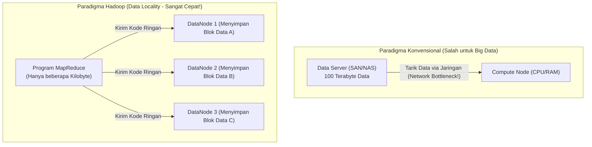

# 🌐 04.1 Konsep Dasar Komputasi Terdistribusi & Paradigma Hadoop

> [!ABSTRACT] Ringkasan Sub-Materi
> Menelaah latar belakang lahirnya ekosistem Apache Hadoop sebagai revolusi dalam pemrosesan data terdistribusi (*distributed data processing*). Sub-materi ini membahas batas fisik komputasi terpusat (*Scale-Up* vs *Scale-Out*), matematika transfer I/O paralel, filosofi revolusioner **Data Locality**, tiga pilar karakteristik Hadoop, konsep kontainerisasi, kisi-kisi ujian, dan panduan menjawab soal konseptual.

---

## 1. Kegagalan Sistem Terpusat & Matematika I/O Disk

Sebelum lahirnya Hadoop, pendekatan standar industri untuk menangani pertambahan data adalah **Scale-Up (Vertical Scaling)**, yaitu mengganti server yang ada dengan mesin mainframe atau superkomputer tunggal yang lebih besar, memiliki prosesor lebih banyak, dan RAM lebih luas.

### Batas Fisik Scale-Up:
1. **Biaya Eksponensial**: Harga sebuah server tunggal dengan spesifikasi ekstrem melonjak secara non-linear (menjadi sangat mahal) untuk setiap penambahan kapasitas marjinal.
2. **Batas Fisik Hukum Moore**: Kecepatan *clock speed* prosesor tunggal telah mencapai batas termal (panas) dan fisika silikon.
3. **Bottleneck Kecepatan I/O Hard Drive Mekanik (*The Storage Bottleneck*)**:
   - Buku teks Tom White (*Hadoop: The Definitive Guide*) memberikan ilustrasi matematika klasik:
   - Kecepatan baca (*read transfer rate*) sebuah hard disk drive standar adalah $\approx 100\text{ MB/s}$.
   - Jika Anda memiliki **1 Terabyte (1.000.000 MB)** data pada satu hard drive tunggal:
     $$\text{Waktu Baca} = \frac{1.000.000\text{ MB}}{100\text{ MB/s}} = 10.000\text{ detik} \approx 2{,}77\text{ jam!}$$
   - Jika data Anda membengkak menjadi **100 Terabyte**, satu drive akan membutuhkan waktu **lebih dari 11 hari** hanya untuk membaca data tersebut satu kali putaran!

### Solusi Komputasi Terdistribusi (Scale-Out):
Alih-alih membaca dari satu disk raksasa, sebarkan 1 Terabyte data tersebut ke dalam **100 hard drive murah secara paralel**:
$$\text{Waktu Baca Paralel} = \frac{10.000\text{ detik}}{100\text{ drive}} = 100\text{ detik} \approx 1{,}6\text{ menit!}$$
Inilah esensi dasar komputasi terdistribusi: **memecah data dan memprosesnya secara paralel melintasi banyak mesin komputer mandiri**.

---

## 2. Paradigma Revolusioner: Data Locality

Pada sistem terdistribusi konvensional terdahulu (seperti MPI atau Grid Computing), data disimpan di server penyimpanan pusat (NAS / SAN) terpisah. Saat komputasi dimulai, data ditarik melintasi kabel jaringan ke server komputasi (*Moving data to the computation*).

> [!IMPORTANT] Doktrin Emas Hadoop: Data Locality
> *"Moving computation to the data is dramatically cheaper and faster than moving data to the computation."*  
> (Memindahkan program komputasi mendekati lokasi fisik data jauh lebih murah dan cepat daripada memindahkan data masif mendekati program komputasi).

### Mengapa Data Locality Sangat Revolusioner?
1. **Bandwidth Jaringan Adalah Sumber Daya Paling Terbatas (*Network is the Bottleneck*)**: Mengalirkan ratusan Terabyte data melintasi switch jaringan lokal (*switches & routers*) akan menyebabkan saturasi jaringan (*congested network*), tabrakan paket, dan latensi ekstrem.
2. **Ukuran Kode Program Sangat Kecil**: File binary/program eksekusi (seperti file `.jar` program MapReduce) umumnya berukuran sangat kecil (hanya beberapa Kilobyte atau Megabyte).
3. **Efisiensi Ekstrem**: Jauh lebih cerdas mengirimkan file `.jar` sebesar 50 KB melintasi jaringan ke 100 node tempat data berada, lalu membiarkan prosesor lokal di masing-masing node memproses data di hard disk lokalnya sendiri secara paralel!

---

## 3. Tiga Pilar Karakteristik Utama Hadoop

1. **Scalability (Skalabilitas Horizontal Bebas Hambatan)**:
   - Menggunakan pendekatan **Scale-Out**.
   - Kapasitas penyimpanan dan daya komputasi dapat ditambah secara linear cukup dengan mencolokkan komputer baru (*commodity hardware*) ke dalam rak kluster tanpa perlu mematikan sistem (*zero-downtime commissioning*).
2. **Fault-Tolerance (Toleransi Kesalahan Bawaan)**:
   - Dalam kluster berisi 2.000 komputer murah, kerusakan perangkat keras (hard disk bad sector, RAM rusak, kabel lepas, power supply mati) adalah **kepastian statistik harian**, bukan insiden kebetulan.
   - Hadoop didesain dari tingkat kernel arsitektur dengan asumsi: *"Hardware will fail, and software must handle it automatically"*.
   - Jika sebuah node mati, Hadoop secara otomatis mendeteksi kegagalan tersebut melalui mekanisme *heartbeat* dan langsung mengalihkan pemrosesan ke replika data lain di node yang masih sehat.
3. **Cost-Effectiveness (Efisiensi Biaya Berbasis Commodity Hardware)**:
   - Hadoop tidak membutuhkan perangkat keras enterprise yang mahal (*no expensive proprietary appliances, no EMC SAN/NAS*).
   - Hadoop berjalan optimal di atas **Commodity Hardware**, yaitu komputer kelas komersial biasa yang mudah dibeli di pasaran bebas.

---

## 4. Konsep Pendukung: Virtualisasi (VM) vs Kontainerisasi (Docker)

Dalam perkuliahan dan praktikum Big Data modern, kluster Hadoop sering diuji menggunakan teknologi isolasi lingkungan:

| Dimensi | Virtual Machine (VM / Hypervisor) | Containerization (Docker / Podman) |
| :--- | :--- | :--- |
| **Arsitektur** | Virtualisasi di level perangkat keras (*Hardware-level*) | Isolasi di level sistem operasi (*OS-level via Linux cgroups & namespaces*) |
| **Sistem Operasi** | Membawa *Guest OS* lengkap sendiri di setiap instance | Berbagi *Host OS Kernel* yang sama secara efisien |
| **Konsumsi Resource**| Sangat berat (Membutuhkan alokasi RAM dan vCPU tetap per VM) | **Sangat ringan** (Konsumsi CPU/RAM dinamis sesuai beban proses) |
| **Waktu Booting** | Menit (Proses booting sistem operasi lengkap) | **Milidetik hingga Detik** |
| **Penerapan Hadoop** | Simulasi lab multi-node tradisional | Penggelaran lingkungan microservices, CI/CD, dan lab kluster terisolasi |

---

## 🎯 Hal-Hal yang Kemungkinan Besar Masuk Ujian

1. **Prinsip Data Locality**:
   - Soal wajib: *"Jelaskan apa yang dimaksud dengan prinsip Data Locality pada Hadoop dan mengapa prinsip ini krusial bagi pemrosesan Big Data!"*
2. **Scale-Up vs Scale-Out**:
   - Membedakan *Vertical Scaling* (memperbesar spesifikasi 1 mesin) dengan *Horizontal Scaling* (menambah jumlah mesin komoditas). Hadoop mengadopsi **Scale-Out**.
3. **Filosofi Toleransi Kesalahan (*Fault-Tolerance*)**:
   - Pahami bahwa Hadoop mengasumsikan kegagalan komponen keras sebagai hal lumrah, ditangani di level perangkat lunak (*software-managed fault tolerance*) melalui replikasi data.
4. **Analisis I/O Paralel**:
   - Menghitung waktu baca disk: membagi waktu serial dengan jumlah disk paralel.

---

## 📋 Contoh Soal Ujian (Pilihan Ganda & Esai)

### Contoh Soal Pilihan Ganda
**Soal 1 (Prinsip Data Locality)**  
Paradigma revolusioner yang membedakan pemrosesan data Apache Hadoop dari sistem komputasi terdistribusi tradisional adalah...  
A. Memindahkan seluruh data berukuran Terabyte ke satu server superkomputer pusat.  
B. Menghapus data dari disk dan hanya menyimpannya di cache peramban web.  
C. Memindahkan komputasi (program eksekusi berukuran kecil) ke node tempat data tersimpan secara fisik (*Data Locality*), bukan memindahkan data masif melintasi jaringan.  
D. Mewajibkan penggunaan hard disk khusus buatan militer yang tidak pernah rusak.  
*Kunci Jawaban*: **C**  
*Pembahasan*: Data Locality menghemat bandwidth jaringan dengan mengeksekusi kode program langsung di node tempat blok data berada secara lokal.

**Soal 2 (Strategi Peningkatan Kapasitas)**  
Strategi penambahan kapasitas pemrosesan data dengan cara menambah unit komputer komoditas baru ke dalam kluster tanpa perlu mengganti mesin lama dikenal sebagai...  
A. *Vertical Scaling (Scale-Up)*  
B. *Horizontal Scaling (Scale-Out)*  
C. *Centralized Scaling*  
D. *Virtual Memory Paging*  
*Kunci Jawaban*: **B**  
*Pembahasan*: Scale-Out (Horizontal Scaling) adalah penambahan jumlah node komputer komoditas paralel, yang merupakan fondasi arsitektur Hadoop.

---

### Contoh Soal Esai
**Soal Esai**:  
Sebuah lembaga survei nasional memiliki data historis sensus sebesar 50 Terabyte. Selama ini mereka menggunakan satu server basis data relasional dengan disk storage tunggal berkecepatan baca 100 MB/s.  
a. Hitung estimasi waktu teoritis yang dibutuhkan server tersebut untuk memindai seluruh data sensus dalam satu putaran kueri agregasi!  
b. Jelaskan bagaimana arsitektur kluster Hadoop dengan 100 node DataNode memecahkan masalah bottleneck I/O tersebut!  
c. Jelaskan mengapa paradigma *Data Locality* menjamin kueri tersebut tidak menyebabkan kemacetan (*bottleneck*) pada kabel jaringan kluster!

**Pedoman Jawaban Lengkap**:
1. **Perhitungan Waktu Baca Server Tunggal**:
   - Volume Data: $50\text{ TB} = 50.000.000\text{ MB}$.
   - Kecepatan Baca Disk: $100\text{ MB/s}$.
   - Waktu Pemindaian:
     $$\text{Waktu} = \frac{50.000.000\text{ MB}}{100\text{ MB/s}} = 500.000\text{ detik} \approx 138{,}8\text{ jam (atau } \approx 5{,}78\text{ hari!)}$$
   - *Kesimpulan*: Pendekatan server tunggal sama sekali tidak dapat digunakan untuk kebutuhan analitik praktis.
2. **Solusi Pemrosesan Paralel Kluster Hadoop**:
   - Dengan kluster Hadoop berisi 100 DataNode independen, data 50 TB dipecah menjadi blok-blok terdistribusi (masing-masing 128 MB) dan disebarkan merata ke 100 node (setiap node menampung $\approx 500\text{ GB}$).
   - Saat kueri dijalankan, ke-100 node membaca data di disk lokalnya masing-masing secara bersamaan (*Massive I/O Parallelism*).
   - Waktu baca teoritis terpangkas 100 kali lipat:
     $$\text{Waktu Paralel} = \frac{500.000\text{ detik}}{100} = 5.000\text{ detik} \approx 1{,}38\text{ jam}.$$
3. **Peranan Data Locality Mencegah Saturasi Jaringan**:
   - Pada arsitektur non-Hadoop, ke-100 node harus mengirimkan 50 TB data melintasi switch jaringan ke server pusat, yang akan menyebabkan jaringan mati (*network congestion*).
   - Dengan *Data Locality*, kode program Map/Agregasi (file `.jar` hanya berukuran $\approx 100\text{ KB}$) yang dikirimkan oleh master ke masing-masing dari 100 DataNode.
   - Setiap DataNode membaca data dari hard disk lokalnya tanpa melalui kabel jaringan kluster, memproses penyaringan lokal, dan hanya mengirimkan hasil agregasi kecil melalui jaringan. Akibatnya, bandwidth jaringan kluster tetap lapang dan kueri berjalan sangat cepat.

---

## 💡 Tips & Trik Menjawab Soal Ujian

1. **Jurus Kata Kunci Ujian**:
   - Scale-Out $\to$ Menambah mesin komoditas murah secara horizontal.
   - Data Locality $\to$ Kode program dikirim ke tempat data berada, bukan sebaliknya.
   - Commodity Hardware $\to$ Komputer standar pasar bebas, bukan server proprietary mahal.
2. **Formula Menjawab Esai Big Data**:
   - Selalu sertakan perbandingan angka waktu transfer disk mekanik vs transfer paralel untuk mendemonstrasikan pemahaman buku teks resmi Tom White secara meyakinkan.
