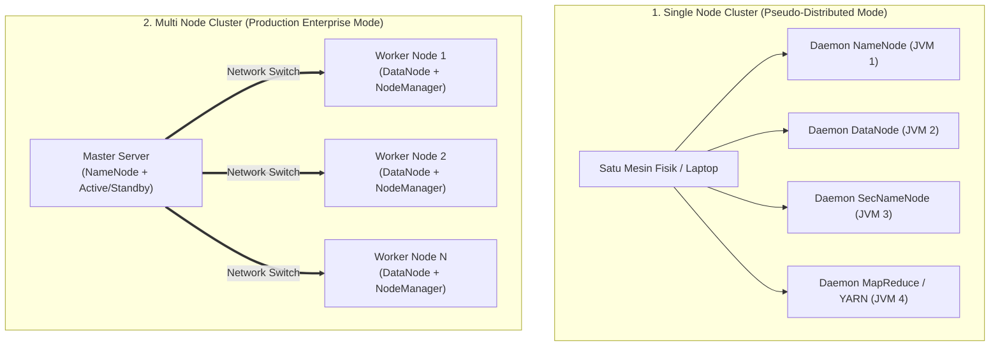
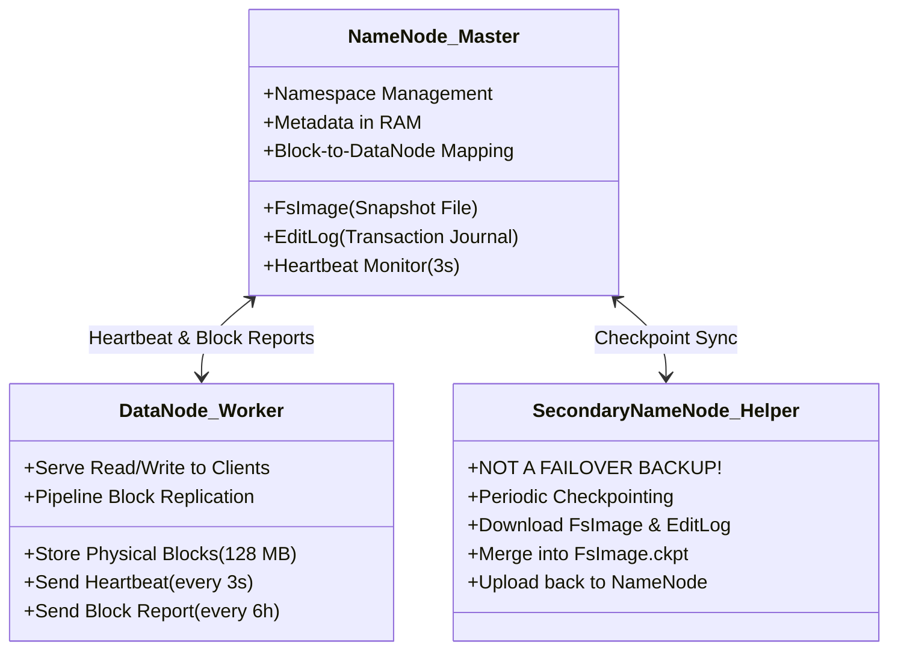

# 🖥️ 04.2 Arsitektur Kluster, Node Types & Single vs Multi Node

> [!ABSTRACT] Ringkasan Sub-Materi
> Menelaah arsitektur fisik dan logis kluster Hadoop. Sub-materi ini membedah perbedaan antara **Single Node Cluster** (*Pseudo-Distributed*) dan **Multi Node Cluster**, tanggung jawab arsitektural **NameNode** dan **DataNode**, meluruskan kesalahpahaman fatal mengenai peran **Secondary NameNode** (bukan *failover backup*!), mekanisme *Heartbeat* dan *Block Report*, kisi-kisi ujian, dan panduan menjawab esai.

---

## 1. Topologi Kluster: Single Node vs Multi Node

Dalam penggelaran (*deployment*) ekosistem Hadoop, terdapat dua modus utama:

### A. Single Node Cluster (Pseudo-Distributed Mode)
- Seluruh daemon Hadoop (`NameNode`, `DataNode`, `SecondaryNameNode`, dan manajer komputasi) dijalankan sebagai **proses JVM (Java Virtual Machine) terpisah pada SATU mesin fisik/laptop yang sama**.
- Tidak ada paralelisme perangkat keras nyata dan tidak ada toleransi kesalahan (*no real fault-tolerance*).
- **Tujuan Penggunaan**: Murni untuk pengembangan (*development*), penulisan kode program MapReduce, pengujian algoritma (*testing*), dan pembelajaran di kelas lab kampus.

### B. Multi Node Cluster (Fully Distributed Mode)
- Daemon Master dan daemon Worker dipisahkan pada mesin-mesin fisik (*racks of servers*) yang berbeda secara terdistribusi.
- Mesin Master didedikasikan murni untuk mengelola metadata, sedangkan puluhan hingga ribuan mesin Worker (*Commodity Slaves*) bertugas menyimpan blok data dan mengeksekusi komputasi.
- **Tujuan Penggunaan**: Lingkungan produksi enterprise (*production grade*) berskala petabyte.

---

## 2. Bedah Peran & Tanggung Jawab Jenis-Jenis Node

Arsitektur penyimpanan HDFS mengadopsi model **Master/Worker (Master/Slave)**:

---

### A. NameNode (The Master Node)
NameNode adalah penguasa tunggal dan "otak" dari sistem berkas HDFS.
1. **Tanggung Jawab Utama**:
   - Mengelola **Namespace Sistem Berkas**: struktur direktori hirarkis, nama file, hak akses pengguna (*permissions*), kuota penyimpanan, dan properti file.
   - Mengelola **Pemetaan Blok (*Block Mapping*)**: mencatat blok-blok fisik mana saja yang membentuk suatu file dan di DataNode mana saja replika blok tersebut tersimpan.
2. **Karakteristik Penyimpanan Metadata**:
   - Seluruh metadata namespace disimpan secara langsung di dalam **Memori RAM NameNode**. Hal ini membuat pembacaan metadata berjalan secepat kilat.
   - *Konsekuensi Penting*: Kapasitas RAM NameNode membatasi jumlah total file di seluruh kluster. Setiap file, direktori, dan blok menghabiskan $\approx 150\text{ byte}$ memori RAM NameNode.
3. **Persistensi Metadata ke Disk (Dua File Krusial)**:
   - **`FsImage`**: File snapshot lengkap dari seluruh struktur direktori dan metadata sistem berkas pada suatu titik waktu tertentu (*point-in-time state*).
   - **`EditLog`**: Jurnal catatan transaksi penulisan (*write-ahead transaction log*) yang mencatat setiap perubahan metadata (seperti pembuatan file baru, penghapusan, penggantian nama) sejak `FsImage` terakhir dibuat.

---

### B. DataNode (The Worker Node)
DataNode adalah "kuli pekerja" yang bertugas mengelola penyimpanan fisik data.
1. **Tanggung Jawab Utama**:
   - Menyimpan blok-blok data fisik (secara default berukuran 128 MB) sebagai file biner biasa di sistem berkas sistem operasi lokal (ext4, xfs).
   - Melayani permintaan pembacaan (*read*) dan penulisan (*write*) langsung dari klien aplikasi.
   - Menjalankan penciptaan, penghapusan, dan replikasi blok fisik atas instruksi dari NameNode.
2. **Komunikasi Rutin ke NameNode**:
   - **Heartbeat**: Dikirimkan setiap **3 detik sekali** via koneksi TCP. Menginformasikan bahwa DataNode tersebut masih hidup, sehat, dan melaporkan sisa kapasitas disk yang tersedia.
     - *Aturan Timeout*: Jika NameNode tidak menerima Heartbeat dari DataNode selama **10 menit (600 detik)** berturut-turut, NameNode menyatakan node tersebut telah **mati (*Dead Node*)**, dan segera menginstruksikan DataNode lain untuk mereplikasi ulang blok-blok yang hilang.
   - **Block Report**: Dikirimkan secara berkala setiap **6 jam sekali**. Berisi daftar komprehensif seluruh blok fisik yang saat ini tersimpan di disk lokal DataNode tersebut.

---

### C. Secondary NameNode (The Checkpointer - BUKAN Failover Backup!)

> [!CAUTION] PERINGATAN KERAS: Mitos Paling Fatal di Ujian!
> **Secondary NameNode BUKANLAH server cadangan (*hot backup / standby*) yang akan otomatis menggantikan peran NameNode jika NameNode mati!**  
> Jika NameNode utama mati pada kluster Hadoop tradisional (1.x), kluster akan mengalami kelumpuhan total (*Single Point of Failure - SPOF*). Secondary NameNode tidak dapat melayani kueri klien.

#### Fungsi Sebenarnya dari Secondary NameNode:
Secondary NameNode adalah mesin pembantu yang menjalankan proses **Periodic Checkpointing** (menggabungkan `FsImage` dan `EditLog`):
1. **Mengapa Perlu Checkpointing?**
   - Seiring waktu, file `EditLog` di NameNode akan terus membesar karena ribuan transaksi penulisan baru.
   - Jika `EditLog` terlalu besar, saat NameNode restart, proses startup akan memakan waktu berjam-jam hanya untuk memutar ulang transaksi (*replay log*).
2. **Alur Kerja Checkpointing**:
   1. Setiap periode waktu (default 1 jam) atau saat `EditLog` mencapai batas ukuran (default 64 MB), Secondary NameNode menghubungi NameNode.
   2. NameNode menutup `EditLog` lama dan membuka file edit log baru.
   3. Secondary NameNode mengunduh `FsImage` lama dan `EditLog` lama melalui protokol HTTP.
   4. Secondary NameNode memuat `FsImage` ke RAM lokalnya, menerapkan seluruh transaksi dari `EditLog` (*merging*), lalu menghasilkan file gambar baru: `FsImage.ckpt`.
   5. Secondary NameNode mengunggah kembali file `FsImage.ckpt` baru tersebut ke NameNode.
   6. NameNode menamai ulang file tersebut menjadi `FsImage` aktif. Ukuran `EditLog` pun kembali ramping.

---

## 🎯 Hal-Hal yang Kemungkinan Besar Masuk Ujian

1. **Fungsi Sebenarnya Secondary NameNode**:
   - Pertanyaan jebakan nomor 1 di PG: *"Pernyataan mana yang BENAR tentang Secondary NameNode?"*  
   *Jawab*: Secondary NameNode bertugas menggabungkan (*merge*) EditLog dan FsImage untuk mencegah EditLog membengkak. Ia **BUKAN** failover cadangan NameNode.
2. **Penyimpanan Metadata NameNode**:
   - Metadata disimpan di **RAM** untuk kecepatan, dan dipersistensikan ke disk dalam bentuk **`FsImage`** (snapshot) dan **`EditLog`** (jurnal perubahan).
3. **Mekanisme Heartbeat DataNode**:
   - Interval normal = **3 detik**.
   - Batas node dinyatakan mati (*dead node threshold*) = **10 menit (600 detik)**.
4. **Single Node vs Multi Node**:
   - Single node = seluruh proses berjalan dalam JVM terpisah di 1 laptop (pseudo-distributed).
   - Multi node = proses master dan worker terdistribusi fisik di banyak server rak.

---

## 📋 Contoh Soal Ujian (Pilihan Ganda & Esai)

### Contoh Soal Pilihan Ganda
**Soal 1 (Jebakan Secondary NameNode)**  
Apa fungsi utama dari komponen *Secondary NameNode* dalam arsitektur HDFS tradisional (Hadoop 1.x)?  
A. Bertindak sebagai server pengganti instan (*automatic failover*) yang langsung mengambil alih tugas master saat NameNode utama mengalami kerusakan hardware.  
B. Melakukan proses *checkpointing* secara berkala dengan cara mengunduh, menggabungkan (*merge*) berkas FsImage dan EditLog, lalu mengunggahnya kembali ke NameNode utama untuk mencegah EditLog membengkak.  
C. Menyimpan salinan kedua (*backup copy*) dari seluruh blok data pengguna di hard disknya.  
D. Bertugas mengeksekusi fungsi Reducer pada program MapReduce.  
*Kunci Jawaban*: **B**  
*Pembahasan*: Secondary NameNode murni berperan sebagai checkpointer pemelihara berkas metadata, bukan server failover cadangan.

**Soal 2 (Toleransi Kegagalan DataNode)**  
Sebuah DataNode di dalam kluster Hadoop tiba-tiba mengalami kerusakan motherboard dan terputus dari jaringan. Apa yang akan dilakukan oleh NameNode?  
A. Kluster Hadoop langsung berhenti beroperasi dan seluruh file rusak.  
B. NameNode menunggu sinyal Heartbeat; jika setelah 10 menit tidak ada sinyal, NameNode menandai DataNode tersebut mati dan secara otomatis mereplikasi blok-blok yang hilang ke DataNode sehat lainnya agar faktor replikasi tetap terpenuhi.  
C. NameNode secara otomatis membeli server baru via internet.  
D. NameNode menghapus seluruh file yang pernah disimpan di node tersebut.  
*Kunci Jawaban*: **B**  
*Pembahasan*: Heartbeat dikirim tiap 3 detik. Setelah timeout 10 menit tanpa heartbeat, node dinyatakan mati dan proses self-healing replikasi dimulai.

---

### Contoh Soal Esai
**Soal Esai**:  
Dalam arsitektur HDFS, metadata sistem berkas dikelola secara terpusat oleh NameNode.  
a. Jelaskan mengapa NameNode menyimpan seluruh metadata di dalam memori RAM utama, dan apa dampak negatif (*drawback*) dari keputusan arsitektur ini terhadap ukuran berkas yang disimpan di HDFS!  
b. Jelaskan secara rinci peran kedua berkas fisik di disk NameNode yaitu **`FsImage`** dan **`EditLog`**, serta bagaimana proses *checkpointing* oleh **Secondary NameNode** mencegah terjadinya kegagalan operasional NameNode!

**Pedoman Jawaban Lengkap**:
1. **Penyimpanan Metadata di RAM & Dampak Negatifnya**:
   - **Alasan**: Disimpan di RAM agar pembacaan dan pemetaan blok saat melayani kueri ribuan klien berjalan dengan latensi sangat rendah (*sub-millisecond*), karena disk seek untuk metadata akan menciptakan bottleneck fatal.
   - **Dampak Negatif**: Terjadinya **"Small Files Problem"**. Setiap objek (file, direktori, atau blok) membutuhkan alokasi memori tetap sekitar 150 byte di RAM NameNode. Jika kluster menyimpan puluhan juta file berukuran kecil (misal file ukuran 10 KB), RAM NameNode akan habis (*Out-Of-Memory*) meskipun sisa kapasitas hard disk di DataNode masih tersisa puluhan Terabyte.
2. **Peran FsImage, EditLog, dan Proses Checkpointing**:
   - **`FsImage`**: Snapshot beku yang merekam seluruh hierarki direktori dan metadata HDFS pada suatu waktu tertentu.
   - **`EditLog`**: Berkas jurnal transaksi penulisan yang mencatat setiap perubahan metadata baru (misal pembuatan berkas baru, perubahan replika) yang terjadi secara real-time.
   - **Peran Secondary NameNode**:
     - Jika tidak ada Secondary NameNode, `EditLog` akan terus bertambah besar hingga ratusan Gigabyte. Saat NameNode direstart, pemulihan (*recovery*) metadata dengan membaca ulang seluruh isi `EditLog` yang raksasa tersebut akan memakan waktu berjam-jam (*unacceptable downtime*).
     - Secondary NameNode secara periodik (misal tiap 1 jam) mengambil `FsImage` dan `EditLog` dari NameNode, menggabungkan keduanya menjadi snapshot baru (`FsImage.ckpt`), lalu mengembalikannya ke NameNode.
     - Dengan demikian, ukuran `EditLog` pada NameNode selalu terjaga kecil dan proses startup NameNode dapat berjalan sangat cepat.

---

## 💡 Tips & Trik Menjawab Soal Ujian

1. **Jurus Melibas Soal Pengecoh Secondary NameNode**:
   - Jika ada pilihan ganda yang menyatakan *"Secondary NameNode adalah backup instan yang menggantikan NameNode jika rusak"* $\to$ **Coret langsung, itu opsi jebakan!**
   - Cari opsi yang menyebutkan: **"Checkpointing", "Menggabungkan FsImage dan EditLog"**.
2. **Formula Menjawab Esai Komponen HDFS**:
   - Selalu sebutkan relasi kerja berpasangan:
     - NameNode (Master) $\longleftrightarrow$ DataNode (Worker).
     - FsImage (Snapshot statis) $\longleftrightarrow$ EditLog (Jurnal dinamis).
     - Heartbeat (Kesehatan/Kapasitas - 3 detik) $\longleftrightarrow$ Block Report (Daftar blok - 6 jam).
