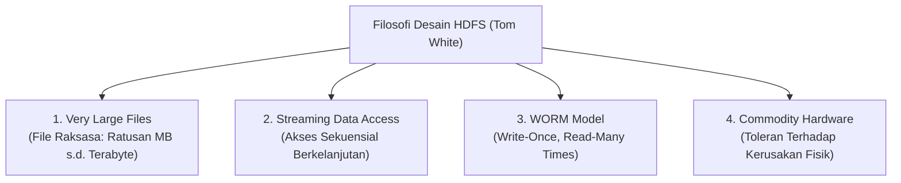
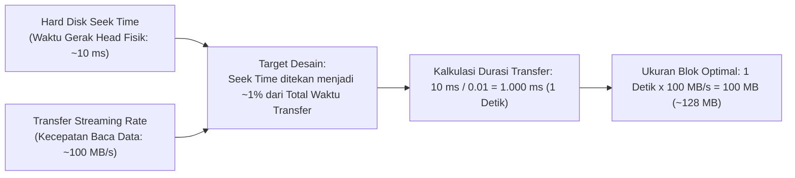
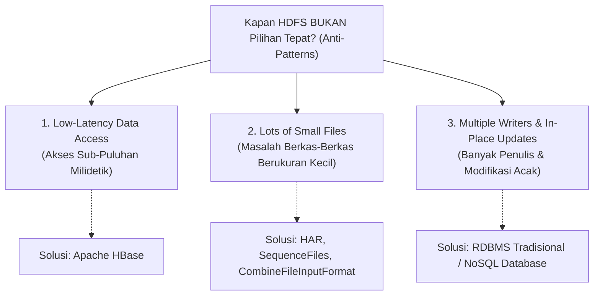

# 📦 04.3 Karakteristik & Filosofi Desain HDFS (WORM, 128 MB Block, Anti-Patterns)

> [!ABSTRACT] Ringkasan Sub-Materi
> Menelaah secara mendalam filosofi perancangan *Hadoop Distributed File System* (HDFS) berdasarkan rujukan otoritatif buku teks *Hadoop: The Definitive Guide* karya Tom White. Sub-materi ini mengupas model akses data **WORM** (*Write-Once, Read-Many*), **justifikasi matematis ukuran blok 128 MB**, fenomena **Small Files Problem**, tiga kondisi di mana HDFS **BUKAN** pilihan yang tepat (*Anti-Patterns*), kisi-kisi ujian, dan panduan jawaban esai.

---

## 1. Filosofi Desain HDFS (*Hadoop: The Definitive Guide*)

Tom White merumuskan bahwa HDFS dirancang dengan asumsi beban kerja (*workload assumptions*) yang sangat spesifik:

1. **Very Large Files (Berkas Sangat Besar)**:
   - HDFS ditujukan untuk mengelola berkas berukuran ratusan Megabyte, Gigabyte, hingga Petabyte. Kluster Hadoop modern mampu menyimpan jutaan berkas raksasa melintasi ribuan server.
2. **Streaming Data Access (Akses Aliran Berkelanjutan)**:
   - Pola akses data didasarkan pada prinsip: *"Lebih penting memiliki throughput transfer data yang tinggi dan konsisten daripada latensi baca instan"*.
   - HDFS dioptimalkan untuk kueri pemindaian batch (*batch processing scans*), bukan pembacaan acak satu baris (*random point queries*).
3. **Write-Once, Read-Many (WORM)**:
   - Pola hidup berkas di HDFS: berkas dibuat, ditulis satu kali dari awal hingga akhir, ditutup, dan selanjutnya dibaca berulang-ulang oleh ribuan pekerjaan analitik.
   - **Operasi yang Diizinkan**: Penambahan data baru hanya diizinkan di bagian akhir berkas (*append-only*).
   - **Operasi yang Dilarang**: Modifikasi data di sembarang posisi di tengah-tengah berkas (*arbitrary modifications / in-place updates*) secara arsitektural **TIDAK DIDUKUNG**.
   - HDFS juga hanya mendukung **Single Writer** (tidak boleh ada dua klien menulis ke satu berkas yang sama secara bersamaan).

---

## 2. Justifikasi Matematis Ukuran Blok HDFS (128 MB)

Pada sistem berkas sistem operasi standar (seperti ext4 di Linux atau NTFS di Windows), ukuran blok fisik berkisar antara **4 KB hingga 8 KB**. Sebaliknya, pada HDFS, ukuran blok default adalah **128 MB** (atau 256 MB pada kluster modern).

Mengapa ukuran blok HDFS dibuat sedemikian raksasa? Tom White memberikan pembuktian matematis berbasis karakteristik perangkat keras disk magnetik:

### Penjelasan Matematis:
1. Hard disk drive mekanik memiliki waktu tunda fisik (*seek time*) $\approx 10\text{ ms}$ untuk menggerakkan lengan pembaca ke sektor track yang tepat.
2. Kecepatan transfer data sekuensial (*streaming transfer rate*) hard disk modern adalah $\approx 100\text{ MB/s}$.
3. Agar pembacaan data efisien, para perancang Hadoop menetapkan target bahwa **waktu pencarian fisik (*seek time*) tidak boleh menyita lebih dari $\approx 1\%$ dari total waktu transfer data**.
4. Rumus kalkulasi waktu transfer minimum yang dibutuhkan:
   $$\text{Waktu Transfer} = \frac{\text{Seek Time}}{1\%} = \frac{10\text{ ms}}{0{,}01} = 1.000\text{ ms} = 1\text{ detik}$$
5. Ukuran blok data fisik yang ditransfer dalam 1 detik tersebut:
   $$\text{Ukuran Blok} = 1\text{ detik} \times 100\text{ MB/s} = 100\text{ MB} \approx \mathbf{128\text{ MB}}\text{ (dibulatkan ke basis } 2^7\text{)}$$

### Analisis Dampak Ukuran Blok:
- **Jika Blok Terlalu Kecil (misal 64 KB)**: Hard disk akan menghabiskan terlalu banyak waktu untuk memindahkan lengan mekanik (*disk seeking*), menyebabkan throughput anjlok drastis. Selain itu, RAM NameNode akan langsung kehabisan memori karena harus memetakan miliaran blok kecil.
- **Jika Blok Terlalu Besar (misal 50 GB)**: Jumlah blok menjadi terlalu sedikit, sehingga mengurangi derajat paralelisme kluster (jumlah tugas Mapper yang berjalan paralel menjadi sedikit, banyak core CPU pekerja menganggur / *idle*).

---

## 3. 3 Skenario HDFS BUKAN Pilihan yang Tepat (*Anti-Patterns*)

Buku teks *Hadoop: The Definitive Guide* menegaskan bahwa ada 3 kasus di mana HDFS **sama sekali tidak cocok digunakan**:

### 1. Low-Latency Data Access (Akses Data Latensi Rendah)
- **Masalah**: Aplikasi yang menuntut waktu respon instan dalam orde sub-puluhan milidetik (misal kueri saldo ATM perbankan, portal pencarian pengguna real-time).
- **Alasan HDFS Gagal**: HDFS dioptimalkan untuk *high throughput of streaming data*, yang mengorbankan waktu latensi awal (*latency penalty*).
- **Solusi Tepat**: Gunakan basis data NoSQL terdistribusi seperti **Apache HBase** atau **Apache Cassandra**.

### 2. Lots of Small Files (Masalah Berkas-Berkas Kecil)
- **Masalah**: Menyimpan jutaan berkas yang masing-masing berukuran hanya beberapa Kilobyte (misal jutaan foto avatar 10 KB atau log sensor per detik).
- **Alasan HDFS Gagal (The Small Files Problem)**:
  - NameNode menyimpan seluruh metadata sistem berkas di dalam memori RAM.
  - Aturan mutlak: **Setiap berkas, direktori, dan blok menyita $\approx 150\text{ byte}$ di RAM NameNode**.
  - *Perhitungan Bencana*: 10 juta file berukuran 10 KB menampung total data hanya $\approx 100\text{ GB}$. Namun di NameNode, metadata membutuhkan:
    $$10.000.000\text{ file} \times 150\text{ byte} = 1{,}5\text{ Gigabyte RAM Murni!}$$
  - Kapasitas RAM NameNode akan habis (*Out of Memory*) sebelum hard disk DataNode terisi bahkan 1%!
- **Solusi Tepat**:
  - Gunakan **Hadoop Archives (HAR)** untuk mengemas ribuan file kecil menjadi satu file arsip besar.
  - Gunakan **SequenceFile** (kombinasi pasangan Key-Value biner).
  - Gunakan **CombineFileInputFormat** pada MapReduce untuk menggabungkan beberapa file kecil ke dalam satu InputSplit.

### 3. Multiple Writers & Arbitrary File Modifications (Banyak Penulis & Modifikasi Acak)
- **Masalah**: Kebutuhan di mana banyak pengguna menulis ke satu berkas secara bersamaan, atau memodifikasi nilai data di baris tengah (*random updates*).
- **Alasan HDFS Gagal**: Berkas di HDFS bersifat WORM (*single-writer append-only*). HDFS tidak mengizinkan penulisan konkuren pada berkas yang sama dan tidak mendukung *update in-place*.
- **Solusi Tepat**: Gunakan RDBMS transaksional standar (PostgreSQL, MySQL) atau NoSQL database.

---

## 🎯 Hal-Hal yang Kemungkinan Besar Masuk Ujian

1. **Justifikasi Ukuran Blok 128 MB**:
   - Dosen sering menanyakan: *"Mengapa blok HDFS berukuran 128 MB dan bagaimana kaitannya dengan rasio seek time hard disk?"*  
   *Jawab*: Untuk menekan seek time disk (~10 ms) agar hanya mengambil porsi $\approx 1\%$ dari durasi transfer streaming data sekuensial (~100 MB/s).
2. **Karakteristik Model WORM**:
   - Tahu pasti apa yang boleh (*append-only*, single writer) dan apa yang dilarang (*in-place update*, multiple writers).
3. **The Small Files Problem**:
   - Memahami bahwa bottleneck berkas kecil terletak pada **RAM NameNode** (alokasi tetap ~150 byte per objek), bukan pada kapasitas hard disk DataNode.
4. **Anti-Patterns & Alternatifnya**:
   - Butuh latensi rendah $\to$ HBase.
   - Punya jutaan file kecil $\to$ HAR / SequenceFiles.

---

## 📋 Contoh Soal Ujian (Pilihan Ganda & Esai)

### Contoh Soal Pilihan Ganda
**Soal 1 (Justifikasi Matematis Ukuran Blok)**  
Mengapa ukuran blok default pada HDFS dikonfigurasi sebesar 128 MB, jauh lebih besar dibandingkan ukuran blok pada sistem berkas Linux biasa (4 KB)?  
A. Agar seluruh file di komputer dapat disimpan di dalam satu blok saja.  
B. Untuk meminimalkan biaya waktu pencarian fisik (*seek time*) pada piringan hard disk mekanik sehingga waktu pencarian hanya menyita sekitar 1% dari total waktu transfer data sekuensial.  
C. Karena memori RAM DataNode tidak dapat membaca blok yang lebih kecil dari 100 MB.  
D. Agar pengguna tidak dapat menghapus file yang telah dibuat.  
*Kunci Jawaban*: **B**  
*Pembahasan*: Penjelasan resmi buku teks Tom White membuktikan bahwa ukuran blok 128 MB membuat rasio seek time (10 ms) bernilai sekitar 1% terhadap waktu transfer data (1 detik pada 100 MB/s).

**Soal 2 (The Small Files Problem)**  
Sebuah kluster Hadoop mengalami kegagalan kehabisan memori (*OutOfMemoryError*) pada NameNode meskipun kapasitas penyimpanan disk pada seluruh DataNode masih tersisa 80%. Penyebab arsitektural yang paling mungkin dari kondisi ini adalah...  
A. DataNode tidak mengirimkan sinyal Heartbeat.  
B. Terjadi fenomena *Small Files Problem*, di mana kluster menyimpan puluhan juta berkas berukuran sangat kecil yang masing-masing menghabiskan memori RAM NameNode sebesar $\approx 150$ byte untuk metadata.  
C. Ukuran blok HDFS diubah menjadi 1 Gigabyte.  
D. Kluster kekurangan switch jaringan.  
*Kunci Jawaban*: **B**  
*Pembahasan*: Setiap berkas di HDFS menyita ~150 byte di RAM NameNode. Jumlah berkas kecil yang terlalu banyak akan menguras habis RAM NameNode terlepas dari masih banyaknya sisa kapasitas hard disk.

---

### Contoh Soal Esai
**Soal Esai**:  
Berdasarkan buku teks resmi *Hadoop: The Definitive Guide* karya Tom White, HDFS dirancang untuk skenario penyimpanan data tertentu dan memiliki batasan tegas di mana HDFS tidak cocok digunakan.  
a. Sebutkan dan jelaskan **3 skenario di mana HDFS BUKAN merupakan pilihan yang tepat (*Anti-Patterns*)**!  
b. Jelaskan konsep **"Small Files Problem"** pada HDFS, analisis mengapa masalah ini menjadi ancaman fatal bagi kelangsungan NameNode, dan berikan 2 solusi teknis yang dapat diterapkan untuk mengatasinya!

**Pedoman Jawaban Lengkap**:
1. **3 Skenario HDFS BUKAN Pilihan Tepat**:
   - **Low-Latency Data Access**: Aplikasi yang menuntut latensi akses dalam skala puluhan milidetik. HDFS dirancang untuk streaming throughput tinggi dan memiliki latensi awal yang tinggi. *Solusi*: Apache HBase.
   - **Lots of Small Files**: Menyimpan jutaan file kecil (berukuran beberapa kilobyte). Metadata setiap file membebani memori RAM NameNode secara konstan, menyebabkan pemborosan memori. *Solusi*: SequenceFiles atau Hadoop Archives (HAR).
   - **Multiple Writers and Arbitrary File Modifications**: Kebutuhan banyak pengguna menulis ke satu file secara konkuren atau melakukan modifikasi acak di tengah-tengah file. HDFS hanya mendukung *single-writer* dan *append-only*. *Solusi*: Basis data relasional atau NoSQL.
2. **Analisis "Small Files Problem" & Solusinya**:
   - **Penyebab & Ancaman Fatal**:
     - Setiap file, direktori, dan blok di HDFS direpresentasikan sebagai objek Java di dalam memori RAM NameNode yang menghabiskan memori konstan sekitar **150 byte**.
     - Jika sebuah sistem menyimpan 10 juta file dengan ukuran masing-masing 10 KB (total data fisik hanya 100 GB), NameNode harus mengalokasikan sekitar $10.000.000 \times 150\text{ byte} = 1{,}5\text{ GB}$ memori RAM murni untuk metadata.
     - Jika jumlah file mencapai ratusan juta, RAM NameNode akan mengalami kegagalan *Out-Of-Memory*, melumpuhkan seluruh kluster meskipun kapasitas hard disk DataNode masih sangat lapang.
   - **2 Solusi Teknis Mengatasi Small Files Problem**:
     1. **Hadoop Archives (HAR)**: Menggunakan utilitas `hadoop archive` untuk mengemas ribuan file kecil ke dalam satu file arsip besar berukuran gigabyte di HDFS, sehingga di RAM NameNode hanya tercatat sebagai satu file tunggal namun tetap dapat dibaca secara transparan oleh MapReduce.
     2. **SequenceFiles**: Menggabungkan file-file kecil menjadi satu file biner terstruktur yang berisi pasangan *Key-Value*, di mana *Key* adalah nama file/identitas dan *Value* adalah isi konten file tersebut.
     3. *(Alternatif)* **CombineFileInputFormat**: Menginstruksikan MapReduce untuk menggabungkan beberapa blok file kecil ke dalam satu *InputSplit* logis agar tidak memicu pembuatan ribuan Mapper JVM yang membebani kluster.

---

## 💡 Tips & Trik Menjawab Soal Ujian

1. **Jurus Angka Ajaib HDFS**:
   - Ukuran blok default = **128 MB**.
   - Konsumsi RAM NameNode per objek = **~150 byte**.
   - Rasio seek time disk target = **~1%**.
   - Seek time disk rata-rata = **10 ms**, Streaming rate = **100 MB/s**.
2. **Formula Menjawab Esai Anti-Pattern**:
   - Jangan hanya menyebutkan *"HDFS tidak cocok untuk file kecil"*, tetapi jelaskan **mengapa** (karena limitasi RAM NameNode 150 byte/objek) dan berikan **solusinya** (HBase, HAR, SequenceFile). Dosen memberi nilai sempurna jika Anda menyertakan solusi teknis.
