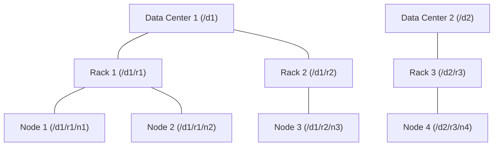
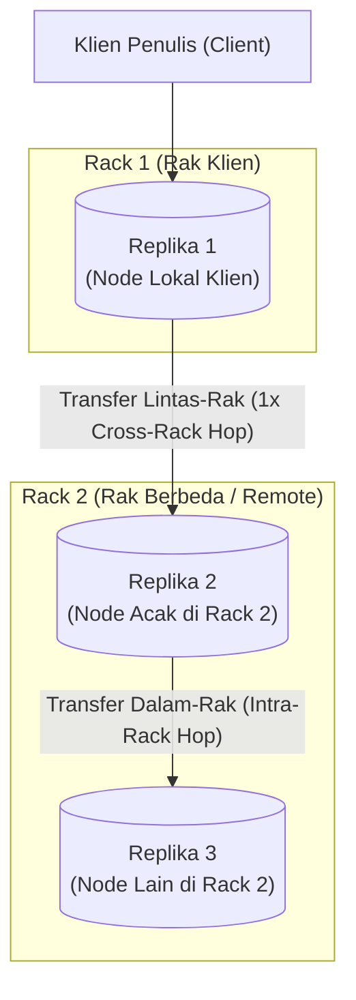

# 🌐 04.4 Replikasi Blok, Topologi Jaringan & Rack-Awareness

> [!ABSTRACT] Ringkasan Sub-Materi
> Menelaah secara mendalam mekanisme toleransi kesalahan HDFS melalui strategi replikasi blok data dan kesadaran topologi rak (*Rack-Awareness*) merujuk pada buku teks resmi *Hadoop: The Definitive Guide* karya Tom White. Sub-materi ini membahas **matematika jarak topologi jaringan ($d = 0, 2, 4, 6$)**, **algoritma penempatan 3 replika**, trade-off arsitektural antara keandalan sistem dan penghematan bandwidth, kisi-kisi ujian, dan panduan jawaban esai.

---

## 1. Konsep Dasar Replikasi Blok HDFS

Untuk menjamin ketersediaan data di atas komputer komoditas yang rentan rusak, HDFS membagi setiap file menjadi blok-blok berukuran 128 MB dan menggandakannya sebanyak **Faktor Replikasi (*Replication Factor*)**:
- Nilai default faktor replikasi adalah **3** (`dfs.replication = 3`).
- Artinya, setiap blok data fisik akan memiliki 3 salinan identik yang disebar ke 3 DataNode yang berbeda di seluruh kluster.

Namun, bagaimana cara Hadoop menentukan *di mana* ketiga salinan tersebut harus diletakkan? Hadoop tidak meletakkannya secara acak, melainkan menggunakan algoritma cerdas berbasis **Topologi Jaringan Kluster**.

---

## 2. Metrik Jarak Topologi Jaringan HDFS (Tom White)

Dalam kluster besar, node-node komputer dipasang pada rak-rak server (*racks*). Bandwidth jaringan antar-node di dalam rak yang sama jauh lebih besar dan memiliki latensi lebih rendah dibandingkan bandwidth antar-node yang berbeda rak (karena harus melewati *rack switch* utama).

Hadoop memodelkan topologi kluster sebagai sebuah **struktur pohon (*tree structure*)**:
$$\text{Data Center} \longrightarrow \text{Rack} \longrightarrow \text{DataNode}$$

Jarak jaringan (*network distance*) antara dua node dihitung dengan menjumlahkan jarak dari masing-masing node ke **leluhur bersama terdekat (*closest common ancestor*)**:

### Tabel Matriks Nilai Jarak Topologi ($d$):
| Kasus Hubungan Antar-Node | Leluhur Bersama Terdekat | Nilai Jarak ($d$) | Makna Fisik |
| :--- | :--- | :---: | :--- |
| **Node yang sama** (`/d1/r1/n1` dan `/d1/r1/n1`) | Node itu sendiri | **$d = 0$** | Proses lokal di mesin yang sama (Sangat cepat / memori/disk lokal) |
| **Node berbeda di Rak yang sama** (`n1` dan `n2`) | Rack 1 (`/d1/r1`) | **$d = 2$** | Komunikasi melalui switch rak lokal (Bandwidth sangat tinggi) |
| **Node di Rak berbeda, Data Center sama** (`n1` dan `n3`) | Data Center 1 (`/d1`) | **$d = 4$** | Komunikasi melewati switch inti data center (*cross-rack*) |
| **Node di Data Center berbeda** (`n1` dan `n4`) | Root (Akar) | **$d = 6$** | Komunikasi antar data center melintasi kabel WAN (Paling lambat) |

---

## 3. Kebijakan Penempatan Replika (*Rack-Aware Replica Placement Policy*)

Bagaimana HDFS menempatkan 3 replika dari satu blok data? Tom White merumuskan aturan default penempatan replika (*Block Placement Strategy*):

### Aturan Baku Penempatan 3 Replika:
1. **Replika 1**:
   - Diletakkan di **DataNode tempat klien sedang berjalan** (jika klien berada di luar kluster, dipilih satu node acak dengan kapasitas penyimpanan yang masih sehat).
2. **Replika 2**:
   - Diletakkan di sebuah DataNode pada **Rak yang berbeda (Rack 2)** yang dipilih secara acak.
3. **Replika 3**:
   - Diletakkan di sebuah DataNode **berbeda tetapi berada di Rak yang SAMA dengan Replika 2 (Rack 2)**.
4. **Replika Tambahan (jika faktor replikasi > 3)**:
   - Ditempatkan pada node acak di seluruh kluster dengan aturan ketat: tidak boleh ada lebih dari 2 replika di rak yang sama jika jumlah rak mencukupi.

---

## 4. Analisis Filosofis & Trade-Off Arsitektural

Dosen sering menguji: *"Mengapa Hadoop tidak menaruh ketiga replika pada 3 rak yang berbeda saja untuk keamanan maksimal?"*

Tom White menjelaskan bahwa strategi Hadoop adalah titik temu paling elegan (*optimal compromise*) antara **Keandalan Sistem (*Reliability*)** dan **Efisiensi Bandwidth Jaringan (*Write Bandwidth Efficiency*)**:

1. **Proteksi Kegagalan Rak (*Rack Failure Protection*)**:
   - Kerusakan switch rak (*rack switch failure*) atau pemadaman listrik rak dapat melumpuhkan seluruh server di dalam satu rak.
   - Karena Replika 1 berada di Rak 1, sedangkan Replika 2 dan 3 berada di Rak 2, maka jika salah satu rak terbakar/padam total, **data dijamin tidak akan pernah hilang** karena selalu ada salinan yang selamat di rak lainnya.
2. **Penghematan Bandwidth Penulisan Jaringan (*Write Bandwidth Optimization*)**:
   - Jika 3 replika disebar ke 3 rak berbeda (Rak 1, Rak 2, Rak 3), aliran data penulisan pipa (*pipeline write*) harus menyeberangi switch antar-rak sebanyak **dua kali** (Rak 1 $\to$ Rak 2 $\to$ Rak 3).
   - Dengan menempatkan Replika 2 dan Replika 3 di rak yang sama (Rak 2), aliran penulisan hanya perlu menyeberangi switch antar-rak **satu kali saja** (Rak 1 $\to$ Rak 2). Replikasi dari Replika 2 ke Replika 3 berjalan di switch lokal rak yang cepat dan tidak membebani switch tulang punggung (*core network switch*).

---

## 🎯 Hal-Hal yang Kemungkinan Besar Masuk Ujian

1. **Perhitungan Metrik Jarak Jaringan HDFS**:
   - Hafalkan rumus nilainya:
     - Node yang sama = **0**.
     - Rak yang sama = **2**.
     - Rak berbeda (DC sama) = **4**.
     - Data center berbeda = **6**.
2. **Pola Penempatan 3 Replika**:
   - Replika 1 di node lokal.
   - Replika 2 di rak berbeda.
   - Replika 3 di rak yang sama dengan replika kedua (pada node berbeda).
3. **Alasan Trade-Off Arsitektural**:
   - Menyeimbangkan antara proteksi terhadap kegagalan total satu rak (*rack fault tolerance*) dan meminimalkan transfer lintas-rak menjadi hanya 1 kali penyeberangan (*one cross-rack hop*).

---

## 📋 Contoh Soal Ujian (Pilihan Ganda & Esai)

### Contoh Soal Pilihan Ganda
**Soal 1 (Kalkulasi Jarak Jaringan HDFS)**  
Berdasarkan metrik jarak topologi jaringan pada buku teks *Hadoop: The Definitive Guide*, jarak jaringan antara Node `/dc1/rack1/node1` dan Node `/dc1/rack2/node3` adalah...  
A. 0  
B. 2  
C. 4  
D. 6  
*Kunci Jawaban*: **C**  
*Pembahasan*: Kedua node berada pada rak yang berbeda (`rack1` vs `rack2`), namun masih berada di dalam data center yang sama (`dc1`). Leluhur bersama terdekat adalah `/dc1`. Jarak dari `node1` ke `/dc1` adalah 2 tingkat, dan jarak dari `/dc1` ke `node3` adalah 2 tingkat. Total jarak = $2 + 2 = 4$.

**Soal 2 (Strategi Penempatan Replika Ketiga)**  
Dalam kebijakan standar penempatan replika HDFS (*Rack-Aware Placement Policy*), di manakah replika ketiga dari sebuah blok data ditempatkan jika replika pertama berada di Rak A dan replika kedua berada di Rak B?  
A. Di sebuah node acak pada Rak A.  
B. Di sebuah node yang berbeda tetapi berada pada Rak B (rak yang sama dengan replika kedua).  
C. Wajib ditempatkan pada Rak C yang baru.  
D. Di dalam memori RAM NameNode.  
*Kunci Jawaban*: **B**  
*Pembahasan*: Aturan resmi penempatan HDFS menempatkan replika ke-3 pada rak yang sama dengan replika ke-2 (pada node fisik yang berbeda) untuk menghemat bandwidth penulisan jaringan lintas-rak.

---

### Contoh Soal Esai
**Soal Esai**:  
Sebuah kluster Hadoop perusahaan telekomunikasi terdiri dari 3 rak server: `Rack_A`, `Rack_B`, dan `Rack_C` di dalam satu data center. Sebuah aplikasi klien yang berjalan pada server di `Rack_A` menulis sebuah berkas besar dengan faktor replikasi default 3 ke HDFS.  
a. Uraikan di rak dan node mana saja ketiga replika dari blok berkas tersebut akan ditempatkan menurut kebijakan *Rack-Awareness* Hadoop!  
b. Jelaskan secara teknis mengapa Hadoop memilih untuk meletakkan replika ketiga pada rak yang sama dengan replika kedua, bukan meletakkannya di `Rack_C`! Apa konsekuensi terhadap keandalan sistem dan efisiensi jaringan dari keputusan desain tersebut?

**Pedoman Jawaban Lengkap**:
1. **Penempatan Ketiga Replika**:
   - **Replika 1**: Ditempatkan di DataNode lokal pada `Rack_A` tempat aplikasi klien sedang berjalan.
   - **Replika 2**: Ditempatkan di salah satu DataNode pada rak yang berbeda, misalnya `Rack_B` (dipilih secara acak).
   - **Replika 3**: Ditempatkan di DataNode yang berbeda dari Replika 2, namun **tetap berada di dalam `Rack_B`** (rak yang sama dengan Replika 2).
2. **Justifikasi Keputusan Desain & Konsekuensi Arsitektural**:
   - **Alasan Tidak Meletakkan di `Rack_C`**:
     - Jika Replika 3 diletakkan di `Rack_C`, proses pengiriman data pipa penulisan (*write pipeline*) harus menyeberangi switch antar-rak sebanyak **dua kali**: dari `Rack_A` menyeberang ke `Rack_B`, kemudian dari `Rack_B` menyeberang lagi ke `Rack_C`.
     - Hal ini akan melipatgandakan beban lalu lintas jaringan pada switch tulang punggung (*core network switch*), yang merupakan sumber daya paling langka di kluster.
   - **Konsekuensi terhadap Efisiensi Jaringan**:
     - Dengan menaruh Replika 2 dan 3 di `Rack_B`, lalu lintas data antar-rak hanya terjadi **satu kali** (dari `Rack_A` ke `Rack_B`). Replikasi dari DataNode Replika 2 ke DataNode Replika 3 berlangsung di dalam switch lokal `Rack_B` yang sangat cepat dan tidak membebani jaringan kluster utama.
   - **Konsekuensi terhadap Keandalan Sistem**:
     - Sistem tetap terlindungi dari kegagalan rak tunggal (*Single Rack Failure*). Jika seluruh switch `Rack_A` atau `Rack_B` terbakar/padam listrik total, data tidak akan hilang karena selalu ada salinan blok yang bertahan di rak lainnya. Satu-satunya skenario di mana data hilang adalah jika kedua rak (`Rack_A` dan `Rack_B`) hancur secara bersamaan, yang probabilitas statistiknya sangat mendekati nol.

---

## 💡 Tips & Trik Menjawab Soal Ujian

1. **Jurus Kilat Menghitung Jarak Topologi**:
   - Sama persis mesinnya? $\to$ **0**.
   - Beda mesin, nama rak sama? $\to$ **2**.
   - Beda nama rak, nama DC sama? $\to$ **4**.
   - Beda nama DC? $\to$ **6**.
2. **Skema Hafalan Penempatan Replika**:
   - Ingat pola: **1 di Rak Sendiri, 2 di Rak Seberang**.
