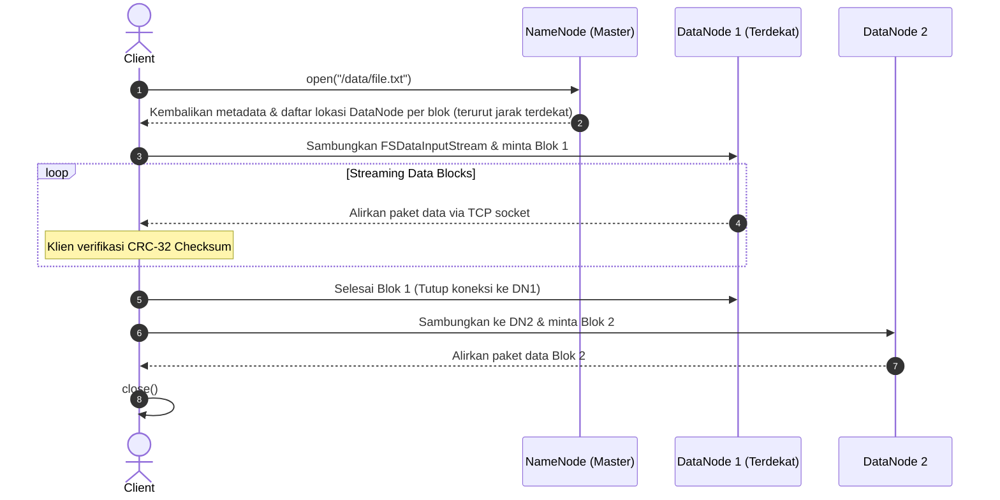
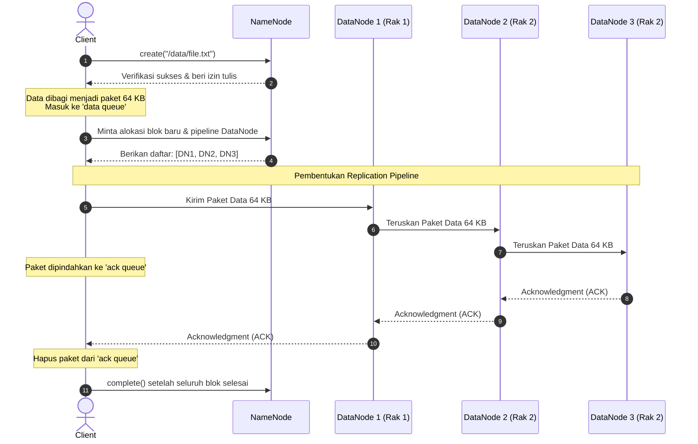
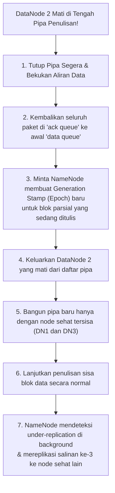

# 🔁 04.5 Mekanisme Detail HDFS Read Path & Write Path

> [!ABSTRACT] Ringkasan Sub-Materi
> Menelaah secara mendalam siklus hidup aliran data (*data flow*) saat klien membaca dan menulis berkas di HDFS berdasarkan buku teks resmi *Hadoop: The Definitive Guide* karya Tom White. Sub-materi ini membahas protokol interaksi klien dengan NameNode dan DataNode, struktur internal antrean data (`data queue` dan `ack queue`), paket transmisi 64 KB, mekanisme pemulihan kegagalan pipa (*Pipeline Failure Recovery*) dengan *Generation Stamp*, kisi-kisi ujian, dan panduan jawaban esai.

---

## 1. Anatomi Alur Pembacaan Berkas (HDFS Read Path)

Alur pembacaan data dirancang agar NameNode tidak pernah menjadi bottleneck transfer data. Klien hanya meminta peta lokasi blok ke NameNode, lalu **mengalirkan data fisik secara langsung dari DataNode**:

### Langkah-Langkah Detail Read Path:
1. **Inisialisasi**: Klien membuka berkas dengan memanggil method `open()` pada objek `DistributedFileSystem`.
2. **Pengambilan Lokasi Blok**: `DistributedFileSystem` melakukan panggilan RPC (*Remote Procedure Call*) ke **NameNode** untuk meminta lokasi blok-blok pertama dari berkas tersebut.
3. **Penyortiran Jarak Topologi**: Untuk setiap blok, NameNode mengembalikan alamat DataNode yang memiliki salinan replika blok tersebut, **diurutkan berdasarkan jarak topologi jaringan yang paling dekat dengan klien** ($d = 0$ didahulukan).
4. **Aliran Data Langsung**: Klien menerima objek pembaca `FSDataInputStream` (yang membungkus `DFSInputStream`). Objek ini langsung menghubungi **DataNode terdekat** melalui soket TCP dan memanggil method `read()`. Data dialirkan secara *streaming* langsung dari DataNode ke klien tanpa melewati NameNode.
5. **Verifikasi Integritas Data (Checksum)**: Saat data mengalir, `DFSInputStream` secara otomatis memverifikasi nilai *checksum* (CRC-32) untuk setiap 512 byte data. Jika ditemukan data korup, klien melaporkan blok rusak ke NameNode dan secara otomatis beralih membaca replika dari DataNode alternatif.
6. **Perpindahan Antar-Blok**: Saat pembacaan satu blok 128 MB selesai, koneksi ke DataNode tersebut ditutup, dan `DFSInputStream` menyambung ke DataNode berikutnya untuk membaca blok selanjutnya secara transparan hingga berkas selesai dibaca.

---

## 2. Anatomi Alur Penulisan Berkas (HDFS Write Path)

Proses penulisan berkas baru ke HDFS melibatkan koordinasi ketat antara klien, NameNode, dan pembentukan **pipa penulisan (*replication pipeline*)** antar-DataNode:

### Langkah-Langkah Detail Write Path:
1. **Permintaan Pembuatan File**: Klien memanggil method `create()` pada `DistributedFileSystem`.
2. **Pengecekan Otoritas oleh NameNode**: `DistributedFileSystem` melakukan RPC ke NameNode untuk memeriksa apakah klien memiliki izin tulis dan memastikan file tersebut belum pernah dibuat sebelumnya. Jika lolos, NameNode mencatat transaksi pembuatan file baru di `EditLog`.
3. **Persiapan Streaming Klien**: Klien menerima objek `FSDataOutputStream` (yang membungkus `DFSOutputStream`). Data yang akan ditulis oleh klien dipecah menjadi **paket-paket kecil berukuran 64 KB**.
4. **Antrean Data (`data queue`)**: Paket-paket 64 KB tersebut pertama kali ditampung di dalam memori lokal bernama **`data queue`**.
5. **Alokasi Pipa Replikasi (*Replication Pipeline*)**:
   - Sebuah background thread internal bernama **`DataStreamer`** mengambil paket dari `data queue` dan meminta NameNode mengalokasikan blok baru.
   - NameNode memilih daftar 3 DataNode yang memenuhi aturan *Rack-Awareness* (misal: `[DataNode_1, DataNode_2, DataNode_3]`) untuk membentuk **pipa replikasi (*pipeline*)**.
6. **Streaming Paket Melintasi Pipa**:
   - Klien mengalirkan paket 64 KB ke `DataNode_1`.
   - `DataNode_1` menyimpan paket di disk lokalnya dan **secara simultan meneruskannya** ke `DataNode_2`.
   - `DataNode_2` menyimpan dan meneruskannya ke `DataNode_3`.
7. **Antrean Konfirmasi (`ack queue`)**:
   - Saat paket dialirkan ke pipa, salinan paket dipindahkan dari `data queue` ke **`ack queue`**.
   - Paket baru akan dihapus permanen dari `ack queue` **hanya jika** konfirmasi (*acknowledgment packet*) telah berhasil mengalir balik dari `DataNode_3` $\to$ `DataNode_2` $\to$ `DataNode_1` $\to$ Klien.
8. **Penutupan File**: Setelah seluruh data selesai dialirkan, klien memanggil `close()`, dan `DFSOutputStream` menghubungi NameNode melalui RPC `complete()` untuk memberi tahu bahwa seluruh blok berkas telah sukses ditulis dan direplikasi.

---

## 3. Penanganan Kegagalan Pipa (*Pipeline Failure Recovery*)

Pertanyaan tingkat tinggi pada ujian: *"Apa yang terjadi jika salah satu DataNode di tengah pipa mati saat klien sedang aktif mengalirkan paket data?"*

Tom White menguraikan mekanisme pemulihan otomatis tanpa henti (*seamless recovery*) sebagai berikut:

### Rincian Tahapan Pemulihan:
1. **Pipa Ditutup**: Aliran transmisi data langsung dibekukan seketika.
2. **Re-queue Paket**: Seluruh paket yang ada di dalam `ack queue` (paket yang belum sempat dikonfirmasi sukses oleh ketiga node) dikembalikan ke posisi paling depan pada `data queue` agar tidak ada data yang hilang.
3. **Pemberian Generation Stamp Baru**: Klien meminta NameNode membuat **stempel generasi (*Generation Stamp*)** baru untuk blok parsial tersebut. Hal ini penting agar jika DataNode yang mati tadi hidup kembali, blok parsialnya yang usang dapat dideteksi dan dihapus.
4. **Pengecualian Node Rusak**: DataNode yang rusak dikeluarkan dari daftar pipa.
5. **Pembentukan Pipa Baru**: Pipa dibangun kembali hanya menggunakan sisa node yang sehat (misal `DataNode_1` dan `DataNode_3`).
6. **Pelanjutan Penulisan**: Sisa paket data dialirkan kembali melalui pipa baru yang sehat hingga blok selesai.
7. **Re-Replikasi di Latar Belakang**: Ketika blok ditutup, NameNode menyadari bahwa blok tersebut hanya memiliki 2 replika (*under-replicated*). NameNode secara asinkron memerintahkan replikasi tambahan ke DataNode sehat lainnya agar faktor replikasi kembali menjadi 3. Klien tidak pernah merasakan adanya kegagalan program!

---

## 4. Model Koherensi HDFS: `hflush` vs `hsync`

HDFS mengelola visibilitas data yang sedang ditulis menggunakan dua metode:
- **`hflush()`**: Memaksa seluruh buffer klien dikosongkan dan dialirkan ke semua DataNode di dalam pipa penulisan. Begitu `hflush()` selesai, pembaca (*readers*) lain di kluster dijamin sudah dapat melihat data baru tersebut secara instan. Namun, data masih berada di *OS page cache* DataNode (belum tentu tertulis permanen di piringan magnetik fisik).
- **`hsync()`**: Tidak hanya melakukan `hflush()`, tetapi juga memicu operasi sistem operasi `fsync()` pada seluruh DataNode untuk memastikan data benar-benar telah **tertulis secara permanen ke media fisik disk**. Operasi ini jauh lebih aman terhadap pemadaman listrik tiba-tiba, namun memakan biaya latensi I/O yang lebih tinggi.

---

## 🎯 Hal-Hal yang Kemungkinan Besar Masuk Ujian

1. **Peran NameNode pada Read Path**:
   - NameNode **TIDAK PERNAH mengalirkan data file**. NameNode hanya mengembalikan daftar alamat DataNode yang memegang blok data, diurutkan berdasarkan jarak topologi terdekat. Data fisik dibaca langsung dari DataNode.
2. **Ukuran Paket Transmisi**:
   - Blok HDFS = **128 MB**. Paket transmisi streaming pipa = **64 KB**. Chunk checksum = **512 byte**. Jangan sampai tertukar ketiga angka ini!
3. **Fungsi `data queue` vs `ack queue`**:
   - `data queue` menampung paket yang *akan dikirim*.
   - `ack queue` menampung paket yang *sedang menunggu konfirmasi dari ketiga DataNode*.
4. **Penanganan Kegagalan Pipa Penulisan**:
   - Kata kunci: **Generation Stamp baru**, paket yang belum di-ack dikembalikan ke antrean, node mati dikeluarkan, dan re-replikasi otomatis di latar belakang oleh NameNode.

---

## 📋 Contoh Soal Ujian (Pilihan Ganda & Esai)

### Contoh Soal Pilihan Ganda
**Soal 1 (Alur Pembacaan Data HDFS)**  
Mengapa arsitektur HDFS tidak mengalirkan data berkas melalui NameNode saat klien melakukan operasi pembacaan (*Read*), melainkan menginstruksikan klien untuk membaca langsung dari DataNode?  
A. Karena NameNode tidak memiliki kartu jaringan (network interface).  
B. Untuk mencegah NameNode menjadi titik kemacetan transmisi (*network bottleneck*) seiring bertambahnya jumlah klien yang membaca ribuan berkas raksasa secara konkuren.  
C. Karena NameNode hanya boleh memproses instruksi penulisan (*Write*).  
D. Karena data di DataNode dienkripsi dan hanya klien yang memiliki kuncinya.  
*Kunci Jawaban*: **B**  
*Pembahasan*: Jika data ratusan Terabyte harus mengalir melewati NameNode, switch jaringan NameNode akan segera lumpuh. NameNode hanya bertindak sebagai direktori penunjuk jalan, sementara beban I/O disebar ke ribuan DataNode.

**Soal 2 (Peranan Ack Queue)**  
Dalam proses penulisan berkas HDFS (*Write Path*), kapankah sebuah paket data berukuran 64 KB dihapus dari antrean konfirmasi (*ack queue*) pada memori klien?  
A. Segera setelah paket tersebut dikirimkan ke kabel jaringan DataNode pertama.  
B. Setelah paket tersebut berhasil ditulis ke disk lokal klien.  
C. Hanya setelah sinyal konfirmasi (ACK) telah mengalir balik dari seluruh DataNode di dalam pipa replikasi (*pipeline*) yang menandakan paket sukses disimpan oleh semua replika.  
D. Setelah berkas ditutup 24 jam kemudian.  
*Kunci Jawaban*: **C**  
*Pembahasan*: `ack queue` menyimpan paket hingga seluruh node dalam pipeline (default 3 node) mengirimkan pengakuan sukses (ACK). Hal ini menjamin paket dapat dikirim ulang jika terjadi kegagalan transmisi di tengah jalan.

---

### Contoh Soal Esai
**Soal Esai**:  
Gambarkan diagram alir dan jelaskan secara rinci proses yang terjadi pada **HDFS Write Path** saat sebuah aplikasi klien menulis sebuah berkas baru sebesar 256 MB dengan faktor replikasi 3 ke dalam sistem berkas HDFS! Jelaskan pula apa yang dilakukan oleh sistem Hadoop apabila salah satu DataNode di dalam pipa replikasi tiba-tiba mati saat transmisi data sedang berlangsung!

**Pedoman Jawaban Lengkap**:
1. **Diagram & Alur HDFS Write Path**:
   - *Langkah 1*: Klien memanggil `DistributedFileSystem.create()`. NameNode memeriksa izin akses dan mencatat entri file baru di `EditLog`.
   - *Langkah 2*: Klien menerima `FSDataOutputStream`. Berkas 256 MB dipecah menjadi 2 blok HDFS (masing-masing 128 MB). Di level transmisi klien, data dipecah menjadi paket-paket kecil 64 KB yang ditampung di `data queue`.
   - *Langkah 3*: Background thread `DataStreamer` meminta NameNode mengalokasikan blok pertama dan memilih 3 DataNode yang memenuhi aturan *Rack-Awareness* (misal DN1 di Rak 1, DN2 dan DN3 di Rak 2) untuk membentuk *Replication Pipeline*.
   - *Langkah 4*: Klien mengalirkan paket 64 KB ke DN1 $\to$ DN1 meneruskan ke DN2 $\to$ DN2 meneruskan ke DN3. Paket yang sedang berjalan dipindahkan ke `ack queue`.
   - *Langkah 5*: Sinyal ACK mengalir balik dari DN3 $\to$ DN2 $\to$ DN1 $\to$ Klien. Setelah ACK lengkap, paket dibersihkan dari `ack queue`.
   - *Langkah 6*: Proses diulang untuk blok kedua (128 MB berikutnya) dengan pipa DataNode baru yang dialokasikan oleh NameNode.
   - *Langkah 7*: Klien memanggil `close()` dan NameNode memvalidasi status blok berkas melalui RPC `complete()`.
2. **Penanganan Kegagalan DataNode di Tengah Pipa Penulisan**:
   - Jika DN2 tiba-tiba mati saat penulisan:
     1. Pipa penulisan langsung ditutup oleh klien untuk mencegah korupsi transmisi.
     2. Seluruh paket di `ack queue` yang belum menerima konfirmasi sukses dikembalikan ke urutan paling depan di `data queue`.
     3. Klien meminta NameNode membuat **Generation Stamp baru** untuk blok parsial yang sedang ditulis agar blok yang belum tuntas di DN2 yang mati tidak akan pernah dianggap valid di masa depan.
     4. DN2 yang mati dikeluarkan dari daftar pipa.
     5. Pipa baru dibentuk kembali menggunakan sisa DataNode yang masih hidup (DN1 dan DN3).
     6. Sisa paket data dari `data queue` dialirkan kembali melalui pipa baru tersebut hingga penulisan blok tuntas.
     7. Setelah penulisan selesai, NameNode mencatat bahwa blok tersebut saat ini berstatus *under-replicated* (hanya memiliki 2 salinan) dan secara asinkron di latar belakang mereplikasi salinan ketiga ke DataNode sehat lainnya di kluster.

---

## 💡 Tips & Trik Menjawab Soal Ujian

1. **Jurus Kata Kunci Write Path**:
   - `DataStreamer` $\to$ Thread yang mengelola pengiriman paket.
   - `data queue` $\to$ Antrean paket siap kirim.
   - `ack queue` $\to$ Antrean paket menunggu konfirmasi ACK.
   - Paket ukuran **64 KB**.
   - **Generation Stamp** $\to$ Stempel versi untuk membatalkan blok dari node gagal.
2. **Tips Menjawab Soal Read Path**:
   - Selalu tekankan kata kunci: **"NameNode hanya memberikan peta lokasi blok yang diurutkan berdasarkan jarak topologi terdekat; pembacaan fisik data dilakukan langsung dari DataNode ke Klien"**.
