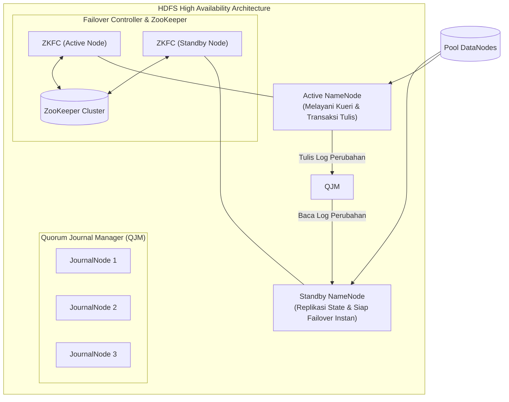
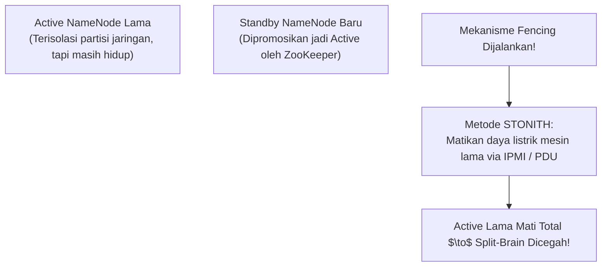
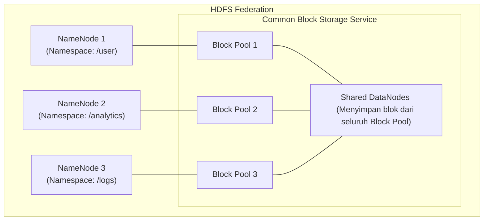

# 🛡️ 04.6 Enterprise HDFS (High Availability, QJM, Federation, Block Caching)

> [!ABSTRACT] Ringkasan Sub-Materi
> Menelaah fitur-fitur tingkat perusahaan (*Enterprise Features*) pada HDFS modern merujuk pada buku teks resmi *Hadoop: The Definitive Guide* karya Tom White. Sub-materi ini membahas penghapusan titik kegagalan tunggal melalui **HDFS High Availability (HA)**, sinkronisasi **Quorum Journal Manager (QJM)**, pencegahan bencana **Split-Brain** dengan teknik **Fencing**, perluasan namespace via **HDFS Federation**, dan optimalisasi performa melalui **Block Caching**.

---

## 1. Masalah Keterbatasan Single NameNode (SPOF)

Pada arsitektur Hadoop 1.x klasik, kluster hanya memiliki **tepat satu NameNode**:
- Jika mesin server NameNode mati (mati lampu, kerusakan CPU, atau sistem operasi crash), **seluruh kluster Hadoop langsung lumpuh total** (*Single Point of Failure - SPOF*).
- Klien tidak dapat membaca maupun menulis berkas karena peta blok tidak tersedia.
- Waktu pemulihan (*Mean Time to Recovery - MTTR*) memakan waktu puluhan menit hingga berjam-jam karena administrator harus menyiapkan server baru, memuat `FsImage`, dan memutar ulang transaksi `EditLog` yang panjang.

---

## 2. Arsitektur HDFS High Availability (HA)

Untuk menghilangkan SPOF, Hadoop 2.x memperkenalkan arsitektur **HDFS High Availability** yang menjalankan **sepasang NameNode: Active NameNode dan Standby NameNode**:

### A. Active vs Standby NameNode
- **Active NameNode**: Bertanggung jawab melayani seluruh permintaan pembacaan dan penulisan dari klien aplikasi. Setiap perubahan metadata dicatat ke *shared storage*.
- **Standby NameNode**: Bertindak sebagai cadangan aktif (*hot standby*). Terus-menerus menyinkronkan status memorinya dengan membaca perubahan dari *shared storage*, dan menjaga pemetaan blok data terbaru. Jika Active NameNode mati, Standby dapat langsung dipromosikan menjadi Active dalam hitungan detik (*instant failover*).
- **Peran DataNode**: Seluruh DataNode di kluster dikonfigurasi untuk mengirimkan *Heartbeat* dan *Block Report* ke **KEDUA NameNode secara bersamaan**.

### B. Quorum Journal Manager (QJM)
Bagaimana Active dan Standby NameNode saling bertukar transaksi `EditLog` secara konsisten tanpa SPOF baru? Solusi standar Hadoop adalah **Quorum Journal Manager (QJM)**:
- Terdiri dari sekelompok proses daemon ringan bernama **JournalNodes** (biasanya berjumlah ganjil: 3 atau 5 node).
- **Aturan Kuorum Mayoritas**: Setiap transaksi penulisan `EditLog` oleh Active NameNode dinyatakan sukses **hanya jika berhasil ditulis ke mayoritas JournalNode** ($\lfloor N/2 \rfloor + 1$).
  - Pada kluster dengan 3 JournalNode, transaksi membutuhkan persetujuan minimal **2 node**. Sistem dapat menoleransi kegagalan 1 JournalNode.
  - Pada kluster dengan 5 JournalNode, transaksi membutuhkan persetujuan minimal **3 node**. Sistem dapat menoleransi kegagalan 2 JournalNode.

---

## 3. Bahaya Bencana Split-Brain & Mekanisme Fencing

> [!CAUTION] Konsep Kritis Ujian: Skenario Split-Brain
> **Split-Brain** adalah kondisi bencana di mana akibat adanya gangguan partisi jaringan (*network partition*), Active NameNode lama dan Standby NameNode yang baru dipromosikan **sama-sama menganggap dirinya sebagai Active NameNode yang sah**.  
> Keduanya mulai menulis perubahan metadata ke sistem berkas secara independen, yang berakibat pada **kerusakan permanen (*irreparable corruption*)** pada struktur sistem berkas HDFS!

### Mekanisme Fencing (Pemagaran / Isolasi):
Untuk mencegah terjadinya *split-brain*, arsitektur HDFS mewajibkan adanya konfigurasi **Fencing**:
1. Sebelum Standby NameNode dipromosikan menjadi Active baru oleh *Failover Controller*, sistem **wajib mengeksekusi aksi Fencing terhadap Active NameNode yang lama**.
2. **Metode Fencing yang Digunakan**:
   - *SSH Fencing*: Menghubungi mesin Active lama via SSH dan mematikan proses Java NameNode secara paksa (`kill -9`).
   - *Network Port Disabling*: Menginstruksikan switch jaringan untuk memutus akses port jaringan server lama.
   - *Power Fencing / STONITH ("Shoot The Other Node In The Head")*: Mengirimkan perintah ke perangkat keras manajemen server (*IPMI / iLO / remote PDU*) untuk langsung **mematikan aliran listrik mesin Active lama secara fisik**.

---

## 4. HDFS Federation (Skalabilitas Namespace Horizontal)

Meskipun High Availability memecahkan masalah keandalan (toleransi kegagalan), sistem berkas HDFS tradisional masih dibatasi oleh **kapasitas memori RAM satu server NameNode tunggal** (ingat aturan ~150 byte per objek).

HDFS Federation memecahkan batasan ini dengan membagi namespace secara horizontal:

### Karakteristik HDFS Federation:
1. **Multiple Independent NameNodes**: Beberapa NameNode berjalan secara paralel dan masing-masing mengelola direktori (*Namespace*) yang berbeda tanpa perlu saling berkomunikasi.
2. **Shared Block Storage (Block Pools)**:
   - Seluruh NameNode berbagi sekumpulan DataNode fisik yang sama di kluster.
   - Setiap DataNode mengalokasikan direktori penyimpanan terpisah yang disebut **Block Pool** untuk masing-masing NameNode.
3. **Manfaat**: Skalabilitas namespace kluster menjadi tak terbatas; jika sebuah divisi membutuhkan miliaran file baru, cukup tambahkan satu server NameNode baru untuk mengelola namespace divisi tersebut.

---

## 5. HDFS Centralized Block Caching

Dalam analisis data modern (seperti kueri berulang pada tabel dimensi di Hive atau algoritma iteratif di Spark), pembacaan berulang dari hard disk mekanik memperlambat komputasi.

HDFS menyediakan fitur **Centralized Block Caching**:
- Administrator sistem dapat menetapkan file, direktori, atau tabel tertentu untuk **dikunci langsung di dalam memori RAM DataNode** (*off-heap memory cache*).
- Aplikasi komputasi (MapReduce atau Spark) dapat langsung membaca blok data tersebut dari memori RAM fisik DataNode dengan kecepatan memori bus (*gigabytes per second*), memangkas latensi pembacaan disk menjadi nol.

---

## 🎯 Hal-Hal yang Kemungkinan Besar Masuk Ujian

1. **Peran QJM (Quorum Journal Manager)**:
   - Menghafal konsep **Kuorum Mayoritas**: $\lfloor N/2 \rfloor + 1$. Minimal 2 dari 3, atau minimal 3 dari 5 node harus setuju.
2. **Definisi Split-Brain dan Fencing**:
   - Dosen sangat sering menguji konsep ini: *"Apa itu skenario Split-Brain dan bagaimana cara mencegahnya menggunakan teknik Fencing?"*
3. **Perbedaan HDFS High Availability vs HDFS Federation**:
   - **High Availability (HA)** = Mengatasi masalah **Keandalan / Ketersediaan (SPOF)** dengan pasangan Active-Standby untuk 1 namespace yang sama.
   - **Federation** = Mengatasi masalah **Skalabilitas Kapasitas Memori RAM** dengan menggunakan banyak NameNode independen untuk namespace yang berbeda.
4. **Peran ZooKeeper (ZKFC)**:
   - Mengawasi detak jantung NameNode dan mengotomatisasi pengalihan fungsi (*automatic failover*).

---

## 📋 Contoh Soal Ujian (Pilihan Ganda & Esai)

### Contoh Soal Pilihan Ganda
**Soal 1 (Pencegahan Split-Brain)**  
Dalam arsitektur HDFS High Availability, tindakan drastis yang dilakukan oleh sistem untuk mematikan daya listrik server Active NameNode lama secara fisik (dikenal dengan istilah STONITH) sesaat sebelum Standby NameNode dipromosikan menjadi Active baru bertujuan untuk...  
A. Menghemat konsumsi daya listrik kluster.  
B. Mencegah terjadinya bencana *Split-Brain*, di mana dua NameNode aktif secara bersamaan dan merusak metadata sistem berkas.  
C. Mempercepat proses kompilasi kode MapReduce.  
D. Menghapus seluruh file temporary di DataNode.  
*Kunci Jawaban*: **B**  
*Pembahasan*: Fencing (termasuk STONITH) menjamin bahwa Active NameNode lama benar-benar mati atau terisolasi sebelum Standby mengambil alih, mencegah dua master menulis ke sistem berkas secara simultan (split-brain).

**Soal 2 (HDFS High Availability vs Federation)**  
Fitur arsitektur HDFS yang dirancang khusus untuk mengatasi keterbatasan kapasitas memori RAM NameNode tunggal dengan cara menggunakan banyak NameNode independen yang berbagi sekumpulan DataNode fisik melalui konsep *Block Pool* disebut...  
A. *HDFS High Availability*  
B. *HDFS Federation*  
C. *HDFS Snapshots*  
D. *Secondary NameNode Checkpointing*  
*Kunci Jawaban*: **B**  
*Pembahasan*: HDFS Federation membagi namespace secara horizontal melintasi banyak NameNode independen untuk mengatasi batasan RAM satu server. High Availability (HA) difokuskan pada toleransi kegagalan Active-Standby.

---

### Contoh Soal Esai
**Soal Esai**:  
Kluster Hadoop tradisional (Hadoop 1.x) memiliki kelemahan arsitektural berupa *Single Point of Failure* (SPOF) pada NameNode dan keterbatasan skalabilitas metadata akibat ukuran RAM server tunggal.  
a. Jelaskan bagaimana arsitektur **HDFS High Availability (HA)** memecahkan masalah SPOF tersebut! Uraikan peranan **Active NameNode**, **Standby NameNode**, **Quorum Journal Manager (QJM)**, dan **ZooKeeper**!  
b. Jelaskan secara teknis skenario apa yang disebut sebagai **Split-Brain** pada kluster HA, mengapa skenario ini sangat berbahaya bagi integritas data, dan bagaimana mekanisme **Fencing** mengatasinya!

**Pedoman Jawaban Lengkap**:
1. **Solusi HDFS High Availability (HA) terhadap SPOF**:
   - Mengimplementasikan sepasang NameNode: **Active NameNode** (melayani kueri dan transaksi tulis pengguna) dan **Standby NameNode** (menjaga replikasi status metadata secara real-time di memorinya).
   - Seluruh DataNode mengirimkan Heartbeat dan Block Report ke kedua NameNode secara simultan.
   - **Quorum Journal Manager (QJM)**: Sekelompok node JournalNode independen (misal 3 node). Active NameNode menulis catatan log perubahan metadata ke QJM dan transaksi dianggap sah jika disetujui kuorum mayoritas (minimal 2 dari 3). Standby NameNode terus membaca log tersebut dari QJM untuk menjaga memorinya tetap identik dengan Active.
   - **ZooKeeper & ZKFC**: ZooKeeper Failover Controller (ZKFC) memantau kesehatan Active NameNode. Jika Active mati, ZKFC mendeteksi kegagalan tersebut dan secara otomatis mempromosikan Standby menjadi Active baru dalam hitungan detik tanpa downtime.
2. **Analisis Skenario Split-Brain & Mekanisme Fencing**:
   - **Definisi Split-Brain**: Terjadi saat terjadi gangguan koneksi jaringan parsial (*network partition*). Mesin Active lama sebenarnya masih hidup tetapi kehilangan kontak dengan ZooKeeper. Standby menganggap Active telah mati dan mempromosikan dirinya menjadi Active baru. Akibatnya, ada **DUA Active NameNode** yang beroperasi secara bersamaan di dalam satu kluster.
   - **Bahaya Fatal**: Kedua NameNode akan menerima instruksi penulisan dari klien yang berbeda dan keduanya akan mencoba memodifikasi metadata serta menginstruksikan DataNode secara berlawanan. Hal ini menyebabkan korupsi fatal pada struktur sistem berkas HDFS yang tidak dapat diperbaiki.
   - **Mekanisme Fencing**:
     - Fencing adalah aturan isolasi mutlak: Sebelum Standby diizinkan menjadi Active baru, sistem **wajib menjamin bahwa Active lama telah dinonaktifkan sepenuhnya**.
     - Sistem menjalankan skrip Fencing: mencoba mematikan proses NameNode via SSH, mematikan port jaringan, atau mengeksekusi metode **STONITH** (*Shoot The Other Node In The Head*) dengan mematikan catu daya listrik server lama melalui antarmuka IPMI perangkat keras. Hanya setelah konfirmasi fencing sukses diterima, Standby baru resmi diaktifkan.

---

## 💡 Tips & Trik Menjawab Soal Ujian

1. **Jurus Kata Kunci Enterprise HDFS**:
   - High Availability (HA) $\to$ Pasangan Active-Standby, zero-downtime failover.
   - QJM $\to$ Sinkronisasi EditLog berbasis kuorum mayoritas.
   - Split-Brain $\to$ Bahaya dua master aktif bersamaan.
   - Fencing / STONITH $\to$ Mematikan/mengisolasi master lama secara paksa.
   - Federation $\to$ Banyak NameNode, multi-namespace, shared block pool (solusi batasan RAM).
2. **Formula Menjawab Esai HA**:
   - Sebutkan 4 komponen wajib: Active NN, Standby NN, QJM, dan ZKFC/ZooKeeper.
   - Jangan lupa menyertakan diagram alur kuorum QJM dan bahaya Split-Brain.
