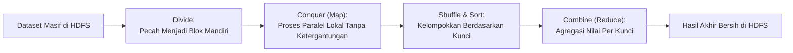
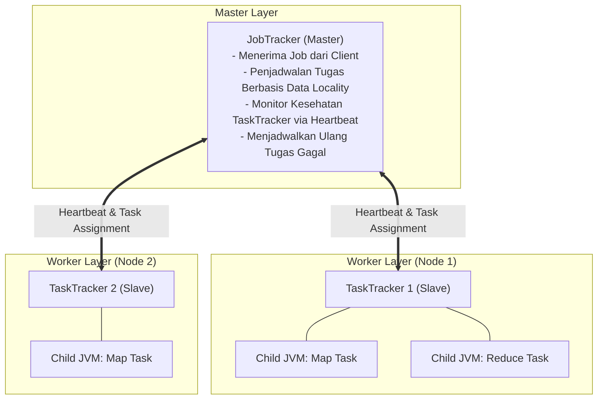

# ⚙️ 05.1 Konsep, Komponen (JobTracker & TaskTracker) & Paradigma MapReduce

> [!ABSTRACT] Ringkasan Sub-Materi
> Menelaah paradigma pemrograman komputasi paralel **MapReduce** yang dipelopori oleh Google (Jeffrey Dean & Sanjay Ghemawat, 2004) dan diimplementasikan secara open-source oleh Apache Hadoop. Sub-materi ini membahas filosofi *Divide-and-Conquer*, transformasi matematis pasangan kunci-nilai (*Key-Value Pairs*), arsitektur eksekusi klasik **JobTracker** dan **TaskTracker**, catatan silabus terkait YARN, kisi-kisi ujian, dan tips menjawab.

---

## 1. Filosofi & Paradigma Pemrograman MapReduce

Sebelum MapReduce lahir, menulis program pemrosesan data paralel berskala besar sangatlah rumit. Pemrogram harus secara manual mengelola sinkronisasi thread, penguncian memori (*mutex/locking*), pembagian data jaringan, dan penanganan mesin yang mendadak rusak.

MapReduce memecahkan masalah ini dengan menyediakan sebuah **model abstraksi pemrograman fungsional**:
- Pemrogram hanya perlu fokus menuliskan dua fungsi bisnis sederhana:
  1. **Fungsi `map()`**: Melakukan transformasi, pemfilteran, dan ekstraksi data awal secara paralel.
  2. **Fungsi `reduce()`**: Melakukan agregasi, perangkuman, dan kalkulasi hasil akhir.
- Segala kerumitan sistem terdistribusi (pemisahan berkas, pengiriman data melintasi jaringan, pengurutan, penyeimbangan beban, dan toleransi kesalahan) **dikelola secara otomatis dan transparan oleh framework Hadoop**.

---

## 2. Jantung Aliran Data: Transformasi Pasangan Kunci-Nilai (*Key-Value Pairs*)

Seluruh siklus komputasi di dalam MapReduce diformulasikan secara ketat dalam bentuk transformasi **pasangan kunci-nilai ($\langle \text{Key}, \text{Value} \rangle$)**:

$$\langle k_1, v_1 \rangle \xrightarrow{\mathbf{map}} \text{list}(\langle k_2, v_2 \rangle) \xrightarrow{\mathbf{shuffle\ \&\ sort}} \langle k_2, \text{list}(v_2) \rangle \xrightarrow{\mathbf{reduce}} \text{list}(\langle k_3, v_3 \rangle)$$

### Penjelasan Transformasi 4 Tahap:
1. **Input Reader**:
   - Membaca baris berkas teks mentah.
   - $k_1$ = Posisi offset byte baris di dalam berkas (biasanya tipe `LongWritable`).
   - $v_1$ = Isi teks baris tersebut (tipe `Text`).
2. **Fase `map()`**:
   - Menerima $\langle k_1, v_1 \rangle$, mengekstrak atribut penting, dan memancarkan (*emit*) pasangan kunci perantara:
   - $k_2$ = Kunci pengelompokan yang diinginkan (misal kata, ID departemen, nama negara).
   - $v_2$ = Nilai yang akan diagregasi (misal angka 1, nominal gaji, nilai suhu cuaca).
3. **Fase *Shuffle & Sort* (Dikelola Framework Otomatis)**:
   - Seluruh pasangan $\langle k_2, v_2 \rangle$ yang memiliki kunci identik ($k_2$) dari seluruh node mapper dikumpulkan melintasi jaringan, diurutkan, dan disatukan menjadi satu daftar nilai:
   - Format: $\langle k_2, [v_{2a}, v_{2b}, v_{2c}, \dots] \rangle$.
4. **Fase `reduce()`**:
   - Menerima kunci $k_2$ beserta daftar seluruh nilainya $\text{list}(v_2)$.
   - Menjalankan logika iterasi perulangan (penjumlahan `SUM`, pencarian nilai maksimum `MAX`, perhitungan rata-rata, dll).
   - Memancarkan hasil akhir: $\langle k_3, v_3 \rangle$ yang ditulis permanen ke HDFS.

---

## 3. Arsitektur Eksekusi Klasik (Hadoop 1.x Engine)

Arsitektur komputasi MapReduce v1 mengadopsi model **Master/Worker** yang terdiri dari dua daemon utama:

### A. JobTracker (The Compute Master)
1. **Tanggung Jawab Utama**:
   - Bertindak sebagai titik kontak tunggal bagi aplikasi klien yang ingin menjalankan pekerjaan komputasi (*job submission*).
   - Menentukan jumlah tugas (*tasks*) yang dibutuhkan dengan memeriksa jumlah *InputSplit* dari NameNode.
   - **Penjadwalan Berbasis Data Locality**: Memeriksa di mana blok data HDFS tersimpan secara fisik, lalu menugaskan *Map task* ke TaskTracker yang berada di mesin DataNode yang sama (atau setidaknya di rak yang sama).
   - Memantau kemajuan pekerjaan (*progress tracking*) dan mendeteksi node yang mengalami kegagalan melalui sinyal *heartbeat*.
   - Jika suatu tugas gagal pada satu TaskTracker, JobTracker secara otomatis menjadwalkan ulang (*reschedule*) tugas tersebut ke TaskTracker lain yang sehat.
2. **Keterbatasan Utama**:
   - Merupakan titik kegagalan tunggal (*SPOF*) di sisi komputasi pada Hadoop 1.x.
   - Memiliki batasan skalabilitas kluster (hanya mampu mengelola hingga $\approx 4.000$ node pekerja karena beban memori tracking terpusat).

### B. TaskTracker (The Compute Worker)
1. **Tanggung Jawab Utama**:
   - Berjalan pada setiap mesin DataNode pekerja di kluster.
   - Mengalokasikan slot eksekusi berukuran tetap: **Map Slots** dan **Reduce Slots**.
   - Menjalankan proses Java terpisah (*Child JVM*) untuk mengeksekusi tugas komputasi aktual pengguna. Penggunaan Child JVM terpisah menjamin bahwa jika kode program MapReduce pengguna mengalami *crash* atau *segmentation fault*, daemon TaskTracker utama tetap aman dan tidak ikut mati.
   - Mengirimkan sinyal Heartbeat secara periodik (setiap beberapa detik) ke JobTracker untuk mengabarkan status slot kosong dan kemajuan pekerjaan.

---

## 4. Catatan Silabus Penting: Konteks YARN

> [!NOTE] Penegasan Silabus UAS
> **Materi YARN (Yet Another Resource Negotiator) TIDAK DIUJIKAN secara mendalam dalam UAS ini!**  
> Dosen hanya mengharapkan pemahaman konseptual evolusi arsitektural:
> - Pada Hadoop 1.x, **JobTracker memikul beban ganda** yang terlalu berat: (1) Mengelola alokasi resource hardware kluster, sekaligus (2) Memantau siklus hidup aplikasi komputasi.
> - Pada Hadoop 2.x, **YARN memisahkan kedua tugas tersebut**:
>   - Alokasi resource perangkat keras diserahkan ke daemon pusat bernama **ResourceManager**.
>   - Pemantauan siklus hidup aplikasi komputasi diserahkan ke komponen mandiri per aplikasi bernama **ApplicationMaster**.
> - Namun, logika fungsional `map()`, *shuffle & sort*, dan `reduce()` **tetap identik 100%** di kedua versi Hadoop.

---

## 🎯 Hal-Hal yang Kemungkinan Besar Masuk Ujian

1. **Transformasi Pasangan Kunci-Nilai**:
   - Dosen pasti menanyakan formula perubahan tipe data:
     $$(k_1, v_1) \longrightarrow (k_2, v_2) \longrightarrow (k_2, [v_2]) \longrightarrow (k_3, v_3)$$
2. **Tanggung Jawab JobTracker vs TaskTracker**:
   - JobTracker = Master (penjadwalan, alokasi data locality, toleransi kesalahan).
   - TaskTracker = Worker (menjalankan child JVM pada slot map/reduce, melaporkan progress via heartbeat).
3. **Data Locality pada Penjadwalan JobTracker**:
   - JobTracker memprioritaskan penugasan Map Task ke node yang **menyimpan blok HDFS secara lokal**.
4. **Fungsi Child JVM**:
   - Mengapa TaskTracker menjalankan proses anak terpisah (*child JVM*)? Untuk mengisolasi kegagalan kode pengguna agar tidak merusak daemon inti TaskTracker.

---

## 📋 Contoh Soal Ujian (Pilihan Ganda & Esai)

### Contoh Soal Pilihan Ganda
**Soal 1 (Transformasi Tipe Data MapReduce)**  
Dalam siklus hidup eksekusi pekerjaan MapReduce, format struktur data yang diterima sebagai parameter masukan (*input argument*) oleh fungsi `reduce()` setelah melewati tahapan Shuffle and Sort adalah...  
A. $\langle k_1, v_1 \rangle$  
B. Pasangan kunci tunggal beserta daftar seluruh nilainya: $\langle k_2, \text{list}(v_2) \rangle$  
C. Sekumpulan baris teks acak tanpa kunci  
D. Berkas zip terkompresi  
*Kunci Jawaban*: **B**  
*Pembahasan*: Fase Shuffle and Sort mengelompokkan seluruh nilai yang memiliki kunci $k_2$ yang sama ke dalam bentuk iterable list, sehingga fungsi reduce menerima pasangan $\langle k_2, \text{Iterable}\langle v_2 \rangle \rangle$.

**Soal 2 (Peranan JobTracker)**  
Pada arsitektur klasik Hadoop 1.x, komponen master yang bertanggung jawab mengoordinasikan eksekusi pekerjaan, menjadwalkan tugas ke mesin pekerja dengan mempertimbangkan prinsip *Data Locality*, dan melakukan penjadwalan ulang jika tugas pekerja gagal adalah...  
A. TaskTracker  
B. NameNode  
C. JobTracker  
D. DataNode  
*Kunci Jawaban*: **C**  
*Pembahasan*: JobTracker adalah master pemrosesan komputasi MapReduce klasik yang mengelola penjadwalan berbasis data locality dan toleransi kesalahan tugas. (NameNode mengelola storage HDFS, bukan komputasi).

---

### Contoh Soal Esai
**Soal Esai**:  
Jelaskan prinsip kerja paradigma komputasi MapReduce! Mengapa arsitektur ini membagi pemrosesan data ke dalam pasangan kunci-nilai (*Key-Value Pairs*), dan bagaimana peran arsitektur Master/Worker (**JobTracker** dan **TaskTracker**) menjamin bahwa pekerjaan komputasi dapat selesai secara andal meskipun ada mesin pekerja yang mendadak rusak di tengah proses?

**Pedoman Jawaban Lengkap**:
1. **Prinsip Kerja Paradigma MapReduce & Peranan Pasangan Kunci-Nilai**:
   - MapReduce bekerja dengan filosofi *Divide-and-Conquer*: memecah dataset raksasa menjadi potongan-potongan independen yang diproses secara serentak oleh fungsi `map()` tanpa ketergantungan antar-node (*shared-nothing architecture*).
   - Penggunaan pasangan **Key-Value Pairs ($\langle K, V \rangle$)** adalah kunci standardisasi agregasi data terdistribusi:
     - *Key* bertindak sebagai penentu identitas pengelompokan (*routing / partitioning criteria*) yang memastikan bahwa seluruh data yang relevan dengan satu topik yang sama akan dikirimkan ke mesin Reducer yang sama.
     - *Value* merepresentasikan besaran pengukuran kuantitatif atau atribut yang akan dikomputasi (dijumlahkan, dirata-rata, atau dicari ekstremumnya).
2. **Peran JobTracker dan TaskTracker dalam Menjamin Keandalan (*Fault-Tolerance*)**:
   - **JobTracker (Master)** memantau seluruh pekerja di kluster melalui sinyal *Heartbeat* berkala dari TaskTracker.
   - **TaskTracker (Worker)** mengeksekusi tugas pada *Child JVM* terisolasi. Jika program pengguna crash karena bug memori, hanya JVM anak tersebut yang mati, sementara daemon TaskTracker tetap stabil.
   - **Mekanisme Penanganan Kegagalan**:
     - Jika sebuah TaskTracker berhenti mengirimkan sinyal Heartbeat (misal server mati lampu atau terputus jaringan), JobTracker menandai TaskTracker tersebut bermasalah.
     - JobTracker memeriksa tugas-tugas (Map atau Reduce) yang sedang berjalan pada node tersebut.
     - Karena data input tersimpan aman dan memiliki replika cadangan di HDFS, JobTracker secara otomatis **menjadwalkan ulang (*reschedule*) tugas yang gagal tersebut ke TaskTracker sehat lainnya** yang memiliki salinan replika blok data tersebut (*Data Locality Failover*).
     - Seluruh proses pemulihan ini berlangsung secara otomatis tanpa campur tangan pemrogram dan pekerjaan MapReduce tetap sukses diselesaikan.

---

## 💡 Tips & Trik Menjawab Soal Ujian

1. **Jurus Membedakan Storage vs Compute Node**:
   - Penyimpanan Data (HDFS) $\to$ **NameNode** (Master) dan **DataNode** (Worker).
   - Pemrosesan Komputasi (MapReduce v1) $\to$ **JobTracker** (Master) dan **TaskTracker** (Worker).
   - Jangan pernah mencampuradukkan kedua domain ini di jawaban esai!
2. **Formula Menjawab Paradigma MapReduce**:
   - Selalu tuliskan rumus aljabar transformasi pasangan kunci-nilainya:  
     $$\langle k_1, v_1 \rangle \to \langle k_2, v_2 \rangle \to \langle k_2, [v_2] \rangle \to \langle k_3, v_3 \rangle$$
   - Penulisan rumus ini langsung memberikan nilai maksimal pada jawaban esai konseptual.
