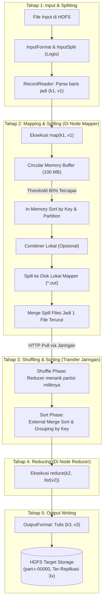

# 🔄 05.2 Alur Kerja Mendalam MapReduce (InputSplit, Map, Buffer, Spill, Shuffle & Sort, Reduce)

> [!ABSTRACT] Ringkasan Sub-Materi
> Mengupas tuntas mekanisme internal aliran data fisik dan siklus eksekusi MapReduce merujuk pada bab 2, 3, dan 7 buku teks *Hadoop: The Definitive Guide* karya Tom White. Sub-materi ini membahas perbedaan fundamental **InputSplit logis vs HDFS Block fisik**, mekanisme **Circular Memory Buffer (100 MB) & Spilling (80%)**, peranan **HashPartitioner**, anatomi fase **Shuffle & Sort**, kisi-kisi ujian, dan panduan jawaban esai.

---

## 1. Siklus Hidup Aliran Data Lengkap MapReduce

Banyak mahasiswa keliru mengira bahwa data hanya berpindah dari "Map langsung ke Reduce". Sebenarnya, terdapat 5 tahapan mekanis internal yang sangat terstruktur:

---

## 2. Bedah Detail 5 Tahapan Internal

### Tahap 1: Input Splitting & Reading
1. **InputFormat**: Kelas yang mendefinisikan validasi berkas masukan dan cara memecah berkas.
2. **InputSplit vs HDFS Block (Konsep Wajib Ujian!)**:
   - **HDFS Block**: Pembagian fisik data di disk (secara default berukuran 128 MB). Dikelola oleh HDFS.
   - **InputSplit**: Representasi logis dari sekumpulan data yang akan diproses oleh **tepat SATU tugas Mapper (*Map Task*)**. Dikelola oleh MapReduce.
   - *Korelasi*: Umumnya 1 InputSplit berukuran sama dengan 1 HDFS Block. Jika sebuah berkas berukuran 512 MB dipecah menjadi 4 blok HDFS, maka framework akan membuat 4 InputSplit dan menjalankan **4 tugas Mapper paralel**.
3. **RecordReader**:
   - Membaca data mentah di dalam InputSplit baris demi baris dan mengonversinya menjadi pasangan $\langle k_1, v_1 \rangle$:
   - $k_1$ = Posisi offset byte baris (tipe `LongWritable`).
   - $v_1$ = Teks baris data tersebut (tipe `Text`).

---

### Tahap 2: Mapping Phase & In-Memory Spilling (Tom White)
Fungsi `map()` mengeksekusi logika pemfilteran dan menghasilkan pasangan kunci-nilai perantara $\langle k_2, v_2 \rangle$.

> [!IMPORTANT] Di Manakah Output Map Disimpan?
> Output dari fungsi Mapper **TIDAK PERNAH ditulis ke HDFS dan TIDAK DIREPLIKASI!**  
> Output mapper adalah hasil perantara (*intermediate data*) yang bersifat sementara. Menulisnya ke HDFS akan membuang-buang bandwidth dan storage replikasi. Output mapper ditulis ke **memori RAM dan disk lokal mesin DataNode tempat mapper berjalan**.

#### Mekanisme Buffer & Spilling (Buku Teks Tom White):
1. **Circular Memory Buffer (100 MB)**:
   - Setiap tugas Mapper memiliki buffer memori melingkar di RAM sebesar default **100 MB** (`mapreduce.task.io.sort.mb = 100`).
   - Output `map()` ditampung sementara di dalam buffer ini.
2. **Spill Threshold (80%)**:
   - Ketika isi buffer mencapai ambang batas **80% (80 MB)** (`mapreduce.map.sort.spill.percent = 0.80`), sebuah background thread terpisah mulai dibangunkan untuk menumpahkan (*spill*) isi buffer ke disk lokal.
   - Selama proses penumpahan ke disk berjalan di background, fungsi `map()` tetap dapat terus menulis data baru ke sisa 20% ruang buffer yang kosong tanpa hambatan.
3. **In-Memory Sort & Partitioning**:
   - Sebelum ditulis ke disk, background thread membagi data di buffer ke dalam partisi-partisi (sesuai jumlah Reducer tujuan) dan **mengurutkannya berdasarkan Kunci (*sort by key*)**.
   - Jika kelas **Combiner** didefinisikan, fungsi Combiner langsung dijalankan pada data di buffer sebelum ditulis ke disk untuk mengurangi volume data.
4. **Merge Spill Files**:
   - Setiap kali buffer penuh 80%, satu file spill baru terbentuk di disk lokal (misal `spill1.out`, `spill2.out`).
   - Saat tugas Mapper selesai sepenuhnya, seluruh file spill tersebut digabungkan (*merged*) dan diurutkan kembali menjadi **satu file output terurut tunggal** yang siap diambil oleh Reducer.

---

### Tahap 3: Shuffling & Sorting Phase (Jantung MapReduce)
Fase ini menghubungkan ujung Mapper dengan pangkal Reducer.

1. **Partitioning (Pembagian Tugas ke Reducer)**:
   - Siapa yang menentukan pasangan kunci $\langle k_2, v_2 \rangle$ harus dikirim ke Reducer nomor berapa? Komponen **Partitioner**.
   - **Default: `HashPartitioner`**:
     Menggunakan fungsi hash dari kunci modulo jumlah Reducer:
     $$\text{ReducerID} = (\text{key.hashCode()} \ \& \ \text{Integer.MAX\_VALUE}) \pmod{\text{numReduceTasks}}$$
   - *Jaminan Matematika*: Seluruh record yang memiliki nilai Kunci ($k_2$) yang identik **dijamin 100% akan selalu dikirim ke Reducer yang sama!**
2. **Copy Phase (Network Shuffle)**:
   - Reducer memiliki beberapa thread penyalin (*fetcher threads*). Segera setelah satu Mapper selesai, Reducer mulai menyalin (*pull/fetch*) partisi datanya melintasi jaringan via protokol HTTP.
3. **Sort / Merge Phase**:
   - Reducer mengumpulkan file-file partisi yang ditarik dari ratusan Mapper.
   - Reducer menjalankan algoritma pengurutan eksternal (*External Merge Sort*, merge factor default 10) untuk menyatukan seluruh aliran data yang telah terurut tersebut.
   - Seluruh nilai yang memiliki kunci sama disatukan ke dalam satu koleksi nilai:  
     $$\langle k_2, [v_{2a}, v_{2b}, v_{2c}, \dots] \rangle$$

---

### Tahap 4: Reducing Phase
- Fungsi `reduce(k2, Iterable<v2>)` dieksekusi tepat satu kali untuk setiap kunci unik $k_2$.
- Logika aplikasi dijalankan (misal menjumlahkan angka, mencari nilai terbesar, dll).
- Reducer memancarkan hasil akhir: $\langle k_3, v_3 \rangle$.

---

### Tahap 5: Output Writing
- Komponen `OutputFormat` (default: `TextOutputFormat`) menerima pasangan $\langle k_3, v_3 \rangle$ dan menulisnya secara permanen ke dalam **HDFS**.
- Berbeda dengan output Mapper, **output Reducer disimpan permanen di HDFS dan otomatis direplikasi sesuai faktor replikasi kluster (default 3 salinan)**.
- Setiap Reducer menghasilkan satu berkas terpisah di HDFS dengan konvensi penamaan: `part-r-00000`, `part-r-00001`, dst.

---

## 🎯 Hal-Hal yang Kemungkinan Besar Masuk Ujian

1. **InputSplit vs HDFS Block**:
   - Block = unit fisik disk (128 MB). InputSplit = unit logis pembagian tugas untuk 1 Mapper.
2. **Spesifikasi Circular Buffer (Angka Resmi Tom White)**:
   - Ukuran total buffer = **100 MB**.
   - Ambang batas spill (*spill threshold*) = **80% (80 MB)**.
3. **Di Mana Output Mapper dan Reducer Disimpan?**:
   - Output Mapper $\to$ **Disk LOKAL DataNode** (sementara, tanpa replikasi).
   - Output Reducer $\to$ **HDFS** (permanen, ter-replikasi 3x).
4. **Rumus HashPartitioner**:
   - `(key.hashCode() & Integer.MAX_VALUE) % numReducers`. Memastikan kunci yang sama selalu masuk ke reducer yang sama.
5. **Urutan Lengkap 5 Fase**:
   - *Input $\to$ Map $\to$ Spill $\to$ Shuffle & Sort $\to$ Reduce $\to$ Output*.

---

## 📋 Contoh Soal Ujian (Pilihan Ganda & Esai)

### Contoh Soal Pilihan Ganda
**Soal 1 (Penyimpanan Output Mapper)**  
Di manakah data luaran perantara (*intermediate key-value output*) dari fungsi Mapper disimpan selama siklus eksekusi pekerjaan MapReduce berlangsung?  
A. Disimpan permanen di HDFS dengan faktor replikasi 3.  
B. Disimpan sementara di dalam memori buffer RAM dan kemudian ditumpahkan (*spill*) ke media hard disk lokal milik mesin pekerja Mapper tersebut tanpa direplikasi.  
C. Diunggah ke server cloud eksternal.  
D. Disimpan di dalam memori RAM master NameNode.  
*Kunci Jawaban*: **B**  
*Pembahasan*: Output mapper adalah data sementara yang hanya dibutuhkan hingga fase Shuffle selesai. Oleh karena itu, data tersebut disimpan di disk lokal node pekerja untuk menghemat ruang dan replikasi jaringan HDFS.

**Soal 2 (Mekanisme Spilling Buku Teks Tom White)**  
Berdasarkan buku teks resmi karya Tom White, sebuah tugas Mapper menampung keluarannya di dalam *Circular Memory Buffer* berukuran default 100 MB. Proses penulisan tumpahan (*spilling*) ke disk lokal mulai aktif berjalan saat kapasitas buffer mencapai ambang batas...  
A. 50%  
B. 80%  
C. 100%  
D. 99%  
*Kunci Jawaban*: **B**  
*Pembahasan*: Ambang batas spilling default adalah 80% (80 MB), memungkinkan proses mapper tetap menulis sisa 20% data ke buffer selagi thread latar belakang menulis data ke disk.

---

### Contoh Soal Esai
**Soal Esai**:  
Gambarkan diagram arsitektur aliran data dan jelaskan secara rinci apa yang terjadi pada fase **Shuffle and Sort** dalam eksekusi MapReduce! Mengapa fase ini disebut sebagai "jantung" dari MapReduce dan bagaimana Hadoop memastikan bahwa seluruh data yang memiliki kunci sama pasti bermuara pada Reducer yang sama?

**Pedoman Jawaban Lengkap**:
1. **Diagram & Alur Kerja Shuffle and Sort**:
   - Fase Shuffle and Sort menjembatani keluaran Mapper menuju masukan Reducer.
   - *Langkah 1 (Partitioning)*: Saat mapper menulis data, **Partitioner** menghitung ID Reducer target untuk setiap pasangan kunci-nilai.
   - *Langkah 2 (Sorting Lokal)*: Data diurutkan berdasarkan kunci di memori sebelum ditumpahkan ke disk lokal mapper.
   - *Langkah 3 (Fetch/Copy)*: Reducer menarik (*pull*) partisi file miliknya dari seluruh node mapper melintasi jaringan via protokol HTTP.
   - *Langkah 4 (Merge & Group)*: Reducer melakukan *External Merge Sort* pada file-file yang ditarik, menyatukan nilai-nilai dengan kunci yang sama menjadi format: $\langle \text{Kunci}, [\text{Nilai}_1, \text{Nilai}_2, \dots] \rangle$.
2. **Mengapa Disebut "Jantung" MapReduce?**:
   - Karena di fase inilah seluruh transformasi komputasi terdistribusi terjadi: mengubah data acak yang tersebar di ratusan node menjadi data terstruktur yang dikelompokkan secara deterministik berdasarkan kuncinya. Tanpa shuffle and sort, operasi agregasi global mustahil dilakukan secara paralel.
3. **Mekanisme Penjaminan Kunci Sama ke Reducer Sama**:
   - Dijamin melalui kelas **`HashPartitioner`**.
   - Algoritma menghitung kode hash dari objek kunci, membuang tanda negatif (`& Integer.MAX_VALUE`), lalu melakukan operasi modulo terhadap jumlah total task Reducer:
     $$\text{Target Reducer} = (\text{key.hashCode()} \ \& \ \text{Integer.MAX\_VALUE}) \pmod{N_{\text{reducers}}}$$
   - Karena dua kunci yang bernilai identik akan selalu menghasilkan nilai `hashCode()` yang sama persis, maka hasil operasi modulo-nya dipastikan menghasilkan integer yang sama, menjamin seluruh record ber-kunci sama mendarat di Reducer yang sama.

---

## 💡 Tips & Trik Menjawab Soal Ujian

1. **Jurus Kata Kunci 5 Tahap MapReduce**:
   - *InputFormat* $\to$ Menghitung *InputSplit* (logis).
   - *Mapper* $\to$ *Circular Buffer* (100 MB, 80% spill).
   - *Partitioner* $\to$ Routing kunci ke Reducer ID (HashPartitioner).
   - *Shuffle* $\to$ Transfer data HTTP lintas jaringan.
   - *Sort* $\to$ Grouping by key $\to$ $\langle k_2, [v_2] \rangle$.
   - *Reducer* $\to$ Agregasi akhir $\to$ Tulis ke HDFS (part-r-XXXXX).
2. **Pola Mengingat Lokasi Data**:
   - Input $\to$ HDFS.
   - Map output $\to$ Local Disk Worker (no replication).
   - Reduce output $\to$ HDFS (replicated 3x).
