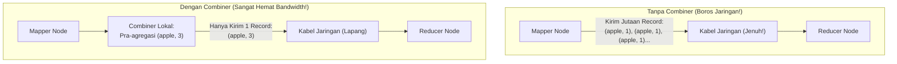
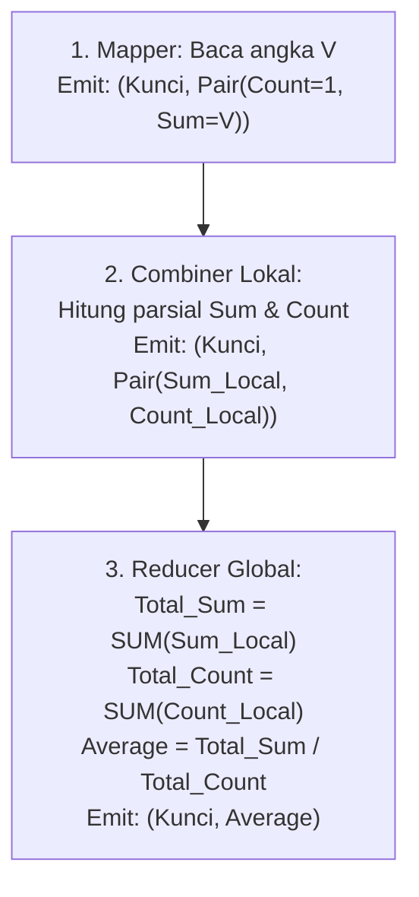
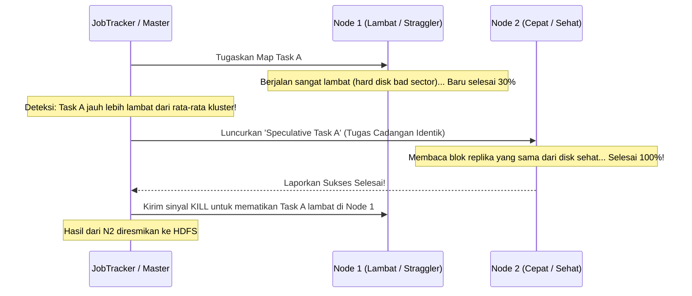

# ⚡ 05.3 Mekanisme Combiner, Optimasi & Speculative Execution

> [!ABSTRACT] Ringkasan Sub-Materi
> Menelaah secara mendalam teknik optimasi performa MapReduce berdasarkan rujukan buku teks resmi *Hadoop: The Definitive Guide* karya Tom White. Sub-materi ini mengupas tuntas fungsi **Combiner (Mini-Reducer)**, **syarat matematis komutatif & asosiatif**, jebakan fatal pada operasi **Rata-Rata (*Average*)** beserta solusinya, mekanisme **Speculative Execution** untuk menumpas tugas lambat (*stragglers*), studi kasus NCDC Weather, kisi-kisi ujian, dan panduan jawaban esai.

---

## 1. Mekanisme Combiner (The Mini-Reducer)

Pada kluster besar, fase *Shuffle* yang memindahkan data luaran Mapper melintasi kabel jaringan menuju Reducer adalah titik hambatan performa terbesar (*network bandwidth bottleneck*).

Untuk menghemat lalu lintas jaringan, Hadoop menyediakan komponen opsional bernama **Combiner** (sering disebut sebagai *Mini-Reducer*):

### A. Sifat & Karakteristik Penting Combiner:
1. **Dijalankan Secara Lokal di Mesin Mapper**: Combiner memproses data di dalam memori dan disk lokal node pekerja Mapper sesaat sebelum data dikirimkan ke jaringan.
2. **Bersifat Kontraktual Opsional**: Framework Hadoop **tidak menjamin berapa kali Combiner akan dipanggil** (bisa dipanggil nol kali jika data sedikit, satu kali saat spilling, atau berkali-kali saat merge).
3. **Kaidah Emas**: Pemanggilan fungsi Combiner **TIDAK BOLEH mengubah hasil akhir komputasi** yang diterima oleh Reducer!

---

## 2. Syarat Matematis Mutlak Combiner & Masalah Rata-Rata (*The Average Problem*)

Dosen sangat gemar menguji pemahaman mahasiswa mengenai fungsi matematika apa saja yang aman menggunakan Combiner:

> [!IMPORTANT] Syarat Matematis Mutlak Combiner
> Sebuah fungsi agregasi HANYA BISA dan AMAN dijadikan sebagai Combiner jika dan hanya jika fungsi tersebut bersifat **Komutatif** dan **Asosiatif**:
> 1. **Komutatif**: Urutan operan tidak mengubah hasil:  
>    $$A \oplus B = B \oplus A$$
> 2. **Asosiatif**: Pengelompokan urutan operasi tidak mengubah hasil:  
>    $$(A \oplus B) \oplus C = A \oplus (B \oplus C)$$

### Evaluasi Fungsi Matematika Umum:
- **`MAX` (Nilai Maksimum)**: Asosiatif dan Komutatif $\to$ **SANGAT AMAN** ($\max(\max(2, 5), 8) = \max(2, \max(5, 8)) = 8$).
- **`MIN` (Nilai Minimum)**: Asosiatif dan Komutatif $\to$ **SANGAT AMAN**.
- **`SUM` (Penjumlahan)**: Asosiatif dan Komutatif $\to$ **SANGAT AMAN** ($(1 + 2) + 3 = 1 + (2 + 3) = 6$).
- **`AVERAGE` (Nilai Rata-Rata)**: **TIDAK ASOSIATIF! $\to$ DILARANG MENGGUNAKAN COMBINER BIASA!**

---

### Bedah Kasus: Mengapa Rata-Rata Gagal Total dengan Combiner Naif?
Misalkan kita memiliki 3 buah data angka: $10, 20, 30$.  
Rata-rata sebenarnya yang benar adalah:
$$\text{Average Sebenarnya} = \frac{10 + 20 + 30}{3} = \frac{60}{3} = \mathbf{20}$$

Bayangkan jika data tersebut diproses oleh 2 Mapper terpisah yang menggunakan fungsi `average` sebagai Combiner:
- **Mapper 1** memproses angka $10$ dan $20$. Combiner Mapper 1 menghitung:
  $$\text{Rata-rata lokal 1} = \frac{10 + 20}{2} = 15 \implies \text{Emit: } \langle \text{kunci}, 15 \rangle$$
- **Mapper 2** memproses angka $30$. Combiner Mapper 2 menghitung:
  $$\text{Rata-rata lokal 2} = \frac{30}{1} = 30 \implies \text{Emit: } \langle \text{kunci}, 30 \rangle$$
- **Reducer** menerima kedua angka hasil Combiner ($15$ dan $30$) lalu menghitung rata-rata akhirnya:
  $$\text{Hasil Reducer} = \frac{15 + 30}{2} = \mathbf{22{,}5} \quad (\mathbf{SALAH\ BESAR!\ Hasil\ sebenarnya\ adalah\ 20})$$

Kesalahan ini terjadi karena pembagi bobot (*weight / count*) hilang saat dirata-ratakan di tingkat lokal!

---

### Solusi Otoritatif Buku Teks Tom White: Pola Pasangan Komposit
Agar kita tetap bisa memanfaatkan kehebatan Combiner untuk menghitung rata-rata tanpa menghasilkan nilai yang salah, kita wajib menggunakan **Pola Pasangan Komposit $\langle \text{Count}, \text{Sum} \rangle$**:

1. **Logika Mapper**:
   - Untuk setiap nilai angka $V$, Mapper memancarkan nilai komposit:  
     $$\text{Emit: } \langle \text{Key}, (1, V) \rangle$$
2. **Logika Combiner (Aman & Asosiatif)**:
   - Combiner menerima daftar pasangan $(\text{count}_i, \text{sum}_i)$.
   - Combiner menjumlahkan seluruh count dan seluruh sum secara terpisah:
     $$\text{Count}_{\text{local}} = \sum 1, \quad \text{Sum}_{\text{local}} = \sum V$$
   - Combiner memancarkan pasangan hasil pra-agregasi parsial:  
     $$\text{Emit: } \langle \text{Key}, (\text{Count}_{\text{local}}, \text{Sum}_{\text{local}}) \rangle$$
3. **Logika Reducer**:
   - Reducer menerima seluruh pasangan parsial dari seluruh node mapper, menjumlahkan total keseluruhan:
     $$\text{TotalCount} = \sum \text{Count}_{\text{local}}, \quad \text{TotalSum} = \sum \text{Sum}_{\text{local}}$$
   - Reducer menghitung rata-rata sejati:
     $$\text{Average} = \frac{\text{TotalSum}}{\text{TotalCount}}$$
   - Nilai rata-rata yang dihasilkan dijamin **100% presisi dan benar**, sementara bandwidth jaringan tetap berhasil dihemat!

---

## 3. Speculative Execution & Penanganan Stragglers

Dalam kluster terdistribusi berskala ratusan node, sering terjadi fenomena **Straggler**:
- **Definisi Straggler**: Suatu tugas (*task*) yang berjalan sangat lambat secara abnormal dibandingkan tugas-tugas lainnya dalam pekerjaan yang sama.
- **Penyebab Straggler**: Bukan karena bug pada kode program, melainkan karena **degradasi perangkat keras pada mesin pekerja tertentu** (misal: hard disk mengalami *bad sectors* sehingga kecepatan baca anjlok ke 1 MB/s, kipas pendingin CPU mati menyebabkan prosesor menurunkan kecepatan / *throttling*, atau kabel jaringan mengalami *packet loss* parah).
- **Dampak Fatal**: Karena pekerjaan MapReduce secara keseluruhan baru dianggap selesai jika seluruh tugas selesai, satu tugas straggler yang lambat dapat menahan penyelesaian pekerjaan selama berjam-jam (*cluster bottleneck*).

### Mekanisme Speculative Execution (Eksekusi Spekulatif):
1. **Deteksi Otomatis**: Framework memantau kecepatan kemajuan (*progress score*) seluruh tugas yang sedang berjalan secara statistik.
2. **Peluncuran Tugas Cadangan**: Jika sebuah tugas terdeteksi berjalan lambat secara signifikan dan tidak ada indikasi kegagalan program, master secara otomatis meluncurkan **tugas cadangan yang identik (*speculative backup task*)** pada node pekerja lain yang sehat.
3. **Kompetisi Paralel**: Tugas asli dan tugas spekulatif kini berlari secara paralel memproses data masukan yang sama.
4. **Pemenang Mengambil Semua (*Winner Takes All*)**: Begitu salah satu tugas berhasil selesai terlebih dahulu:
   - Hasil tugas yang menang langsung diterima sebagai output resmi.
   - Tugas lawannya yang masih tertatih-tatih langsung **dimatikan secara paksa (*killed*)** oleh master agar tidak memboroskan sumber daya kluster.

---

## 4. Studi Kasus Otoritatif Tom White: NCDC Global Weather Data

Dalam buku teks *Hadoop: The Definitive Guide*, Tom White menggunakan contoh kasus analitik dataset cuaca dari *National Climatic Data Center* (NCDC) untuk menemukan **Suhu Udara Maksimum Global per Tahun**:
- **Format Data Mentah**: Baris teks ASCII panjang di mana kolom tahun berada di karakter 15–19 dan kolom suhu udara berada di karakter 87–92 (dengan kode kualitas 9999 menandakan data hilang).
- **Desain MapReduce**:
  - `map()`: Mengekstrak teks $\to$ jika suhu valid ($\neq 9999$), emit $\langle \text{Year}, \text{Temperature} \rangle$.
  - `combiner`: Menjalankan fungsi `Math.max()` lokal di node mapper untuk menyaring suhu tertinggi per tahun pada blok tersebut.
  - `reduce()`: Menjalankan `Math.max()` global untuk seluruh tahun tersebut dan memancarkan suhu maksimum final ke HDFS.

---

## 🎯 Hal-Hal yang Kemungkinan Besar Masuk Ujian

1. **Syarat Matematis Combiner**:
   - Wajib hafal: **Komutatif** ($A+B = B+A$) dan **Asosiatif** ($(A+B)+C = A+(B+C)$).
2. **Jebakan Operasi Rata-Rata (*Average*)**:
   - Dosen pasti menanyakan: *"Mengapa fungsi Average tidak bisa langsung digunakan sebagai Combiner?"*  
   *Jawab*: Karena Average tidak asosiatif. Rata-rata dari rata-rata lokal menghasilkan nilai bias yang salah.
   - Solusi: Emit pasangan komposit `(count, sum)`.
3. **Fungsi Speculative Execution**:
   - Kata kunci: **Mengatasi masalah stragglers (tugas lambat akibat degradasi hardware)** dengan menjalankan tugas cadangan paralel di node sehat lain.
4. **Mengapa Combiner Bersifat Opsional?**:
   - Karena Hadoop tidak menjamin frekuensi pemanggilan combiner; fungsi combiner murni alat bantu penghemat bandwidth jaringan.

---

## 📋 Contoh Soal Ujian (Pilihan Ganda & Esai)

### Contoh Soal Pilihan Ganda
**Soal 1 (Kelayakan Fungsi Combiner)**  
Di antara fungsi-fungsi agregasi statistik berikut, manakah yang **TIDAK BISA** digunakan secara langsung sebagai fungsi *Combiner* pada pekerjaan MapReduce tanpa memicu kesalahan kalkulasi nilai akhir?  
A. `SUM` (Menghitung total penjualan)  
B. `MAX` (Mencari nilai transaksi tertinggi)  
C. `AVERAGE` (Menghitung nilai rata-rata nilai ujian)  
D. `MIN` (Mencari temperatur terendah)  
*Kunci Jawaban*: **C**  
*Pembahasan*: Rata-rata (Average) tidak memenuhi sifat aljabar asosiatif. Melakukan rata-rata atas rata-rata bagian lokal akan mendistorsi bobot perhitungan populasi data sesungguhnya.

**Soal 2 (Mekanisme Speculative Execution)**  
Fitur *Speculative Execution* pada Apache Hadoop diaktifkan secara default untuk mengatasi skenario di mana...  
A. Seluruh hard disk di kluster penuh secara bersamaan.  
B. Terjadi *Straggler*, yaitu tugas yang berjalan sangat lambat pada sebuah mesin pekerja akibat degradasi perangkat keras tersembunyi, sehingga Hadoop meluncurkan tugas cadangan paralel di node lain.  
C. Pengguna salah menuliskan sintaks kode program Java.  
D. NameNode kehabisan memori RAM.  
*Kunci Jawaban*: **B**  
*Pembahasan*: Speculative Execution mendeteksi tugas tertatih-tatih (stragglers) dan menjalankan salinan spekulatif di node pekerja lain untuk mencegah keterlambatan penyelesaian pekerjaan secara keseluruhan.

---

### Contoh Soal Esai
**Soal Esai**:  
Sebuah perusahaan logistik ingin menghitung **biaya pengiriman rata-rata per kilogram paket barang untuk setiap provinsi tujuan** dari dataset transaksi sebesar 5 Terabyte menggunakan MapReduce.  
a. Jelaskan mengapa seorang data engineer dilarang secara naif menggunakan fungsi perhitungan rata-rata standar sebagai *Combiner* pada pekerjaan tersebut!  
b. Rancanglah solusi arsitektur MapReduce yang benar (spesifikasikan struktur input, logika fungsi **Mapper**, fungsi **Combiner**, dan fungsi **Reducer**) agar proses komputasi rata-rata tersebut tetap dapat memanfaatkan efisiensi penghematan bandwidth dari Combiner tanpa menghasilkan kesalahan kalkulasi!

**Pedoman Jawaban Lengkap**:
1. **Penyebab Larangan Combiner Rata-Rata Naif**:
   - Operasi rata-rata bersifat **non-asosiatif**: $\text{avg}(\text{avg}(a, b), c) \neq \text{avg}(a, b, c)$ jika jumlah sampel di tiap kelompok berbeda.
   - Jika Combiner naif menghitung rata-rata lokal di masing-masing Mapper, informasi mengenai *jumlah frekuensi paket barang (bobot pengali)* akan terhapus. Reducer yang hanya merata-ratakan angka hasil rata-rata lokal tersebut akan menghasilkan nilai rata-rata tertimbang (*weighted average*) yang keliru secara fatal.
2. **Desain Solusi MapReduce dengan Pola Pasangan Komposit**:
   - **Struktur Input**:
     - $\langle k_1, v_1 \rangle = \langle \text{ByteOffset}, \text{TeksBaris: "Provinsi, BeratKg, BiayaKirim"} \rangle$.
   - **Logika Mapper**:
     - Parse baris, ekstrak `Provinsi`, `BeratKg`, dan `BiayaKirim`.
     - Hitung biaya per kg untuk baris tersebut: $\text{CostPerKg} = \frac{\text{BiayaKirim}}{\text{BeratKg}}$.
     - *Emit*: Pasangan dengan nilai komposit berupa pasangan $\langle \text{Count}=1, \text{CostPerKg} \rangle$:  
       $$\text{Emit: } \langle \text{Provinsi}, (1, \text{CostPerKg}) \rangle$$
   - **Logika Combiner (Pra-Agregasi Lokal Aman)**:
     - Menerima: $\langle \text{Provinsi}, \text{list}((1, \text{Cost}_1), (1, \text{Cost}_2), \dots) \rangle$.
     - Lakukan akumulasi penjumlahan secara terpisah untuk count dan cost:
       $$\text{LocalCount} = \sum 1, \quad \text{LocalCostSum} = \sum \text{Cost}_i$$
     - *Emit*: Pasangan hasil akumulasi parsial lokal:  
       $$\text{Emit: } \langle \text{Provinsi}, (\text{LocalCount}, \text{LocalCostSum}) \rangle$$
   - **Fase Shuffle and Sort**:
     - Mengelompokkan seluruh pasangan parsial untuk provinsi yang sama dari seluruh mapper ke Reducer yang sama.
   - **Logika Reducer (Kalkulasi Rata-Rata Global)**:
     - Menerima: $\langle \text{Provinsi}, \text{list}((\text{LocalCount}_j, \text{LocalCostSum}_j)) \rangle$.
     - Inisialisasi: $\text{GlobalCount} = 0, \text{GlobalCostSum} = 0$.
     - Iterasi:
       $$\text{GlobalCount} += \text{LocalCount}_j, \quad \text{GlobalCostSum} += \text{LocalCostSum}_j$$
     - Hitung rata-rata sejati:
       $$\text{AverageCostPerKg} = \frac{\text{GlobalCostSum}}{\text{GlobalCount}}$$
     - *Emit*: Hasil akhir yang ditulis ke HDFS:  
       $$\text{Emit: } \langle \text{Provinsi}, \text{AverageCostPerKg} \rangle$$
   - *Keunggulan*: Nilai rata-rata dihasilkan secara matematis 100% akurat dan bandwidth jaringan tetap terhemat secara masif berkat peringkasan data oleh Combiner di setiap node Mapper.

---

## 💡 Tips & Trik Menjawab Soal Ujian

1. **Jurus Kilat Evaluasi Combiner**:
   - Jika ditanya: "Bolehkah fungsi [X] dijadikan Combiner?", uji dengan 3 angka berbeda: apakah $(A \oplus B) \oplus C = A \oplus (B \oplus C)$?
   - Jika sama $\to$ **Boleh (Valid)**.
   - Jika beda $\to$ **Dilarang (Butuh Composite Pattern)**.
2. **Formula Menjawab Esai Rata-Rata**:
   - Selalu tunjukkan struktur komposit: `(Count, Sum)`. Tuliskan rumus di tingkat Mapper, Combiner, dan Reducer secara terpisah dan bertahap.
