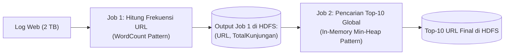

# ✍️ 05.4 Panduan Menjawab & Bedah Soal Esai MapReduce (Template & 6 Kasus Lengkap)

> [!ABSTRACT] Dokumen Wajib Kuasai untuk UAS!
> Kisi-kisi resmi UAS menegaskan: **"2–3 soal esai, salah satunya PASTI adalah soal perancangan / penggunaan MapReduce"**.  
> Sub-materi ini menyediakan **Template Standar 5 Komponen Jawaban Bernilai Sempurna (100)**, diikuti pembedahan langkah demi langkah **6 Kasus Soal Esai MapReduce** yang paling sering dikeluarkan oleh dosen, mulai dari *Word Count*, agregasi komposit, hingga algoritma *Two-Pass Top-K*.

---

## 1. Template Standar 5 Komponen Jawaban Esai MapReduce

Untuk mendapatkan poin penuh dari dosen penguji, jangan hanya menulis kode acak atau paragraf narasi tanpa struktur. Susun jawaban Anda mengikuti **Template 5 Komponen Baku** berikut:

```markdown
### 1. Struktur Masukan (Input Data)
- Format berkas mentah: [Jelaskan delimiter koma/tab/teks baris]
- Masukan Mapper: <k1, v1> = <ByteOffset (LongWritable), BarisTeks (Text)>

### 2. Logika Mapper (Mapping Phase)
- Pemrosesan: [Jelaskan tokenisasi, ekstraksi kolom, atau filtering]
- Pasangan Luaran Map: <k2, v2> = <KunciPengelompokan, NilaiPengukuran>
- Contoh Pemancangan (Emit): Emit <"Kunci", Nilai>

### 3. Evaluasi & Logika Combiner (Opsional / Mini-Reducer)
- Analisis Kelayakan: [Jelaskan apakah fungsi asosiatif & komutatif]
- Logika Pra-Agregasi: [Jelaskan agregasi parsial di node lokal mapper]
- Luaran Combiner: Emit <k2, v2_ringkas>

### 4. Fase Shuffle & Sort (Framework Otomatis)
- Partisioning: HashPartitioner merutekan seluruh k2 yang sama ke Reducer yang sama.
- Grouping: Framework mengelompokkan nilai menjadi <k2, list(v2)>.

### 5. Logika Reducer (Reducing Phase & Output)
- Masukan Reducer: <k2, Iterable<v2>>
- Pemrosesan: [Jelaskan loop iterasi agregasi akhir: SUM, MAX, AVG, atau Heap]
- Pasangan Luaran Akhir: <k3, v3> yang ditulis permanen ke HDFS.
```

---

## 2. Bedah 6 Kasus Soal Esai MapReduce Paling Sering Diujikan

---

### Kasus 1: Word Count Klasik (Frekuensi Kata)
**Skenario Soal**: Diberikan sekumpulan dokumen teks mentah berukuran 1 Terabyte di HDFS. Rancang program MapReduce untuk menghitung total frekuensi kemunculan setiap kata unik!

**Pedoman Jawaban Sempurna**:
1. **Input**: $\langle k_1, v_1 \rangle = \langle \text{ByteOffset}, \text{BarisKalimat} \rangle$.
2. **Mapper**:
   - Memecah baris teks menjadi kata-kata terpisah (*tokenization*) berdasarkan spasi/tanda baca.
   - Mengubah kata menjadi huruf kecil (*case-insensitive*) dan membuang karakter non-alfanumerik.
   - Untuk setiap kata $W$, pancarkan:
     $$\text{Emit: } \langle W, 1 \rangle$$
3. **Combiner**:
   - Operasi penjumlahan bersifat asosiatif dan komutatif $\to$ **Valid dan Sangat Dianjurkan**.
   - Melakukan penjumlahan lokal di node mapper: $\text{Count}_{\text{local}} = \sum 1$.
   - Pancarkan: $\langle W, \text{Count}_{\text{local}} \rangle$.
4. **Shuffle & Sort**:
   - Merutekan seluruh kata yang identik ke Reducer yang sama. Menghasilkan: $\langle W, [c_1, c_2, c_3, \dots] \rangle$.
5. **Reducer**:
   - Inisialisasi $\text{Total} = 0$.
   - Iterasi: Untuk setiap nilai $c$ dalam list, lakukan $\text{Total} += c$.
   - Pancarkan hasil akhir ke HDFS:
     $$\text{Emit: } \langle W, \text{Total} \rangle$$

---

### Kasus 2: Nilai Tertinggi Global (*Highest / Maximum Value*)
**Skenario Soal**: Diberikan file CSV transaksi penggajian karyawan perusahaan nasional: `EmpID, Name, Department, Salary`. Rancang MapReduce untuk menemukan **Gaji Tertinggi (*Highest Salary*) di seluruh perusahaan** beserta nama karyawannya!

**Pedoman Jawaban Sempurna**:
1. **Input**: $\langle k_1, v_1 \rangle = \langle \text{ByteOffset}, \text{"EmpID, Name, Department, Salary"} \rangle$.
2. **Mapper**:
   - Parse CSV, ekstrak kolom `Name` dan `Salary`.
   - Karena mencari maksimum global di seluruh perusahaan, gunakan **Kunci Dummy Tunggal (*Dummy Global Key*)** yang sama untuk semua record agar seluruh data bermuara ke satu titik:
     $$\text{Emit: } \langle \text{"GLOBAL\_MAX"}, (\text{Salary}, \text{Name}) \rangle$$
3. **Combiner**:
   - Fungsi `MAX` bersifat asosiatif dan komutatif $\to$ **Sangat Dianjurkan**.
   - Combiner lokal mencari pasangan dengan `Salary` tertinggi di mapper tersebut, dan **hanya memancarkan 1 pasang pemenang lokal** ke jaringan:
     $$\text{Emit: } \langle \text{"GLOBAL\_MAX"}, (\text{MaxSalary}_{\text{local}}, \text{Name}_{\text{local}}) \rangle$$
4. **Shuffle & Sort**:
   - Seluruh pemenang lokal dari setiap mapper dikumpulkan ke satu Reducer: $\langle \text{"GLOBAL\_MAX"}, [(\text{Sal}_1, \text{Nm}_1), (\text{Sal}_2, \text{Nm}_2), \dots] \rangle$.
5. **Reducer**:
   - Inisialisasi: $\text{MaxVal} = -1$, $\text{WinnerName} = \text{""}$.
   - Iterasi melintasi list kandidat:
     - Jika $\text{Salary} > \text{MaxVal}$, perbarui $\text{MaxVal} = \text{Salary}$ dan $\text{WinnerName} = \text{Name}$.
   - Pancarkan hasil akhir ke HDFS:
     $$\text{Emit: } \langle \text{WinnerName}, \text{MaxVal} \rangle$$

---

### Kasus 3: Agregasi per Grup / Departemen (`GROUP BY` + `SUM`)
**Skenario Soal**: Diberikan file CSV transaksi penjualan toko: `TransactionID, StoreCity, ProductID, AmountSold`. Rancang MapReduce untuk menghitung **Total Omset Penjualan per Kota Toko (*Total Sales Amount per City*)**!

**Pedoman Jawaban Sempurna**:
1. **Input**: $\langle k_1, v_1 \rangle = \langle \text{ByteOffset}, \text{"TransactionID, StoreCity, ProductID, AmountSold"} \rangle$.
2. **Mapper**:
   - Parse baris, ambil kolom `StoreCity` sebagai Kunci, dan `AmountSold` sebagai Nilai.
   - Pancarkan:
     $$\text{Emit: } \langle \text{StoreCity}, \text{AmountSold} \rangle$$
3. **Combiner**:
   - Penjumlahan omset bersifat komutatif & asosiatif $\to$ **Valid**.
   - Melakukan `SUM(AmountSold)` lokal per kota di mapper:
     $$\text{Emit: } \langle \text{StoreCity}, \sum \text{AmountSold}_{\text{local}} \rangle$$
4. **Shuffle & Sort**:
   - Mengelompokkan seluruh data berdasarkan nama kota: $\langle \text{StoreCity}, [\text{SubTotal}_1, \text{SubTotal}_2, \dots] \rangle$.
5. **Reducer**:
   - Inisialisasi: $\text{GrandTotalCity} = 0$.
   - Iterasi list nilai: $\text{GrandTotalCity} += \text{SubTotal}_i$.
   - Pancarkan hasil ke HDFS:
     $$\text{Emit: } \langle \text{StoreCity}, \text{GrandTotalCity} \rangle$$

---

### Kasus 4: Rata-Rata per Grup (*Average Salary per Department*)
**Skenario Soal**: Diberikan file data pegawai: `EmpID, Department, Salary`. Rancang MapReduce untuk menghitung **Rata-Rata Gaji per Departemen** dengan memanfaatkan Combiner secara benar!

**Pedoman Jawaban Sempurna**:
1. **Input**: $\langle k_1, v_1 \rangle = \langle \text{ByteOffset}, \text{"EmpID, Department, Salary"} \rangle$.
2. **Mapper**:
   - Parse kolom `Department` dan `Salary`.
   - Menggunakan pola pasangan komposit nilai $\langle \text{Count}=1, \text{Salary} \rangle$:
     $$\text{Emit: } \langle \text{Department}, (1, \text{Salary}) \rangle$$
3. **Combiner (Pola Komposit Khusus - BUKAN Rata-Rata Naif!)**:
   - Menghitung subtotal jumlah orang dan subtotal nominal gaji di node lokal mapper:
     $$\text{Count}_{\text{local}} = \sum 1, \quad \text{SalarySum}_{\text{local}} = \sum \text{Salary}$$
   - Pancarkan pasangan teragregasi parsial:
     $$\text{Emit: } \langle \text{Department}, (\text{Count}_{\text{local}}, \text{SalarySum}_{\text{local}}) \rangle$$
4. **Shuffle & Sort**:
   - Mengelompokkan berdasarkan departemen: $\langle \text{Department}, [(\text{Cnt}_1, \text{Sum}_1), (\text{Cnt}_2, \text{Sum}_2), \dots] \rangle$.
5. **Reducer**:
   - Inisialisasi: $\text{TotalPegawai} = 0, \text{TotalGaji} = 0$.
   - Iterasi:
     $$\text{TotalPegawai} += \text{Cnt}_i, \quad \text{TotalGaji} += \text{Sum}_i$$
   - Hitung rata-rata: $\text{AvgSalary} = \frac{\text{TotalGaji}}{\text{TotalPegawai}}$.
   - Pancarkan hasil ke HDFS:
     $$\text{Emit: } \langle \text{Department}, \text{AvgSalary} \rangle$$

---

### Kasus 5: Kunci Komposit (*Composite Key: Country + State*)
**Skenario Soal**: Diberikan data sensus dunia: `Country, StateProvince, District, Population`. Rancang MapReduce untuk menghitung **Total Populasi per Provinsi di Masing-Masing Negara**!

**Pedoman Jawaban Sempurna**:
1. **Input**: $\langle k_1, v_1 \rangle = \langle \text{ByteOffset}, \text{"Country, StateProvince, District, Population"} \rangle$.
2. **Mapper**:
   - Ekstrak kolom `Country`, `StateProvince`, dan `Population`.
   - Karena pengelompokan melibatkan dua dimensi hierarkis, buat **Kunci Komposit (*Composite Key*)** dengan menggabungkan Country dan State menggunakan delimiter unik (misal titik dua `:` atau kelas kustom `CountryStateWritable`):
     $$\text{KunciKomposit} = \text{Country} + \text{":"} + \text{StateProvince}$$
   - Pancarkan:
     $$\text{Emit: } \langle \text{KunciKomposit}, \text{Population} \rangle$$
3. **Combiner**:
   - Lakukan pra-penjumlahan lokal populasi untuk kunci komposit tersebut:
     $$\text{Emit: } \langle \text{KunciKomposit}, \sum \text{Population}_{\text{local}} \rangle$$
4. **Shuffle & Sort**:
   - Mengelompokkan seluruh populasi untuk pasangan negara-provinsi yang identik: $\langle \text{"Indonesia:JawaTimur"}, [P_1, P_2, \dots] \rangle$.
5. **Reducer**:
   - Inisialisasi: $\text{TotalProvPop} = 0$.
   - Iterasi: $\text{TotalProvPop} += P_i$.
   - Pancarkan hasil akhir yang rapi ke HDFS:
     $$\text{Emit: } \langle \text{KunciKomposit}, \text{TotalProvPop} \rangle$$

---

### Kasus 6: Pencarian Top-K Global Dua Tahap (*Two-Pass Top-K URL*)
**Skenario Soal**: Diberikan log web server sebesar 2 Terabyte: `timestamp, ip_address, url, status_code`. Rancang arsitektur MapReduce untuk menemukan **10 URL Halaman Web yang Paling Banyak Dikunjungi (*Top-10 Visited URLs*)**!

**Pedoman Jawaban Sempurna**:
Masalah ini menuntut arsitektur **Dua Tahap Berantai (*Two-Pass Chained MapReduce Job*)**:



#### Job 1: Menghitung Frekuensi Kemunculan Setiap URL
- **Mapper 1**: Ekstrak `url`. Emit: $\langle \text{url}, 1 \rangle$.
- **Combiner 1**: Hitung $\sum 1$ lokal di mapper. Emit: $\langle \text{url}, \text{SubTotal} \rangle$.
- **Reducer 1**: Hitung total global per URL: $\text{GrandTotal} = \sum \text{SubTotal}$.
- **Output Job 1**: Berkas di HDFS berisi baris: `(url, TotalKunjungan)`.

#### Job 2: Pencarian Top-10 Global Menggunakan Min-Heap
- **Mapper 2**:
  - Membaca baris output Job 1: `url` dan `TotalKunjungan`.
  - Di dalam memori Mapper 2, buat struktur data **PriorityQueue / Min-Heap** berkapasitas maksimal 10 elemen terurut berdasarkan `TotalKunjungan`.
  - Masukkan setiap record ke Min-Heap. Jika ukuran heap $> 10$, buang elemen terkecil (*poll*).
  - Saat split selesai dibaca seluruhnya (`cleanup` method), Mapper 2 **hanya memancarkan tepat 10 URL teratas lokalnya** menggunakan Kunci Global Dummy:
    $$\text{Emit: } \langle \text{"TOP"}, (url, TotalKunjungan) \rangle$$
- **Reducer 2**:
  - Konfigurasikan jumlah Reducer tepat 1 (`setNumReduceTasks(1)`).
  - Reducer 2 menerima kandidat 10 teratas dari seluruh Mapper di kluster (misal dari 100 mapper $\to$ menerima 1.000 kandidat).
  - Reducer 2 memasukkan 1.000 kandidat tersebut ke dalam Min-Heap ukuran 10 miliknya.
  - Setelah selesai, elemen di dalam Min-Heap diurutkan menurun (*descending*) dan dipancarkan ke HDFS sebagai **Top-10 URL terpopuler global**.

---

## 🎯 Kriteria Penilaian Dosen & Checklist Nilai 100

| Komponen Penilaian | Poin Kunci yang Dinilai Dosen | Skor Maks |
| :--- | :--- | :---: |
| **1. Definisi Input $\langle k_1, v_1 \rangle$** | Menyebutkan tipe offset byte dan baris teks secara tepat | 15% |
| **2. Logika Mapper $\langle k_2, v_2 \rangle$** | Penentuan Kunci ($k_2$) dan Nilai ($v_2$) yang tepat sesuai tujuan pengelompokan | 25% |
| **3. Analisis Combiner** | Ketepatan evaluasi apakah fungsi boleh/tidak memakai combiner (terutama kasus Average) | 15% |
| **4. Alur Shuffle & Sort** | Penjelasan bagaimana kueri dikelompokkan menjadi $\langle k_2, [v_2] \rangle$ | 15% |
| **5. Logika Reducer $\langle k_3, v_3 \rangle$** | Ketepatan loop iterasi agregasi dan format hasil akhir yang ditulis ke HDFS | 30% |
| **TOTAL SKOR** | **Jawaban Terstruktur Sempurna** | **100%** |

---

## 💡 Tips & Trik Menjawab Soal Ujian

1. **Jurus Kunci Dummy**:
   - Jika soal meminta nilai global (misal *Gaji Tertinggi di seluruh perusahaan*, bukan per divisi) $\to$ gunakan **Kunci Dummy Tunggal** di Mapper, misal `"ALL"` atau `"GLOBAL"`.
2. **Jurus Soal Rata-Rata**:
   - Jika keluar soal rata-rata di esai, **wajib gunakan pola komposit `(count, sum)`** di Combiner. Tuliskan penjelasan eksplisit mengapa Combiner rata-rata biasa dilarang. Dosen penguji sangat mengagumi mahasiswa yang paham detail ini!
3. **Jurus Soal Top-K**:
   - Jika keluar soal Top-K (Top-5, Top-10) $\to$ jelaskan bahwa dibutuhkan **Two-Pass Job** (Job 1 agregasi count, Job 2 pemfilteran Min-Heap).
