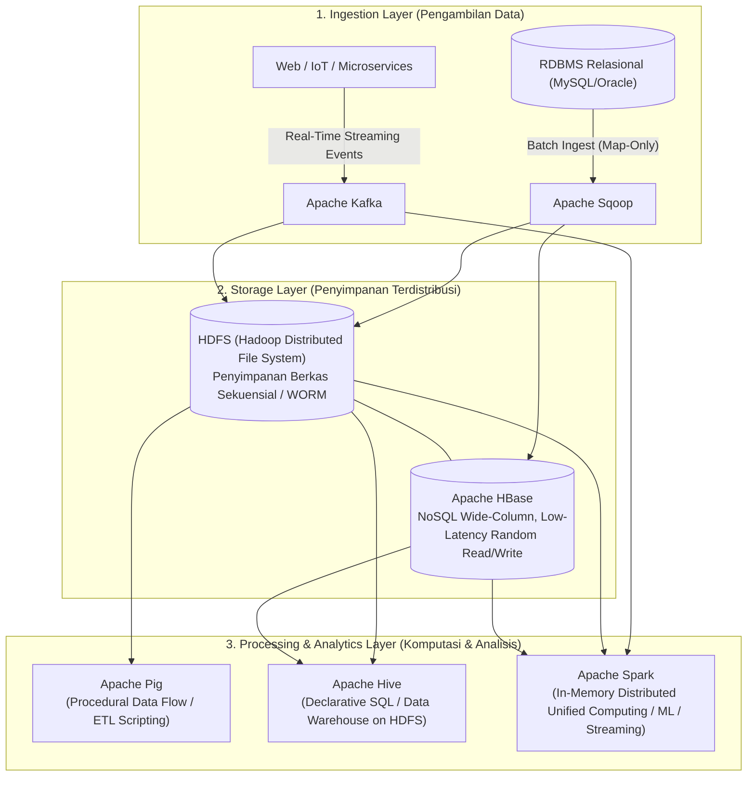
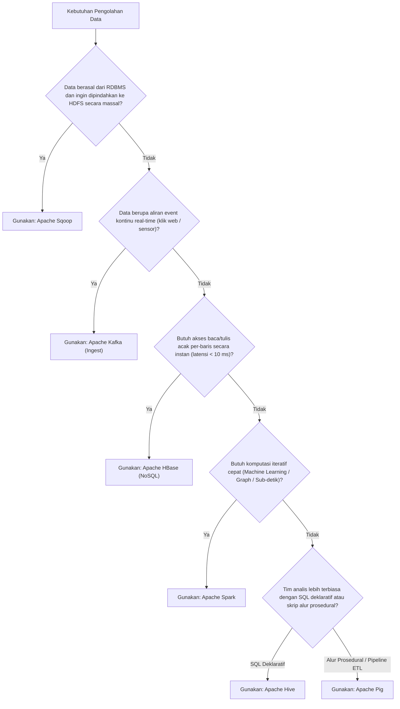

# 🌐 06.0 Matriks Perbandingan Akbar Ekosistem Hadoop

> [!ABSTRACT] Ringkasan Sub-Materi
> Menyajikan peta komparatif komprehensif lintas 6 alat bantu (*tools*) utama dalam ekosistem Apache Hadoop: **Apache Sqoop**, **Apache Hive**, **Apache HBase**, **Apache Pig**, **Apache Kafka**, dan **Apache Spark**. Fokus pada **Spesialisasi Aplikasi Unik** (apa yang membedakannya secara mutlak dari tools lain), fungsi utama, matriks komparasi 8 dimensi, pohon keputusan arsitektural (*decision tree*), kisi-kisi ujian, dan tips menjawab.

---

## 1. Peta Ekosistem Hadoop: Dari Ingest hingga Komputasi Memori

Ekosistem Big Data Hadoop dirancang seperti sebuah kotak perkakas modular di mana setiap *tool* memiliki spesialisasi peran unik dalam siklus hidup data:

---

## 2. Matriks Komparasi Akbar 6 Tools Utama

Tabel ini adalah acuan baku terlengkap untuk menjawab pertanyaan-pertanyaan spesialisasi alat pada UAS:

| Tool | Spesialisasi Aplikasi Unik (*Key Differentiator*) | Model Data / Struktur | Abstraksi Bahasa | Latensi Pemrosesan | Titik Integrasi Hadoop | Kasus Penggunaan Ideal |
| :--- | :--- | :--- | :--- | :--- | :--- | :--- |
| **Apache Sqoop** | **Jembatan Transfer Data Massal Dua Arah** antara RDBMS Relasional dan HDFS/Hive/HBase | Tabel Terstruktur Relasional (RDBMS) | CLI / Parameter Perintah Bash | Batch (Tergantung ukuran tabel) | Menggunakan **Map-Only Jobs** di Hadoop | Migrasi data master dari MySQL/Oracle ke HDFS saat awal proyek |
| **Apache Hive** | **Data Warehouse Terdistribusi Berbasis SQL Deklaratif** di atas HDFS untuk analis BI | Tabel Skematik Terstruktur (Skema RDBMS di atas file HDFS) | **HiveQL (Dialek SQL ANSI)** | Batch Tinggi (Puluhan detik s.d. jam) | Mengompilasi kueri SQL menjadi serangkaian job **MapReduce / Tez** | Pembuatan laporan analitik bulanan dan dashboard BI oleh tim analis SQL |
| **Apache HBase** | **NoSQL Column-Family Database Terdistribusi** untuk operasi kueri acak instan (*random read/write*) | Semi-Terstruktur (*Sparse Column Families*) | Java API / REST / HBase Shell | **Sangat Rendah (Sub-10 milidetik)** | Menggunakan **HDFS sebagai media simpan file HFile** | Sistem pencarian profil pelanggan real-time, sensor IoT, deteksi fraud |
| **Apache Pig** | **Platform Pemrosesan Data Aliran Prosedural (*Data Flow Pipeline*)** untuk transformasi data kompleks | Semi-Terstruktur / Tak Terstruktur (Bag, Tuple, Map) | **Pig Latin (Bahasa Prosedural / Alir)** | Batch Tinggi (Mirip Hive) | Menerjemahkan skrip DAG menjadi serangkaian job **MapReduce** | Pipeline pembersihan data (ETL), ekstraksi log mentah, data scrubbing |
| **Apache Kafka** | **Distributed Publish-Subscribe Event Streaming Platform** dengan throughput jutaan pesan/detik | Aliran Pesan Biner (*Key-Value byte arrays*) | Producer / Consumer API / Kafka Streams | **Real-Time Ekstrem (Sub-milidetik)** | Jalur masukan (*ingest*) untuk Spark Streaming atau Flume ke HDFS | Pengumpulan klik pengguna web (*clickstream*), agregasi log server terpusat |
| **Apache Spark** | **Mesin Komputasi Kluster Terpadu Berbasis Memori (*In-Memory*)**, hingga 100x lebih cepat dari MapReduce | Resilient Distributed Datasets (RDD), DataFrame | Python (PySpark), Scala, Java, Spark SQL | **Near Real-Time hingga Batch Mikro (Sub-detik)** | Berjalan di atas HDFS/YARN, menggantikan peran eksekusi MapReduce | Algoritma iteratif Machine Learning, graph analytics, stream processing |

---

## 3. Pohon Keputusan: "Kapan Memilih Tool Apa?"

---

## 4. Tiga Pasangan Perbandingan Paling Sering Diuji Dosen

### 1. Apache Hive vs Apache HBase
- **Hive**: Adalah mesin **Data Warehouse berbasis SQL** untuk analisis pemindaian batch (*batch scans*) pada dataset historis raksasa di HDFS. **Tidak mendukung pembaruan acak (*no random point writes*)**.
- **HBase**: Adalah mesin **Database NoSQL** yang dirancang untuk **pembacaan dan penulisan acak satu baris (*random read/write*) secara real-time** dengan latensi sub-10 ms.

### 2. Apache Hive vs Apache Pig
- **Hive**: Bahasa **Deklaratif (SQL)**. Pengguna hanya mendeskripsikan *apa* hasil yang diinginkan (`SELECT ... FROM ... WHERE ...`), membiarkan mesin Hive menentukan alur eksekusinya. Cocok untuk analis bisnis.
- **Pig**: Bahasa **Prosedural (Pig Latin)**. Pengguna mendeskripsikan *bagaimana* data mengalir langkah demi langkah (`LOAD ... FOREACH ... FILTER ... GENERATE ...`). Cocok untuk pemrogram dan insinyur data pipeline ETL.

### 3. Apache MapReduce vs Apache Spark
- **MapReduce**: Memproses data berbasis **Disk I/O**. Setiap langkah perantara (*intermediate output*) wajib ditulis dan dibaca kembali dari hard disk lokal, sehingga sangat lambat untuk algoritma iteratif.
- **Spark**: Memproses data secara terpadu di dalam **Memori RAM (*In-Memory Computing*)**. Data dipertahankan di RAM melintasi tahapan iterasi tanpa perlu menyentuh disk, menghasilkan kecepatan komputasi hingga **100 kali lipat lebih cepat** dibandingkan MapReduce.

---

## 🎯 Hal-Hal yang Kemungkinan Besar Masuk Ujian

1. **Spesialisasi Unik Tiap Tool**:
   - Dosen pasti menanyakan: *"Alat manakah yang bertindak sebagai jembatan impor data RDBMS ke HDFS?"* $\to$ **Sqoop**.
   - *"Alat manakah yang menyediakan akses random read/write latensi sub-10 ms?"* $\to$ **HBase**.
   - *"Alat manakah yang memproses data in-memory?"* $\to$ **Spark**.
2. **Abstraksi Bahasa**:
   - Hive $\to$ **HiveQL (SQL)**.
   - Pig $\to$ **Pig Latin (Prosedural)**.
   - Sqoop $\to$ **CLI / Batch Map-only**.
   - Spark $\to$ **RDD / DataFrame (Scala/Python/SQL)**.
3. **Mekanisme Eksekusi di Bawah Layar**:
   - Sqoop mengeksekusi **Map-only jobs** (tanpa Reducer).
   - Hive dan Pig mengompilasi skripnya menjadi serangkaian **MapReduce/Tez jobs**.
   - Spark memiliki mesin eksekusi sendiri berbasis **DAG Engine** independen dari MapReduce.

---

## 📋 Contoh Soal Ujian (Pilihan Ganda & Esai)

### Contoh Soal Pilihan Ganda
**Soal 1 (Pembeda Hive vs HBase)**  
Sebuah aplikasi analitik rumah sakit membutuhkan fitur pencarian riwayat rekam medis seorang pasien secara instan berdasarkan Nomor Rekam Medis (ID unik) dengan waktu respons di bawah 10 milidetik. Alat ekosistem Hadoop manakah yang paling tepat untuk kebutuhan tersebut?  
A. Apache Hive  
B. Apache Pig  
C. Apache HBase  
D. Apache Sqoop  
*Kunci Jawaban*: **C**  
*Pembahasan*: Apache HBase dirancang khusus untuk kueri acak (*random point queries*) dengan latensi sangat rendah (sub-10 ms) menggunakan RowKey. Apache Hive dan Pig adalah mesin pemindaian batch yang membutuhkan waktu puluhan detik untuk memulai komputasi.

**Soal 2 (Karakteristik Pemrosesan Spark vs MapReduce)**  
Alasan fundamental mengapa Apache Spark mampu menjalankan algoritma komputasi iteratif (seperti Machine Learning) hingga 100 kali lebih cepat dibandingkan Apache MapReduce tradisional adalah...  
A. Karena Spark tidak membutuhkan komputer server.  
B. Karena Spark mempertahankan data perantara (*intermediate data*) di dalam memori RAM utama melintasi seluruh siklus iterasi tanpa perlu menulis dan membaca ulang dari media hard disk mekanik.  
C. Karena Spark menghapus kebutuhan sistem operasi.  
D. Karena Spark hanya bisa berjalan pada satu node tunggal.  
*Kunci Jawaban*: **B**  
*Pembahasan*: Keunggulan utama Spark adalah *In-Memory Computing*. MapReduce membuang banyak waktu untuk siklus I/O hard disk pada setiap pergantian fase map dan reduce.

---

### Contoh Soal Esai
**Soal Esai**:  
Sebuah bank nasional ingin memodernisasi infrastruktur pengolahan datanya menggunakan ekosistem Apache Hadoop. Bank tersebut memiliki empat kebutuhan bisnis:  
1. Menyalin riwayat transaksi 10 tahun dari basis data Oracle ke HDFS setiap akhir pekan.  
2. Memungkinkan tim akuntan membuat laporan kepatuhan pajak bulanan menggunakan kueri bergaya SQL standar.  
3. Mendeteksi indikasi transaksi kartu kredit palsu (*fraud detection*) secara real-time saat nasabah menggesek kartu di mesin EDC.  
4. Melayani kueri pengecekan saldo rekening nasabah di aplikasi mobile banking dengan latensi instan (< 10 ms).  
Tentukan alat (*tool*) ekosistem Hadoop mana yang paling tepat untuk masing-masing dari ke-4 kebutuhan di atas, dan jelaskan alasan spesialisasi dari masing-masing alat yang Anda pilih!

**Pedoman Jawaban Lengkap**:
1. **Kebutuhan 1: Apache Sqoop**:
   - *Alasan*: Sqoop adalah alat yang dirancang khusus (*purpose-built*) untuk transfer data massal dua arah yang efisien antara sistem RDBMS relasional (Oracle) dan kluster HDFS menggunakan pekerjaan Map-only paralel.
2. **Kebutuhan 2: Apache Hive**:
   - *Alasan*: Hive menyediakan antarmuka deklaratif **HiveQL (dialek SQL)** yang familiar bagi analis bisnis dan akuntan untuk memindai dataset historis raksasa di HDFS tanpa perlu mempelajari bahasa pemrograman Java atau MapReduce tingkat rendah.
3. **Kebutuhan 3: Kombinasi Apache Kafka & Apache Spark Streaming**:
   - *Alasan*: Kafka bertindak sebagai pipa penerima aliran transaksi (*event ingestion*) dari ribuan mesin EDC secara real-time dengan latensi sub-milidetik. Spark Streaming memproses dan mengevaluasi aturan deteksi penipuan (*fraud detection algorithms*) di dalam memori RAM secara instan saat transaksi masuk.
4. **Kebutuhan 4: Apache HBase**:
   - *Alasan*: HBase adalah basis data NoSQL terdistribusi yang memiliki kemampuan melayani pembacaan acak satu baris (*random point lookup*) pada tabel berisi miliaran baris dengan latensi sangat rendah (**sub-10 milidetik**) menggunakan `RowKey` berupa nomor rekening nasabah. HDFS murni atau Hive tidak dapat melayani kueri instan ini karena berkarakteristik batch.

---

## 💡 Tips & Trik Menjawab Soal Ujian

1. **Jurus Pencocokan Cepat Nama Tool**:
   - RDBMS $\leftrightarrow$ HDFS $\to$ **Sqoop**.
   - SQL di atas HDFS $\to$ **Hive**.
   - NoSQL / Latensi < 10 ms / Random Read-Write $\to$ **HBase**.
   - Data Flow / Pipeline ETL Prosedural $\to$ **Pig**.
   - Real-Time Message Bus / Event Streaming $\to$ **Kafka**.
   - In-Memory Computing / Cepat 100x $\to$ **Spark**.
2. **Trik Esai Perbandingan**:
   - Selalu sebutkan aspek **Latensi** (Batch vs Sub-detik vs Sub-10ms) dan **Struktur Data** (Relasional vs Column-Family vs Byte-Stream) saat membandingkan dua alat untuk mendapatkan nilai penuh.
