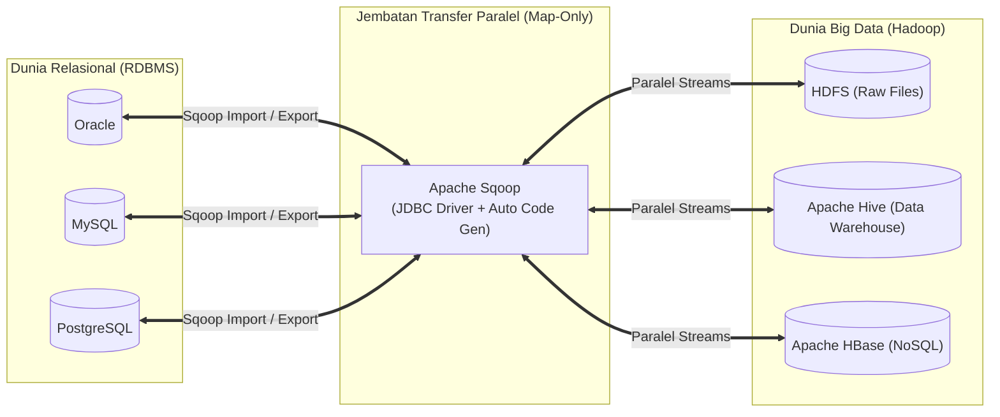
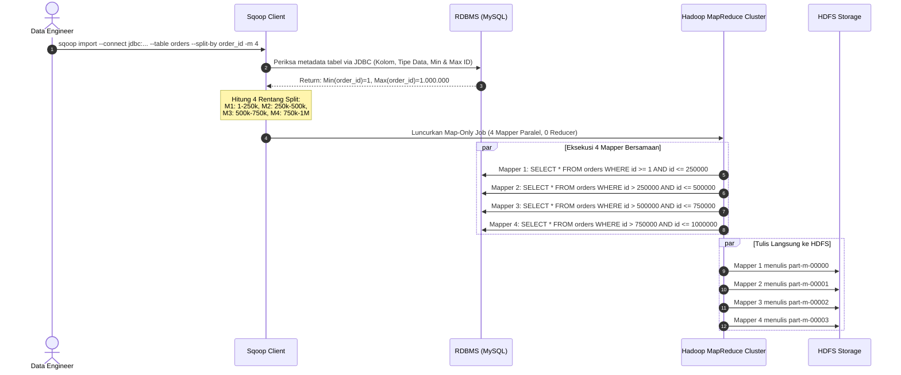
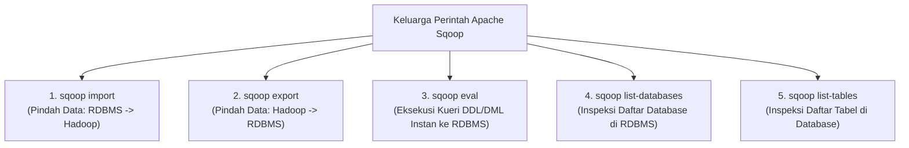

# 🔄 06.1 Apache Sqoop (RDBMS to HDFS Transfer & Map-Only Jobs)

> [!ABSTRACT] Ringkasan Sub-Materi
> Menelaah secara mendalam alat bantu transfer data **Apache Sqoop** (*SQL-to-Hadoop*). Sub-materi ini membahas spesialisasi peran Sqoop sebagai jembatan dua arah RDBMS $\leftrightarrow$ Hadoop, arsitektur eksekusi berbasis **Map-Only Jobs** (tanpa Reducer), pembagian partisi paralel menggunakan *Primary Key*, fitur *Incremental Import*, format penyimpanan, kisi-kisi ujian, dan tips menjawab.

---

## 1. Spesialisasi Aplikasi Unik (*The Differentiator*)

Nama **Sqoop** merupakan portmanteau (singkatan) dari **SQL-to-Hadoop**:
- **Spesialisasi Unik**: Apache Sqoop dirancang khusus (*purpose-built*) untuk melakukan **transfer data terstruktur dalam volume massal (*bulk data transfer*) secara efisien dan dua arah antara sistem basis data relasional (RDBMS) dan ekosistem Hadoop (HDFS, Hive, HBase)**.
- **Mengapa Dibutuhkan?**:
  - Menulis script Java JDBC manual untuk memindahkan 10 Terabyte data dari Oracle ke HDFS akan sangat lambat, rawan putus koneksi, dan membebani server tunggal.
  - Sqoop mengotomatisasi seluruh proses tersebut dengan memanfaatkan daya komputasi paralel dari kluster Hadoop.



---

## 2. Dua Arah Operasi Utama

1. **Sqoop Import (RDBMS $\longrightarrow$ Hadoop)**:
   - Membaca baris-baris tabel dari RDBMS dan menuliskannya sebagai kumpulan berkas terpartisi di HDFS, tabel metastore di Apache Hive, atau tabel kolom di Apache HBase.
2. **Sqoop Export (Hadoop $\longrightarrow$ RDBMS)**:
   - Membaca data hasil agregasi/analisis dari HDFS dan menyalinnya kembali (*bulk insert/update*) ke dalam tabel target di RDBMS agar dapat diakses oleh aplikasi kasir, portal web, atau sistem ERP operasional.

---

## 3. Cara Kerja Konseptual: Mengapa Sqoop Berbasis "Map-Only"?

Dosen sangat gemar menanyakan mekanisme kerja internal Sqoop: *"Bagaimana Sqoop memindahkan data secara paralel dan mengapa Sqoop tidak menggunakan Reducer?"*



### Langkah-Langkah Detail Kerja Sqoop:
1. **Pemeriksaan Metadata (Introspection via JDBC)**:
   - Sqoop menghubungi RDBMS melalui driver JDBC standar. Sqoop memeriksa skema tabel: nama-nama kolom, tipe data SQL, dan keberadaan **Primary Key**.
2. **Penentuan Batas Rentang Data (*Splitting Boundary*)**:
   - Jika pengguna menentukan parameter 4 mapper (`-m 4`), Sqoop mengeksekusi kueri agregasi cepat ke RDBMS:
     `SELECT MIN(primary_key), MAX(primary_key) FROM table;`
   - Berdasarkan nilai minimum dan maksimum tersebut, Sqoop membagi rentang data menjadi 4 irisan (*splits*) yang sama rata.
3. **Pembangkitan Kode Java Otomatis (*Auto Code Generation*)**:
   - Sqoop secara otomatis men-generate sebuah kelas Java DAO (*Data Access Object*) yang mengonversi tipe data SQL (misal `VARCHAR`, `INTEGER`, `TIMESTAMP`) menjadi tipe data serialisasi Hadoop (`Text`, `IntWritable`, dll).
4. **Peluncuran Map-Only Job (Nol Reducer)**:
   - Sqoop mengirimkan pekerjaan komputasi ke kluster Hadoop. Pekerjaan ini **HANYA TERDIRI DARI FASE MAPPER (Map-Only Job)**.
   - Jumlah Reducer secara sengaja diatur **tepat 0 (`numReduceTasks = 0`)**.
   - *Alasan Arsitektural*: Tugas Sqoop murni membaca data dari sumber dan menuliskannya ke target (*data transfer / replication*). Tidak ada proses kalkulasi matematika, tidak ada pengelompokan agregasi, dan tidak ada pengurutan ulang. Menambahkan fase Reducer hanya akan membuang waktu dan memicu network shuffle yang tidak perlu.
5. **Penulisan Paralel ke HDFS**:
   - Masing-masing Mapper membaca bagian datanya secara independen langsung dari RDBMS dan menuliskannya langsung ke blok HDFS. Setiap Mapper menghasilkan satu berkas partisi bernama `part-m-00000`, `part-m-00001`, dst (huruf `m` menandakan hasil dari Mapper).

---

---

## 4. 5 Perintah Utama Apache Sqoop (Sering Keluar di Ujian Esai!)

Dalam ujian UAS, mahasiswa sering diminta menyebutkan dan menjelaskan perintah-perintah utama pada Apache Sqoop beserta contoh sintaksnya:



### 1. `sqoop import`
- **Fungsi**: Mengimpor data satu tabel (atau hasil kueri SQL) dari basis data relasional (RDBMS) ke dalam sistem penyimpanan Hadoop (HDFS, Hive, atau HBase).
- **Contoh Sintaks**:
  ```bash
  sqoop import \
    --connect jdbc:mysql://localhost:3306/db_penjualan \
    --username root \
    --password secret \
    --table produk \
    --target-dir /data/produk \
    -m 4
  ```

### 2. `sqoop export`
- **Fungsi**: Mengekspor sekumpulan berkas data hasil pengolahan di HDFS kembali ke tabel target yang sudah ada pada basis data relasional.
- **Contoh Sintaks**:
  ```bash
  sqoop export \
    --connect jdbc:mysql://localhost:3306/db_penjualan \
    --username root \
    --password secret \
    --table produk_ringkasan \
    --export-dir /data/produk_agregat \
    -m 2
  ```

### 3. `sqoop eval` (Paling Sering Masuk Pilihan Ganda!)
- **Fungsi**: Mengeksekusi kueri SQL instan (**baik perintah DDL seperti `CREATE`/`DROP` maupun DML seperti `SELECT`/`INSERT`/`UPDATE`**) secara langsung terhadap basis data relasional sumber tanpa perlu menyimpan hasilnya ke HDFS. Sangat berguna untuk menguji koneksi JDBC, melihat preview data, atau memvalidasi skema sebelum melakukan impor massal.
- **Contoh Sintaks**:
  ```bash
  sqoop eval \
    --connect jdbc:mysql://localhost:3306/db_penjualan \
    --username root \
    --password secret \
    --query "SELECT id, nama, harga FROM produk WHERE stok > 50 LIMIT 10"
  ```

### 4. `sqoop list-databases`
- **Fungsi**: Menampilkan daftar seluruh nama basis data (*databases/schemas*) yang tersedia pada server RDBMS target melalui koneksi JDBC.
- **Contoh Sintaks**:
  ```bash
  sqoop list-databases \
    --connect jdbc:mysql://localhost:3306/ \
    --username root \
    --password secret
  ```

### 5. `sqoop list-tables`
- **Fungsi**: Menampilkan daftar seluruh tabel yang berada di dalam basis data spesifik pada server RDBMS target.
- **Contoh Sintaks**:
  ```bash
  sqoop list-tables \
    --connect jdbc:mysql://localhost:3306/db_penjualan \
    --username root \
    --password secret
  ```

---

## 5. Fitur Penting: Incremental Import & Format Berkas

### A. Parameter Kunci Incremental Import (Soal Wajib UAS!)
Untuk menghindari pengunduhan ulang seluruh tabel setiap hari (*full load*), Sqoop menyediakan fitur pengisian bertahap (*incremental load*). Tiga parameter utama yang **wajib digunakan bersamaan**:
1. `--incremental <mode>`: Menentukan mode inkremental, yaitu:
   - `append`: Untuk data sekuensial yang selalu bertambah (misal transaksi dengan ID baru).
   - `lastmodified`: Untuk data yang dapat diubah nilainya (*update*) berdasarkan timestamp.
2. `--check-column <nama_kolom>`: Menentukan kolom acuan pemeriksaan (misal `id` transaksi atau `updated_at`).
3. `--last-value <nilai>`: Menentukan batas nilai terakhir yang telah diimpor pada proses sebelumnya. Baris yang akan diimpor berikutnya adalah yang memiliki nilai lebih besar dari nilai ini.

**Contoh Perintah Incremental Import**:
```bash
sqoop import \
  --connect jdbc:mysql://localhost:3306/db_penjualan \
  --username root \
  --table transaksi \
  --target-dir /data/transaksi \
  --incremental append \
  --check-column id_transaksi \
  --last-value 150000
```

### B. Format Berkas yang Didukung di HDFS:
- *TextFile (CSV/TSV)*: Berkas teks biasa yang mudah dibaca manusia.
- *SequenceFile*: Format biner terkompresi berkinerja tinggi bawaan Hadoop.
- *Apache Avro*: Format biner berbasis skema JSON yang mendukung evolusi skema (*schema evolution*).
- *Apache Parquet*: Format penyimpanan berbasis kolom (*columnar storage*) yang paling efisien dalam kompresi dan penghematan ruang penyimpanan kueri analitik.

---

## 🎯 Hal-Hal yang Kemungkinan Besar Masuk Ujian

1. **Mengapa Sqoop Menggunakan Map-Only Job?**:
   - *Jawab*: Karena proses impor data adalah transfer data langsung tanpa membutuhkan agregasi atau pengurutan ulang. Fase Shuffle dan Reduce dihilangkan untuk memaksimalkan kecepatan transfer (*zero shuffle overhead*).
2. **Peran Primary Key dalam Eksekusi Sqoop**:
   - Sqoop membutuhkan kolom Primary Key (atau kolom yang ditentukan via `--split-by`) untuk **membagi rentang baris data secara merata ke masing-masing tugas Mapper**.
3. **Format Penamaan Berkas Output Sqoop**:
   - Berkas bernama `part-m-XXXXX` (huruf `m` untuk mapper), berbeda dengan output MapReduce standar `part-r-XXXXX` (huruf `r` untuk reducer).
4. **Fungsi `sqoop eval`**:
   - Menjalankan kueri SQL DDL maupun DML langsung ke database sumber tanpa menulis ke HDFS.
5. **Trio Parameter Incremental Load**:
   - `--incremental`, `--check-column`, dan `--last-value`.
6. **5 Perintah Utama Sqoop**:
   - `import`, `export`, `eval`, `list-databases`, dan `list-tables`.

---

## 📋 Contoh Soal Ujian (Pilihan Ganda & Esai)

### Contoh Soal Pilihan Ganda
**Soal 1 (Mekanisme Eksekusi Sqoop)**  
Mengapa pekerjaan komputasi MapReduce yang dihasilkan oleh Apache Sqoop saat melakukan impor data dari basis data MySQL ke HDFS secara default dikonfigurasi sebagai *Map-Only Job* (tanpa fase Reducer)?  
A. Karena mesin MySQL tidak mendukung sintaks Reducer.  
B. Karena proses impor Sqoop murni merupakan operasi pembacaan dan penyalinan data paralel secara langsung ke HDFS tanpa memerlukan agregasi, pengurutan, atau pemindahan data lintas jaringan (*shuffle*).  
C. Karena memori RAM DataNode tidak cukup untuk menjalankan Reducer.  
D. Agar data yang tersimpan di HDFS terenkripsi otomatis.  
*Kunci Jawaban*: **B**  
*Pembahasan*: Pekerjaan impor data tidak melakukan kalkulasi gabungan (*aggregation*). Menggunakan Reducer hanya akan membuang sumber daya kluster untuk proses network shuffle yang sia-sia.

**Soal 2 (Peranan Kolom Pembagi Data)**  
Jika sebuah tabel RDBMS yang akan diimpor menggunakan Apache Sqoop dengan 4 Mapper tidak memiliki kolom *Primary Key*, tindakan apa yang wajib ditentukan oleh administrator dalam perintah Sqoop agar proses pembagian data paralel dapat berjalan sukses?  
A. Menghapus tabel tersebut dari RDBMS.  
B. Menentukan kolom pembagi secara eksplisit menggunakan parameter `--split-by <nama_kolom>`, atau memaksa jumlah mapper menjadi tepat satu (`-m 1`).  
C. Mengubah format berkas menjadi PDF.  
D. Me-restart master NameNode.  
*Kunci Jawaban*: **B**  
*Pembahasan*: Sqoop mengandalkan Primary Key untuk membagi beban rentang data ke mapper. Jika tidak ada PK, pengguna harus menentukan kolom alternatif via `--split-by` atau menjalankan impor secara serial dengan 1 mapper (`-m 1`).

---

### Contoh Soal Esai
**Soal Esai**:  
Sebuah perusahaan e-commerce memiliki tabel transaksi pesanan `orders` di basis data PostgreSQL produksi yang menampung 50 juta baris data (total ukuran $\approx 20\text{ GB}$). Perusahaan ingin memigrasikan data tersebut ke HDFS menggunakan Apache Sqoop dengan 4 proses paralel.  
a. Jelaskan secara teknis bagaimana Apache Sqoop membagi tabel `orders` tersebut ke dalam 4 tugas paralel dan bagaimana masing-masing tugas berinteraksi dengan database sumber!  
b. Jelaskan mengapa luaran berkas yang dihasilkan di HDFS memiliki penamaan berawalan `part-m-` dan bukan `part-r-`!

**Pedoman Jawaban Lengkap**:
1. **Mekanisme Pembagian Beban Paralel Sqoop**:
   - *Tahap 1*: Klien mengeksekusi perintah Sqoop import dengan parameter `-m 4`. Sqoop menghubungi PostgreSQL via JDBC dan memeriksa nilai minimum dan maksimum dari kolom Primary Key (misal `order_id`):  
     `SELECT MIN(order_id), MAX(order_id) FROM orders;`
   - *Tahap 2*: Misalkan nilai minimum adalah 1 dan maksimum adalah 50.000.000. Sqoop menghitung lebar rentang (*split size*): $\frac{50.000.000}{4} = 12.500.000$ baris per tugas.
   - *Tahap 3*: Sqoop meluncurkan 4 Mapper di kluster Hadoop. Masing-masing Mapper menjalankan kueri SQL terisolasi ke database PostgreSQL secara bersamaan:
     - Mapper 1: `SELECT * FROM orders WHERE order_id >= 1 AND order_id < 12500001`
     - Mapper 2: `SELECT * FROM orders WHERE order_id >= 12500001 AND order_id < 25000001`
     - Mapper 3: `SELECT * FROM orders WHERE order_id >= 25000001 AND order_id < 37500001`
     - Mapper 4: `SELECT * FROM orders WHERE order_id >= 37500001 AND order_id <= 50000000`
   - *Tahap 4*: Setiap Mapper membaca aliran baris data dari PostgreSQL dan langsung menuliskannya secara independen ke blok-blok HDFS.
2. **Alasan Penamaan Berkas `part-m-`**:
   - Di Hadoop MapReduce, konvensi penamaan berkas luaran mencerminkan komponen yang menghasilkannya:
     - Huruf **`m`** menandakan bahwa berkas tersebut ditulis langsung oleh tugas **Mapper** (`part-m-00000`).
     - Huruf **`r`** menandakan bahwa berkas tersebut ditulis oleh tugas **Reducer** (`part-r-00000`).
   - Karena pekerjaan Sqoop adalah **Map-Only Job** (di mana jumlah Reducer dikonfigurasi nol untuk efisiensi transfer data langsung tanpa shuffle), seluruh berkas yang dihasilkan di HDFS secara otomatis diberi awalan `part-m-`.

---

## 💡 Tips & Trik Menjawab Soal Ujian

1. **Jurus Kata Kunci Sqoop**:
   - SQL-to-Hadoop, jembatan dua arah RDBMS $\leftrightarrow$ Hadoop.
   - **Map-Only Job** (tanpa Reducer, zero shuffle overhead).
   - Bergantung pada **Primary Key** untuk splitting beban paralel.
   - Output berkas berawalan **`part-m-`**.
2. **Trik Membedakan Sqoop vs Flume / Kafka**:
   - Jika sumber data adalah **basis data relasional (RDBMS / batch)** $\to$ Jawab: **Sqoop**.
   - Jika sumber data adalah **aliran log server / event kontinu real-time** $\to$ Jawab: **Kafka** atau **Flume**.
