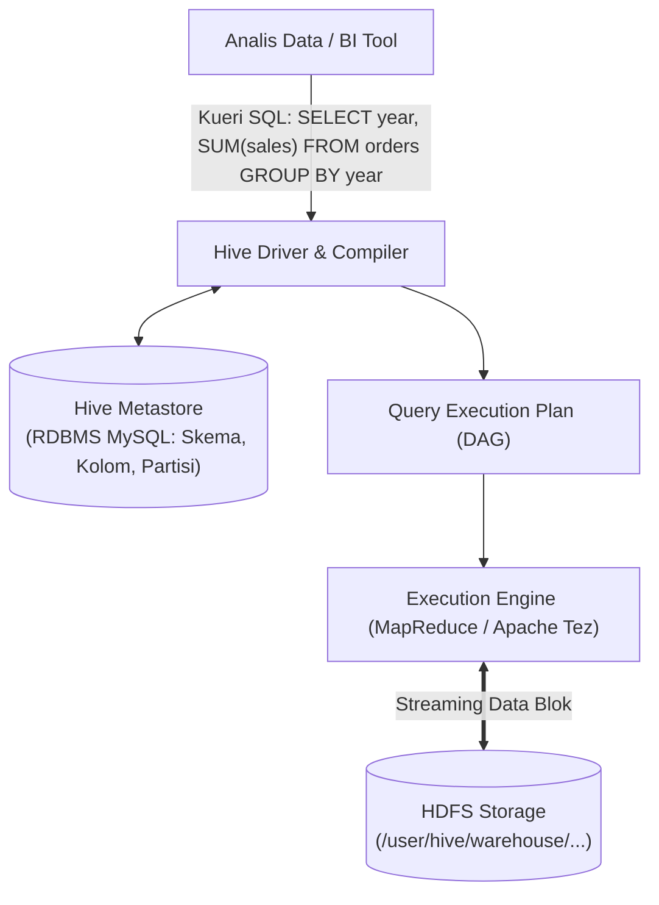
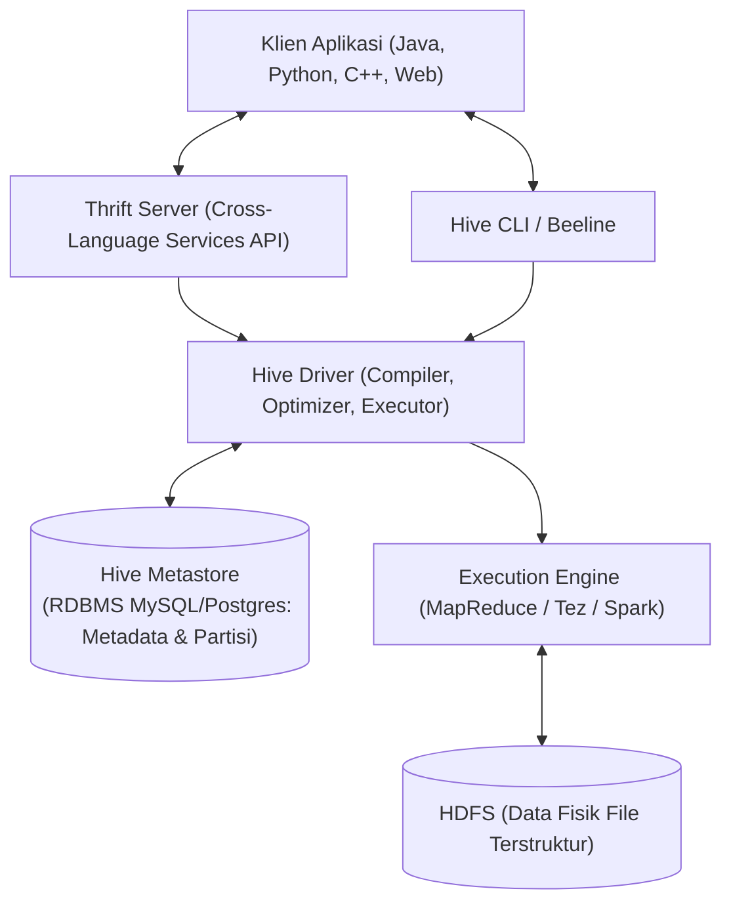
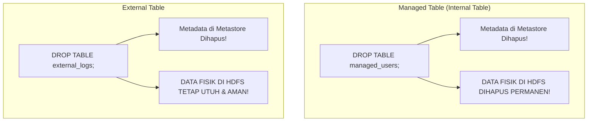
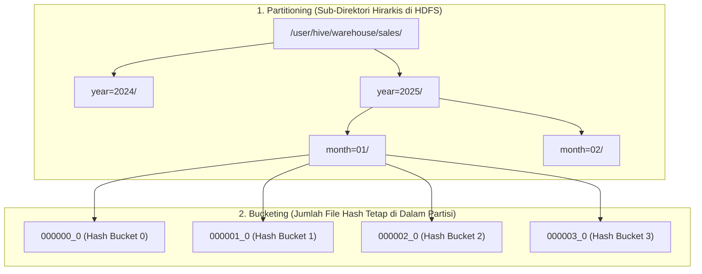

# 🐝 06.2 Apache Hive (SQL on HDFS, Metastore, Partitioning vs Bucketing)

> [!ABSTRACT] Ringkasan Sub-Materi
> Menelaah secara mendalam platform data warehouse terdistribusi **Apache Hive** yang dipelopori oleh tim data Facebook. Sub-materi ini membahas arsitektur penerjemahan bahasa deklaratif **HiveQL** menjadi pekerjaan MapReduce/Tez, peranan krusial **Hive Metastore**, perbedaan fatal antara **Managed Table vs External Table**, teknik optimasi **Partitioning vs Bucketing**, kisi-kisi ujian, dan panduan jawaban esai.

---

## 1. Spesialisasi Aplikasi Unik (*The Differentiator*)

Sebelum Apache Hive diciptakan, siapapun yang ingin menganalisis data di HDFS harus menulis puluhan hingga ratusan baris kode pemrograman Java MapReduce yang rumit. Hal ini membatasi pemanfaatan Big Data hanya bagi insinyur perangkat lunak senior.

**Spesialisasi Unik Apache Hive**:
- Membangun abstraksi **Data Warehouse terdistribusi di atas HDFS** dengan menyediakan antarmuka kueri berbasis dialek SQL deklaratif yang disebut **HiveQL**.
- Memungkinkan para analis data, pakar statistik, dan eksekutif bisnis untuk melakukan agregasi dan kueri analitis pada dataset berskala Petabyte menggunakan sintaks SQL yang telah mereka kuasai (`SELECT`, `JOIN`, `GROUP BY`).
- Di bawah layar, mesin Hive secara otomatis **menerjemahkan kueri SQL tersebut menjadi serangkaian pekerjaan MapReduce atau Apache Tez**.



---

---

## 2. Arsitektur Komponen Utama Hive



1. **Hive Thrift Server (Sangat Sering Keluar di Pilihan Ganda!)**:
   - Berfungsi sebagai **kerangka kerja layanan lintas bahasa (*cross-language services framework*)**.
   - Menyediakan antarmuka RPC (*Remote Procedure Call*) berbasis Apache Thrift yang memungkinkan aplikasi luar yang ditulis dalam berbagai bahasa pemrograman berbeda (Python, Java, PHP, C++, Ruby) untuk terhubung, mengirimkan kueri SQL, dan menerima hasil dari Hive secara terstandarisasi.
2. **Hive Driver, Compiler, & Optimizer**:
   - Menerima kueri HiveQL dari pengguna atau Thrift Server.
   - Mengurai sintaks (*parsing*), memvalidasi semantik kebenaran nama tabel dan tipe data kolom dengan memeriksa Metastore.
   - Mengubah kueri SQL menjadi *Directed Acyclic Graph (DAG)* yang optimal dan menghasilkan pekerjaan MapReduce/Tez yang siap dieksekusi di kluster.
3. **Hive Metastore (Kamus Data Skema)**:
   - **Definisi Resmi**: Pusat penyimpanan metadata untuk tabel dan partisi Hive di dalam **basis data relasional (RDBMS eksternal seperti MySQL atau PostgreSQL)**, dan memberikan klien akses ke informasi ini menggunakan API layanan metastore (*Metastore Service API*).
   - Menyimpan seluruh definisi: nama tabel, skema tipe kolom, lokasi direktori fisik di HDFS, format serialisasi (*SerDe*), dan informasi partisi/bucketing.
   - *Mengapa di RDBMS?*: Karena Hive membutuhkan pembacaan metadata skema dengan latensi sangat rendah saat memvalidasi kueri tanpa membebani HDFS.
4. **Execution Engine (Mesin Eksekusi)**:
   - Bertugas menjalankan rencana eksekusi fisik (MapReduce, Apache Tez, atau Apache Spark).
5. **Karakteristik Data: Khusus Data Terstruktur (*Structured Data Only*)**:
   - Berbeda dengan Spark atau Pig yang dapat mengolah data semi-terstruktur dan tidak terstruktur, **Apache Hive secara fundamental dirancang khusus hanya untuk memproses data terstruktur (*structured data*)** yang memiliki skema terdefinisi jelas (*Schema-on-Read*).

---

## 3. Klasifikasi Perintah HiveQL: DDL vs DML (Awas Jebakan Ujian!)

Banyak mahasiswa terkecoh membedakan antara Data Definition Language (DDL) dan Data Manipulation Language (DML) pada HiveQL:

| Kategori | Definisi | Contoh Perintah HiveQL |
| :--- | :--- | :--- |
| **DDL (Data Definition Language)** | Perintah untuk mendefinisikan, mengubah, atau memeriksa struktur/metadata tabel di Metastore | `CREATE TABLE`, `ALTER TABLE`, `DROP TABLE`, `TRUNCATE TABLE`, `SHOW TABLES`, `SHOW PARTITIONS`, `DESCRIBE [FORMATTED] <tabel>` |
| **DML (Data Manipulation Language)** | Perintah untuk memanipulasi, memuat, dan mengambil isi data fisik | **`LOAD DATA [LOCAL] INPATH ... INTO TABLE`** (⚠️ *Bukan DDL!*), `INSERT INTO / OVERWRITE TABLE`, `SELECT ... FROM` |

> [!WARNING] Jebakan Populer UAS
> Perintah **`LOAD DATA`** atau **`LOAD TABLE`** tergolong dalam **DML**, karena tugasnya adalah memindahkan atau menyalin berkas data fisik ke dalam direktori tabel di HDFS, bukan mendefinisikan skema metadata! Sebaliknya, `SHOW TABLES` dan `DESCRIBE` adalah **DDL**.

---

## 4. Konsep Krusial: Managed Table vs External Table

Dosen penguji hampir selalu mengeluarkan topik ini di ujian pilihan ganda maupun esai:



### A. Managed Table (Internal Table)
- **Definisi**: Tabel di mana Hive memiliki **kendali penuh** atas skema dan siklus hidup data fisik berkasnya.
- **Lokasi Penyimpanan**: Berkas disimpan di direktori default internal Hive Warehouse di HDFS (biasanya di `/user/hive/warehouse/nama_tabel`).
- **Dampak Perintah `DROP TABLE`**:
  - Jika Anda mengeksekusi `DROP TABLE`, Hive akan menghapus **metadata tabel di Metastore DAN MENGHAPUS BERKAS FISIK DATA DI HDFS SECARA PERMANEN!**
- **Kasus Penggunaan**: Cocok untuk tabel temporer, tabel olahan internal, atau data yang sepenuhnya dimiliki oleh tim analis Hive.

### B. External Table (Tabel Eksternal)
- **Definisi**: Tabel di mana Hive **hanya mengelola metadata skema saja**, sedangkan data fisik berkasnya berada di direktori kustom HDFS di luar kendali langsung Hive.
- **Karakteristik**: Dideklarasikan menggunakan kata kunci `CREATE EXTERNAL TABLE ... LOCATION '/path/hdfs/kustom'`.
- **Dampak Perintah `DROP TABLE`**:
  - Jika Anda mengeksekusi `DROP TABLE`, Hive **HANYA AKAN MENGHAPUS METADATA di Metastore**. Berkas fisik data mentah di HDFS **TETAP AMAN 100% DAN TIDAK AKAN PERNAH TERHAPUS!**
- **Kasus Penggunaan (Standar Industri)**: Wajib digunakan untuk data mentah (*raw data logs*), data bersama yang juga diakses oleh Spark atau Pig, dan data kritis perusahaan agar tidak sengaja terhapus oleh kueri analis.

---

## 4. Teknik Optimasi Penyimpanan: Partitioning vs Bucketing

Untuk mencegah agar kueri tidak melakukan pemindaian seluruh isi tabel (*Full Table Scan*) pada dataset ratusan Terabyte, Hive menyediakan dua strategi partisi fisik:



### A. Partitioning (Pemartisian Direktori)
- **Mekanisme**: Membagi tabel ke dalam **sub-direktori fisik hirarkis di HDFS** berdasarkan nilai dari satu atau beberapa kolom partisi (misal kolom `year` dan `country`).
- **Keuntungan Utama (*Partition Pruning*)**:
  - Jika pengguna menjalankan kueri:  
    `SELECT * FROM sales WHERE year = 2025 AND country = 'ID';`
  - Mesin Hive hanya akan membuka dan memindai folder `/year=2025/country=ID/`. Seluruh folder tahun dan negara lainnya diabaikan sepenuhnya (*pruned*), memangkas waktu eksekusi kueri dari hitungan jam menjadi hitungan detik.
- **Batasan**: Kolom partisi harus memiliki kardinalitas rendah/sedang (misal tanggal, tahun, wilayah). Jangan mempartisi berdasarkan kolom berkardinalitas tinggi seperti `user_id` karena akan menciptakan jutaan folder kecil (*Small Files Problem* di NameNode!).

### B. Bucketing / Clustering (Pembagian Ember Hash)
- **Mekanisme**: Memecah data di dalam suatu direktori menjadi **sejumlah berkas fisik dengan jumlah tetap (*fixed number of bucket files*)** berdasarkan fungsi hash dari suatu kolom:
  $$\text{Nomor Bucket} = \text{hash(kolom)} \pmod{\text{jumlah\_bucket}}$$
- **Keuntungan Utama**:
  1. **Optimalisasi Kueri JOIN (*Map-Side Bucket Join*)**: Jika dua tabel besar di-bucket pada kolom yang sama (misal `customer_id`) dengan kelipatan bucket yang sama, proses JOIN antar-tabel dapat dilakukan langsung di memori Mapper tanpa perlu melakukan *network shuffle* yang mahal.
  2. **Pengambilan Sampel Cepat (*Efficient Sampling*)**: Memungkinkan pengambilan sampel data secara representatif menggunakan klausa `TABLESAMPLE(BUCKET x OUT OF y)`.

---

## 5. Matriks Komparasi Ringkas: Partitioning vs Bucketing

| Dimensi Perbandingan | Partitioning | Bucketing (Clustering) |
| :--- | :--- | :--- |
| **Bentuk Fisik di HDFS** | Membentuk **Sub-Direktori Hirarkis** | Membentuk **Berkas Fisik Terpisah** di dalam direktori |
| **Kriteria Penentuan** | Berdasarkan nilai unik kolom (misal `year=2025`) | Berdasarkan fungsi kalkulasi hash modulo kolom |
| **Jumlah Hasil** | Dinamis (Sebanyak nilai unik kolom partisi) | **Tetap / Statis** (Ditentukan di awal via `CLUSTERED BY ... INTO N BUCKETS`) |
| **Kolom yang Tepat** | Kolom kardinalitas rendah (Tahun, Bulan, Wilayah) | Kolom kardinalitas tinggi (ID Pengguna, ID Transaksi) |
| **Manfaat Utama** | *Partition Pruning* (Menghindari scan folder lain) | *Map-Side Join Optimization* & *Data Sampling* |

---

---

## 🎯 Hal-Hal yang Kemungkinan Besar Masuk Ujian

1. **Peran Thrift Server**:
   - Sebagai framework layanan lintas bahasa (*cross-language services*) agar aplikasi dari berbagai bahasa (Python, Java, PHP, dll) dapat berinteraksi dengan Hive via RPC.
2. **Definisi Hive Metastore**:
   - Pusat penyimpanan metadata tabel dan partisi di dalam **RDBMS eksternal** (MySQL/PostgreSQL) yang diakses klien via Metastore Service API.
3. **Perbedaan Managed vs External Table**:
   - *Managed Table* $\implies$ `DROP TABLE` menghapus **metadata DAN data fisik HDFS**.
   - *External Table* $\implies$ `DROP TABLE` **HANYA menghapus metadata**, data fisik HDFS tetap utuh.
4. **Klasifikasi DDL vs DML**:
   - `CREATE TABLE`, `SHOW TABLES`, `DESCRIBE` adalah **DDL**.
   - `LOAD DATA` adalah **DML** (karena memanipulasi pemindahan berkas data fisik).
5. **Spesialisasi Data Terstruktur**:
   - Hive hanya dirancang untuk memproses **data terstruktur (*structured data*)**, bukan data bebas tanpa skema.
6. **Partitioning vs Bucketing**:
   - Partitioning = sub-folder hirarki (bagus untuk filter WHERE kolom tanggal/kategori).
   - Bucketing = file hash dengan jumlah tetap (bagus untuk JOIN kolom ID).

---

## 📋 Contoh Soal Ujian (Pilihan Ganda & Esai)

### Contoh Soal Pilihan Ganda

**Soal 1 (Dampak DROP TABLE pada External Table)**  
Seorang data engineer membuat tabel di Apache Hive menggunakan perintah:  
`CREATE EXTERNAL TABLE web_logs (...) LOCATION '/data/logs/';`  
Suatu hari, engineer tersebut tidak sengaja mengeksekusi perintah `DROP TABLE web_logs;`. Apa yang terjadi pada data log di HDFS?  
A. Seluruh berkas log di `/data/logs/` terhapus permanen dari HDFS.  
B. Hanya metadata definisi tabel di Metastore yang terhapus, sedangkan berkas fisik data mentah di direktori HDFS `/data/logs/` tetap aman dan utuh sepenuhnya.  
C. Seluruh kluster Hadoop mengalami restart otomatis.  
D. Berkas data dipindahkan ke recycle bin komputer klien.  
*Kunci Jawaban*: **B**  
*Pembahasan*: Karakteristik utama dari External Table adalah pelepasan kepemilikan data fisik. Hive hanya mengelola metadata skema; penghapusan tabel eksternal tidak pernah menyentuh data fisik di HDFS.

**Soal 2 (Klasifikasi Perintah HiveQL)**  
Berikut ini yang BUKAN merupakan perintah Data Definition Language (DDL) pada HiveQL adalah...  
A. `LOAD TABLE` / `LOAD DATA`  
B. `CREATE TABLE`  
C. `SHOW TABLES`  
D. `DESCRIBE`  
*Kunci Jawaban*: **A**  
*Pembahasan*: `LOAD DATA` tergolong DML (Data Manipulation Language) karena memanipulasi pengisian file data fisik ke dalam direktori tabel.

**Soal 3 (Komponen Cross-Language Services)**  
Komponen Apache Hive yang berperan sebagai kerangka kerja (*framework*) untuk menyediakan layanan lintas bahasa (*cross-language services*) adalah...  
A. Hive Driver  
B. Hive CLI  
C. Thrift Server  
D. Metastore  
*Kunci Jawaban*: **C**  
*Pembahasan*: Apache Thrift Server memungkinkan client dari bahasa pemrograman non-Java (Python, PHP, C++) terhubung dan mengirim kueri ke Hive.

---

### Contoh Soal Esai

#### Soal Esai 1: Kueri HiveQL Penggabungan Tabel & Penyaringan (UAS 2022/2023)
Diketahui dua tabel pada Apache Hive:
- **Tabel A**: memuat kolom `ID`, `Nama`, `Usia`.
- **Tabel B**: memuat kolom `ID`, `Kota`, `Gaji`.

Tuliskan sintaks kueri HiveQL yang tepat untuk:
a. Menggabungkan Tabel A dan Tabel B berdasarkan kolom `ID`!  
b. Menampilkan nama dan gaji pegawai yang berumur di bawah 30 tahun dan bertempat tinggal di kota "Jakarta"!

**Pedoman Jawaban**:
```sql
-- a. Menggabungkan Tabel A dan Tabel B berdasarkan kolom ID:
SELECT 
    A.ID, 
    A.Nama, 
    A.Usia, 
    B.Kota, 
    B.Gaji 
FROM TabelA A 
JOIN TabelB B ON A.ID = B.ID;

-- b. Menampilkan Nama dan Gaji pegawai berumur < 30 tahun di kota Jakarta:
SELECT 
    A.Nama, 
    B.Gaji 
FROM TabelA A 
JOIN TabelB B ON A.ID = B.ID 
WHERE A.Usia < 30 AND B.Kota = 'Jakarta';
```

---

#### Soal Esai 2: Desain Optimasi Partitioning & Bucketing Perbankan
Sebuah bank menyimpan 100 Terabyte log transaksi perbankan di HDFS. Tim analis data sering menjalankan kueri analitik seperti: *"Hitung total transaksi nasabah pada bulan Agustus 2025"* dan kueri penggabungan (*JOIN*) antara tabel transaksi dengan tabel profil nasabah berdasarkan kolom `customer_id`.  
a. Rancanglah strategi optimasi penyimpanan tabel di Apache Hive untuk kasus tersebut dengan mengombinasikan teknik **Partitioning** dan **Bucketing**! Jelaskan kolom mana yang dijadikan partisi, kolom mana yang dijadikan bucket, dan berikan alasan teknisnya!  
b. Jelaskan mengapa bank tersebut wajib mendefinisikan tabel transaksi tersebut sebagai **External Table** dan bukan Managed Table!

**Pedoman Jawaban Lengkap**:
1. **Strategi Kombinasi Partitioning & Bucketing**:
   - **Penerapan Partitioning pada Kolom Waktu (`year` dan `month`)**:
     - *Alasan*: Kueri analis selalu memfilter data berdasarkan periode waktu tertentu (misal: Agustus 2025). Dengan mempartisi tabel berdasarkan `year` dan `month`, data fisik di HDFS akan terbagi ke dalam sub-folder hirarki (misal `/year=2025/month=08/`).
     - Saat kueri dijalankan, mesin Hive melakukan **Partition Pruning**: Hive hanya memindai folder bulan Agustus 2025 dan mengabaikan 99% data dari bulan-bulan lainnya, menghemat pembacaan I/O disk secara masif.
   - **Penerapan Bucketing pada Kolom `customer_id` (misal 32 Buckets)**:
     - *Alasan*: Kueri sering melakukan operasi `JOIN` antara tabel transaksi dan tabel profil nasabah menggunakan kunci `customer_id`. Kolom `customer_id` memiliki kardinalitas sangat tinggi (jutaan nasabah) sehingga tidak boleh dijadikan partisi folder.
     - Dengan melakukan bucketing pada `customer_id` di kedua tabel dengan jumlah bucket yang selaras, Hive dapat mengeksekusi teknik **Map-Side Bucket Join**. Data nasabah dengan ID yang sama dijamin berada di bucket nomor yang sama, sehingga proses JOIN dapat dilakukan langsung di dalam memori Mapper tanpa perlu melakukan fase Shuffle jaringan yang lambat.
2. **Urgensi Pemilihan External Table**:
   - Data transaksi perbankan berukuran 100 TB adalah aset data historis paling kritis perusahaan.
   - Jika didefinisikan sebagai *Managed Table*, risiko kesalahan manusia (*human error*) sangat tinggi: jika seorang analis junior atau script otomatis menjalankan perintah `DROP TABLE`, seluruh 100 TB berkas data fisik di HDFS akan terhapus seketika dan musnah.
   - Dengan mendeklarasikan tabel sebagai **External Table**, data fisik HDFS terlindungi secara independen. Perintah `DROP TABLE` hanya akan menghapus definisi metadata di Metastore, sementara aset data 100 TB di HDFS tetap terjaga aman.

---

## 💡 Tips & Trik Menjawab Soal Ujian

1. **Jurus Kilat Managed vs External**:
   - Managed Table $\to$ Drop menghapus: **Metadata + Data Fisik HDFS**.
   - External Table $\to$ Drop menghapus: **Hanya Metadata (Data HDFS AMAN)**.
2. **Jurus Kilat Partitioning vs Bucketing**:
   - Partisi $\to$ Sub-direktori HDFS, kolom kardinalitas rendah (Waktu, Negara), manfaat: *Partition Pruning*.
   - Bucketing $\to$ File hash tetap, kolom kardinalitas tinggi (User ID), manfaat: *Map-Side Join*.
3. **Jurus Kilat DDL vs DML**:
   - Struktur skema = DDL (`CREATE`, `ALTER`, `DROP`, `SHOW`, `DESCRIBE`).
   - Gerakan data = DML (`LOAD DATA`, `INSERT`, `SELECT`).
4. **Karakteristik**:
   - Thrift Server = Cross-language RPC.
   - Metastore = RDBMS relasional terpisah.
   - Target data = Structured data.
