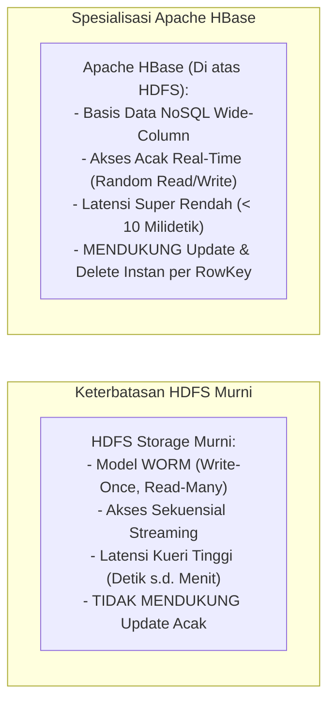
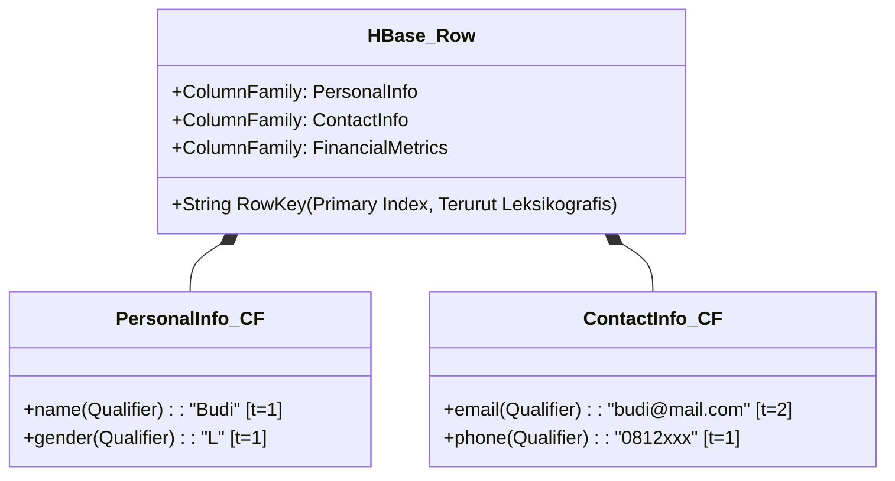
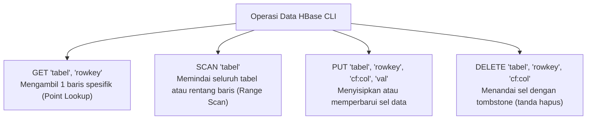
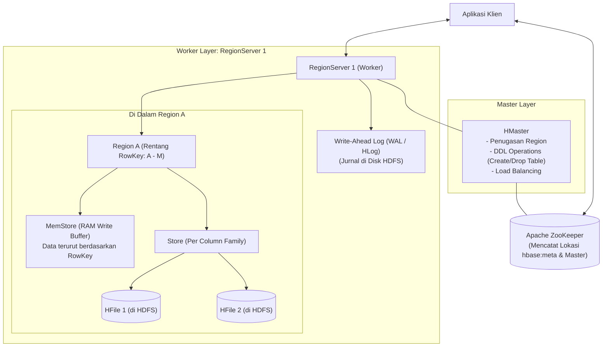
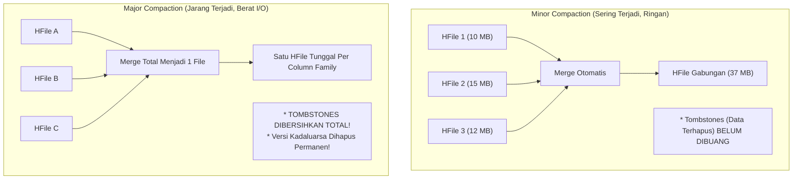

# 🗄️ 06.3 Apache HBase (NoSQL Column-Family & Low-Latency Random Read-Write)

> [!ABSTRACT] Ringkasan Sub-Materi
> Menelaah secara mendalam basis data NoSQL terdistribusi **Apache HBase** yang dibangun berdasarkan cetak biru arsitektur *Google BigTable*. Sub-materi ini membahas spesialisasi HBase dalam melayani operasi kueri acak instan (*random real-time read/write*) berlatensi sub-10 ms, model data *Column-Family*, arsitektur internal (**HMaster, RegionServer, MemStore, WAL, HFile, ZooKeeper**), siklus *Minor vs Major Compaction*, kisi-kisi ujian, dan tips menjawab.

---

## 1. Spesialisasi Aplikasi Unik (*The Differentiator*)

Mengapa kita membutuhkan Apache HBase jika kita sudah memiliki sistem berkas HDFS yang masif?



- **Spesialisasi Unik**: Apache HBase dirancang khusus untuk menyediakan **kemampuan pembacaan dan penulisan acak satu baris (*random real-time read/write access*) dengan latensi sangat rendah (< 10 milidetik)** pada dataset berukuran Petabyte yang memuat miliaran baris dan jutaan kolom.
- **Karakteristik Teorema CAP**: HBase adalah sistem **CP (Consistency & Partition Tolerance)**. HBase menjamin konsistensi pembacaan data yang kuat (*Strong Consistency*) pada setiap baris data.

---

## 2. Model Data HBase: Wide-Column & Sparse Map

Berbeda dengan tabel relasional (RDBMS) yang kaku, model data HBase didefinisikan secara matematis sebagai:
> *"A sparse, distributed, persistent, multidimensional sorted map."*

Setiap sel data diakses melalui 4 koordinat koordinasi unik:
$$\mathbf{(RowKey,\ ColumnFamily,\ ColumnQualifier,\ Timestamp) \longrightarrow Value}$$



### Elemen-Elemen Model Data:
1. **RowKey (Kunci Baris)**:
   - Bertindak sebagai Primary Key utama tabel. Seluruh baris di dalam tabel HBase secara fisik **diurutkan secara leksikografis (*lexicographically sorted*)** berdasarkan RowKey.
   - Akses instan sub-10 ms **HANYA BISA dilakukan jika kueri mencari berdasarkan RowKey spesifik** atau pemindaian rentang (*range scan: startRow to stopRow*).
2. **Column Family (Keluarga Kolom)**:
   - Sekelompok kolom yang memiliki kesamaan sifat akses dan **disimpan bersama secara fisik dalam satu berkas di disk**.
   - Harus dideklarasikan di awal saat pembuatan skema tabel (biasanya hanya berjumlah sedikit: 1 hingga 3 Column Family per tabel).
3. **Column Qualifier (Nama Kolom Dinamis)**:
   - Atribut kolom individual di dalam sebuah Column Family.
   - Bersifat **dinamis (*schema-less*)**: Kolom dapat ditambahkan kapan saja oleh aplikasi pada baris tertentu tanpa perlu memodifikasi skema tabel (*no ALTER TABLE needed*).
4. **Timestamp / Versioning**:
   - Setiap sel data dapat menyimpan beberapa versi historis nilai yang dibedakan berdasarkan timestamp waktu penulisan. Secara default, HBase menyimpan 3 versi terbaru dari suatu sel data.

---

## 3. Perintah Utama HBase Shell / CLI (Soal Wajib UAS!)

HBase **TIDAK MENGGUNAKAN bahasa SQL standar**. Perintah `SELECT` tidak ada di HBase CLI. Sebagai gantinya, HBase menggunakan perintah operasi berbasis baris:



1. **`GET` (Point Lookup Cepat Berbasis Row Key)**:
   - Mengambil data untuk satu *Row Key* tertentu secara langsung.
   - **Contoh Kasus UAS**:
     ```hbase
     -- Mengambil data produk dengan Row Key '3'
     GET 'produk', '3'
     
     -- Mengambil kolom tertentu dari Row Key '3'
     GET 'produk', '3', {COLUMN => 'info:harga'}
     ```
2. **`SCAN` (Range Scan)**:
   - Memindai beberapa baris sekaligus. Dapat dibatasi menggunakan batas awal dan akhir (*startRow* dan *stopRow*):
     ```hbase
     SCAN 'produk', {STARTROW => '1', STOPROW => '5'}
     ```
3. **`PUT` (Insert / Update)**:
   - Menyimpan atau menimpa nilai sel baru:
     ```hbase
     PUT 'produk', '3', 'info:harga', '650000'
     ```
4. **`DELETE`**:
   - Menghapus sel atau baris spesifik (menuliskan *tombstone*).

---

## 4. Arsitektur Internal: Komponen Fisik HBase

HBase berjalan di atas kluster HDFS dan dikoordinasikan oleh Apache ZooKeeper:



### Komponen-Komponen Utama:
1. **HMaster**:
   - Bertanggung jawab atas operasi manajemen skema DDL (*Create, Alter, Drop Table*), penugasan partisi (*Region assignment*) ke RegionServer, pemantauan kegagalan node, dan penyeimbangan beban kluster (*load balancing*).
   - *Catatan Penting*: **HMaster TIDAK PERNAH dilewati oleh aliran data kueri klien (*client does not read/write through HMaster*)**.
2. **RegionServer (Worker Daemon)**:
   - Pekerja utama yang melayani permintaan pembacaan (`GET`, `SCAN`) dan penulisan (`PUT`, `DELETE`) langsung dari aplikasi klien.
   - Satu RegionServer mengelola puluhan hingga ratusan **Region**.
3. **Region (Partisi Baris Horizontal)**:
   - Partisi horizontal dari tabel HBase yang memuat **rentang baris tertentu (*continuous range of RowKeys*)**, misal Region 1 memuat baris `1` hingga `10000`, Region 2 memuat `10001` hingga `20000`.
   - **Awas Jebakan Ujian**: **Region Split membagi data berdasarkan RENTANG ROW KEY**, BUKAN berdasarkan column-family!
   - Jika ukuran data di dalam Region membesar melampaui batas (misal > 10 GB), Region secara otomatis membelah dirinya menjadi dua (*Region Split*).
4. **MemStore (Buffer Penulisan di RAM)**:
   - Setiap Column Family di dalam Region memiliki satu **MemStore** di memori RAM.
   - Saat klien melakukan operasi tulis (`PUT`), data baru pertama kali disimpan di dalam MemStore dalam kondisi **terurut berdasarkan RowKey**.
5. **Write-Ahead Log (WAL / HLog)**:
   - Karena MemStore berada di RAM yang rentan hilang jika listrik padam, sebelum data ditulis ke MemStore, data **wajib dicatat terlebih dahulu ke dalam berkas jurnal WAL di HDFS**. Jika RegionServer crash, data di MemStore dapat dipulihkan 100% dengan membaca ulang WAL.
6. **HFile (Penyimpanan Fisik Permanen dalam Region)**:
   - **HFile merupakan format berkas fisik penyimpanan data dalam Region HBase** di HDFS.
   - Di dalam HFile, data disimpan dalam blok-blok terkompresi dengan pohon indeks (*Block Index*). Indeks Row Key inilah yang memungkinkan operasi **Random Access berkecepatan tinggi** (sub-10 ms). Berkas HFile bersifat *immutable*.

---

## 5. Siklus Pemeliharaan Data: Minor vs Major Compaction

Seiring berjalannya transaksi penulisan, jumlah berkas HFile di HDFS akan bertambah banyak, yang dapat memperlambat kueri pembacaan. HBase menjalankan proses pemeliharaan berkala yang disebut **Compaction**:



| Dimensi Evaluasi | Minor Compaction | Major Compaction |
| :--- | :--- | :--- |
| **Cakupan Penggabungan** | Menggabungkan **beberapa HFile kecil** yang berdekatan menjadi file yang lebih besar | Menggabungkan **SELURUH HFile** di dalam satu Store menjadi **tepat satu HFile tunggal** |
| **Penanganan Data Terhapus (*Tombstones*)** | **TIDAK menghapus** data yang berstatus *tombstone* (tanda hapus) | **MEMBERSIHKAN & MENGHAPUS PERMANEN** seluruh record *tombstone* dari disk fisik |
| **Penanganan Versi Kadaluarsa** | Membiarkan versi data lama | Membuang seluruh versi data yang melebihi batas retensi skema |
| **Beban Performa I/O** | Ringan, berjalan otomatis di latar belakang | **Sangat Berat**, mengonsumsi I/O disk dan jaringan kluster secara masif |
| **Frekuensi Pelaksanaan** | Berjalan terus-menerus sesuai ambang batas file | Biasanya dijadwalkan secara manual oleh admin di luar jam sibuk (tengah malam) |

---

## 🎯 Hal-Hal yang Kemungkinan Besar Masuk Ujian

1. **Model Data**:
   - Model data Apache HBase adalah **Column-Family** (NoSQL Wide-Column).
2. **Pembeda Mutlak Hive vs HBase**:
   - Hive cocok untuk **analisis pemrosesan batch data terstruktur** (agregasi SQL / reporting).
   - HBase dirancang untuk **pemrosesan transaksi data berlatensi rendah pada level baris (*row-level random read/write*)**.
3. **Pernyataan Benar tentang Arsitektur HBase**:
   - ✅ **HFile** merupakan format berkas fisik dalam HBase untuk menyimpan data di dalam Region.
   - ✅ Operasi **Random Access** berkecepatan tinggi dimungkinkan karena adanya **indeks Row Key** pada setiap baris data.
   - ❌ Region split membagi data berdasarkan rentang Row Key (bukan column-family).
   - ❌ HBase tidak menggunakan perintah `SELECT`, melainkan `GET` dan `SCAN`.
4. **Perintah Kueri Data**:
   - Mengambil data baris tunggal berdasarkan Row Key $\implies$ gunakan perintah **`GET`** (contoh: `GET 'produk', '3'`).
5. **Alur Penulisan Data (MemStore & WAL)**:
   - Data ditulis ke **WAL (disk HDFS)** terlebih dahulu untuk durabilitas, baru dimasukkan ke **MemStore (RAM)**, lalu di-*flush* ke **HFile**.
6. **Minor vs Major Compaction**:
   - Rekaman yang dihapus (*tombstone*) **hanya benar-benar dibersihkan dan dihapus permanen dari disk fisik saat siklus Major Compaction**.

---

## 📋 Contoh Soal Ujian (Pilihan Ganda & Esai)

### Contoh Soal Pilihan Ganda

**Soal 1 (Perintah Point Lookup HBase - UAS 2022/2023)**  
Diketahui suatu tabel HBase bernama `produk` dengan baris data sebagai berikut:
| Row Key | Info:Nama | Info:Harga | Info:Stok |
| :--- | :--- | :--- | :--- |
| 1 | Mouse | 100,000 | 50 |
| 2 | Keyboard | 230,000 | 30 |
| 3 | Monitor | 600,000 | 100 |

Perintah HBase Shell yang tepat digunakan untuk mengambil data dengan Row Key "3" adalah...  
A. `SCAN 'produk', '3'`  
B. `GET 'produk', '3'`  
C. `SELECT 'produk', '3'`  
D. `FETCH 'produk', '3'`  
*Kunci Jawaban*: **B**  
*Pembahasan*: Pada HBase CLI, pembacaan record tunggal spesifik berdasarkan Row Key menggunakan perintah `GET`. Perintah `SELECT` tidak dikenal di HBase, sedangkan `SCAN` digunakan untuk rentang banyak baris.

**Soal 2 (Pernyataan Karakteristik HBase - UAS 2022/2023)**  
Perhatikan pernyataan-pernyataan berikut tentang Apache HBase:  
1) HBase memanfaatkan MapReduce untuk memproses data dalam Hadoop.  
2) Region split pada HBase membagi data berdasarkan rentang column-family.  
3) HFile merupakan format file dalam HBase untuk menyimpan data dalam Region.  
4) Random access pada HBase memungkinkan karena indeks Row Key pada setiap baris data.  
5) Perintah select digunakan untuk membaca data pada HBase, sama dengan perintah Hive.  
Manakah kombinasi pernyataan yang BENAR?  
A. 1 dan 2  
B. 2 dan 3  
C. 3 dan 4  
D. 4 dan 5  
*Kunci Jawaban*: **C**  
*Pembahasan*: Pernyataan 3 benar (HFile adalah format penyimpanan Region di HDFS) dan Pernyataan 4 benar (indeks Row Key memungkinkan pencarian acak sub-10 ms). Pernyataan 2 salah karena Region split membagi berdasarkan baris/Row Key. Pernyataan 5 salah karena kueri HBase menggunakan `GET`/`SCAN`, bukan `SELECT`.

**Soal 3 (Komparasi Fundamental Hive vs HBase - UAS 2022/2023)**  
Pernyataan berikut ini yang paling tepat menggambarkan perbedaan fungsi antara Apache Hive dan Apache HBase adalah...  
A. Hive menyediakan API untuk membaca dan menulis data menggunakan operasi CRUD, sedangkan HBase dirancang untuk kueri data menggunakan bahasa HiveQL.  
B. Hive cenderung lebih cocok untuk pemrosesan analitik batch, sedangkan HBase dirancang untuk pemrosesan data yang membutuhkan akses baca/tulis yang cepat pada level baris (*row-level*).  
C. Hive lebih sesuai untuk aplikasi transaksi real-time, sedangkan HBase untuk batch analitis.  
D. Hive dan HBase memiliki tipe pemrosesan data yang persis sama.  
*Kunci Jawaban*: **B**  
*Pembahasan*: Hive dioptimalkan untuk batch processing berbasis SQL analitik, sedangkan HBase adalah NoSQL untuk random read/write real-time berlatensi rendah.

**Soal 4 (Mekanisme Penghapusan Data Fisik)**  
Saat perintah `DELETE` dieksekusi terhadap suatu baris di Apache HBase, data tersebut tidak langsung dihapus dari disk fisik HFile, melainkan diberi penanda khusus bernama *Tombstone*. Pada tahapan manakah berkas bertanda *Tombstone* tersebut benar-benar dibersihkan dan dihapus secara fisik dari media penyimpanan HDFS?  
A. Sesaat setelah perintah DELETE selesai dieksekusi.  
B. Saat proses *Minor Compaction* berlangsung.  
C. Saat proses *Major Compaction* dijalankan.  
D. Saat master NameNode melakukan restart.  
*Kunci Jawaban*: **C**  
*Pembahasan*: Karena berkas HFile bersifat immutable, operasi delete hanya menulis penanda tombstone. Pembersihan fisik data dan penghapusan tombstone dari disk baru terjadi saat seluruh HFile digabungkan dalam siklus Major Compaction.

---

### Contoh Soal Esai
**Soal Esai**:  
Sebuah platform perbankan digital melayani transaksi jutaan nasabah. Sistem membutuhkan basis data yang mampu melayani kueri pengecekan saldo rekening nasabah secara acak (*random query*) dengan latensi di bawah 10 milidetik, sekaligus mampu mencatat mutasi transaksi baru secara instan.  
a. Jelaskan mengapa sistem berkas HDFS murni tidak dapat digunakan untuk kebutuhan tersebut dan mengapa **Apache HBase** adalah solusi yang tepat!  
b. Jelaskan alur kerja internal yang terjadi di dalam RegionServer ketika aplikasi perbankan mengeksekusi operasi penulisan data mutasi baru (`PUT`), dan bagaimana peran **Write-Ahead Log (WAL)** dan **MemStore** menjamin bahwa data nasabah tidak akan hilang jika listrik server mendadak padam!

**Pedoman Jawaban Lengkap**:
1. **Mengapa HDFS Gagal & Mengapa HBase Tepat**:
   - **Kegagalan HDFS Murni**: HDFS dirancang dengan model akses *Write-Once, Read-Many (WORM)* yang dioptimalkan untuk pembacaan aliran sekuensial (*batch streaming*). HDFS tidak memiliki mekanisme indeks pencarian acak satu baris data; kueri saldo satu nasabah di HDFS akan memicu pemindaian seluruh file berukuran gigabyte (*Full Scan*) yang memakan waktu puluhan detik hingga menit. HDFS juga tidak mendukung modifikasi data acak (*no arbitrary in-place updates*).
   - **Keunggulan Apache HBase**: HBase mengorganisasikan data dalam struktur tabel NoSQL terurut berdasarkan `RowKey` (nomor rekening). Menggunakan indeks internal blok HFile dan cache memori, HBase mampu langsung melompat (*point lookup*) ke lokasi fisik record nasabah yang dicari dan mengembalikan saldo rekening dalam waktu **sub-10 milidetik**.
2. **Alur Kerja Operasi Penulisan (`PUT`) & Jaminan Durabilitas Data**:
   - Saat klien bank mengeksekusi instruksi `PUT`:
     - *Langkah 1 (Pencatatan WAL)*: Klien mengirim transaksi ke RegionServer yang bertanggung jawab atas Region nomor rekening tersebut. RegionServer **pertama-tama menuliskan catatan transaksi mutasi tersebut ke dalam berkas Write-Ahead Log (WAL / HLog)** yang dipersistensikan secara aman ke HDFS.
     - *Langkah 2 (Penyimpanan di MemStore)*: Setelah transaksi aman tercatat di WAL, data dimasukkan ke dalam memori RAM bernama **MemStore**. Di dalam MemStore, data langsung disusun terurut secara rapi berdasarkan `RowKey`.
     - *Langkah 3 (Konfirmasi Klien)*: RegionServer langsung mengirimkan status sukses (*ACK*) ke aplikasi perbankan. Seluruh proses ini hanya memakan waktu beberapa milidetik karena operasi penulisan di memori sangat cepat.
   - **Peran Penjamin Keamanan (Crash Recovery)**:
     - Jika mesin server tiba-tiba mati lampu saat data masih berada di RAM MemStore dan belum sempat di-flush ke HFile:
     - Master HBase akan mendeteksi kematian node melalui ZooKeeper dan mengalihkan Region tersebut ke RegionServer lain yang sehat.
     - RegionServer baru akan **membuka berkas WAL di HDFS dan memutar ulang (*replay*) seluruh transaksi mutasi yang belum sempat tertulis ke HFile**.
     - Dengan cara ini, saldo dan mutasi nasabah dijamin **100% aman dan tidak akan hilang**, memenuhi prinsip durabilitas data enterprise.

---

## 💡 Tips & Trik Menjawab Soal Ujian

1. **Jurus Kata Kunci HBase**:
   - NoSQL Wide-Column, Google BigTable, CP system.
   - **Random Read/Write**, Latensi **sub-10 milidetik**.
   - Terurut berdasarkan **RowKey**.
   - Komponen: HMaster (DDL), RegionServer (Kueri data), MemStore (RAM), WAL (Disaster recovery), HFile (Disk HDFS).
   - Major Compaction $\to$ Hapus tombstones secara fisik.
2. **Trik Membedakan Hive vs HBase di Soal Kasus**:
   - Butuh laporan analitik bulanan / SQL aggregasi masif $\to$ **Hive**.
   - Butuh kueri profil instan per-ID / transaksi cepat sub-detik $\to$ **HBase**.
