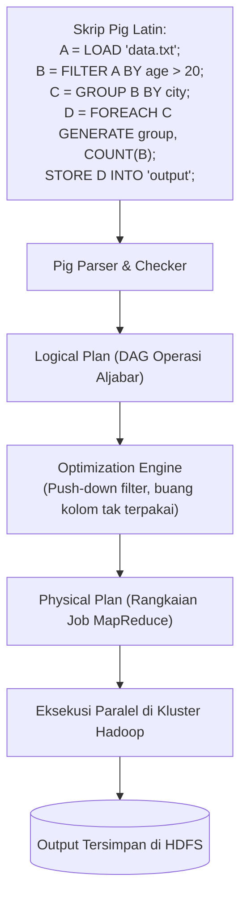
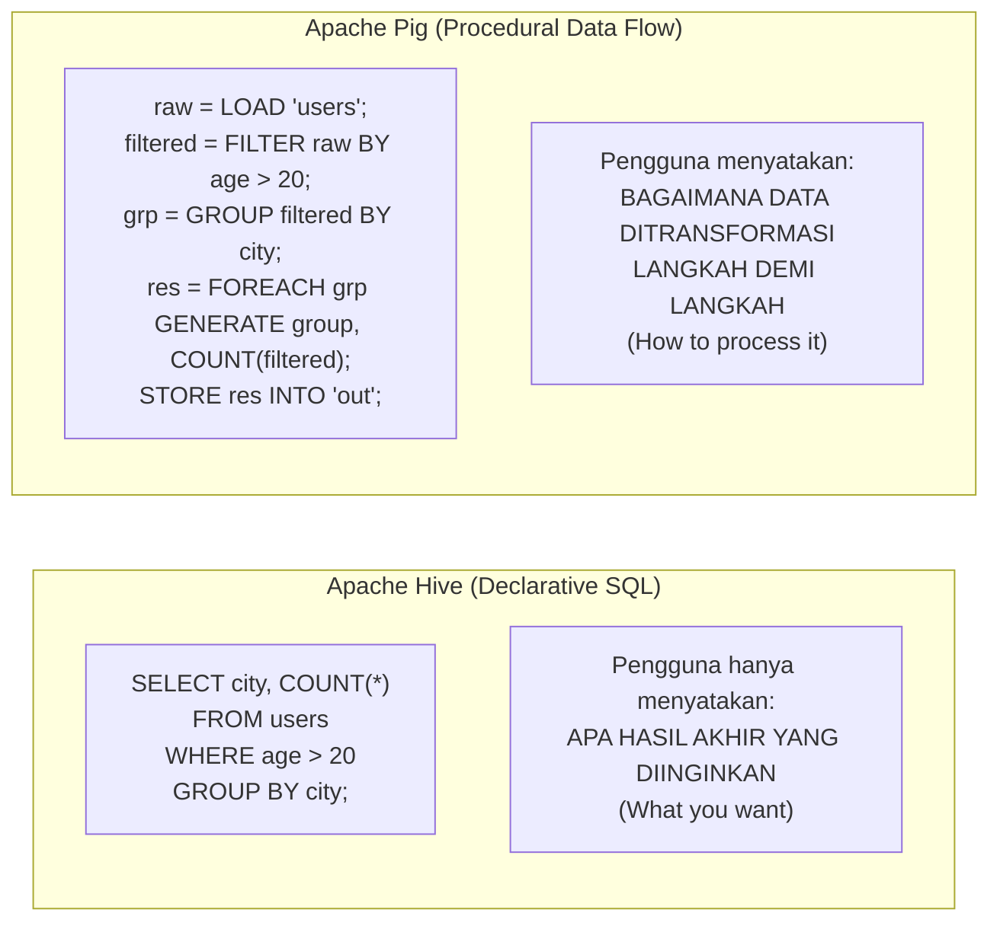
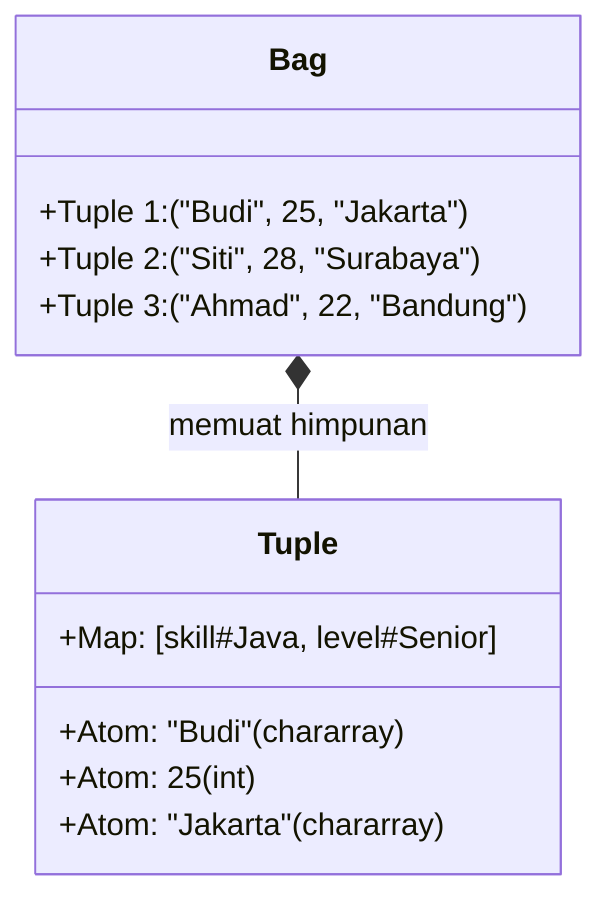
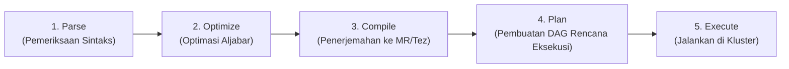

# 🐷 06.4 Apache Pig (Procedural Data Flow Platform & Pig Latin)

> [!ABSTRACT] Ringkasan Sub-Materi
> Menelaah secara mendalam platform pemrosesan data aliran prosedural **Apache Pig** yang dirintis oleh tim riset Yahoo!. Sub-materi ini membahas spesialisasi peran Pig dalam menyusun pipeline data ETL yang rumit, komparasi fundamental antara bahasa **Prosedural (Pig Latin)** versus **Deklaratif (HiveQL/SQL)**, tipe data kompleks (**Atom, Tuple, Bag, Map**), arsitektur kompilasi skrip menjadi *Directed Acyclic Graph* (DAG) pekerjaan MapReduce, kisi-kisi ujian, dan panduan jawaban esai.

---

## 1. Spesialisasi Aplikasi Unik (*The Differentiator*)

Bagi para perekayasa perangkat lunak (*software engineers*), bahasa SQL seringkali terasa kaku dan sulit digunakan saat harus mengeksekusi serangkaian tahapan pembersihan data bertingkat (*multi-stage data transformations*) yang melibatkan percabangan logika, format semi-terstruktur, dan penanganan kesalahan.

**Spesialisasi Unik Apache Pig**:
- Menyediakan platform **aliran data prosedural tingkat tinggi (*procedural data flow platform*)** yang mengekspresikan transformasi data kompleks langkah demi langkah menggunakan bahasa alir bernama **Pig Latin**.
- Menjembatani kesenjangan antara kemudahan bahasa skrip tingkat tinggi dengan kekuatan komputasi terdistribusi skala Petabyte di Hadoop.
- Mengubah alur skrip Pig Latin menjadi **graf ketergantungan terarah (*Directed Acyclic Graph - DAG*) yang secara otomatis dioptimasi dan dikompilasi menjadi serangkaian pekerjaan MapReduce atau Apache Tez**.



---

## 2. Paradigma Bahasa: Prosedural (Pig) vs Deklaratif (Hive)

Salah satu pertanyaan paling klasik dalam ujian Big Data adalah membandingkan filosofi pendekatan bahasa antara Apache Pig dan Apache Hive:



| Dimensi Perbandingan | Apache Pig (Pig Latin) | Apache Hive (HiveQL) |
| :--- | :--- | :--- |
| **Gaya Pemrograman** | **Prosedural / Imperatif** (Menjelaskan *langkah demi langkah*) | **Deklaratif** (Menjelaskan *hasil akhir* yang diinginkan) |
| **Audiens Pengguna Utama**| Pemrogram, Data Engineer, Pengembang Pipeline ETL | Analis Bisnis, Administrator Database, Praktisi BI |
| **Penanganan Skema Data**| Mendukung skema opsional (*Schema-optional*), sangat fleksibel menangani data semi-terstruktur | Menuntut skema tabel terdefinisi di awal (*Schema-required* di Metastore) |
| **Titik Manfaat Terbaik** | Pipeline pembersihan data, ekstraksi log mentah, data scrubbing multi-tahap | Pelaporan ringkasan, kueri agregasi OLAP, dashboard manajemen |
| **Kemudahan Kueri Ad-hoc** | Kurang intuitif untuk kueri cepat satu baris | **Sangat Mudah & Intuitif** bagi pengguna SQL |

---

## 3. Tipe Data Kompleks Pig (Atom, Tuple, Bag, Map)

Tidak seperti database relasional yang hanya mengenal tipe data skalar datar, Pig Latin memiliki sistem tipe data bertingkat (*nested data model*) yang sangat kaya:



1. **Atom / Scalar (Nilai Tunggal Primitif)**:
   - Nilai data sederhana atomik tunggal, seperti `int`, `long`, `float`, `double`, `chararray` (string teks), dan `bytearray`.
   - Contoh: `100`, `'Budi Santoso'`, `3.14`.
2. **Tuple (Rekaman Data Berurutan)**:
   - Kumpulan nilai data berurutan (*ordered set of fields*) dengan jumlah elemen tetap. Mirip seperti **satu baris record** dalam tabel database.
   - Ditandai dengan tanda kurung biasa `(...)`.
   - Contoh: `('Budi', 25, 'Teknik Informatika')`.
3. **Bag (Himpunan Rekaman / Multi-set)**:
   - Koleksi atau himpunan *tuple* yang **tidak berurutan (*unordered collection of tuples*)**.
   - Ditandai dengan tanda kurung kurawal `{...}`.
   - Boleh memuat duplikasi data dan skema antar-tuple tidak harus seragam. Seringkali dihasilkan dari operasi `GROUP BY` atau `COGROUP`.
   - Contoh: `{('Budi', 25), ('Siti', 28), ('Ahmad', 22)}`.
4. **Map (Pasangan Kunci-Nilai Dinamis)**:
   - Kumpulan pasangan elemen di mana kunci (*key*) bertipe teks string dan mengait ke sembarang nilai (*value*).
   - Ditandai dengan tanda kurung siku `[...]` dengan delimiter tanda pagar `#`.
   - Contoh: `['nama'#'Budi', 'pekerjaan'#'Programmer', 'gaji'#15000000]`.

---

---

## 4. Cara Kerja & Urutan Eksekusi Pig Engine (Sering Keluar di Pilihan Ganda!)

Dosen sering menguji urutan tahapan internal yang dilakukan oleh **Pig Engine** saat mengeksekusi skrip Pig Latin:



> [!IMPORTANT] Urutan Resmi 4 Tahapan Pig Engine
> Sesuai silabus dan kunci ujian, urutan proses transformasi internal Pig Engine adalah:
> $$\mathbf{Parse \longrightarrow Optimize \longrightarrow Compile \longrightarrow Plan}$$
> 1. **Parse**: Memeriksa kebenaran sintaks Pig Latin, memvalidasi nama tipe data, dan memastikan relasi variabel terdefinisi dengan benar.
> 2. **Optimize**: Mesin pengoptimasi menerapkan aturan aljabar cerdas, seperti *Push-down Predicates* (memajukan filter seawal mungkin) dan *Column Pruning* (membuang kolom yang tidak digunakan).
> 3. **Compile**: Menerjemahkan operator-operator logis menjadi pekerjaan fisik MapReduce (mengelompokkan filter/transformasi ke Mapper dan pengelompokan ke Reducer).
> 4. **Plan**: Menyusun pekerjaan-pekerjaan fisik tersebut ke dalam graf ketergantungan terarah (*Directed Acyclic Graph - DAG*) rencana eksekusi yang siap diserahkan ke kluster Hadoop.

---

## 5. Operator Relasional Kunci Pig Latin (Awas Sintaks Ujian!)

Pig Latin memiliki sintaks deklarasi aliran data yang khas:

| Operator | Fungsi Utama | Contoh Sintaks Nyata |
| :--- | :--- | :--- |
| **`LOAD`** | Membaca data mentah dari HDFS dengan skema opsional | `students = LOAD 'students.csv' USING PigStorage(',') AS (fname:chararray, lname:chararray, age:int, grade:int);` |
| **`FILTER`** | Menyaring baris berdasarkan kondisi (**Wajib gunakan kata `BY`**) | **`students_20 = FILTER students BY age > 20;`** (⚠️ *Bukan SELECT / WHERE!*) |
| **`FOREACH`** | Melakukan proyeksi kolom atau transformasi ekspresi per baris | `names = FOREACH students GENERATE fname, age;` |
| **`GROUP`** | Mengelompokkan data berdasarkan satu atau beberapa kunci | `by_grade = GROUP students BY grade;` |
| **`JOIN`** | Menggabungkan dua atau lebih relasi berdasarkan kunci identik | `joined = JOIN students BY grade, classes BY grade;` |
| **`STORE`** | Menuliskan hasil olahan relasi ke direktori HDFS | `STORE students_20 INTO '/output/students_dewasa';` |
| **`DUMP`** | Menampilkan hasil relasi langsung ke layar terminal (debug) | `DUMP students_20;` |

---

## 🎯 Hal-Hal yang Kemungkinan Besar Masuk Ujian

1. **Urutan Pemrosesan Pig Engine**:
   - **`parse - optimize - compile - plan`** (Hafalkan urutan ini!).
2. **Sintaks Filter Data**:
   - Di Pig Latin, penyaringan menggunakan format: **`FILTER <relasi> BY <kondisi>;`**.
3. **Gaya Bahasa Pig vs Hive**:
   - Pig = **Prosedural (How)**. Hive = **Deklaratif (What)**.
4. **4 Tipe Data Kompleks Pig**:
   - **Atom** = Nilai tunggal skalar.
   - **Tuple** = Satu baris record diapit `(...)`.
   - **Bag** = Kumpulan tuple tidak berurutan diapit `{...}`.
   - **Map** = Pasangan key-value diapit `[...]` dengan delimiter `#`.
5. **Kompilasi di Balik Layar**:
   - Pig Latin dikompilasi menjadi **DAG pekerjaan MapReduce/Tez**.

---

## 📋 Contoh Soal Ujian (Pilihan Ganda & Esai)

### Contoh Soal Pilihan Ganda

**Soal 1 (Urutan Proses Pig Engine - UAS 2022/2023)**  
Urutan proses yang dilakukan oleh Pig Engine dalam memproses skrip Pig Latin adalah...  
A. parse - compile - optimize - plan  
B. parse - compile - plan - execute  
C. parse - optimize - compile - execute  
D. parse - optimize - compile - plan  
*Kunci Jawaban*: **D**  
*Pembahasan*: Pig Engine memproses skrip melalui urutan sintaksis: *parse* (validasi) $\to$ *optimize* (optimasi aljabar DAG) $\to$ *compile* (kompilasi ke pekerjaan MapReduce) $\to$ *plan* (perencanaan graf eksekusi fisik).

**Soal 2 (Sintaks Filter Pig Latin - UAS 2022/2023)**  
Diketahui suatu data berkas CSV dimuat ke Apache Pig dengan perintah:  
`students = LOAD 'students.csv' USING PigStorage(',') AS (fname: chararray, lname: chararray, age: int, grade: int);`  
Skrip Pig Latin yang benar untuk mengambil data siswa dengan usia di atas 20 tahun adalah...  
A. `students_20 = SELECT students WHERE age > 20;`  
B. `students_20 = WHERE students BY age > 20;`  
C. `students_20 = FILTER students BY age > 20;`  
D. `students_20 = EXTRACT students IF age > 20;`  
*Kunci Jawaban*: **C**  
*Pembahasan*: Pada bahasa Pig Latin, penyaringan record dilakukan menggunakan operator `FILTER ... BY <kondisi>`. Kata kunci `SELECT` dan `WHERE` adalah milik SQL/HiveQL, bukan Pig.

**Soal 3 (Filosofi Pemrograman Pig vs Hive)**  
Perbedaan mendasar antara Apache Pig dan Apache Hive dalam hal pendekatan bahasa pemrosesan data adalah...  
A. Pig menggunakan bahasa pemrograman assembly biner, sedangkan Hive menggunakan bahasa HTML.  
B. Pig menggunakan bahasa prosedural (Pig Latin) yang mendeskripsikan aliran transformasi data langkah demi langkah (*how to process*), sedangkan Hive menggunakan bahasa deklaratif (HiveQL) yang menyatakan hasil akhir yang diinginkan (*what to retrieve*).  
C. Hive hanya dapat memproses data teks, sedangkan Pig hanya untuk gambar.  
D. Pig tidak dapat dijalankan di atas Hadoop.  
*Kunci Jawaban*: **B**  
*Pembahasan*: Karakteristik utama yang membedakan Pig dari Hive adalah gaya bahasanya: Pig bersifat prosedural (*data flow pipeline*), sedangkan Hive bersifat deklaratif (*SQL-like*).

**Soal 4 (Struktur Data Kompleks Pig)**  
Dalam sistem model data Apache Pig, kumpulan atau himpunan dari beberapa record *Tuple* yang tidak berurutan dan diapit oleh tanda kurung kurawal `{...}` disebut sebagai...  
A. *Atom*  
B. *Bag*  
C. *Map*  
D. *Array*  
*Kunci Jawaban*: **B**  
*Pembahasan*: Sesuai spesifikasi resmi Pig, *Bag* adalah koleksi atau multi-set dari beberapa tuple yang tidak berurutan dan ditandai dengan kurung kurawal `{...}`.

---

### Contoh Soal Esai
**Soal Esai**:  
Sebuah perusahaan analitik media sosial mengumpulkan 50 Terabyte log interaksi pengguna dalam format semi-terstruktur yang tidak memiliki skema tabel kaku. Tim engineer perlu melakukan serangkaian transformasi: (1) Menyaring log error, (2) Mengekstrak hashtag dari teks komentar, (3) Menghitung frekuensi kemunculan tiap hashtag, dan (4) Menyimpan hasilnya ke HDFS.  
a. Jelaskan mengapa **Apache Pig** lebih disukai oleh para data engineer dibandingkan **Apache Hive** untuk tugas pemrosesan pipeline data di atas!  
b. Jelaskan bagaimana struktur data bertingkat pada Apache Pig (**Tuple**, **Bag**, dan **Map**) mempermudah manipulasi data komentar yang kompleks tanpa perlu melakukan normalisasi database yang kaku!

**Pedoman Jawaban Lengkap**:
1. **Mengapa Apache Pig Lebih Unggul untuk Pipeline ETL Tersebut**:
   - **Fleksibilitas Skema (Schema-Optional)**: Log interaksi media sosial bersifat semi-terstruktur dan formatnya sering berubah. Hive menuntut skema tabel kaku di Metastore sebelum kueri dapat dieksekusi. Sebaliknya, Pig Latin memungkinkan data mentah dimuat apa adanya tanpa skema (`LOAD 'log.txt'`), dan skema dapat diterapkan secara bertahap saat data mengalir.
   - **Alur Kerja Prosedural Langkah demi Langkah**: Tugas tersebut memiliki 4 tahapan transformasi sekuensial yang saling bergantung. Menulis kueri SQL di Hive untuk skenario ini akan menghasilkan *nested sub-queries* yang sangat panjang dan sulit di-debug. Di Pig Latin, engineer cukup menuliskan 4 baris kode sederhana yang mengekspresikan aliran data secara natural:
     ```piglatin
     A = LOAD 'logs';
     B = FILTER A BY status != 'ERROR';
     C = FOREACH B GENERATE extract_hashtag(comment) AS tag;
     D = GROUP C BY tag;
     E = FOREACH D GENERATE group, COUNT(C);
     STORE E INTO 'output';
     ```
   - Kemudahan debugging dan kontrol alur prosedural inilah yang membuat Pig menjadi alat favorit para data engineer.
2. **Peran Model Data Kompleks (Tuple, Bag, Map)**:
   - Pada basis data relasional standar (Hive/RDBMS), sebuah komentar yang memuat banyak hashtag (misal: `#BigData`, `#AI`, `#Hadoop`) harus dinormalisasi menjadi banyak baris di tabel relasi terpisah via operasi JOIN yang lambat.
   - Di Apache Pig, satu baris komentar dapat langsung disimpan sebagai satu **Tuple**, di mana daftar hashtag-nya ditampung langsung sebagai sebuah **Bag** di dalam tuple tersebut:
     $$(\text{"Komentar 1"}, \text{"Budi"}, \{(\text{"\#BigData"}), (\text{"\#AI"}), (\text{"\#Hadoop"})\})$$
   - Metadata tambahan (seperti perangkat yang digunakan dan lokasi GPS) dapat disimpan secara dinamis menggunakan tipe **Map**:
     $$[\text{'device'}\#\text{'Android'}, \text{'city'}\#\text{'Jakarta'}]$$
   - Kemampuan menampung struktur data bersarang (*nested structures*) ini menghilangkan kebutuhan operasi JOIN yang mahal dan memungkinkan pemrosesan data semi-terstruktur berjalan jauh lebih cepat.

---

## 💡 Tips & Trik Menjawab Soal Ujian

1. **Jurus Kata Kunci Pig**:
   - Prosedural / Imperatif, Aliran Data (*Data Flow Pipeline*).
   - Tipe data: **Atom, Tuple `(...)`, Bag `{...}`, Map `[...]`**.
   - Kasus ideal: **Data Cleansing, Ekstraksi Log Semi-Terstruktur, Pipeline ETL Multi-Tahap**.
2. **Formula Menjawab Komparasi Pig vs Hive**:
   - Jangan lupa menyertakan tabel komparatif 2 kolom (Pig vs Hive) dengan parameter: Gaya Bahasa (*Procedural vs Declarative*), Audiens (*Engineer vs Analyst*), Skema (*Optional vs Required*), dan Kegunaan Utama.
