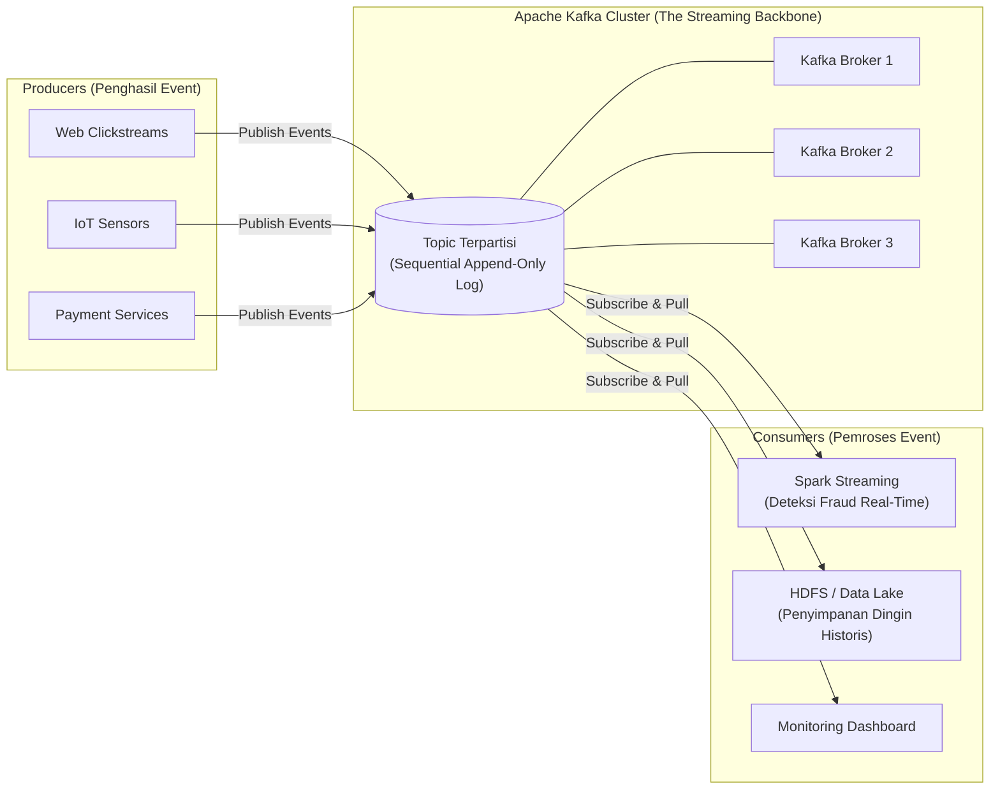
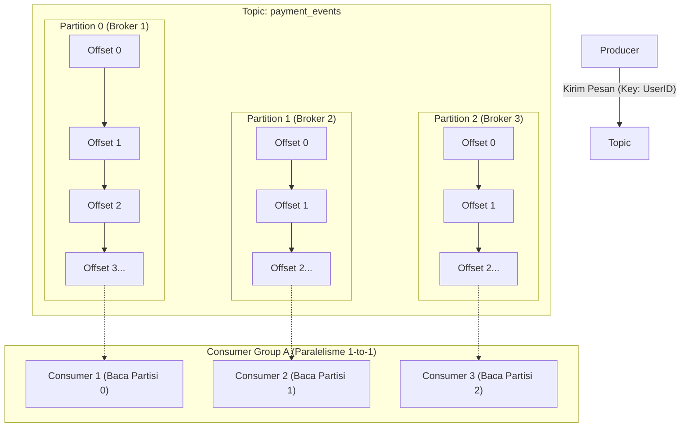
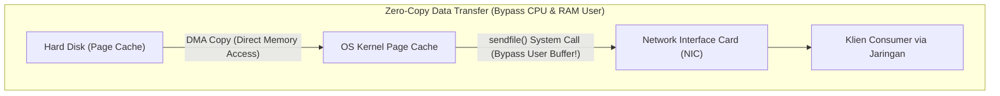

# 📨 06.5 Apache Kafka (Distributed Real-Time Event Streaming & Ingestion)

> [!ABSTRACT] Ringkasan Sub-Materi
> Menelaah secara mendalam platform pengaliran event terdistribusi **Apache Kafka** yang dirintis oleh para insinyur LinkedIn. Sub-materi ini membahas spesialisasi peran Kafka sebagai "Sistem Saraf Pusat" (*Event Ingestion Backbone*), konsep inti (**Producer, Consumer, Broker, Topic, Partition, Offset, Consumer Group**), alasan teknis performa ekstrem (*Sequential Disk I/O* dan *Zero-Copy*), kisi-kisi ujian, dan panduan jawaban esai.

---

## 1. Spesialisasi Aplikasi Unik (*The Differentiator*)

Di era Big Data modern, data tidak lagi hanya berupa tabel transaksi harian di RDBMS, melainkan berupa **aliran peristiwa kontinu (*continuous event streams*)** yang terjadi setiap milidetik: klik pengguna web (*clickstream*), perubahan sensor IoT, log server, dan transaksi finansial.

Sistem perantara pesan tradisional (seperti RabbitMQ atau ActiveMQ) seringkali tumbang ketika harus menangani jutaan pesan per detik dari ribuan produsen data yang berbeda.

**Spesialisasi Unik Apache Kafka**:
- Bertindak sebagai **Distributed Publish-Subscribe Event Streaming Platform berkinerja tinggi** yang berfungsi sebagai "Sistem Saraf Pusat" (*Central Event Backbone*) bagi seluruh arsitektur data enterprise.
- Mampu menerima, menyimpan, dan mengalirkan **jutaan event per detik dengan latensi sub-milidetik** secara toleran terhadap kesalahan (*fault-tolerant*).
- Menghubungkan sistem penghasil data (*Producers*) dengan berbagai mesin pemrosesan analitik (*Consumers*) seperti Apache Spark Streaming, Apache Flink, dan penyimpanan HDFS.



---

## 2. Bedah Anatomi Komponen & Konsep Inti Kafka



### 1. Producer (Produsen Pesan)
- Aplikasi klien yang mempublikasikan (*menuliskan*) pesan rekaman event ke dalam Kafka Topics.
- Produsen dapat menentukan kunci pesan (*Message Key*). Seluruh pesan dengan kunci yang sama dijamin akan diarahkan ke partisi yang sama (*key-based hashing*).

### 2. Consumer & Consumer Group (Konsumen Pesan)
- **Consumer**: Aplikasi klien yang berlangganan (*subscribe*) dan membaca pesan dari Topics.
- **Consumer Group (Konsep Paling Penting di Ujian!)**:
  - Sekelompok consumer yang bekerja sama untuk membaca data dari sebuah Topic secara paralel.
  - **Aturan Pembagian Partisi**: Setiap partisi di dalam satu Topic **HANYA AKAN DIBACA oleh tepat satu consumer di dalam satu consumer group**.
  - *Mekanisme Skalabilitas*: Jika sebuah Topic memiliki 4 partisi, Anda dapat menjalankan 4 consumer di dalam satu grup untuk membagi beban kerja secara merata (skalabilitas baca 4x). Namun, jika Anda menjalankan 5 consumer pada Topic dengan 4 partisi, consumer ke-5 akan menganggur (*idle*) karena tidak ada partisi yang tersisa!

### 3. Kafka Broker & Cluster
- **Broker**: Satu server node fisik di dalam kluster Kafka yang bertugas menerima, menyimpan berkas log partisi di disk, dan melayani pembacaan klien.
- **Cluster**: Kumpulan beberapa broker yang bekerja sama untuk mendistribusikan data secara seimbang dan toleran terhadap kegagalan.

### 4. Topic (Kategori Saluran Pesan)
- Saluran logis tempat pesan dikelompokkan (misal Topic `user_clicks`, `gps_locations`, `order_status`). Klien berlangganan ke nama topic tertentu.

### 5. Partition (Unit Skalabilitas Fisik) & Aturan Distribusi Pesan (Soal Wajib UAS!)
- Setiap Topic dipecah menjadi satu atau beberapa **Partisi (*Partitions*)**.
- **Aturan Pengiriman Pesan (Awas Jebakan Ujian!)**:
  > **Sebuah pesan (*message*) dalam sebuah topik HANYA dikirimkan dan disimpan ke SALAH SATU partisi tertentu dalam topik tersebut**, BUKAN disiarkan (*broadcast*) ke semua partisi!
  - Penentuan partisi target dilakukan oleh Producer berdasarkan nilai hash dari *Message Key* (atau mekanisme *Round-Robin* jika tanpa key).
- Partisi adalah **log sekuensial yang terurut dan tidak dapat diubah (*immutable append-only commit log*)**.
- Pesan baru selalu ditambahkan di bagian paling akhir (*append to end*).
- Partisi adalah kunci paralelisme Kafka: semakin banyak partisi, semakin banyak data yang dapat ditulis dan dibaca secara bersamaan di seluruh broker.

### 6. Offset (ID Urutan Pesan)
- Setiap pesan yang masuk ke dalam sebuah partisi diberi nomor pengenal integer sekuensial unik yang disebut **Offset** (misal Offset 0, 1, 2, 3, dst).
- Offset menjamin urutan pesan strictly preserved **di dalam satu partisi**.
- Consumer melacak posisinya sendiri dengan mencatat offset terakhir yang berhasil dibaca (*committing offset*).

---

## 3. Manajemen Topik via Perintah CLI (`kafka-topics.sh`)

Dalam administrasi dan soal ujian, pembuatan topic dilakukan menggunakan utilitas skrip CLI:

```bash
kafka-topics.sh --create \
  --zookeeper <zookeeper_host>:<zookeeper_port> \
  --replication-factor 1 \
  --partitions 3 \
  --topic clicks
```

*Penjelasan Parameter Kunci*:
1. `--create`: Menginstruksikan Kafka untuk membuat topik baru.
2. `--zookeeper` (atau `--bootstrap-server` pada versi baru): Alamat koordinasi kluster (ZooKeeper mengelola metadata topik dan status broker).
3. `--replication-factor 1`: Jumlah salinan redundan per partisi (faktor replikasi 1 berarti setiap partisi hanya memiliki 1 salinan fisik tanpa backup).
4. `--partitions 3`: Jumlah pecahan partisi fisik untuk topik tersebut.
5. `--topic clicks`: Nama topik yang dibuat (dalam hal ini `clicks`).

---

## 4. Model Komunikasi Real-time: Publish-Subscribe (Pub/Sub)

Aliran data real-time pada Apache Kafka menerapkan model komunikasi **Publish-Subscribe (Pub/Sub)** berarsitektur *event-driven*:
- **Producer (Publisher)**: Mempublikasikan aliran event atau pesan ke dalam topik tanpa perlu mengetahui siapa konsumen yang akan membacanya (*decoupled producers*).
- **Broker**: Menyimpan pesan-pesan tersebut secara persisten dan terdistribusi ke dalam partisi-partisi log.
- **Consumer (Subscriber)**: Melakukan *subscribe* ke topik tertentu dan menarik (*pull*) pesan dari partisi secara mandiri sesuai kecepatannya masing-masing.

---

## 5. Mengapa Apache Kafka Sangat Cepat? (*Under the Hood*)

Dosen sering menguji rahasia teknis di balik throughput jutaan pesan/detik Kafka:



1. **Sequential Disk I/O (Penulisan Sekuensial ke Disk)**:
   - Kafka menyimpan pesan secara *append-only* di ujung berkas disk.
   - Kecepatan penulisan sekuensial pada hard disk mekanik modern mencapai $\approx 600\text{ MB/s}$, hampir menyamai kecepatan akses memori acak (*random memory access*). Kafka menghindari *random disk seeks* sama sekali.
2. **Teknik Zero-Copy (Bypass Memori Aplikasi)**:
   - Pada aplikasi tradisional, data dari disk dibaca ke memori kernel sistem operasi $\to$ disalin ke memori aplikasi (JVM) $\to$ disalin kembali ke buffer soket kernel $\to$ dikirim ke kartu jaringan (NIC). Hal ini memicu 4 kali penyalinan konteks CPU.
   - Kafka menggunakan panggilan sistem kernel Linux **`sendfile()` (Zero-Copy)**: data langsung dialirkan dari *OS page cache* ke antarmuka kartu jaringan tanpa pernah masuk ke memori aplikasi JVM. Ini memangkas siklus CPU hingga mendekati nol!
3. **Penyimpanan Berbasis Halaman Memori OS (*Page Cache Centric*)**:
   - Kafka tidak menimbun pesan di dalam memori Java Heap (menghindari jeda *Garbage Collection pause*), melainkan memanfaatkan *Page Cache* sistem operasi secara cerdas.

---

## 🎯 Hal-Hal yang Kemungkinan Besar Masuk Ujian

1. **Aturan Distribusi Pesan**:
   - Satu pesan dalam sebuah topik **hanya dikirimkan ke SALAH SATU partisi tertentu** (bukan ke seluruh partisi).
2. **Model Komunikasi**:
   - Menerapkan arsitektur **Publish-Subscribe (Pub/Sub)** *event-driven*.
3. **Parameter CLI `kafka-topics.sh`**:
   - `--topic`, `--partitions`, `--replication-factor`, `--zookeeper` / `--bootstrap-server`.
4. **Aturan Consumer Group & Partisi**:
   - 1 partisi hanya dibaca oleh tepat 1 consumer di dalam consumer group yang sama.
5. **Rahasia Kecepatan Kafka**:
   - **Sequential Disk I/O** (append-only) dan **Zero-Copy Architecture** (`sendfile()`).

---

## 📋 Contoh Soal Ujian (Pilihan Ganda & Esai)

### Contoh Soal Pilihan Ganda

**Soal 1 (Distribusi Pesan ke Partisi - UAS 2022/2023)**  
Pernyataan berikut ini yang BENAR tentang pesan (*message*) dalam Apache Kafka adalah...  
A. Sebuah message dalam sebuah topik dikirimkan ke semua partisi dalam topik tersebut secara paralel.  
B. Sebuah message dalam sebuah topik dikirimkan ke salah satu partisi tertentu dalam topik tersebut.  
C. Offset sebuah message di dalam sebuah partisi Kafka digunakan untuk mengatur kecepatan produksi message dalam partisi tersebut.  
D. Offset sebuah message merupakan kunci yang digunakan untuk mengenkripsi message di topik Kafka.  
*Kunci Jawaban*: **B**  
*Pembahasan*: Sesuai arsitektur Kafka, setiap record pesan hanya dikirimkan dan disimpan ke satu partisi spesifik di dalam topik (berdasarkan key hash atau round-robin). Offset adalah ID urutan numerik pesan di partisi, bukan pengatur kecepatan atau kunci enkripsi.

**Soal 2 (Dinamika Alokasi Consumer Group)**  
Sebuah Topic pada Apache Kafka dikonfigurasi memiliki 6 partisi. Sebuah tim data engineer menjalankan sebuah aplikasi *Consumer Group* yang memiliki 8 instans consumer aktif untuk membaca Topic tersebut. Pernyataan manakah yang paling akurat mengenai pembagian beban kerja tersebut?  
A. Dua partisi akan dibaca oleh dua consumer secara bersamaan.  
B. Enam consumer masing-masing akan membaca tepat satu partisi, sementara dua consumer lainnya akan berada dalam kondisi menganggur (*idle / standby*).  
C. Seluruh consumer akan mengalami error *OutOfMemory*.  
D. Kafka secara otomatis menambah 2 partisi baru pada topic tersebut.  
*Kunci Jawaban*: **B**  
*Pembahasan*: Aturan partisi Kafka menjamin bahwa satu partisi hanya boleh dikonsumsi oleh maksimal satu consumer di dalam satu grup yang sama demi menjaga keterurutan pesan. Jika jumlah consumer melebihi jumlah partisi, kelebihannya akan menganggur.

**Soal 3 (Teknik Optimasi Throughput Kafka)**  
Teknologi tingkat rendah pada sistem operasi Linux yang dimanfaatkan oleh Apache Kafka untuk mentransfer data log berkas langsung dari *Page Cache* ke soket jaringan kartu antarmuka (NIC) tanpa perlu menyalin data ke dalam memori aplikasi JVM pengguna disebut...  
A. *Garbage Collection Tuning*  
B. *Zero-Copy Transfer (via sendfile)*  
C. *Thread Locking*  
D. *MapReduce Paging*  
*Kunci Jawaban*: **B**  
*Pembahasan*: Panggilan sistem `sendfile()` memungkinkan transfer data langsung (zero-copy) antar-deskriptor kernel, meminimalkan penyalinan konteks CPU dan menghasilkan throughput transmisi yang luar biasa cepat.

---

### Contoh Soal Esai

#### Soal Esai 1: Analisis Perintah CLI Kafka & Topologi 3 Broker (UAS 2022/2023)
Diketahui suatu pemrosesan data real-time pada Apache Kafka yang berjalan di atas kluster 3 Broker/Server Kafka diinisialisasi menggunakan perintah sebagai berikut:
```bash
kafka-topics.sh --create \
  --zookeeper 192.168.1.10:2181 \
  --replication-factor 1 \
  --partitions 3 \
  --topic clicks
```
Berdasarkan skenario di atas:
a. Sebutkan nama topic yang dibuat dan berapakah jumlah partisinya!  
b. Gambarkan dan jelaskan secara jelas dan sederhana hubungan antara **Producer**, **Broker**, **Topic**, **Partition**, dan **Consumer** pada kasus di atas (perhatikan jumlah tiap komponen)!  
c. Jelaskan secara singkat model komunikasi yang digunakan dalam aliran data real-time pada Apache Kafka!

**Pedoman Jawaban Lengkap**:
1. **Nama Topic & Jumlah Partisi**:
   - **Nama Topic**: `clicks`
   - **Jumlah Partisi**: `3` (Partisi 0, Partisi 1, Partisi 2)
2. **Gambaran Hubungan Komponen**:
   ```
   [Producer] 
       │ (Kirim aliran event klik)
       ▼
   ┌─────────────────────────────────────────────────────────────────┐
   │                       Topic: clicks                             │
   │  ┌───────────────────┐ ┌───────────────────┐ ┌────────────────┐ │
   │  │    Partition 0    │ │    Partition 1    │ │  Partition 2   │ │
   │  └─────────┬─────────┘ └─────────┬─────────┘ └────────┬───────┘ │
   └────────────┼─────────────────────┼────────────────────┼─────────┘
                ▼                     ▼                    ▼
        ┌──────────────┐      ┌──────────────┐     ┌──────────────┐
        │   Broker 1   │      │   Broker 2   │     │   Broker 3   │
        └───────┬──────┘      └───────┬──────┘     └───────┬──────┘
                │                     │                    │
                └─────────────────────┼────────────────────┘
                                      ▼ (Subscribe & Pull data)
                              [Consumer Group]
                      (Consumer 1, Consumer 2, Consumer 3)
   ```
   - *Penjelasan Distribusi*:
     - Terdapat 3 Broker Server. Karena parameter `--replication-factor 1`, masing-masing partisi tidak memiliki replika cadangan.
     - Kafka mendistribusikan 3 partisi secara merata: **Partition 0 dialokasikan di Broker 1**, **Partition 1 di Broker 2**, dan **Partition 2 di Broker 3**.
     - **Producer**: Mengirimkan pesan event klik ke topic `clicks`. Tiap pesan diarahkan ke salah satu dari 3 partisi.
     - **Consumer**: Aplikasi konsumen (Consumer Group dengan 3 consumer) membaca data dari masing-masing partisi secara paralel dan independen.
3. **Model Komunikasi Real-time**:
   - Apache Kafka menggunakan model **Publish-Subscribe (Pub/Sub)** berarsitektur *event-driven*.
   - **Producer (Publisher)** mempublikasikan pesan ke topik tanpa perlu mengetahui siapa penerimanya (*loosely coupled*).
   - Pesan disimpan secara terurut dan persisten di dalam partisi log broker.
   - **Consumer (Subscriber)** berlangganan ke topik dan secara aktif menarik (*pull*) data dari partisi broker sesuai kapasitas kecepatannya masing-masing.

---

#### Soal Esai 2: Arsitektur Penyerapan Lonjakan GPS Pengemudi (E-Commerce/Ride-Hailing)
Sebuah platform transportasi online menerima aliran data koordinat GPS dari 500.000 pengemudi setiap 2 detik. Data ini harus didistribusikan ke dua sistem berbeda: (1) Sistem pencocokan tarif real-time, dan (2) Sistem Data Lake di HDFS untuk histori rute.  
a. Gambarkan arsitektur Kafka untuk skenario tersebut!  
b. Jelaskan bagaimana offset menjamin kedua konsumen dapat membaca dengan kecepatan berbeda tanpa saling mengganggu!

**Pedoman Jawaban**:
- Lihat rincian implementasi Producer GPS, Topic terpartisi, dan 2 Consumer Group independen (`realtime-matching` dan `hdfs-archival`) dengan Offset pointer terpisah.

---

## 💡 Tips & Trik Menjawab Soal Ujian

1. **Jurus Kata Kunci Kafka**:
   - Pub-Sub Event Streaming, Real-time Backbone.
   - 1 Pesan $\to$ Hanya ke **1 partisi tertentu**.
   - **Topic** $\to$ **Partition** (Log fisik terurut) $\to$ **Offset** (ID urutan unik).
   - **Consumer Group** (1 partisi = tepat 1 consumer per grup).
   - Rahasia kecepatan: **Sequential Disk I/O** dan **Zero-Copy (`sendfile`)**.
2. **Sintaks CLI**:
   - `kafka-topics.sh --create --topic <nama> --partitions <N> --replication-factor <M>`.
