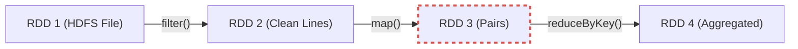
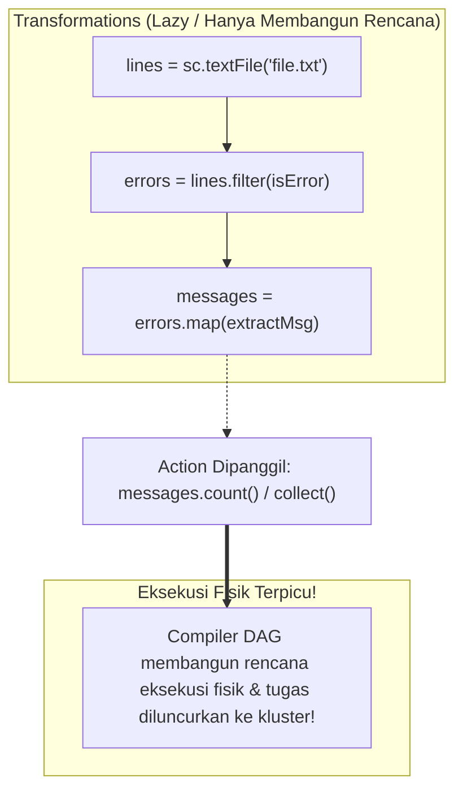
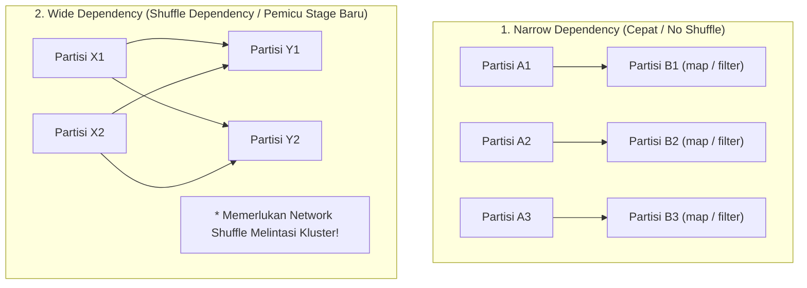

# ⚡ 06.6 Apache Spark (In-Memory Unified Computing Engine & RDD)

> [!ABSTRACT] Ringkasan Sub-Materi
> Menelaah secara mendalam mesin komputasi terdistribusi generasi modern **Apache Spark** yang dirintis oleh AMPLab UC Berkeley. Sub-materi ini membahas abstraksi inti **Resilient Distributed Datasets (RDD)**, toleransi kesalahan berbasis **Lineage Graph**, siklus **Lazy Evaluation** (*Transformations vs Actions*), perbedaan krusial **Narrow vs Wide Dependency**, optimasi *Catalyst*, komparasi mendalam **Spark vs MapReduce**, kisi-kisi ujian, dan panduan jawaban esai.

---

## 1. Spesialisasi Aplikasi Unik (*The Differentiator*)

Meskipun Apache MapReduce sangat andal untuk pemrosesan batch data statis, MapReduce memiliki kelemahan mendasar: **setiap langkah perantara (*intermediate data*) wajib ditulis ke media hard disk fisik dan dibaca ulang melintasi jaringan**.

Kelemahan I/O disk ini membuat algoritma iteratif (seperti pelatihan model *Machine Learning* k-means, regresi logistik, analisis graf PageRank, atau kueri kueri interaktif) berjalan sangat lambat karena harus mengulang siklus baca-tulis disk puluhan kali.

**Spesialisasi Unik Apache Spark**:
- Menghadirkan **Mesin Komputasi Kluster Terpadu Berbasis Memori (*In-Memory Unified Cluster Computing Engine*)**.
- Mempertahankan dataset perantara di dalam **memori RAM utama secara terdistribusi melintasi seluruh siklus iterasi**, sehingga mampu mencapai kecepatan komputasi hingga **100 kali lebih cepat di RAM** (atau 10x lebih cepat di disk) dibandingkan Apache MapReduce konvensional.
- Menyediakan ekosistem API terpadu untuk kueri SQL (*Spark SQL*), *Machine Learning* (*MLlib*), pemrosesan graf (*GraphX*), dan pengaliran data real-time (*Spark Streaming*).

```mermaid
graph TD
    subgraph "Siklus Iteratif MapReduce (Lambat / Disk Bottleneck)"
        D1[(Disk)] --> M1["Map 1"] --> R1["Reduce 1"] --> D2[(Tulis ke Disk)]
        D2 --> M2["Map 2"] --> R2["Reduce 2"] --> D3[(Tulis ke Disk)]
    end

    subgraph "Siklus Iteratif Apache Spark (Super Cepat / 100x di RAM!)"
        RAM[("HDFS / Storage")] --> SPARK_MEM["Muat ke RAM (RDD / DataFrame)"]
        SPARK_MEM --> IT1["Iterasi 1 (Dalam RAM)"]
        IT1 --> IT2["Iterasi 2 (Dalam RAM)"]
        IT2 --> IT_N["Iterasi N (Dalam RAM)"]
        IT_N --> OUT[(Simpan Hasil Akhir)]
    end
```



---

## 2. Abstraksi Inti: Resilient Distributed Datasets (RDD)

Jantung dari model pemrograman Apache Spark adalah **RDD (Resilient Distributed Dataset)**:
- **Resilient (Tahan Banting)**: Mampu memulihkan data yang hilang secara otomatis jika sebuah node pekerja rusak di tengah komputasi tanpa memerlukan replikasi data fisik ke disk.
- **Distributed (Terdistribusi)**: Data dipecah menjadi partisi-partisi logis yang disebar melintasi memori RAM ratusan komputer pekerja di kluster.
- **Dataset (Kumpulan Elemen Data)**: Koleksi objek data yang dapat diolah menggunakan fungsi pemrograman fungsional (Scala, Python, Java, R).
- **Immutable (Tidak Dapat Diubah)**: RDD bersifat *read-only*. Sekali dibuat, isi partisi RDD tidak pernah bisa dimodifikasi. Setiap operasi transformasi selalu menghasilkan RDD baru.

---

## 3. Toleransi Kesalahan Tanpa Replikasi Disk: Lineage Graph

Bagaimana Spark menjamin toleransi kesalahan (*fault-tolerance*) jika data hanya disimpan di memori RAM yang mudah hilang saat server mati?

> [!IMPORTANT] Rahasia Ketahanan Spark: Lineage Graph (DAG)
> Spark **TIDAK MENDUPLIKASI partisi RDD ke 3 hard disk** seperti yang dilakukan HDFS.  
> Sebagai gantinya, Spark mencatat secara rinci **"silsilah keturunan" (*Lineage Graph*)** dari setiap RDD: informasi mengenai RDD induk mana yang melahirkannya dan fungsi transformasi apa yang diterapkan.



**Mekanisme Pemulihan Otomatis**:
- Jika mesin pekerja yang memegang salah satu partisi dari `RDD 3` tiba-tiba meledak/mati:
- Spark **tidak perlu mengulang seluruh pekerjaan dari awal!**
- Manajer kluster Spark cukup memeriksa *Lineage Graph* untuk melihat bagaimana partisi tersebut diciptakan: yaitu dengan menerapkan fungsi `map()` pada partisi yang sesuai di `RDD 2`.
- Spark menjadwalkan ulang komputasi lokal untuk menghitung ulang (*recompute*) hanya partisi yang hilang tersebut pada node lain yang masih sehat. Pendekatan ini sangat hemat penyimpanan disk dan overhead jaringan!

---

## 4. Siklus Eksekusi: Transformations vs Actions (Lazy Evaluation)

Operasi pada RDD dibagi secara tegas menjadi dua kategori:



### A. Transformations (Bersifat Lazy Evaluation)
- Operasi yang menerima RDD yang sudah ada dan menghasilkan RDD baru (misal: `map()`, `filter()`, `flatMap()`, `groupByKey()`, `distinct()`).
- **Prinsip Lazy Evaluation (Evaluasi Malas)**: Saat Anda menulis baris kode transformasi, **Spark TIDAK LANGSUNG mengeksekusi komputasi tersebut secara fisik!** Spark hanya mencatat operasi tersebut sebagai simpul rencana di dalam *Lineage Graph*.
- *Tujuan Optimasi*: Memungkinkan mesin pengoptimasi Spark menggabungkan beberapa tahapan operasi (misal menggabungkan `filter()` dan `map()` ke dalam satu putaran loop) sebelum data dieksekusi secara nyata.

#### 1. Perbedaan Krusial `map()` vs `flatMap()` (Soal Wajib UAS!)
| Metode Transformasi | Pola Pemetaan | Mekanisme Kerja | Contoh Kasus Penggunaan |
| :--- | :--- | :--- | :--- |
| **`map(func)`** | **1-ke-1 ($1 \to 1$)** | Setiap satu elemen masukan menghasilkan **tepat satu elemen keluaran** | Mengubah string huruf kecil ke kapital: `"halo" \to "HALO"` |
| **`flatMap(func)`** | **1-ke-Banyak ($1 \to N$)** | Setiap satu elemen masukan dipetakan dan diratakan (*flattened*) menjadi **nol, satu, atau banyak elemen keluaran** | **Tokenisasi Teks**: Memecah satu baris kalimat menjadi daftar kata-kata individu (*WordCount*) |

> [!EXAMPLE] Kasus Soal UAS: Mengapa flatMap()?
> Jika input berupa baris teks: `["Project Gutenberg's", "Alice's Adventures"]`  
> - Jika menggunakan `.map(lambda line: line.split(" "))`, hasilnya adalah array di dalam array: `[["Project", "Gutenberg's"], ["Alice's", "Adventures"]]`  
> - Jika menggunakan **`.flatMap(lambda line: line.split(" "))`**, seluruh array diratakan menjadi satu aliran baris kata: `["Project", "Gutenberg's", "Alice's", "Adventures"]`.

#### 2. Perilaku Transformasi pada *Immutable RDD* (Awas Jebakan Ujian!)
Ketika sebuah operasi transformasi diterapkan pada sebuah Immutable RDD di Spark:
- **Data dalam RDD awal TIDAK PERNAH DIUBAH** secara langsung (*read-only*).
- **Spark membentuk RDD baru yang sepenuhnya independen** yang merepresentasikan hasil transformasi tersebut dan terhubung ke RDD induknya dalam *Lineage Graph*.

#### 3. Operasi pada DataFrame Spark (`withColumn`)
Selain RDD level rendah, Spark menyediakan abstraksi tingkat tinggi berupa **DataFrame**:
- Fungsi **`.withColumn(colName, colExpr)`**: Digunakan untuk **menambah kolom baru atau memperbarui/memodifikasi konten data pada kolom yang sudah ada**.
- Contoh: `df_baru = df.withColumn("gaji_bonus", df["gaji"] * 1.1)`

### B. Actions (Pemicu Eksekusi Nyata)
- Operasi yang menghasilkan nilai akhir bukan-RDD kembali ke program *driver* atau menulis data ke sistem berkas permanen (misal: `count()`, `collect()`, `take(n)`, `reduce()`, `saveAsTextFile()`).
- **Action adalah Pemicu (*Trigger*)**: Hanya ketika sebuah fungsi *Action* dipanggil, mesin penjadwal DAG Spark akan benar-benar menjalankan komputasi fisik di kluster.

---

## 5. Dependensi RDD: Narrow Dependency vs Wide Dependency

Konsep pembeda paling vital yang menentukan batas tahapan (*Stages*) eksekusi pada Spark:



| Dimensi Evaluasi | Narrow Dependency (*Dependensi Sempit*) | Wide Dependency (*Dependensi Luas / Shuffle*) |
| :--- | :--- | :--- |
| **Pola Ketergantungan** | Setiap partisi RDD induk digunakan oleh **maksimal satu partisi** RDD anak | Satu partisi RDD induk digunakan oleh **banyak partisi** RDD anak |
| **Contoh Operasi** | `map()`, `filter()`, `flatMap()`, `mapPartitions()` | `groupByKey()`, `reduceByKey()`, `join()`, `distinct()` |
| **Kebutuhan Jaringan** | **Nol Shuffle Jaringan**; data dapat diproses langsung di memori lokal (*pipelining*) | **Wajib Network Shuffle**; data harus ditata ulang dan ditransfer melintasi jaringan |
| **Batas Tahapan (*Stage*)**| Berjalan di dalam **satu Stage yang sama** | **Membagi eksekusi menjadi Stage baru (*Stage Boundary*)** |
| **Biaya Pemulihan Data** | Cepat (hanya hitung ulang 1 partisi induk lokal) | Lebih lambat (harus melibatkan partisi dari banyak node) |

---

## 6. Matriks Perbandingan Akbar: Apache Spark vs Apache MapReduce

| Kriteria Komparasi | Apache MapReduce | Apache Spark |
| :--- | :--- | :--- |
| **Media Pemrosesan Data** | **Hard Disk I/O Sentris** (Setiap pergantian fase map-reduce membaca dan menulis ke disk) | **Memori RAM Sentris** (*In-Memory Computing*, persistensi ke disk hanya jika RAM penuh) |
| **Kecepatan Algoritma Iteratif** | Lambat (Terbebani penulisan disk lokal dan replikasi) | **Hingga 100x Lebih Cepat** untuk Machine Learning dan graph |
| **Mekanisme Toleransi Kesalahan**| Replikasi blok fisik ke disk DataNode (HDFS) | Pelacakan komputasi logis berbasis **Lineage Graph (DAG)** |
| **Model Eksekusi** | Kaku: tepat 2 fase berturut-turut (*Map $\to$ Shuffle $\to$ Reduce*) | Fleksibel: graf asiklik terarah arbitrer (**DAG Engine**) |
| **Evaluasi Kueri** | Segera / Langsung dieksekusi per langkah | **Lazy Evaluation** (Dioptimasi sebelum Action dijalankan) |
| **Dukungan Streaming** | Tidak mendukung streaming asli (hanya batch besar) | Mendukung streaming kontinu / mikro-batch (*Spark Streaming*) |
| **Kebutuhan Perangkat Keras**| RAM sedang, kapasitas disk hard drive besar | **Membutuhkan kapasitas RAM kluster yang sangat besar** |

---

## 🎯 Hal-Hal yang Kemungkinan Besar Masuk Ujian

1. **Abstraksi Dasar Spark Core**:
   - Struktur data fundamental Spark adalah **RDD (Resilient Distributed Dataset)**.
2. **Transformasi `map()` vs `flatMap()`**:
   - Pemecahan baris kalimat teks menjadi kata-kata individu ($1 \to N$) menggunakan fungsi **`flatMap()`**.
3. **Manipulasi Kolom DataFrame**:
   - Menambah atau memodifikasi nilai konten kolom pada DataFrame menggunakan fungsi **`.withColumn()`**.
4. **Sifat Immutable RDD**:
   - Saat transformasi diterapkan, **RDD awal tidak diubah, melainkan dibentuk RDD baru yang sepenuhnya independen**.
5. **In-Memory Computing**:
   - Spark hingga **100x lebih cepat** dibanding MapReduce untuk algoritma iteratif karena data perantara ditahan di memori RAM tanpa siklus baca-tulis disk berulang.
6. **Narrow vs Wide Dependency**:
   - Narrow (`map`, `filter`) = satu partisi ke satu partisi, nol shuffle.
   - Wide (`groupByKey`, `reduceByKey`, `join`) = melibatkan banyak partisi, memicu **Network Shuffle**.

---

## 📋 Contoh Soal Ujian (Pilihan Ganda & Esai)

### Contoh Soal Pilihan Ganda

**Soal 1 (Abstraksi Data Dasar Spark - UAS 2022/2023)**  
Berikut ini merupakan struktur data dasar Spark dan abstraksi data utama pada Apache Spark dan Spark Core adalah...  
A. DataFrame  
B. Linked List  
C. Hash Table  
D. Resilient Distributed Dataset  
*Kunci Jawaban*: **D**  
*Pembahasan*: RDD (Resilient Distributed Dataset) adalah fondasi dan abstraksi data paling mendasar dari Apache Spark Core. DataFrame dibangun di atas RDD.

**Soal 2 (Operasi Transformasi flatMap - UAS 2022/2023)**  
Diketahui baris masukan teks:
```
+--------------------+
|                data|
+--------------------+
|Project Gutenberg's |
|Alice's Adventures  |
+--------------------+
```
Menghasilkan keluaran satu kolom kata individu:
```
+--------------------+
|               value|
+--------------------+
|Project             |
|Gutenberg's         |
|Alice's             |
|Adventures          |
+--------------------+
```
Jenis transformasi di Spark yang berfungsi untuk menghasilkan luaran di atas adalah...  
A. `collect()`  
B. `map()`  
C. `filter()`  
D. `flatMap()`  
*Kunci Jawaban*: **D**  
*Pembahasan*: Transformasi `flatMap()` memetakan setiap satu baris elemen masukan menjadi banyak elemen keluaran (*one-to-many*) dan meratakannya menjadi satu aliran data datar.

**Soal 3 (Modifikasi Kolom DataFrame - UAS 2022/2023)**  
Operasi yang digunakan pada DataFrame Spark untuk melakukan modifikasi pada konten data atau menambah kolom baru adalah...  
A. `groupBy`  
B. `select`  
C. `withColumn`  
D. `filter`  
*Kunci Jawaban*: **C**  
*Pembahasan*: Metode `.withColumn(nama_kolom, ekspresi)` digunakan secara khusus pada Spark DataFrame untuk menambah kolom baru atau mengubah isi data kolom yang sudah ada.

**Soal 4 (Perilaku Immutable RDD - UAS 2022/2023)**  
Ketika sebuah transformasi diterapkan pada *Immutable RDD* dalam Apache Spark, apa yang sebenarnya terjadi?  
A. RDD awal diubah menjadi RDD baru yang sepenuhnya independen.  
B. Data dalam RDD awal diubah secara langsung tanpa membuat RDD baru.  
C. RDD baru dibuat yang hanya menyimpan perbedaan dengan RDD awal.  
D. Transformasi dieksekusi pada RDD awal secara berurutan satu per satu.  
*Kunci Jawaban*: **A**  
*Pembahasan*: Sifat mutlak RDD adalah *immutable* (tidak dapat diubah). Setiap transformasi membentuk RDD baru yang mandiri dan mencatat hubungan dependensinya pada Lineage Graph.

**Soal 5 (Konsep Narrow vs Wide Dependency)**  
Dalam arsitektur Apache Spark, operasi transformasi yang menyebabkan data dari satu partisi RDD induk harus dipindahkan melintasi jaringan (*network shuffle*) untuk digabungkan dengan data dari partisi lain disebut...  
A. *Narrow Dependency*  
B. *Wide / Shuffle Dependency*  
C. *In-Memory Pipelining*  
D. *Local Thread Partition*  
*Kunci Jawaban*: **B**  
*Pembahasan*: Wide Dependency mengharuskan terjadinya pemindahan data antar-node melalui jaringan (shuffle) karena partisi anak bergantung pada data dari banyak partisi induk (misal pada `groupByKey()`).

---

### Contoh Soal Esai

#### Soal Esai 1: Komparasi Mendalam Apache Spark vs Apache MapReduce (UAS 2022/2023)
Jelaskan secara mendalam perbedaan antara Apache Spark dan Apache MapReduce dari 3 aspek arsitektural utama!

**Pedoman Jawaban Lengkap**:
1. **Penyimpanan Data Perantara (*Intermediate Data Storage*)**:
   - **MapReduce**: Menuliskan seluruh data perantara ke media hard disk fisik (disk lokal & HDFS) pada setiap akhir fase *Map* dan *Reduce*. Hal ini menimbulkan beban disk I/O dan latensi yang sangat tinggi.
   - **Spark**: Memproses dan menahan data perantara langsung di dalam **memori RAM utama secara terdistribusi (*In-Memory Computing*)**. Persistensi ke disk hanya dilakukan jika kapasitas RAM tidak mencukupi atau atas permintaan eksplisit (`persist/checkpoint`).
2. **Kecepatan Komputasi & Performa Algoritma Iteratif**:
   - **MapReduce**: Eksekusinya lambat, sangat terbebani operasi baca-tulis piringan disk, dan hanya optimal untuk pemrosesan batch satu kali jalan (*one-pass batch*).
   - **Spark**: Mampu mencapai kecepatan **hingga 100 kali lebih cepat** dibandingkan MapReduce, terutama untuk pemrosesan interaktif dan algoritma iteratif (seperti *Machine Learning* dan pemrosesan graf) di mana data diakses berulang kali di RAM.
3. **Model Pemrograman & Fleksibilitas Eksekusi**:
   - **MapReduce**: Terikat secara kaku pada dua fungsi primitif: `map` dan `reduce` dengan pola linier bertahap (*Map $\to$ Shuffle $\to$ Reduce*).
   - **Spark**: Menyediakan ratusan fungsi transformasi tingkat tinggi yang kaya (`map`, `filter`, `flatMap`, `reduceByKey`, `join`) dengan dukungan arsitektur **Directed Acyclic Graph (DAG)** dan eksekusi berbasis **Lazy Evaluation**.

---

#### Soal Esai 2: Fault Tolerance RDD pada Kasus Machine Learning
Sebuah laboratorium AI melatih model regresi logistik 50 iterasi pada data 2 TB di Spark. Server mati pada iterasi ke-45. Jelaskan peran RDD dan Lineage Graph dalam menyelamatkan komputasi tersebut tanpa mengulang dari awal!  
*(Lihat pembahasan detail pada Bab 3 tentang recompute partisi hilang via Lineage Graph).*

---

## 💡 Tips & Trik Menjawab Soal Ujian

1. **Jurus Kata Kunci Apache Spark**:
   - In-Memory Computing, RDD (Resilient, Distributed, Immutable).
   - `flatMap()` $\to$ Memecah kalimat menjadi kata ($1 \to N$).
   - `.withColumn()` $\to$ Menambah/mengubah kolom DataFrame.
   - Transformasi pada Immutable RDD $\to$ **Membentuk RDD baru yang independen**.
   - **Lineage Graph (DAG)** $\to$ Fault-tolerance tanpa replikasi data ke disk.
   - **Lazy Evaluation** $\to$ *Transformations* dicatat, baru dieksekusi saat *Action* dipanggil.
2. **Formula Menjawab Esai Spark vs MapReduce**:
   - Sebutkan 3 poin kontras: **Media Penyimpanan (RAM vs Disk)**, **Kecepatan (Hingga 100x di RAM)**, dan **Model Pemrograman (Fleksibel DAG vs Kaku Map-Reduce)**.
