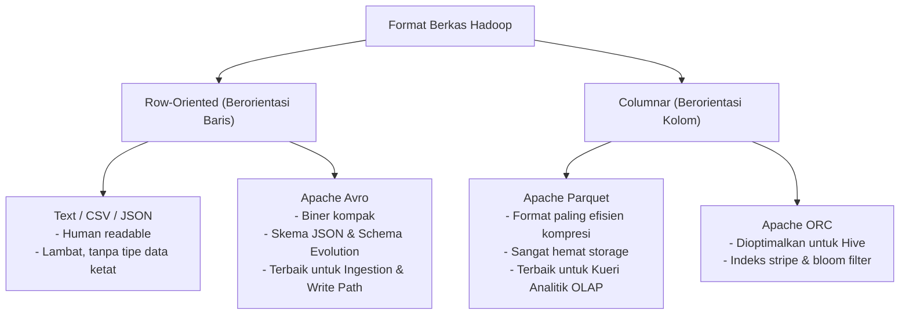
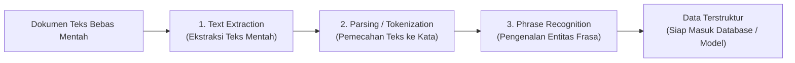
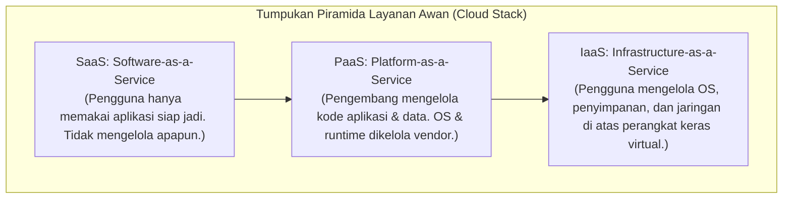
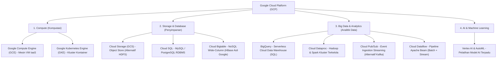

# ☁️ 06.7 Format Data, Pemrosesan Teks & Cloud Computing Big Data

> [!ABSTRACT] Ringkasan Sub-Materi
> Menelaah topik-topik modern yang diujikan dalam UAS TPD: (1) Format berkas penyimpanan Big Data di ekosistem Hadoop (**Apache Parquet, Apache Avro, ORC**), (2) Tahapan menstrukturkan data teks tidak terstruktur dan strategi data semi-terstruktur di **Data Lake**, (3) Konsep komputasi awan (**IaaS, PaaS, SaaS, dan Hypervisor**), serta (4) Ekosistem **Google Cloud Platform (GCP)** dan layanan-layanan Big Data unggulannya (**BigQuery, Dataproc, Cloud Storage, Pub/Sub**).

---

## 1. Format Berkas Penyimpanan Big Data di Hadoop

Pemilihan format berkas (*file format*) sangat menentukan efisiensi kompresi, konsumsi I/O disk, dan kecepatan kueri di Hadoop:

### A. Apache Parquet (Format Paling Efisien di Hadoop - Soal Wajib UAS!)
- **Filosofi Penyimpanan**: **Penyimpanan Berorientasi Kolom (*Columnar Storage*)**. Nilai dari kolom yang sama disimpan berdampingan secara fisik di dalam blok disk.
- **Keunggulan Kompresi & Penghematan Ruang**:
  - Karena data dalam satu kolom memiliki tipe dan domain nilai yang sama, algoritma kompresi (seperti *Snappy* atau *Gzip*) dan teknik *dictionary encoding / run-length encoding* dapat memampatkan data dengan rasio yang luar biasa tinggi.
  - **Parquet adalah format file yang paling efisien dalam hal kompresi dan penghematan ruang penyimpanan (*storage saving*) di Hadoop**.
- **Efisiensi Kueri Analitik (*Column Pruning*)**:
  - Jika kueri hanya meminta 2 kolom dari tabel yang memiliki 100 kolom:
    `SELECT customer_id, SUM(total) FROM orders;`
  - Mesin kueri hanya membaca blok disk dari kolom `customer_id` dan `total`. Sebanyak 98 kolom lainnya **tidak pernah dibaca dari disk**, memangkas I/O hingga 98%.

### B. Apache Avro (Format Baris Biner & Evolusi Skema)
- **Filosofi Penyimpanan**: **Berorientasi Baris (*Row-based Storage*)**. Data disimpan dalam format biner kompak.
- **Karakteristik Unik**:
  - Skema data didefinisikan menggunakan format **JSON** dan **disimpan bersama data di dalam berkas itu sendiri (*self-describing*)**.
  - **Dukungan Evolusi Skema (*Schema Evolution*)**: Sangat tangguh saat skema berubah seiring waktu (penambahan kolom baru, penghapusan kolom lama) tanpa merusak kompatibilitas pembacaan data historis.
  - **Sangat Ideal untuk**: Aliran data masuk (*event streaming ingestion* via Kafka) dan lapisan *Schema-on-Read* pada Data Lake.

### C. Matriks Perbandingan Format Berkas Hadoop

| Dimensi Evaluasi | Text (CSV/JSON) | Apache Avro | Apache Parquet | Apache ORC |
| :--- | :--- | :--- | :--- | :--- |
| **Orientasi Penyimpanan** | Baris (Teks) | **Baris (Biner)** | **Kolom (Biner)** | **Kolom (Biner)** |
| **Efisiensi Kompresi** | Sangat Rendah | Sedang / Tinggi | **Sangat Tinggi (Paling Hemat Ruang)** | Sangat Tinggi |
| **Kecepatan Kueri Analitik** | Sangat Lambat | Sedang | **Sangat Cepat (*Column Pruning*)** | Sangat Cepat (Hive) |
| **Dukungan Schema Evolution** | Lemah / Manual | **Sangat Kuat (Skema JSON)** | Baik | Baik |
| **Kasus Penggunaan Terbaik** | Ekspor mentah manusia | Ingestion Kafka & Data Lake | DWH, Spark SQL, Analitik OLAP | Data Warehouse Apache Hive |

---

## 2. Pemrosesan Data Teks Tidak Terstruktur & Semi-Terstruktur

Data modern di dunia Big Data didominasi oleh data semi-terstruktur (JSON, XML, log web) dan tidak terstruktur (dokumen teks bebas, review pelanggan, transkrip percakapan).

### A. Tiga Tahapan Menstrukturkan Data Teks Tidak Terstruktur (Soal Wajib UAS!)
Untuk mengubah teks bebas menjadi data yang memiliki struktur tabular/relasional, alur pemrosesan teks standar melewati 3 tahapan utama:
1. **Text Extraction (Ekstraksi Teks)**:
   - Mengambil teks murni dari berbagai format dokumen asal (seperti file PDF, HTML web scrap, dokumen Word, atau OCR gambar) dan membersihkan format biner pembungkusnya.
2. **Parsing / Tokenization (Segmentasi Kata)**:
   - Mengurai teks menjadi unit-unit terkecil yang bermakna (*tokens* / kata-kata individu), membuang tanda baca, memisahkan spasi, serta menerapkan *stop words removal* dan *stemming*.
3. **Phrase Recognition (Pengenalan Frasa & Entitas)**:
   - Mengidentifikasi kelompok kata atau frasa majemuk yang memiliki makna khusus (*Named Entity Recognition - NER*), seperti nama orang, nama kota ("DKI Jakarta"), istilah teknis, atau nilai mata uang.

> [!WARNING] Awas Jebakan UAS
> Istilah seperti **"Flatering Flatmap" / `flatMap` BUKAN merupakan tahapan menstrukturkan teks linguistik**, melainkan fungsi transformasi komputasi koding pada Apache Spark!

### B. Pemrosesan Data Semi-Terstruktur pada Data Lake Hadoop
- **Konsep *Schema-on-Read***:
  - Berbeda dengan Data Warehouse tradisional yang menerapkan *Schema-on-Write* (skema harus divalidasi ketat saat data ditulis), **Data Lake** mengizinkan penyimpanan data mentah apa adanya.
  - Skema data baru diterapkan dan disesuaikan **saat data dibaca (*Schema-on-Read*)**.
- **Peran Format Avro**:
  - Data semi-terstruktur dapat dikonversi ke dalam **format Avro** untuk mempermudah penyesuaian dan evolusi skema saat data dibaca (*schema evolution*), memungkinkan kolom baru ditambahkan tanpa perlu memformat ulang seluruh dataset historis.

---

## 3. Komputasi Awan (Cloud Computing) & Model Layanan

Cloud Computing menyediakan sumber daya komputasi (server, storage, database, jaringan, perangkat lunak) melalui internet secara *on-demand* dengan model pembayaran sesuai pemakaian (*pay-as-you-go*).

### A. Tiga Model Layanan Cloud Computing
1. **IaaS (Infrastructure-as-a-Service)**:
   - **Karakteristik**: Menyediakan infrastruktur komputasi fisik dasar secara virtual: mesin virtual (*Virtual Machines*), penyimpanan (*storage*), dan jaringan (*networking*) yang dapat diakses melalui konektivitas berbasis IP.
   - **Contoh Soal UAS**: Pengiriman dan penyimpanan berkas dari sistem lokal ke server penyimpanan awan melalui konektivitas berbasis IP sebagai bagian dari sumber daya penyimpanan fisik *on-demand* tergolong dalam layanan **IaaS**.
   - *Contoh Layanan*: Google Compute Engine (GCE), Amazon EC2, Azure VMs, Google Cloud Storage.
2. **PaaS (Platform-as-a-Service)**:
   - **Karakteristik**: Menyediakan lingkungan *runtime*, kerangka kerja (*framework*), dan peralatan terkelola untuk membangun, menguji, dan meluncurkan aplikasi tanpa perlu memusingkan pemeliharaan server fisik dan sistem operasi.
   - *Contoh Layanan*: Google App Engine, Google Cloud Dataproc (Hadoop/Spark terkelola), AWS Elastic Beanstalk.
3. **SaaS (Software-as-a-Service)**:
   - **Karakteristik**: Menyediakan perangkat lunak aplikasi siap pakai yang di-host di awan dan diakses pengguna melalui antarmuka web atau aplikasi mobile.
   - Pengguna **TIDAK PERLU melakukan pengelolaan infrastruktur atau instalasi software sama sekali**, dan hanya membayar lisensi sesuai pemakaian (*pay-as-you-go*).
   - *Contoh Layanan*: Google Workspace (Gmail, Docs), Salesforce, Microsoft 365, Dropbox.

### B. Peran Hypervisor dalam Virtualisasi Cloud
- **Definisi**: **Hypervisor** (atau *Virtual Machine Monitor - VMM*) adalah **lapisan perangkat lunak (software) yang membuat, mengelola, dan mengalokasikan sumber daya komputasi fisik (CPU, RAM, Hard Disk) ke beberapa mesin virtual (*Virtual Machines - VMs*) secara terisolasi**.
- **Fungsi Utama**:
  - Memungkinkan satu server fisik besar (*Host Machine*) menjalankan puluhan sistem operasi tamu (*Guest OS*) yang berbeda secara bersamaan dan independen.

---

## 4. Bedah Lengkap Google Cloud Platform (GCP) untuk Big Data

**Google Cloud Platform (GCP)** adalah ekosistem layanan komputasi awan (*cloud computing*) yang berjalan di atas infrastruktur global berkecepatan tinggi milik Google. GCP menyediakan infrastruktur terkelola (IaaS dan PaaS) untuk kebutuhan penyimpanan, pengolahan *Big Data*, jaringan, hingga kecerdasan buatan secara *scalable* dan *on-demand*.

### Fitur & Layanan Utama GCP untuk Perekayasaan Data:
1. **Layanan Compute (Komputasi)**:
   - **Google Compute Engine (GCE)**: Layanan IaaS yang menyediakan mesin virtual (*Virtual Machines*) yang dapat dikonfigurasi fleksibel (CPU, RAM, GPU) sesuai kebutuhan pemrosesan data.
   - **Google Kubernetes Engine (GKE)**: Platform orkestrasi kontainer Docker terkelola untuk menjalankan aplikasi mikroservis dan pipeline data modern.
2. **Layanan Storage & Database (Penyimpanan)**:
   - **Cloud Storage (GCS)**: Layanan penyimpanan objek (*object storage*) dengan durabilitas 99.999999999% (11 nines). Sering digunakan sebagai *Data Lake* pengganti sistem berkas HDFS on-premise.
   - **Cloud Bigtable**: Basis data NoSQL berlatensi sub-milidetik berskala Petabyte. Merupakan cetak biru asli yang menginspirasi Apache HBase.
   - **Cloud SQL & Cloud Spanner**: Basis data relasional terkelola (MySQL, PostgreSQL, SQL Server) dan basis data transaksional terdistribusi global yang konsisten (*NewSQL*).
3. **Layanan Big Data & Analytics (Analitik Data Terdistribusi)**:
   - **BigQuery**: Platform *Data Warehouse* berbasis awan yang sepenuhnya *serverless* dan sangat cepat. Mampu mengeksekusi kueri SQL pada dataset skala Terabyte/Petabyte dalam hitungan detik (*query engine Dremel*).
   - **Cloud Dataproc**: Layanan kluster **Apache Hadoop dan Apache Spark terkelola**. Memungkinkan pengguna membuat kluster pemrosesan data Big Data dalam waktu kurang dari 90 detik, lalu menghancurkannya saat selesai (*ephemeral clusters*) untuk menghemat biaya.
   - **Google Cloud Pub/Sub**: Layanan pengaliran pesan (*message ingestion*) berbasis publish-subscribe yang dapat diskalakan secara otomatis untuk menyerap jutaan event per detik (padanan dari Apache Kafka).
   - **Cloud Dataflow**: Layanan pemrosesan data *stream* dan *batch* terkelola berbasis Apache Beam.
4. **Layanan AI & Machine Learning**:
   - **Vertex AI & AutoML**: Platform terpadu untuk melatih, mengevaluasi, dan men-deploy model *Machine Learning* skala besar yang terintegrasi langsung dengan data di BigQuery.

---

## 🎯 Hal-Hal yang Kemungkinan Besar Masuk Ujian

1. **Format File Paling Hemat di Hadoop**:
   - **Apache Parquet**: Format berbasis kolom (*columnar*), kompresi paling efisien, dan paling hemat ruang penyimpanan.
2. **Tahapan Menstrukturkan Teks Tidak Terstruktur**:
   - Tiga tahap resmi: **Text Extraction $\to$ Parsing/Tokenization $\to$ Phrase Recognition**.
   - `flatMap` / "Flatering Flatmap" **BUKAN** tahapan teks, melainkan fungsi koding.
3. **Data Semi-Terstruktur di Data Lake**:
   - Menerapkan prinsip **Schema-on-Read**. Format **Avro** membantu mengelola penyesuaian skema saat dibaca.
4. **Model Layanan Cloud**:
   - **IaaS**: Penyimpanan fisik / file transfer via IP, server VM (*Infrastructure*).
   - **PaaS**: Lingkungan platform pengembang, runtime tanpa kelola server (*Platform*).
   - **SaaS**: Pengguna hanya memakai aplikasi siap jadi, bayar per pakai (*Software*).
5. **Definisi Hypervisor**:
   - Perangkat lunak yang mengelola mesin virtual (VM) dan mengalokasikan sumber daya perangkat keras fisik.
6. **Ekosistem Google Cloud Platform (GCP)**:
   - Pengertian: Ekosistem komputasi awan terkelola IaaS/PaaS milik Google.
   - Layanan Big Data wajib: **BigQuery** (DWH), **Cloud Dataproc** (Hadoop & Spark), **Cloud Storage** (Data Lake), dan **Pub/Sub** (Streaming).

---

## 📋 Contoh Soal Ujian (Pilihan Ganda & Esai)

### Contoh Soal Pilihan Ganda

**Soal 1 (Format Berkas Paling Efisien - UAS 2022/2023)**  
Di antara format file di bawah ini, yang paling efisien dalam hal kompresi dan penghematan ruang penyimpanan di Hadoop adalah...  
A. CSV  
B. Avro  
C. Parquet  
D. JSON  
*Kunci Jawaban*: **C**  
*Pembahasan*: Format Parquet menggunakan penyimpanan berorientasi kolom (*columnar storage*) yang mengelompokkan nilai dari tipe data yang sama sehingga algoritma kompresi dapat memampatkan data dengan efisiensi tertinggi dan menghemat ruang disk HDFS.

**Soal 2 (Tahapan Penstrukturan Data Teks - UAS 2022/2023)**  
Tahapan yang dilakukan dalam proses menstrukturkan data tidak terstruktur pada data Teks, KECUALI...  
A. Flatering Flatmap  
B. Text Extraction  
C. Parsing/Tokenization  
D. Phrase Recognition  
*Kunci Jawaban*: **A**  
*Pembahasan*: Tahapan baku menstrukturkan dokumen teks meliputi ekstraksi teks mentah (*Text Extraction*), segmentasi/tokenisasi kata (*Parsing/Tokenization*), dan pengenalan frasa majemuk (*Phrase Recognition*). *Flatmap* merupakan operasi pemrograman pada mesin komputasi (Spark).

**Soal 3 (Pemrosesan Data Semi-Terstruktur di Data Lake - UAS 2022/2023)**  
Berikut ini pernyataan yang benar tentang pemrosesan data semi-structured pada Data Lake Hadoop adalah...  
A. Penentuan skema data dilakukan ketika data disimpan dalam Data Lake.  
B. Data dapat dikonversi ke dalam format Avro untuk penyesuaian skema data ketika data dibaca.  
C. Data semi-structured dapat diproses sebagai tabel Hive untuk menjamin skema data yang fleksibel di Data Lake.  
D. Skema tidak relevan dalam pemrosesan data semi-structured pada Data Lake.  
*Kunci Jawaban*: **B**  
*Pembahasan*: Data Lake menerapkan prinsip *Schema-on-Read*. Mengonversi data ke format Avro memfasilitasi evolusi skema (*schema evolution*) saat kueri pembacaan data dieksekusi.

**Soal 4 (Model Layanan Penyimpanan Awan - UAS 2022/2023)**  
Metode untuk mengirimkan suatu file dari suatu sistem ke server penyimpanan, melalui konektivitas berbasis IP sebagai bagian dari layanan on-demand adalah bagian dari layanan cloud computing...  
A. Software-as-a-service  
B. Platform-as-a-service  
C. Infrastructure-as-a-service  
D. Cloud-as-a-service  
*Kunci Jawaban*: **C**  
*Pembahasan*: Penyediaan media penyimpanan data fisik dan transfer data berbasis jaringan IP secara on-demand merupakan komponen dasar dari IaaS (Infrastructure-as-a-Service).

**Soal 5 (Definisi Hypervisor - UAS 2022/2023)**  
Apa yang dimaksud dengan hypervisor dalam virtualisasi Cloud Computing?  
A. Alat yang mengatur kecepatan koneksi internet di Cloud.  
B. Komponen perangkat keras yang memastikan ketersediaan Cloud secara terus-menerus.  
C. Perangkat lunak yang mengelola mesin virtual dan alokasi sumber daya.  
D. Teknologi enkripsi yang melindungi data saat transit di Cloud.  
*Kunci Jawaban*: **C**  
*Pembahasan*: Hypervisor (Virtual Machine Monitor) adalah lapisan perangkat lunak yang bertugas membuat, menjalankan, dan mengalokasikan sumber daya fisik (CPU, RAM, storage) ke beberapa mesin virtual secara terisolasi.

**Soal 6 (Karakteristik SaaS - UAS 2022/2023)**  
Tipe cloud computing yang memungkinkan pengguna tidak perlu melakukan pengelolaan infrastruktur atau software sendiri dan hanya membayar sesuai dengan pemakaian aplikasi siap pakai adalah...  
A. IaaS  
B. SaaS  
C. PaaS  
D. Virtualization  
*Kunci Jawaban*: **B**  
*Pembahasan*: SaaS (Software-as-a-Service) menyediakan aplikasi siap pakai yang berjalan di awan tanpa mewajibkan pengguna menginstal, mengelola, atau mengonfigurasi infrastruktur di bawahnya.

---

### Contoh Soal Esai

#### Soal Esai: Google Cloud Platform (GCP) & Fitur-Fiturnya (UAS 2022/2023)
Jelaskan apakah yang dimaksud dengan **Google Cloud Platform (GCP)** dan sebutkan fitur-fitur serta layanan utama yang disediakan oleh GCP untuk mendukung pemrosesan dan analitik data berskala besar!

**Pedoman Jawaban Lengkap**:
1. **Pengertian Google Cloud Platform (GCP)**:
   - Google Cloud Platform (GCP) adalah ekosistem rangkaian layanan komputasi awan (*cloud computing services*) terpadu yang berjalan di atas infrastruktur fisik global berkinerja tinggi yang sama dengan yang digunakan oleh produk konsumen Google (seperti Google Search, YouTube, dan Gmail).
   - GCP menyediakan layanan komputasi terdistribusi dalam model **IaaS (Infrastructure-as-a-Service)** dan **PaaS (Platform-as-a-Service)** yang memungkinkan perusahaan menyimpan, mengelola, memproses *Big Data*, dan menjalankan algoritma analitik/AI secara elastis, aman, dan *on-demand*.
2. **Empat Kategori Fitur & Layanan Utama GCP untuk Perekayasaan Data**:
   - **Compute (Layanan Komputasi)**:
     - *Google Compute Engine (GCE)*: Mesin virtual (VM) IaaS yang dapat dikonfigurasi spesifikasi CPU, RAM, dan akselerator GPU-nya secara fleksibel.
     - *Google Kubernetes Engine (GKE)*: Layanan orkestrasi kontainer terkelola untuk deployment pipeline data mikroservis.
   - **Storage & Database (Layanan Penyimpanan & Basis Data)**:
     - *Cloud Storage (GCS)*: Penyimpanan objek (*object storage*) berskala tak terbatas dengan durabilitas tinggi yang bertindak sebagai *Data Lake* korporat.
     - *Cloud Bigtable*: Basis data NoSQL terdistribusi *Wide-Column* dengan latensi sub-milidetik untuk pembacaan dan penulisan data masif (padanan HBase).
     - *Cloud SQL*: Basis data relasional terkelola (MySQL, PostgreSQL).
   - **Big Data & Analytics (Analitik Data Terdistribusi)**:
     - *BigQuery*: *Cloud Data Warehouse* terkelola penuh (*serverless*) yang memungkinkan kueri analitik SQL super cepat pada data skala Petabyte tanpa perlu mengelola kluster server.
     - *Cloud Dataproc*: Layanan penyediaan kluster **Apache Hadoop dan Apache Spark terkelola** secara instan (dapat dinyalakan dalam hitungan detik dan dimatikan otomatis untuk penghematan biaya).
     - *Cloud Pub/Sub*: Layanan perantara pesan streaming berbasis *publish-subscribe* berlatensi rendah untuk penyerapan data masif secara real-time (padanan Kafka).
     - *Cloud Dataflow*: Layanan pemrosesan pipeline data streaming dan batch berbasis Apache Beam.
   - **Artificial Intelligence & Machine Learning (AI/ML)**:
     - *Vertex AI & AutoML*: Platform terpadu untuk melatih, menyetel, dan meluncurkan model Machine Learning yang terintegrasi langsung dengan dataset di BigQuery dan Cloud Storage.

---

## 💡 Tips & Trik Menjawab Soal Ujian

1. **Jurus Kata Kunci Format File**:
   - Parquet $\to$ Columnar storage, **paling hemat dan efisien kompresi di Hadoop**.
   - Avro $\to$ Row-based binary, JSON schema, **Schema Evolution** terbaik.
2. **Jurus Kata Kunci Pemrosesan Teks**:
   - Tahapan: **Text Extraction $\to$ Parsing/Tokenization $\to$ Phrase Recognition**.
   - Ingat: flatMap adalah fungsi koding, bukan tahapan bahasa teks.
3. **Jurus Kata Kunci Cloud & GCP**:
   - IaaS = Sewa infrastruktur mentah (Server VM, storage, IP transfer).
   - PaaS = Sewa platform pengembangan/runtime (Dataproc managed).
   - SaaS = Sewa aplikasi siap pakai langsung diakses pengguna (Gmail, Office 365).
   - Hypervisor = Software pengelola VM dan alokasi resource fisik.
   - BigQuery = Serverless Data Warehouse SQL di GCP.
   - Cloud Dataproc = Hadoop & Spark terkelola di GCP.
   - Cloud Bigtable = NoSQL Wide-column berlatensi rendah di GCP.
