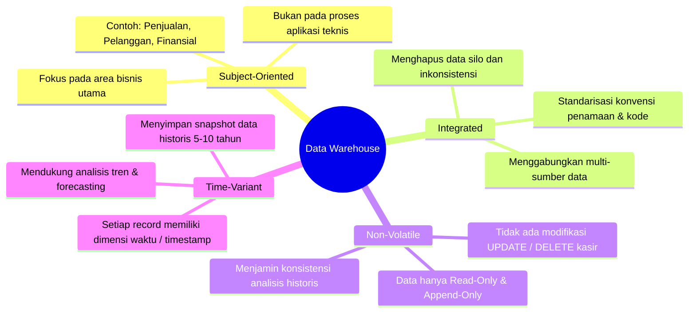
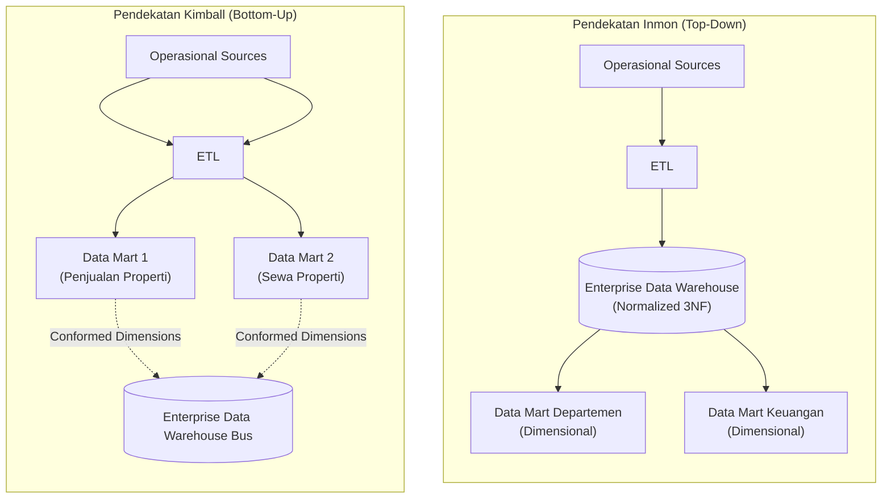

# 🏢 01. Data Warehouse & Arsitektur DWH

> [!NOTE] Referensi Kisi-Kisi UAS
> **Topik**: Data Warehouse: konsep utama, perbedaan arsitektur-arsitektur DWH, perbedaan data mart dan data warehouse.
> **Terkait dengan**: [[02. Dimensional Modeling & Slowly Changing Dimensions (SCD)]], [[03. ETL (Extract, Transform, Load) vs ELT]].

---

## 1. Latar Belakang & Kebutuhan Data Warehouse

### A. Permasalahan Database Tradisional (OLTP)
Sebelum adanya Data Warehouse, organisasi mengandalkan sistem **OLTP (*Online Transaction Processing*)** (seperti database kasir POS, sistem perbankan, CRM operasional) untuk segala kebutuhan data. Muncul berbagai kendala serius:
1. **Data Terisolasi (*Data Silo*)**: Data departemen penjualan, keuangan, logistik, dan SDM tersimpan di server terpisah dengan struktur yang berbeda-beda.
2. **Inkonsistensi Data**: Format data pelanggan di cabang A berbeda dengan cabang B (misal format tanggal, kode negara, penulisan nama).
3. **Beban Komputasi Campur Aduk**: Ketika bagian analis menjalankan kueri agregasi berat (*analytical report* tahunan) di database operasional, sistem transaksi kasir menjadi lambat (*resource contention*) bahkan *crash*.
4. **Hanya Menyimpan Data Terkini (*Current Data*)**: Sistem operasional biasanya melakukan *UPDATE* di tempat (*in-place update*), sehingga riwayat nilai lama hilang. Padahal, manajemen membutuhkan **data historis** untuk analisis tren.

> [!IMPORTANT] Kesimpulan Masalah
> Perusahaan membutuhkan penyimpanan **terpusat, terstruktur, terintegrasi, dan terpisah dari sistem transaksional operasional** untuk mendukung pengambilan keputusan bisnis strategis.

---

## 2. Konsep Utama Data Warehouse

Konsep Data Warehouse (DWH) pertama kali diformulasikan oleh **Bill Inmon** (sering dijuluki *Bapak Data Warehouse*) pada tahun 1990:

> **"A subject-oriented, integrated, non-volatile, and time-variant collection of data in support of management's decisions."**
> — *Bill Inmon (1990)*

Keempat pilar karakteristik tersebut wajib dipahami secara mendalam:

### 1. Subject-Oriented (Berorientasi pada Subjek)
- DWH disusun berdasarkan tema/subjek utama bisnis yang bernilai analitis tinggi (seperti: *Sales*, *Customer*, *Product*, *Finance*).
- Berbeda dengan database OLTP yang disusun berdasarkan proses operasional aplikasi (misalnya: *faktur kasir*, *antrean pesanan*, *input formulir*).

### 2. Integrated (Terintegrasi)
- Data berasal dari sumber yang heterogen (RDBMS MySQL, Oracle, file CSV, logs, API eksternal).
- Melalui proses pembersihan dan transformasi, semua data diseragamkan dalam format, tipe data, skala ukuran, dan pengkodean yang sama (contoh: jenis kelamin diseragamkan menjadi `L`/`P`, format tanggal `YYYY-MM-DD`).

### 3. Non-Volatile (Tidak Menguap / Stabil)
- Data yang sudah masuk ke dalam Data Warehouse bersifat **permanen** (*read-only* bagi end-user, dan *append-only* bagi proses sistem).
- Data operasional kasir dapat berubah sewaktu-waktu melalui operasi `UPDATE` dan `DELETE`. Namun di Data Warehouse, data masa lalu tidak ditimpa sembarangan agar analisis audit dan evaluasi historis tetap akurat dan sahih.

### 4. Time-Variant (Bervariasi Menurut Waktu)
- Setiap data di DWH selalu terikat secara eksplisit dengan horizon waktu (*timestamp*, *date key*).
- Jika database OLTP menyimpan data valid saat ini (biasanya rentang 30-90 hari operasional aktif), DWH menyimpan riwayat data jangka panjang (5 hingga 10+ tahun) sehingga memungkinkan analisis perbandingan antar kuartal/tahun (*trend analysis*, *forecasting*).

### DWH sebagai Single Source of Truth (SSoT)
Dengan integrasi ini, seluruh pemangku kepentingan (CEO, Manajer Pemasaran, Akuntan) mengacu pada **satu versi kebenaran data yang sama** (*Single Source of Truth*), menghilangkan perdebatan angka antar departemen.

---

## 3. Komparasi Komprehensif: OLTP vs OLAP

Pembedaan antara OLTP dan OLAP adalah materi favorit di ujian. Pahami matriks perbandingan berikut:

| Karakteristik | OLTP (*Online Transaction Processing*) | Data Warehouse / OLAP (*Online Analytical Processing*) |
| :--- | :--- | :--- |
| **Tujuan Utama** | Mendukung operasi bisnis transaksional harian (rutin & cepat). | Mendukung analisis data dan pengambilan keputusan manajerial. |
| **Sumber Data** | Input langsung dari transaksi pengguna/kasir/aplikasi. | Data terkumpul dari berbagai database OLTP melalui proses ETL. |
| **Usia Data** | Data saat ini (*current data*, *real-time snapshot*). | Data historis jangka panjang (mencakup tren bertahun-tahun). |
| **Latensi Data** | *Real-time*, detik per detik. | Berkala (*batch load*, harian, mingguan) meski tren modern mendukung *near-real-time*. |
| **Granularitas Data** | Sangat detail (*atomic level* transaksi individu). | Data detail, ringkasan ringan (*lightly summarized*), hingga ringkasan tinggi (*highly summarized*). |
| **Pola Pemrosesan** | Operasi `INSERT`, `UPDATE`, `DELETE`, dan `SELECT` sederhana. | Terbanyak `SELECT` kompleks (*heavy read/aggregations*), *batch append/insert*. |
| **Throughput Transaksi** | Sangat tinggi, transaksi berukuran kecil (*short transactions*). | Sedang hingga rendah, tetapi kueri mengeksekusi jutaan baris sekaligus. |
| **Desain Database** | Dinormalisasi tinggi (3NF/BCNF) untuk menghindari redundansi & *anomaly*. | Didenormalisasi (Star / Snowflake Schema) untuk performa kueri agregasi cepat. |
| **Sifat Kueri** | Terprediksi, sederhana, mengambil sedikit baris per transaksi. | Kueri *ad-hoc*, tidak terprediksi, multidimensi, melibatkan *JOIN* dan agregasi besar. |
| **Pengguna Utama** | Petugas operasional, kasir, staf administrasi, sistem aplikasi (ribuan - jutaan pengguna). | Manajer, analis bisnis, eksekutif, data scientist (puluhan - ratusan pengguna). |

---

## 4. Arsitektur Lengkap Data Warehouse

Berikut adalah alur arsitektur logis Data Warehouse dari sumber operasional hingga alat analitis pengguna akhir:

```mermaid
flowchart LR
    subgraph SOURCES["1. Operational Data Sources"]
        DB1[("RDBMS / OLTP")]
        DB2[("ERP / CRM")]
        FILES[("Flat Files / CSV / Logs")]
    end

    subgraph STAGING["2. Data Staging Area / ODS"]
        ETL["ETL Manager"]
        DSA["Staging Area\n(Cleaned & Integrated)"]
    end

    subgraph DWH["3. Enterprise Data Warehouse"]
        DET["Detailed Data"]
        L_SUM["Lightly Summarized Data"]
        H_SUM["Highly Summarized Data"]
        META["Metadata Repository"]
        ARCH["Archive / Backup Data"]
    end

    subgraph ACCESS["4. End-User Access Tools"]
        REP["Reporting & Dashboard\n(PowerBI, Tableau)"]
        OLAP_TOOL["OLAP Tools\n(SSAS, Cognos)"]
        DM["Data Mining / ML\n(Python, SPSS)"]
    end

    SOURCES --> ETL --> DSA --> DWH
    DWH --> ACCESS
```

### Komponen Utama dalam Arsitektur:
1. **Operational Data Sources (ODS)**:
   - Sistem transaksi harian (database MySQL, PostgreSQL, logs server, aplikasi eksternal) yang menyediakan data mentah (*raw data*).
2. **ETL Manager**:
   - Lapisan perangkat lunak yang mengekstrak (*extract*) data dari sumber, membersihkan & memvalidasi (*transform*), serta memuat (*load*) data ke dalam warehouse.
3. **Data Staging Area (DSA) / Operational Data Store (ODS)**:
   - Area transit sementara tempat data dibersihkan, dideduplikasi, dan diselaraskan sebelum benar-benar di-load ke warehouse agar tidak mengganggu performa server analitis.
4. **Data Warehouse Storage**:
   - **Detailed Data**: Data transaksi dalam tingkat granularitas terendah yang belum diringkas.
   - **Lightly Summarized Data**: Data yang sudah diagregasi pada tingkat awal (misal: total penjualan per hari per toko).
   - **Highly Summarized Data**: Data ringkasan tingkat eksekutif (misal: total revenue per kuartal per wilayah negara).
5. **Metadata Repository**:
   - *"Data about data"*. Menyimpan informasi struktur skema, silsilah data (*data lineage*), aturan transformasi, jadwal ETL, tipe data, dan hak akses.
6. **Archive / Backup Data**:
   - Penyimpanan arsip jangka panjang untuk keperluan audit kepatuhan (*compliance*) dan pemulihan bencana (*disaster recovery*).
7. **End-User Access Tools**:
   - Antarmuka visualisasi (Tableau, Power BI), alat analisis multidimensi (OLAP tools), dan perangkat pemodelan prediktif (*data mining / machine learning*).

---

## 5. Perbedaan Arsitektur DWH: Inmon vs Kimball

Terdapat dua mazhab besar dalam perancangan arsitektur Data Warehouse. Perbedaan keduanya sering diuji:

### Tabel Komparasi Filosofi: Inmon vs Kimball

| Kriteria Evaluasi | Pendekatan Inmon (*Top-Down*) | Pendekatan Kimball (*Bottom-Up*) |
| :--- | :--- | :--- |
| **Arah Desain** | **Top-Down**: Membangun *Enterprise Data Warehouse* (EDW) terpusat terlebih dahulu untuk seluruh organisasi. | **Bottom-Up**: Membangun *Data Mart* spesifik per departemen/proses bisnis terlebih dahulu, lalu diintegrasikan. |
| **Model Data Inti** | EDW dimodelkan dalam bentuk relasional **ternormalisasi (3NF - Third Normal Form)**. | Dimodelkan langsung menggunakan **Dimensional Modeling** (*Star/Snowflake Schema*). |
| **Data Mart** | Data Mart adalah turunan (*dependent data marts*) yang diekstrak setelah EDW selesai dibangun. | Kumpulan Data Mart modular yang terhubung melalui **Conformed Dimensions** secara bersama-sama membentuk EDW. |
| **Waktu Pembangunan** | **Lama** (*long time-to-market*) karena harus merancang skema komprehensif organisasi secara keseluruhan di awal. | **Cepat** (*rapid ROI/quick wins*); hasil analitis unit bisnis pertama dapat dirasakan lebih awal. |
| **Biaya Inisial** | **Tinggi** (membutuhkan investasi besar dan tim arsitek terpusat). | **Lebih Rendah**, investasi dapat dicicil per modul kebutuhan bisnis. |
| **Kemudahan Modifikasi** | Kaku di awal, namun sangat konsisten untuk skala organisasi raksasa jangka panjang. | Sangat fleksibel dan adaptif terhadap perubahan kebutuhan bisnis lokal departemen. |
| **Keahlian Dibutuhkan** | Keahlian database relasional 3NF tradisional yang ketat. | Keahlian pemodelan dimensional (*fact & dimensions*). |

---

## 6. Perbedaan: Data Mart vs Enterprise Data Warehouse (EDW)

Sering kali timbul kerancuan antara Data Mart dan Data Warehouse. Berikut adalah batas pemisah yang tegas:

| Parameter | Data Mart | Enterprise Data Warehouse (EDW) |
| :--- | :--- | :--- |
| **Cakupan Bisnis (*Scope*)** | Khusus untuk satu departemen atau fungsi bisnis tertentu (misal: *Marketing*, *HR*, *Finance*). | Seluruh organisasi lintas divisi (*Enterprise-wide / Cross-functional*). |
| **Subjek Data** | Berfokus pada satu subjek tunggal (*single subject area*). | Menyimpan multi-subjek yang saling berkaitan di seluruh entitas bisnis. |
| **Ukuran Data** | Relatif kecil (biasanya puluhan hingga ratusan Gigabyte). | Sangat besar (Terabyte hingga Petabyte). |
| **Sumber Data** | Terbatas (beberapa sumber spesifik departemen atau diekstrak dari EDW). | Beragam sumber heterogen di seluruh operasional perusahaan. |
| **Waktu Implementasi** | Singkat (hitungan minggu hingga beberapa bulan). | Panjang (hitungan bulan hingga bertahun-tahun). |
| **Pengguna Utama** | Staf analis spesifik satu unit kerja. | Analis lintas fungsi, manajemen eksekutif, data scientist global. |
| **Biaya & Kompleksitas** | Biaya rendah dan kompleksitas relatif sederhana. | Biaya tinggi dan kompleksitas arsitektur sangat tinggi. |

### Mengapa Perusahaan Membutuhkan Data Mart?
1. **Akses Data Cepat**: Kueri analis departemen tidak perlu memindai tabel raksasa seluruh perusahaan.
2. **Kustomisasi Kebutuhan**: Data disajikan sesuai bahasa dan terminologi kerja departemen tersebut.
3. **Biaya & Implementasi Cepat**: Memberikan *quick wins* bagi manajemen lokal.
4. **Isolasi Beban Kueri**: Aktivitas kueri divisi pemasaran tidak memperlambat analitis divisi keuangan.
