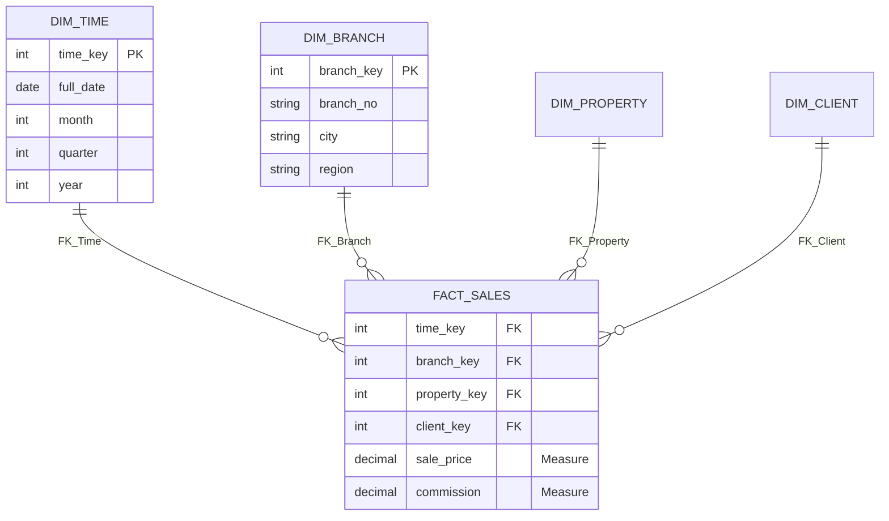
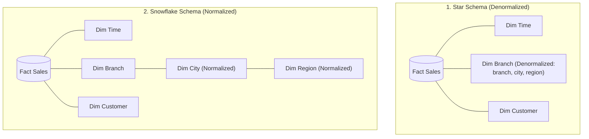
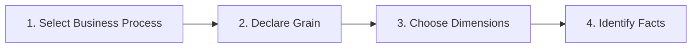
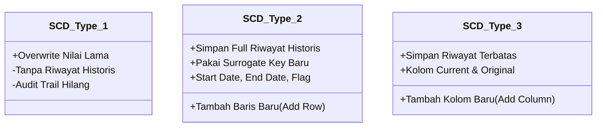
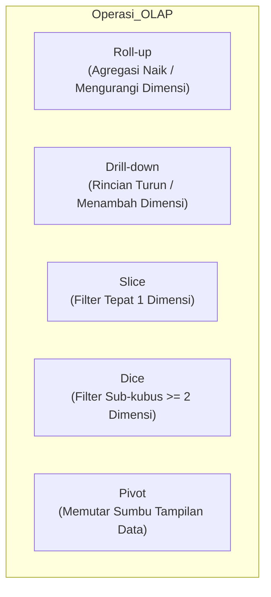

# 📐 02. Dimensional Modeling & Slowly Changing Dimensions (SCD)

> [!NOTE] Referensi Kisi-Kisi UAS
> **Topik**: Contoh-contoh rancangan model data dimensional, perbedaan skema, conformed dimensions, dan penanganan Slowly Changing Dimensions (SCD Tipe 1, 2, 3), serta operasi OLAP.
> **Terkait dengan**: [[01. Data Warehouse & Arsitektur DWH]].

---

## 1. Anatomi Model Data Dimensional

Pemodelan dimensional (*Dimensional Modeling*) adalah teknik desain database khusus untuk kueri analitis data warehouse yang dipopulerkan oleh Ralph Kimball. Struktur intinya terdiri dari dua jenis tabel:

### A. Fact Table (Tabel Fakta)
- **Karakteristik**:
  - Berada di pusat skema, berukuran paling besar (jutaan hingga miliaran baris).
  - Memiliki **Composite Primary Key** yang tersusun dari kumpulan Foreign Keys yang merujuk ke tabel-tabel dimensi.
  - Berisi metrik pengukuran numerik kuantitatif bisnis yang disebut **Measures / Facts**.
- **Kriteria Facts yang Sah**:
  1. **Numerik**: Harus berupa angka yang dapat dihitung (misal: `sales_revenue`, `units_sold`, `commission`).
  2. **Additif (*Additive*)**: Nilai fakta dapat dijumlahkan secara valid di seluruh dimensi (waktu, cabang, produk). *Catatan: Nilai semi-additif (seperti saldo bank) hanya bisa dijumlahkan pada dimensi tertentu, sedangkan non-additif (seperti persentase margin) tidak boleh dijumlahkan langsung*.
  3. **Konsisten dengan Grain**: Setiap nilai fakta dalam satu baris harus berada pada tingkat detail yang persis sama dengan definisi *grain*.

### B. Dimension Table (Tabel Dimensi)
- **Karakteristik**:
  - Berada di sekeliling fact table, berukuran baris lebih sedikit tetapi memiliki banyak kolom teks deskriptif (*wide table*).
  - Memiliki **Simple Primary Key**.
  - Menyediakan konteks kueri bisnis (*Who, What, When, Where, Why, and How*).
  - Contoh kolom: Nama produk, kategori produk, alamat cabang, kota, kuartal, nama staf.

### C. Surrogate Key vs Natural Key
- **Natural Key**: Kunci unik bisnis yang berasal langsung dari sistem sumber OLTP (misal: `NIK`, `No_Faktur`, `Kode_Cabang`).
- **Surrogate Key**: Kunci buatan (*synthetic key*), biasanya berupa bilangan bulat sederhana (`integer` auto-increment) yang dihasilkan oleh proses ETL di Data Warehouse.
- **Mengapa Wajib Menggunakan Surrogate Key di Tabel Dimensi?**
  1. **Independensi Sistem Sumber**: Jika sistem kasir OLTP mengubah sistem nomor akun atau menggunakan format alfanumerik yang rumit, struktur DWH tidak terpengaruh.
  2. **Performa Join Tinggi**: Relasi *join* antara *Fact Table* dan *Dimension Table* menggunakan integer jauh lebih cepat dan hemat memori dibandingkan tipe data teks/string.
  3. **Manajemen Riwayat Perubahan (SCD Tipe 2)**: Jika seorang pelanggan pindah alamat, kita dapat membuat baris baru dengan *Surrogate Key* baru, meskipun *Natural Key* (Nomor KTP/ID Pelanggan) tetap sama.

---

## 2. Model Skema Data Dimensional

Terdapat 3 rancangan arsitektur skema data warehouse:

### 1. Star Schema (Skema Bintang)
- **Konsep**: Fact table di tengah dikelilingi oleh tabel-tabel dimensi yang **didenormalisasi (*denormalized*)**. Tabel dimensi menyimpan hierarki lengkap dalam satu tabel datar (contoh: tabel `Dim_Branch` langsung memuat kolom `branch_id`, `city`, `region`, `country`).
- **Kelebihan**:
  - **Performa kueri sangat cepat**: Kueri analitis hanya membutuhkan sedikit operasi `JOIN` (langsung antara Fact dan Dimensi).
  - **Struktur sangat sederhana & mudah dipahami** oleh pembuat laporan bisnis.
  - Perangkat visualisasi BI modern sangat teroptimasi untuk skema bintang.
- **Kekurangan**: Terjadi redundansi data di tabel dimensi (misal nama kota dan region diulang untuk banyak cabang), sehingga membutuhkan ruang penyimpanan sedikit lebih besar.

### 2. Snowflake Schema (Skema Kepingan Salju)
- **Konsep**: Bentuk variasi dari Star Schema di mana tabel-tabel dimensi **dinormalisasi (*normalized*)** lebih lanjut menjadi beberapa subtabel yang berelasi (contoh: `Dim_Branch` berelasi dengan `Dim_City`, lalu `Dim_City` berelasi dengan `Dim_Region`).
- **Kelebihan**:
  - Mengurangi redundansi data teks pada tabel dimensi.
  - Menghemat sedikit ruang penyimpanan (*storage efficiency*).
- **Kekurangan**:
  - **Performa kueri lebih lambat**: Kueri agregasi membutuhkan banyak operasi *multi-table JOIN* yang mahal secara komputasi.
  - Kompleksitas skema tinggi dan membingungkan pengguna akhir dalam menyusun kueri SQL.

### 3. Fact Constellation (Galaxy Schema)
- **Konsep**: Menggabungkan **beberapa fact table** yang saling berbagi tabel dimensi bersama (*shared/conformed dimensions*).
- **Contoh Kasus (*DreamHome*)**:
  - `Fact_PropertySale` dan `Fact_PropertyRent` sama-sama terhubung ke dimensi `Dim_Time`, `Dim_Branch`, `Dim_Staff`, dan `Dim_Owner`.
- **Kelebihan**: Mampu memodelkan seluruh proses bisnis perusahaan terintegrasi secara modular.

---

## 3. Conformed Dimensions

> [!IMPORTANT] Definisi Kunci Ujian
> **Conformed Dimensions** adalah dimensi yang memiliki **definisi, skema, struktur atribut, dan isi nilai yang konsisten serta dapat digunakan kembali (*reusable*) di seluruh Data Mart dalam suatu Enterprise Data Warehouse.**

### Peran Conformed Dimensions:
1. **Pondasi Arsitektur Bus Kimball**: Memungkinkan berbagai Data Mart dibangun secara independen oleh tim yang berbeda namun tetap dapat digabungkan (*drill-across*) secara terintegrasi.
2. **Menghindari Inkonsistensi Analisis**: Memastikan bahwa divisi penjualan, divisi keuangan, dan divisi pengadaan memiliki definisi "Pelanggan Aktif" atau "Kuartal 1" yang seragam.
3. **Contoh**: Dimensi Waktu (`Dim_Time`), Dimensi Lokasi/Cabang (`Dim_Branch`), Dimensi Pelanggan (`Dim_Customer`).

---

## 4. 4 Tahapan Kimball Dimensional Modeling

Dalam merancang model dimensional, Kimball merumuskan 4 langkah sistematis:

### Langkah 1: Select Business Process (Pilih Proses Bisnis)
- Memilih subjek atau area aktivitas bisnis yang menjadi fokus utama Data Mart pertama (contoh: *Penjualan Properti* / *Property Sales*).
- Data Mart pertama sebaiknya memilih proses bisnis yang bernilai strategis tinggi dan membangun *conformed dimensions* untuk Data Mart berikutnya.

### Langkah 2: Declare Grain (Tetapkan Granularitas)
- Menentukan secara presisi apa yang diwakili oleh **tepat satu baris data** di dalam *Fact Table*.
- **Rekomendasi Utama Kimball**: Pilihlah **tingkat detail terendah yang tersedia (*atomic grain*)**, karena data atomik memberikan fleksibilitas kueri analitis maksimum tanpa kehilangan detail transaksi.
- *Contoh*: "Satu baris di Fact Table merepresentasikan satu transaksi penjualan unit properti oleh seorang agen kepada pembeli pada tanggal tertentu."

### Langkah 3: Choose Dimensions (Pilih Dimensi)
- Menentukan atribut deskriptif yang memberikan konteks: *Kapan?* (`Time`), *Di mana?* (`Branch`), *Siapa agennya?* (`Staff`), *Properti apa?* (`Property`), *Siapa pembelinya?* (`ClientBuyer`).

### Langkah 4: Identify Facts (Identifikasi Fakta/Metrik)
- Menentukan data numerik hasil pengukuran yang konsisten dengan *grain*.
- **Analisis Contoh Kesalahan Desain Fact Table (Materi Kuliah)**:
  - ❌ `promotionName` (Salah: Teks deskriptif non-numerik, seharusnya berada di tabel `Dim_Promotion`).
  - ❌ `staffName` (Salah: Teks deskriptif non-numerik, seharusnya berada di `Dim_Staff`).
  - ❌ `monthlyRent` (Salah: Non-aditif jika grain adalah transaksi penjualan properti, atau tidak konsisten dengan konteks pengukuran).
  - ❌ `lastYearRevenue` (Salah: Grain tidak konsisten, ini adalah data ringkasan historis tahunan, bukan metrik transaksi atomik saat transaksi terjadi).
- **Contoh Fakta yang Benar**:
  - ✅ `salePrice` (Numerik, aditif, sesuai grain).
  - ✅ `commissionAmount` (Numerik, aditif).
  - ✅ `discountGiven` (Numerik, aditif).

---

## 5. Slowly Changing Dimensions (SCD)

> [!WARNING] Sangat Sering Diujikan!
> **Slowly Changing Dimension (SCD)** adalah kondisi di mana nilai atribut dalam tabel dimensi mengalami perubahan seiring berjalannya waktu secara perlahan (misal: pelanggan pindah alamat kota, vendor berganti nama, staf dipromosikan ke divisi baru).
> DWH harus mengelola perubahan ini agar pelaporan data historis masa lalu tidak menjadi keliru.

### Perbandingan 3 Tipe Utama SCD

### Studi Kasus: Perubahan Status Bagian Pemasok *Acme Supply Co* dari 'CA' ke 'IL'

#### 1. SCD Tipe 1: Overwrite (Timpa Data)
- **Mekanisme**: Nilai atribut lama langsung ditimpa (*update in-place*) dengan nilai baru.
- **Tabel Sebelum**:
  | Supplier_Key | Supplier_Code | Supplier_Name | Supplier_State |
  | :--- | :--- | :--- | :--- |
  | 123 | ABC | Acme Supply Co | **CA** |
- **Tabel Sesudah Perubahan**:
  | Supplier_Key | Supplier_Code | Supplier_Name | Supplier_State |
  | :--- | :--- | :--- | :--- |
  | 123 | ABC | Acme Supply Co | **IL** |
- **Dampak Analitis**: **Tidak ada riwayat masa lalu**. Semua transaksi penjualan tahun-tahun lalu otomatis tercatat seolah-olah terjadi di `IL`.
- **Kapan Digunakan**: Hanya untuk koreksi kesalahan pengetikan (*typo*) data, nama ejaan, atau atribut yang tidak relevan secara historis.

---

#### 2. SCD Tipe 2: Add New Row (Tambah Baris Baru) — *Metode Standar Emas DWH*
- **Mekanisme**: Setiap terjadi perubahan, sistem **tidak menimpa data lama**, melainkan menyisipkan **baris baru** dengan *Surrogate Key* baru, menyertakan kolom tanggal berlaku (`Start_Date`, `End_Date`) dan indikator status aktif (`is_current`). Baris lama ditandai tanggal kedaluwarsanya.
- **Tabel Hasil Akhir**:
  | Supplier_Key | Supplier_Code | Supplier_Name | Supplier_State | Start_Date | End_Date | Is_Current |
  | :--- | :--- | :--- | :--- | :--- | :--- | :--- |
  | 123 | ABC | Acme Supply Co | CA | 01-Jan-2000 | 21-Dec-2004 | N |
  | **124** | ABC | Acme Supply Co | **IL** | 22-Dec-2004 | 99-99-9999 | **Y** |
- **Dampak Analitis**: **Menjaga riwayat historis 100% akurat**.
  - Transaksi sebelum 22 Desember 2004 menggunakan `Supplier_Key = 123` (terhubung ke negara bagian `CA`).
  - Transaksi baru mulai 22 Desember 2004 menggunakan `Supplier_Key = 124` (terhubung ke negara bagian `IL`).
- **Kelemahan**: Jumlah baris tabel dimensi bertambah.

---

#### 3. SCD Tipe 3: Add New Column (Tambah Kolom Baru)
- **Mekanisme**: Nilai baru ditulis dengan menambahkan kolom baru di tabel dimensi untuk menyimpan nilai sebelumnya (*Original/Previous*) dan nilai saat ini (*Current*).
- **Tabel Hasil Akhir**:
  | Supplier_Key | Supplier_Code | Supplier_Name | Original_Supplier_State | Effective_Date | Current_Supplier_State |
  | :--- | :--- | :--- | :--- | :--- | :--- |
  | 123 | ABC | Acme Supply Co | **CA** | 22-Dec-2004 | **IL** |
- **Dampak Analitis**: Hanya dapat melacak **riwayat terbatas** (biasanya hanya status asli pertama dan status terakhir saat ini). Jika terjadi perpindahan ketiga kalinya (misal pindah ke `TX`), riwayat perantara akan hilang.

---

## 6. Operasi Multidimensi OLAP Data Cube

Data di OLAP dimodelkan dalam bentuk kubus data multidimensi (*Data Cube*). Pengguna dapat mengeksplorasi data dengan 5 operasi standar:

1. **Roll-up (Drill-Up / Agregasi)**:
   - Menaikkan tingkat abstraksi data dengan merangkum data sepanjang hierarki dimensi (misal: dari data penjualan per *Kota* $\to$ diringkas menjadi per *Provinsi* $\to$ *Negara*), atau menghapus dimensi.
2. **Drill-down (Navigasi ke Rincian)**:
   - Kebalikan dari Roll-up. Menjelajahi data dari ringkasan umum ke detail yang lebih dalam (misal: dari data per *Tahun* $\to$ turun ke *Kuartal* $\to$ *Bulan* $\to$ *Hari*), atau menambahkan dimensi baru.
3. **Slice (Irisan Tunggal)**:
   - Memilih tepat **satu dimensi** dengan nilai spesifik sehingga memotong kubus menjadi sebuah bidang data 2 dimensi (Contoh: Menampilkan data penjualan khusus untuk jenis properti `"Flat"`).
4. **Dice (Dadu Sub-Kubus)**:
   - Melakukan seleksi filter pada **dua atau lebih dimensi** sekaligus untuk mengambil sub-kubus yang lebih kecil (Contoh: Menampilkan data penjualan khusus untuk jenis properti `"Flat"`, di wilayah `"Jakarta"`, dan kuartal `"Q1"`).
5. **Pivot (Rotasi)**:
   - Memutar orientasi sumbu data untuk memberikan sudut pandang alternatif (Contoh: menukar baris yang semula *Lokasi Kota* dan kolom *Waktu Kuartal*, diputar sehingga baris menjadi *Waktu Kuartal* dan kolom menjadi *Lokasi Kota*).

---

## 7. Kategori Server Arsitektur OLAP

Berdasarkan cara penyimpanan fisik dan pemrosesan datanya, server OLAP terbagi menjadi 4 kategori:

| Kategori OLAP | Format Penyimpanan Data | Keunggulan Utama | Kelemahan Utama |
| :--- | :--- | :--- | :--- |
| **MOLAP** (*Multidimensional OLAP*) | Disimpan dalam array kubus multidimensi khusus yang telah dihitung sebelumnya (*pre-computed cubes*). | Waktu respon kueri **paling cepat**; kalkulasi kompleks instan. | Membutuhkan kapasitas penyimpanan besar; proses pemuatan kubus (*cube processing*) lama. |
| **ROLAP** (*Relational OLAP*) | Disimpan langsung di dalam database relasional (RDBMS) standar dalam format tabel Fact dan Dimensi. | Skalabilitas data sangat besar; mampu menangani data atomic volume masif. | Kueri agregasi lebih lambat karena harus mengeksekusi SQL `JOIN` dan `GROUP BY` dinamis. |
| **HOLAP** (*Hybrid OLAP*) | **Gabungan**: Data agregasi ringkasan disimpan di MOLAP (kubus), sedangkan data detail transaksi disimpan di ROLAP (RDBMS). | Menggabungkan kecepatan kueri ringkasan MOLAP dengan skalabilitas kapasitas ROLAP. | Kompleksitas arsitektur dan sinkronisasi data lebih tinggi. |
| **DOLAP** (*Desktop OLAP*) | Data diekstrak dan disimpan dalam file kubus lokal di komputer desktop pengguna. | Analis dapat bekerja mandiri secara *offline* tanpa jaringan. | Kapasitas data sangat terbatas dan risiko inkonsistensi versi data lokal. |
