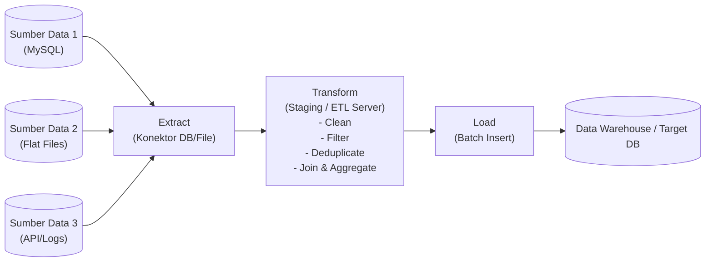
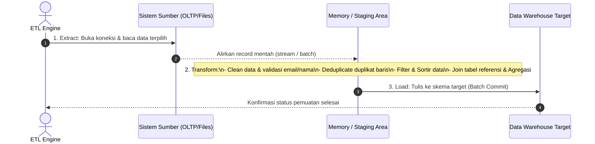
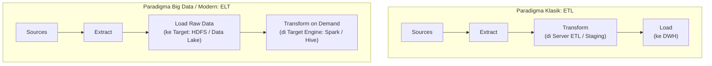

# 🔄 03. ETL (Extract, Transform, Load) vs ELT

> [!NOTE] Referensi Kisi-Kisi UAS
> **Topik**: ETL: konsep utama, perbedaan ETL dengan ELT, dan alur kerja langkah demi langkah ETL.
> **Terkait dengan**: [[01. Data Warehouse & Arsitektur DWH]], [[04. Pengenalan Hadoop & Arsitektur HDFS]].

---

## 1. Konsep Utama ETL

**ETL** adalah singkatan dari **Extract, Transform, and Load**. ETL merupakan sebuah jalur pipa data (*data pipeline*) terotomatisasi yang bertugas:
1. **Mengambil (*Extract*)** data dari berbagai sistem sumber yang heterogen (database operasional OLTP, file teks CSV/Excel, ERP, CRM, log server, API eksternal).
2. **Mengubah (*Transform*)** data mentah tersebut berdasarkan aturan bisnis (*business rules*), standar kualitas, dan validasi agar seragam dan bersih.
3. **Memuat (*Load*)** data hasil transformasi ke dalam repositori target akhir (Data Warehouse atau Data Mart).

> [!TIP] Karakteristik Kunci ETL
> - Pada paradigma ETL klasik, proses **transformasi terjadi di server terpisah (*dedicated ETL server / Staging memory*) SEBELUM data dimuat ke dalam database target.**
> - Proses ETL modern dapat berjalan secara paralel (*pipelining*), di mana sebagian data yang telah berhasil diekstrak langsung ditransformasikan dan dimuat tanpa harus menunggu seluruh sumber data selesai dibaca.

---

## 2. Alur Kerja Langkah demi Langkah ETL

Alur kerja ETL terbagi secara kronologis menjadi tiga fase utama:

---

### Fase 1: Data Extraction (Ekstraksi Data)
Ekstraksi adalah proses membaca dan mengambil data dari sumber heterogen.
- **Aspek Kritis Ekstraksi**:
  1. **Konektivitas ke Sumber Data**: Menghubungkan engine ETL ke sumber menggunakan driver yang sesuai:
     - **OLE DB** (*Object Linking and Embedding Database*): Driver milik Microsoft, performa sangat tinggi untuk ekosistem Windows dan SQL Server.
     - **ODBC** (*Open Database Connectivity*): Standar terbuka lintas platform (Windows, Linux, macOS, Unix) yang didukung oleh hampir semua DBMS (MySQL, Oracle, PostgreSQL, MongoDB).
     - **File Connectors**: Membaca file flat (*delimited text*, CSV), Excel, XML, JSON.
  2. **Metadata Sumber**: Memeriksa nama kolom, tipe data, panjang string (*data length*), dan batasan nilai (*nullability*).
  3. **Penanganan Flat File**: Menentukan pemisah kolom (*delimiter* seperti koma atau titik koma), penanda teks (*text qualifier* seperti tanda kutip `"`), serta ada/tidaknya header kolom (*column headers*).
  4. **Seleksi Kolom (*Projection*)**: Hanya mengekstrak kolom dan baris yang benar-benar dibutuhkan analitis untuk menghemat bandwidth jaringan dan memori staging.

---

### Fase 2: Data Transformation (Transformasi Data)
Tahap pembersihan dan konversi data agar memenuhi skema warehouse target. Transformasi melibatkan 7 operasi standar:

1. **Filtering (Penyaringan)**:
   - Menyaring baris yang tidak memenuhi kriteria bisnis (misal: hanya memproses transaksi yang statusnya `"Success"` atau kategori barang tertentu).
2. **Sorting (Pengurutan)**:
   - Mengurutkan record berdasarkan kunci tertentu (misal: berdasarkan `CategoryCode` atau tanggal transaksi) untuk mempermudah operasi berikutnya.
3. **Aggregating (Agregasi)**:
   - Menghitung ringkasan metrik statistik (misal: `COUNT()`, `SUM(revenue)`, `AVG(price)` per kategori).
4. **Joining Data (Penggabungan Relasi)**:
   - Menggabungkan data dari tabel sumber yang berbeda (misal: menggabungkan tabel `SubKategori` dengan tabel `Kategori` menggunakan kunci `CategoryCode`).
5. **Cleaning Data (Pembersihan Data)**:
   - Menghapus karakter tak diinginkan, memangkas spasi (*trim whitespace*), standarisasi huruf kapital/kecil, dan penanganan nilai kosong (*handling NULL values*).
6. **Deduplicating (Deduplikasi Data)**:
   - Mendeteksi dan menghapus record ganda (*duplicate rows*) yang memiliki kombinasi kunci bisnis yang sama (misal: alamat email ganda).
7. **Validating Data (Validasi Integritas)**:
   - Memeriksa keabsahan format data (misal: validasi pola regex email, nomor telepon harus angka, memastikan nilai kunci asing valid).

> [!WARNING] Catatan Teknis Optimasi Transformasi (SSIS)
> - **Synchronous Transformation**: Transformasi baris-per-baris di mana output langsung dihasilkan tanpa menunggu (misal: konversi huruf, penambahan kolom kalkulasi). Memori sangat efisien.
> - **Asynchronous Transformation**: Transformasi yang memblokir (*blocking*) aliran data karena harus menampung seluruh baris di memori sebelum menghasilkan output (misal: **Sort, Aggregate, Merge Join**). Gunakan seperlunya untuk mencegah kehabisan memori (*memory exhaustion*).

---

### Fase 3: Data Loading (Pemuatan Data)
Proses penulisan data yang telah bersih ke dalam tabel repositori target.
- **Aspek Kritis Pemuatan**:
  1. **Skema & Kolom Target**: Memastikan pemetaan (*mapping*) kolom antara hasil transformasi dengan kolom tabel fakta/dimensi target sudah tepat.
  2. **Metode Pemuatan**:
     - *Full Load*: Mengosongkan (*truncate*) tabel target lalu mengisi ulang secara total (cocok untuk dimensi kecil).
     - *Incremental Load*: Hanya menyisipkan data transaksi baru atau data yang berubah sejak proses ETL terakhir (menggunakan kolom `timestamp` atau `id` terakhir).
  3. **Pengaturan Batching**: Mengonfigurasi parameter *Rows per Batch* dan *Maximum Insert Commit Size* agar penulisan ke database target dilakukan secara paket (*bulk insert*), bukan baris demi baris yang lambat.

---

## 3. Komparasi Komprehensif: ETL vs ELT

Perbedaan antara ETL dan ELT adalah salah satu butir inti dalam kisi-kisi ujian. Pahami kontras fundamental berikut:

### Tabel Perbandingan Menyeluruh: ETL vs ELT

| Kriteria Evaluasi | ETL (*Extract - Transform - Load*) | ELT (*Extract - Load - Transform*) |
| :--- | :--- | :--- |
| **Lokasi Transformasi** | Terjadi di **server perantara khusus (ETL Server)** atau area memori *staging* terpisah. | Terjadi **langsung di dalam repositori sistem target** (Data Lake, Hadoop HDFS, Cloud DWH). |
| **Waktu Transformasi** | Data diubah dan distandarisasi **sebelum** dimuat ke target penyimpanan. | Data mentah (*raw data*) dimuat terlebih dahulu, transformasi dilakukan **sesudahnya (*on-demand*)**. |
| **Beban Komputasi Target** | Ringan bagi sistem target; target hanya menerima data matang yang sudah siap saji. | Sistem target harus memiliki daya komputasi terdistribusi yang sangat kuat (misal cluster Hadoop/Spark). |
| **Kesesuaian dengan Big Data** | Kurang cocok untuk volume Petabyte data mentah yang dinamis karena ETL server menjadi *bottleneck*. | **Sangat ideal untuk Big Data** (*Data Lake*), di mana volume masif data multi-format disimpan apa adanya. |
| **Kecepatan Ingestion Awal** | Lebih lambat pada tahap awal karena data harus menunggu proses pembersihan dan transformasi selesai. | **Sangat cepat** (*instant load*); data mentah langsung ditumpahkan ke storage tanpa hambatan. |
| **Fleksibilitas Analisis** | Kurang fleksibel jika di masa depan ada analisis baru yang membutuhkan data mentah yang terlanjur terbuang. | Sangat fleksibel; data historis asli (*raw*) tetap utuh sehingga bisa ditransformasikan ulang sesuai kebutuhan baru. |
| **Privasi & Keamanan Data** | Data sensitif (misal NIK/Nomor Kartu Kredit) dapat disensor/dienkripsi di tahap Transformasi sebelum masuk DWH. | Data mentah masuk ke target lebih dulu, sehingga membutuhkan tata kelola akses (*data governance*) yang sangat ketat. |

---

## 4. Perangkat (*Tools*) Populer dalam Ekosistem ETL

| Kategori Perangkat | Nama Software | Karakteristik Utama |
| :--- | :--- | :--- |
| **Enterprise / Desktop GUI** | **SQL Server Integration Services (SSIS)** | Produk Microsoft yang terintegrasi dengan Visual Studio dan SQL Server; menyediakan antarmuka drag-and-drop grafis (*Control Flow & Data Flow*) yang kaya fitur. |
| **Enterprise COTS** | **IBM InfoSphere DataStage** | Perangkat lunak komersial (*Commercial Off-The-Shelf*) skala besar berbasis antarmuka grafis desktop dan web; handal untuk integrasi enterprise skala raksasa. |
| **Modern Open Source Workflow** | **Apache Airflow** | Dibuat awalnya oleh Airbnb; mengelola alur kerja pipa data (*data pipelines*) berbasis kode Python murni (*Directed Acyclic Graph - DAG*); sangat fleksibel untuk orkestrasi Big Data modern. |

---

## 5. Ringkasan Tips Optimasi Performa ETL (Bahan Pilihan Ganda)

1. **Paralelisasi Ekstraksi**: Ekstrak sumber data secara paralel menggunakan banyak thread atau konektor.
2. **Saring Data di Sumber (*Pushdown Predicates*)**: Gunakan klausa `WHERE` pada kueri ekstraksi agar data yang ditarik lewat jaringan hanya yang relevan.
3. **Hindari Komponen Asinkron Berlebih**: Kurangi penggunaan task *Sort* atau *Aggregate* di memori ETL jika operasi tersebut bisa dilakukan lebih cepat oleh database sumber.
4. **Optimalkan Parameter Jaringan & Batch**: Gunakan *Native OLE DB / bulk drivers*, atur *Rows per Batch* dan *Commit Size* tinggi untuk meminimalkan *network roundtrip*.
5. **Hindari Konversi Tipe Data Implisit**: Konversi tipe data otomatis (*implicit typecast*) membebani CPU; lakukan *explicit cast* yang terencana.
