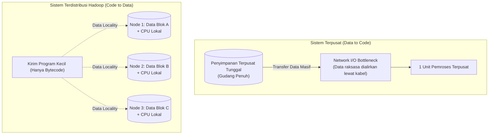
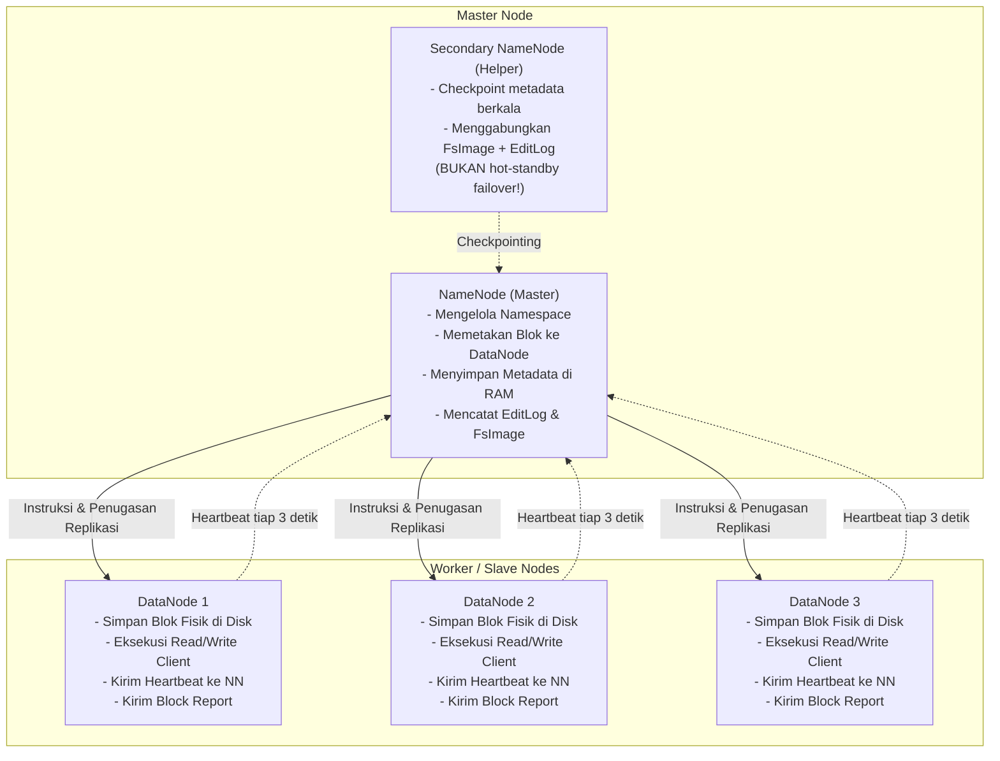
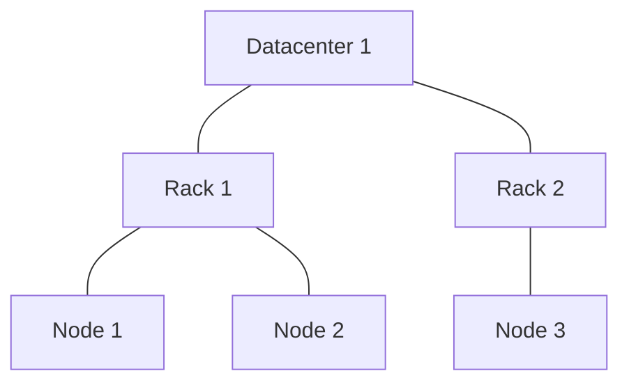
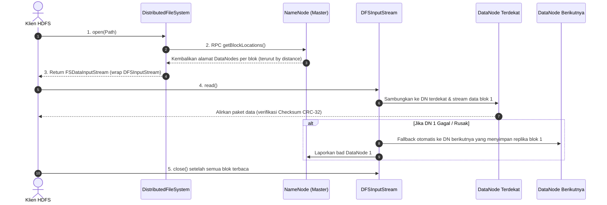
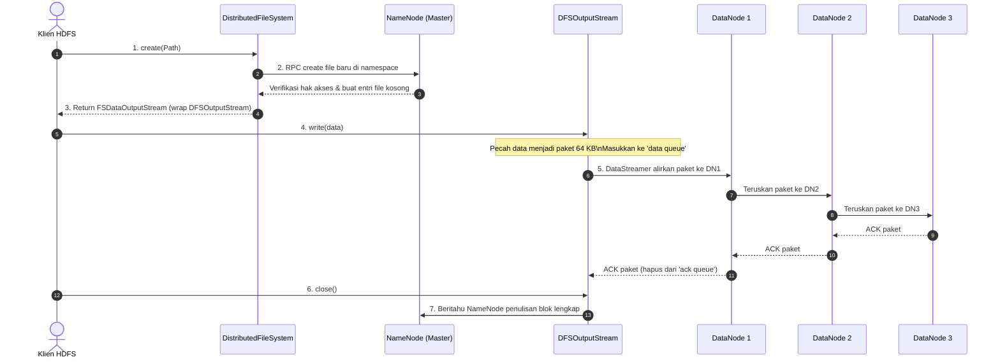

# 🐘 04. Pengenalan Hadoop & Arsitektur HDFS (Edisi Lengkap Textbook)

> [!NOTE] Referensi Kisi-Kisi & Textbook
> - **Topik Kisi-Kisi**: Pengenalan Hadoop: konsep, komponen utama, bagaimana kerja, single node vs multi node, jenis-jenis node dan perbedaannya, konsep dan pengertian HDFS beserta komponennya.
> - **Sumber Utama**: Slide Kuliah TPD STIS & Textbook resmi **"Hadoop: The Definitive Guide" (4th Edition) karya Tom White** (O'Reilly).
> - **Terkait dengan**: [[05. MapReduce - Konsep, Mekanisme Detail & Bedah Soal Esai]], [[06. Perbandingan Komprehensif Tools Ekosistem Hadoop (Sqoop, Hive, HBase, Pig, Kafka, Spark)]].

---

## 1. Pemrosesan Data Terdistribusi (*Distributed Data Processing*)

### A. Latar Belakang & Kegagalan Sistem Terpusat
Pada era Big Data, volume data melonjak dari Gigabyte ke Terabyte hingga Petabyte dengan variasi data yang tinggi (*Volume, Velocity, Variety*).
- **Pendekatan Terpusat (*Centralized Architecture*)**:
  - Satu server besar (*supercomputer / mainframe*) mencoba memproses semua data.
  - **Bottleneck Penyimpanan**: Storage terpusat tidak sanggup menampung data masif.
  - **Bottleneck Jaringan**: Memindahkan data berukuran Petabyte melalui kabel LAN/WAN menuju satu unit CPU menghabiskan bandwidth dan menimbulkan *network overhead* yang ekstrem.
  - **Bottleneck Pemrosesan**: Satu prosesor membutuhkan waktu berhari-hari bahkan berbulan-bulan untuk menyelesaikan satu kueri agregasi.

### B. Analogi Kebun Buah (*The Story of Jack*)
Dalam materi kuliah diilustrasikan kisah Jack:
1. Awalnya Jack memanen anggur dan menyimpannya di satu gudang penyimpanan sendiri.
2. Ketika permintaan melonjak drastis mencakup apel dan jeruk, Jack kewalahan memanen dan gudangnya penuh (*single processor & single storage bottleneck*).
3. **Solusi Terdistribusi**: Jack mempekerjakan 2 orang tambahan (membagi tenaga kerja secara paralel) dan **memberikan masing-masing pekerja ruang penyimpanan terpisah (*distributed storage*)**.
4. Dengan penyimpanan dan pemrosesan terdistribusi, setiap pekerja memproses buah di areanya sendiri secara simultan, sehingga pesanan pelanggan selesai tepat waktu.



### C. Prinsip Emas Hadoop: *Data Locality*
> [!IMPORTANT] Prinsip Inti Arsitektur Hadoop (Tom White, Ch. 1 & 2)
> *"Instead of moving large data to the processing unit, Hadoop moves the processing computation program to where the data resides."*
> **(Memindahkan kode program komputasi yang berukuran kilobyte ke node tempat data tersimpan, bukan mengalirkan data berukuran terabyte ke server pemroses).**

### D. Keuntungan Pemrosesan Terdistribusi
1. **Scalability (Skalabilitas Horizontal)**: Kapasitas cluster dapat ditambah secara elastis (*scale-out*) cukup dengan menghubungkan komputer biasa baru (*commodity hardware*).
2. **Fault Tolerance (Toleransi Kesalahan)**: Kegagalan salah satu node fisik tidak merusak sistem karena data direplikasi ke beberapa node lain.
3. **Cost-Effective**: Menggunakan perangkat keras komoditas (*commodity hardware*) yang murah dan beredar luas di pasaran, bukan hardware kelas enterprise yang mahal.
4. **High Throughput & Speed**: Komputasi paralel pada potongan data lokal menghasilkan pemrosesan ratusan kali lebih cepat.

---

## 2. Prinsip Desain HDFS Menurut Textbook (*The Design of HDFS*)

Buku teks *Tom White (Chapter 3)* mendefinisikan HDFS secara presisi:
> **"HDFS is a filesystem designed for storing very large files with streaming data access patterns, running on clusters of commodity hardware."**

### A. Tiga Aspek Utama yang Didukung HDFS
1. **Very Large Files (File Berukuran Sangat Besar)**:
   - File berukuran ratusan Megabyte, Gigabyte, Terabyte, hingga Petabyte.
2. **Streaming Data Access (Pola Akses Streaming)**:
   - HDFS dibangun di atas filosofi **WORM (*Write-Once, Read-Many-Times*)**. Data dimuat sekali dari sumber, kemudian dianalisis berkali-kali.
   - Waktu untuk membaca seluruh dataset secara berkesinambungan (*high throughput*) jauh lebih diprioritaskan daripada latensi membaca record pertama.
3. **Commodity Hardware (Perangkat Keras Komoditas)**:
   - Dirancang berjalan pada komputer standar yang tersedia luas di pasaran dengan tingkat probabilitas kegagalan node yang tinggi, di mana HDFS mampu terus beroperasi tanpa gangguan bagi pengguna (*fault recovery* otomatis).

### B. Tiga Skenario di Mana HDFS TIDAK COCOK Digunakan (*Where HDFS Is Not a Good Fit*)
> [!CAUTION] Sangat Sering Keluar di Ujian Pilihan Ganda!
> Menurut Tom White, HDFS memiliki kelemahan inheren jika dipaksakan untuk 3 kebutuhan berikut:
1. **Low-Latency Data Access (Akses Data Berlatensi Rendah)**:
   - Aplikasi yang memerlukan waktu respon dalam rentang puluhan milidetik (sub-detik) tidak akan bekerja baik dengan HDFS, karena HDFS dioptimalkan untuk *throughput* tinggi, bukan *low latency*.
   - **Solusi**: Gunakan **Apache HBase** yang berjalan di atas HDFS untuk akses acak instan.
2. **Lots of Small Files (Masalah Banyak File Kecil / *Small Files Problem*)**:
   - Karena NameNode menyimpan seluruh metadata filesystem di dalam memori utama (RAM), jumlah file dalam cluster dibatasi oleh kapasitas RAM NameNode.
   - **Aturan Praktis (*Rule of Thumb*)**: Setiap file, direktori, dan blok membutuhkan sekitar **150 byte** di memori NameNode.
   - *Contoh*: Jika Anda menyimpan 1 juta file kecil (masing-masing 1 blok), dibutuhkan memori sekitar $1.000.000 \times 150 \times 2 \approx 300\text{ MB}$. Namun jika ada 1 miliar file kecil, RAM NameNode akan kewalahan (*out-of-memory*).
3. **Multiple Writers & Arbitrary File Modifications (Banyak Penulis & Modifikasi Acak)**:
   - File dalam HDFS hanya boleh ditulis oleh **tepat satu klien (*single writer*)**.
   - Penulisan hanya dapat dilakukan di akhir file secara bersambung (**append-only**).
   - HDFS **TIDAK MENDUKUNG** banyak penulis simultan (*multiple writers*) dan **TIDAK MENDUKUNG** perubahan/pembaruan data pada posisi acak (*arbitrary offsets*).

---

## 3. Komponen Utama & Evolusi Arsitektur Hadoop

### A. Komponen Inti
1. **Hadoop Common**: Pustaka Java bersama, utilitas RPC, serialisasi, dan konfigurasi OS.
2. **HDFS**: Lapisan penyimpanan terdistribusi (*distributed storage*).
3. **MapReduce**: Lapisan pemrosesan data terdistribusi secara paralel (*distributed batch processing*).
4. **YARN**: Lapisan manajemen sumber daya (*cluster resource management*) pada Hadoop 2.x/3.x. *(Catatan UAS: YARN tidak diujikan mendalam)*.

---

## 4. Single Node Cluster vs Multi Node Cluster

| Parameter Perbandingan | Single Node Hadoop Cluster (*Pseudo-Distributed*) | Multi Node Hadoop Cluster (*Fully Distributed*) |
| :--- | :--- | :--- |
| **Jumlah Mesin Fisik** | Tepat **1 mesin fisik / VM tunggal**. | **Banyak mesin fisik** yang terhubung dalam satu jaringan LAN. |
| **Lokasi Daemon** | Semua daemon (*NameNode, DataNode, JobTracker/RM, TaskTracker/NM*) berjalan di **mesin dan sistem operasi yang sama**. | Master daemons (*NameNode*) berjalan di server terpisah; Worker daemons (*DataNode*) berjalan di masing-masing server pekerja. |
| **Jumlah DataNode** | **Hanya 1 DataNode aktif**. | **Banyak DataNode aktif** (dari puluhan hingga ribuan node). |
| **Faktor Replikasi Efektif**| Default 1 (karena tidak ada node fisik lain untuk replikasi). | Default 3 (tersebar di beberapa node dan rak berbeda). |
| **Tujuan Penggunaan** | Pembelajaran, pengujian kode (*testing*), eksplorasi sintaks praktikum. | Lingkungan produksi nyata (*production environment*) untuk data skala enterprise. |

---

## 5. Jenis-Jenis Node dalam HDFS dan Tanggung Jawabnya

HDFS mengadopsi arsitektur **Master-Slave / Master-Worker**:



### A. NameNode (Master)
- **Peran**: Pusat pengendali dan pengawas seluruh cluster HDFS.
- **Tugas Utama**:
  1. Mengelola **Namespace** file sistem HDFS (struktur direktori hirarkis).
  2. Menyimpan **Metadata** (nama file, izin akses, faktor replikasi, daftar blok, dan lokasi DataNode tempat blok tersebut disimpan).
  3. **Menyimpan seluruh metadata di memori utama (RAM)** agar pencarian alamat blok sangat cepat.
  4. Menerima sinyal *Heartbeat* (tiap 3 detik) dan *Block Report* (berkala) dari seluruh DataNode. Jika DataNode tidak mengirim heartbeat selama 10 menit, NameNode menganggap DataNode tersebut mati (*DEAD*) dan memerintahkan replikasi ulang blok yang hilang ke node lain.
- **Titik Kritis**: Pada arsitektur dasar, NameNode adalah *Single Point of Failure (SPOF)*; jika NameNode mati, seluruh file sistem HDFS tidak dapat diakses.

### B. DataNode (Slave / Worker)
- **Peran**: Unit pekerja tempat penyimpanan data aktual dan pemrosesan komputasi.
- **Tugas Utama**:
  1. Menyimpan potongan blok-blok file data aktual pada disk fisik lokal masing-masing.
  2. Melayani permintaan baca (*read*) dan tulis (*write*) langsung dari aplikasi klien.
  3. Menjalankan instruksi pembuatan blok, penghapusan blok, dan replikasi blok dari NameNode.
  4. Mengirimkan sinyal **Heartbeat** berkala (setiap 3 detik) ke NameNode.
  5. Mengirimkan laporan blok (**Block Report**) secara periodik yang berisi daftar semua blok data yang tersimpan pada disknya.

### C. Secondary NameNode (Checkpointer)
- > [!WARNING] Kesalahan Pemahaman yang Sering Muncul di Ujian
  > Secondary NameNode **BUKAN NameNode cadangan (*Backup/Standby NameNode*)** yang otomatis mengambil alih jika NameNode utama mati!
- **Fungsi Sebenarnya**: Bertindak sebagai asisten pembantu (*housekeeper*) yang melakukan proses **Checkpointing** berkala: mengunduh `FsImage` dan `EditLog` dari NameNode utama, menggabungkannya (*merge*) menjadi `FsImage` baru yang bersih, dan mengunggahnya kembali ke NameNode agar file EditLog tidak membengkak tak terbatas.

---

## 6. Konsep Lanjutan HDFS dari Textbook Tom White

### A. Konsep Blok HDFS (Mengapa 128 MB?)
- Blok adalah satuan terkecil penyimpanan data di disk. HDFS memecah file menjadi blok berukuran default **128 MB** (Hadoop 2.x/3.x) atau **64 MB** (Hadoop 1.x).
- **Analisis Matematis Efisiensi Blok (Tom White, Ch. 3)**:
  - Waktu pencarian piringan disk (*disk seek time*) modern berkisar sekitar $10\text{ ms}$.
  - Kecepatan transfer data disk modern berkisar sekitar $100\text{ MB/s}$.
  - Untuk membuat waktu pencarian hanya memakan **1% dari waktu transfer data**, waktu transfer data harus berkisar $10\text{ ms} \times 100 = 1\text{ detik}$.
  - Dalam 1 detik, disk dengan kecepatan $100\text{ MB/s}$ mentransfer sekitar **100 MB**.
  - Oleh karena itu, ukuran blok ditetapkan **128 MB** agar waktu pencarian disk dapat diabaikan (*negligible*), sehingga pemrosesan didominasi oleh transfer data berkecepatan tinggi (*streaming transfer*).

### B. Block Caching
- Pada umumnya DataNode membaca blok dari hard disk drive (HDD).
- Namun untuk file-file tabel referensi kecil yang sering diakses berulang-ulang (misalnya tabel dimensi *lookup* pada operasi join), blok dapat dicadangkan secara eksplisit di dalam memori RAM DataNode (*off-heap block cache*).
- Penjadwal tugas (MapReduce / Spark) dapat memanfaatkan blok dalam cache ini untuk mengeksekusi komputasi dengan performa pembacaan sangat cepat (*memory-speed read*).

### C. HDFS Federation
- Pada cluster raksasa dengan miliaran file, memori RAM satu NameNode menjadi batas skalabilitas (*scaling bottleneck*).
- **HDFS Federation** (diperkenalkan pada Hadoop 2.x) memungkinkan penambahan **banyak NameNode** ke dalam cluster, di mana masing-masing NameNode mengelola sub-pohon (*portion*) namespace yang berbeda (misalnya: NameNode 1 mengelola `/user`, NameNode 2 mengelola `/data/analytics`).
- Seluruh NameNode federasi ini berbagi sekumpulan DataNode (*common pool of DataNodes*) yang sama.

### D. HDFS High Availability (HA)
- Untuk mengeliminasi *Single Point of Failure (SPOF)* pada NameNode, Hadoop 2.x menyediakan arsitektur High Availability:
  1. Sepasang NameNode dijalankan dalam konfigurasi **Active-Standby**.
  2. Keduanya menggunakan penyimpanan log bersama yang sangat konsisten bernama **Quorum Journal Manager (QJM)**.
  3. Seluruh DataNode mengirimkan sinyal heartbeat dan block report ke **kedua NameNode** secara bersamaan.
  4. Pengawas failover otomatis berbasis **Apache ZooKeeper (*ZKFailoverController - ZKFC*)** memantau kesehatan Active NameNode. Jika Active NameNode crash, Standby NameNode otomatis dipromosikan menjadi Active dalam hitungan detik tanpa downtime.

---

## 7. Topologi Jaringan & Perhitungan Jarak (*Network Topology & Distance*)

Hadoop memodelkan jaringan cluster sebagai sebuah pohon (*tree*). Jarak antara dua node dihitung berdasarkan jarak ke leluhur bersama terdekat (*closest common ancestor*):

$$\text{Distance}(d) = \text{Langkah dari Node 1 ke Ancestor} + \text{Langkah dari Ancestor ke Node 2}$$



| Pasangan Node | Leluhur Bersama Terdekat | Nilai Jarak (*Distance*) | Keterangan |
| :--- | :--- | :--- | :--- |
| **Node 1 & Node 1** | Diri sendiri (Node 1) | **0** | Proses berjalan pada mesin fisik yang sama (*Data-local*). |
| **Node 1 & Node 2** | Rack 1 | **2** | Berada pada rak yang sama, beda mesin (*Rack-local*). |
| **Node 1 & Node 3** | Datacenter 1 | **4** | Berada pada datacenter yang sama, beda rak (*Off-rack*). |
| **Node beda Datacenter** | Root Global | **6** | Berada pada datacenter fisik yang berbeda. |

### Kebijakan Penempatan Replikasi (*Rack-Aware Replica Placement*):
- **Replika 1**: Ditaruh di node lokal klien (jika klien di luar cluster, dipilih node acak).
- **Replika 2**: Ditaruh di node pada **rak yang berbeda** dari Replika 1 (Jarak 4).
- **Replika 3**: Ditaruh di node berbeda pada **rak yang sama dengan Replika 2** (Jarak 2).

---

## 8. Alur Kerja Mendalam HDFS: Read Path & Write Path

### A. Anatomi Pembacaan File (HDFS Read Path)



1. **Inisialisasi**: Klien memanggil method `open()` pada objek `DistributedFileSystem`.
2. **Pengambilan Metadata**: `DistributedFileSystem` menghubungi NameNode via RPC (`getBlockLocations`) untuk meminta alamat DataNode yang menyimpan blok-blok awal file. NameNode mengurutkan DataNode berdasarkan kedekatan jarak (*network distance*).
3. **Pemberian Stream**: Mengembalikan objek `FSDataInputStream` yang membungkus `DFSInputStream`.
4. **Pembacaan Langsung**: Klien memanggil `read()`. `DFSInputStream` membuka koneksi soket langsung ke DataNode pertama (terdekat). Data dialirkan langsung dari DataNode ke Klien. Klien memverifikasi integritas data menggunakan checksum (CRC-32). Jika terjadi kerusakan blok atau kegagalan node, klien otomatis beralih ke DataNode penyimpan replika berikutnya dan melaporkan blok rusak ke NameNode.
5. **Penutupan**: Setelah selesai membaca seluruh blok berurutan, klien memanggil `close()`.

---

### B. Anatomi Penulisan File (HDFS Write Path)



1. **Pembuatan File**: Klien memanggil `create()` pada `DistributedFileSystem`.
2. **Pemeriksaan Namespace**: `DistributedFileSystem` mengirim RPC ke NameNode untuk membuat file baru di namespace HDFS (memeriksa izin dan memastikan nama belum ada). Mengembalikan objek `FSDataOutputStream` yang membungkus `DFSOutputStream`.
3. **Pemisahan Paket**: Saat klien menulis data, `DFSOutputStream` memecah data menjadi paket-paket kecil (biasanya berukuran **64 KB**) dan menyimpannya di antrean memori internal bernama **`data queue`**.
4. **Pipeline Streaming**: Komponen **`DataStreamer`** mengambil paket dari `data queue`, meminta NameNode mengalokasikan blok baru dan memberikan daftar 3 DataNode target (misal DN1, DN2, DN3). Paket dialirkan ke DN1 $\to$ diteruskan ke DN2 $\to$ diteruskan ke DN3.
5. **Manajemen ACK Queue**: Paket yang telah dikirim dipindahkan ke **`ack queue`**. Paket baru dihapus dari `ack queue` setelah menerima sinyal *acknowledgment* sukses dari seluruh node dalam pipeline.
6. **Penanganan Kegagalan Mesin Saat Menulis (*Write Failure Recovery*)**:
   - Jika sebuah DataNode mati di tengah proses penulisan:
     1. Pipeline langsung ditutup.
     2. Semua paket di `ack queue` dikembalikan ke bagian depan `data queue` agar tidak ada data yang hilang.
     3. Blok yang sedang ditulis pada DataNode yang sehat diberi identitas baru (*new epoch generation stamp*) yang dilaporkan ke NameNode (sehingga jika node rusak hidup kembali, blok parsialnya akan dihapus).
     4. Node yang rusak dikeluarkan dari pipeline, dan penulisan sisa blok dilanjutkan pada DataNode sehat yang tersisa.
     5. NameNode mendeteksi replika kurang dari target dan secara otomatis menjadwalkan replikasi ke node lain di latar belakang.
7. **Penutupan**: Klien memanggil `close()`, mengosongkan antrean paket (*flush*), dan memberi tahu NameNode bahwa penulisan file telah rampung.

---

## 9. Model Konsistensi HDFS (*Coherency Model*)

Menurut Tom White (Ch. 3), model konsistensi menggambarkan visibilitas pembacaan dan penulisan file:
1. Setelah membuat file baru, file langsung terlihat di namespace:
   ```java
   Path p = new Path("p");
   fs.create(p);
   assertThat(fs.exists(p), is(true));
   ```
2. Namun, data yang sedang ditulis ke file **belum tentu terlihat oleh pembaca lain**, bahkan jika buffer telah di-flush, karena data masih berada di pipeline DataStreamer.
3. Untuk memaksa seluruh buffer dialirkan dan disinkronkan ke seluruh DataNode dalam pipeline agar pembaca lain dapat melihatnya, klien harus memanggil method **`hflush()`**.
4. Untuk menjamin data benar-benar telah ditulis ke media piringan disk fisik (*commit to physical disk storage*), klien harus memanggil method **`hsync()`** (ekuivalen dengan `fsync()` pada sistem operasi POSIX).
