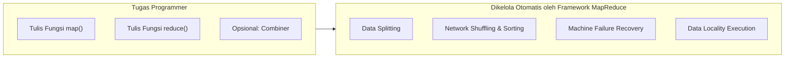
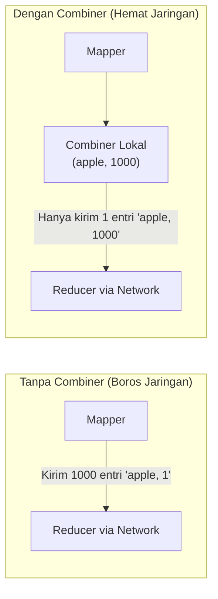

# ⚙️ 05. MapReduce - Konsep, Mekanisme Detail & Bedah Soal Esai (Edisi Lengkap Textbook)

> [!IMPORTANT] Perhatian Khusus Kisi-Kisi & Textbook
> - **Kisi-Kisi**: MapReduce: Konsep, Penggunaan, contoh penggunaan MapReduce, cara kerja MapReduce secara detail.
> - **Catatan Dosen**: Dari **2 - 3 soal esai**, salah satunya adalah **SOAL PENGGUNAAN MAPREDUCE**!
> - **Referensi Buku Teks**: *Hadoop: The Definitive Guide* karya Tom White (Chapter 2: MapReduce, Chapter 7: How MapReduce Works, Chapter 8: Types and Formats).

---

## 1. Konsep & Filosofi Dasar MapReduce

### A. Sejarah & Motivasi
- **Asal-usul**: Model pemrograman MapReduce pertama kali dirumuskan dan dipublikasikan pada tahun 2004 oleh **Jeffrey Dean dan Sanjay Ghemawat** dari Google (*"MapReduce: Simplified Data Processing on Large Clusters"*).
- **Inspirasi Pemrograman Fungsional**: Terinspirasi dari fungsi primitif `map` dan `reduce` pada bahasa fungsional seperti Lisp.
- **Tujuan Utama**: Menyediakan sebuah **lapisan abstraksi (*clean abstraction*)** yang menyembunyikan seluruh kerumitan komputasi paralel dari programmer:
  - Pemecahan data otomatis (*data partitioning*).
  - Penjadwalan eksekusi tugas di ribuan node (*task scheduling*).
  - Penanganan kegagalan mesin (*fault tolerance*).
  - Komunikasi dan sinkronisasi jaringan antar-mesin (*inter-machine communication & load balancing*).



---

### B. Kontrak Pasangan Kunci-Nilai (*Key-Value Contract*)
Seluruh pemrosesan dalam MapReduce mentransformasikan sekumpulan pasangan *key-value* input menjadi sekumpulan pasangan *key-value* output:

$$\text{Input: } \langle k_1, v_1 \rangle \xrightarrow{\text{map()}} \text{Intermediate: } \operatorname{list}(\langle k_2, v_2 \rangle)$$

$$\text{Intermediate: } \langle k_2, \operatorname{list}(v_2) \rangle \xrightarrow{\text{reduce()}} \text{Output: } \operatorname{list}(\langle k_3, v_3 \rangle)$$

1. **Fungsi `map()`**:
   - Menerima satu pasang kunci-nilai input $\langle k_1, v_1 \rangle$.
   - Memproses record tersebut dan menghasilkan nol, satu, atau banyak pasangan kunci-nilai perantara (*intermediate pairs*) $\langle k_2, v_2 \rangle$.
2. **Fungsi `reduce()`**:
   - Menerima sebuah kunci perantara $k_2$ beserta **kumpulan seluruh nilai** yang terkait dengan kunci tersebut: $\langle k_2, [v_{2,1}, v_{2,2}, \dots] \rangle$.
   - Menggabungkan, menjumlahkan, atau menyaring nilai-nilai tersebut untuk menghasilkan pasangan output akhir $\langle k_3, v_3 \rangle$.

---

## 2. Fungsi Combiner (*Combiner Functions*) — Materi Kunci Textbook

Menurut Tom White (*Chapter 2 & 7*), salah satu bottleneck terbesar dalam cluster cluster komputasi terdistribusi adalah bandwidth jaringan saat fase **Shuffle**.



### A. Apa itu Combiner?
- **Combiner** adalah sebuah fungsi optimasi opsional (sering disebut sebagai *"Mini-Reducer"*) yang dieksekusi **secara lokal di node Mapper** langsung setelah tahap Mapping selesai dan sebelum data dikirim melintasi jaringan.
- **Tujuan**: Memangkas jumlah rekaman perantara (*intermediate records*) yang harus ditransfer melalui jaringan kabel LAN ke Reducer.

### B. Aturan Matematis Penggunaan Combiner
> [!WARNING] Pertanyaan Jebakan Favorit Ujian!
> Combiner **HANYA BISA DIGUNAKAN** jika fungsi agregasi bersifat **Komutatif** (urutan tidak berpengaruh) dan **Asosiatif** (pengelompokan tidak berpengaruh):
> $$\operatorname{Operasi}(a, b, c) = \operatorname{Operasi}(\operatorname{Operasi}(a, b), c)$$

- ✅ **Boleh Menggunakan Combiner**:
  - `MAX`: $\max(10, 50, 30) = \max(\max(10, 50), 30) = 50$
  - `MIN`: $\min(10, 50, 30) = 10$
  - `SUM` / `COUNT`: $10 + 50 + 30 = (10 + 50) + 30 = 90$
- ❌ **TIDAK BOLEH Menggunakan Combiner Secara Naif**:
  - `AVERAGE` (Rata-rata):
    $$\operatorname{avg}(1, 2, 9) = \frac{1+2+9}{3} = 4$$
    Jika dihitung sebagian oleh combiner:
    $$\operatorname{avg}(\operatorname{avg}(1, 2), 9) = \operatorname{avg}(1.5, 9) = \frac{1.5+9}{2} = 5.25 \quad (\text{SALAH! } 5.25 \neq 4)$$
  - *Catatan*: Jika ingin menghitung rata-rata dengan combiner, Mapper harus memancarkan pasangan objek komposit `(count, sum)`, bukan nilai rata-rata langsung!

---

## 3. Mekanisme Shuffle and Sort Mendalam (Tom White, Chapter 7)

Proses pemindahan output mapper ke reducer dinamakan **Shuffle**. Memahami arsitektur internal memory buffer dan spilling adalah nilai pembeda di ujian:

```mermaid
flowchart TD
    subgraph MAP_SIDE["1. The Map Side (Node Pekerja Mapper)"]
        MAP_OUT["Fungsi map() menghasilkan entri (k2, v2)"]
        CIRC_BUF["Circular Memory Buffer (RAM)\n(Ukuran Default: 100 MB)\n[io.sort.mb]"]
        THRESH["Threshold 80% Tercapai\n[sort.spill.percent = 0.80]"]
        PART_SORT["Background Thread:\n- Partisi per Reducer\n- In-Memory Sort by Key\n- Jalankan Combiner (jika ada)"]
        SPILL_FILES["Spill Files ke Disk Lokal\n(spill1, spill2, spill3)"]
        MERGE_MAP["Merge Phase:\nGabungkan semua spill file jadi 1 file terurut tunggal\n[io.sort.factor = 10]"]

        MAP_OUT --> CIRC_BUF --> THRESH --> PART_SORT --> SPILL_FILES --> MERGE_MAP
    end

    subgraph REDUCE_SIDE["2. The Reduce Side (Node Reducer)"]
        COPY_PHASE["Copy Phase:\nFetcher threads (default 5) tarik partisi via HTTP"]
        SORT_PHASE["Sort / Merge Phase:\nGabungkan file partisi dari berbagai mapper\n(In-memory & on-disk merge)"]
        RUN_RED["Reduce Phase:\nEksekusi fungsi reduce(k2, list(v2))"]

        MERGE_MAP -.->|Network Transfer (Shuffle)| COPY_PHASE
        COPY_PHASE --> SORT_PHASE --> RUN_RED
    end
```

### A. The Map Side (Sisi Mapper)
1. **Circular Memory Buffer**:
   - Output mapper tidak langsung ditulis ke disk. Setiap map task memiliki penyangga memori melingkar (*circular buffer*) di RAM berukuran default **100 MB** (`mapreduce.task.io.sort.mb`).
2. **Spilling ke Disk Lokal**:
   - Ketika isi buffer mencapai ambang batas default **80%** (`mapreduce.map.sort.spill.percent`), thread latar belakang mulai menumpahkan (*spill*) isinya ke hard disk lokal di direktori `mapreduce.cluster.local.dir`. Mapper tetap dapat terus menulis ke 20% sisa buffer.
3. **Partisi & Sorting di Memori**:
   - Sebelum ditulis ke disk, thread membagi data menjadi partisi-partisi sesuai jumlah Reducer yang dituju.
   - Di dalam setiap partisi, data diurutkan (*sorted by key*) di memori RAM.
   - Jika kelas `Combiner` didefinisikan, combiner dieksekusi langsung pada hasil sorting di memori sebelum ditulis ke file spill disk.
4. **Merge Phase di Mapper**:
   - Sebelum map task dinyatakan selesai, puluhan file spill kecil di disk digabungkan (*merge sort*) menjadi **satu file output tunggal yang terpartisi dan terurut** (parameter `mapreduce.task.io.sort.factor`, default 10 file per putaran merge).

### B. The Reduce Side (Sisi Reducer)
1. **Copy Phase**:
   - Begitu sebuah map task selesai, reducer langsung mulai menyalin partisi data yang menjadi bagiannya melintasi jaringan menggunakan beberapa thread paralel (*copier/fetcher threads*, default 5 thread).
2. **Sort / Merge Phase**:
   - Setelah seluruh output mapper disalin, framework menggabungkan file-file tersebut sambil mempertahankan urutan kunci (*merge sort*).
3. **Reduce Phase**:
   - Fungsi `reduce(k2, Iterable<v2>)` dipanggil untuk setiap kunci unik.

---

## 4. Eksekusi Spekulatif (*Speculative Execution*)

> [!TIP] Definisi Konsep Textbook (Tom White, Ch. 7)
> Dalam cluster terdistribusi dengan ratusan mesin, sering kali ada sebuah node yang mengalami degradasi performa hardware (misal bad sector pada hard disk, kabel jaringan kendur, atau panas CPU) tanpa mengalami crash total. Node ini menjalankan tugasnya dengan sangat lambat dibandingkan rata-rata node lain, yang disebut sebagai **"Straggler"**.

### Mekanisme Speculative Execution:
1. Hadoop terus memantau metrik kemajuan (*progress score*) seluruh tugas.
2. Jika sebuah task berjalan jauh lebih lambat dari rata-rata (*straggler*), Hadoop secara otomatis meluncurkan **tugas duplikat identik (*speculative task*) sebagai cadangan di node lain yang sehat**.
3. Kedua task berjalan paralel memperebutkan penyelesaian.
4. **Task mana pun yang selesai lebih dahulu akan diterima hasilnya oleh JobTracker/ApplicationMaster**, dan task duplikat yang tersisa langsung dihentikan (*killed*) dan dibatalkan.
5. Hal ini mencegah satu mesin lambat menahan penyelesaian keseluruhan pekerjaan ratusan gigabyte.

---

## 5. Studi Kasus Textbook: Analisis Suhu Cuaca NCDC

*(Studi Kasus Patokan Tom White - Chapter 2)*:  
Menghitung **Suhu Udara Maksimum per Tahun** dari catatan cuaca stasiun meteorologi global (*National Climatic Data Center - NCDC*).

### Format Data Mentah:
Setiap baris teks mewakili rekaman cuaca stasiun dengan panjang karakter tetap:
```text
0067011990999991950051507004...9999999N9+00001+99999999999...
0043011990999991950051512004...9999999N9+00221+99999999999...
0043011990999991949051518004...9999999N9+01111+99999999999...
```
- Karakter ke-15 hingga 19: **Tahun** (misal `1950`, `1949`).
- Karakter ke-87 hingga 92: **Suhu Udara** (misal `+0022` mewakili $2.2^\circ\text{C}$, dengan kode kualitas `1`). Nilai `+9999` menunjukkan data hilang (*missing*).

### Solusi MapReduce:
1. **Fungsi `map()`**:
   - Parse substring tahun: `year = line.substring(15, 19)`.
   - Parse substring suhu: `temp = Integer.parseInt(line.substring(87, 92))`.
   - Saring data: abaikan jika suhu `+9999` atau kode kualitas tidak valid.
   - **Output Mapper**: $\langle \text{year}, \text{temperature} \rangle$ (misal: $\langle \text{"1950"}, 0 \rangle, \langle \text{"1950"}, 22 \rangle, \langle \text{"1949"}, 111 \rangle$).
2. **Fungsi `reduce()`**:
   - Untuk setiap tahun, inisialisasi `max_temp = Integer.MIN_VALUE`.
   - Lakukan loop: `max_temp = Math.max(max_temp, temp)`.
   - **Output Reducer**: $\langle \text{year}, \text{max\_temp} \rangle$.

---

## 6. BEDAH SOAL ESAI UAS: Perancangan MapReduce

> [!TIP] Format Jawaban Esai Sempurna
> Ketika menjawab soal perancangan MapReduce di lembar jawaban esai UAS, selalu tuliskan dalam **6 bagian terstruktur**:
> 1. **Format Input Data**
> 2. **Logika & Desain Mapper** (Sebutkan input key-value dan output key-value).
> 3. **Peran Combiner (jika relevan)**.
> 4. **Proses Shuffling & Sorting** (Jelaskan kunci pengelompokan).
> 5. **Logika & Desain Reducer** (Sebutkan input list key-value dan output final).
> 6. **Format Output Akhir**

Berikut adalah bedah 5 skenario soal esai dari slide kuliah STIS & Textbook:

---

### 📝 Kasus Esai 1: Menghitung Gaji Tertinggi (*Highest Salary*) di Seluruh Perusahaan
*(Dataset 4 file/mesin pada slide kuliah: Format `name, salary`)*.

#### Perancangan Jawaban:
1. **Input Key-Value**:
   - $\text{Key } k_1$: `LongWritable` (Byte offset baris)
   - $\text{Value } v_1$: `Text` (Teks baris, misal `"gopal, 50000"`)
2. **Logika Mapper**:
   - Parse string $v_1$ berdasarkan delimiter koma `,`.
   - Ambil elemen kedua sebagai integer `salary = 50000`.
   - **Kunci Konseptual**: Karena kita ingin mencari nilai maksimum global seluruh perusahaan, gunakan **kunci statis/dummy yang sama untuk semua baris**, misal `"MAX_SALARY"`.
   - **Output Mapper**: $\langle \text{"MAX\_SALARY"}, \text{salary} \rangle$
3. **Penggunaan Combiner**:
   - Sangat disarankan menggunakan Combiner dengan logika mencari nilai maksimum lokal di setiap node mapper: `max_val = Math.max(local_max, val)`.
   - Hal ini mereduksi ribuan record gaji per mesin menjadi **tepat 1 record nilai maksimum per mapper** sebelum dikirim ke jaringan.
4. **Proses Shuffling & Sorting**:
   - Karena semua mapper memancarkan kunci `"MAX_SALARY"`, seluruh nilai diarahkan ke tepat **satu Reducer**.
   - Input ke Reducer: $\langle \text{"MAX\_SALARY"}, [50000, 45000, 26000, \dots] \rangle$.
5. **Logika Reducer**:
   - Inisialisasi `global_max = 0`.
   - Loop list gaji: `if (val > global_max) global_max = val;`
   - **Output Reducer**: $\langle \text{"MAX\_SALARY"}, \text{global\_max} \rangle$.
6. **Output Akhir**: `"MAX_SALARY", 50000`.

---

### 📝 Kasus Esai 2: Menghitung Total Pengeluaran Gaji per Departemen (*Total Salary per Department*)
*(Slide Kuliah: `empID, dept, salary`)*.

#### Perancangan Jawaban:
1. **Input Key-Value**:
   - $\text{Key } k_1$: `LongWritable` (Offset)
   - $\text{Value } v_1$: `Text` (`"e001, it, 10000"`)
2. **Logika Mapper**:
   - Pecah baris dengan `split(",")`. Ambil indeks 1 sebagai `dept`, indeks 2 sebagai integer `salary`.
   - **Output Mapper**: $\langle \text{dept}, \text{salary} \rangle$ (misal: $\langle \text{"it"}, 10000 \rangle$).
3. **Combiner**:
   - Dapat menggunakan kelas Reducer sebagai Combiner karena operasi `SUM` bersifat asosiatif dan komutatif (`job.setCombinerClass(Reduce.class)`).
4. **Proses Shuffling & Sorting**:
   - Mengelompokkan berdasarkan nama departemen: $\langle \text{"it"}, [10000, 30000] \rangle$.
5. **Logika Reducer**:
   - Loop menjumlahkan seluruh nilai gaji: `total += val`.
   - **Output Reducer**: $\langle \text{dept}, \text{total} \rangle$.

---

### 📝 Kasus Esai 3: Agregasi Populasi dengan Kunci Komposit (*Composite Key: Country + State*)
*(Slide Kuliah: `Country, State, City, Population`)*.

#### Perancangan Jawaban:
1. **Konsep Penting**: Kunci dalam MapReduce tidak harus atomik tunggal, tetapi bisa berupa **Kunci Komposit (*Composite Key*)**.
2. **Logika Mapper**:
   - Parse array kolom `[Country, State, City, Population]`.
   - Gabungkan kolom Country dan State: `composite_key = Country + "_" + State`.
   - Ambil `Population` sebagai integer/long `pop`.
   - **Output Mapper**: $\langle \text{composite\_key}, \text{pop} \rangle$ (misal: $\langle \text{"USA\_CA"}, 42 \rangle$).
3. **Shuffling & Sorting**:
   - Framework mengelompokkan nilai populasi berdasarkan pasangan `(Country, State)` yang unik:
     $\langle \text{"USA\_CA"}, [12, 42, 23] \rangle \to \text{Total: } 77$.
4. **Logika Reducer**:
   - Jumlahkan seluruh nilai populasi untuk kunci komposit tersebut.
   - **Output Reducer**: $\langle \text{Country, State}, \text{total\_pop} \rangle$.

---

### 📝 Kasus Esai 4: Penghalusan Gambar / Image Smoothing (RGB Pixel Window Averaging)

#### Perancangan Jawaban:
1. **Input**: Koordinat pixel $(x, y)$ dan intensitas warna $(R, G, B)$.
2. **Logika Mapper**:
   - Untuk setiap pixel $(x, y)$, pancarkan nilai $(R, G, B)$ ke dirinya sendiri dan seluruh 8 tetangga di sekeliling jendela $3 \times 3$:
     $\langle (x \pm 1, y \pm 1), (R, G, B) \rangle$.
3. **Shuffling & Sorting**:
   - Mengumpulkan seluruh 9 nilai RGB di sekitar koordinat target $(x, y)$.
4. **Logika Reducer**:
   - Hitung rata-rata komponen merah, hijau, dan biru: $\text{Avg}_R = \frac{\sum R}{9}$, $\text{Avg}_G = \frac{\sum G}{9}$, $\text{Avg}_B = \frac{\sum B}{9}$.
   - **Output Reducer**: $\langle (x, y), (\text{Avg}_R, \text{Avg}_G, \text{Avg}_B) \rangle$.
