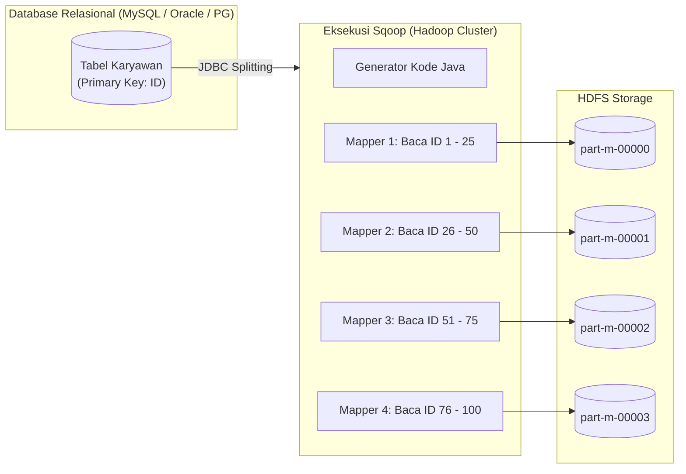
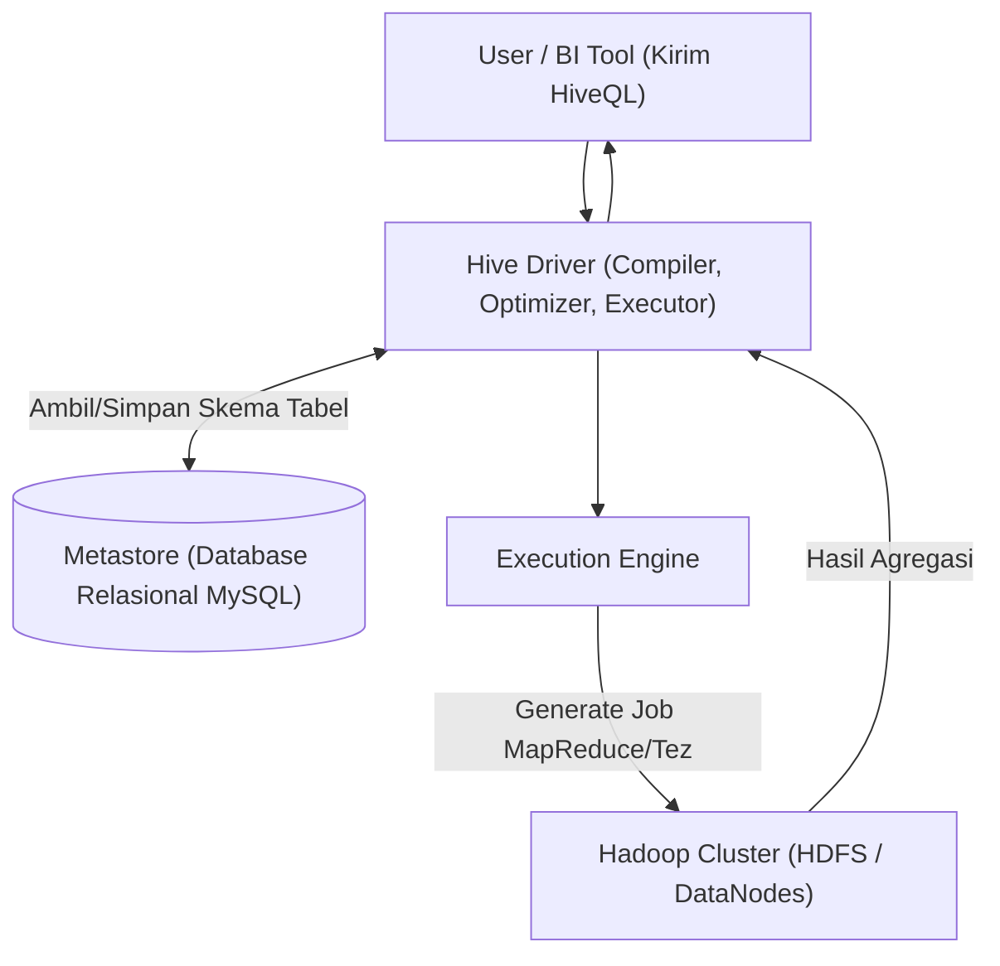
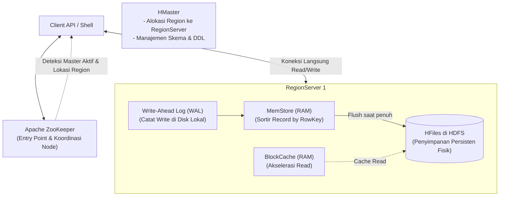
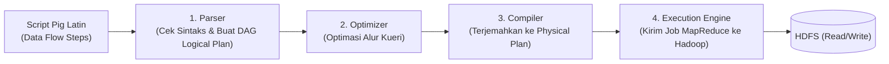
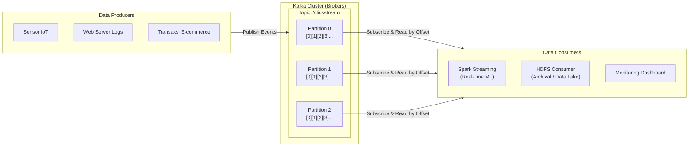
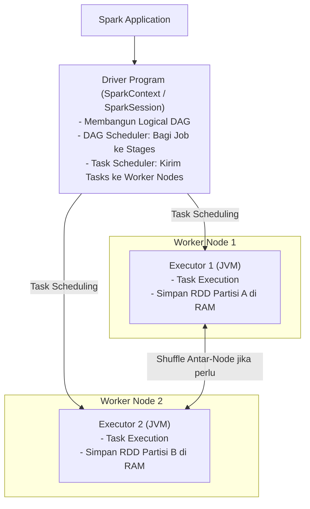

# 🛠️ 06. Perbandingan Komprehensif Tools Ekosistem Hadoop (Sqoop, Hive, HBase, Pig, Kafka, Spark)

> [!IMPORTANT] Perhatian Khusus Kisi-Kisi UAS
> **Topik Kisi-Kisi**: Tools dari Sqoop sampai Spark:
> 1. **Spesialisasi aplikasi** (fitur pembeda utama dengan tools lain).
> 2. **Fungsi utama**.
> 3. **Cara kerja secara konseptual (tanpa kode)**.

---

## 1. Tabel Matriks Perbandingan Akbar Ekosistem Hadoop

Berikut adalah perbandingan ringkas lintas 6 tools utama yang sering menjadi sumber soal perbandingan pilihan ganda:

| Nama Tool | Spesialisasi Aplikasi (Pembeda Unik) | Fungsi Utama | Abstraksi Bahasa | Model Data | Karakteristik Latensi | Hubungan dengan Hadoop / HDFS |
| :--- | :--- | :--- | :--- | :--- | :--- | :--- |
| **Apache Sqoop** | **Jembatan Transfer Data Massal**: Spesialis memindahkan data terstruktur antara RDBMS dan Hadoop secara dua arah. | Impor tabel RDBMS ke HDFS/Hive/HBase dan Ekspor file HDFS ke tabel RDBMS. | Perintah CLI / Parameter Tools | Tabel Relasional $\leftrightarrow$ File HDFS (Text, Avro, Parquet) | *Batch-oriented* (tergantung beban data) | Menjalankan **Map-Only MapReduce Job** (secara default tanpa fase Reducer). |
| **Apache Hive** | **Data Warehouse SQL-Like**: Memungkinkan analis yang terbiasa dengan SQL konvensional untuk menganalisis data terstruktur di HDFS tanpa menulis kode Java. | Kueri analitis data terstruktur skala besar (*OLAP*), pelaporan agregasi, pembuatan partisi tabel. | **HiveQL (HQL)** (Deklaratif, sangat mirip SQL ANSI) | Berbasis Skema (*Schema-based*): Tabel, Baris, Kolom terstruktur | **Tinggi (*High Latency*)**: Tidak cocok untuk kueri real-time/interaktif | Berjalan di atas HDFS; mengompilasi kueri menjadi rangkaian **Job MapReduce / Tez**. Skema disimpan di **Metastore (RDBMS)**. |
| **Apache HBase** | **NoSQL Real-Time Random Read/Write**: Database terdistribusi yang menyediakan akses acak berlatensi sangat rendah untuk miliaran baris data. | Pencarian dan modifikasi record individual secara acak (*single-row lookup/mutation*) dan cepat secara *real-time*. | API Java CRUD (`Get`, `Put`, `Scan`, `Delete`), HBase Shell | Berorientasi Kolom (*Column-Family oriented*), non-relasional, skema dinamis | **Sangat Rendah (*Low Latency*)**: Real-time / Sub-detik | Menggunakan **HDFS sebagai lapisan penyimpanan persisten (*storage layer*)**, tetapi **TIDAK menggunakan MapReduce** untuk read/write data normal. |
| **Apache Pig** | **Procedural Data Flow Platform**: Dirancang untuk pipeline ETL dan transformasi data kompleks bertahap yang fleksibel. | Analisis, transformasi, penyaringan, dan persiapan data semi-terstruktur/tak-terstruktur skala besar. | **Pig Latin** (Prosedural / *Data-flow paradigm*) | Fleksibel: *Atom*, *Tuple* (baris), *Bag* (kumpulan tuple dengan skema bebas) | *Batch-oriented* (tinggi) | Diterjemahkan oleh Pig Engine menjadi graf asiklik terarah (**DAG**) lalu dieksekusi sebagai **Job MapReduce** di HDFS. |
| **Apache Kafka** | **Distributed Real-time Event Streaming**: Platform perantara log terdistribusi berkecepatan sangat tinggi berbasis *publish-subscribe*. | Menampung, mengalirkan, dan menyangga (*buffering*) aliran data streaming real-time berkecepatan tinggi dari berbagai produsen ke konsumen. | API Producer/Consumer, CLI Scripts | Aliran Pesan Tak Terstruktur / JSON / Avro berurutan (*Sequential Log*) | **Sangat Rendah (*Near Real-time / Sub-millisecond*)** | **BUKAN komponen bawaan Hadoop**, melainkan gerbang ingest *streaming* yang sering dihubungkan dengan Spark/HDFS. |
| **Apache Spark** | **Unified In-Memory Analytics Engine**: Pemrosesan komputasi cluster di dalam RAM yang mampu berjalan hingga 100x lebih cepat dari MapReduce. | Pemrosesan Batch, Kueri Interaktif (Spark SQL), Real-time Streaming, Machine Learning (MLlib), dan Graf (GraphX). | Scala, Python (PySpark), Java, R, SQL | **RDD (*Resilient Distributed Dataset*)**, DataFrames, Datasets | **Sangat Rendah (*In-Memory processing*)** | Pengganti MapReduce; dapat berjalan mandiri (*Standalone*) atau di atas cluster HDFS/YARN. |

---

## 2. Profil Konseptual Mendalam Masing-Masing Tool

---

### A. Apache Sqoop (SQL-to-Hadoop)

#### 1. Spesialisasi Aplikasi:
- Menjadi **jembatan penghubung transfer data massal** yang efisien antara sistem database relasional tradisional (RDBMS) dengan ekosistem Hadoop (HDFS, Hive, HBase).
- Pembeda utama: Sqoop tidak melakukan analisis data atau transformasi kompleks, melainkan fokus murni pada kecepatan dan keandalan pemindahan data terstruktur.

#### 2. Fungsi Utama:
- **Sqoop Import**: Mengimpor seluruh tabel atau hasil kueri SQL dari RDBMS ke direktori file di HDFS, tabel Hive, atau HBase.
- **Incremental Import**: Mengimpor hanya data transaksi baru atau data yang berubah (menggunakan opsi `--incremental append` berdasarkan kolom acuan ID atau timestamp).
- **Sqoop Export**: Mengekspor file-file hasil pemrosesan dari HDFS kembali ke tabel database RDBMS operasional.

#### 3. Cara Kerja Konseptual (Tanpa Kode):
1. **Pemeriksaan Metadata**: Sqoop terhubung ke RDBMS target menggunakan driver JDBC standar untuk membaca metadata tabel (tipe kolom, batasan *primary key*).
2. **Generasi Job MapReduce Otomatis**: Sqoop mengompilasi sebuah job MapReduce khusus di mana **hanya tahap Mapper yang dijalankan (*Map-only job*)**, tanpa melibatkan fase Reducer.
3. **Pembagian Rentang Paralel (*Data Splitting*)**: Secara default, Sqoop meluncurkan **4 task mapper secara paralel**. Sqoop mencari nilai minimum dan maksimum dari kolom *Primary Key*, membaginya menjadi 4 rentang sama besar, dan setiap mapper mengeksekusi kueri `SELECT ... WHERE id BETWEEN ...` secara simultan.
4. **Penulisan Bersamaan**: Setiap mapper menulis record hasil bacaannya langsung ke file bagian terpisah (`part-m-00000`, `part-m-00001`, dst.) di folder tujuan HDFS.

---

### B. Apache Hive

#### 1. Spesialisasi Aplikasi:
- Sistem **Data Warehouse terdistribusi** yang menyediakan abstraksi bahasa deklaratif mirip SQL (**HiveQL**) di atas file-file masif yang tersimpan di HDFS.
- Pembeda utama: Menjembatani keahlian analis data SQL tradisional dengan sistem Hadoop tanpa mengharuskan mereka mempelajari pemrograman Java MapReduce yang rumit.

#### 2. Fungsi Utama:
- Pengelolaan metadata skema database (*schema-on-read*).
- Kueri agregasi, pemfilteran, penggabungan (*join*), dan pelaporan analitis skala besar (*OLAP*).
- Pengelompokan data melalui teknik **Partitioning** (folder hirarkis) dan **Bucketing** (file hash) untuk mempercepat performa pencarian.

#### 3. Cara Kerja Konseptual (Tanpa Kode):
1. **Pengiriman Kueri**: Pengguna mengirimkan kueri HiveQL (misal `SELECT category, SUM(revenue) FROM sales GROUP BY category`).
2. **Pemeriksaan Metadata di Metastore**: Compiler Hive meminta informasi definisi skema (lokasi file di HDFS, tipe kolom, delimiter) ke **Metastore** (database relasional eksternal seperti MySQL atau PostgreSQL).
3. **Kompilasi ke DAG MapReduce**: Compiler menerjemahkan instruksi SQL tersebut menjadi sebuah graf asiklik terarah (*Directed Acyclic Graph - DAG*) yang tersusun dari tahapan Map dan Reduce.
4. **Eksekusi di Cluster**: Execution Engine menyerahkan job tersebut ke framework cluster Hadoop (JobTracker/ResourceManager) untuk dieksekusi di DataNodes tempat file HDFS tersimpan.
5. **Pengembalian Hasil**: Hasil akhir dikumpulkan dari DataNodes dan disajikan kembali ke pengguna dalam format tabel relasional.

> [!NOTE] Perbedaan Managed Table vs External Table pada Hive
> - **Managed Table (Internal)**: Hive menguasai data dan skema. Jika tabel di-`DROP`, **skema DAN file fisik data di HDFS ikut terhapus**.
> - **External Table**: Hive hanya mengelola skema logis, file data dikelola pengguna di lokasi HDFS tertentu. Jika tabel di-`DROP`, **hanya skema yang dihapus, sedangkan file data fisik di HDFS tetap aman tersimpan**.

---

### C. Apache HBase

#### 1. Spesialisasi Aplikasi:
- Database **NoSQL terdistribusi berorientasi kolom (*Column-Family Database*)** yang dirancang berdasarkan konsep Google Bigtable.
- Pembeda utama: Menyediakan **akses acak baca/tulis berlatensi sangat rendah secara *real-time* (*low-latency real-time random read/write access*)** pada miliaran baris data di HDFS, sesuatu yang sama sekali tidak dapat dilakukan oleh HDFS murni atau Hive.

#### 2. Fungsi Utama:
- Penyimpanan data semi-terstruktur dengan skema yang dinamis dan fleksibel (*sparse data*).
- Aplikasi transaksional real-time, pencatatan log pesan instan (digunakan Facebook Messenger), pelacakan sensor IoT, dan deteksi kecurangan keuangan.

#### 3. Cara Kerja Konseptual (Tanpa Kode):
1. **Model Data Berbasis RowKey & Column Family**: Data disimpan dalam tabel yang diindeks secara alfabetis berdasarkan kunci baris (**RowKey**). Di dalam baris, data dikelompokkan ke dalam **Column Family**. Setiap sel data dapat memiliki banyak versi berdasarkan penanda waktu (*timestamp*).
2. **Partisi Horizontal (*Regions & RegionServers*)**: Tabel HBase yang membengkak secara otomatis dipecah menjadi rentang-rentang baris yang disebut **Regions** (setiap region memiliki batas *start key* dan *end key*). Masing-masing Region ditugaskan ke server pekerja bernama **RegionServer**.
3. **Mekanisme Tulis (*Write Path*)**:
   - Klien menulis data langsung ke RegionServer yang bertanggung jawab.
   - Perubahan pertama-tama dicatat secara sekuensial di **WAL (*Write-Ahead Log*)** pada disk untuk menjamin pemulihan jika mesin mati.
   - Kemudian data ditaruh di dalam memori utama bernama **MemStore** dan diurutkan berdasarkan RowKey.
   - Ketika MemStore penuh, data di-*flush* (dituang) menjadi file berformat **HFile** secara permanen di penyimpanan HDFS.
4. **Mekanisme Baca (*Read Path*)**:
   - Untuk membaca satu record, RegionServer memeriksa **MemStore** di RAM terlebih dahulu, lalu memeriksa **BlockCache** (RAM), dan terakhir membaca dari **HFile** di HDFS. Akses instan tercapai tanpa harus membaca seluruh file dari awal.
5. **Peran ZooKeeper & HMaster**: ZooKeeper bertindak sebagai gerbang pertama (*entry point*) yang memberi tahu klien lokasi tabel metadata (`.META.`), sedangkan HMaster mengawasi penyeimbangan beban dan pembagian region antar-RegionServer.

---

### D. Apache Pig

#### 1. Spesialisasi Aplikasi:
- Platform **alur data prosedural (*procedural data flow platform*)** tingkat tinggi yang menggunakan bahasa skrip bernama **Pig Latin**.
- Pembeda utama: Jika Hive menggunakan gaya deklaratif (pengguna menyatakan *"apa hasil akhir yang diinginkan"* seperti SQL), Pig menggunakan gaya prosedural bertahap (pengguna mendefinisikan *"langkah demi langkah bagaimana data mengalir dan diubah"*).

#### 2. Fungsi Utama:
- Pembersihan data (*data cleansing*), transformasi kompleks bertahap, dan persiapan pipeline data ETL untuk dataset tak terstruktur maupun semi-terstruktur.
- Menjalankan analisis data ad-hoc dengan fleksibilitas manipulasi struktur bersarang (*nested data structures*).

#### 3. Cara Kerja Konseptual (Tanpa Kode):
1. **Model Data Fleksibel**: Mendukung tipe data bersarang:
   - **Atom**: Tipe data primitif tunggal (angka, string).
   - **Tuple**: Satu baris record data.
   - **Bag**: Kumpulan dari beberapa tuple yang skemanya fleksibel (bisa berbeda jumlah kolom).
2. **Parser**: Menerima script Pig Latin, memeriksa sintaks, dan menyusun representasi logika operasi dalam bentuk **DAG (*Directed Acyclic Graph*)** yang disebut *Logical Plan*.
3. **Optimizer**: Mengoptimalkan alur logika, seperti memajukan operasi filter di awal agar data yang diproses pada tahap berikutnya berkurang secara drastis.
4. **Compiler**: Mengompilasi *optimized logical plan* menjadi serangkaian **pekerjaan fisik MapReduce (*Physical Plan*)**.
5. **Execution Engine**: Menyerahkan urutan job MapReduce tersebut ke cluster Hadoop untuk dieksekusi di HDFS, dan menyajikan hasilnya ke layar (`DUMP`) atau menyimpannya ke direktori HDFS (`STORE`).

---

### E. Apache Kafka

#### 1. Spesialisasi Aplikasi:
- Platform **aliran peristiwa terdistribusi (*distributed real-time event streaming platform*)** berbasis model pesan terbit-berlangganan (*publish-subscribe*).
- Pembeda utama: **Bukan komponen bawaan Hadoop**, melainkan lapisan pengumpul data terluar (*front ingestion gateway*) yang mampu menelan jutaan pesan per detik secara persisten dan menyajikannya ke mesin pemroses real-time.

#### 2. Fungsi Utama:
- Ingestion data streaming kecepatan tinggi dari berbagai sistem eksternal tanpa membebani sistem analitis di belakangnya (*buffer decoupling*).
- Membangun pipa data real-time, arsitektur berbasis peristiwa (*event-driven*), pelacakan aktivitas web, dan sistem pencegahan kecurangan instan.

#### 3. Cara Kerja Konseptual (Tanpa Kode):
1. **Producer**: Aplikasi atau perangkat yang memproduksi peristiwa dan mempublikasikannya ke Kafka.
2. **Topic & Partition**: Pesan dikelompokkan ke dalam kategori unik bernama **Topic**. Agar skalabel, setiap Topic dipecah menjadi beberapa **Partition** yang disebar ke server-server Kafka (**Brokers**).
3. **Penyimpanan Log Sekuensial & Offset**:
   - Di dalam partisi, pesan ditulis secara berurutan (*append-only log*) langsung ke disk penyimpanan server broker.
   - Setiap pesan diberi nomor urut unik yang terus bertambah yang disebut **Offset**.
   - Identitas setiap pesan ditentukan secara presisi oleh: **(Topic, Partition ID, Offset)**.
4. **Consumer**: Aplikasi konsumen (misalnya Apache Spark atau konektor HDFS) membaca pesan secara mandiri dengan melacak nomor *Offset* terakhir yang telah mereka proses. Model ini memisahkan produsen dan konsumen secara total (*decoupled*).

---

### F. Apache Spark

#### 1. Spesialisasi Aplikasi:
- Kerangka kerja **komputasi cluster terpadu (*unified cluster computing framework*) berbasis pemrosesan di dalam memori (*in-memory processing*)**.
- Pembeda utama: Menggantikan model MapReduce disk-bound klasik dengan eksekusi memori RAM penuh, meminimalkan latensi pembacaan/penulisan disk hingga mampu berjalan **100 kali lebih cepat di RAM** dan **10 kali lebih cepat di disk**.

#### 2. Fungsi Utama:
- Pemrosesan batch skala besar, kueri SQL interaktif (*Spark SQL*), analisis data streaming (*Spark Streaming*), pembelajaran mesin terdistribusi (*MLlib*), dan komputasi graf (*GraphX*).

#### 3. Cara Kerja Konseptual (Tanpa Kode):
1. **Abstraksi Utama: RDD (*Resilient Distributed Dataset*)**:
   - Struktur data dasar berupa kumpulan objek terdistribusi yang bersifat **kekal (*immutable*)** dan **tahan kerusakan (*fault-tolerant*)**.
   - Data dipartisi secara logis di seluruh node pekerja. Jika satu partisi hilang akibat kegagalan node, Spark dapat merekonstruksi partisi tersebut secara otomatis menggunakan silsilah graf transformasinya (*lineage graph*).
2. **Evaluasi Tertunda (*Lazy Evaluation*)**:
   - Operasi pada Spark terbagi menjadi dua kategori:
     - **Transformations** (seperti `map()`, `filter()`, `flatMap()`): **TIDAK langsung dieksekusi**. Spark hanya mencatat rencana eksekusi dalam bentuk graf DAG.
     - **Actions** (seperti `count()`, `collect()`, `save()`): Menjadi pemicu (*trigger*) yang memaksa Spark mengeksekusi seluruh rencana komputasi DAG untuk menghasilkan nilai konkret ke pengguna.
3. **Arsitektur Driver & Executor**:
   - **Driver Program**: Berisi `SparkContext` / `SparkSession`. Bertindak sebagai otak pengendali yang mengubah kode pengguna menjadi tahapan (*stages*) DAG, lalu membaginya menjadi tugas-tugas kecil (*tasks*).
   - **Executors**: Proses yang berjalan di node pekerja yang mengeksekusi tugas-tugas komputasi di memori RAM dan menyimpan partisi data dalam cache.

---

## 3. Matriks Perbandingan Biner Pasangan Tools Krusial

### 1. Hive vs HBase
| Kriteria | Apache Hive | Apache HBase |
| :--- | :--- | :--- |
| **Kategori** | Distributed Data Warehouse (*OLAP*). | Distributed NoSQL Column-Family Database (*OLTP / Real-time*). |
| **Model Data** | Berbasis skema relasional tabel tradisional. | Berorientasi kolom (*column-family*), skema dinamis fleksibel. |
| **Bahasa Kueri** | HiveQL (mirip SQL deklaratif). | API Programmatis CRUD (`Get`, `Put`, `Scan`, `Delete`). |
| **Waktu Respon** | Tinggi (*High Latency*, menit hingga jam). | Sangat rendah (*Low Latency*, hitungan milidetik). |
| **Operasi Record** | Hanya *append-only*; tidak mendukung modifikasi/update baris individual. | Mendukung pembaruan, penghapusan, dan pencarian baris individual secara acak (*random read/write*). |

---

### 2. Pig vs Hive
| Kriteria | Apache Pig | Apache Hive |
| :--- | :--- | :--- |
| **Pencipta Awal** | Dikembangkan awalnya oleh **Yahoo!**. | Dikembangkan awalnya oleh **Facebook**. |
| **Bahasa** | **Pig Latin** (Bahasa skrip prosedural *data-flow*). | **HiveQL** (Bahasa kueri deklaratif mirip SQL ANSI). |
| **Pengguna Target** | Pemrogram, data engineer, pengembang pipeline data. | Analis bisnis, pengguna yang terbiasa dengan SQL database. |
| **Tipe Data** | Sangat mahir untuk data semi-terstruktur & tak terstruktur. | Paling optimal untuk data terstruktur dengan skema rapi. |

---

### 3. MapReduce vs Apache Spark
| Kriteria | Hadoop MapReduce | Apache Spark |
| :--- | :--- | :--- |
| **Penyimpanan Perantara**| Menulis data perantara (*intermediate data*) ke **disk fisik lokal DataNode**. | Menyimpan data perantara langsung di **memori utama (RAM)**. |
| **Kecepatan Komputasi** | Standar; banyak terbuang pada overhead I/O disk dan jaringan. | Hingga **100x lebih cepat** untuk pemrosesan memori, 10x lebih cepat di disk. |
| **Model Pemrosesan** | Murni pemrosesan tumpak (*Batch Processing* linear). | Multiguna (*Batch*, *Streaming*, *Interactive Query*, *Machine Learning*, *Graph*). |
| **Kemudahan Pemrograman**| Rendah; membutuhkan penulisan kelas Driver, Mapper, dan Reducer Java yang panjang. | Sangat tinggi; menyediakan lebih dari 80 operator fungsi tingkat tinggi di berbagai bahasa (Python, Scala, SQL). |
| **Biaya Hardware** | Lebih hemat memori RAM; menitikberatkan kapasitas disk keras. | Membutuhkan kapasitas memori RAM server yang besar (*RAM-intensive*). |
