# HBase

Pertemuan 10 - Teknologi Perekayasaan Data

Politeknik Statistika STIS

Siti Mariyah, Ph.D

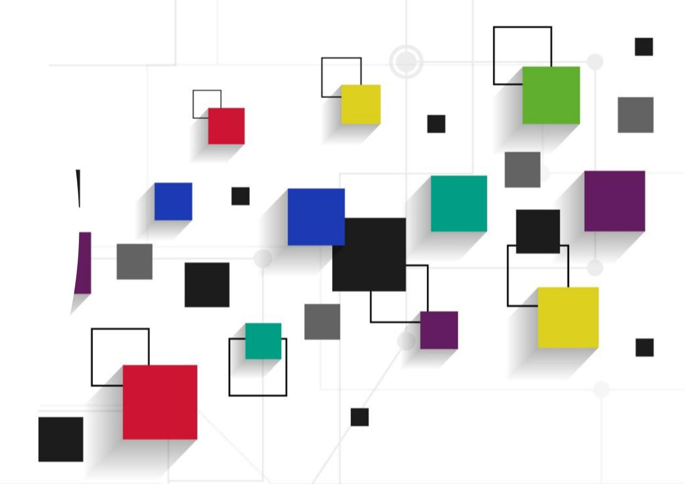

# Agenda Pertemuan


**Review Teorema CAP, NoSQL**

**Apa itu HBase?**

**HBase Data Model**

**HBase Architecture**

**HBase Operations**


# Teorema CAP

- Teorema CAP yang dipublikasikan oleh Eric Brewer pada tahun 2000, yang menjelaskan tentang sistem terdistribusi. q**Consistency** – Mengacu pada keseragaman data di seluruh sistem terdistribusi pada saat yang sama, setiap client akan melihat versi data yang konsisten, terlepas dari node yang digunakan untuk mengakses data tersebut. q**Availability** – Mengacu pada kemampuan sistem untuk memberikan respons yang valid bahkan dalam kondisi kegagalan atau gangguan pada beberapa bagian sistem. q**Partition Tolerance** – Mengacu pada kemampuan sistem untuk tetap berfungsi secara normal meskipun dilakukan partisi atau kehilangan konektivitas antara beberapa node dalam sistem.
- Teorema CAP menyatakan bahwa pada sistem database terdistribusi apa pun, "tidak mungkin" untuk menjamin terpenuhinya ketiga kondisi tersebut
- Kita dapat memiliki **paling banyak dua dari tiga kondisi**

# Teorema CAP

**CA Kategori**  
Permasalahan pada jaringan dapat membuat sistem berhenti.  
Contoh database seperti MySQL, Oracle, SQL Server dan RDBMS lainnya

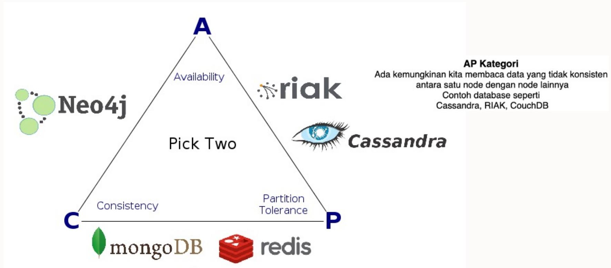

**CP Kategori**  
Terdapat resiko data tidak bisa ditemukan  
Contoh database seperti MongoDB, Hbase, MemCache, Redis

# NoSQL

- • Database NoSQL adalah database non-tabular dan menyimpan data secara berbeda dari tabel relasional
- • Database NoSQL memiliki berbagai jenis model data. Beberapa yang utama adalah document, key-value, wide-column, dan graph.
- • Model data tersebut menyediakan skema yang fleksibel dan scale yang mudah untuk jumlah data hasar dan beban pengguna yang tinggi


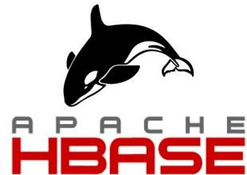


# NoSQL Data Model

- Data model mengacu pada cara data disimpan, diorganisasikan, dan diakses dalam sistem database NoSQL


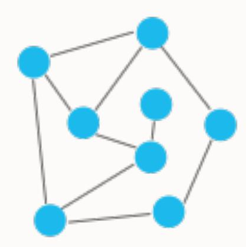

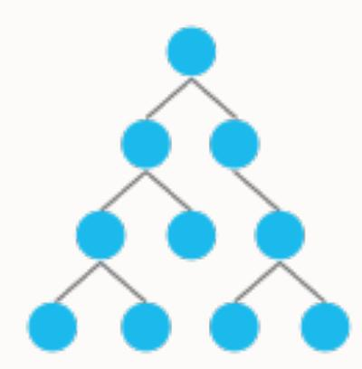

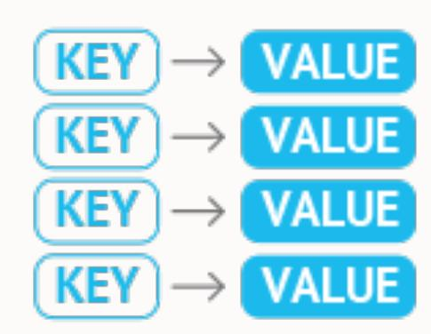

# NoSQL Data Model

#### **Key-Value Model**

| Key | Value            |
|-----|------------------|
| K1  | AAA,BBB,CCC      |
| K2  | AAA,BBB          |
| K3  | AAA,DDD          |
| K4  | AAA,2,01/01/2015 |
| K5  | 3,ZZZ,5623       |

#### **Column-Family Model Document Model**

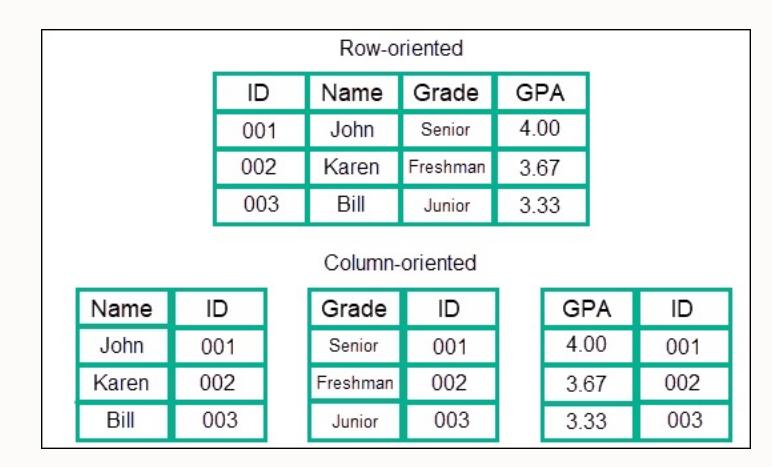

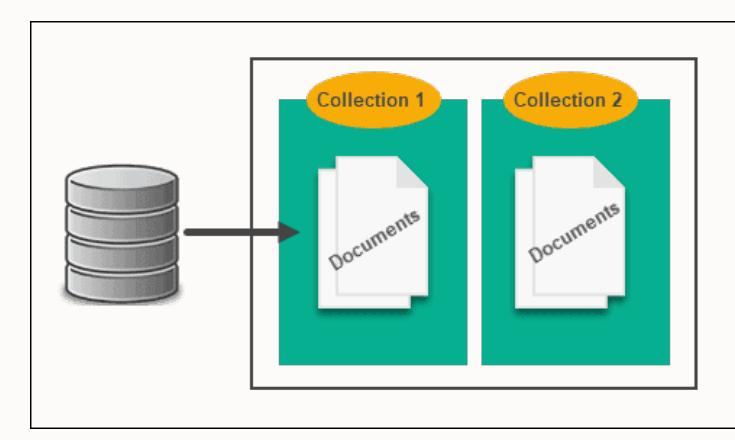

#### **Graph Model**

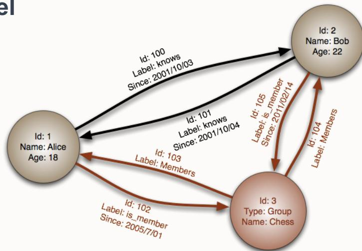

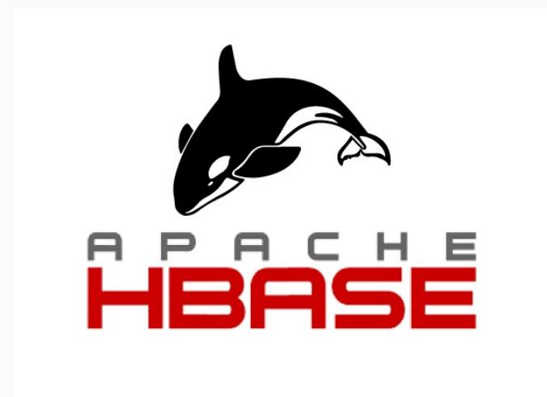

**Apache HBase**


# HBase pada Hadoop

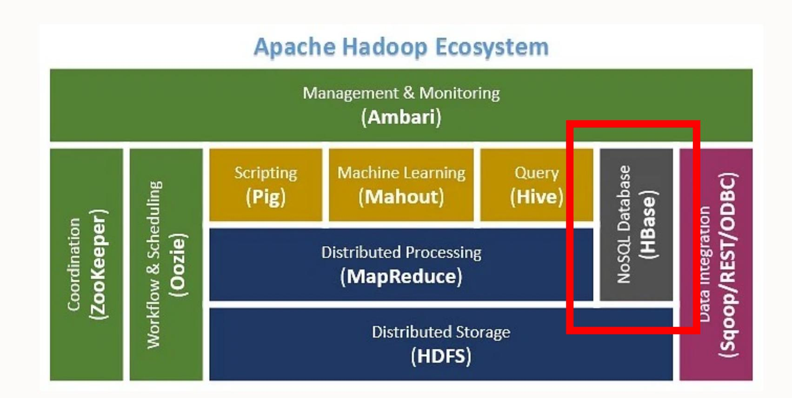

**HBase** is a distributed column-oriented database built on top of the Hadoop file system and provides read and write access

# HBase

- Database terdistribusi yang berorientasi pada kolom untuk structured dan semi-structured data
- Implementasi dari konsep Google Bigtable
- Program yang berjalan di atas Hadoop Distributed File System (HDFS)
- Mampu memproses data dalam skala besar secara interaktif bagian dari ekosistem Hadoop yang menyediakan **random real-time read/write access** ke data di HDFS q**Real-time access**: kemampuan HBase untuk memberikan respons dengan waktu penyelesaian yang rendah (*low latency*) atau mendekati *real-time*. q**Random access**: kemampuan untuk mengakses data secara acak tanpa harus melakukan operasi sekuensial. Setiap data record di HBase memiliki *row-key* yang memungkinkan pencarian dan akses yang cepat ke data tertentu tanpa harus melalui seluruh dataset secara berurutan.

# HBase

- Seseorang dapat menyimpan data dalam HDFS baik secara langsung atau melalui HBase. Data consumer read/akses data dalam HDFS secara random menggunakan HBase.

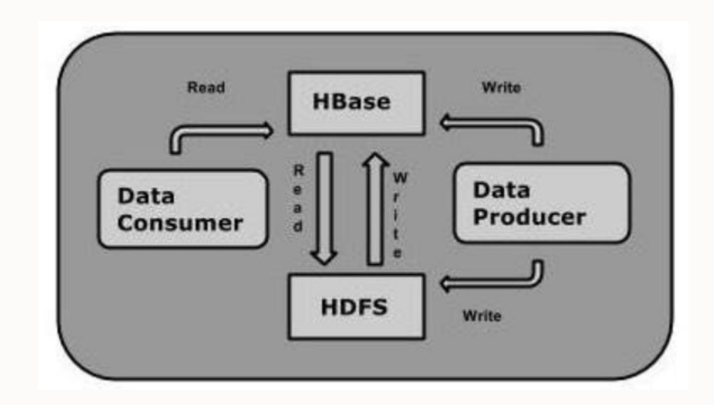

# HDFS vs HBase

Pendekatan menyimpan file data langsung di HDFS tanpa menggunakan HBase

Pendekatan menggunakan HBase sebagai **VS** storage layer di atas HDFS

| <b>HDFS</b>                                                                | <b>HBase</b>                                                                                                                   |
|----------------------------------------------------------------------------|--------------------------------------------------------------------------------------------------------------------------------|
| HDFS is a distributed file system suitable for storing large files.        | HBase is a database built on top of the HDFS.                                                                                  |
| HDFS does not support fast individual record lookups.                      | HBase provides fast lookups for larger tables.                                                                                 |
| It provides high latency batch processing; no concept of batch processing. | It provides low latency access to single rows from billions of records (Random access).                                        |
| It provides only sequential access of data.                                | HBase internally uses Hash tables and provides random access, and it stores the data in indexed HDFS files for faster lookups. |

# Perbedaan Hive dan HBASE

- **Model Data**: Hive menggunakan model data yang berbasis skema (schema-based) yang mirip dengan basis data relasional tradisional. Data disimpan dalam tabel dengan skema yang ditentukan sebelumnya. Di sisi lain, HBase menggunakan model data berbasis kolom (column-based) atau column-family.
- **Tipe Query**: Hive dirancang untuk query data menggunakan bahasa SQL (HiveQL) yang memungkinkan pengguna untuk melakukan analisis data menggunakan query SQL tradisional. HBase tidak menggunakan SQL, tetapi menyediakan API untuk membaca dan menulis data menggunakan operasi CRUD (Create, Read, Update, Delete).
- **Pemrosesan**: Hive cenderung lebih cocok untuk pemrosesan data dalam skala besar, khususnya untuk tugas-tugas pemrosesan batch yang melibatkan pengolahan data dalam jumlah besar. HBase dirancang untuk pemrosesan data yang membutuhkan akses baca/tulis yang cepat dan langsung pada level baris.
- **Jenis Aplikasi**: Hive lebih cocok untuk analisis data yang berbasis query untuk pemrosesan batch (familiar interface dengan SQL). HBase lebih sesuai untuk aplikasi yang memerlukan akses langsung ke data, pemrosesan transaksi dengan kebutuhan respons real-time.

# Kelebihan HBase

- **Skema Dinamis**: HBase menggunakan model data column-family
- **Akses Real-time**: HBase menyediakan akses read/write real-time ke data dengan latensi rendah
- **Horizontal Scalability**: HBase memiliki fungsi *sharding* original bawaan yang dapat bekerja secara otomatis maupun manual
- **Fault Tolerance**: HBase memiliki mekanisme replikasi data otomatis yang memberikan toleransi kesalahan

# Penggunaan HBase

Mozilla uses HBase to store all crash data in HBase

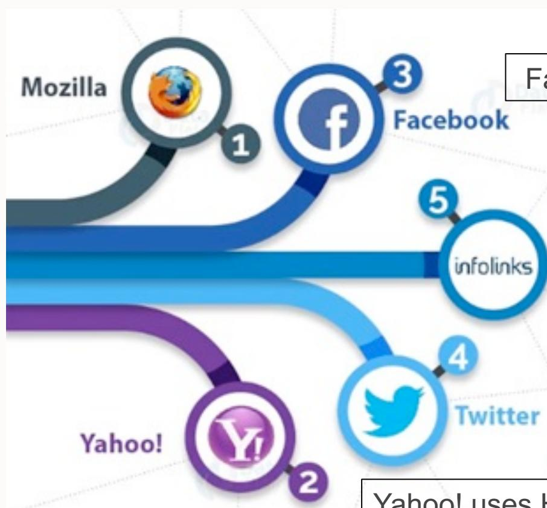

Facebook uses HBase storage to store real-time messages

Infolinks uses HBase to process advertisement selection and user events for the In-Text ad network

Twitter runs HBase across its entire Hadoop cluster, HBase offers a distributed, read/write the backup of all MySQL tables in their production backend

Yahoo! uses HBase to store document fingerprint in order to detect near-duplicates

# HBase Data Model

- HBase adalah **column-oriented** database

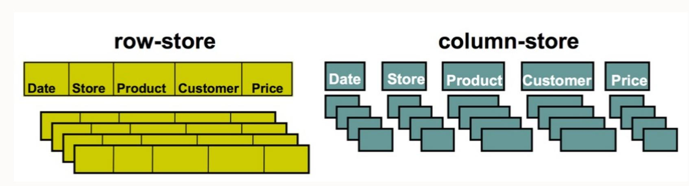

Data disimpan per baris berdasarkan entitas yang mewakili satu keseluruhan record.

Data disimpan dalam urutan kolom secara terpisah. Setiap kolom berisi nilai-nilai untuk atribut yang sama dari seluruh record.

**Misalnya, kita ingin menjumlahkan total penjualan (price), manakah yang memiliki performa lebih baik?** 

**Mana yang lebih cocok untuk OLTP atau OLAP?** <sup>17</sup>

# HBase Data Model

- **Table** adalah kumpulan dari Rows
- **Row** adalah kumpulan dari Colum Family
- **Colum Family** adalah kumpulan Columns
- **Column** adalah kumpulan pasangan key-value
- **Rowkey** setiap data dalam tabel diidentifikasi dan diindeks oleh RowKey

| Row ID | Column Family | Column Family | Column Family | Column Family | Column Family |      |
|--------|---------------|---------------|---------------|---------------|---------------|------|
|        | col1          | col2          | col3          | col1          | col2          | col3 |
| 1      |               |               |               |               |               |      |
| 2      |               |               |               |               |               |      |
| 3      |               |               |               |               |               |      |

# HBase Data Model

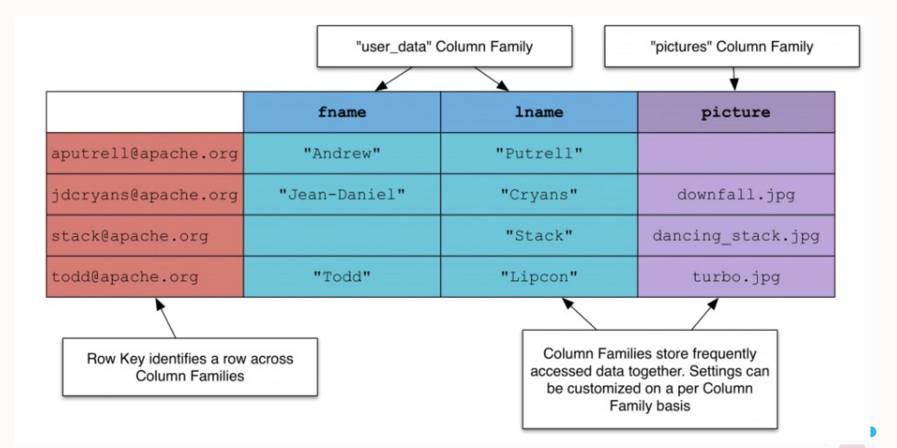

#### Data secara fisik disimpan berdasarkan Column Family

| table | fam1      |           | fam2      |           |
|-------|-----------|-----------|-----------|-----------|
|       | fam1:col1 | fam1:col2 | fam2:col1 | fam2:col2 |
| row1  |           |           |           |           |
| row2  |           |           |           |           |


| table |           | fam1      |
|-------|-----------|-----------|
|       | fam1:col1 | fam1:col2 |
| row1  |           |           |
| row2  |           |           |

|             | <b>fam2</b> |           |
|-------------|-------------|-----------|
|             | fam2:col1   | fam2:col2 |
| <b>row1</b> |             |           |
| <b>row2</b> |             |           |

# Arsitektur HBase

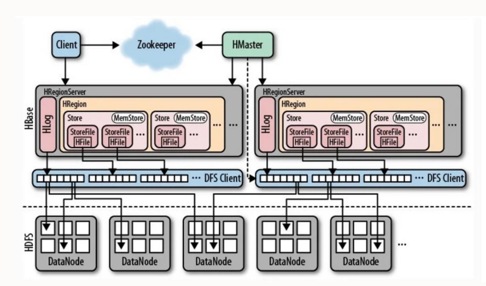

**HBase memanfaatkan HDFS untuk data storage dan fault tolerance**

# Master Server (atau HMaster)

- Master Server adalah komponen pusat yang bertanggung jawab untuk mengatur dan mengoordinasi operasi di cluster HBase.
- Master Server mengelola metadata, seperti informasi tentang Table, Region, dan penempatan RegionServer dalam cluster.
- Master Server mengelola operasi pembagian Region saat menambahkan atau menghapus RegionServer

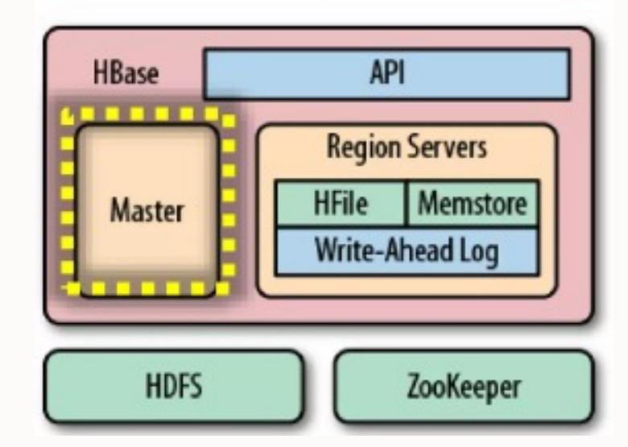

# RegionServer

- RegionServer adalah komponen utama dalam arsitektur HBase yang mengelola data dan melayani permintaan dari clients.
- Setiap RegionServer bertanggung jawab atas satu atau beberapa Region.
- Region adalah *range* baris data yang disimpan dalam RegionServer. Setiap RegionServer menyimpan data dalam satu atau lebih file HFile di HDFS dan menjawab permintaan read/write dari client.

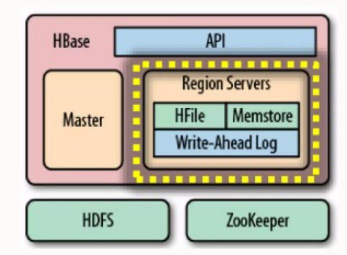

# Region

- Table HBase dibagi secara horizontal dengan range Rowkey menjadi Regions
- Suatu Region berisi semua baris tabel antara *start key* dan *end key*
- Region di-*assign* ke node dalam cluster, yang disebut RegionServer dan melayani data untuk read dan write
- Sebuah RegionServer dapat melayani sekitar 1.000 Region. Setiap Region berukuran 1GB (default).

# Ilustrasi RegionServer dan Region

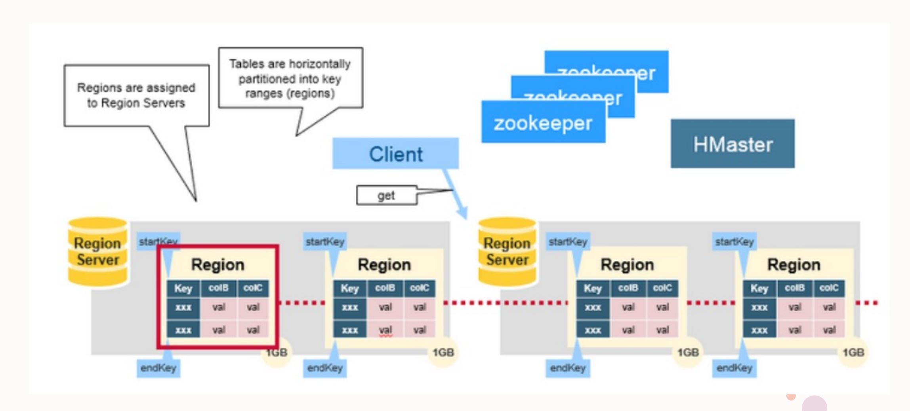

# Ilustrasi Region

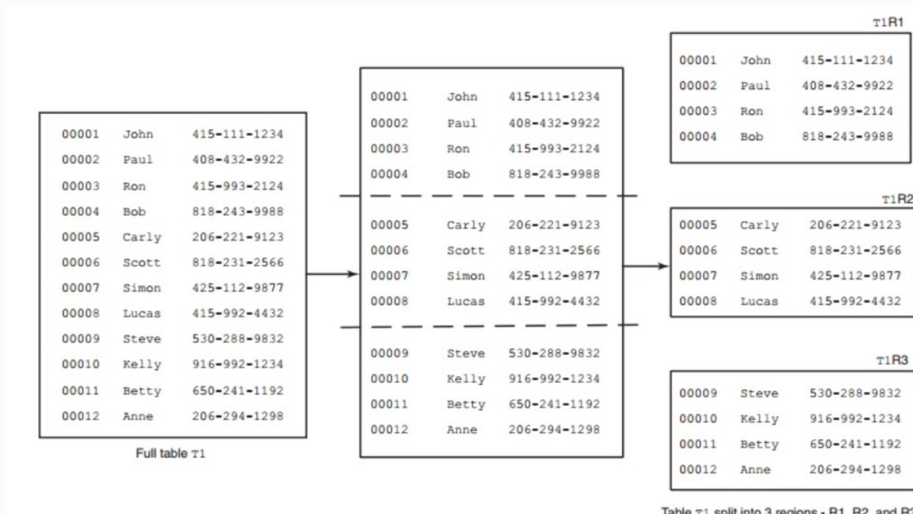

**Region Splitting**: Pembagian data ke dalam Region dilakukan berdasarkan rentang Rowkey dari data

#### Langkah-langkah dalam Pembagian Region (Region splitting)

- **1. Inisialisasi Region**: Saat tabel baru dibuat, satu Region awal dibuat untuk menampung seluruh rentang kunci baris. Region ini dapat dianggap sebagai rentang awal yang sangat besar.
- **2. Memantau Ukuran Region**: HBase secara periodik memantau ukuran Region. Ketika ukuran Region mencapai batas yang ditentukan (seperti ukuran maksimum yang telah ditetapkan), proses pembagian Region akan terjadi.
- **3. Split Region**: Proses pembagian Region melibatkan pemecahan Region yang ada menjadi dua Region yang lebih kecil. Pembagian Region biasanya berdasarkan rentang Rowkey. Salah satu metode yang umum digunakan adalah "split point" yang berarti membagi Region di tengah rentang kunci baris. Dua Region baru yang dihasilkan masing-masing mengelola setengah rentang Rowkey dari Region asli.
- **4. Distribusi Region**: Setelah Region dibagi, Region-Region baru tersebut didistribusikan ke RegionServer yang tersedia di cluster. Master Server bertanggung jawab untuk melakukan penempatan Region ke RegionServer yang sesuai untuk mendistribusikan beban secara merata di seluruh cluster.

#### RegionServer: Komponen di dalam RegionServer

- **MemStore**: area memori utama di RegionServer yang digunakan untuk menampung data yang baru ditambahkan atau diubah sebelum disimpan ke disk. MemStore menyimpan data dalam bentuk struktur memori yang diurutkan berdasarkan Rowkey. Ketika MemStore mencapai batas ukuran tertentu, data akan ditulis ke HFile di HDFS. <sup>Ø</sup>1 MemStore untuk 1 Column Family di setiap Region.

- **HFile**: format penyimpanan yang digunakan oleh HBase untuk menyimpan data di disk. Setiap region dapat memiliki beberapa file HFile .
- **WAL (Write -Ahead Log)**: log yang digunakan untuk menyimpan operasi write yang dilakukan pada data sebelum ditulis ke MemStore. WAL mencatat perubahan data yang dilakukan pada Region. Jika terjadi kegagalan atau recovery, data dapat direkonstruksi dengan menggunakan WAL untuk memastikan integritas data.
- **Block Cache**: area memori yang digunakan untuk menyimpan sejumlah blok data HFile yang sering diakses. 28

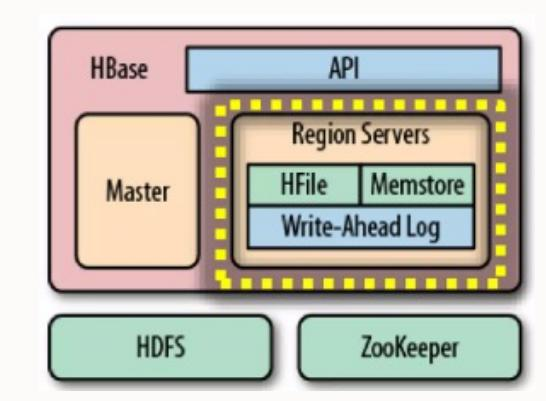

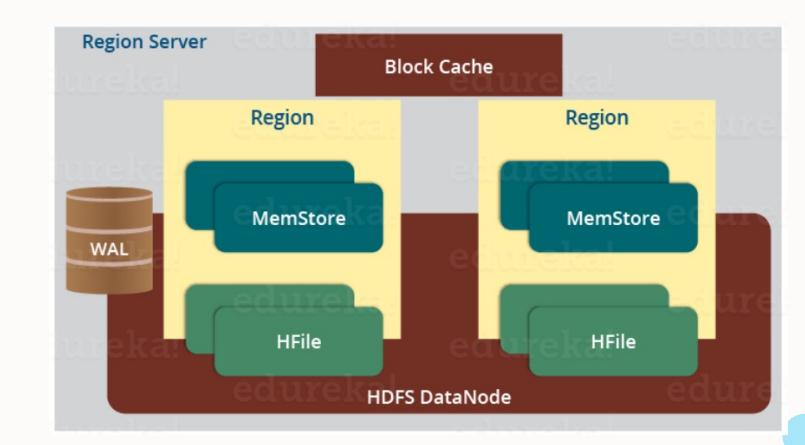

# ZooKeeper

- Zookeeper merupakan *entry point* dalam HBase
- ZooKeeper digunakan oleh HBase sebagai layanan koordinasi terdistribusi.
- HBase menggunakan ZooKeeper untuk koordinasi antara Master Server dan RegionServer, serta untuk mengatur *failover* dan *recovery* dalam cluster.
- ZooKeeper juga digunakan untuk mendeteksi perubahan topologi cluster, seperti penambahan atau penghapusan node.

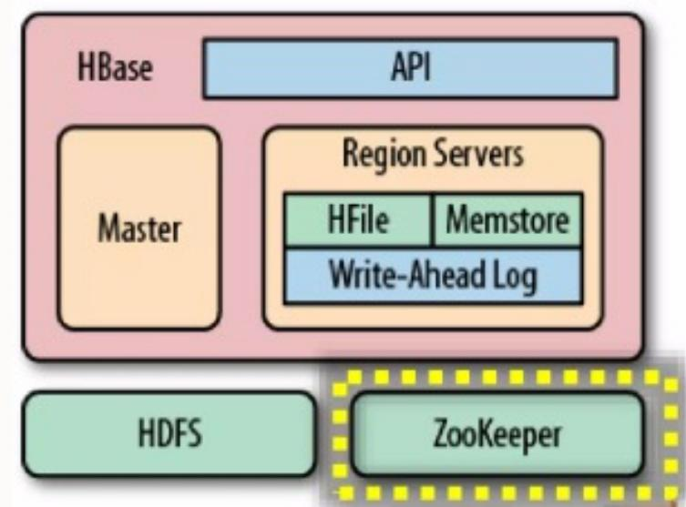

# Client API dan Shell

- HBase menyediakan API client yang memungkinkan aplikasi atau pengguna untuk berinteraksi dengan HBase.
- API ini memungkinkan akses read/write ke data di tabel HBase.
- Selain itu, HBase juga menyediakan shell interaktif yang memungkinkan pengguna untuk menjalankan perintah HBase menggunakan bahasa scripting.

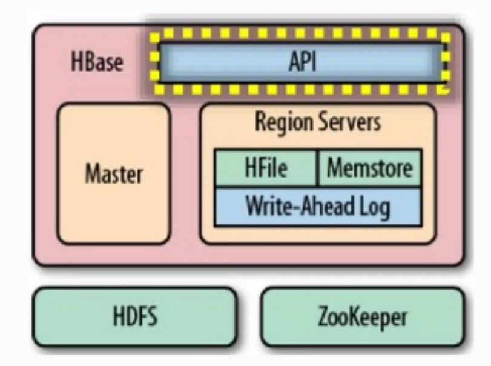

# META Table

- Tabel khusus dalam HBase yang menyimpan metadata tentang semua Region yang ada dalam cluster HBase.
- Informasi ini mencakup detail tentang nama Table, Region, RegionServer yang menampung Region, rentang Rowkey (start key dan end key) yang dikelola oleh setiap Region, dan lokasi HFile

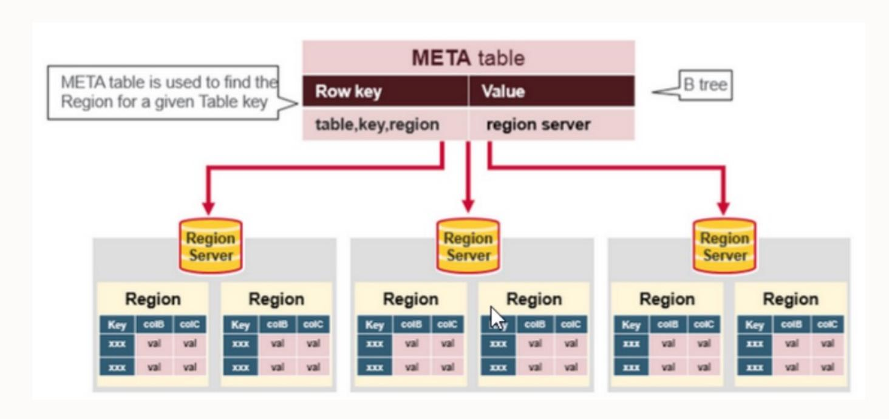

# META Table

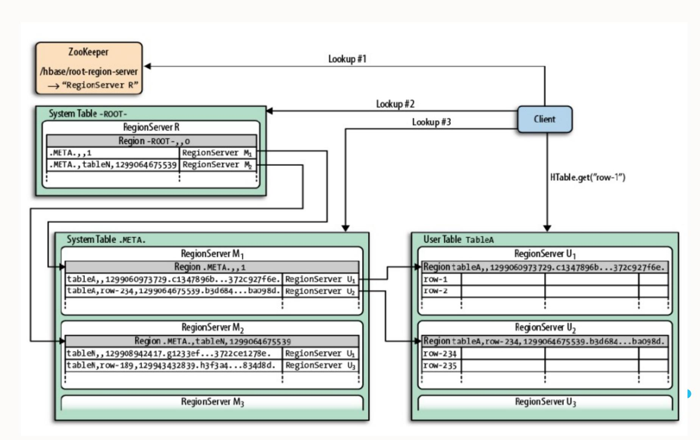

# HBase – Mekanisme Read

## HBase - Read Path

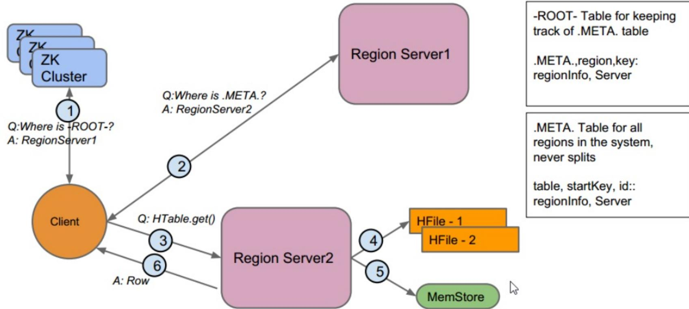

# HBase – Mekanisme Write

## HBase - Write Path

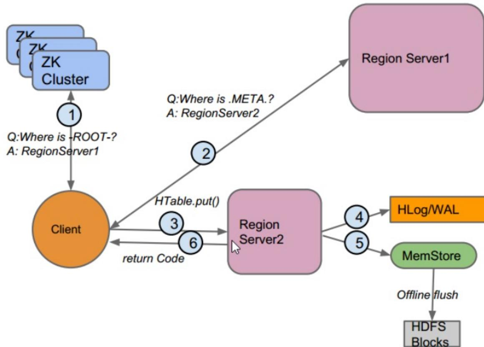

-ROOT- Table for keeping track of .META. table

.META.,region,key:  
regionInfo, Server

.META. Table for all regions in the system, never splits

table, startKey, id::  
regionInfo, Server

# HBase: Perintah Umum

- **status**: Memberikan status HBase
- **version**: Menyediakan versi HBase yang digunakan
- **table\_help**: Memberikan bantuan untuk referensi tabel perintah
- **whoami**: Memberikan informasi user

# HBase: DDL

- **create** Creates a table.
- **list** Lists all the tables in HBase.
- **disable** Disables a table.
- **is\_disabled** Verifies whether a table is disabled.
- **enable** Enables a table.
- **is\_enabled** Verifies whether a table is enabled.
- **describe** Provides the description of a table.
- **alter** Alters a table.
- **exists** Verifies whether a table exists.
- **drop** Drops a table from HBase.
- **drop\_all** Drops the tables matching the 'regex' given in the command.

## RDBMS

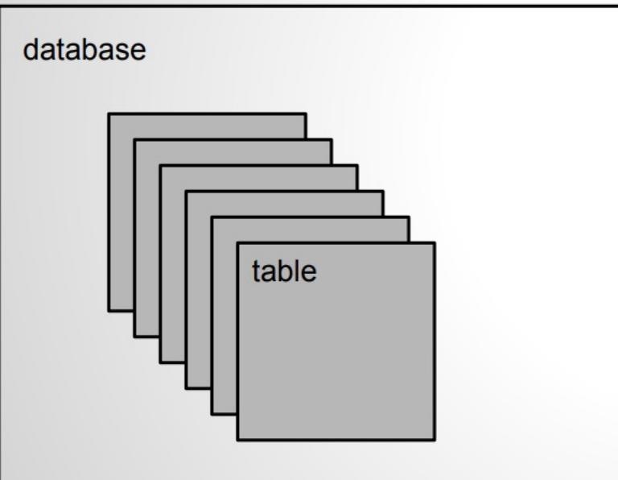

## Apache HBase

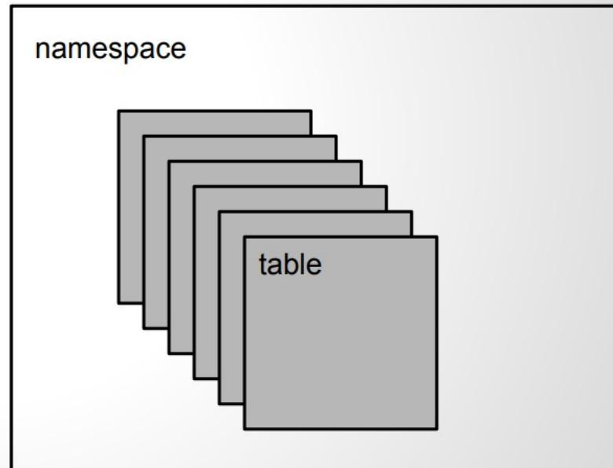

- ✓ Dalam HBase, database direpresentasikan sebagai sekumpulan tabel-tabel.
- ✓ Namespace HBase menyediakan cara untuk mengelompokkan tabel secara logis dalam ekosistem HBase, tetapi namespace tidak sama dengan database di RDBMS tradisional.

# HBase: DML

- **put** Puts a cell value at a specified column in a specified row in a particular table.
- **get** Fetches the contents of row or a cell.
- **delete** Deletes a cell value in a table.
- **deleteall** Deletes all the cells in a given row.
- **scan** Scans and returns the table data.
- **count** Counts and returns the number of rows in a table.
- **truncate** Disables, drops, and recreates a specified table.

# Contoh

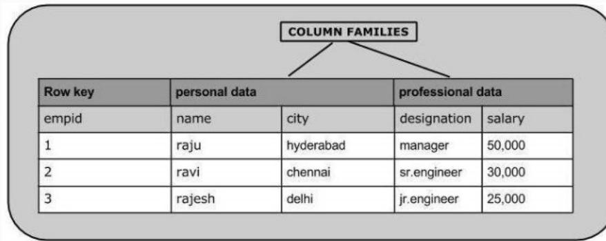

```
hbase> create 'emp', 'personal data', 'professional data'\nhbase> list\nhbase> describe 'emp'\nhbase> put 'emp','1','personal data:name','raju'\nhbase> put 'emp','1','personal data:city','hyderabad'\nhbase> put 'emp','1','professional data:designation','manager'\nhbase> put 'emp','1','professional data:salary','50000'\nhbase> scan 'emp'\nhbase> count 'emp'
```

# [Referensi](https://docs.cloudera.com/HDPDocuments/HDP3/HDP-3.1.4/hbase-data-access)

- https://www.oreilly.com/library/view/hbase-thedefinitive/9781449314682/ch01.html
- https://nag-9-s.gitbook.io/hbase
- https://hbase.apache.org/book.html
- https://docs.cloudera.com/HDPDocuments/HDP3/HDP-3.1.4/hbase-dataaccess

# Terima kasih