# Pig dan Kafka

Pertemuan 11 - Teknologi Perekayasaan Data

Politeknik Statistika STIS

Siti Mariyah, Ph.D


## Agenda Pertemuan


**1**

**Pig dan Kafka**

**<sup>2</sup> Pig, Pig Data Model, Pig Latin, Use Case**

**3**

**Kafka, Kafka Components, Use Case**


#### **Apache Pig**

## Pig pada Hadoop

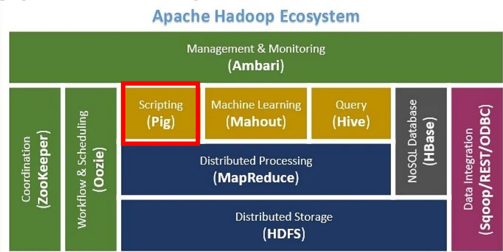

**Pig** is a high-level scripting language and platform for data processing and analysis

## Pig: High-Level Data Flow Platform

- **Pig** adalah bahasa script tingkat tinggi/tool/platform yang digunakan untuk menganalisis *large dataset* yang direpresentasikan sebagai *data flow*
- Disebut juga **data flow language**, mengacu pada aliran data yang melalui serangkaian transformasi dan operasi
  - Misalnya, kita dapat load data dari file, lalu menerapkan operasi filtering, grouping, dan aggregation, dan terakhir store data yang diproses dalam format yang diinginkan atau menulisnya ke file lain.
  - Memungkinkan pengguna untuk melakukan transformasi data dan analisis dengan cara yang lebih intuitif dan ringkas
- Dirancang sebagai abstraksi MapReduce, mengurangi kompleksitas penulisan program MapReduce

## Apache Pig

- Untuk menganalisis data menggunakan Apache Pig, programmer perlu menulis script menggunakan bahasa Pig Latin
- Scripts kemudian secara internal dikonversi ke Map and Reduce tasks
- Apache Pig memiliki komponen yang disebut Pig Engine yang menerima script Pig Latin sebagai input dan mengkonversi script tersebut menjadi job MapReduce

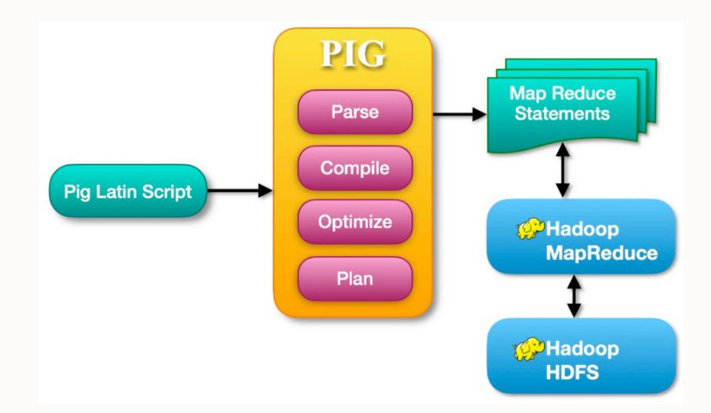

## Fitur Pig

- **Kumpulan operator yang banyak**: Menyediakan banyak operator untuk melakukan operasi seperti *join*, *sort*, *filter*, dan lain-lain.
- **Kemudahan pemrograman**: Pig Latin mirip dengan SQL dan mudah untuk menulis script Pig jika familiar SQL.
- **Ekstensibilitas**: Menggunakan operator yang ada, pengguna dapat mengembangkan fungsi sendiri untuk *read*, *process*, dan *write* data.
- **UDF's**: Pig menyediakan fasilitas untuk membuat User-defined Function (UDF) dalam bahasa pemrograman lain seperti Java dan dapat dipanggil dalam script Pig.
- **Menangani semua jenis data**: Apache Pig menganalisis semua jenis data, baik terstruktur maupun tidak terstruktur, dan menyimpan hasilnya dalam HDFS.

## Pig vs Hive

| <b>Apache Pig</b>                                                                                | <b>Hive</b>                                                                                |
|--------------------------------------------------------------------------------------------------|--------------------------------------------------------------------------------------------|
| Apache Pig uses a language called <b>Pig Latin</b> . It was originally created at <b>Yahoo</b> . | Hive uses a language called <b>HiveQL</b> . It was originally created at <b>Facebook</b> . |
| Pig Latin is a data flow language.                                                               | HiveQL is a query processing language.                                                     |
| Pig Latin is a procedural language and it fits in pipeline paradigm.                             | HiveQL is a declarative language.                                                          |
| Apache Pig can handle structured, unstructured, and semi-structured data.                        | Hive is mostly for structured data.                                                        |

Ø Pig menyediakan bahasa script (Pig Latin) yang menawarkan lebih banyak fleksibilitas dan ekspresif untuk transformasi dan pemrosesan data. Ø Jika kasus penggunaan melibatkan transformasi data yang kompleks, *custom logic*, atau analisis ad -hoc, Pig mungkin merupakan pilihan yang lebih baik

## Arsitektur Apache Pig

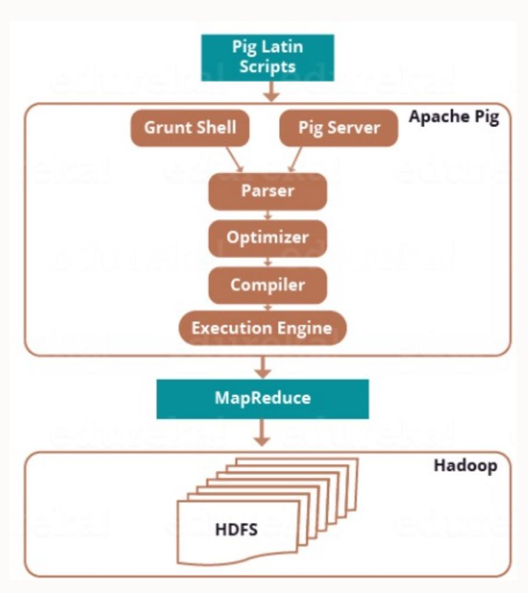

- **Parser**: Awalnya, script akan ditangani oleh Parser dengan memeriksa sintaks script. Output dari parser adalah DAG (*directed acyclic graph*), yang merepresentasikan struktur logika dari Pig Latin. DAG ini merupakan logical plan menggambarkan serangkaian operasi dan aliran data yang perlu dilakukan dalam pemrosesan.
- **Optimizer**: *Logical plan* (DAG) diteruskan ke optimizer yang melakukan pengoptimalan logic.
- **Compiler**: Compiler meng-compile *optimized logical plan* menjadi serangkaian job-job MapReduce – *physical plan*.
- **Execution Engine**: Job-job MapReduce dikirimkan ke Hadoop dalam suatu urutan dan kemudian dieksekusi.

## Apache Pig Data Model

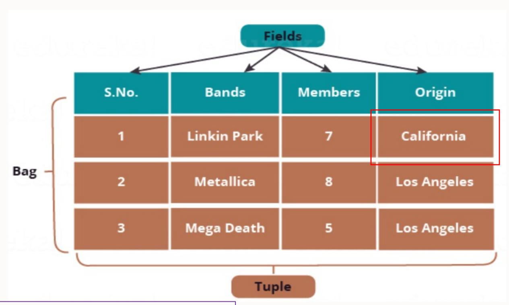

**Atom**: unit data terkecil – primitive data type (string, int, float, long, double, char[], byte[])

**Penulisan**:

'1', 'Linkin Park', '7', 'California'

**Tuple**: baris data

**Penulisan**:

**(**1, Linkin Park, 7, California**)**

**(**California, **{(**Linkin Park, California**)})**

**Bag**: kumpulan dari beberapa tuple, setiap tuple bisa berbeda jumlah field (flexible schema)

**Penulisan**:

**{**(Linkin Park, 7, California), (Metallica, 8), (Mega Death, Los Angeles)**}, {**(Metallica, 8, Los Angeles), (Mega Death, 8), (Linkin Park, California)**}**

**inner bag**: di dalam tuple

# Eksekusi Apache Pig

- • **Dua cara eksekusi:**

- - ○ Local - dijalankan menggunakan host local dan sistem file, biasanya untuk tujuan testing atau data skala kecil.

```
$ pig -x local
```

- - ○ MapReduce - dijalankan di cluster Hadoop dan HDFS. \$ pig -x mapreduce (atau \$pig)

- • **Grunt/Interactive:** \$ pig

```
grunt> customers= LOAD '/home/cloudera/customers.txt' USING  
PigStorage(',');  
grunt> dump customers;
```

- • **Batch:** eksekusi menggunakan Pig Scripts

```
[cloudera@quickstart ~]$ cat pig_samplescript_local.pig  
customers= LOAD '/home/cloudera/customers.txt' USING PigStorage(',') as  
(id:int,name:chararray,age:int,address:chararray,salary:int);  
dump customers;
```

```
[cloudera@quickstart ~]$ pig -x local pig_samplescript_local.pig
```

```
[cloudera@quickstart ~]$ cat pig_samplescript_global.pig  
customers= LOAD '/training/customers.txt' USING PigStorage(',') as  
(id:int,name:chararray,age:int,address:chararray,salary:int);  
dump customers;
```

```
[cloudera@quickstart ~]$ pig -x mapreduce pig_samplescript_global.pig
```

- • **Embedded (UDF):** menyematkan dan eksekusi Pig Script di Java, python, dan Ruby

## Pig Latin

- Script Pig Latin umumnya disusun sebagai berikut: ØLOAD membaca data ØSerangkaian statement "transformasi" untuk memproses data ØSTORE menulis output ke sistem file (atau DUMP menampilkan output di layar)

## Contoh Script Pig Latin

-- Load the content of a file into a pig bag named 'input\_lines' input\_lines = LOAD 'CHANGES.txt' AS (line:chararray);

-- Extract words from each line and put them into a pig bag named 'words' words = FOREACH input\_lines GENERATE FLATTEN(TOKENIZE(line)) AS word;

-- filter out any words that are just white spaces filtered\_words = FILTER words BY word MATCHES '\\w+';

-- create a group for each word word\_groups = GROUP filtered\_words BY word;

-- count the entries in each group word\_count = FOREACH word\_groups GENERATE COUNT(filtered\_words) AS count, group AS word;

-- order the records by count ordered\_word\_count = ORDER word\_count BY count DESC;

-- Store the results ( executes the pig script ) STORE ordered\_word\_count INTO 'output';

## Pig Latin: relational operators

| Category                | Operator              | Description                                                                   |
|-------------------------|-----------------------|-------------------------------------------------------------------------------|
| Loading and storing     | LOAD                  | Loads data from the filesystem or other storage into a relation               |
|                         | STORE                 | Saves a relation to the filesystem or other storage                           |
| Filtering               | DUMP (\d)             | Prints a relation to the console                                              |
|                         | FILTER                | Removes unwanted rows from a relation                                         |
|                         | DISTINCT              | Removes duplicate rows from a relation                                        |
|                         | FOREACH. . . GENERATE | Adds or removes fields to or from a relation                                  |
|                         | MAPREDUCE             | Runs a MapReduce job using a relation as input                                |
| Grouping and joining    | STREAM                | Transforms a relation using an external program                               |
|                         | SAMPLE                | Selects a random sample of a relation                                         |
|                         | ASSERT                | Ensures a condition is true for all rows in a relation; otherwise, fails      |
|                         | JOIN                  | Joins two or more relations                                                   |
|                         | COGROUP               | Groups the data in two or more relations                                      |
|                         | GROUP                 | Groups the data in a single relation                                          |
|                         | CROSS                 | Creates the cross product of two or more relations                            |
| Sorting                 | CUBE                  | Creates aggregations for all combinations of specified columns in a relation  |
|                         | ORDER                 | Sorts a relation by one or more fields                                        |
|                         | RANK                  | Assign a rank to each tuple in a relation, optionally sorting by fields first |
|                         | LIMIT                 | Limits the size of a relation to a maximum number of tuples                   |
| Combining and splitting | UNION                 | Combines two or more relations into one                                       |
|                         | SPLIT                 | Splits a relation into two or more relations                                  |

**LOAD: Pig Data Formats**

§ BinStorage Loads and stores data in machine-readable (binary) format § PigStorage Loads and stores data as structured, field delimited text files § TextLoa[der](https://pig.apache.org/docs/latest/basic.html) Loads unstructured data in UTF-8 format § PigDump Stores data in UTF-8 format § YourOwnFormat! via UDFs

# Pig Latin: expressions

| Category             | Expressions    | Description                                                           | Examples                                    |
|----------------------|----------------|-----------------------------------------------------------------------|---------------------------------------------|
| Constant             | Literal        | Constant value (see also the "Literal example" column in Table 16-6)  | 1.0, 'a'                                    |
| Field (by position)  | $\$n$          | Field in position $n$ (zero-based)                                    | \$0                                         |
| Field (by name)      | $f$            | Field named $f$                                                       | year                                        |
| Field (disambiguate) | $r::f$         | Field named $f$ from relation $r$ after grouping or joining           | A::year                                     |
| Projection           | $c.\$n, c.f$   | Field in container $c$ (relation, bag, or tuple) by position, by name | records.\$0, records.year                   |
| Map lookup           | $m\#k$         | Value associated with key $k$ in map $m$                              | items#'Coat'                                |
| Cast                 | $(t) f$        | Cast of field $f$ to type $t$                                         | (int) year                                  |
| Arithmetic           | $x + y, x - y$ | Addition, subtraction                                                 | \$1 + \$2, \$1 - \$2                        |
|                      | $x * y, x / y$ | Multiplication, division                                              | \$1 * \$2, \$1 / \$2                        |
|                      | $x \% y$       | Modulo, the remainder of $x$ divided by $y$                           | \$1 % \$2                                   |
| Conditional          | $+x, -x$       | Unary positive, negation                                              | +1, -1                                      |
|                      | $x ? y : z$    | Bincond/ternary; $y$ if $x$ evaluates to true, $z$ otherwise          | quality == 0 ? 0 : 1                        |
|                      | CASE           | Multi-case conditional                                                | CASE q WHEN 0 THEN 'good'<br>ELSE 'bad' END |

## Contoh Pig Latin

**Table** urls: (url,category, pagerank)

**Find for each sufficiently large category, the average pagerank of high-pagerank urls in that category!**

SQL:

SELECT category, AVG(pagerank)

FROM urls WHERE pagerank > 0.2

GROUP BY category HAVING COUNT(\*) > 10^6

Pig Latin:

good\_urls = FILTER urls BY pagerank > 0.2;

groups = GROUP good\_urls BY category;

big\_groups = FILTER groups BY COUNT(good\_urls)>10^6;

output = FOREACH big\_groups GENERATE category, AVG(good\_urls.pagerank);

## Contoh Pig Latin

A = LOAD 'user.dat' AS (name, age, city); Load(user.dat) B = GROUP A BY city; C = FOREACH B GENERATE group AS city, COUNT(A); D = FILTER C BY city IS 'kitchener' Filter OR city IS 'waterloo'; STORE D INTO 'local\_user\_count.dat';

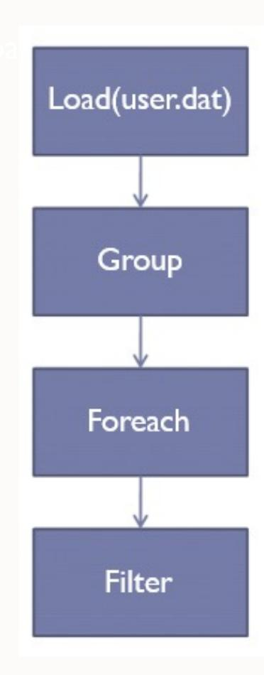


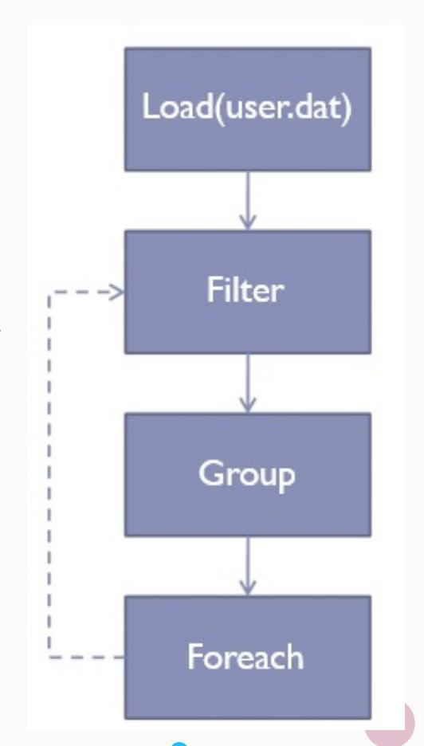

Logical plan Optimized logical plan

## Apache Pig: Use Cases


Transforming and analyzing user behavior data, content recommendations, and other aspects of their streaming service

Utilized in IBM's data analytics platforms to enable data scientists and analysts to perform complex data transformations and analysis


Data transformation, cleaning, and analysis of their vast user and business data


Extensively used Pig for various data processing tasks within their infrastructure


Process and analyze vast amounts of data generated by Twitter users


Pig has been used for tasks such as log analysis, data transformations, and generating insights from their vast transactional data


# kafka

**Apache Kafka**

## Kafka is not a component of Hadoop

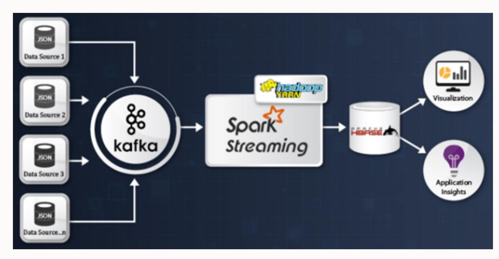

By integrating Kafka with Hadoop, organizations can create end-to-end **data pipelines** that capture, process, and analyze real-time data streams

# Apache Kafka

- • Apache Kafka adalah sebuah platform data streaming terdistribusi
- • Awalnya dikembangkan oleh LinkedIn, dirancang untuk pemrosesan data real-time dalam skala besar
- • Kafka menjadi solusi untuk membangun alur data yang dapat menangani aliran data streaming dalam jumlah besar secara efisien dan handal

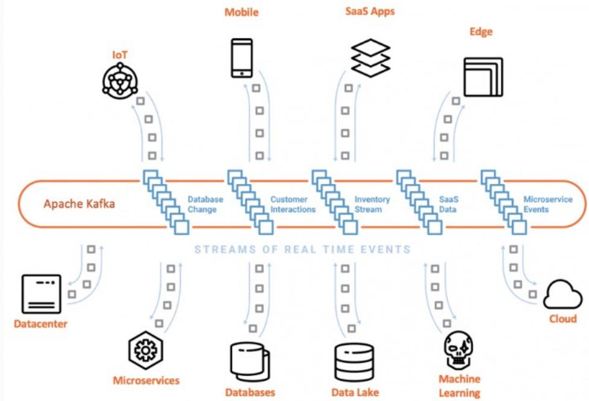

- • Global-scale
- • Real-time
- • Persistent Storage
- • Stream Processing


## Apa itu data real-time? data streaming?

- **Data real-time** mengacu pada data yang diperbarui secara instan dan tersedia dalam waktu nyata atau mendekati waktu nyata/*real-time* o Contoh: data streaming, data sensor, data perubahan status dalam sistem, dan lain-lain
- **Streaming data** mengacu pada aliran kontinu data yang dikirimkan dan diterima secara berkesinambungan dari sumber data ke sistem pemrosesan atau aplikasi yang dapat mengolah data secara real-time
- Sumber data streaming berupa *events* atau sumber yang menghasilkan data secara terus-menerus, seperti sensor IoT (Internet of Things), server log, sensor kendaraan, media sosial, aplikasi seluler, transaksi keuangan, dan lain-lain

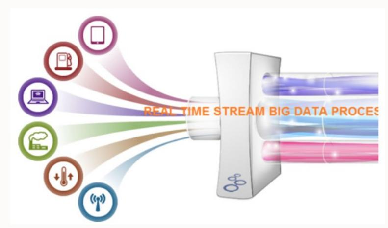

## Konsep dalam Apache Kafka

- **Topic**: Kategori dari messages (nama unik untuk setiap data stream).
- **Partition**: Topic yang dibagi menjadi bagian-bagian yang lebih kecil dan dapat dikelola.
- **Offset**: Nomor urut suatu message di partition, diberikan saat message masuk di partition.
- **Producer**: Aplikasi/device/sistem yang menghasilkan data, mengirimkan messages ke Kafka server.
- **Broker**: Sebuah Kafka server. Komponen inti dari Kafka Cluster.
- **Consumer**: Aplikasi/device/sistem yang mengkonsumsi messages.

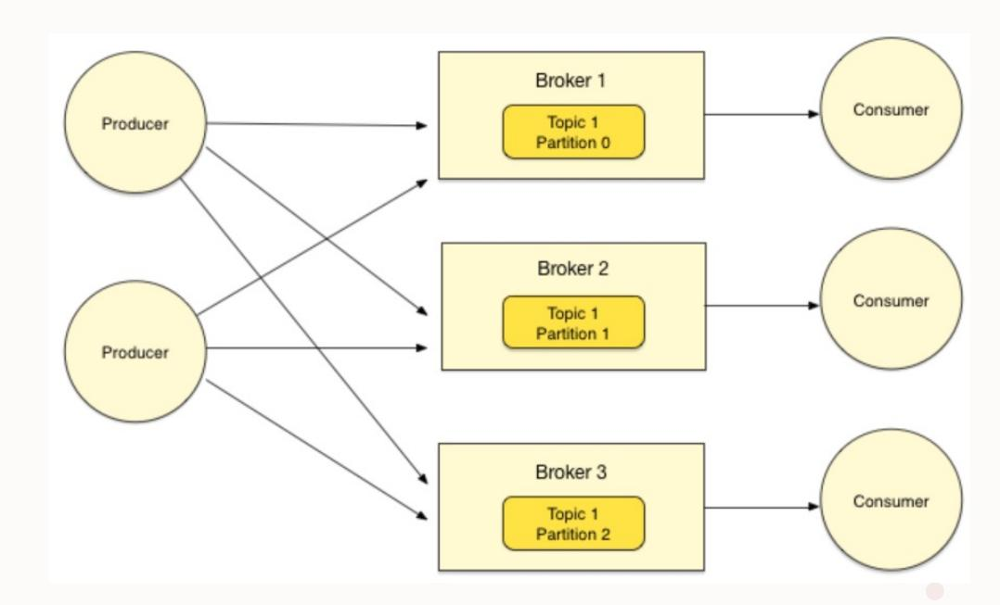

## Ilustrasi Topic, Partition, dan Offset

- **Topic** ~ tabel di database (tanpa constraint) diidentifikasi dengan nama yang unik
- Misalkan: sebuah Kafka Topic ditentukan memiliki 3 Partition, setiap message di dalam Partition akan mendapatkan incremental ID (disebut Offset) yang merupakan posisi message di dalam Partition.

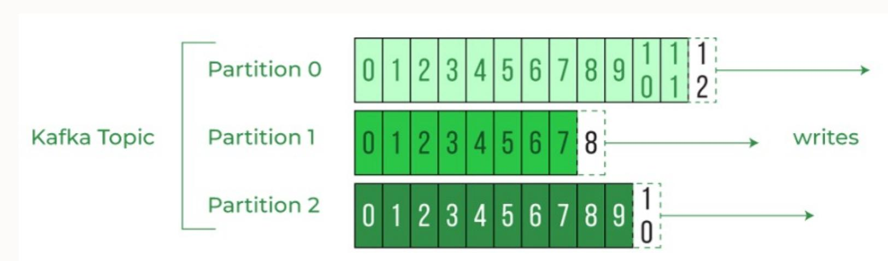

Suatu message diidentifikasi dari **Topic Name, Partition ID, Offset**

## Bagaimana Apache Kafka Bekerja?

- Apache Kafka bekerja menggunakan **publish-subscribe model** untuk mengelola aliran data secara realtime.
- Pola komunikasi di mana **producer** (publisher) mengirim message ke **topics**, dan **consumer** (subscriber) menerima message dari topik-topik yang mereka minati.
- Model ini memungkinkan pemisahan antara producer dan consumer, sehingga memungkinkan distribusi data yang scalable dan fleksibel.

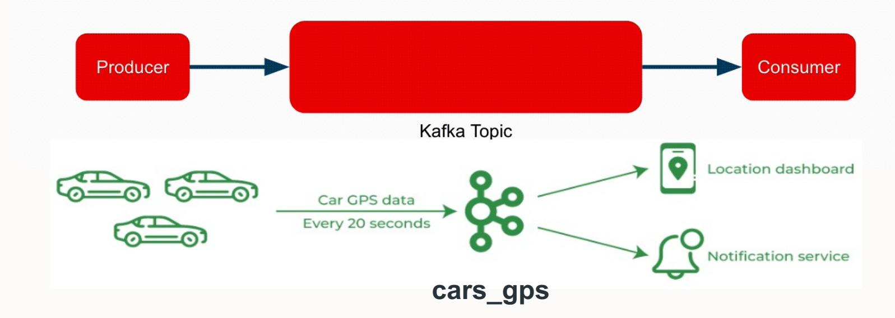

## Kafka à Cluster Hadoop

- Kafka digunakan untuk membuat real-time streaming data pipeline ke cluster Hadoop
- **Referensi Penggunaan Kafka dengan Hadoop**:
  - 1. Membuat topic Kafka
  - 2. Produksi data ke Kafka
  - 3. Konsumsi data dari Kafka: Apache Storm, Apache Spark, atau Apache Flink sebagai konsumen Kafka yang akan mengambil dan memproses data secara real-time
  - 4. Pemrosesan data dengan Hadoop: Apache Hadoop MapReduce, Apache Spark, atau Apache Hive untuk memproses data tersebut
  - 5. Penyimpanan hasil pemrosesan: HDFS, Apache Hive, atau sistem penyimpanan Hadoop lainnya sesuai

**Data ingestion capabilities of Kafka + processing power of Hadoop**  à **robust, scalable, and real-time data processing pipeline**  à **enable advanced analytics and insights**

#### Kafka Basic Commands – **kafka-topics.sh**

- Create a topic: **kafka-topics.sh --create --zookeeper localhost:2181 --replication-factor 1 --partitions 1 -- topic mytopic**
- List all topics: **kafka-topics.sh --list --zookeeper localhost:2181**
- Describe a topic: **kafka-topics.sh --describe --zookeeper localhost:2181 --topic mytopic**
- Delete a topic: **kafka-topics.sh --delete --zookeeper localhost:2181 --topic mytopic**

## Kafka Basic Commands

- **kafka-console-producer.sh, kafka-console-consumer.sh, kafka-configs.sh**
- Produce messages to a Kafka: **kafka-console-producer.sh --broker- list localhost:9092 --topic mytopic**
- Consume from the beginning: **kafka-console-consumer.sh -- bootstrap-server localhost:9092 --topic mytopic --from- beginning**
- Consume only new messages: **kafka-console-consumer.sh -- bootstrap-server localhost:9092 --topic mytopic**
- View topic configurations: **kafka-configs.sh --zookeeper localhost:2181 --entity-type topics --describe --entity- name mytopic**
- Add or update topic configuration: **kafka-configs.sh --zookeeper localhost:2181 --alter --entity-type topics --entity- name mytopic --add-config max.message.bytes=1000000**

## Kafka Basic Commands

- **kafka-producer-perf-test.sh, kafka-consumer-perf-test.sh**
- Measure the performance of Kafka producers by generating a specified number of messages: **kafka-producer-perf-test.sh --topic mytopic --num-records 100000 --record-size 100 -- throughput -1 --producer-props bootstrap.servers=localhost:9092**
- Measure the performance of Kafka consumers by consuming messages at a specified rate: **kafka-consumer-perf-test.sh --broker-list localhost:9092 --topic mytopic --messages 100000 -- threads 1**

## Apache Kafka: Use Cases


Extensively used within the company for various real-time data processing and streaming applications


Handling high-volume data streams, event-driven architectures, and building real-time fraud detection and risk management systems


Data streaming and real-time processing in their content delivery, recommendation systems, and operational monitoring applications


Building real-time data pipelines, event streaming, and enabling realtime analytics for their online marketplace and booking platform

Handling real-time data ingestion, stream processing, and building scalable, event-driven architectures for their transportation and logistics platforms


Kafka as a central component of their real-time data infrastructure


## [Referensi](https://docs.cloudera.com/documentation/enterprise/6/6.1/PDF/cloudera-kafka.pdf)

- https://pig.apache.org/
- https://pig.apache.org/docs/latest/basic.html
- https://book.huihoo.com/pdf/confluent-kafka-definitive-guidecomplete.pdf
- https://docs.cloudera.com/documentation/enterprise/6/6.1/PDF/clouderakafka.pdf

# Terima kasih