# Spark

Pertemuan 12 - Teknologi Perekayasaan Data

Politeknik Statistika STIS

Siti Mariyah, Ph.D


### Agenda Pertemuan


**Apa itu Spark?**

**Fitur Spark**

**Spark vs Map Reduce**

**Contoh Penggunaan Spark**

### Spark in Hadoop

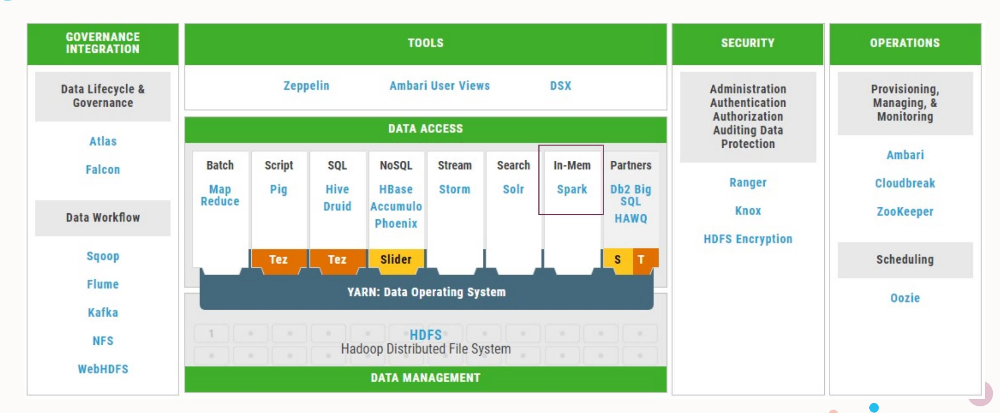

**Spark – A cluster computing framework for large-scale data processing and analytics**

# Apa itu Spark?

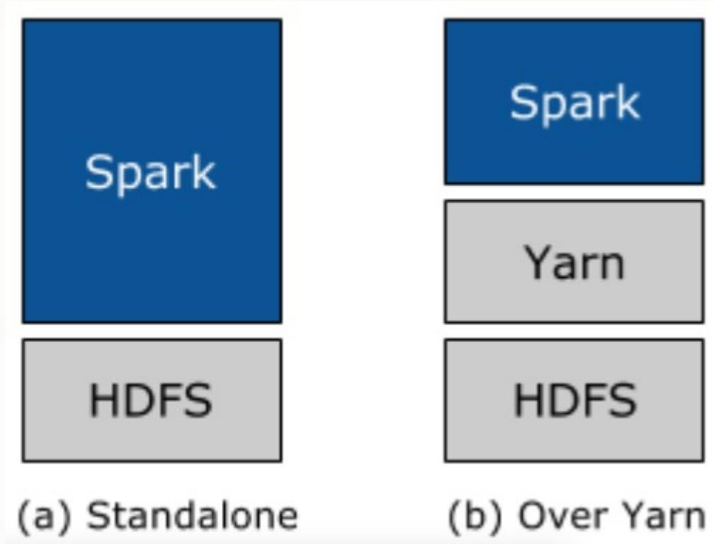

- Apache spark tidak menggunakan MapReduce sebagai *execution engine*.
- Apache Spark menggunakan *distributed runtime* untuk mengeksekusi *job* pada *cluster*.
- Memiliki kemampuan untuk menyimpan *working datasets / intermediate output* di *memory*.
- Dapat berjalan sebagai standalone application atau berjalan di atas Hadoop.
- Menyediakan API dalam beberapa bahasa pemrograman: Scala, Java, Python.
- Menyediakan analytic tools, seperti: Mlib (Machine Learning), Spark Streaming (Stream Processing), Spark SQL (SQL).

# Apache Spark Ecosystem

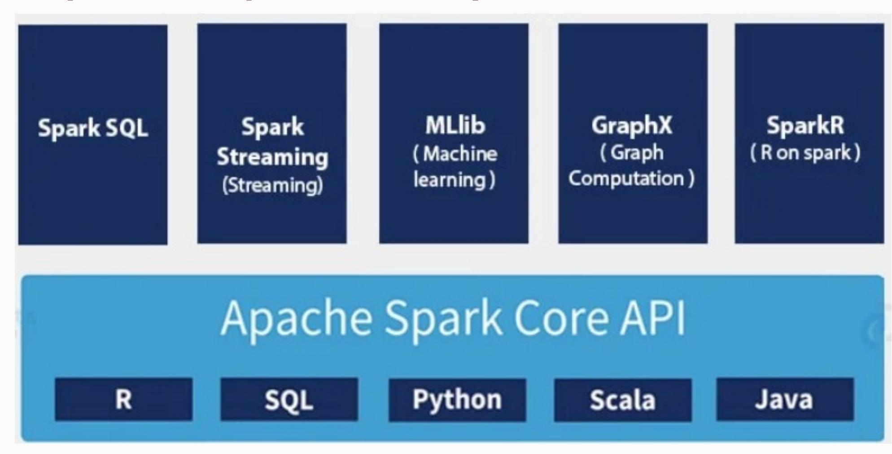

## Features of Spark


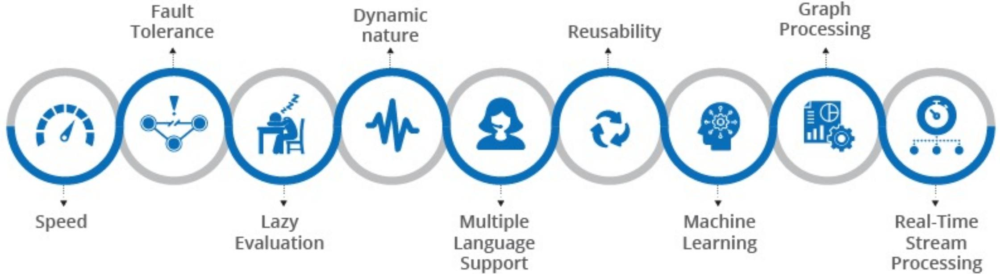

- **Speed**: Spark enables applications running on Hadoop to run up to 100x faster in memory and up to 10x faster on disk. Spark achieves this by minimizing disk read/write operations for intermediate results and storing them in memory and performing disk operations only when essential. Spark achieves this using DAG, query optimizer, and a highly optimized physical execution engine.
- **Fault Tolerance**: Apache Spark achieves fault tolerance using a spark abstraction layer called RDD (Resilient Distributed Datasets), which is designed to handle worker node failure.

- **Lazy Evaluation**: All the processing(transformations) on Spark RDD/Datasets are lazily evaluated, i.e. the output RDD/datasets are not available right away after transformation but will be available only when an action is performed.
- **Dynamic nature**: Spark offers over 80 high-level operators that make it easy to build parallel apps.
- **Multiple Language Support**: Spark provides multiple programming language support and you can use it interactively from the Scala, Python, R, and SQL shells.
- **Reusability**: Spark code can be used for batch-processing, joining streaming data against historical data as well as running ad-hoc queries on the streaming state.

- **Machine Learning**: Apache Spark comes with out-of-the-box support for machine learning called MLib which can be used for complex, predictive data analytics. oAlgorithms for classification, regression, clustering, recommendation, etc
- **Graph Processing**: GraphX is Apache Spark's API for graphs and graph-parallel computation. You can view the same data as both graphs and collections, transform and join graphs with RDDs efficiently, and write custom iterative graph algorithms using the Pregel API. oGraph data: social networks, web graphs, etc

- **Real-Time Stream Processing**: Spark Streaming brings Apache Spark's language-integrated API to stream processing, letting you write streaming jobs the same way you write batch jobs. oApache Kafka, Flume, HDFS, TCP sockets
- **Batch Processing**: Spark SQL allows you to query and analyze structured/semistructured data using SQL syntax or DataFrame and Dataset APIs. oHDFS, Apache Hive, Apache HBase

# Spark vs MapReduce

## MapReduce processing

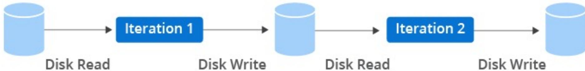

## Spark processing

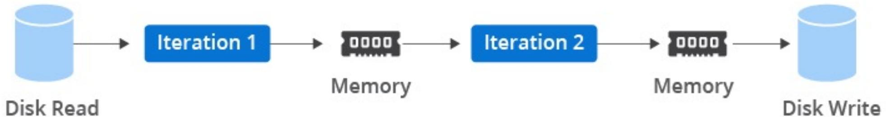

### Spark vs MapReduce

| Topik           | Spark                                             | MapReduce                                                    |
|-----------------|---------------------------------------------------|--------------------------------------------------------------|
| Performance     | Memproses data in-memory                          | Melakukan operasi read/write ke disk selama proses ma/reduce |
| Ease of Use     | Menyediakan pre-builts API untuk Java, Scala, dan |                                                              |
| Data Processing | Real-time processing dan batch processing, serta  |                                                              |

### Spark vs MapReduce

| Topik             | Spark                                                     | MapReduce                                           |
|-------------------|-----------------------------------------------------------|-----------------------------------------------------|
| Security          | Secara default di set “off” sehingga rentan. Namun, Spark |                                                     |
| Cost              | Memory pada spark cluster setidaknya sama dengan jumlah   |                                                     |
| Compatibilitty    | Dapat mengakses berbagai tipe data dan sumber data.       | Dapat mengakses berbagai tipe data dan sumber data. |
| Failure Tolerance | Karena bergantung pada memory, jika terdapat kegagalan    |                                                     |

# Implementasi Spark


Uses Spark Core, Streaming, MLlib and Graphx, and Hadoop to build cost-effective data center solutions for customers in the telecom industry as well as other industrial sectors


Predictive models and learning algorithms to improve the relevance of programmatic marketing


Creates personalized experiences using Spark


Using Spark core for log transaction aggregation and analytics


Using Spark Core, SQL, and Streaming. Product recommendations, BI and analytics, real-time malicious activity filtering, and data mining.

# Resilient Distributed Dataset (RDD)

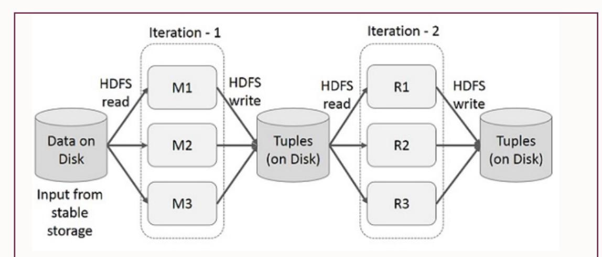

Interactive Operations on Spark RDD

Iterative Operations on Spark RDD Iterative Operations on MapReduce

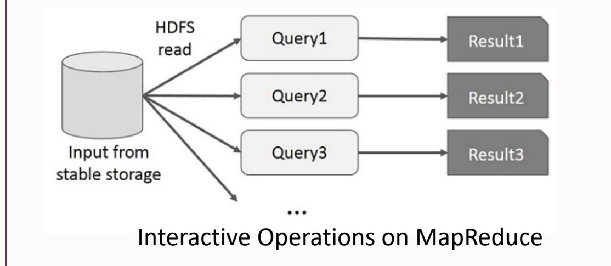

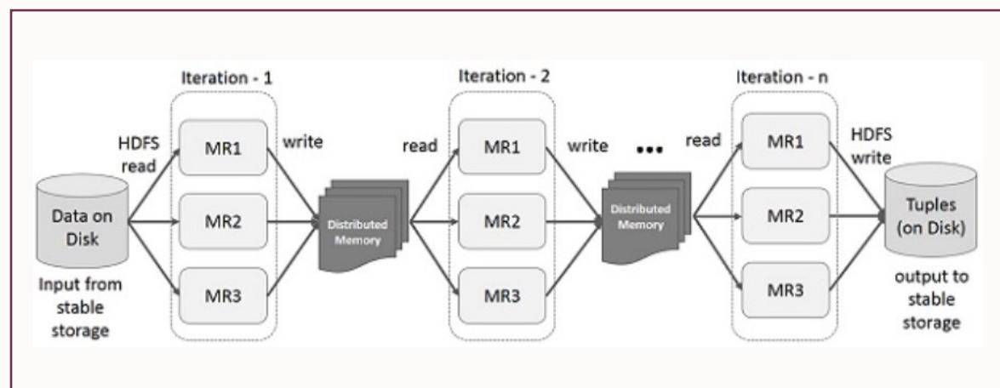

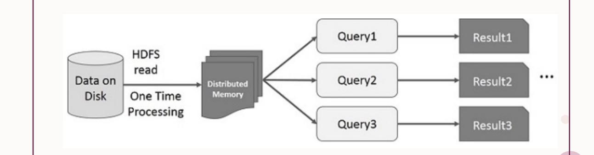

#### Resilient Distributed Dataset (RDD)

**Resilient Distributed Dataset (RDD)** merupakan struktur data dasar Spark dan abstraksi data utama pada Apache Spark dan Spark Core.

§ *Fault-tolerant* § Sekali RDD dibuat, maka tidak dapat diubah (*Immutable distributed collection of objects*) § Setiap dataset terbagi dalam beberapa partisi logical sehingga dapat diproses pada node yang berbeda dalam cluster § Tidak cocok digunakan pada aplikasi yang melakukan update terhadap data § Terdiri dari dua operasi: *transformations* dan *actions*

# Resilient Distributed Dataset (RDD)

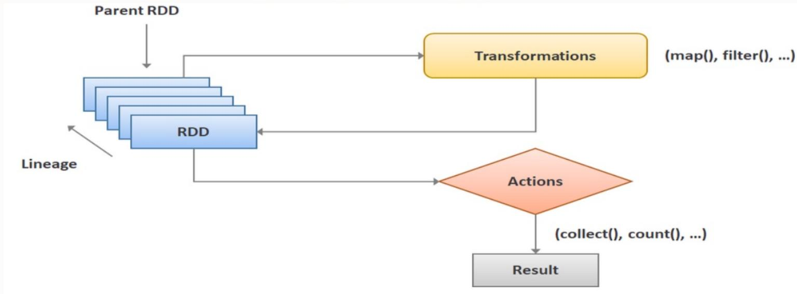

## Lazy evaluation:

- Transformation pada RDD tidak dieksekusi secara langsung saat didefinisikan.
- Spark akan membuat *evaluation plan*.
- Ketika Action dipanggil, Spark akan mengikuti *evaluation plan* dan mengeksekusi transformation yang diperlukan untuk menghasilkan hasil yang diminta.

```
val text = sc.textFile(inputPath)
val lower: RDD[String] = text.map(_.toLowerCase())
lower.foreach(println(_))
```

Transformation (output yang dihasilkan adalah RDD)

### RDD Operations

- 1. flatmap()
- 2. map()
- 3. reduceByKey()
- 4. filter()
- 5. sortByKey()

- 1. count()
- 2. collect()
- 3. first()
- 4. max()
- 5. reduce()

# Bagaimana Spark Menjalankan Job?

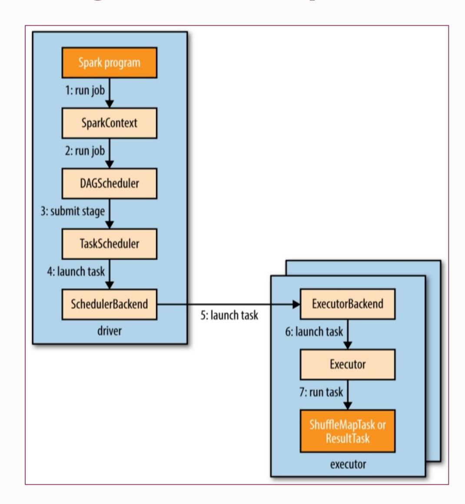

ØSpark Context merupakan entry point ke Spark dan didefinisikan dalam **org.apache.spark package**. ØDigunakan untuk pembuatan RDD, accumulators, dan broadcast variables dalam cluster. ØSecara default Spark Context didefinisikan sebagai variable **sc** dan secara pemrograman dibuat menggunakan SparkContext class.

# Bagaimana Spark Menjalankan Job?

- 1. Spark Job di-submit secara otomatis ketika suatu action dijalankan pada RDD.
- 2. Job yang di-submit tersebut akan dipanggil dalam SparkContext yang kemudian diteruskan ke scheduler sebagai bagian dari driver.
- **3. Scheduler** akan terbagi menjadi dua bagian yaitu DAG scheduler yang memecah job menjadi beberapa tahapan DAG dan task scheduler yang bertanggung jawab untuk submit task dari tiap tahapan di cluster.
- 4. Setiap **task scheduler** mengirim sekumpulan task, pemetaan dari task dan executor akan dilakukan dengan sebelumnya mempertimbangkan daftar executor yang akan berjalan untuk aplikasi tersebut.
- 5. Task akan di-assign ke executor yang berstatus free cores. Task akan terus di-assign hingga keseluruhan task selesai dieksekusi.
- 6. Task yang di-assign akan di-launch melalui **scheduler backend**, yang mana akan mengirim task message ke **executor backend** untuk menjalankan task.

# Bagaimana Spark Menjalankan Job?

- 7. Executor akan memastikan JAR dan file terkait task dalam kondisi terbaru serta melakukan deserilization terhadap task code dan terakhir melakukan eksekusi task. Pengelolaan excutors menjadi tanggung jawab cluster manager (local, standalone, Mesos, Yarn).
- 8. Terdapat dua tipe task yaitu: Ø **Shuffle Map Tasks**: sama halnya dengan proses shuffle pada MapReduce. Setiap shuffle akan melakukan pemrosesan pada satu partisi RDD dan akan menulis hasil pada partisi yang baru. Tahapan shuffle dijalankan pada semua tahapan kecuali pada tahap akhir. Ø **Result Task**: dijalankan saat tahap akhir yang akan mengembalikan output dari Spark program yang di-submit oleh user. Setiap result task berjalan pada partisi RDD, kemudian mengirim hasil melalui driver yang akan menggabungkan setiap hasil dari setiap partisi menjadi hasil final.

# Spark on Yarn

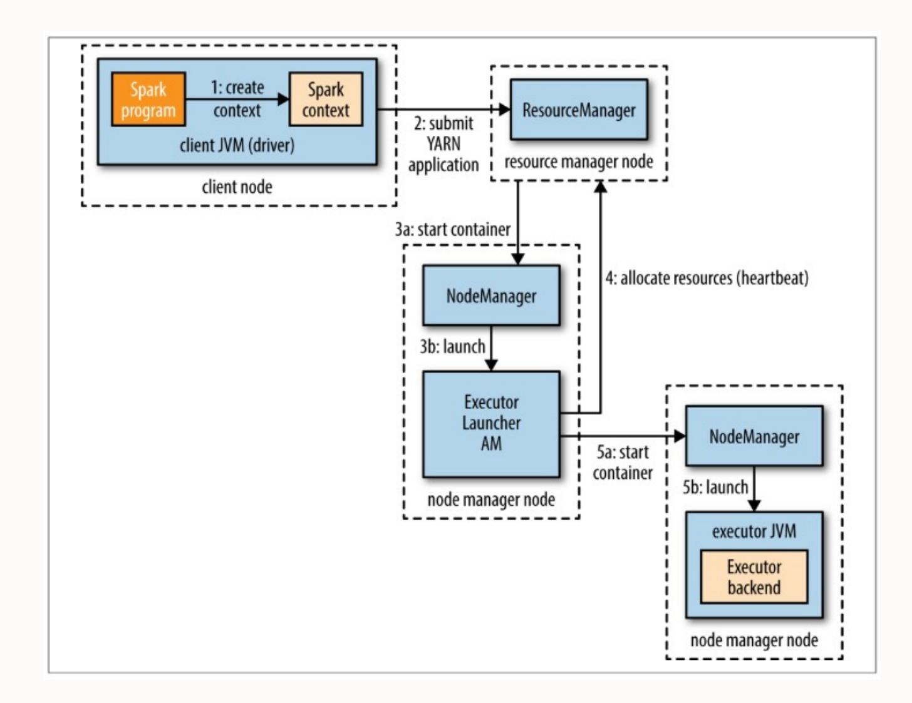

Terdapat dua cara untuk deploy Spark Job:

Ø YARN client mode à driver berjalan di client, membutuhkan interactive component (spark-shell atau pyspark) Ø YARN cluster mode à driver berjalan di YARN application master, sesuai untuk job production

# Contoh Spark (Scala)

```
// "sc" is a "Spark context" - this transforms the file into an RDD
val textFile = sc.textFile("data.txt")
// Return number of items (lines) in this RDD; count() is an action
textFile.count()
// Demo filtering. Filter is a transform. By itself this does no real work
val linesWithSpark = textFile.filter(line => line.contains("Spark"))
// Demo chaining - how many lines contain "Spark"? count() is an action.
textFile.filter(line => line.contains("Spark")).count()
// Length of line with most words. Reduce is an action.
textFile.map(line => line.split(" ").size).reduce((a, b) => if (a > b) a else b)
// Word count - traditional map-reduce. collect() is an action
val word Counts = text File.flatMap(line => line.split(" ")).map(word => (word,
1)).reduceByKey((a, b) => a + b)
word Counts.collect()
```

Spark

```
map(String input_key, String input_value):
// input_key: document name
// input_value: document contents
for each word w in input_value:
EmitIntermediate(w, "1");
reduce(String output_key, Iterator intermediate_values):
// output_key: a word
// output_values: a list of counts
int result = 0;
for each v in intermediate_values:
result += ParseInt(v);
Emit(AsString(result));
```

MapReduce

### How to Start Spark

- Launch Spark Shell

> **spark-shell**

- Run spark statement from shell

//Create RDD from parallelize

**val dataSeq = Seq(("Java", 20000), ("Python", 100000), ("Scala", 3000))** 

**val rdd=spark.sparkContext.parallelize(dataSeq)**

//Create RDD from external Data source

**val rdd2 = spark.sparkContext.textFile("/path/textFile.txt")**

# Spark Session

```
// Create SparkSession object
import org.apache.spark.sql.SparkSession
object SparkSessionTest extends App {
  val spark = SparkSession.builder()
    .master("local[1]")
    .appName("SparkByExamples.com")
    .getOrCreate();
  println(spark)
  println("Spark Version : "+spark.version)
}// Outputs
//org.apache.spark.sql.SparkSession@2fdf17dc
//Spark Version : 3.2.1
```

```
// Get existing SparkSession
import org.apache.spark.sql.SparkSession
val spark2 = SparkSession.builder().getOrCreate()
print(spark2)// Outputs
// org.apache.spark.sql.SparkSession@2fdf17dc
```

```
SparkSession.builder() -
Return SparkSession.Builder class.
```

```
master() - If you are running it on the cluster you need to use
your master name as an argument to master(). usually, it would
be either yarn or mesos depends on your cluster setup.
```

```
appName() - Sets a name to the Spark application that shows
in the Spark web UI. If no application name is set, it sets a
random name.
```

```
getOrCreate() - This returns a SparkSession object if already
exists. Creates a new one if not exist.
```

# DataFrame dan SQL Spark

```
val data = Seq(('James','','Smith','1991-04-01','M',3000),
                                                ('Michael','Rose','','2000-05-19','M',4000),
                                                ('Robert','','Williams','1978-09-05','M',4000),
                                                ('Maria','Anne','Jones','1967-12-01','F',4000),
                                                ('Jen','Mary','Brown','1980-02-17','F',-1)
)val columns = Seq("firstname","middlename","lastname","dob","gender","salary")
df = spark.createDataFrame(data), schema = columns).toDF(columns:_*)
```

Menggunakan dataframe

Menggunakan SQL Spark

```
df.createOrReplaceTempView("PERSON_DATA")
val df2 = spark.sql("SELECT * from PERSON_DATA")
df2.printSchema()
df2.show()
```

### Spark Streaming

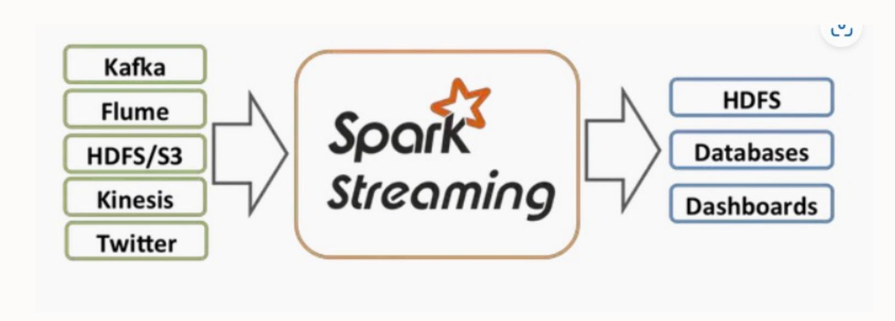

Apache Spark Streaming:

Ø Scalable Ø High-throughput Ø Fault-tolerant Ø Support batch and streaming workloads Ø Terkoneksi dengan sumber data, seperti Kafka, Flume, HDFS, dll

# Spark Streaming

```
buntu@namenode:~/kafka$ bin/kafka-console-producer.sh --broker-list localhost:9092 --topic json_topic
>{"id":1,"firstname":"James ","middlename":"","lastname":"Smith","dob_year":2018,"dob_month":1,"gender":"M","salary":3000}
>{"id":2,"firstname":"Michael ","middlename":"Rose","lastname":"","dob_year":2010,"dob_month":3,"gender":"M","salary":4000}
>{"id":3,"firstname":"Robert ","middlename":"","lastname":"Williams","dob_year":2010,"dob_month":3,"gender":"M","salary":4000}
>{"id":4,"firstname":"Maria ","middlename":"Anne","lastname":"Jones","dob_year":2005,"dob_month":5,"gender":"F","salary":4000}
>{"id":5,"firstname":"Jen","middlename":"Mary","lastname":"Brown","dob_year":2010,"dob_month":7,"gender":"","salary":-1}
>
```

```
val df = spark.readStream
    .format("kafka")
    .option("kafka.bootstrap.servers", "192.168.1.100:9092")
    .option("subscribe", "json_topic")
    .option("startingOffsets", "earliest") // From starting
    .load()df.printSchema()
```

### Spark Web UI

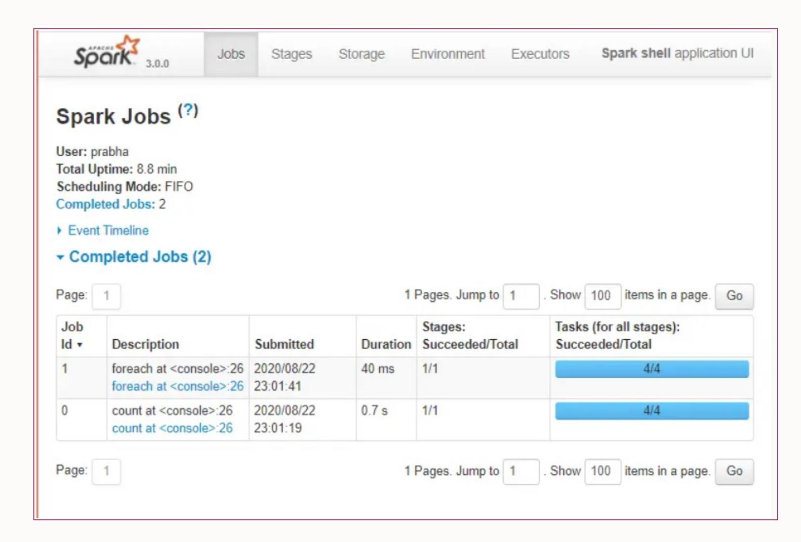

Apache Spark menyediakan WEB UI untuk memantau status dari Spark Application, penggunaan resource pada Spark Cluster, dan konfigurasi Spark serta bagaimana eksekusi job dilakukan.

http://<spark\_application\_master>:404 0

# TERIMA KASIH

# Terima kasih