### Data Warehouse

Pertemuan 4 - Teknologi Perekayasaan Data

Politeknik Statistika STIS

Siti Mariyah, Ph.D

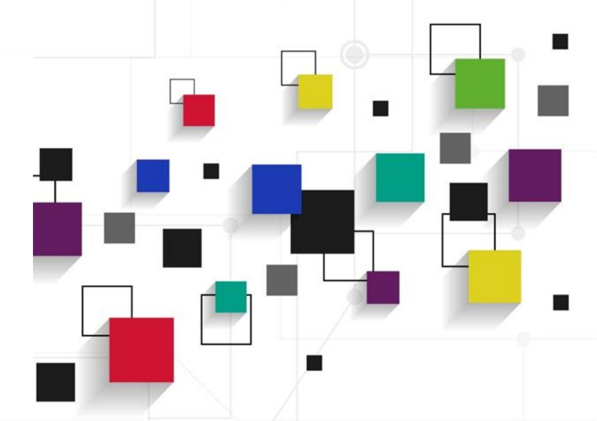

### Outline

- 1. Konsep Data Warehouse
- 2. Arsitektur Data Warehouse
- 3. Data mart, Enterprise Data Warehouse
- 4. Dimensional Model
- 5. OLAP

### Latar Belakang

- Pada awalnya, perusahaan menggunakan sistem database tradisional (OLTP *Online Transaction Processing*) untuk menangani transaksi harian seperti penjualan, pembelian, dan inventaris.
- Sistem ini dirancang untuk operasi cepat dan efisien, tetapi tidak optimal untuk analisis data yang membutuhkan query kompleks dan agregasi data.
- Data tersebar di berbagai sistem yang terisolasi (*silo*) dengan format berbeda. Terkadang data tidak konsisten, duplikat, atau tidak lengkap.
- Keterbatasan dalam analisis data yaitu sulit untuk melakukan analisis *cross-functional* atau melihat gambaran besar (*big picture*) dari data.

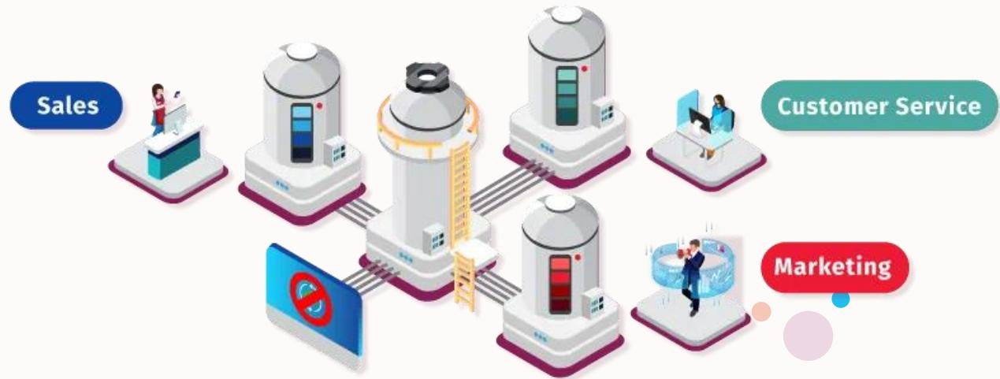

# Kebutuhan Penyimpanan Terpusat

- Perusahaan mulai menyadari pentingnya data sebagai aset strategis untuk mengambil keputusan yang lebih baik.
- Database tradisional hanya menyimpan data saat ini (*current data*), sementara perusahaan membutuhkan data historis untuk analisis tren dan prediksi.
- Dengan perkembangan teknologi, volume data yang dihasilkan oleh perusahaan meningkat secara eksponensial. Data tidak hanya berasal dari transaksi internal, tetapi juga dari sumber eksternal seperti media sosial, sensor IoT, dan lainnya.
- **Perusahaan membutuhkan solusi untuk menyimpan data dalam jumlah besar secara terpusat dan terstruktur.**

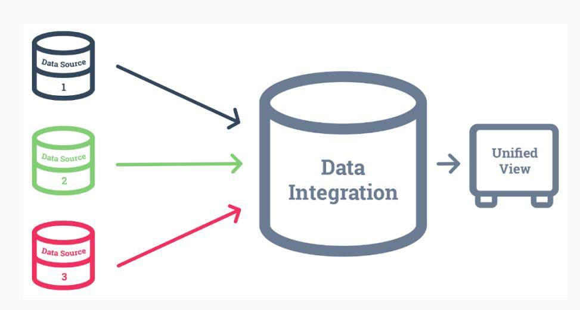

## Konsep Data Warehouse

- Konsep Data Warehouse pertama kali diperkenalkan oleh **Bill Inmon** pada tahun 1990. Inmon mendefinisikan Data Warehouse sebagai:

**"A subject-oriented, integrated, non-volatile, and time-variant collection of data in support of management's decisions."**

#### o **Subject-Oriented**

- Data Warehouse dirancang untuk menyediakan informasi yang berfokus pada subjek atau tema tertentu yang relevan bagi bisnis, seperti penjualan, pelanggan, produk, atau keuangan.
- Jika subjeknya adalah "penjualan", maka Data Warehouse akan menyimpan data terkait penjualan seperti jumlah transaksi, revenue, lokasi penjualan, dan produk yang terjual.

#### o **Integrated**

- Data Warehouse mengintegrasikan data dari berbagai sumber yang berbeda (seperti database, aplikasi, atau file) ke dalam format yang konsisten dan terstandarisasi.
- Menghilangkan silo data dan memastikan konsistensi data.

#### o **Non-Volatile**

- Data yang disimpan dalam Data Warehouse tidak diubah atau dihapus setelah dimasukkan. Data hanya bisa dibaca (*readonly*) dan diperbarui melalui proses tambahan (*append-only*).
- Data Warehouse dirancang untuk analisis historis, sehingga data harus tetap stabil dan tidak berubah untuk memastikan konsistensi dan keakuratan analisis.

#### o **Time-Variant**

- Data Warehouse menyimpan data dalam konteks waktu, artinya data dicatat dengan informasi waktu (timestamp) yang memungkinkan analisis historis dan tren.
- Contohnya data penjualan disimpan dengan informasi tanggal, sehingga perusahaan dapat menganalisis tren penjualan bulanan, tahunan, atau perbandingan antar periode.

### Manfaat Implementasi Data Warehouse

#### • **Return on Investment (ROI) yang Tinggi**

- Organisasi perlu mengalokasikan sumber daya yang besar untuk memastikan implementasi Data Warehouse yang sukses.
- Studi oleh International Data Corporation (IDC): Proyek Data Warehouse memberikan ROI rata-rata 401% dalam 3 tahun (IDC, 1996). Tools analitik yang mengakses Data Warehouse memberikan ROI rata-rata 431% dalam 1 tahun (IDC, 2002).

#### • **Keunggulan Kompetitif**

- ROI yang tinggi bagi perusahaan yang sukses mengimplementasikan Data Warehouse menunjukkan keunggulan kompetitif yang signifikan.
- Keunggulan ini diperoleh dengan memberikan akses kepada pengambil keputusan ke data yang dapat mengungkap informasi yang sebelumnya tidak tersedia, tidak diketahui, atau belum dimanfaatkan.

#### • **Peningkatan Produktivitas Pengambil Keputusan**

- Meningkatkan produktivitas pengambil keputusan dengan menyediakan database terintegrasi yang berisi data historis, konsisten, dan berorientasi pada subjek.

### Data Warehouse sebagai Single Source of Truth (SSoT)

- Menyediakan satu sumber kebenaran (*single source of truth*) untuk data perusahaan
- Memungkinkan query kompleks dan analisis data historis
- Mampu menangani volume data yang besar dan terus bertambah

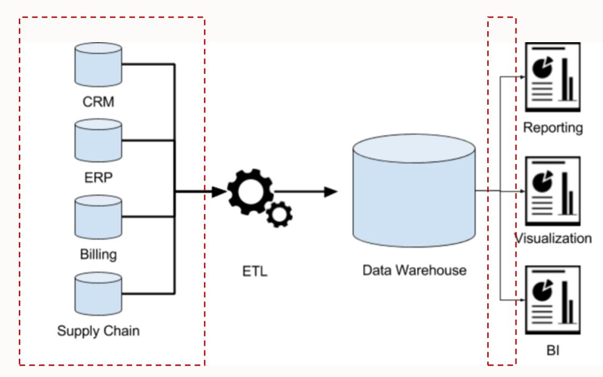

**OLTPs (Online Transaction Processing) OLAPs (Online Analytical Processing)**

## OLTP vs OLAP

| Karakteristik Sistem OLTP                                                |                      | Data Warehouse + Sistem |            | OLAP      |                |                               |
|--------------------------------------------------------------------------|----------------------|-------------------------|------------|-----------|----------------|-------------------------------|
| Tujuan Utama Mendukung pemrosesan operasional                            | Mendukung            |                         | pemrosesan | analitis  |                |                               |
| Usia Data Data saat ini ( current )                                      |                      |                         |            |           |                |                               |
|                                                                          | Data historis        | (namun                  | tren       | sekarang  | juga           | mencakup data                 |
| saat                                                                     | ini)                 |                         |            |           |                |                               |
| Latensi Data Real-time                                                   | Tergantung           | pada                    | siklus     | pengisian | data ke        | warehouse                     |
| (namun                                                                   | tren                 | mengarah                | pada       |           | data real-time | )                             |
| Granularitas Data Data detail                                            |                      | Data detail, ringkasan  | data (     |           |                | lightly and highly summarized |
| data                                                                     | )                    |                         |            |           |                |                               |
| Pemrosesan Data Pola pemrosesan untuk insert, delete, update, dan query. |                      |                         |            |           |                |                               |
| Tingkat throughput transaksi yang tinggi.                                |                      |                         |            |           |                |                               |
| Pola                                                                     |                      | query yang kurang       |            | dapat     | diprediksi.    | Tingkat                       |
|                                                                          | throughput transaksi |                         | sedang     |           | hingga         | rendah.                       |
| Pelaporan Pelaporan yang dapat diprediksi, satu dimensi, dan relatif     |                      |                         |            |           |                |                               |
|                                                                          | Pelaporan            | yang tidak              | dapat      |           |                | diprediksi, multidimensi, dan |
| Pengguna Melayani sejumlah besar pengguna operasional                    |                      |                         |            |           |                |                               |
|                                                                          | Melayani             | sejumlah                | kecil      | pengguna  |                | manajerial (namun tren        |
| juga                                                                     | mengarah             | pada                    | dukungan   |           | kebutuhan      | analitis                      |
|                                                                          | pengguna             | operasional)            |            |           |                |                               |

### Arsitektur Data Warehouse

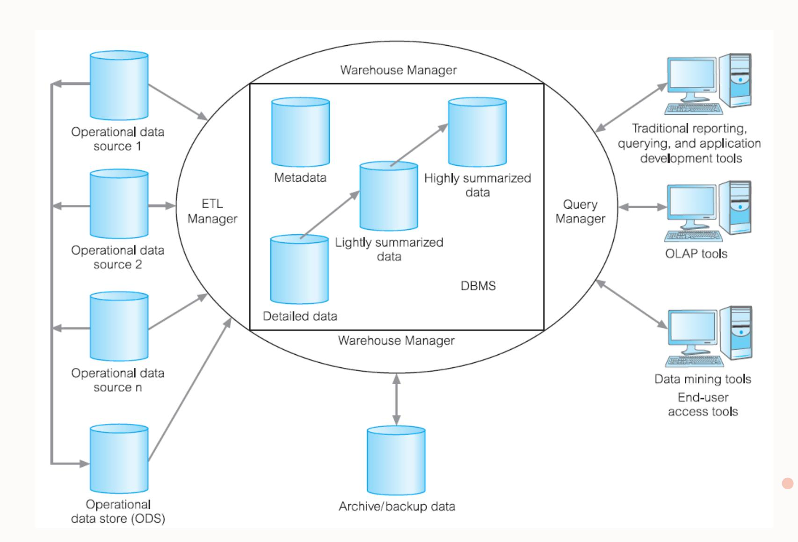

## Arsitektur Data Warehouse

- **Operational Data Sources**: Sistem atau aplikasi yang menghasilkan data transaksional, seperti database OLTP, aplikasi CRM, atau ERP. Menyediakan data mentah yang akan diintegrasikan ke dalam Data Warehouse.
- **ETL Manager**: Proses ETL (Extract, Transform, Load) digunakan untuk mengambil data dari sumber operasional, membersihkannya, dan memuatnya ke dalam Data Warehouse.
- **Data Staging Area (Operational Data Store):** Penyimpanan sementara yang menyimpan data terintegrasi dari berbagai sumber sebelum dimuat ke Data Warehouse. Menyediakan data yang sudah dibersihkan dan diintegrasikan untuk digunakan dalam proses lebih lanjut.
- **Data Warehouse**: Area penyimpanan data dalam Data Warehouse, yang mencakup:
  - *Detailed Data*: Data mentah yang belum diringkas.
  - *Lightly Summarized Data*: Data yang sudah diringkas pada tingkat tertentu.
  - *Highly Summarized Data*: Data yang sudah diringkas pada tingkat tinggi.

- **Metadata**: Data tentang data, yang menjelaskan struktur, sumber, dan makna data dalam Data Warehouse. Contoh: Informasi tentang sumber data, format data, atau aturan transformasi.
- **Archive/Backup Data**: Data yang diarsipkan atau dicadangkan untuk keperluan pemulihan atau analisis historis.
- **End-User Access Tools**: *Tools* yang digunakan oleh pengguna akhir untuk mengakses, menganalisis, dan memvisualisasikan data dari Data Warehouse. o **OLAP Tools**: *Tools* yang digunakan untuk menganalisis data dari Data Warehouse secara interaktif dan multidimensi. o **Data Mining Tools**: *Tools* yang digunakan untuk mengekstrak pola dan pengetahuan dari data dalam Data Warehouse.

## *Tools* dan Teknologi Data Warehouse

- **ETL Tools**: Informatica PowerCenter, Talend, Microsoft SSIS (SQL Server Integration Services), Apache NiFi, dll o *Extract*: Mengambil data dari sumber. o *Transform*: Membersihkan dan mengubah data. o *Load*: Memuat data ke Data Warehouse.
- **Database Management Systems (DBMS)**: Amazon Redshift, Google BigQuery, Snowflake, Microsoft SQL Server, Oracle Database, dll
- **OLAP Tools**: Microsoft Analysis Services (SSAS), IBM Cognos, SAP BusinessObjects, Pentaho OLAP, dll
- **Data Visualization and Reporting Tools**: Tableau, Power BI, QlikView, Looker, dll
- **Data Mining and Advanced Analytics Tools**: IBM SPSS, RapidMiner, KNIME, Python (dengan library seperti Pandas, scikit-learn)

### Data Mart

- **Data Mart** adalah subset dari Data Warehouse yang dirancang khusus untuk memenuhi kebutuhan analitis departemen atau unit bisnis tertentu dalam suatu organisasi.
- Repositori data yang berfokus pada subjek tertentu atau area bisnis tertentu, seperti penjualan, keuangan, atau pemasaran.
- Lebih kecil dan lebih spesifik dibandingkan Data Warehouse. Terbatas pada departemen atau area bisnis tertentu.

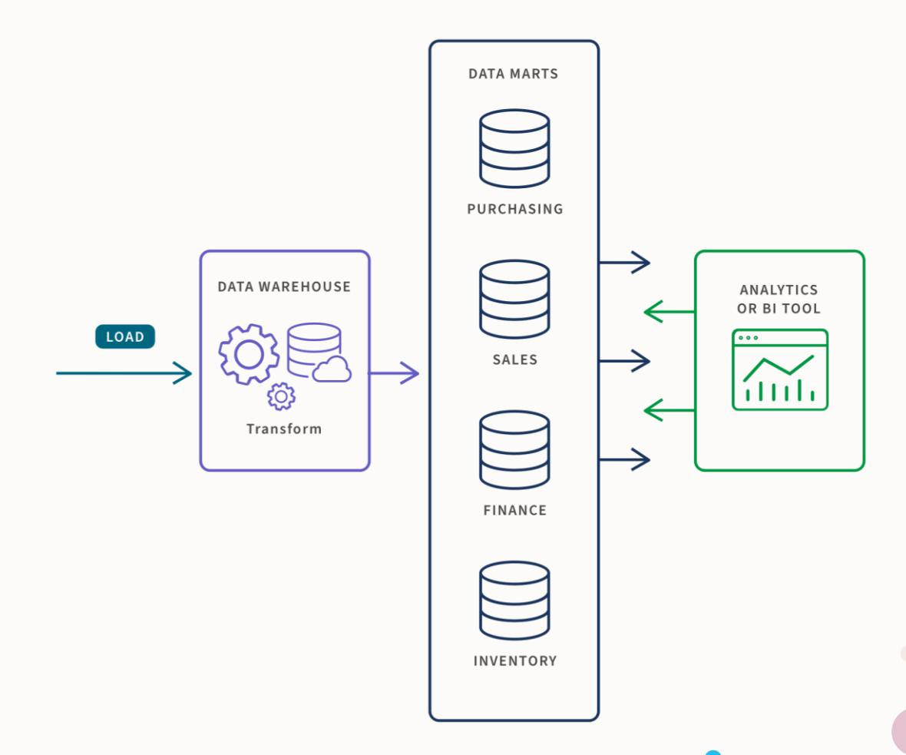

## Mengapa Data Mart?

- Memberikan akses ke data yang sering dibutuhkan
- Menyediakan data yang sesuai dengan kebutuhan pengguna
- Meningkatkan waktu respon pengguna akhir
- Menyediakan data yang terstruktur dengan tepat
- Proses ETL yang lebih sederhana
- Biaya implementasi yang lebih rendah
- Pengguna yang lebih terdefinisi dengan jelas dalam proyek Data Mart dibandingkan dengan proyek EDW (Enterprise Data Warehouse)

### Pembangunan (Enterprise) Data Warehouse

#### **Pendekatan Kimball (***Bottom-up)*

o Dimulai dengan pembangunan Data Mart yang berfokus pada kebutuhan bisnis spesifik, kemudian menggabungkannya ke dalam Enterprise Data Warehouse (EDW) o Lebih cepat o Biaya lebih rendah

#### **Pendekatan Inmon (***Top-down)*

o Dimulai dengan membangun Enterprise Data Warehouse (EDW) yang terintegrasi untuk seluruh organisasi, kemudian mengembangkan Data Mart dari EDW. o Lebih lambat karena memerlukan pembangunan EDW terlebih dahulu. o Biaya lebih tinggi.

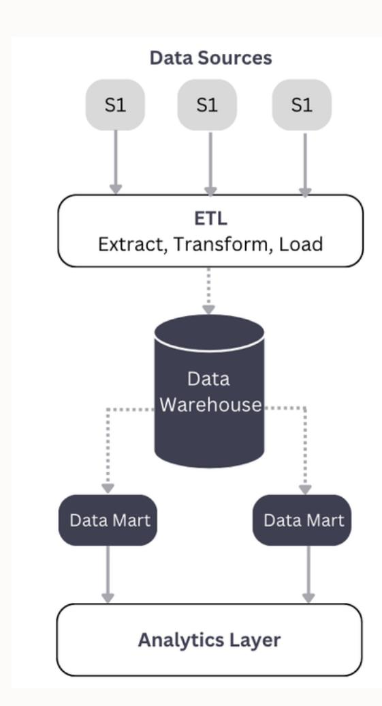

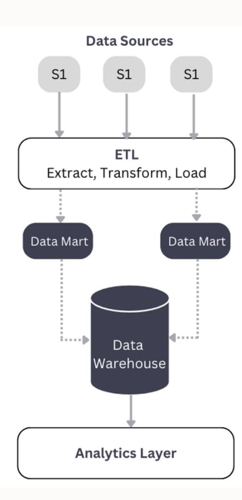

# Data Warehouse Project (Kimball Lifecycle)

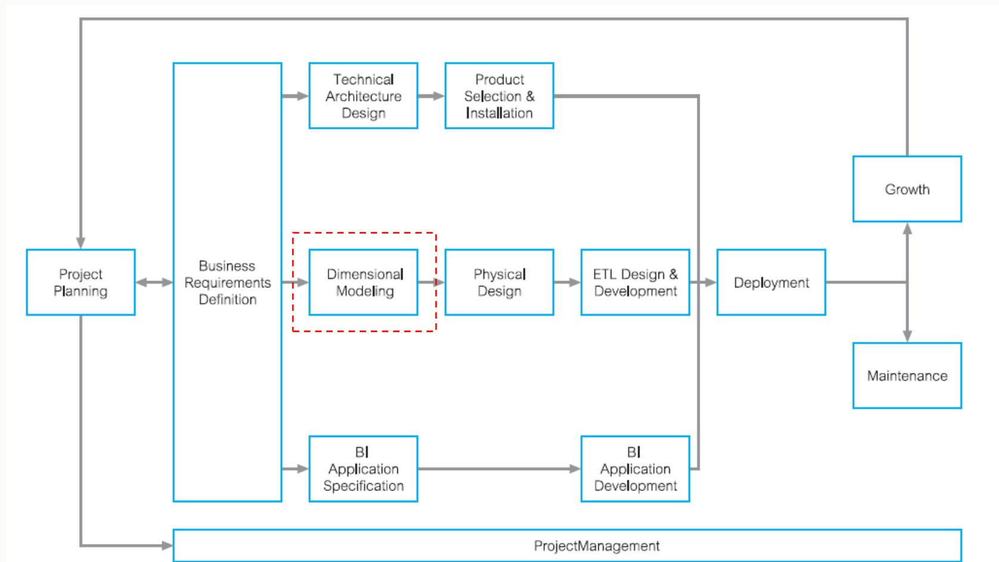

**Figure 32.1** The stages of Kimball's Business Dimensional Lifecycle (Kimball, 2008).

## Dimensional Modeling

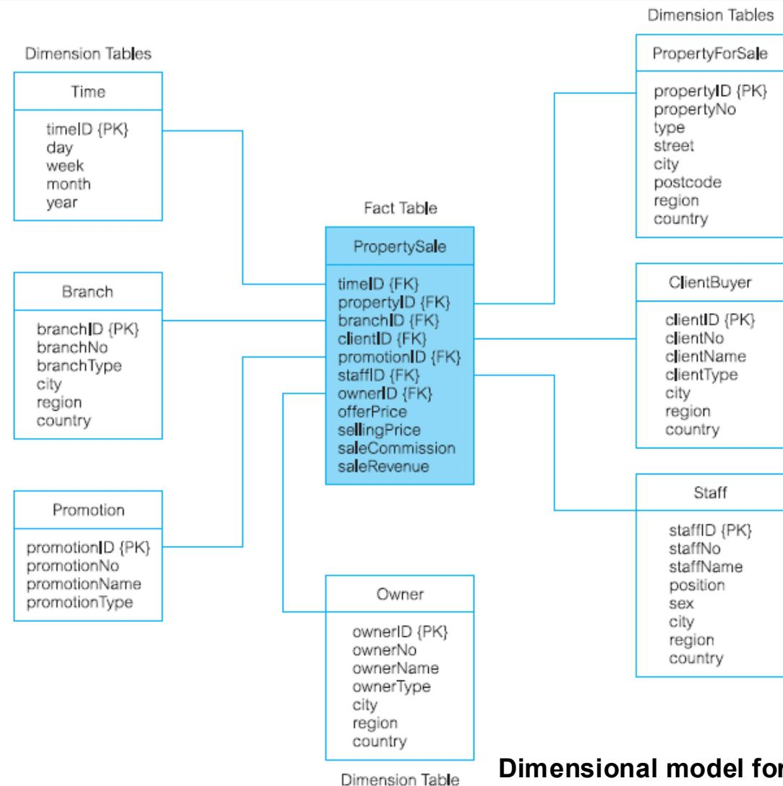

#### **Fact Table:**

- Tabel utama yang memiliki **composite primary key**.
- Berisi data numerik (*measures*) yang akan dianalisis, seperti jumlah penjualan atau pendapatan.

#### **Dimension Tables:**

- Tabel-tabel kecil yang memiliki **simple primary key**.
- Berisi data deskriptif yang memberikan konteks pada data di fact table, seperti informasi waktu, lokasi, atau produk.

**Setiap komponen dari composite key di fact table adalah foreign key yang merujuk ke primary key di dimension table.**

**Surrogate Key:** Kunci buatan (biasanya berupa integer) yang menggantikan natural key (kunci alami) dalam dimension table.

#### **Manfaat Surrogate Key:**

- Memberikan independensi antara data warehouse dan sistem OLTP.
- Memudahkan manajemen perubahan data historis.

## Model Data Dimensional

#### • **Star Schema**

o Model data dimensional dengan **fact table** di tengah, dikelilingi oleh **dimension tables yang denormalized**. o Denormalisasi, performa tinggi, mudah dipahami.

#### • **Snowflake Schema**

o Model data dimensional dengan fact table di tengah, dikelilingi oleh **dimension tables yang normalized**. o Normalisasi, Kompleksitas Lebih Tinggi, Penghematan Ruang Penyimpanan.

### • **Starflake/Galaxy Schema**

o Model data dimensional dengan **fact table** di tengah, dikelilingi oleh **dimension tables yang sebagian normalized dan sebagian denormalized**. o Menggabungkan keuntungan dari star schema (performansi) dan snowflake schema (penghematan ruang). o Cocok untuk skenario di mana beberapa dimension tables perlu di-normalisasi, sementara yang lain tetap denormalisasi (lebih fleksibel).

# Star vs Snowflake

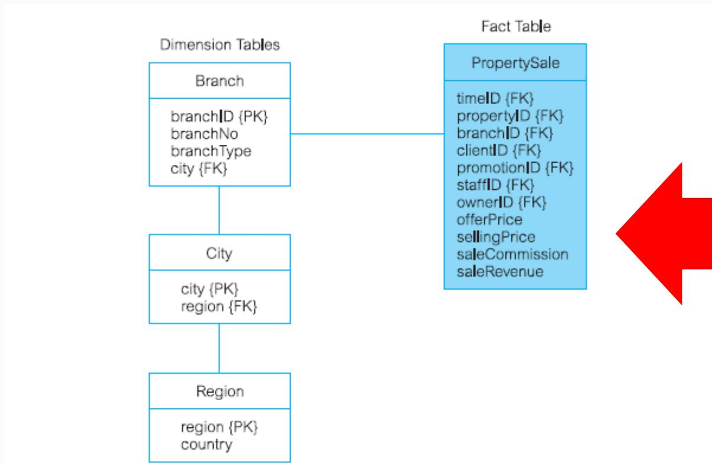

**Figure 32.3** Part of star schema (dimensional model) for property sales of *DreamHome* with a normalized version of the Branch dimension table.

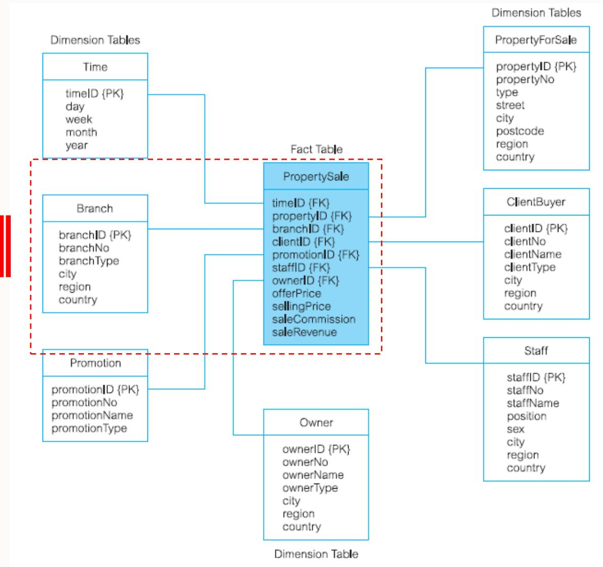

### Contoh 2 dimensional model (data marts)

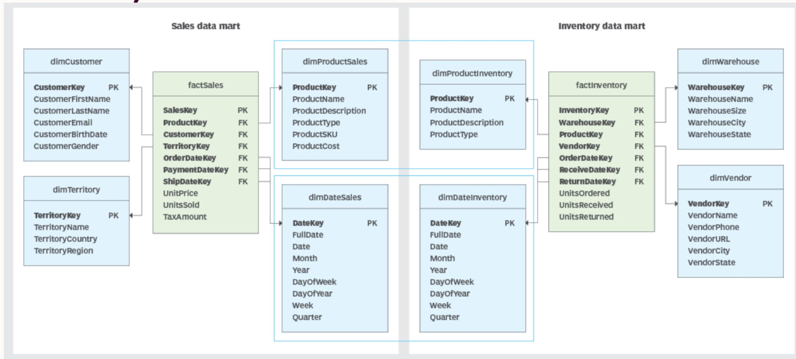

**Conformed Dimensions** adalah dimensi yang **konsisten** dan **dapat digunakan kembali** di seluruh Data Mart atau Data Warehouse.

## Contoh conformed dimensions

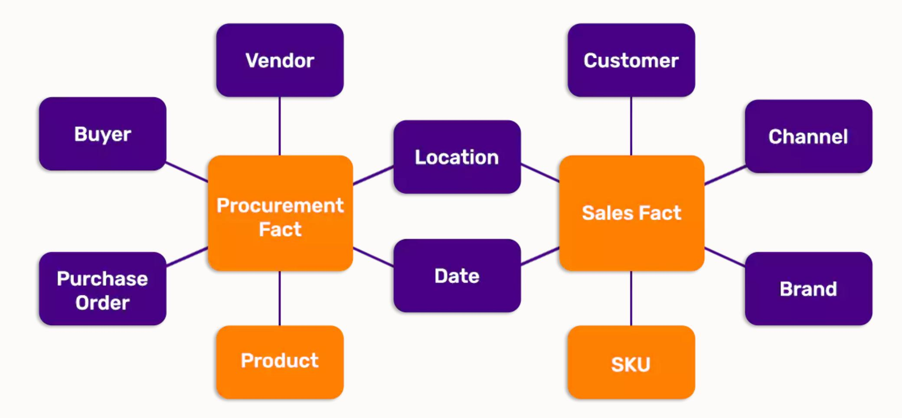

**Mana yang merupakan conformed dimensions?**

# Tahapan dalam Dimensional Modeling

### **1. Create a High-Level Dimensional Model**

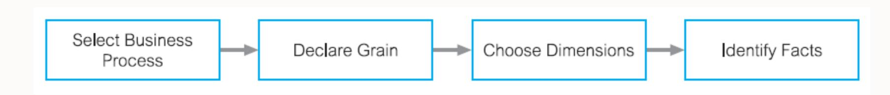

#### **Step 1: Select Business Process**

▪ Proses bisnis merujuk pada subjek atau area bisnis tertentu yang akan menjadi fokus Data Mart. ▪ Kriteria pemilihan: dapat diselesaikan tepat waktu, sesuai anggaran, menjawab pertanyaan bisnis yang penting. ▪ Data Mart pertama harus menciptakan **conformed dimensions** (dimensi yang konsisten) yang dapat digunakan kembali di Data Mart lainnya.

- • Contoh menggunakan **DreamHome** dengan proses bisnis dipilih adalah **Property Sales**

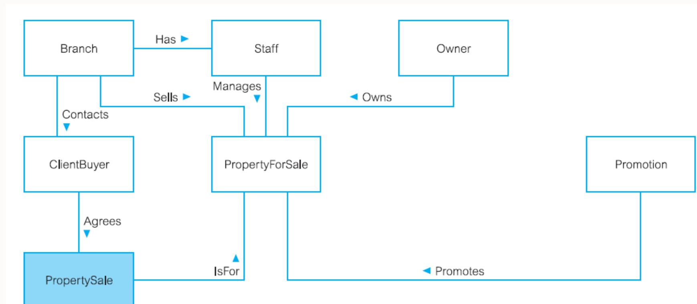

**Figure 32.6** Part of ER model in Figure 32.5 that represents the data requirements of the property sales business process of *DreamHome*.

#### **Step 2: Declare Grain**

▪ **Grain** adalah tingkat detail atau granularitas yang menentukan apa yang diwakili oleh satu record di fact table. ▪ Grain harus menyeimbangkan antara kebutuhan bisnis dan ketersediaan data. ▪**Rekomendasi**: Gunakan tingkat detail terendah yang tersedia untuk memastikan fleksibilitas analisis.

#### **Step 3: Choose Dimensions**

▪Dimensi mendeskripsikan "siapa, apa, kapan, di mana, dan bagaimana" terkait dengan fakta.

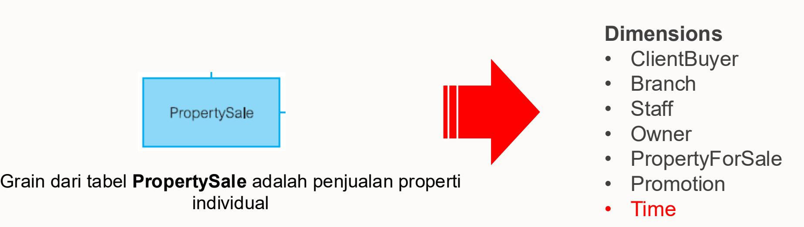

#### **Step 4: Identify Facts**

- ▪ **Facts** adalah data numerik yang diukur dan dianalisis dalam fact table. ▪ Facts mewakili metrik bisnis, seperti penjualan, pendapatan, atau jumlah transaksi. ▪ **Kriteria:** 
  - **Numerik:** berupa data numerik yang dapat dihitung atau diukur.
  - **Additif:** harus dapat diagregasi (ditambahkan) di seluruh dimensi.
  - **Konsisten dengan Grain:** Semua facts harus sesuai dengan tingkat detail (grain) yang telah ditentukan untuk fact table.

### **Contoh Salah**

- promotionName (non-numerik)
- staffName (non-numerik)
- monthlyRent (non-additif)
- lastYearRevenue (grain tidak konsisten)

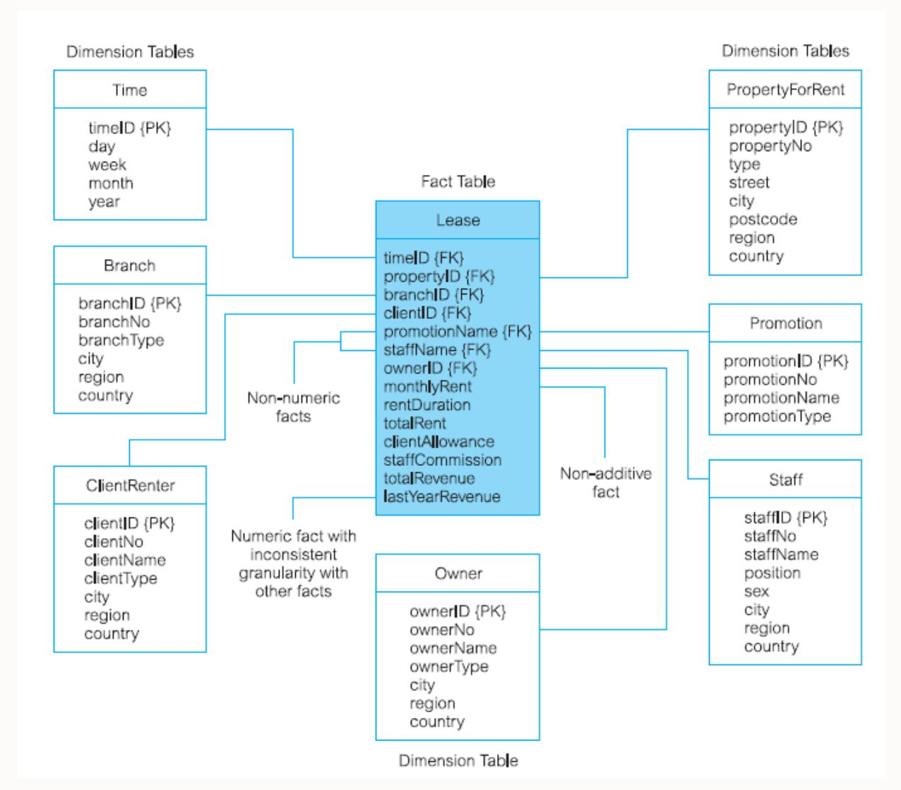

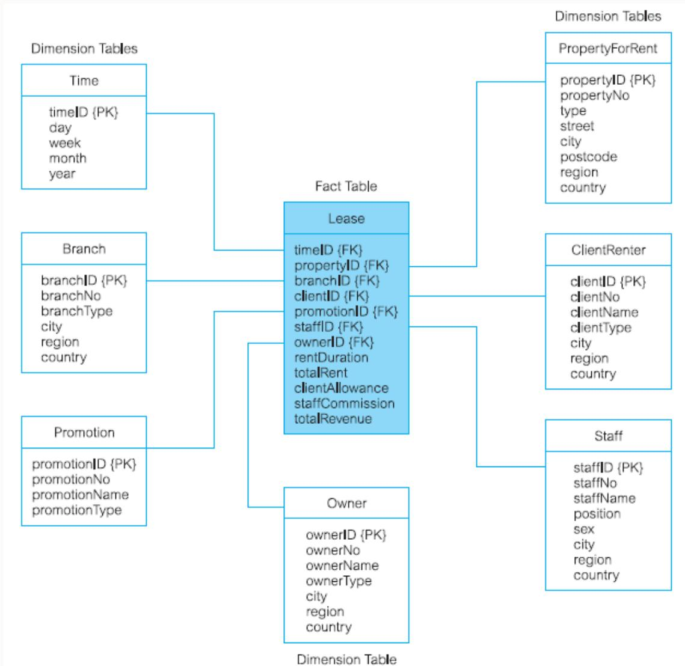

# Contoh Benar

### **2. Identify All Dimension Attributes for the Dimensional Model**

- Analisis Kebutuhan Bisnis: Atribut ditambahkan berdasarkan kebutuhan bisnis yang diidentifikasi selama tahap analisis.
- Contoh: Untuk dimensi **ClientBuyer**, atribut yang ditambahkan mungkin yaitu **clientID, clientNo, clientName, clientType, city, region, country**.

#### **Pertimbangan tambahan dalam Modeling:**

- **Durasi Database**: Menentukan berapa lama data akan disimpan dalam Data Mart. ➢ Berdasarkan kebutuhan bisnis atau aturan hukum misalnya beberapa perusahaan perlu melihat data dari periode satu atau dua tahun sebelumnya, Industri seperti asuransi mungkin diwajibkan menyimpan data selama lima tahun atau lebih.
- **Slowly Changing Dimensions (SCD):** Dimensi yang atributnya berubah seiring waktu, seperti alamat pelanggan atau kategori produk.

**>>> Implementasi Data Mart**

# Slowly Changing Dimensions (SCD)

- **Slowly Changing Dimension (SCD)** adalah konsep dalam data warehousing yang mengacu pada dimensi yang atributnya berubah seiring waktu.
- Perubahan ini terjadi secara perlahan (*slowly*) dan perlu dikelola dengan hati-hati untuk memastikan bahwa data historis tetap akurat dan dapat dianalisis dengan benar.

### **Jenis-Jenis Slowly Changing Dimensions (SCD)**

▪ **SCD Tipe 1: Overwrite** → Nilai lama diganti dengan nilai baru tanpa menyimpan riwayat perubahan. ▪ **SCD Tipe 2: Add New Row** → Setiap perubahan menambahkan record baru ke dimensi, sehingga riwayat perubahan disimpan. ▪ **SCD Tipe 3: Add New Column** → Kolom baru ditambahkan ke dimensi untuk menyimpan nilai lama dan baru.

# Contoh Slowly Changing Dimensions (SCD)

## Type 1: Update Changes

| Supplier_Key | Supplier_Code | Supplier_Name  | Supplier_State |
|--------------|---------------|----------------|----------------|
| 123          | ABC           | Acme Supply Co | CA             |

| Supplier_Key | Supplier_Code | Supplier_Name  | Supplier_State |
|--------------|---------------|----------------|----------------|
| 123          | ABC           | Acme Supply Co | IL             |

## Type 2: Keep Historical

| Supplier_Key | Supplier_Code | Supplier_Name  | Supplier_State | Start_Date  | End_Date    |
|--------------|---------------|----------------|----------------|-------------|-------------|
| 123          | ABC           | Acme Supply Co | CA             | 01-Jan-2000 | 21-Dec-2004 |
| 124          | ABC           | Acme Supply Co | IL             | 22-Dec-2004 |             |

## Type 3: Preserve Limited History

| Supplier_Key | Supplier_Code | Supplier_Name  | Original_Supplier_State | Effective_Date | Current_Supplier_State |
|--------------|---------------|----------------|-------------------------|----------------|------------------------|
| 123          | ABC           | Acme Supply Co | CA                      | 22-Dec-2004    | IL                     |

### Implementasi dan Integrasi Data Marts membentuk EDW

- Setelah dimensional model disetujui, Data Mart diimplementasikan dan diintegrasikan untuk membentuk EDW.
- Data Mart pertama akan mendukung analisis proses bisnis tertentu (misalnya, penjualan properti).
- Data Mart ini akan diintegrasikan dengan Data Mart lainnya untuk membentuk EDW.

| <b>BUSINESS PROCESS</b> | <b>FACT TABLE</b>   | <b>DIMENSION TABLES</b>                                                   |
|-------------------------|---------------------|---------------------------------------------------------------------------|
| Property sales          | PropertySale        | Time, Branch, Staff, PropertyForSale, Owner, ClientBuyer, Promotion       |
| Property rentals        | Lease               | Time, Branch, Staff, PropertyForRent, Owner, ClientRenter, Promotion      |
| Property viewing        | PropertyViewing     | Time, Branch, PropertyForSale, PropertyForRent, ClientBuyer, ClientRenter |
| Property advertising    | Advert              | Time, Branch, PropertyForSale, PropertyForRent, Promotion, Newspaper      |
| Property maintenance    | PropertyMaintenance | Time, Branch, Staff, PropertyForRent                                      |

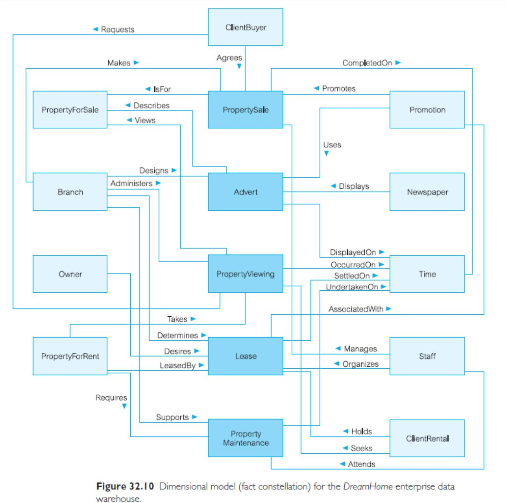

**Figure 32.10** Dimensional model (fact constellation) for the *DreamHome* enterprise data warehouse.

# Aplikasi OLAP

#### **Tujuan OLAP:**

- Menyediakan informasi untuk pengambilan keputusan
- Menghitung data secara dinamis: Informasi yang diberikan oleh OLAP sering kali mencerminkan hubungan data yang kompleks dan dapat dihitung secara langsung (*on the fly*).

#### **Karakteristik OLAP yang Efektif:**

▪ Waktu respon yang cepat ▪Fleksibilitas data model

#### **Fitur OLAP:**

▪ **Multidimensional Views of Data**: OLAP memungkinkan pengguna untuk melihat data dari berbagai perspektif (dimensi) ▪ **Support for Complex Calculations**: OLAP mendukung perhitungan yang kompleks, seperti agregasi, rasio, pertumbuhan, dan prediksi. ▪ **Time Intelligence**: OLAP menyediakan kemampuan untuk menganalisis data berdasarkan waktu, seperti perbandingan periode, tren historis, dan peramalan.

# OLAP: Representasi Data Multidimensi

- • Data multidimensi: data yang terdiri dari **fakta (numeric measurements)** dan **dimensi** yang memberikan konteks pada fakta tersebut.
- • Format representasi data multidimensi: **tabel relasional, matrix, data cube**

| city     | quarter | revenue |
|----------|---------|---------|
| Glasgow  | Q1      | 29726   |
| Glasgow  | Q2      | 30443   |
| Glasgow  | Q3      | 30582   |
| Glasgow  | Q4      | 31390   |
| London   | Q1      | 43555   |
| London   | Q2      | 48244   |
| London   | Q3      | 56222   |
| London   | Q4      | 45632   |
| Aberdeen | Q1      | 53210   |
| Aberdeen | Q2      | 34567   |
| Aberdeen | Q3      | 45677   |
| Aberdeen | Q4      | 50056   |
| .....    | .....   | .....   |
| .....    | .....   | .....   |

|         |  | city  |         |        |          |       |
|---------|--|-------|---------|--------|----------|-------|
|         |  | city  | Glasgow | London | Aberdeen | ..... |
| quarter |  |       |         |        |          |       |
| Q1      |  | 29726 | 43555   | 53210  | .....    |       |
| Q2      |  | 30443 | 48244   | 34567  | .....    |       |
| Q3      |  | 30582 | 56222   | 45677  | .....    |       |
| Q4      |  | 31390 | 45632   | 50056  | .....    |       |

**Figure 33.1** Multidimensional data viewed in: (a) three-field table; (b) two-dimensional matrix;

| type  | city    | quarter | revenue |
|-------|---------|---------|---------|
| Flat  | Glasgow | Q1      | 15056   |
| House | Glasgow | Q1      | 14670   |
| Flat  | Glasgow | Q2      | 14555   |
| House | Glasgow | Q2      | 15888   |
| Flat  | Glasgow | Q3      | 14578   |
| House | Glasgow | Q3      | 16004   |
| Flat  | Glasgow | Q4      | 15890   |
| House | Glasgow | Q4      | 15500   |
| Flat  | London  | Q1      | 19678   |
| House | London  | Q1      | 23877   |
| Flat  | London  | Q2      | 19567   |
| House | London  | Q2      | 28677   |
| ..... | .....   | .....   | .....   |
| ..... | .....   | .....   | .....   |

(c)

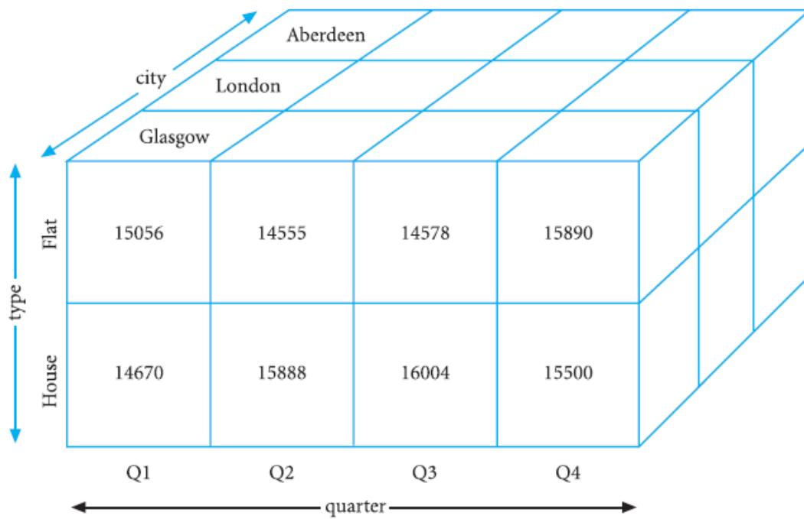

(d)

(c) four-field table; (d) three-dimensional cube.

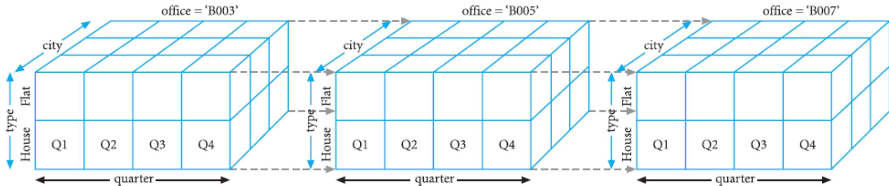

**Figure 33.2** A representation of four-dimensional property sales revenue data with time (quarter), location (city), property type (type), and branch office (office) dimensions is shown as a

# Hierarki Dimensi

**Figure 33.4**

An example of dimensional hierarchies for the (a) location and (b) time dimensions. The dashed line shows the level of the location and time dimensional hierarchies used in the two-dimensional data of Figure 33.1 (a) and (b).

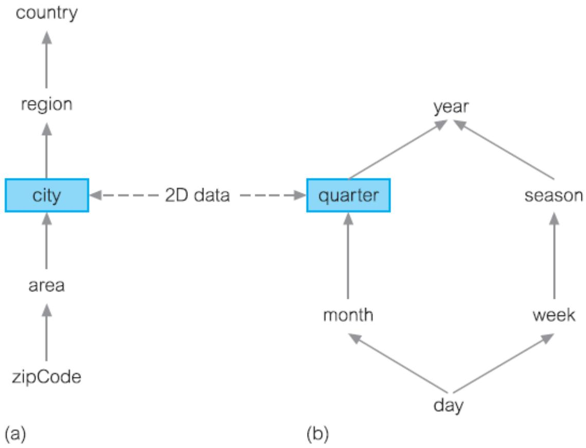

### Operasi Multidimensi pada Data Cube OLAP

- **Roll-up:** Operasi *roll-up* melakukan agregasi data dengan:

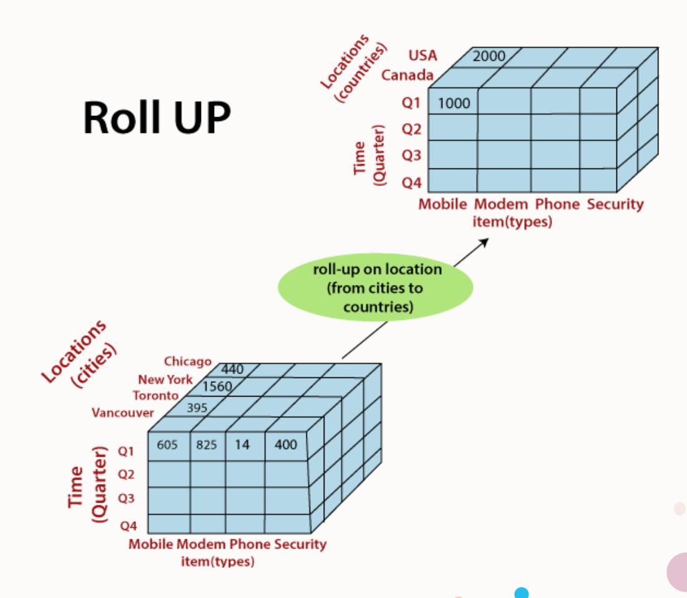

- • **Drill-down:** kebalikan dari *roll-up* dan melibatkan data detail yang membentuk data agregasi.
  - • Turun dalam hierarki dimensi (misalnya, dari kota → area → kode pos).
  - • Menambahkan dimensi (misalnya, dari 3D ke 4D).

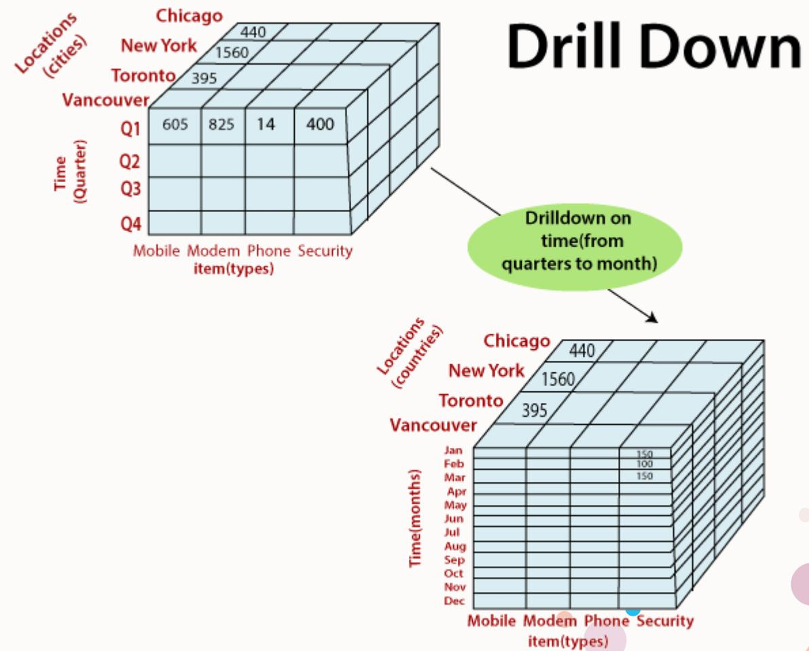

- • **Slice and Dice:** Operasi ini memungkinkan pengguna melihat data dari sudut pandang yang berbeda.

**Slice:**

- • Melakukan seleksi pada satu dimensi.
- • Contoh: Menampilkan semua penjualan untuk jenis properti "Flat".

**Dice:**

- • Melakukan seleksi pada dua atau lebih dimensi.
- • Contoh: Menampilkan semua penjualan untuk jenis properti "Flat" dan kuartal "Q1".

**Slice**

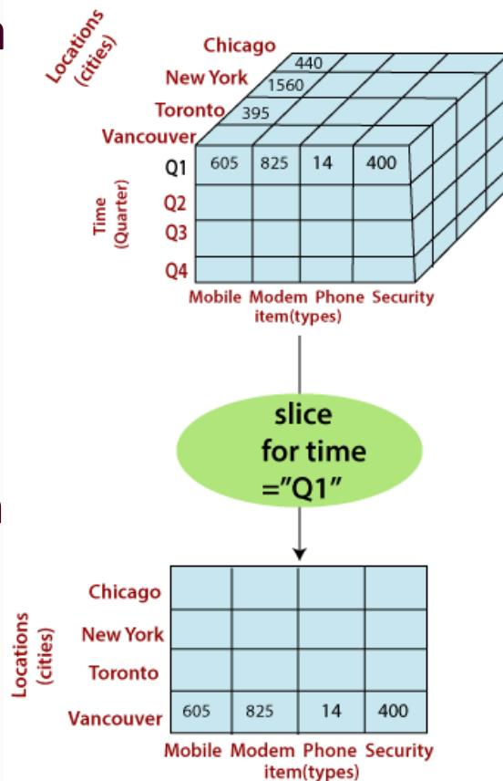

**Dice**

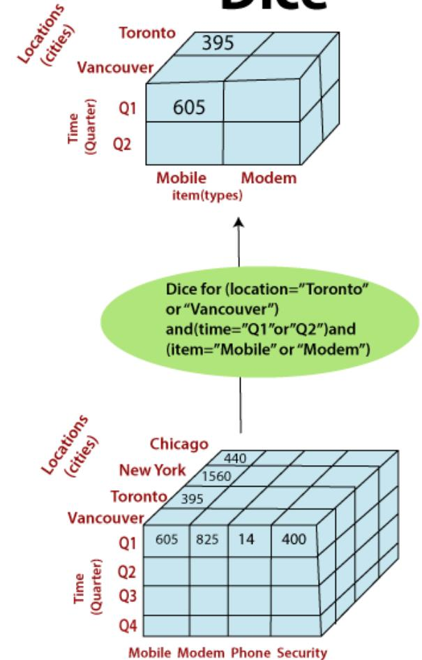

- **Pivot**: Operasi pivot memungkinkan pengguna memutar data untuk melihatnya dari sudut pandang yang berbeda.

Data penjualan yang awalnya ditampilkan dengan:

- Sumbu X: Lokasi (kota).
- Sumbu Y: Waktu (kuartal).

Diputar menjadi:

- Sumbu X: Waktu (kuartal).
- Sumbu Y: Lokasi (kota).

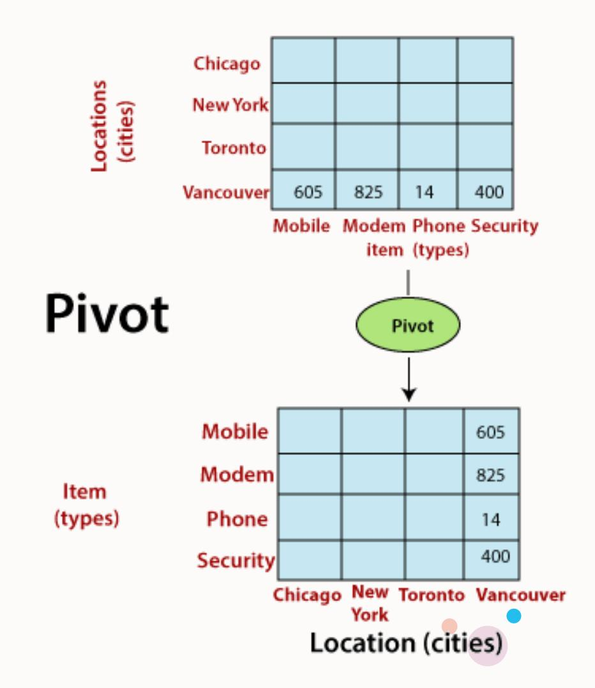

## Kategori Server OLAP

Server OLAP dikategorikan berdasarkan arsitektur untuk menyimpan dan memproses data multidimensional:

- **Multidimensional OLAP (MOLAP)**

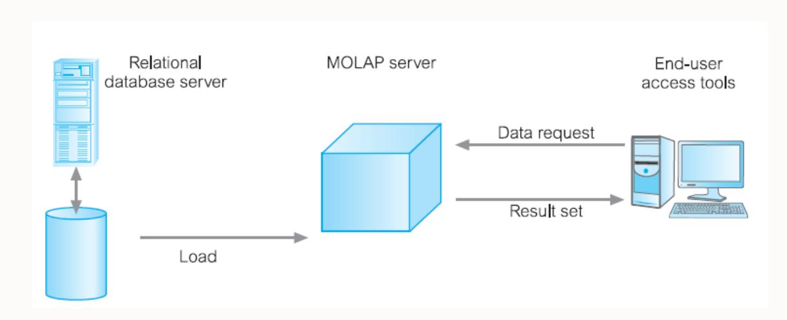

**Relational OLAP (ROLAP)**

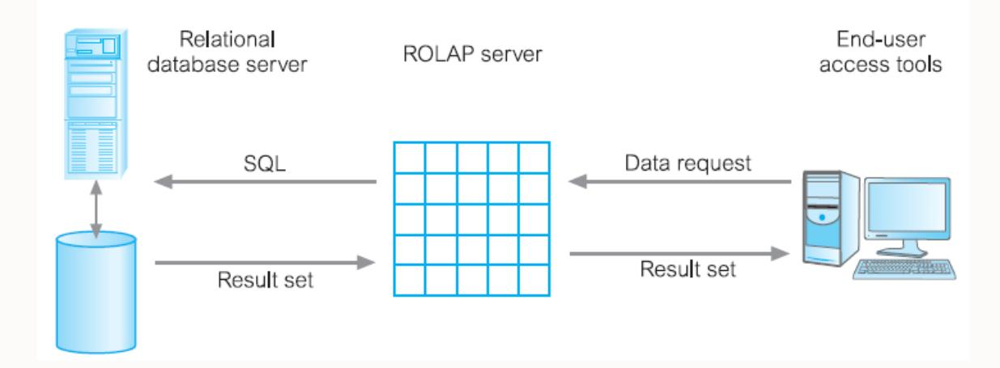

OLAP server yang menyimpan data dalam format **multidimensional cube** OLAP server yang menyimpan data dalam format **database relasional (RDBMS)**

### • **Hybrid OLAP (HOLAP) Desktop OLAP (DOLAP)**

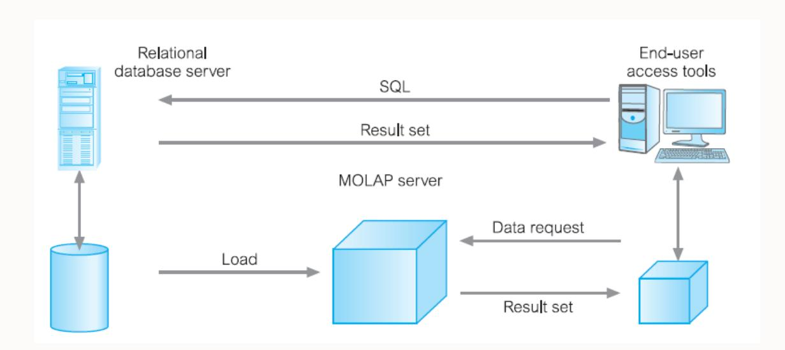

✓ Data agregasi disimpan dalam format multidimensional (MOLAP) ✓ Data detail disimpan dalam database relasional (ROLAP)

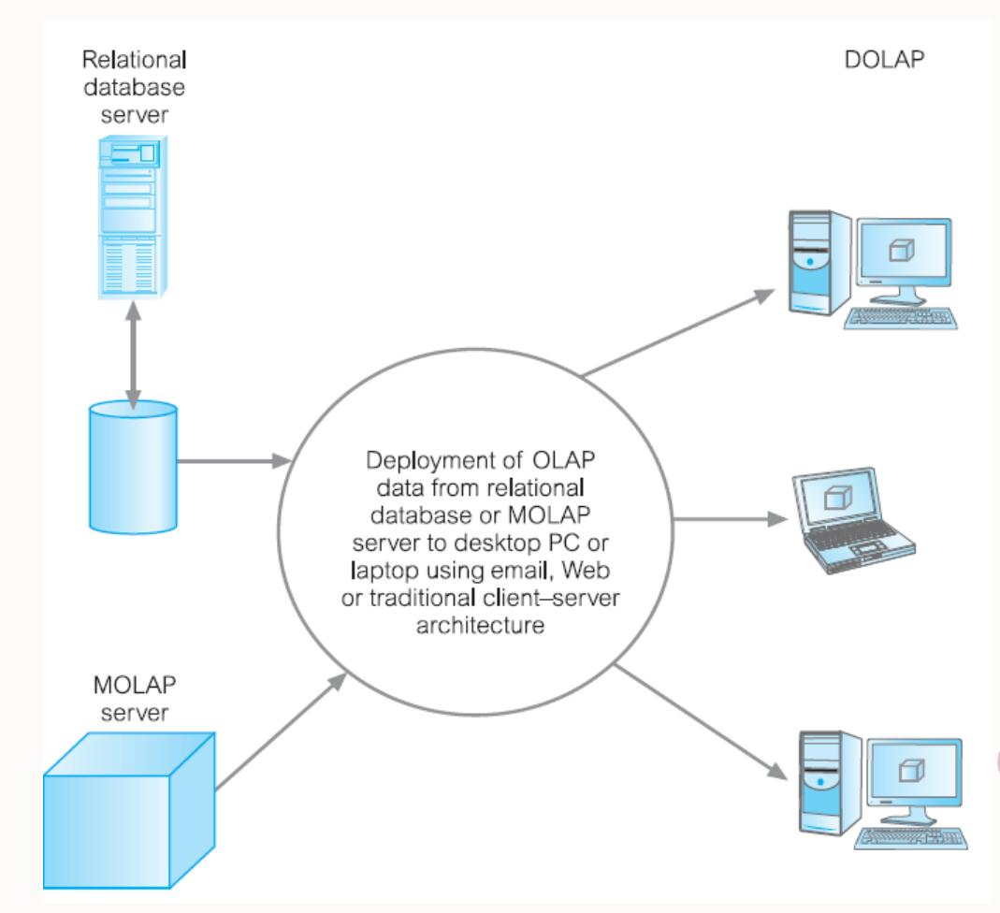

# Terima kasih