## ETL

Pertemuan 5 - Teknologi Perekayasaan Data

Politeknik Statistika STIS

Siti Mariyah, Ph.D

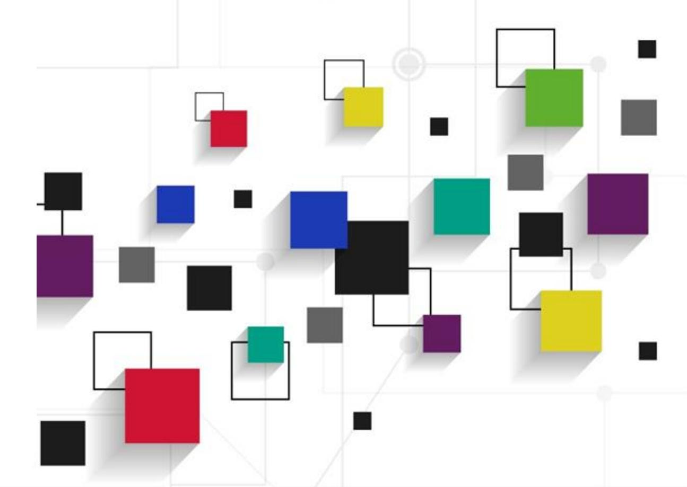

# Agenda Pertemuan

**Apa itu ETL?**

**ETL Tools**

**Pengenalan SQL Server Integration Services**

**Implementasi**

# ETL

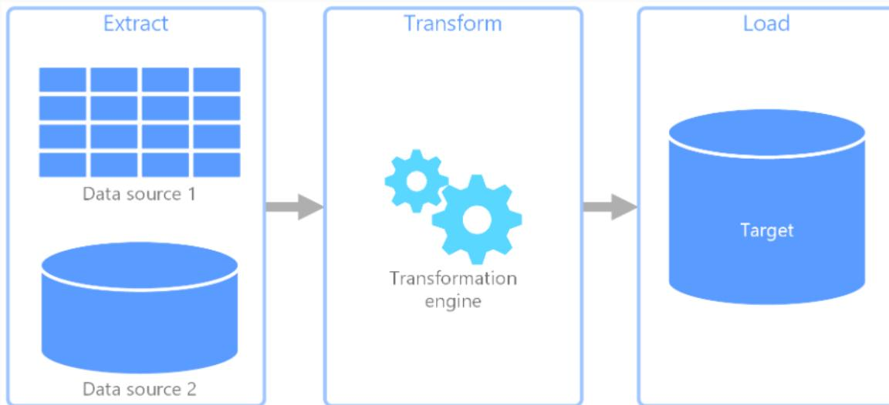

- ■ **ETL** merupakan singkatan dari Extract, Transform, Load
- ■ **Extract, transform, and load (ETL)** merupakan *data pipeline* yang digunakan untuk mengumpulkan data dari berbagai sumber. Kemudian data tersebut ditransformasi berdasarkan *rule* bisnis dan di-*load* ke target repositori.
- ■ **Transformasi** dapat melibatkan berbagai operasi, seperti *filtering*, *sorting*, *aggregating*, *joining data*, *cleaning data*, *deduplicating*, *dan validating data*.
- ■ **Proses ETL** dapat berlangsung secara paralel, dimana proses transformasi dan load data dilakukan untuk sebagian data yang telah berhasil di ekstrak.

# ELT

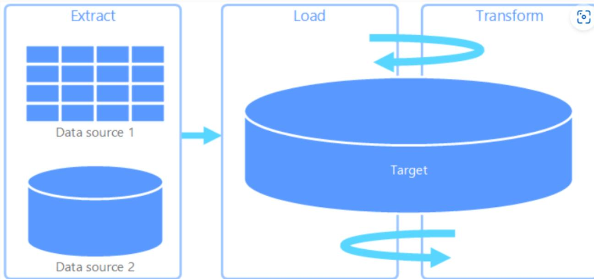

- ■ Berbeda dengan **ELT**, transformasi pada proses **ELT** berlangsung pada repositori target.
- ■ ELT dilakukan dengan mempertimbangkan **spesifikasi dari sistem target** untuk mengakomodir penyimpanan dan pemrosesan data.
- ■ Biasanya, ELT dilakukan pada **sistem Big Data**, dimana data yang berasal dari berbagai sumber di-*load* terlebih dahulu ke penyimpanan, seperti HDFS, untuk kemudian ditransformasi sesuai dengan kebutuhan analisis.

# Data Extraction

- ■ Proses *data extraction* dapat melibatkan beberapa sumber data dengan format yang berbeda
- ■ Beberapa hal yang perlu diperhatikan saat *data extraction* yaitu:
  - a. Koneksi ke sumber data: ole db, odbc, file connector, flat file, excel, dll
  - b. Struktur data dari sumber data: nama kolom, tipe kolom, *length*
  - c. Untuk data tipe flat file, perlu ditentukan *delimiter*, *text qualifier*, serta *column header*
  - d. Penentuan kolom apa saja yang akan di-*load*

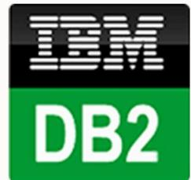

# Data Transformation

#### ✓**Filtering**

| SubCategoryCode | CategoryCode | SubCategoryName           |
|-----------------|--------------|---------------------------|
| 50              | A            | Bahan Pokok               |
| 51              | A            | Cokelat & Permen          |
| 52              | A            | Makanan & Minuman Lainnya |
| 53              | A            | Makanan Beku              |
| 54              | A            | Makanan Instan            |
| 55              | A            | Makanan Kaleng            |
| 56              | A            | Makanan Ringan            |
| 57              | A            | Makanan Segar             |
| 58              | A            | Makanan Siap Saji         |
| 59              | A            | Menu Sarapan              |
| 60              | A            | Minuman                   |
| 61              | A            | Roti & Kue                |
| 62              | A            | Susu & Olahan             |

#### ✓**Sorting**

| SubCategoryCode | CategoryCode | SubCategoryName           |
|-----------------|--------------|---------------------------|
| 62              | A            | Susu & Olahan             |
| 61              | A            | Roti & Kue                |
| 60              | A            | Minuman                   |
| 59              | A            | Menu Sarapan              |
| 58              | A            | Makanan Siap Saji         |
| 57              | A            | Makanan Segar             |
| 56              | A            | Makanan Ringan            |
| 55              | A            | Makanan Kaleng            |
| 54              | A            | Makanan Instan            |
| 53              | A            | Makanan Beku              |
| 52              | A            | Makanan & Minuman Lainnya |
| 51              | A            | Cokelat & Permen          |
| 50              | A            | Bahan Pokok               |

| SubCategoryCode | CategoryCode | CategoryName      | SubCategoryName           |
|-----------------|--------------|-------------------|---------------------------|
| 62              | A            | Makanan & Minuman | Susu & Olahan             |
| 61              | A            | Makanan & Minuman | Roti & Kue                |
| 60              | A            | Makanan & Minuman | Minuman                   |
| 59              | A            | Makanan & Minuman | Menu Sarapan              |
| 58              | A            | Makanan & Minuman | Makanan Siap Saji         |
| 57              | A            | Makanan & Minuman | Makanan Segar             |
| 56              | A            | Makanan & Minuman | Makanan Ringan            |
| 55              | A            | Makanan & Minuman | Makanan Kaleng            |
| 54              | A            | Makanan & Minuman | Makanan Instan            |
| 53              | A            | Makanan & Minuman | Makanan Beku              |
| 52              | A            | Makanan & Minuman | Makanan & Minuman Lainnya |
| 51              | A            | Makanan & Minuman | Cokelat & Permen          |
| 50              | A            | Makanan & Minuman | Bahan Pokok               |

### ✓**Aggregating**

| CategoryCode | CategoryName      | cnt |
|--------------|-------------------|-----|
| A            | Makanan & Minuman | 1   |

## **Data Hasil Ekstraksi** ✓ **Joining Data**

| SubCategoryCode | CategoryCode | SubCategoryName           |
|-----------------|--------------|---------------------------|
| 50              | A            | Bahan Pokok               |
| 51              | A            | Cokelat & Permen          |
| 52              | A            | Makanan & Minuman Lainnya |
| 53              | A            | Makanan Beku              |
| 54              | A            | Makanan Instan            |
| 55              | A            | Makanan Kaleng            |
| 56              | A            | Makanan Ringan            |
| 57              | A            | Makanan Segar             |
| 58              | A            | Makanan Siap Saji         |
| 59              | A            | Menu Sarapan              |
| 60              | A            | Minuman                   |
| 61              | A            | Roti & Kue                |
| 62              | A            | Susu & Olahan             |
| 63              | B            | Kabel & Sparepart         |
| 64              | B            | Kamera Pengintai          |
| 65              | B            | Kelistrikan               |
| 66              | B            | Media Player              |
| 67              | B            | Pencahayaan               |
| 68              | B            | Pendingin                 |
| 69              | B            | Penyedot Debu             |
| 70              | B            | Perangkat Dapur           |

# Data Transformation

## ✓**Cleaning Data**

|   | id | FirstName | LastName  | EmailAddress                 |
|---|----|-----------|-----------|------------------------------|
| 1 | 1  | Reidar    | Harrowing | rharrowing0@sciencedaily.com |
| 2 | 2  | Marcellus | Jobes     | mjobes1@nasa.gov             |
| 3 | 3  | Reynold   | Dymott    | rdymott2@amazon.co.uk        |
| 4 | 4  | Suzette   | Saphir    | ssaphir3@cdc.gov             |
| 5 | 5  | Kinny     | McCard    | kmccard4@dailymail.co.uk     |

### ✓**Deduplicating**

## **Data Hasil Ekstraksi**

|  | email                           | Name               |
|--|---------------------------------|--------------------|
|  | rharrowing0@sciencedaily.com    | Reidar Harrowing   |
|  | mjobes1@nasa.gov                | Marcellus Jobes    |
|  | rdymott2@amazon.co.uk           | Reynold Dymott     |
|  | ssaphir3@cdc.gov                | Suzette Saphir     |
|  | kmccard4@dailymail.co.uk        | Kinny McCard       |
|  | rstiggers5@hp.com               | Rance Stiggers     |
|  | raitchinson6@angelfire.com      | Rustie Aitchinson  |
|  | hprandin7@paypal.com            | Heidie Prandin     |
|  | nbrownsmith8@odnoklassniki.ru   | Nikolas Brownsmith |
|  | mbolger9@networkadvertising.org | Merry Bolger       |
|  | nnyssena@jigsy.com              | Neila Nyssen       |
|  | afoaleb@lulu.com                | Annabelle Foale    |
|  | hstanettc@walmart.com           | Hayward Stanett    |
|  | ayablsleyd@pinterest.com        | Ardine Yablsley    |
|  | jrothe@fotki.com                | Josephina Roth     |
|  | icastagnetf@cnet.com            | Ignacio Castagnet  |
|  | gsiburng@zdnet.com              | Germain Siburn     |
|  | csmithenh@google.it             | Chere Smithen      |
|  | tbeeckeri@slashdot.org          | Theressa Beecker   |
|  | tfotittj@google.com.au          | Theodosia Fotitt   |
|  | bprovestk@weibo.com             | Brook Provest      |
|  | kdummerl@opera.com              | Kelsey Dummer      |

## ✓**Validating Data**

Mendeteksi jika terdapat duplikasi record

Memvalidasi isian data, seperti:

- a. Terdapat email yang tidak sesuai format
- b. Nama yang null
- c. Panjang karakter kolom nama dan email

# Data Loading

- ■ Proses *data loading* dapat menghasilkan output dengan format data sesuai dengan kebutuhan
- ■ Beberapa hal yang perlu diperhatikan saat *data loading* yaitu:
  1. a. Koneksi ke repositori target: ole db, odbc, file connector, flat file, excel, dll
  2. b. Struktur data pada repositori target: nama kolom, tipe kolom, *length*
  3. c. Untuk data tipe flat file, perlu ditentukan *delimiter*, *text qualifier*, serta *column header*
  4. d. Mapping kolom pada sumber data dengan kolom pada skema target

| email                        | Name              |
|------------------------------|-------------------|
| rharrowing0@sciencedaily.com | Reidar Harrowing  |
| mjobes1@nasa.gov             | Marcellus Jobes   |
| rdymott2@amazon.co.uk        | Reynold Dymott    |
| ssaphir3@cdc.gov             | Suzette Saphir    |
| kmccard4@dailymail.co.uk     | Kinny McCard      |
| rstiggers5@hp.com            | Rance Stiggers    |
| raitchinson6@angelfire.com   | Rustie Aitchinson |
| hprandin7@paypal.com         | Heidie Prandin    |

| id | FirstName | LastName  | EmailAddress                 |
|----|-----------|-----------|------------------------------|
| 1  | Reidar    | Harrowing | rharrowing0@sciencedaily.com |
| 2  | Marcellus | Jobes     | mjobes1@nasa.gov             |
| 3  | Reynold   | Dymott    | rdymott2@amazon.co.uk        |
| 4  | Suzette   | Saphir    | ssaphir3@cdc.gov             |
| 5  | Kinny     | McCard    | kmccard4@dailymail.co.uk     |

# ETL Tools

## **SQL Server Integration Services**

- Terintegrasi dengan SQL server dan Visual studio
- Merupakan aplikasi desktop
- Koneksi data source yang tersedia: OLE DB, ODBC, Flat file, Excel, XML, HDFS, dll

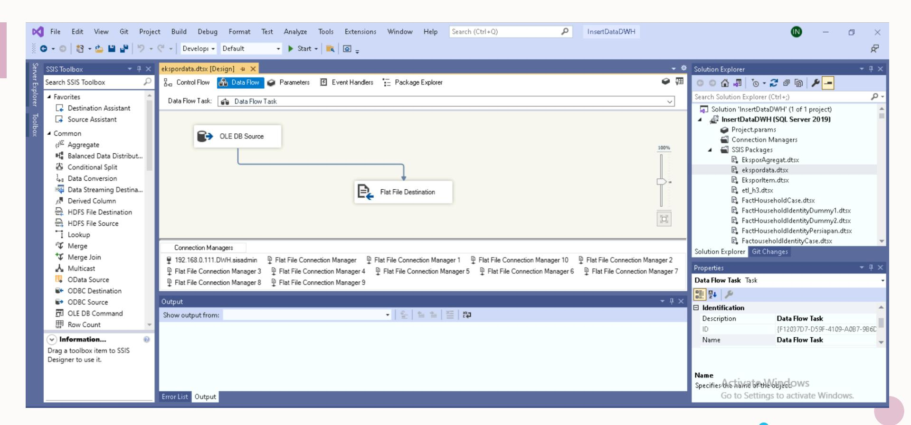

# ETL Tools

## **IBM Data Stage**

- Merupakan aplikasi COTS
- Tersedia dalam aplikasi desktop dan web
- Koneksi data source yang tersedia: ODBC, JDBC, File Connector, Sequential File, DB2,

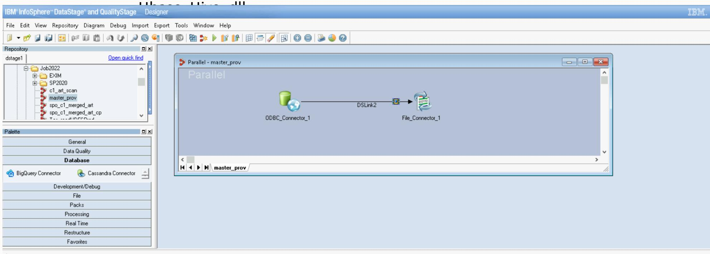

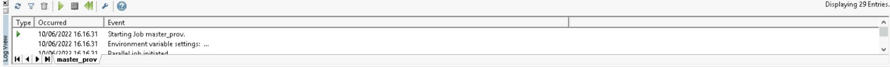

## ETL Tools

## **Apache Air Flow**

- Merupakan Open Source
- Tersedia dalam aplikasi web yang dapat digunakan untuk membuat task flow
- Proses ekstraksi, transformasi, dan loading dilakukan dengan menggunakan script python

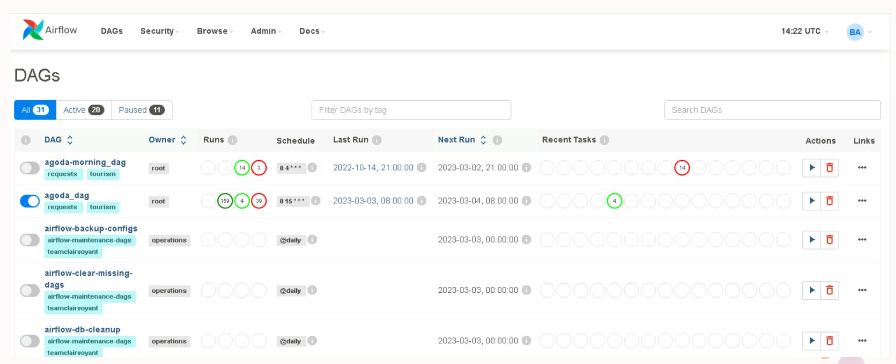

# Pengenalan SQL Server Integration

## Services

- • SQL Server Integration Services (SSIS) merupakan platform yang digunakan sebagai solusi untuk integrasi dan transformasi data.
- • SSIS dapat dimanfaatkan untuk menyelesaikan permasalahan kompleks, seperti *copy* atau mengunduh file, loading data ke skema warehouse, *cleansing* dan *mining* data, dan pengelolaan objek dan data di SQL Server.
- • Kapabilitas:
  - ✓ Ektraksi dan transformasi data
  - ✓ Memiliki sejumlah fitur task dan transformasi
  - ✓ Graphical tools untuk membuat package
  - ✓ Terintegrasi dengan SSIS catalog database untuk menyimpan, menjalankan, dan mengelola *packages*

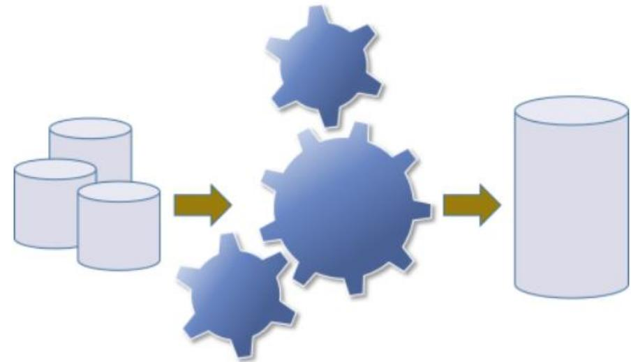

Microsoft®  
**SQL Server®**  
Integration Services

## Fitur SSIS

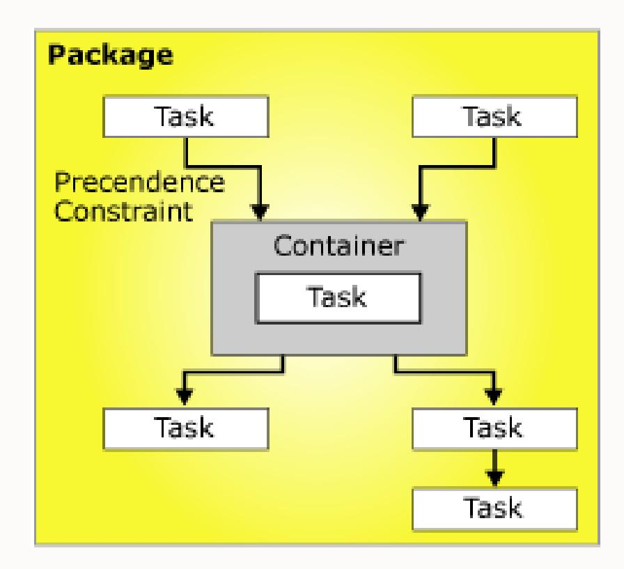

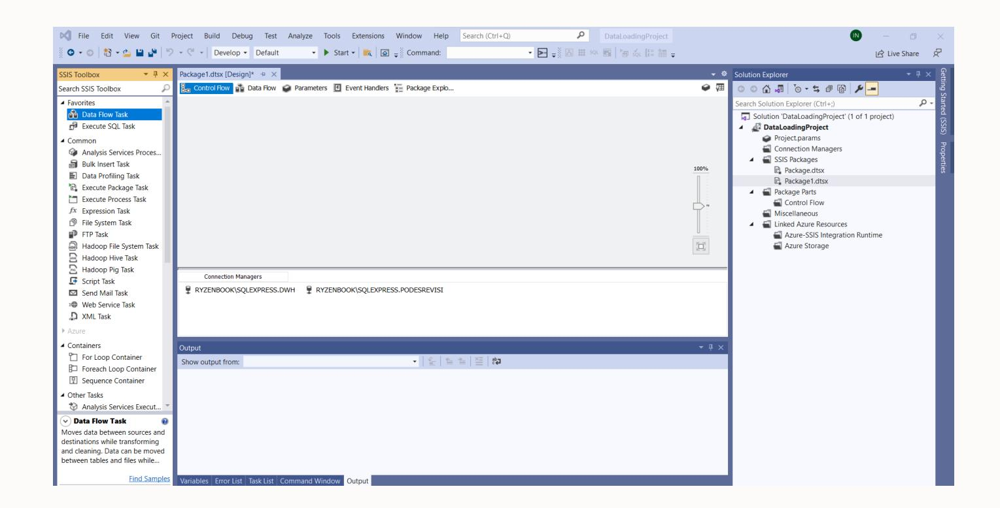

Control Flow SSIS Designer

## Fitur SSIS

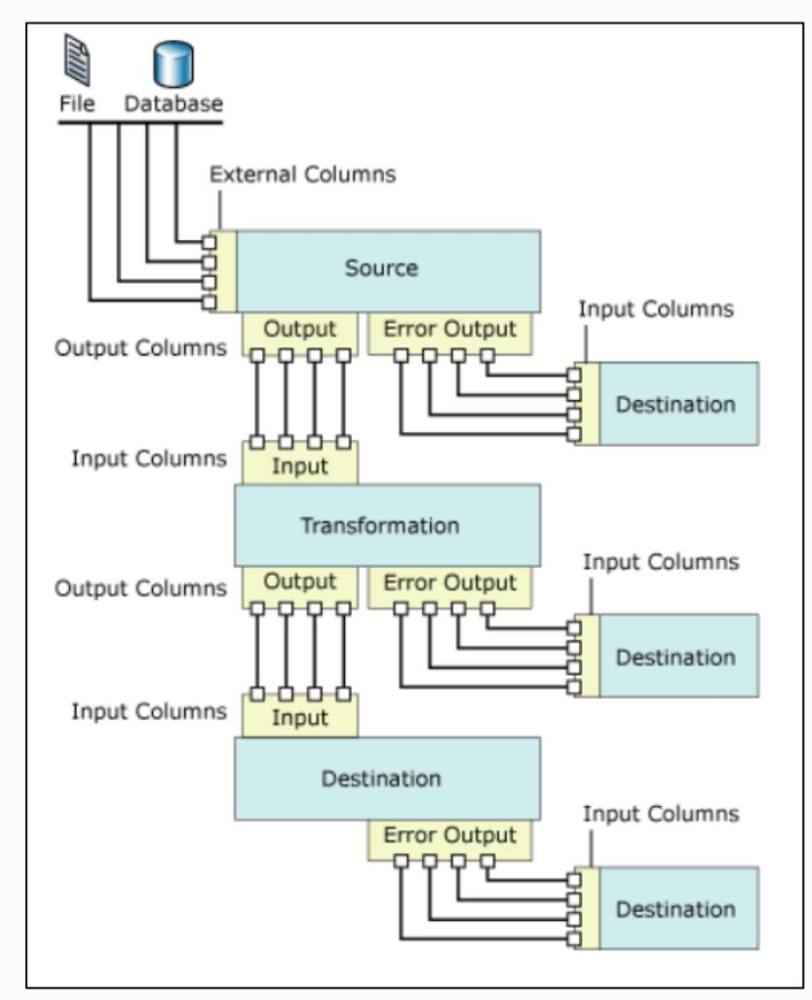

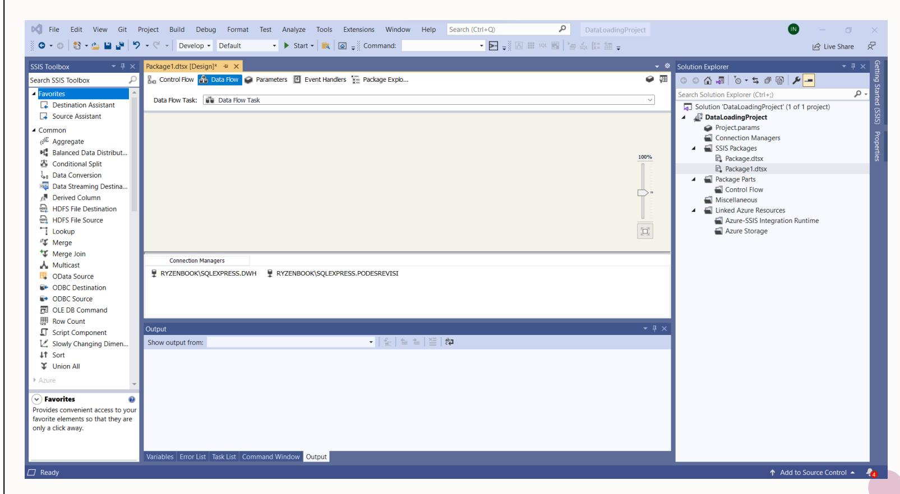

Data Flow SSIS Designer

# Tipe Data Koneksi

- **OLE DB** → Object Linking and Embedding Database
- **ODBC** → Open Database Connecting

|                                  | criteria                                                            | OLEDB | ODBC                                                                                                                                      |
|----------------------------------|---------------------------------------------------------------------|-------|-------------------------------------------------------------------------------------------------------------------------------------------|
| Platofrm Support                 | 32/64-bit Windows only                                              |       | 32/64-bit Windows, Linux, Mac, Unix                                                                                                       |
| Product Support                  | Currently supported in .Net 6. On preview in .Net 7.                |       | Currently supported in .Net 6. On preview in .Net 7. Also supported in UnixODBC iODBC                                                     |
| Database Driver/Provider Support | Fewer providers compared to ODBC but can use ODBC data sources      |       | Most DBMS Systems have ODBC drivers. (This includes major RDBMS, NoSQL like MongoDB, and flat files like CSV, Excel, text file, and more) |
| Performance                      | Each provider and data source are different. So, test against ODBC. |       | Each driver and data source are different. So, test against OLEDB.                                                                        |

# OLE DB Connection

![Screenshot of the Native OLE DB Connection Manager interface showing a connection to a Native OLE DB Provider. The interface includes a provider name 'Native OLE DB\SQL Server Native Client 11.0', a server name 'Server name:', an authentication field 'Authentication: Windows Authentication', a password field 'Password:', a search field 'Connect to a database', a selection field 'Select or enter a database name:', an attach field 'Attach a database file:', a logical name field 'Logical name:', a test field 'Test Connection', and a cancel field 'Cancel'. A client section shows a list of Native OLE DB Providers and a search field 'SQL Server Native Client 11.0'.]()

# ODBC Connection

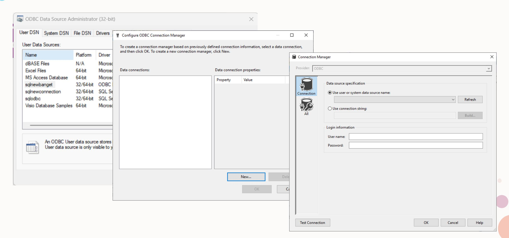

# Tips

- 1. Extraksi data dilakukan secara paralel
- 2. Ektraksi dilakukan pada data yang memang dibutuhkan
- 3. Jika kebutuhan ETL cukup dinamis, maka pendekatan, seperti Meta Data driven ETL dan lainnya, dapat dilakukan dibandingkan langsung mendesain semuanya dalam satu kali waktu
- 4. Hindari penggunaan **Asynchronous transformation components**: Sort, Aggregate, Merge Join, dll
- 5. Optimalkan penggunaan **event handlers**
- 6. Pertimbangkan skema tabel tujuan saat akan me-*load* data dalam ukuran besar
- 7. Konfigurasi *property* dari komponen, misal MaxCurrentExecutables dan EngineThreads
- 8. Konfigurasi **Data access mode option** pada koneksi OLE DB
- 9. Konfigurasi **Rows per Batch** dan **Maximum Insert Commit Size** pada OLE DB Desrination
- 10. Hindari typecast yang implisit

Sumber: [Top 10 Methods to Improve ETL Performance Using SSIS | Developer.com](https://www.developer.com/database/top-10-methods-to-improve-etl-performance-using-ssis/)

# Implementasi (Demo)

- 1. Instalasi SQL Server dan Visual Studio
- 2. Melakukan modifikasi pada visual studio untuk menambahkan SSDT (SQL Server Data Tools)
- 3. Menambahkan add-on/extension Integration Services pada visual studio
- 4. Membuat project Integration Services

## **Persiapan Praktik**

## **Case**

- 1. Data yang digunakan adalah: imdb\_data.csv
- 2. Penyiapan skema tujuan
- 3. Operasi yang dilakukan ✓
  - a. Ektraksi data ✓
  - b. Transformasi data ✓
    - c. Load Data
- 4. Melihat hasil dari data yang telah di-load

# Terima kasih