# Pengenalan Hadoop

Pertemuan 6 - Teknologi

Perekayasaan Data

Politeknik Statistika STIS

Siti Mariyah, Ph.D


# Agenda Pertemuan

Big Data dengan Hadoop

Hadoop Architecture

Bagaimana Hadoop Bekerja

Virtualization, Containerization


**In a farm far away...**

Jack harvests grapes and then sells  
it in the nearby town


After harvesting, he then stores the produce in a storage room


Soon there was a high demand for other fruits. So, he started harvesting apples and oranges as well


He then realizes that it is time consuming and difficult to harvest all the fruits by himself


So, he hires 2 more people to work with him.  
With this, harvesting is done simultaneously


Jack now decides to distribute the storage area and give each one of them a separate storage space


To complete the order on time, all of them work parallelly with their own storage space

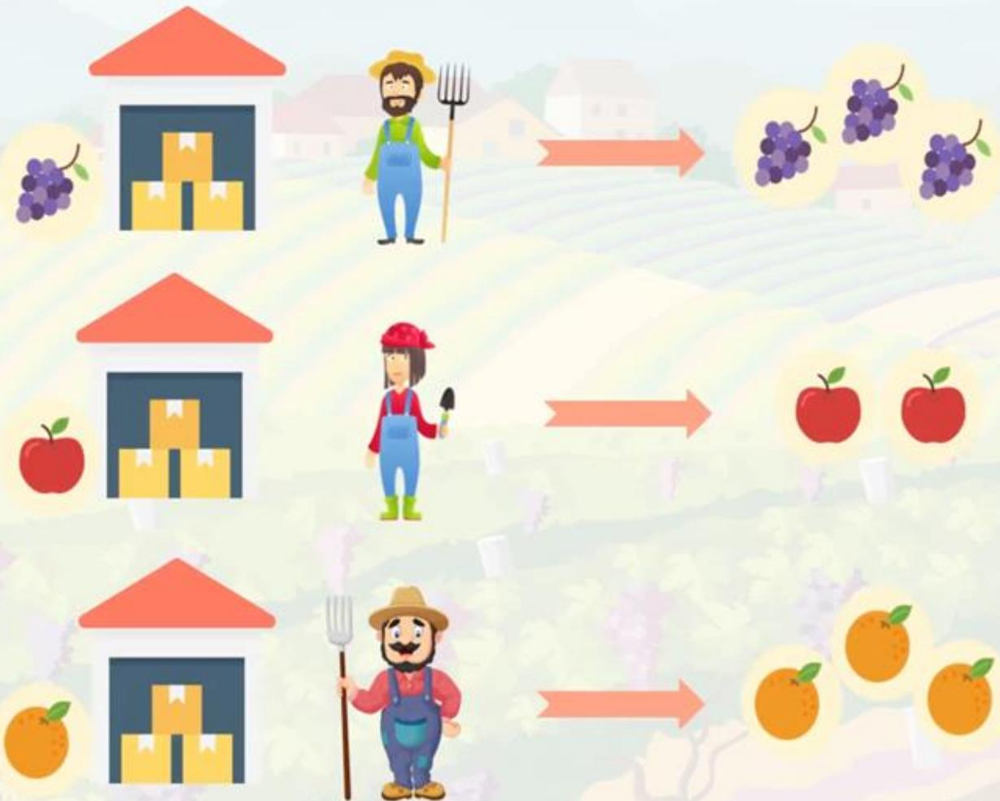

Hello, I want a fruit basket of 3 grapes, 2 apples and 3 oranges

All of them are happy and they are prepared for an increase in demand in the future


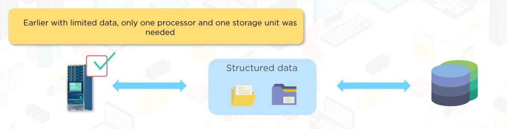


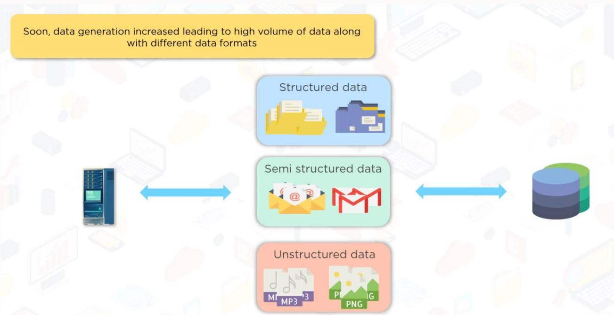

A single processor was not enough to process such high volume of different kinds of data as it was very time consuming

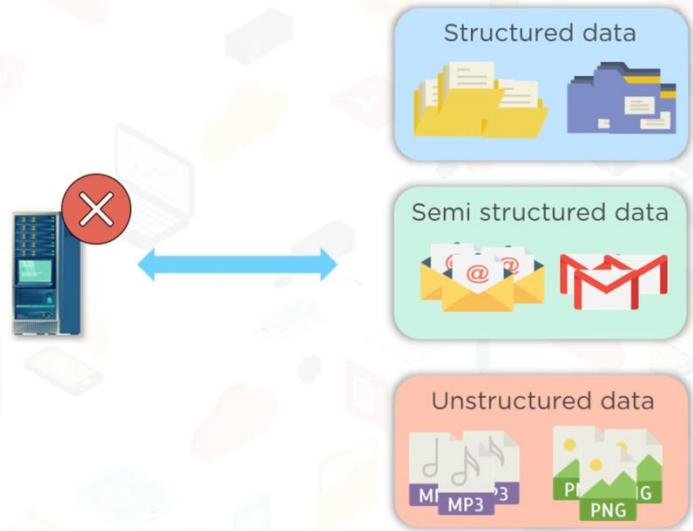


The single storage unit became the bottleneck due to which network overhead was generated

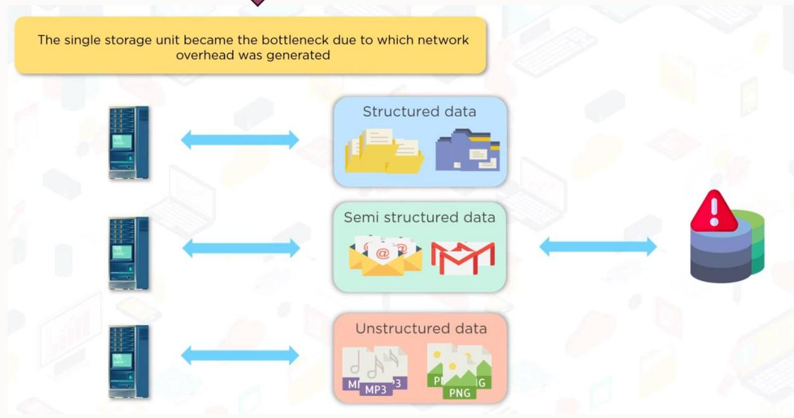

The solution was to use distributed storage for each processor. This enabled easy access to store and access data


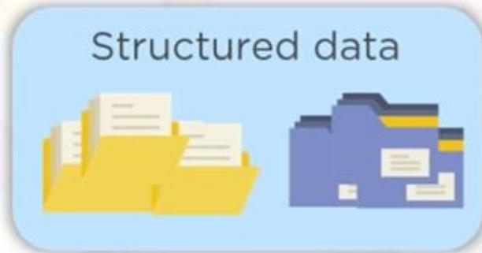


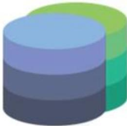


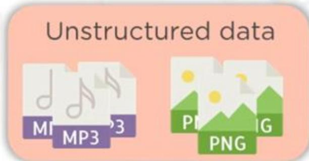


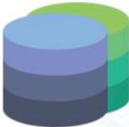

# What is Hadoop?

- **Hadoop** is an open-source software framework that is used for storing and processing large amounts of data in a distributed computing environment. It is designed to handle big data and is based on the MapReduce programming model, which allows for the parallel processing of large datasets.

## Kelebihan

- ✓ **Scalability**: data are divided multiple machines in a cluster which is processed parallelly
- ✓ **Cost-effective**: open-source (free to use), commodity hardware (inexpensive, widely available and more or less interchangeable)
- ✓ **Fault-tolerance**: data are replicated on various nodes, if the machine faces a technical issue, data can also be read from other nodes
- ✓ **Flexibility**: it can deal with any kind of dataset
- ✓ **Open-source**
- ✓ **Large community**
- ✓ **Integration**: multiple, disparate internal and external sources and putting it in a single location

## Kekurangan


# Komponen (Utama) Hadoop


# Evolusi Arsitektur Hadoop

### **Hadoop 1**

### **HDFS**

(Hadoop Distributed File System)

### **MapReduce**

(Cluster Resource Management & **Batch** Data Processing)

### **Hadoop 2 & 3**

**HDFS**

(Hadoop Distributed File System)


### **YARN: Data Operating System**

(Cluster Resource Management)

**Batch**

Map Reduce

**Batch & Interactive**

Tez / Others

**Realtime**

Slider

**Others**

Spark

# Komponen Utama Hadoop (Evolusi)

**Hadoop Common**: Berisikan Libraries Java dan Utilities yang dibutuhkan modul lainnya

**HDFS (Hadoop Distributed File System)**: Menyediakan akses ke data aplikasi *(distributed storage)*

**Yarn (Yet Another Resource Negotiator)**: Mengelola Cluster Resources dan Job Scheduling

**MapReduce**: Pemrosesan dataset secara parallel *(distributed processing)*


~ > 1 Tahun

2 Bulan ~


# Gambaran Cluster Hadoop (**Multi Node Hadoop Cluster**)

### **Master-Slave architecture**

- NameNode (Master)
- DataNode (Slave/Worker)

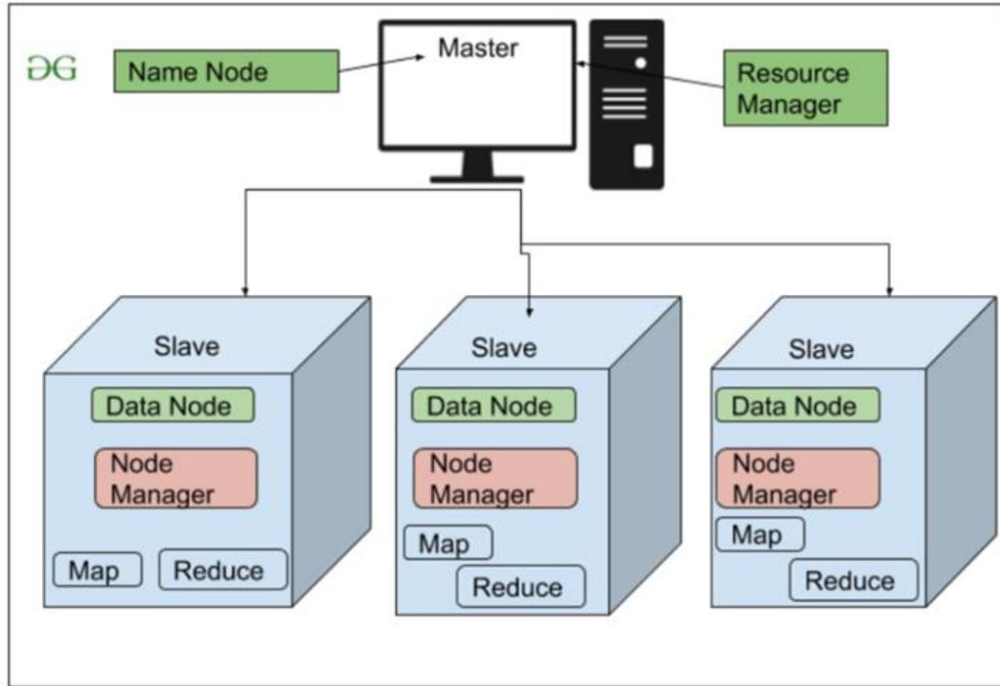

# Bagaimana dengan **Single Node Hadoop Cluster**?

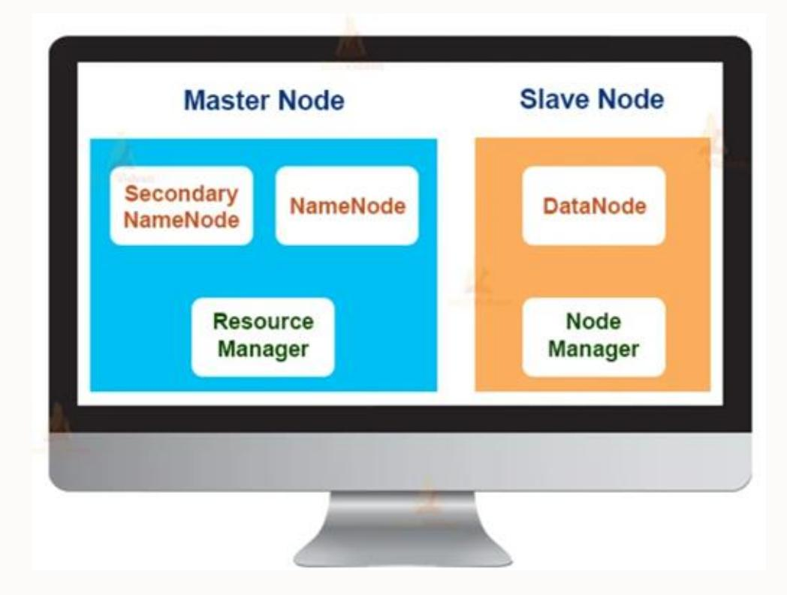

Single Node Hadoop Cluster diterapkan pada **satu mesin**. Semua *daemon* (*services*) seperti NameNode, DataNode, ResourceManager, NodeManager berjalan di mesin/host yang sama.

### **Perbedaannya:**

- **Single node cluster:** hanya 1 DataNode yang *running*
- **Multi node cluster:** lebih dari 1 DataNode yang *running* dan setiap DataNode berjalan di mesin berbeda

# Gambaran Cluster Hadoop

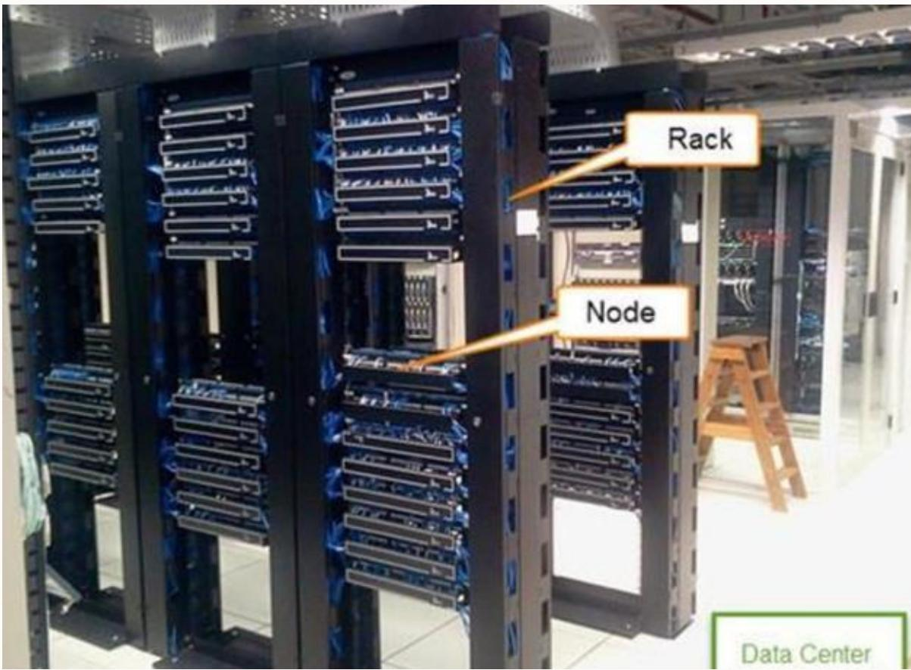

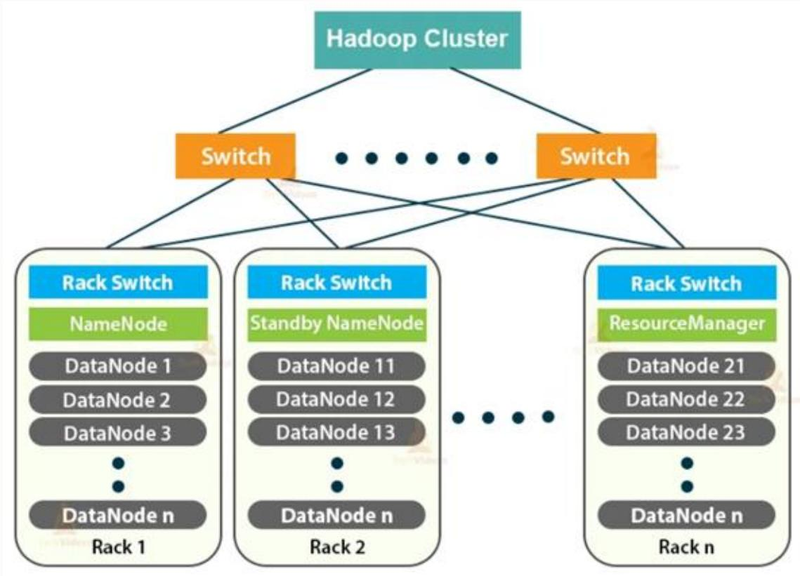

Cluster • Sekumpulan komputer yang terdiri DataNodes dan NameNode

NameNode

- Komputer yang bertugas sebagai monitor dan supervisor operasioperasi yang dilakukan DataNodes, menyimpan metadata (data about data)

DataNode • Komputer yang bertugas menyimpan file data dan melakukan pemrosesan

Mapper • Bertugas dalam melakukan pencarian blok data yang tersebar di DataNodes dan melakukan pemrosesan di mana blok data tersimpan

Reducer • Bertugas dalam mengambil dan mengompilasi hasil pemrosesan oleh Mapper

Block • Satuan terkecil dari file yang dipecah-pecah

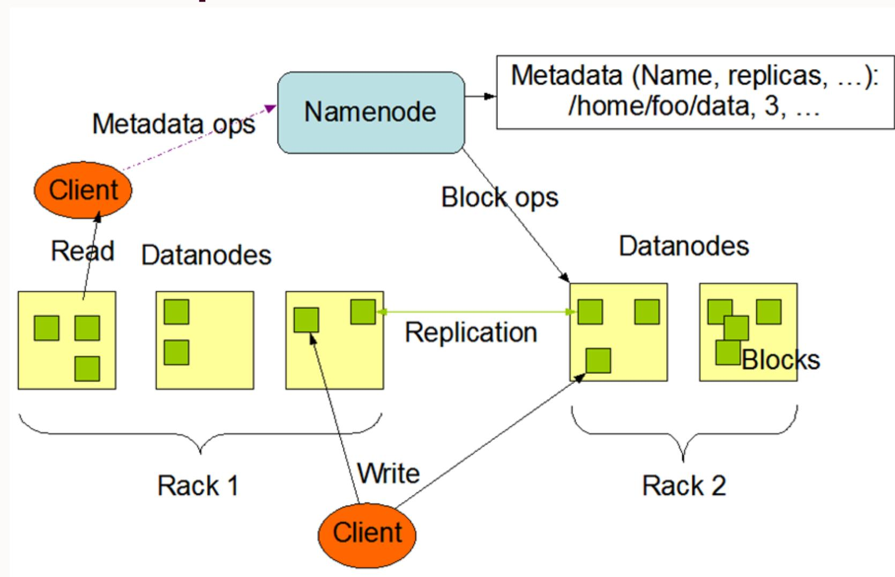

- 1. Ketika suatu aplikasi **client** akan *read/write* data di Hadoop, mereka akan berinteraksi dengan **NameNode**. NameNode pertama-tama akan memeriksa hak akses client, dan apakah client memiliki permission. Jika ya, NameNode menanggapi permintaan dari client dengan menyediakan daftar *address* dari DataNodes dimana client dapat *read* atau *write* data. Setelahnya, aplikasi client dapat berinteraksi langsung ke DataNode.
- **2. DataNodes** selalu terhubung ke NameNode. Mereka mengirimkan sinyal, yang dikenal sebagai *heartbeats*, ke NameNode. Heartbeats ini menunjukkan status DataNode. DataNode akan terus mengecek apakah ada permintaan dari NameNode untuk mengakses data.
- **3. Misalkan client akan menambahkan data**, client dapat secara langsung *write* data pada DataNodes yang telah disediakan alamatnya oleh NameNode. File data client dalam HDFS dibagi menjadi beberapa blok. Ukuran blok adalah 128 MB secara default (bisa diganti). DataNode menyimpan blok file. Untuk memberikan **fault-tolerance**, HDFS membuat replika blok tergantung pada faktor replikasi, secara default adalah 3. Status apakah sudah selesai akan dikirimkan ke NameNode.

- **4. Misalkan client akan membaca data**, client juga dapat secara langsung *read* data pada DataNodes yang telah disediakan alamatnya oleh NameNode. Client akan mengirim permintaan ke DataNodes terdekat. Data akan mengalir langsung dari DataNode ke client. Selama proses read, jika ada DataNode yang mati, NameNode memberikan alamat DataNode lain yang berisi replika blok dimana client dapat membaca datanya tanpa downtime. Status apakah sudah selesai akan dikirimkan ke NameNode.

# Data Storage in HDFS

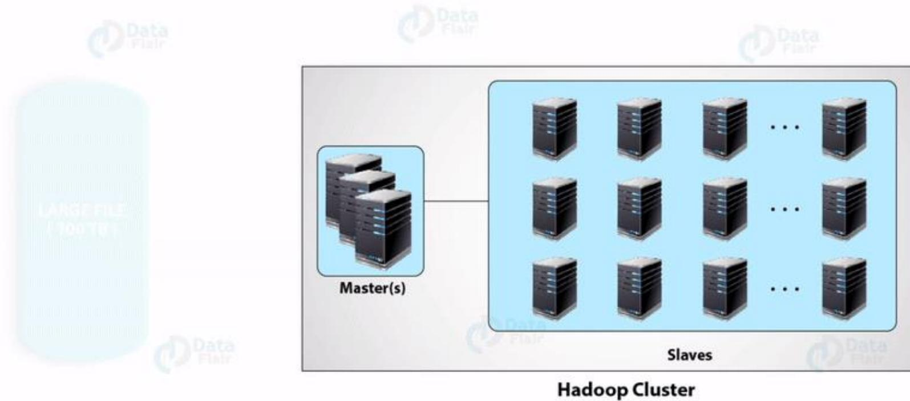

# Arsitektur Hortonworks Data Platform (HDP)

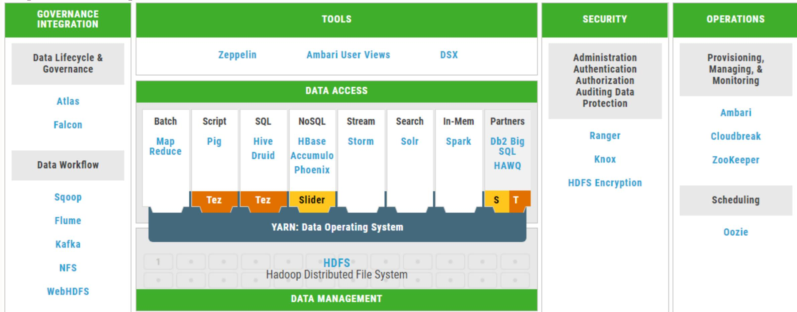

# Komponen Hadoop

| Table 1-1                  | Related Hadoop Projects                                                                                                                                              |
|----------------------------|----------------------------------------------------------------------------------------------------------------------------------------------------------------------|
| <i><b>Project Name</b></i> | <i><b>Description</b></i>                                                                                                                                            |
| Ambari                     | An integrated set of Hadoop administration tools for installing, monitoring, and maintaining a Hadoop cluster. Also included are tools to add or remove slave nodes. |
| Avro                       | A framework for the efficient <i>serialization</i> (a kind of transformation) of data into a compact binary format                                                   |
| Flume                      | A data flow service for the movement of large volumes of log data into Hadoop                                                                                        |
| HBase                      | A distributed columnar database that uses HDFS for its underlying storage. With HBase, you can store data in extremely large tables with variable column structures  |
| HCatalog                   | A service for providing a relational view of data stored in Hadoop, including a standard approach for tabular data                                                   |

| <b>Table 1-1 (<i>continued</i>)</b> |                                                                                                                                                                                                                                                     |
|-------------------------------------|-----------------------------------------------------------------------------------------------------------------------------------------------------------------------------------------------------------------------------------------------------|
| <b><i>Project Name</i></b>          | <b><i>Description</i></b>                                                                                                                                                                                                                           |
| Hive                                | A distributed data warehouse for data that is stored in HDFS; also provides a query language that's based on SQL (HiveQL)                                                                                                                           |
| Hue                                 | A Hadoop administration interface with handy GUI tools for browsing files, issuing Hive and Pig queries, and developing Oozie workflows                                                                                                             |
| Mahout                              | A library of machine learning statistical algorithms that were implemented in MapReduce and can run natively on Hadoop                                                                                                                              |
| Oozie                               | A workflow management tool that can handle the scheduling and chaining together of Hadoop applications                                                                                                                                              |
| Pig                                 | A platform for the analysis of very large data sets that runs on HDFS and with an infrastructure layer consisting of a compiler that produces sequences of MapReduce programs and a language layer consisting of the query language named Pig Latin |
| Sqoop                               | A tool for efficiently moving large amounts of data between relational databases and HDFS                                                                                                                                                           |
| ZooKeeper                           | A simple interface to the centralized coordination of services (such as naming, configuration, and synchronization) used by distributed applications                                                                                                |

# Komponen Hadoop - HDFS

## Block Replication

```
Namenode (Filename, numReplicas, block-ids, ...)  
/users/sameerp/data/part-0, r:2, {1,3}, ...  
/users/sameerp/data/part-1, r:3, {2,4,5}, ...
```

## Datanodes

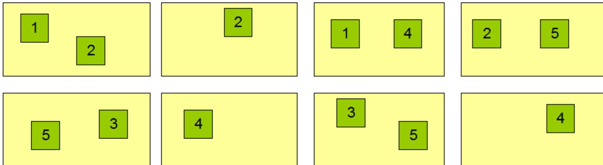

# Apa itu HDFS?

- ■ **Sistem File Terdistribusi Hadoop (Hadoop Distributed File System - HDFS)** adalah sistem file terdistribusi yang dirancang untuk berjalan pada *perangkat keras komoditas*.
- ■ HDFS memiliki banyak kesamaan dengan sistem file terdistribusi yang ada. Namun, perbedaan dengan sistem file terdistribusi lainnya sangat signifikan. HDFS sangat toleran terhadap kesalahan dan dirancang untuk digunakan pada perangkat keras berbiaya rendah. HDFS menyediakan akses throughput tinggi ke data aplikasi dan cocok untuk aplikasi yang memiliki dataset besar. HDFS mengaktifkan akses streaming ke sistem file data.
- ■ HDFS awalnya dibangun sebagai infrastruktur untuk proyek mesin pencari web Apache Nutch. HDFS adalah bagian dari proyek Apache Hadoop Core.

Hadoop Distributed File System (HDFS) is known for its distributed storage method. It distributes the data amongst many computers. In addition to this, replication of data is also done to avoid loss of data

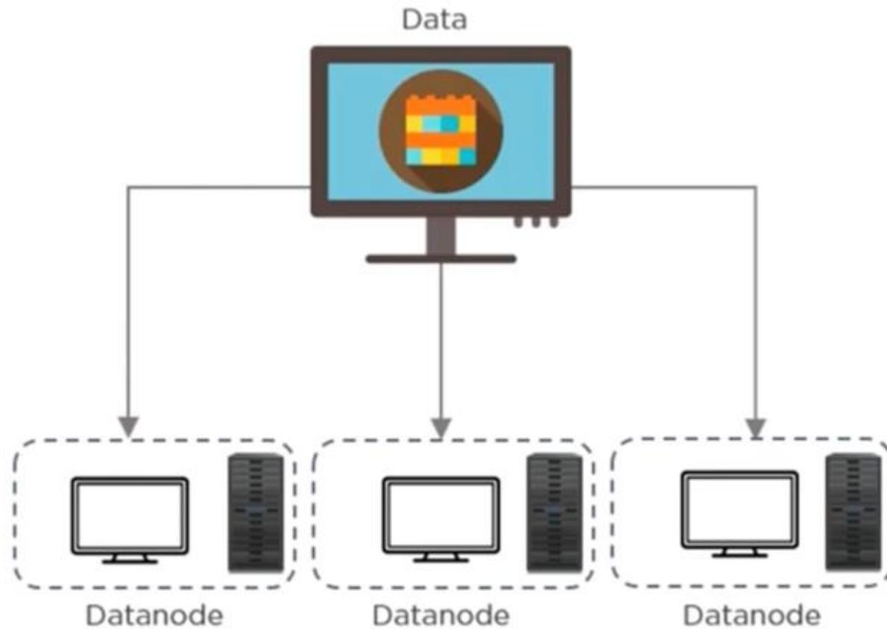

Each block of data is stored on multiple systems and by default has 128 MB of data

# Arsitektur HDFS

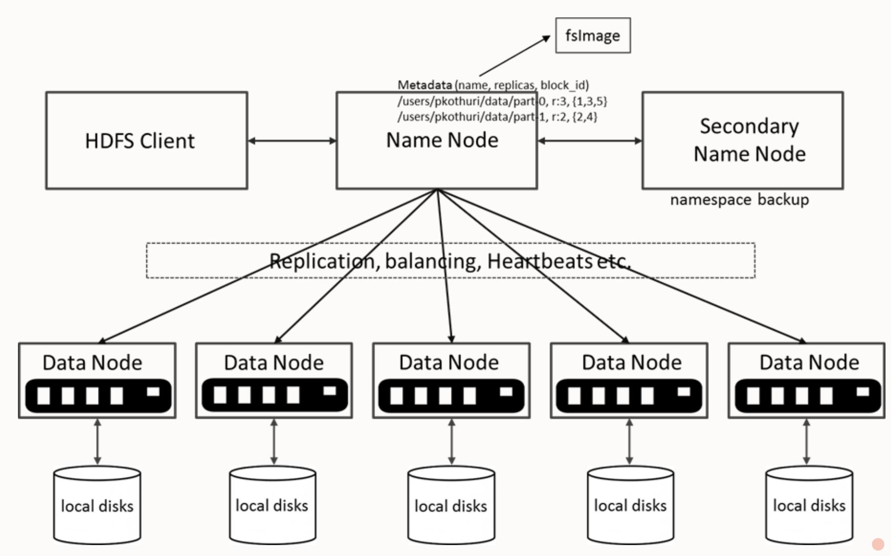

# HeartBeat pada HDFS

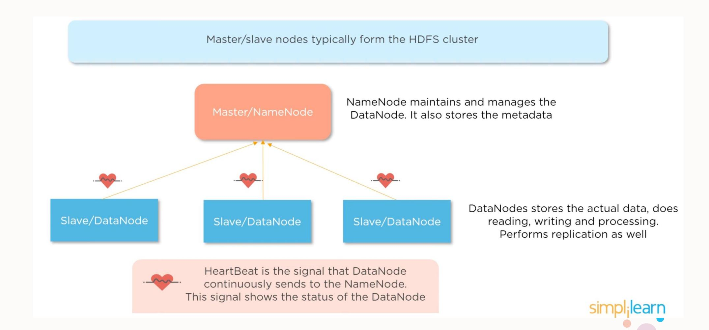

# HDFS

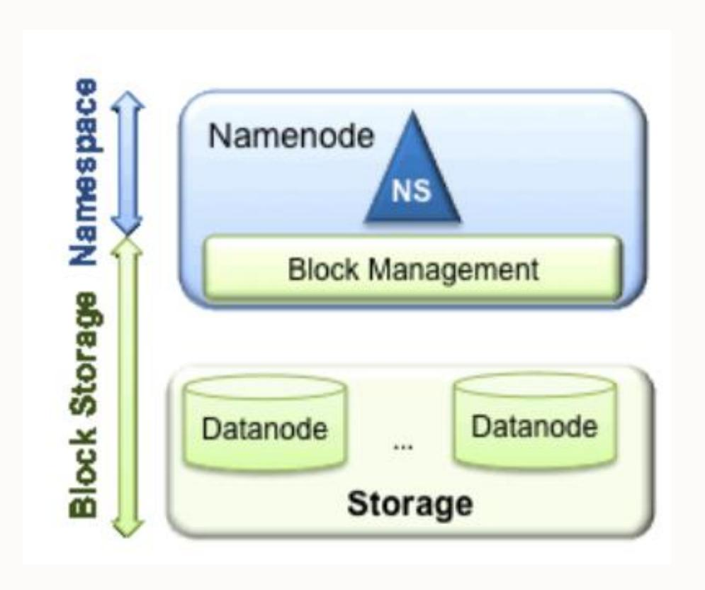

HDFS mempunyai 2 layer utama:

### <sup>◼</sup> **Namespace**

- Terdiri dari directory, file, dan block.
- Mendukung semua operasi sistem file terkait namespace seperti *create*, *delete*, *modify*, dan *list* file dan directory.
- Namespace = lokasi tertentu di HDFS

### <sup>◼</sup> **Block Storage Service**, yang memiliki dua bagian: Namenode dan Datanode

# Namenode dan Datanodes

- Master/slave architecture.
- HDFS terdiri dari sebuah **Namenode**, sebuah master server yang melakukan manajemen file seperti file sistem Namespace (file atau directory) dan mengatur akses file-file oleh client.
- Terdiri dari beberapa **DataNodes**.
- DataNodes melakukan menyimpan data dan pemrosesannya.
- File data terbagi kedalam satu atau beberapa blok dan satu set blok tersimpan dalam DataNodes.
- DataNodes melayani *read, write*, menjalankan *block creation, deletion*, dan *replication* berdasarkan instruksi dari Namenode.

# File system Metadata

- ■ Namespace disimpan dalam Namenode.
- ■ Namenode menggunakan transaction log bernama **EditLog** untuk menyimpan setiap perubahan yang terjadi terhadap data di dalam metadata. Contohnya, membuat file baru atau perubahan replication factor.
- ■ Keseluruhan file sistem Namespace, termasuk pemetaan block-block suatu file data dan propertinya, disimpan dalam suatu file bernama **FsImage**.


# Distributed File Systems

## Comparison of distributed file systems

[Add languages](#)

[Article](#) [Talk](#)

[Read](#) [Edit](#) [View history](#)

From Wikipedia, the free encyclopedia

*See also: Comparison of distributed parallel fault-tolerant file systems*

In computing, a distributed file system (DFS) or network file system is any file system that allows access to files from multiple hosts sharing via a computer network. This makes it possible for multiple users on multiple machines to share files and storage resources.

Distributed file systems differ in their performance, mutability of content, handling of concurrent writes, handling of permanent or temporary loss of nodes or storage, and their policy of storing content.

**Locally managed** [\[edit\]](#)

**FOSS** [\[edit\]](#)

| Client                                       | Written in | License            | Access API                                       | High availability | Shareds | Efficient Redundancy                   | Redundancy Granularity | Initial release year | Memory requirements (GB) |
|----------------------------------------------|------------|--------------------|--------------------------------------------------|-------------------|---------|----------------------------------------|------------------------|----------------------|--------------------------|
| Alluxio<br>(Virtual Distributed File System) | Java       | Apache License 2.0 | HDFS, FUSE, HTTP/REST, S3                        | hot standby       | No      | Replication <sup>[1]</sup>             | File <sup>[2]</sup>    | 2013                 |                          |
| Ceph                                         | C++        | LGPL               | librados (C, C++, Python, Ruby), S3, Swift, FUSE | Yes               | Yes     | Pluggable erasure codes <sup>[3]</sup> | Pool <sup>[4]</sup>    | 2010                 | 1 per TB of storage      |
| Coda                                         | C          | GPL                | C                                                | Yes               | Yes     | Replication                            | Volume <sup>[5]</sup>  | 1987                 |                          |
| GlusterFS                                    | C          | GPLv3              | libglusterfs, FUSE, NFS, SMB, Swift              | mirror            | Yes     | Reed-Solomon <sup>[6]</sup>            | Volume <sup>[7]</sup>  | 2005                 |                          |

# Komponen Hadoop – MapReduce

Hadoop MapReduce is a programming technique where huge data is processed in a parallel and distributed fashion

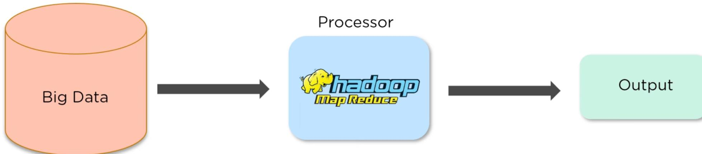

MapReduce is used for parallel processing of the Big Data, which is stored in HDFS

# Pendekatan MapReduce

In MapReduce approach, processing is done at the slave nodes and the final result is sent to the master node

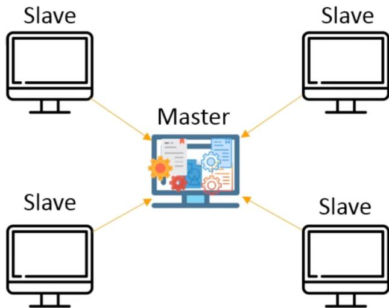

Traditional approach – Data is processed at the Master node

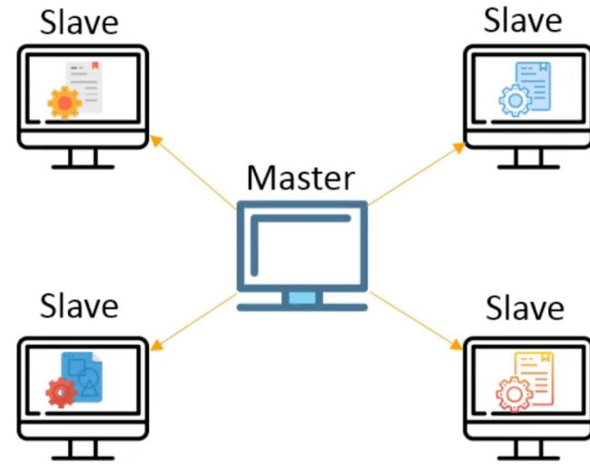

MapReduce approach – Data is processed at the Slave nodes

# Komponen Hadoop – MapReduce

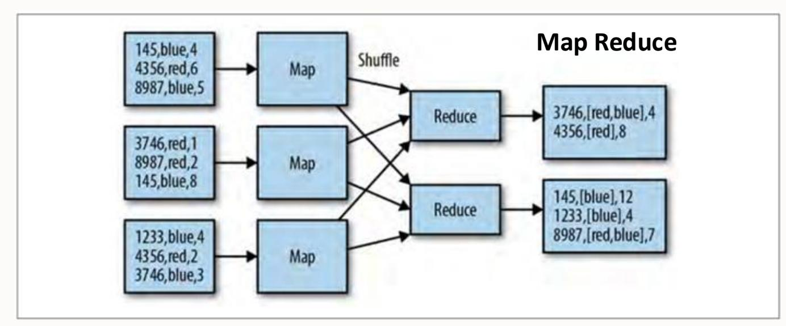

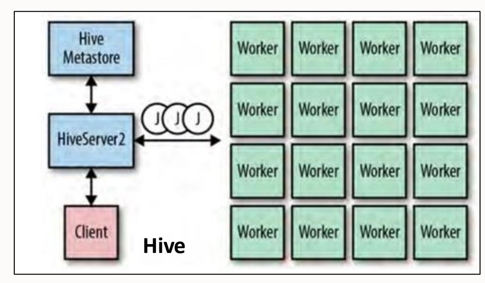

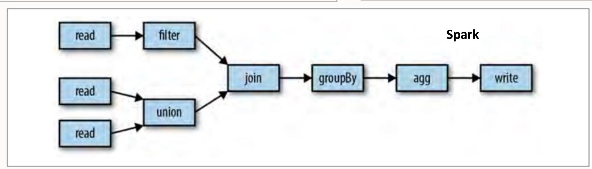

# How MapReduce works


User

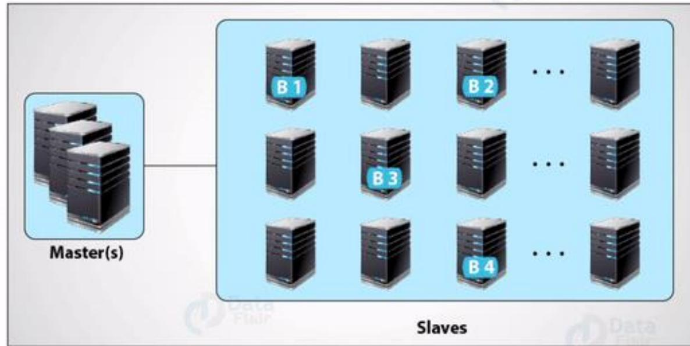

Hadoop Cluster

Instead of moving data to the processing unit, we are moving the processing unit to the data in the MapReduce Framework

## Contoh MapReduce menggunakan 3 nodes untuk job WordCount()

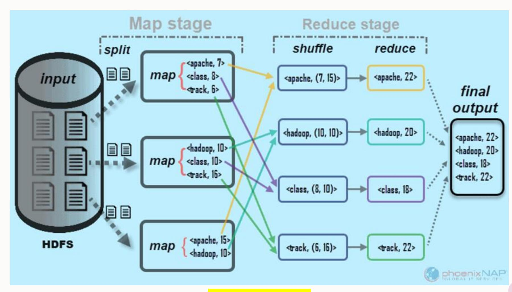

key-value pairs <sup>43</sup>

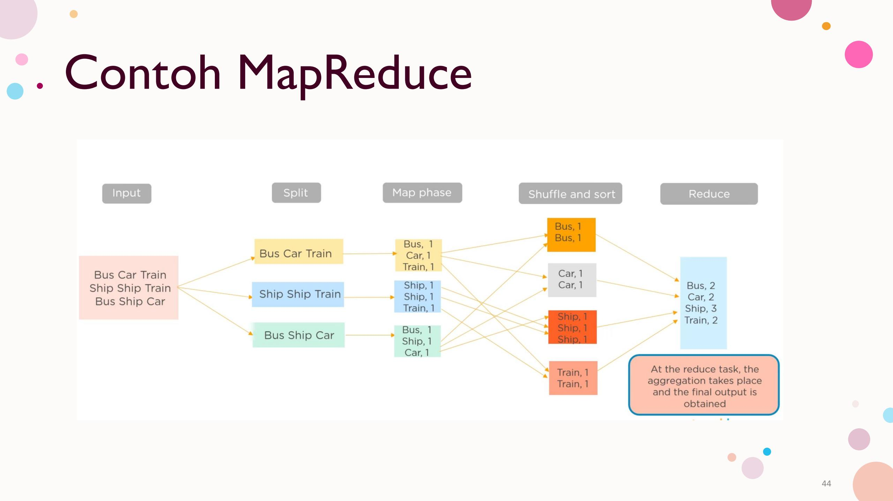

# Contoh MapReduce

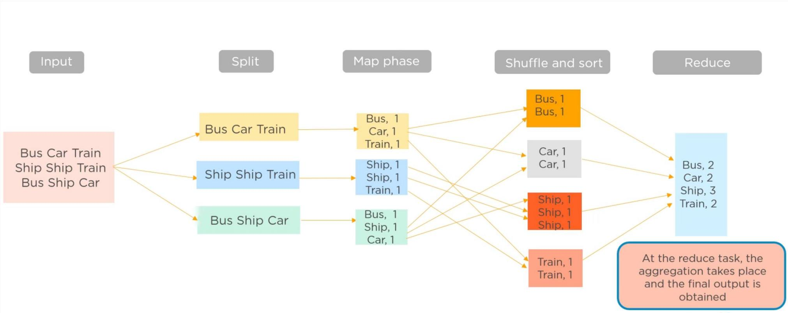


# Hadoop Versi >= 2.0

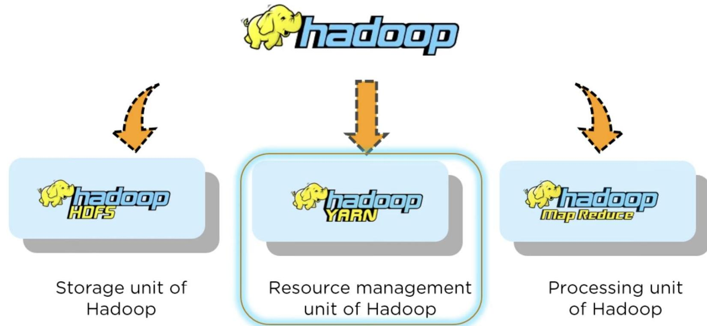

# YARN (Yeat Another Resource Negotiator)

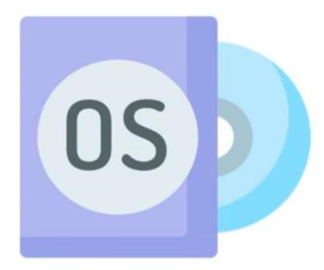

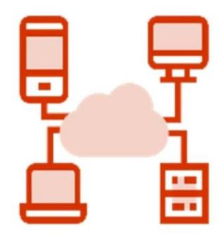

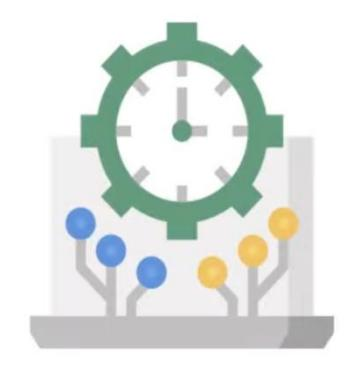

# YARN

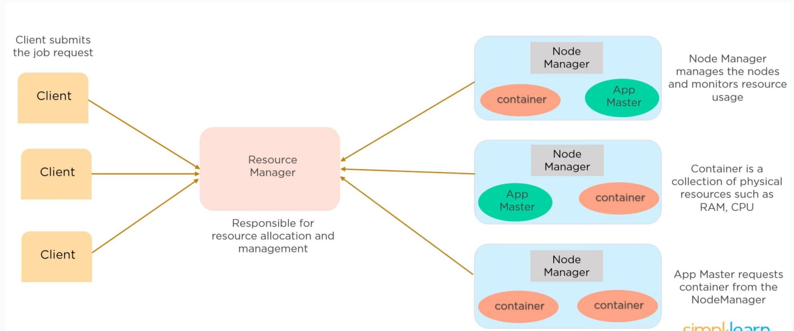

# Komponen Hadoop - Yarn

YARN memungkinkan berbagai data processing engines:

- interactive processing,
- graph processing,
- batch processing,
- stream processing

untuk menjalankan dan memproses data yang disimpan dalam HDFS (*lihat gambar arsitektur Hadoop/HDP* )

- ■ **Resource Manager:** Scheduler (pengalokasian resource e.g. CPU, Memory) and Application Manager
- ■ **Node Manager**

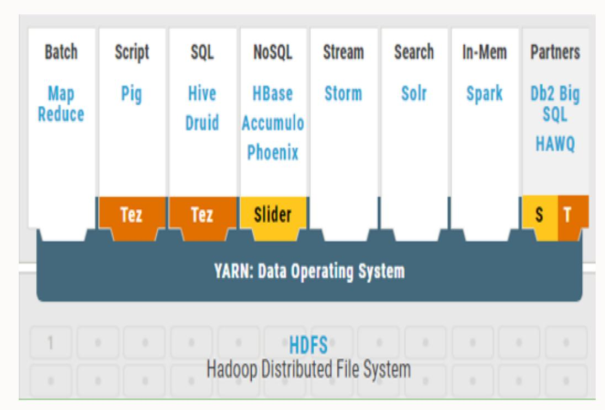

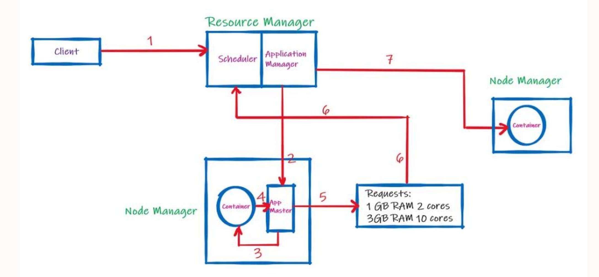

# Pengenalan Virtualization

- **Virtualization technology** adalah teknologi pembuatan sesuatu versi virtual – bukan aktual -, seperti sistem operasi (OS), server, storage, atau network.

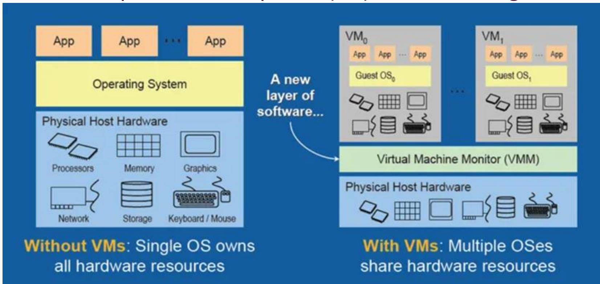

# Implementasi Virtualisasi

- ■ Server Virtualization
- ■ Desktop Virtualization
- ■ Storage Virtualization
- ■ Virtualization vs. Cloud Computing *complementary, not interchangeable*


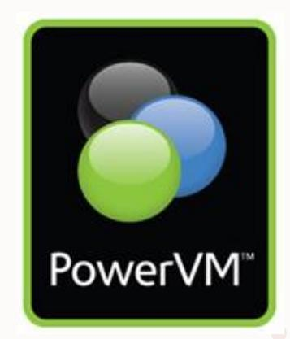


# Virtual Machine vs Container

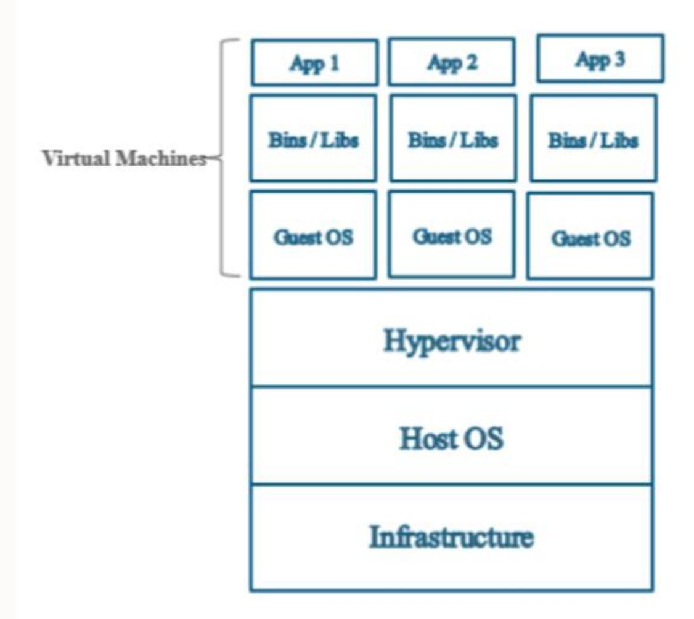

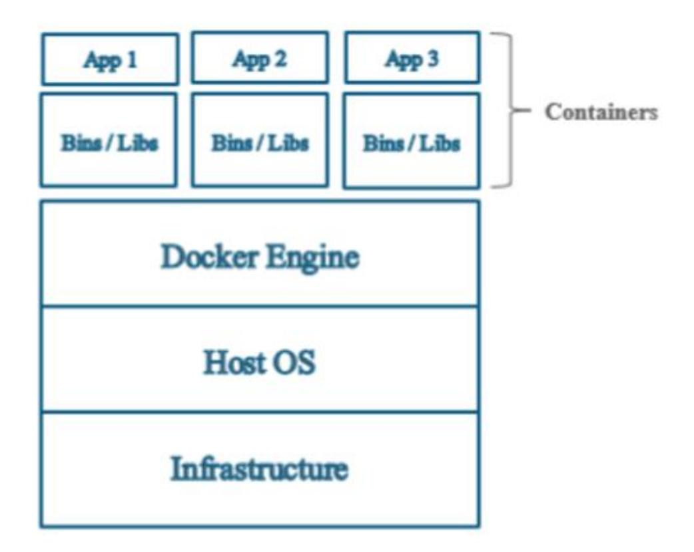

# Containerization

**Container** adalah sebuah virtualisasi OS yang dapat membungkus suatu aplikasi beserta dependency dan environment-nya. Setiap container memiliki process yang terisolir sehingga tidak mengganggu host OS ataupun container yang lain.

### **Keuntungan Container**:

- Portability
- Resource density and efficiency
- Isolation and resource sharing
- Speed
- Scalability

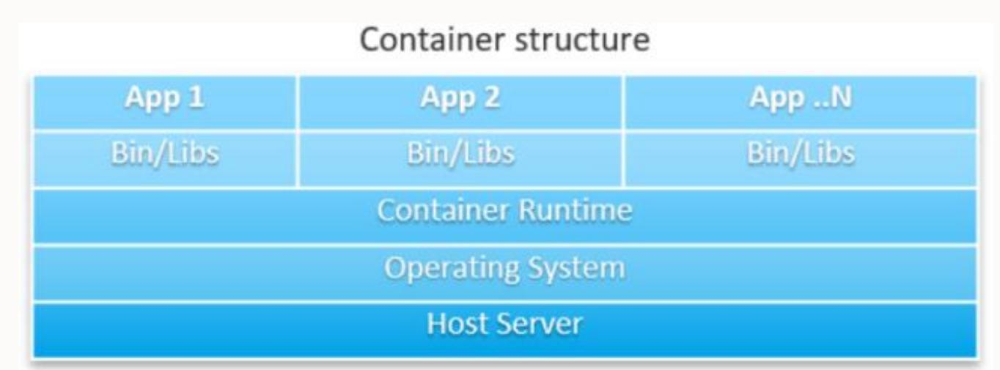

# Praktikum: Hadoop

- ■ Hortonworks Data Platform (HDP) Sandbox
- ■ VirtualBox

# Perintah Shell

- ■ Hadoop menyertakan berbagai perintah mirip shell yang berinteraksi langsung dengan HDFS dan sistem file lain yang didukung Hadoop.
- ■ Perintah **hdfs dfs -help** mencantumkan perintah yang didukung oleh Hadoop shell.
- ■ Selanjutnya, perintah **hdfs dfs -help command-name** menampilkan bantuan yang lebih detail untuk sebuah perintah.
- ■ Perintah-perintah ini mendukung sebagian besar operasi sistem file normal seperti menyalin file, mengubah hak akses file, dll. Selain itu, juga mendukung beberapa operasi khusus HDFS seperti mengubah replikasi file.

# HDFS Configuration

### HDFS Defaults

- ■ Block Size – 64 MB
- ■ Replication Factor – 3
- ■ Web UI Port – 50070

**HDFS conf file** - /etc/hadoop/conf/hdfs-site.xml


```
<property>
    <name>dfs.namenode.name.dir</name>    <value>file:///data1/cloudera/dfs/nn,file:///data2/cloudera/dfs/nn</value></property><property>
    <name>dfs.blocksize</name>
    <value>268435456</value></property><property>
    <name>dfs.replication</name>
    <value>3</value></property><property>
    <name>dfs.namenode.http-address</name>
    <value>itracXXX.cern.ch:50070</value></property>
    </property>
    </property>
    </property>
    </property&

# Terima kasih

Thanks to:

- Apache Hadoop
- SimpliLearn (some images credited to)
```