# Distributed Processing

Pertemuan 7 - Teknologi Perekayasaan Data

Politeknik Statistika STIS

Siti Mariyah, Ph.D


# Agenda Pertemuan


**MapReduce**

**MapReduce pada Hadoop**

**MapReduce Use Case dan Implementasi**

**YARN pada Hadoop**

# MapReduce pada Hadoop

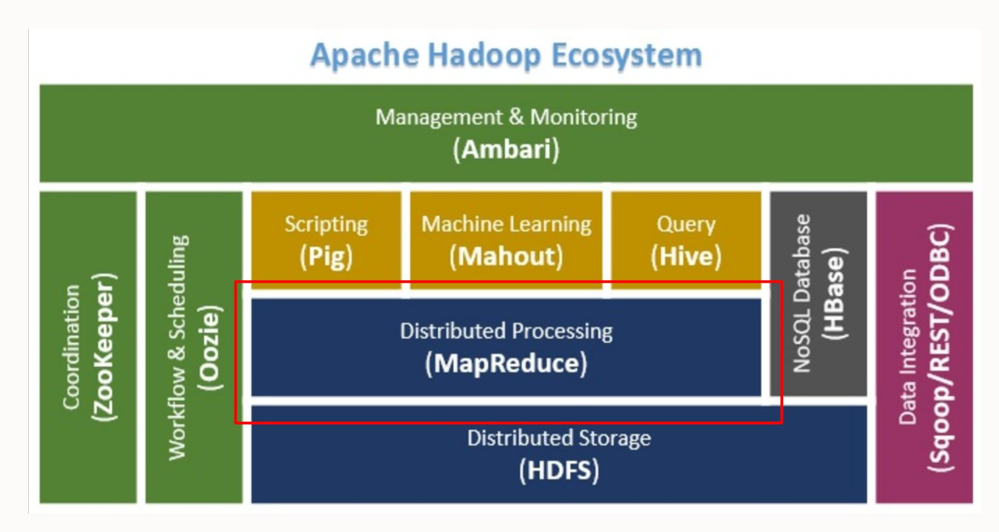

**MapReduce – Distributed Data Processing Framework of Apache Hadoop**

**MapReduce** is the heart of **Hadoop**

# Distributed System

Ø **Sistem Terdistribusi (***Distributed System***)** adalah sekelompok komputer yang bekerja bersama tetapi terlihat sebagai satu sistem oleh pengguna. Ø Sistem terdistribusi memungkinkan pengguna untuk **berbagi** perangkat keras, perangkat lunak, dan sumber daya data. Ø Komputer – komputer tersebut berkomunikasi satu sama lain melalui jaringan dan sebuah sistem operasi terdistribusi (DOS – *Distributed Operating System*) yang mengelola sumber daya tersebut.

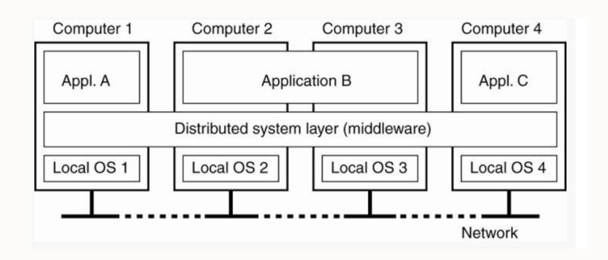

# Distributed Data Processing

- ❖ **Pemrosesan Data Terdistribusi (*Distributed Data Processing*)** adalah suatu proses pemrosesan data di beberapa komputer dalam sistem terdistribusi. Proses ini memungkinkan data diproses lebih cepat dan lebih efisien karena beban kerja tersebar di banyak komputer.
- ❖ Pada proses ini, data akan dibagi menjadi segmen-segmen kecil dan diproses secara paralel di beberapa node. Hasilnya kemudian digabungkan untuk menghasilkan output akhir.
- ❖ Keuntungan pemrosesan terdistribusi VS pemrosesan terpusat:
  - Scalability
  - Fault-tolerance
  - Higher performance
  - Cost-effective
  - Increased data security
  - Greater agility - memungkinkan organisasi dengan cepat beradaptasi dengan perubahan kebutuhan bisnis, penambahan node baru dapat dilakukan dengan cepat, memungkinkan menskalakan kapabilitas pemrosesan dengan cepat.
  - Geographical flexibility - memproses data dari lokasi-lokasi berbeda tanpa memusatkan data di tempat tertentu.

# Apa itu MapReduce?

**MapReduce** merupakan suatu model pemrograman dan software framework yang dikembangkan oleh Google dan dipopulerkan oleh Apache Hadoop yang digunakan untuk memproses data dalam jumlah besar

MapReduce dirancang untuk memproses dan menghasilkan dataset yang besar secara paralel dengan membagi tugas menjadi tugas-tugas yang lebih kecil dan mengeksekusinya di beberapa node dalam sistem terdistribusi

MapReduce menyederhanakan pengembangan aplikasi pemrosesan data terdistribusi dengan menyediakan abstraksi atas kompleksitas pemrosesan data terdistribusi

# Apa itu MapReduce?

## MapReduce: Simplified Data Processing on Large Clusters

Jeffrey Dean and Sanjay Ghemawat

jeff@google.com, sanjay@google.com

*Google, Inc.*

### Abstract

MapReduce is a programming model and an associated implementation for processing and generating large data sets. Users specify a *map* function that processes a key/value pair to generate a set of intermediate key/value pairs, and a *reduce* function that merges all intermediate values associated with the same intermediate key. Many real world tasks are expressible in this model, as shown in the paper.

Programs written in this functional style are automatically parallelized and executed on a large cluster of commodity machines. The run-time system takes care of the details of partitioning the input data, scheduling the program's execution across a set of machines, handling machine failures, and managing the required inter-machine communication. This allows programmers without any experience with parallel and distributed systems to easily utilize the resources of a large distributed system.

given day, etc. Most such computations are conceptually straightforward. However, the input data is usually large and the computations have to be distributed across hundreds or thousands of machines in order to finish in a reasonable amount of time. The issues of how to parallelize the computation, distribute the data, and handle failures conspire to obscure the original simple computation with large amounts of complex code to deal with these issues.

As a reaction to this complexity, we designed a new abstraction that allows us to express the simple computations we were trying to perform but hides the messy details of parallelization, fault-tolerance, data distribution and load balancing in a library. Our abstraction is inspired by the *map* and *reduce* primitives present in Lisp and many other functional languages. We realized that most of our computations involved applying a *map* operation to each logical "record" in our input in order to

- ➤ MapReduce pertama kali dipopulerkan sebagai model pemrograman pada tahun 2004 oleh Jeffery Dean dan Sanjay Ghemawat dari Google (Dean & Ghemawat, 2004) dalam paper mereka

- ➤ Paper ini membahas pendekatan Google untuk mengumpulkan dan menganalisis data situs web untuk pengoptimalan penelusuran, e.g: PageRank, Web request logs, etc

- ➤ Sistem MapReduce milik Google berjalan di Google File System (GFS)

- ➤ Apache mulai menggunakan MapReduce dalam proyek "Nutch"

# Bagaimana MapReduce bekerja?

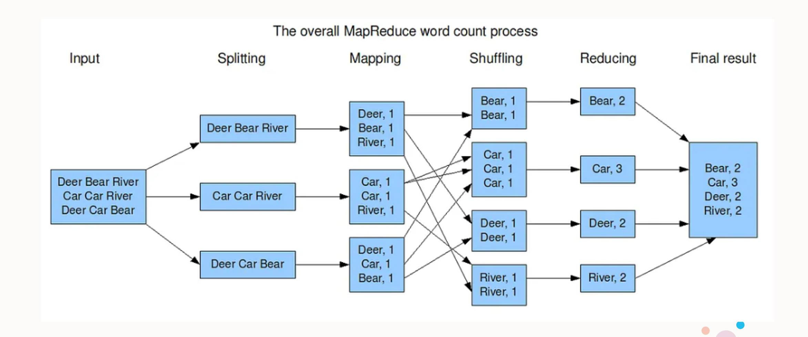

# Bagaimana MapReduce bekerja?

Berdasarkan contoh kasus Word Count, **tahapan MapReduce** dapat dibagi menjadi beberapa tahap:

#### **1. Splitting (Pemecahan data masukan ).**

Pada proses ini data masukan yang diberikan oleh pengguna MapReduce (*client*) akan dipecah menjadi bagian-bagian yang lebih kecil.

#### **2. Mapping**

- Merupakan salah satu tahap terpenting dari MapReduce. Pada fase ini, data yang telah dipecah akan di proses untuk menghasilkan *intermediary key-value pairs*. Pada contoh Word Count di gambar, data yang mengandung "Dear Bear River" akan diproses sehingga menghasilkan pasangan *key-value* Dear:1, Bear:1, dan River:1.
- Dalam fase *Mapping*, bisa jadi ada satu atau lebih mesin pekerja (*worker*) yang melakukan proses terhadap beberapa pecahan data yang berbeda. Semakin banyak jumlah mesin atau tingkatan paralelisme yang digunakan, maka durasi pemrosesan seluruh data dapat berjalan jauh lebih cepat.

# Bagaimana MapReduce bekerja?

- **3. Shuffling (Pengacakan)** Fase *mapping* bisa berjalan di satu atau banyak mesin. Akibatnya, pasangan *key-value* yang dihasilkan oleh sebuah mapper bisa tersebar di berbagai mesin. • Namun, jika pengolahan yang ingin dilakukan adalah perhitungan dengan menggunakan key yang sama, maka data dengan key yang sama harus berada pada mesin yang sama pada fase *reduce*.
  - Oleh karena itu, sebelum fase *reduce*, fase *shuffling* bertugas untuk mengumpulkan satu atau lebih *key* yang berbeda disebuah mesin tertentu agar aggregasi dapat dilakukan dengan mudah.

- **4. Reducing** Fase *reducing* bertugas untuk melakukan aggregasi terhadap seluruh pasangan *intermediary key- value* dengan *key* yang sama. Pada gambar, pasangan *key-value* Bear:1 dan Bear:1 akan diaggregasi oleh *reducer* sehingga pada akhirnya *reducer* akan menghasilkan keluaran Bear:2 seperti pada contoh kasus Word Count.

# Contoh Studi Kasus Lain

1. Jelaskan setiap tahapan (termasuk *key-value pairs*-nya) pada implementasi MapReduce untuk menghitung Salary tertinggi dari suatu perusahaan, dimana data tersebut telah dipecah di 4 machine/file sebagai berikut:

| name, salary   | name, salary   | name, salary   | name, salary   |
|----------------|----------------|----------------|----------------|
| satish, 26000  | gopal, 50000   | satish, 26000  | satish, 26000  |
| Krishna, 25000 | Krishna, 25000 | kiran, 45000   | Krishna, 25000 |
| Satishk, 15000 | Satishk, 15000 | Satishk, 15000 | manisha, 45000 |
| Raju, 10000    | Raju, 10000    | Raju, 10000    | Raju, 10000    |

2. Jelaskan setiap tahapan MapReduce untuk menghitung jumlah Salary di setiap department yang harus dikeluarkan oleh perusahaan dari dataset berikut:

```
empID,dept,salary
e001,it,10000
e002,cse,20000
e003,it,30000
e004,fin,40000
...
e0nn,hr,20000
```

# Contoh Studi Kasus Lain

- 3. Misalkan diketahui input dan output yang diharapkan dari MapReduce sebagai berikut. Jelaskan prosesnya!

| Country | State | City | Population (Mil) |
|---------|-------|------|------------------|
| USA,    | CA    | Su   | 12               |
| USA,    | CA    | SA   | 42               |
| USA,    | CA    | Fr   | 23               |
| USA,    | MO    | XY   | 23               |
| USA,    | MO    | AB   | 19               |
| USA,    | MO    | XY   | 23               |
| USA,    | MO    | AB   | 19               |
| IND,    | TN    | AT   | 11               |
| IND,    | TN    | KL   | 10               |

#### **Input Output**

| Country | State | Total Population |
|---------|-------|------------------|
| IND     | TN    | 21               |
| USA     | CA    | 77               |
| USA     | MO    | 84               |

*Key* dalam tahapan MapReduce tidak harus *single atomic value*, bisa saja berupa *composite keys*.

## Contoh Studi Kasus Lain – composite key-value

- 4. Misal kita mengaplikasikan nilai rata-rata RGB setiap pixel untuk memperhalus suatu gambar


#### **Map**

- input key: (x,y), input value: (R,G,B)
- 9 point data untuk setiap pixel gambar (x,y)

yaitu:

(x-1, y-1, R,G,B)

(x , y-1, R,G,B)

(x+1, y-1, R,G,B), dst

#### **Reduce**

- input key: (x,y), input value: *list of* (R,G,B)
- compute rata-rata dari (R,G,B)
- output key: (x,y), output value: avg(R,G,B)

# MapReduce Programming Model

Terdiri dari 2 fungsi utama yaitu "**Map**" dan "**Reduce**"

- Tugas **Map** berurusan dengan *splitting* dan *mapping* data
- Tugas **Reduce** berurusan dengan *shuffling* dan *reducing* data

Suatu program MapReduce mentranformasi **input list** ke **ouput list**. List ini berbentuk **key-value** pairs.

Programmer perlu mendefinisikan dua fungsi: fungsi **map()** dan fungsi **reduce()**

**map (in\_key, in\_value) list(out\_key, intermediate\_value)**

**reduce (out\_key, list(intermediate\_value)) list(out\_value)**

- Memproses input key-value pair
- Menghasilkan himpunan intermediate key-value pairs

- Menggabungkan semua intermediate values untuk satu key
- Menghasilkan himpunan output values hasil dari penggabungan

# MapReduce (ilustrasi input - output)

Proses Map Proses Reduce

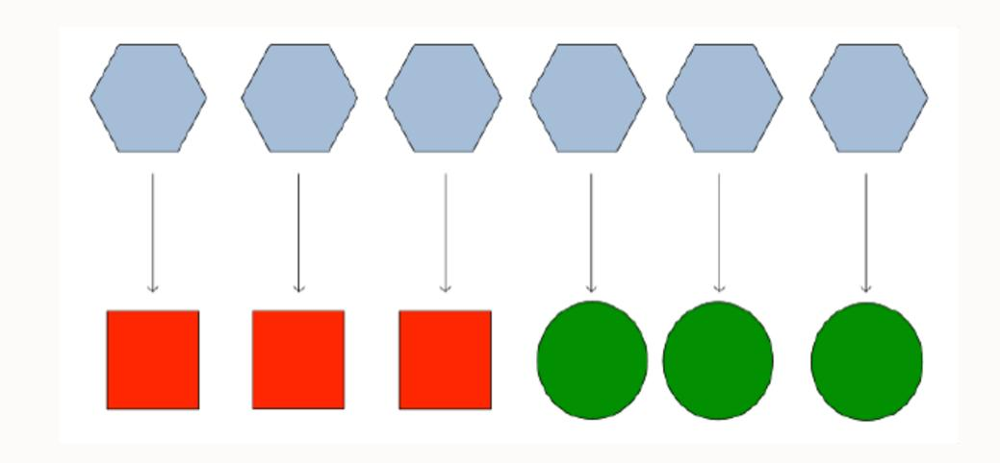

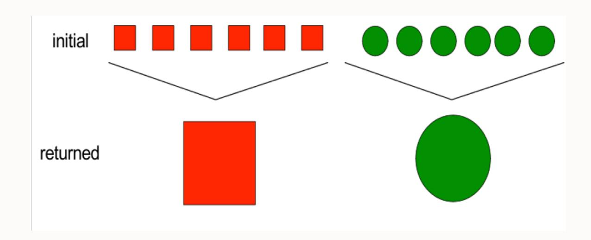

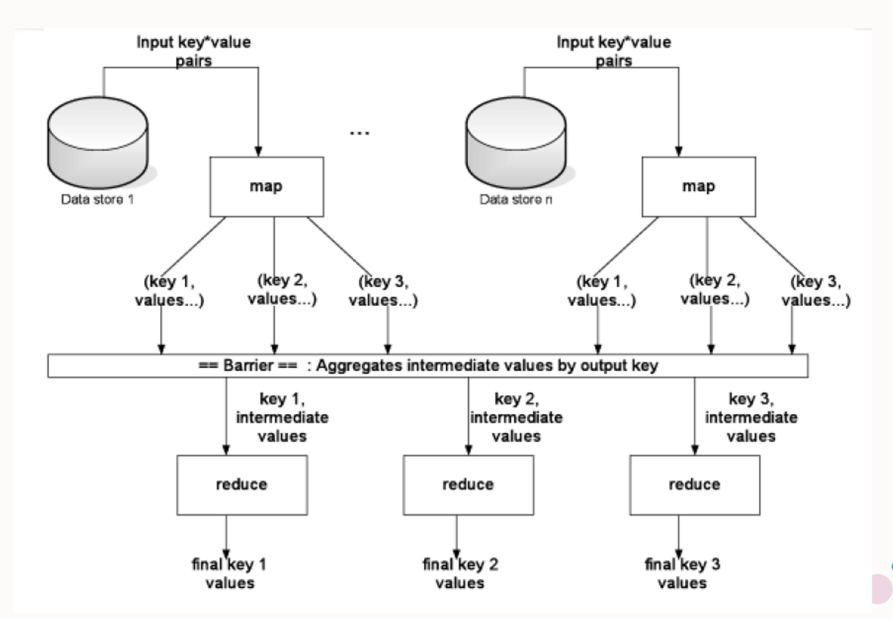

## MapReduce Programming Model

#### **Map**

- Menjalankan suatu fungsi di setiap *individual value* di suatu dataset untuk membuat suatu list baru
- Contoh:

**square x = x\*x**

**map square [1, 2, 3, 4, 5]**

**returns [1, 4, 9, 16, 25]**

#### **Reduce**

- Menggabungkan values di dataset untuk membuat suatu value baru
- Contoh:

**sum = (each elemen in arr, total += )**

**reduce [1, 2, 3, 4, 5]**

**returns 15**

# Contoh Program MapReduce – WordCount dalam Java

```
package PackageDemoTPD;import java.io.IOException;
import org.apache.hadoop.conf.Configuration;
import org.apache.hadoop.fs.Path;
import org.apache.hadoop.io.IntWritable;
import org.apache.hadoop.io.LongWritable;
import org.apache.hadoop.io.Text;
import org.apache.hadoop.mapreduce.Job;
import org.apache.hadoop.mapreduce.Mapper;
import org.apache.hadoop.mapreduce.Reducer;
import org.apache.hadoop.mapreduce.lib.input.FileInputFormat;
import org.apache.hadoop.mapreduce.lib.output.FileOutputFormat;
import org.apache.hadoop.util.GenericOptionsParser;public class WordCount {
    public static void main(String [] args) throws Exception
    {
        Configuration c=new Configuration();
        String[] files=new GenericOptionsParser(c,args).getRemainingArgs();
        Path input=new Path(files[0]);
        Path output=new Path(files[1]);
        Job j=new Job(c,"wordcount");
        j.setJarByClass(WordCount.class);
        j.setMapperClass(MapForWordCount.class);
        j.setReducerClass(ReduceForWordCount.class);
        j.setOutputKeyClass(Text.class);
        j.setOutputValueClass(IntWritable.class);
        FileInputFormat.addInputPath(j, input);
        FileOutputFormat.setOutputPath(j, output);
        System.exit(j.waitForCompletion(true)?0:1);
    }
}
```

Seluruh program MapReduce secara fundamental dapat dibagi menjadi tiga bagian:

- Mapper Phase Code
- Reducer Phase Code
- Driver Code

Pada Class driver, kita lakukan pengaturan konfigurasi pekerjaan MapReduce untuk dijalankan di Hadoop.

# Contoh Program MapReduce – WordCount dalam Java

```
public static class MapForWordCount extends Mapper<LongWritable, Text, Text, IntWritable>{
    public void map(LongWritable key, Text value, Context con) throws IOException, InterruptedException
    {
        String line = value.toString();
        String[] words=line.split(",");
        for(String word: words)
        {
            Text outputKey = new Text(word.toUpperCase().trim());
            IntWritable outputValue = new IntWritable(1);
            con.write(outputKey, outputValue);
        }
    }
}
```

- Class MapForWordCount mengextend class **Mapper** yang sudah didefinisikan dalam framework MapReduce
- Input dan output dari Mapper adalah pasangan key/value

```
public static class ReduceForWordCount extends Reducer<Text, IntWritable, Text, IntWritable>
{
    public void reduce(Text word, Iterable<IntWritable> values, Context con) throws IOException, InterruptedException
    {
        int sum = 0;
        for(IntWritable value : values)
        {
            sum += value.get();
        }
        con.write(word, new IntWritable(sum));
    }
}
```

- Class ReduceForWordCount mengextend class **Reducer** yang sudah didefinisikan dalam framework MapReduce
- Input dan output dari Reducer adalah pasangan key/value

## Aplikasi MapReduce

Text mining

Index building

Graph creation and analysis

Pattern recognition

Collaborative filtering

Prediction models

Sentiment analysis

Risk assessment

## Arsitektur MapReduce di Hadoop: High Level

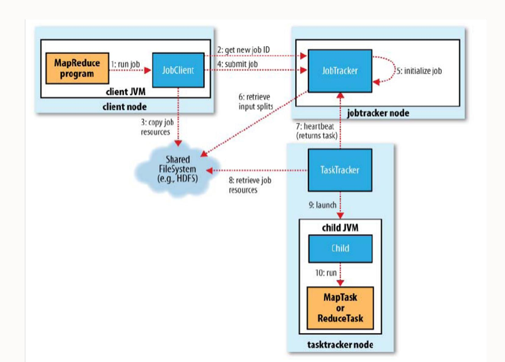

## Arsitektur MapReduce di Hadoop: Detail

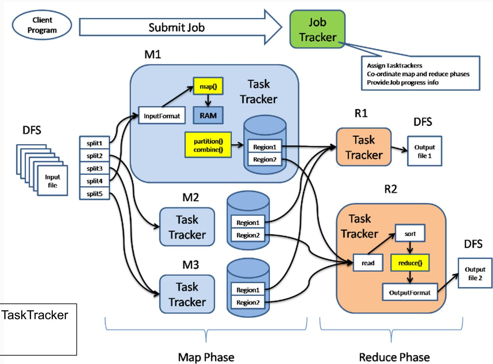

Daemons: JobTracker dan TaskTracker M1, M2, M3: Mapper R1, R2: Reducer

## Komponen-komponen dalam Arsitektur MapReduce

Ø **Client**: dapat berupa program atau API yang mengirimkan *tasks*/tugas MapReduce. MapReduce dapat menerima *services* dari banyak client. Ø **Job**: Pekerjaan yang harus dilakukan atau diproses. Ø **Task/Job-Parts**: Tugas-tugas kecil hasil dari pembagian pekerjaan. *Job* terdiri dari kumpulan *tasks*. Ø **JobTracker/ Hadoop MapReduce Master**: berperan dalam mengatur *tasks*, termasuk membagi *Job* menjadi *tasks*, dan melacak semua tasks yang diberikan ke suatu *TaskTracker*. Ø **TaskTracker**: berperan melacak aktivitas dan melaporkan status aktivitas ke *JobTracker*. Ø **Input Data**: digunakan untuk diproses dalam fase *Mapping*. Ø **Ouput/Exit Data**: Hasil akhir yang diperoleh setelah pemrosesan MapReduce.

## Bagaimana data diproses di MapReduce Hadoop?

- 1. MapReduce dimulai saat client men-*submit* suatu Job. Job tersebut pertama akan masuk ke JobTracker. Saat diterima, JobTracker mengirimkan permintaan ke NameNode yang memiliki lokasi DataNode. NameNode akan mengirimkan lokasi itu ke JobTracker.
- 2. Selanjutnya, JobTracker akan membagi Job ini menjadi Tasks/Job-Parts yang seimbang. Kemudian, Job Tracker mengirimkan permintaan ke TaskTracker di DataNode. Tasks ini kemudian tersedia untuk Map Task dan Reduce Task. Map() dan Reduce() Task berisi program yang ditulis sesuai kebutuhan pemrosesan data.

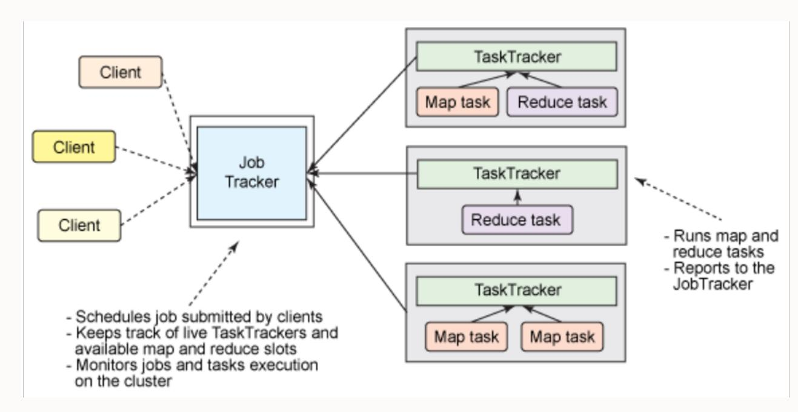

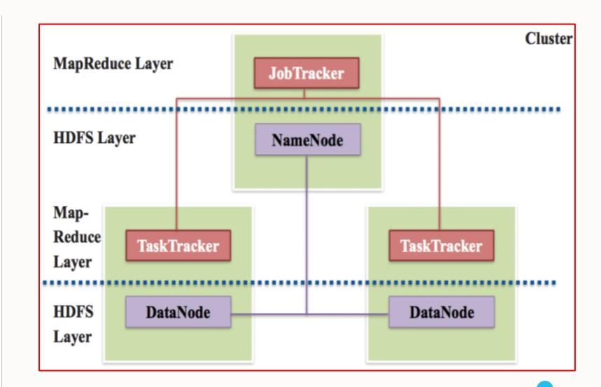

## Bagaimana data diproses di MapReduce Hadoop?

- 3. TaskTracker akan mengambil Input data di Datanode masing-masing. Data tersebut yang kita gunakan kemudian akan dibaca dan menjadi input untuk Map Task dan akan menghasilkan *intermediate keyvalue pair* sebagai output di memory buffer. Saat Map Task selesai dilakukan, JobTracker mendapat notifikasi dari TaskTracker. Setelah semua TaskTracker memberi tahu JobTracker, JobTracker memberi tahu TaskTracker untuk memulai fase Reduce.
- 4. Output dari Map Task (yaitu *key-value pair*) kemudian menjadi input untuk Reduce Task dan final output akan disimpan dalam HDFS.

## Bagaimana data diproses di MapReduce Hadoop?

*Intermediate key-value pair yang* dihasilkan oleh Map Task biasanya disimpan dalam memori di dalam buffer yang disebut "**map output buffer**". Namun, jika buffer penuh, beberapa *intermediate key-value pair* mungkin akan tersimpan ke disk untuk menghindari kehabisan memori. Data ini disimpan di disk lokal dari masing-masing Datanode. Setelah semua Map Task menyelesaikan pekerjaan mereka, data tersebut ditransfer ke Reducer, biasanya dalam HDFS.

Mungkin saja diperlukan/dibuat lebih dari satu Map Task dan Reduce Task tergantung kebutuhan pemrosesan data.

Hadoop mampu menjalankan program MapReduce yang ditulis dalam berbagai bahasa: Java, Ruby, Python, dan C++

## Keterbatasan MapReduce dalam Hadoop

MapReduce **kurang cocok** diterapkan pada:

v Real-time Processing. Hadoop MapReduce lebih efektif diterapkan untuk Batch Processing (dataset tersedia di HDFS). v Tidak selalu mudah untuk mengimplementasikan setiap kebutuhan sebagai program MR (banyak diperlukan pemrograman manual misal seperti join, filter, projection, aggregates, sorting, distinct, dll). v Ketika *intermediate processes* perlu berkomunikasi satu sama lain (*jobs run in isolation*). v MapReduce tidak dapat meng-cache *intermediate data* di memori untuk kebutuhan lebih lanjut (biasanya ada yang disimpan di disk untuk menghindari kehabisan memory) v banyak operasi read/write I/O terjadi selama pemrosesan MapReduce yang menghabiskan banyak waktu v solusi: in-memory processing **Apache Spark** *(10 - 100 times faster)*

## Alternatives to MapReduce

Apache Spark

Apache Storm

Ceph

Hydra

Google BigQuery

## Yet Another Resource Negotiator (YARN)

### **Hadoop 1**

#### **HDFS**

(Hadoop Distributed File System)

#### **MapReduce**

(Cluster Resource Management & **Batch** Data Processing)

### **Hadoop 2 & 3**

#### **HDFS**

(Hadoop Distributed File System)


#### **YARN: Data Operating System**

(Cluster Resource Management)

**Batch**

Map Reduce

**Batch & Interactive**

Tez / Others

**Realtime**

Slider

**Others**

Spark

## YARN

Pengenalan Hadoop Versi 2 mengubah cara aplikasi MapReduce berjalan di sebuah cluster.

Berbeda dengan MapReduce-Schedule monolitik di Hadoop Versi 1, Hadoop YARN telah menggeneralisasi sumber daya cluster yang tersedia untuk pengguna.

YARN awalnya disebut "MapReduce 2" karena meningkatkan MapReduce dengan memberikan pendekatan baru dengan memisahkan manajemen sumber daya MapReduce untuk kapabilitas penjadwalan yang lebih baik.

## Arsitektur YARN

#### v **MapReduce on Hadoop Version 1**

ü JobTracker bertanggung jawab untuk manajemen sumber daya (mengelola nodes melalui TaskTracker), melacak konsumsi dan ketersediaan sumber daya, dan juga manajemen siklus hidup Job (menjadwalkan Tasks dari Job, melacak progress, memberikan fault-tolerance untuk Task, dll) ü TaskTracker menjalankan Task atas perintah dari JobTracker dan secara berkala memberikan informasi status Task kepada JobTracker

#### v **MapReduce on Hadoop YARN**

ü Manajemen sumber daya cluster telah dipindahkan dari MapReduce ke YARN, sehingga memungkinkan aplikasi lain memanfaatkan YARN dan Hadoop ü Menfokuskan tugas MapReduce: memproses data. Dengan YARN, banyak aplikasi dapat dijalankan di Hadoop, semuanya berbagi manajemen sumber daya yang sama.

# Arsitektur YARN

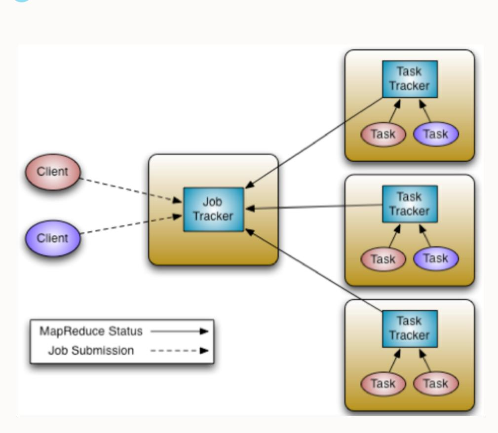


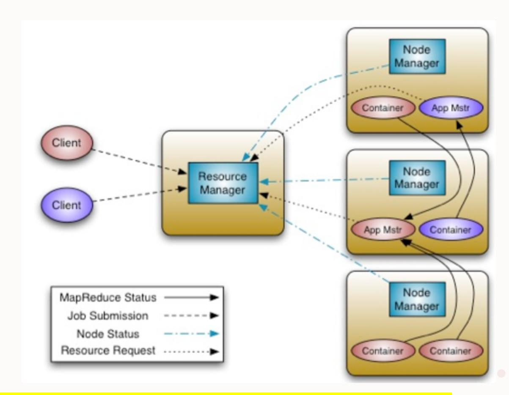

**Idea**: memecah fungsi *resource management* dan *job scheduling/monitoring* ke *daemon* terpisah

ResourceManager (RM) ApplicationMaster (AM) <sup>32</sup>

|                               | YARN                                                               | MapReduce                                         |
|-------------------------------|--------------------------------------------------------------------|---------------------------------------------------|
| Criteria                      | Real-time, batch, and interactive processing with multiple engines | Silo and batch processing with a single engine    |
| Cluster resource optimization | Excellent due to central resource management                       | Average due to fixed Map and Reduce slots         |
| Suitable for                  | MapReduce and non-MapReduce applications                           | Only MapReduce applications                       |
| Managing cluster resource     | Done by YARN                                                       | Done by JobTracker                                |
| Namespace                     | With YARN, Hadoop supports multiple namespaces                     | Only one namespace could be supported, i.e., HDFS |

## Komponen-komponen dalam Arsitektur YARN

**Resource Manager** terdiri dari 2 komponen:

- **Scheduler** mengatur penjadwalan cluster untuk mengalokasikan sumber daya ke berbagai aplikasi yang sedang berjalan di cluster
- **Applications Manager** bertanggung jawab untuk menerima Job, memantau progress aplikasi yang di-submit (misal MapReduce Job)

**Node Manager** mengatur node individu dalam cluster, bertugas untuk memantau container, memantau penggunaan resource (CPU, memori, disk, jaringan), dan melaporkan ke Resource Manager (Scheduler).

**Application Master** melakukan eksekusi Job, satu Application Master di-*launch* untuk satu Job, bekerja dengan Node Managers dan menegosiasikan sumber daya dengan Resource Manager (Scheduler). Untuk alokasi sumber daya, AM akan berkomunikasi dengan Resource Manager, untuk *launch* atau menghentikan container, AM akan berkomunikasi dengan Node Manager.

**Containers** adalah kumpulan sumber daya fisik pada satu node, seperti memori (RAM), CPU, dan disk. Bisa ada satu atau beberapa container pada satu Node yang di-*start* oleh Node Manager. Setiap node dalam sistem dapat terdiri dari beberapa container dengan ukuran memori minimum (512MB atau 1 GB, misalnya).

## Bagaimana Job dijalankan menggunakan YARN?

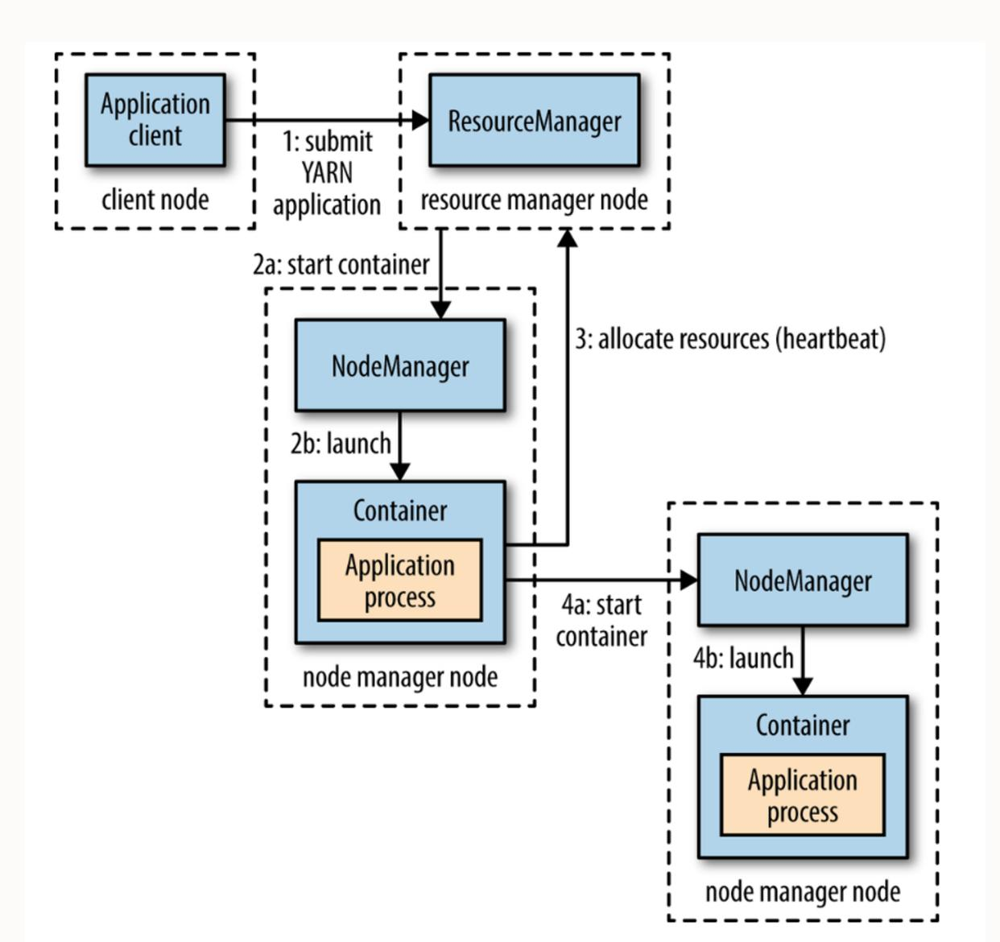

## Bagaimana Job dijalankan menggunakan YARN?

- 1. Client men-*submit* Job/aplikasi dengan meminta Resource Manager untuk menjalankan *process* Application Master (1). Resource Manager kemudian mengkontak Node Manager untuk me-*launch* container baru dan menjalankan Application Master di dalamnya (2a & 2b).
- 2. Application Master meminta Resource Manager untuk mengalokasikan sumber daya (3). Kemudian, Resource Manager akan mengalokasi sumber daya dengan mempertimbangkan data locality (misal ukuran dan bandwidth) sehingga Tasks dapat dijalankan di machine dimana blok data berada.
- 3. Task pemrosesan/komputasi bisa langsung dieksekusi di dalam container yang sama yang sedang berjalan tersebut dan mengembalikan hasilnya ke client. Atau dapat juga meminta lebih banyak container dari Resource Manager (3) dan menggunakannya untuk menjalankan komputasi terdistribusi (4a & 4b).
- 4. Task akan mengirimkan progress update ke Application Master dari waktu ke waktu. Jika terjadi kegagalan, Application Master dapat menjalankan Task tersebut di container yang berbeda.

# File Konfigurasi pada Hadoop

```
/etc/hadoop/conf/mapred-site.xml
/etc/hadoop/conf/yarn-site.xml
/etc/hadoop/conf/capacity-scheduler.xml Resource Manager
/etc/hadoop/conf/yarn-env.sh
```

File permissions:

[https://docs.cloudera.com/HDPDocuments/HDP2/HDP-2.1.7/bk\\_using-apache-HDP2/](https://docs.cloudera.com/HDPDocuments/HDP2/HDP-2.1.7/bk_using-apache-HDP2/)

```
drwxr-xr-x    3 root    root        4096 /etc/hadoop
lrwxrwxrwx   1 hadoop_deploy hadoop   29 conf -> /etc/alternatives/hadoop
-rw-r--r--   1 hdfs    hadoop   2316 core-site.xml
-rw-r--r--   1 mapred hadoop   7632 mapred-site.xml
-rw-r--r--   1 mapred hadoop   7632 yarn-site.xml
-rw-r--r--   1 mapred hadoop   2033 mapred-queue-acls.xml
-rw-r--r--   1 hdfs     hadoop    928 taskcontroller.cfg
-rw-r--r--   1 root      root       9406 capacity-scheduler.xml
-rw-r--r--   1 root      root       327 fair-scheduler.xml
-rw-r--r--   1 hdfs     hadoop   4867 hadoop-env.sh
-rw-r--r--   1 hdfs     hadoop   4867 yarn-env.sh
```


# Referensi

#### [Hadoop: The Definitive Guide](https://docs.cloudera.com/HDPDocuments/HDP2/HDP-2.1.2/bk_using-apache-hadoop/content/yarn_overview.html)

#### **MapReduce**

https://hadoop.apache.org/docs/current/hadoop-mapreduce-client/hadoop- mapreduce-client-core/MapReduceTutorial.html

#### **YARN**

https://hadoop.apache.org/docs/current/hadoop-yarn/hadoop-yarn-site/YARN.html

https://docs.cloudera.com/HDPDocuments/HDP2/HDP-2.1.2/bk\_using-apache- hadoop/content/yarn\_overview.html

## Agenda Pertemuan

Big Data dengan Hadoop

Hadoop Architecture

Bagaimana Hadoop Bekerja

Virtualization, Containerization


# Terima kasih