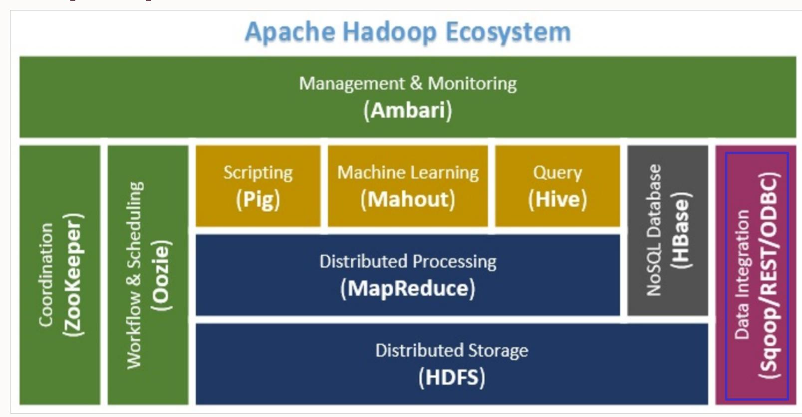
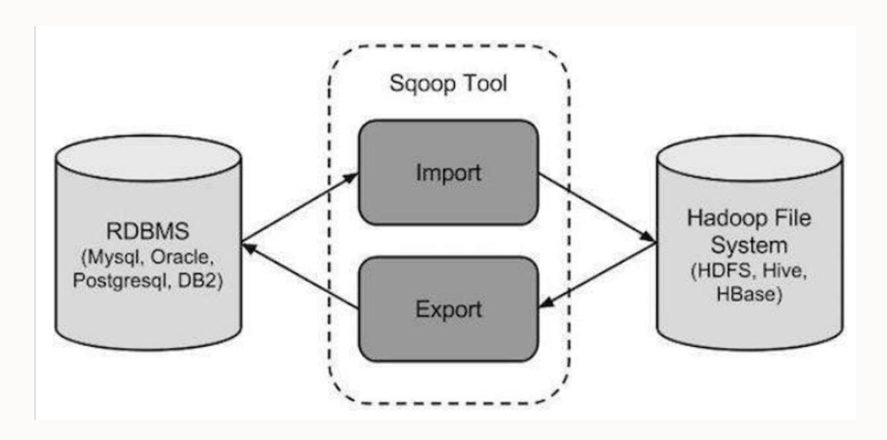
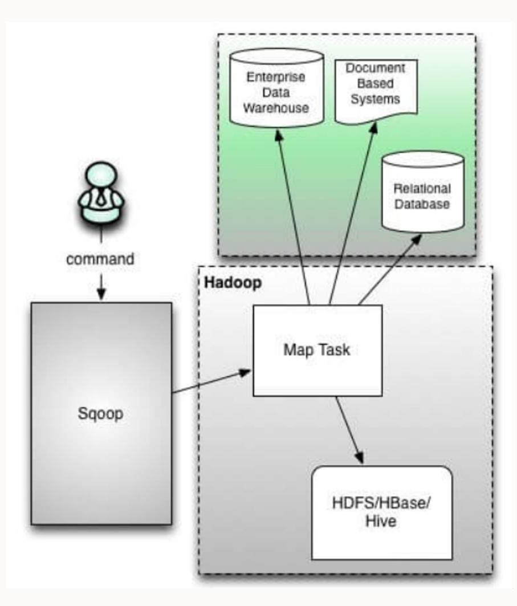
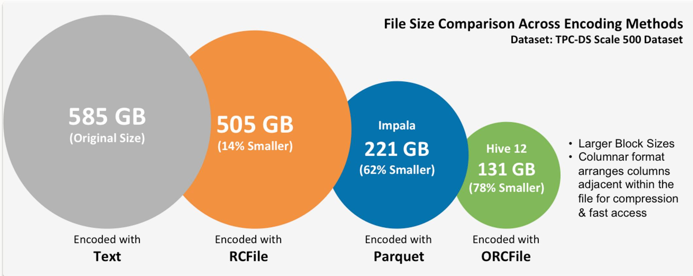

# SQOOP

Pertemuan 8 - Teknologi Perekayasaan Data

Politeknik Statistika STIS

Siti Mariyah, Ph.D


# Agenda Pertemuan


Apa itu Sqoop?

Format File di HDFS

Sqoop Import dan Export

Sqoop Jobs

# Apa itu Sqoop?



Sqoop – Tool yang didesain untuk transfer data antar sumber data baik terstruktur, semi-terstruktur, dan tidak terstruktur

# Apa itu Sqoop?



- Tool untuk melakukan import tabel dari RDBMS ke HDFS.
- Setiap baris pada tabel akan menjadi record pada HDFS.
- Semua record disimpan sebagai data dalam format text files atau sebagai binary (seperti Avro dan sequence files).
- Tool untuk melakukan export sejumlah file dari HDFS ke RDBMS.
- Input berupa record atau baris pada tabel yang dibaca dan di-*parse* ke dalam kumpulan record dan diberi delimiter sesuai dengan kebutuhan user.

**Sqoop simplifies the process of moving data between Hadoop and database systems**

# Apa itu Sqoop?



- Command line interface
- Java API

- **File system** adalah cara bagaimana file disimpan dan diatur pada sebuah sistem operasi, seperti NTFS pada Windows, HFS+ pada macOS, atau HDFS pada Hadoop
- **File format** adalah cara bagaimana data disimpan dalam sebuah file, seperti misalnya format file .docx untuk dokumen Microsoft Word atau .mp3 untuk file audio. Pada Hadoop, data/file formats yang berbeda digunakan oleh aplikasi Big Data yang berbeda seperti Spark, Hadoop, Hive, dan lainnya

### **Apa perbedaan File System dan File Format?**

#### Text/CSV Files

#### JSON Records

#### Avro Files

#### Sequence Files

- Tidak Support Block Compression
- Low read performance
- Metadata tidak tersimpan di file

- Tidak support block compression
- 3rd party tools untuk bisa digunakan di hadoop

- Menyimpan metadata di dalam data
- Support perubahan tipe data melalui independen skema
- Filesnya spittable, Support Block Compression, cukup mature
- Native Hadoop Ecosystem

- Data disimpan dalam bentuk binary dan memiliki struktur yang hampir mirip dengan CSV
- Metadata tidak disimpan ke dalam file
- Evolusi skema hanya berupa penambahan kolom
- Support Block Compression
- Digunakan dalam intermediate storage (MR Jobs) karena kekompleksitasannya

#### Record Columnar (RC) Files

#### ORC Files

#### Parquet Files

- First columnar file di Hadoop
- Significant compression
- Good query performance
- Tidak support evolusi skema (perlu rewrite)

- Compressed version dari RC Files
- Enhanced RC Files benefit
- Tidak support evolusi skema (perlu rewrite)
- Kompresi terkecil di hadoop

- Native columnar file Hadoop
- Good compression and query performance
- Cukup lambat dalam menulis dibanding non-columnar file formats
- Kolom baru dapat ditambahkan pada bagian akhir dari struktur yang telah ada



### Pertimbangan dalam Pemilihan Format File di HDFS

### Write Performance

### Partial Read Performance

### Full Read Performance

Seberapa cepat data dapat ditulis

Seberapa cepat individual kolom dalam file dapat dibaca

Seberapa cepat setiap elemen data pada file dapat dibaca

### Pertimbangan dalam Pemilihan Format File di HDFS

- ❑ **File-level compression:** kompresi dilakukan pada kes format file. Hal ini sama halnya ketika melakukan kompresi format seperti bzip2, LZO bersifat *splittable*.
- ❑ **Block-level compression:** kompresi terhadap individual Hal ini berarti file tetap *splittable* bahkan ketika kompresi *splittable*, seperti snappy. Dapat disimpulkan bahwa drastis dapat meningkatkan workload, terutama saat Spark yang seringkali hanya membaca segmen record termasuk pada kes format file.

# Fitur dari Sqoop

Full Load

Incremental Load

Parallel Import/Export

Import Results of SQL Query

Compression

Connector for all major RDBMS

Kerberos Security Integration

Load Data Directly Into Hive/HBase

Support for Accumulo

# Sqoop Import

| Id  | Name  | Salary | Department | Designation |
|-----|-------|--------|------------|-------------|
| 101 | John  | 5000   | IT         | Developer   |
| 102 | Chris | 6000   | Sales      | Manager     |
| 103 | Jamie | 7000   | Support    | Director    |

```
$ sqoop import \  
--connect jdbc:mysql://localhost/userdb \  
--username root \  
--table emp  
--m 1
```

# Sqoop Import

```
$ sqoop import \  
--connect jdbc:mysql://localhost/userdb \  
--username root \  
--table emp \  
--m 1 \  
--target-dir /rdbmsdata
```

```
$ sqoop import \  
--connect jdbc:mysql://localhost/userdb \  
--username root \  
--table emp \  
--m 1 \  
--where "Designation ='Manager'" \  
--target-dir /folderlocation
```

# Sqoop Import (Incremental Load)

- • **Incremental** – Mode like appended
- • **check-column** – based on which column you want to decide the incremental value
- • **last value** – What was the last value you imported so that it will take next value after that

| Id  | Name  | Salary | Department | Designation |
|-----|-------|--------|------------|-------------|
| 101 | John  | 5000   | IT         | Developer   |
| 102 | Chris | 6000   | Sales      | Manager     |
| 103 | Jamie | 7000   | Support    | Director    |

Last value for column Id

**104, Henning, 4000, IT, Developer**

# Sqoop Import

## Incremental Load

```
sqoop import \  
--connect jdbc:mysql://localhost/userdb \  
--username root \  
--table emp \  
--m 1 \  
--incremental append \  
--check-column id \  
--last-value 103
```

## Import All Tables

```
$ sqoop import-all-tables \  
--connect jdbc:mysql://localhost/emp_warehouse \  
--username root
```

# Sqoop Export

## Create table

```
USE empdb;
CREATE TABLE emp (id INT NOT NULL PRIMARY KEY, name VARCHAR(20),
designation VARCHAR(20), salary INT, department VARCHAR(10));
```

## Jalankan command sqoop export

```
sqoop export \
--connect jdbc:mysql://localhost/empdb \
--username root \
--table emp \
--export-dir /empdetails
```

# Sqoop Jobs

```
sqoop job -create firstjob \  
--import \  
--connect jdbc:mysql://localhost/empdb \  
--username root \  
--table emp --m 1
```

```
$ sqoop job --exec firstjob
```

| -create | Defines a new job with the specified job-id (name). Actual Sqoop import command should be separated by “-“ |
|---------|------------------------------------------------------------------------------------------------------------|
| -delete | Delete a saved job.                                                                                        |
| -exec   | Executes the saved job.                                                                                    |
| -show   | Show the save job configuration                                                                            |
| -list   | Lists all the saved jobs                                                                                   |

# Sqoop Commands

| codegen           | Generate code to interact with database          |
|-------------------|--------------------------------------------------|
| create-hive-table | Import a table definition into Hive              |
| eval              | Evaluate a SQL statement and display the results |
| export            | Export an HDFS directory to a database table     |
| help              | List available commands                          |
| import            | Import a table from a database to HDFS           |
| import-all-tables | Import tables from a database to HDFS            |
| job               | Work with saved jobs                             |
| list-databases    | List available databases on a server             |
| list-tables       | List available tables in a database              |
| merge             | Merge results of incremental imports             |
| metastore         | Run a standalone Sqoop metastore                 |
| version           | Display version information 19                   |

# Sqoop Import Command

```
% sqoop help import
```

```
usage: sqoop import [GENERIC-ARGS] [TOOL-ARGS]
```

Common arguments:

| --connect <jdbc-uri>  | Specify JDBC connect string               |
|-----------------------|-------------------------------------------|
| --driver <class-name> | Manually specify JDBC driver class to use |
| --hadoop-home <dir>   | Override \$HADOOP_HOME                    |
| --help                | Print usage instructions                  |
| -P                    | Read password from console                |
| --password <password> | Set authentication password               |
| --username <username> | Set authentication username               |
| --verbose             | Print more information while working      |
| ...                   |                                           |

# Sqoop Commands

\$ sqoop list-databases \ --connect jdbc:mysql://localhost/ \ --username root

\$ sqoop list-tables \ --connect jdbc:mysql://localhost/empdb \ --username root

# Sqoop Commands

\$ sqoop eval \ --connect jdbc:mysql://localhost/empdb \ --username root \ --query "SELECT \* FROM emp LIMIT 3"

\$ sqoop eval \ --connect jdbc:mysql://localhost/empdb \ --username root \ --query "INSERT INTO emp VALUES (105,'Raj','Sales',1500,'Google')"

# Contoh Import

## Buat tabel widgets

```
mysql> CREATE TABLE widgets(id INT NOT NULL PRIMARY KEY AUTO_INCREMENT,
  -> widget_name VARCHAR(64) NOT NULL,
  -> price DECIMAL(10,2),
  -> design_date DATE,
  -> version INT,
  -> design_comment VARCHAR(100));
Query OK, 0 rows affected (0.00 sec)mysql> INSERT INTO widgets VALUES (NULL, 'sprocket', 0.25, '2010-02-10',
  -> 1, 'Connects two gizmos');
Query OK, 1 row affected (0.00 sec)mysql> INSERT INTO widgets VALUES (NULL, 'gizmo', 4.00, '2009-11-30', 4,
  -> NULL);
Query OK, 1 row affected (0.00 sec)mysql> INSERT INTO widgets VALUES (NULL, 'gadget', 99.99, '1983-08-13',
  -> 13, 'Our flagship product');
Query OK, 1 row affected (0.00 sec)mysql> quit;
```

## Import tabel widgets ke HDFS

```
% sqoop import --connect jdbc:mysql://localhost/hadoopguide \
> --table widgets -m 1
...
14/10/28 21:36:23 INFO tool.CodeGenTool: Beginning code generation
...
14/10/28 21:36:28 INFO mapreduce.Job: Running job: job_1413746845532_0008
14/10/28 21:36:35 INFO mapreduce.Job: Job job_1413746845532_0008 running in
uber mode : false
14/10/28 21:36:35 INFO mapreduce.Job: map 0% reduce 0%
14/10/28 21:36:41 INFO mapreduce.Job: map 100% reduce 0%
14/10/28 21:36:41 INFO mapreduce.Job: Job job_1413746845532_0008 completed
successfully
...
14/10/28 21:36:41 INFO mapreduce.ImportJobBase: Retrieved 3 records.
```

Import Sqoop akan menjalankan tugas MapReduce yang terhubung ke basis data MySQL dan membaca tabel.

Secara default, Sqoop menggunakan empat tugas map secara paralel untuk mempercepat proses impor.

Setiap tugas akan menulis hasil impornya ke file yang berbeda, tetapi semuanya dalam direktori yang sama.

# Contoh Import

- • Import Sqoop akan menjalankan tugas MapReduce yang terhubung ke basis data MySQL dan membaca tabel.
- • Secara default, Sqoop **menggunakan empat tugas map secara paralel untuk mempercepat proses import.**
- • Setiap tugas akan menulis hasil impornya ke file yang berbeda, tetapi semuanya dalam direktori yang sama.
- • Karena kita tahu bahwa kita hanya memiliki tiga baris untuk diimpor, kita menentukan bahwa Sqoop harus menggunakan satu tugas map (-m 1) sehingga kita mendapatkan satu file di HDFS.

## Import tabel widgets ke HDFS

```
% sqoop import --connect jdbc:mysql://localhost/hadoopguide \
> --table widgets -m 1
...
14/10/28 21:36:23 INFO tool.CodeGenTool: Beginning code generation
...
14/10/28 21:36:28 INFO mapreduce.Job: Running job: job_1413746845532_0008
14/10/28 21:36:35 INFO mapreduce.Job: Job job_1413746845532_0008 running in
uber mode : false
14/10/28 21:36:35 INFO mapreduce.Job: map 0% reduce 0%
14/10/28 21:36:41 INFO mapreduce.Job: map 100% reduce 0%
14/10/28 21:36:41 INFO mapreduce.Job: Job job_1413746845532_0008 completed
successfully
...
14/10/28 21:36:41 INFO mapreduce.ImportJobBase: Retrieved 3 records.
```


# . Contoh Membaca Hasil Import

```
% hadoop fs -cat widgets/part-m-00000  
1,sprocket,0.25,2010-02-10,1,Connects two gizmos  
2,gizmo,4.00,2009-11-30,4,null  
3,gadget,99.99,1983-08-13,13,Our flagship product
```

# Terima kasih