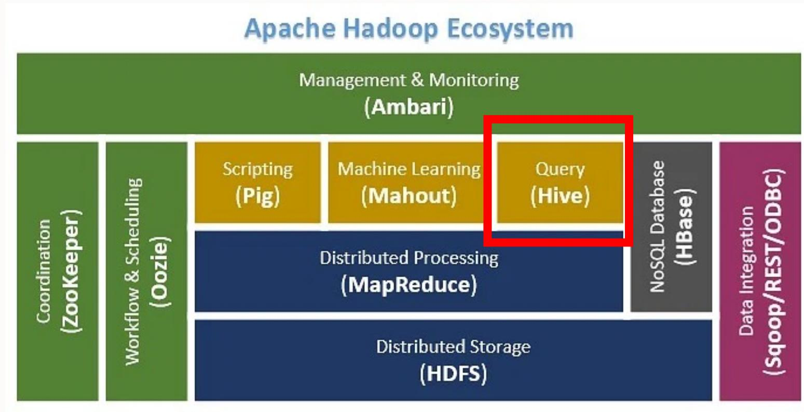
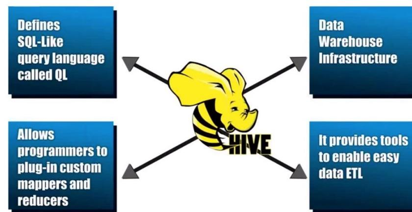
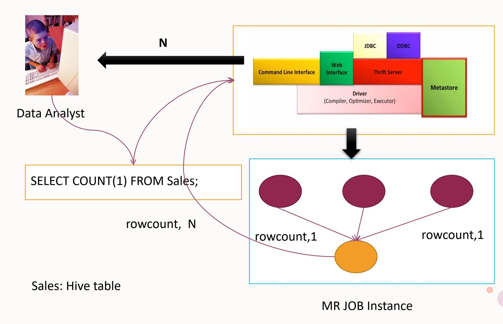
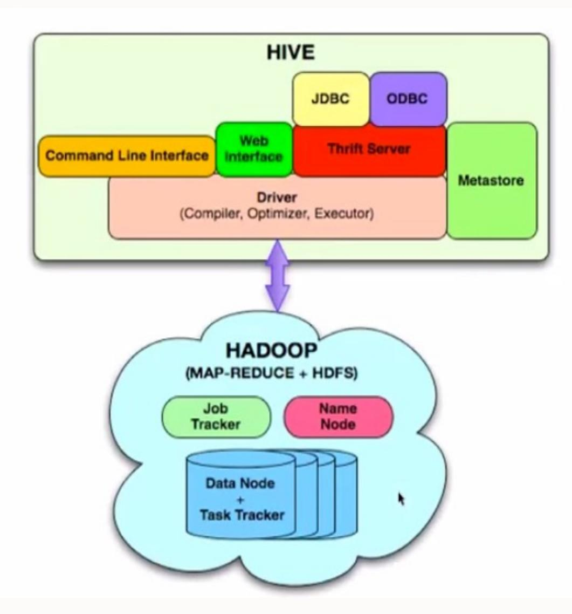
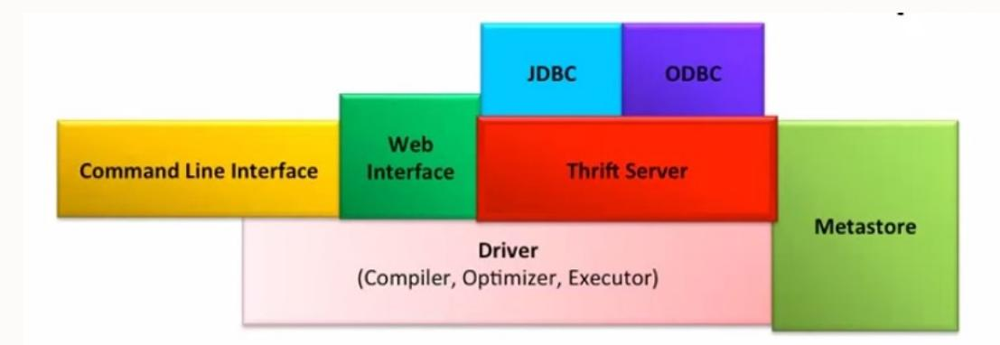
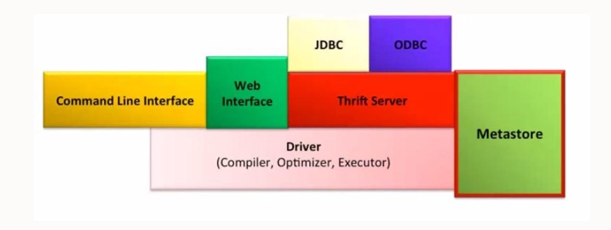
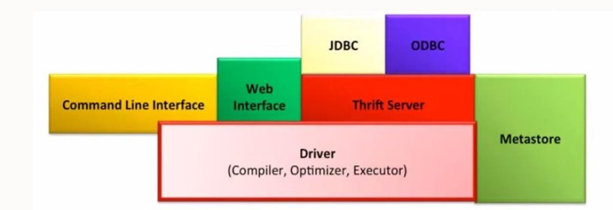
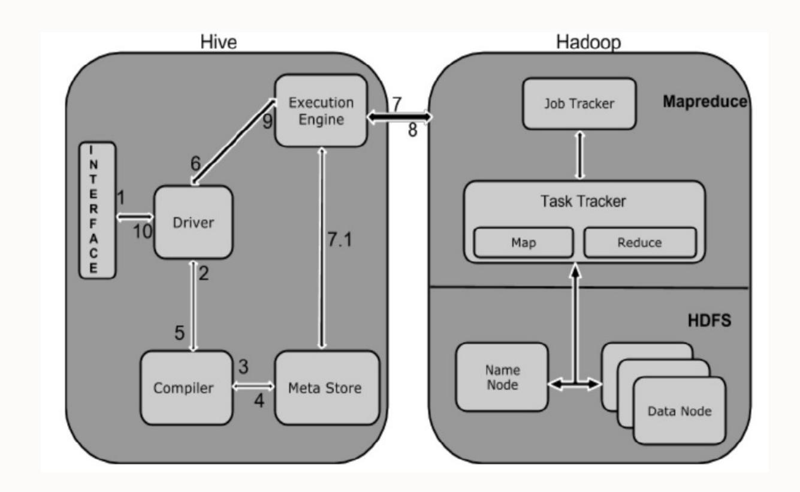
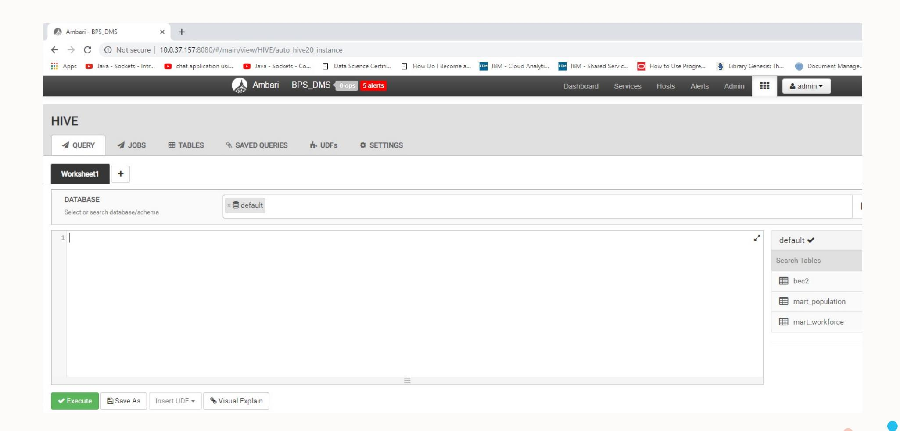
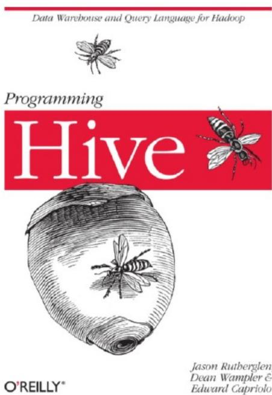

## HIVE

Pertemuan 9 - Teknologi Perekayasaan Data

Politeknik Statistika STIS

Siti Mariyah, Ph.D


## Agenda Pertemuan


**Apa itu Hive?**

**Arsitektur Hive**

**Cara Kerja Hive**

**Hive Query Languange**

# HIVE pada Hadoop



HIVE – Query Builder of Apache Hadoop

## Apa itu Hive ?

**Hive** adalah sistem untuk mengelola dan membuat *query* data terstruktur yang dibangun di atas Hadoop.

q Menggunakan Map Reduce untuk eksekusi job q Menggunakan HDFS untuk penyimpanan q Dapat diperluas ke repositori data lainnya

Awalnya Hive dikembangkan oleh Facebook, kemudian Apache Software Foundation mengambilnya dan dikembangkan lebih lanjut sebagai open source di bawah nama Apache Hive.

# Hive

Hive memungkinkan analisis yang familiar dengan SQL untuk meng-*query* data yang disimpan pada HDFS dengan menggunakan HiveQL

Hive berjalan di atas Hadoop untuk melakukan ekstraksi data dan mempermudah proses *query* dan analisis data

Hive mentransformasi *query* HiveQL ke job MapReduce

Hive tidak menyediakan record-level update maupun delete

*High latency* (waktu antara mengirimkan queri dan menerima hasilnya) - Hive kurang cocok untuk aplikasi yang membutuhkan waktu respon yang sangat cepat

## Hive BUKAN…

Relational Database

Didesain untuk OLTP (Online Transaction Processing)

Digunakan untuk pemrosesan yang real-time dan update pada low level

**Apache Hive is a data warehouse system for Apache Hadoop**

## Fitur Hive

- Menyimpan skema database dan memproses data di HDFS
- Didesain untuk OLAP (Online Analytical Processing)
- Menyediakan bahasa sejenis dengan SQL untuk melakukan *query* dengan nama HiveQL atau HQL
- Sehingga memudahkan pengguna dengan fitur yang familiar, cepat, *scalable* dan *extensible*



## HiveQL ke Map Reduce



## Arsitektur Hive



- **External Interfaces**  CLI, WebUI, JDBC, ODBC programming interfaces
- **Thrift Server**  Cross Language service framework .
- **Metastore** Metadata about the Hive tables, partitions
- **Driver** Brain of Hive! Compiler, Optimizer and Execution engine

## Hive Thrift Server



q Framework for cross language services q Server written in Java q Support for clients written in different languages Ø JDBC(java), ODBC(C++), PHP, Perl, Python scripts

## Metastore



q System catalog which contains metadata about the Hive tables q Stored in RDBMS/local fs. HDFS too slow(not optimized for random access) q Objects of Metastore Ø Database – Namespace of tables Ø Table – List of columns, types, owner, storage, SerDes Ø Partition – Partition specific column, Serdes and storage

## Hive Driver



q **Driver** – Maintains the lifecycle of HiveQL statement q **Query Compiler** – Compiles HiveQL in a DAG of map reduce tasks q **Executor** – Executes the tasks plan generated by the compiler in proper dependency order. Interacts with the underlying Hadoop instance

## Cara Kerja Hive



- The conjunction part of HiveQL process Engine and MapReduce is Hive Execution Engine. Execution engine processes the query and generates results as same as MapReduce results. It uses the flavor of MapReduce.

## Cara Kerja Hive (2)

### **1. Execute Query**

The Hive interface such as Command Line or Web UI sends query to Driver (any database driver such as JDBC, ODBC, etc.) to execute.

### **2. Get Plan**

The driver takes the help of query compiler that parses the query to check the syntax and query plan or the requirement of query.

### **3. Get Metadata**

The compiler sends metadata request to Metastore (any database).

### **4. Send Metadata**

Metastore sends metadata as a response to the compiler.

## Cara Kerja Hive (3)

### **5. Send Plan**

The compiler checks the requirement and resends the plan to the driver. Up to here, the parsing and compiling of a query is complete.

### **6. Execute Plan**

The driver sends the execute plan to the execution engine.

### **7. Execute Job**

Internally, the process of execution job is a MapReduce job. The execution engine sends the job to JobTracker, which is in Namenode and it assigns this job to TaskTracker, which is in Data node.

Here, the query executes MapReduce job.

## Cara Kerja Hive (4)

### **7.1. Metadata Ops**

Meanwhile in execution, the execution engine can execute metadata operations with Metastore.

### **8. Fetch Result**

The execution engine receives the results from Data nodes.

### **9. Send Results**

The execution engine sends those resultant values to the driver.

### **10. Send Results**

The driver sends the results to Hive Interfaces.

## Menjalankan Hive via Ambari



# Menjalankan Hive via CLI


## Hive Query Language (HQL)

### • **DDL**:

CREATE DATABASE

CREATE TABLE

ALTER TABLE

SHOW TABLE

DESCRIBE

### • **DML**:

LOAD TABLE

INSERT

#### **QUERY**:

SELECT

GROUP BY

JOIN

MULTI TABLE INSERT

# HiveQL : Data Definition

- • Create Database

```
hive> CREATE DATABASE IF NOT EXISTS financials;
```

```
hive> CREATE DATABASE financials
> LOCATION '/my/preferred/directory';
```

```
hive> CREATE DATABASE financials
> COMMENT 'Holds all financial tables';
```

```
hive> CREATE DATABASE financials
> WITH DBPROPERTIES ('creator' = 'Mark Moneybags', 'date' = '2012-01-02');
```

```
hive> DESCRIBE DATABASE EXTENDED financials;
financials   hdfs://master-server/user/hive/warehouse/financials.db
{date=2012-01-02, creator=Mark Moneybags};
```

## HiveQL : Data Definition (2)

- • Use Database

```
hive> USE financials;
```

```
hive> set hive.cli.print.current.db=true;
```

```
hive (financials)> USE default;
```

```
hive (default)> set hive.cli.print.current.db=false;
```

```
hive> ...
```


- • **Managed Table**

- Tabel yang data dan metadatanya diatur oleh Hive
- Data akan ditempatkan di folder yang diberi nama sesuai tabel di dalam warehouse Hive, yang pada dasarnya merupakan suatu lokasi file di HDFS
- Jika managed table dihapus, Hive akan menghapus schema (deskripsi tabel) dan file data yang terkait dengan tabel tersebut

- • **External Table**

- Tabel dimana hanya schema tabel yang dikelola oleh Hive
- Saat tabel external table dihapus, Hive hanya akan menghapus schema yang terkait dengan tabel tersebut. File data tidak akan terpengaruh.
- Dalam kebanyakan kasus penggunaan external table, pengguna akan membuat/mengatur lokasi folder dalam HDFS dan menyalin file-file data di sana (tidak terpencar-pencar)

## HiveQL : Data Definition (3)

- Create Table

```
CREATE TABLE IF NOT EXISTS mydb.employees (
    name           STRING COMMENT 'Employee name',
    salary          FLOAT COMMENT 'Employee salary',
    subordinates ARRAY<STRING> COMMENT 'Names of subordinates',
    deductions MAP<STRING, FLOAT>
                        COMMENT 'Keys are deductions names, values are percentages',
    address         STRUCT<street:STRING, city:STRING, state:STRING, zip:INT>
                        COMMENT 'Home address')
COMMENT 'Description of the table'
TBLPROPERTIES ('creator'='me', 'created_at'='2012-01-02 10:00:00', ...)
LOCATION '/user/hive/warehouse/mydb.db/employees';
```

## HiveQL : Data Definition (3)

- • Create Managed Table dan External Table

```
CREATE TABLE IF NOT EXISTS stocks (exchange STRING,
symbol STRING,
price_open FLOAT,
price_high FLOAT,
price_low FLOAT,
price_adj_close FLOAT)
ROW FORMAT DELIMITED FIELDS TERMINATED BY ',' ;
```

```
CREATE EXTERNAL TABLE IF NOT EXISTS stocks (exchange STRING,
symbol STRING,
price_open FLOAT,
price_high FLOAT,
price_low FLOAT,
price_adj_close FLOAT)
ROW FORMAT DELIMITED FIELDS TERMINATED BY ','
LOCATION '/data/stocks';
```

## HiveQL : Data Definition (4)

### • Partition

```
CREATE TABLE employees (
  name                             STRING,
  salary                            FLOAT,
  subordinates   ARRAY<STRING>,
  deductions   MAP<STRING, FLOAT>,
  address                           STRUCT<street:STRING, city:STRING, state:STRING, zip:INT>
)
PARTITIONED BY (country STRING, state STRING);
```

```
...
.../employees/country=CA/state=AB
.../employees/country=CA/state=BC
...
.../employees/country=US/state=AL
.../employees/country=US/state=AK
...
```

## HiveQL : Data Definition (5)

```
hive> set hive.mapred.mode=strict;hive> SELECT e.name, e.salary FROM employees e LIMIT 100;
FAILED: Error in semantic analysis: No partition predicate found for
    Alias "e" Table "employees"hive> set hive.mapred.mode=nonstrict;hive> SELECT e.name, e.salary FROM employees e LIMIT 100;
```

```
hive> SHOW PARTITIONS employees;
...
Country=CA/state=AB
country=CA/state=BC
...
country=US/state=AL
country=US/state=AK
...
```

## HiveQL : Data Definition (6)

```
hive> SHOW PARTITIONS employees PARTITION(country='US');
country=US/state=AL
country=US/state=AK
...
```

```
hive> SHOW PARTITIONS employees PARTITION(country='US', state='AK');
country=US/state=AK
```

# HiveQL – Data Manipulation

- • Insert Data

```
INSERT OVERWRITE TABLE employees
PARTITION (country = 'US', state = 'OR')
SELECT * FROM staged_employees se
WHERE se.cnty = 'US' AND se.st = 'OR';
```

```
CREATE TABLE ca_employees
AS SELECT name, salary, address
FROM employees
WHERE se.state = 'CA';
```

## HiveQL – Data Manipulation (2)

- • Like

```
hive> SELECT name, address.street FROM employees WHERE address.street LIKE '%Ave.';
John Doe           1 Michigan Ave.
Todd Jones        200 Chicago Ave.
```

```
hive> SELECT name, address.street
                          > FROM employees WHERE address.street RLIKE '.*(Chicago|Ontario).*';
Mary Smith|           100 Ontario St.
Todd Jones           200 Chicago Ave.
```

```
SELECT name, address FROM employees
WHERE address.street LIKE '%Chicago%' OR address.street LIKE '%Ontario%';
```

## HiveQL – Data Manipulation (3)

- Order By dan Sort By

```
SELECT s.ymd, s.symbol, s.price_close
FROM stocks s
ORDER BY s.ymd ASC, s.symbol DESC;
```

```
SELECT s.ymd, s.symbol, s.price_close
FROM stocks s
SORT BY s.ymd ASC, s.symbol DESC;
```

## HiveQL – Data Manipulation (4)

- • Distributed By dan Sort By

```
hive> SELECT s.ymd, s.symbol, s.price_close
> FROM stocks s
> DISTRIBUTE BY s.symbol
> SORT BY  s.symbol ASC, s.ymd ASC;
```

# HiveQL – Data Manipulation (5)

- • Cluster By

```
hive> SELECT s.ymd, s.symbol, s.price_close
> FROM stocks s
> CLUSTER BY s.symbol;
```

## HiveQL – Data Manipulation (6)

- • Query dengan Sampel Data

```
SELECT *  
FROM source TABLESAMPLE(0.1 PERCENT) s;
```

# HiveQL – Data Manipulation (7)

- • View Data

```
hive> CREATE VIEW techops_employee AS
> SELECT firstname,lastname,ssn FROM userinfo WERE department='techops';
```

## Kelebihan Hive

- Digunakan oleh Data Analysts
- Lebih mudah dipelajari
- Proses yang transparan di atas Map-Reduce
- Partitions(speed!)
- Fleksibel untuk load data dari dan ke HDFS ke Tabel Hive

# TERIMA KASIH

## Referensi

- http://tusharkute.com
- https://cwiki.apache.org/confluence/display/Hive/Home
- https://cwiki.apache.org/confluence/display/Hive/Presentations
- https://hive.apache.org/



## Terima kasih